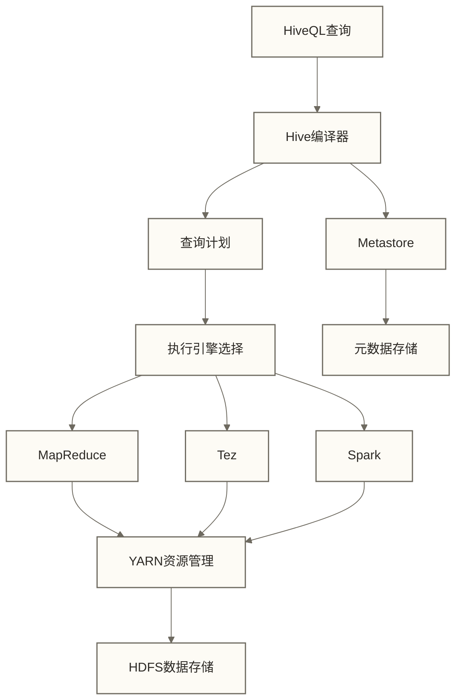
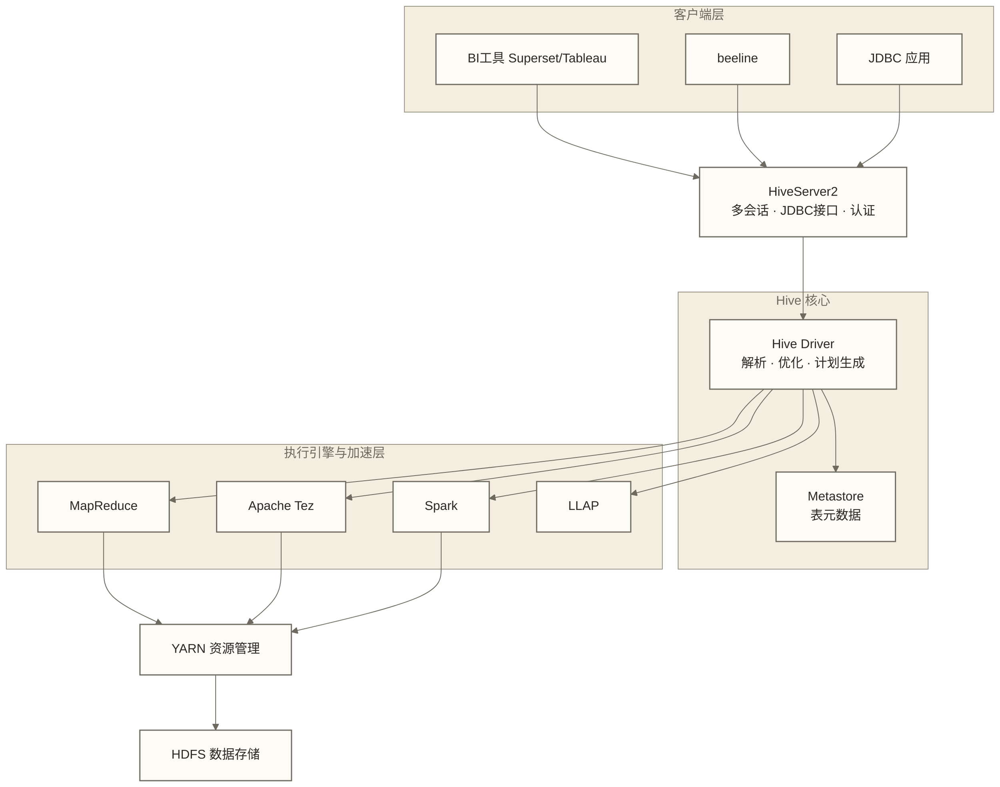

# 🏢 Hive数据仓库 - Hadoop生态中的SQL引擎

> [!abstract] 📋 本节概览
> - 🎯 **学习目标**：理解Hive在Hadoop生态中的定位、架构和核心设计
> - 📚 **前置知识**：[[【技术与工具】/Hadoop/09-YARN资源管理架构|YARN资源管理]] | [[【技术与工具】/Hadoop/03-HDFS分布式文件系统|HDFS分布式文件系统]]
> - ⏱️ **预计用时**：60分钟
> - 🔧 **技术重点**：Hive架构、Metastore 三种模式、执行引擎对比、HiveServer2、关键参数

> [!note] 📖 深入学习指引
> 本文重点介绍Hive在Hadoop生态中的角色和架构全貌。HiveQL语法、分区/桶表设计、性能调优等内容，请参考：
> - **Hive学习路线图** - 完整的Hive学习体系
> - **Hive架构与原理** - 深入的架构原理
> - **HiveQL语法详解** - 完整的语法参考

## 🎯 Hive在Hadoop生态中的定位

### 核心价值

> [!note] 💡 Hive就像大数据的SQL翻译官
> 想象你是一个只会说中文的游客，要在外国点餐：
> - **传统方式**：学习当地语言（MapReduce编程）
> - **Hive方式**：找个翻译（Hive），用中文点餐（SQL），翻译帮你和服务员交流

**在Hadoop生态中的作用**：
- **数据访问层**：为HDFS上的数据提供SQL接口，降低大数据使用门槛
- **数据仓库层**：构建企业级数据仓库的基础，支持分层建模（ODS/DWD/DWS/ADS）
- **ETL 处理**：数据抽取、转换、加载的重要工具
- **元数据中心**：Metastore 为整个 Hadoop 生态（Spark、Presto、Flink 等）提供统一表元数据服务

### Hive vs 传统关系数据库

Hive 虽然使用 SQL 语法，但本质上是一个**批处理计算框架**，与 MySQL/Oracle 等 OLTP 数据库有根本性差异：

下表仅用于比较离线分析与在线事务处理的常见倾向；规模、延迟和并发数字为原稿未核实的示意，不是产品能力上限，事务、校验和扩展能力也需结合版本与配置判断。

| 维度 | Hive | 传统关系数据库（MySQL/Oracle） |
|---|---|---|
| **设计目标** | 大规模批量数据分析（OLAP） | 事务性在线处理（OLTP） |
| **数据规模** | PB 级，数十亿行 | GB 到 TB 级，数千万行 |
| **查询延迟** | 分钟级到小时级 | 毫秒级到秒级 |
| **并发能力** | 低并发（数十个并发查询） | 高并发（数千个并发连接） |
| **事务支持** | 有限（ACID 支持较弱，依赖 ORC） | 完整 ACID 事务 |
| **Schema** | Schema-on-Read（写时不校验） | Schema-on-Write（写时严格校验） |
| **扩展方式** | 水平扩展（加节点） | 垂直扩展（加硬件）为主 |
| **数据修改** | 不擅长行级 UPDATE/DELETE | 高效行级增删改 |
| **适用场景** | 离线数仓、ETL、大规模报表 | 业务系统、实时交易、点查询 |

---

## 🏗️ Hive与Hadoop组件集成

### 核心架构



### 与Hadoop组件的关系

| 组件 | 集成关系 | 作用 |
|---|---|---|
| **HDFS** | 数据存储 | 存储表数据文件和分区 |
| **YARN** | 资源管理 | 管理查询执行的计算资源 |
| **MapReduce** | 执行引擎 | 默认的查询执行引擎 |
| **Zookeeper** | 服务协调 | HiveServer2高可用性支持 |

---

## 📊 Metastore 元数据管理

### Metastore 的核心价值

> [!note] Metastore 是 Hive 的大脑，也是 Hadoop 生态的元数据中枢
> - **存储内容**：表结构、列类型、分区信息、数据文件在 HDFS 的存储位置、数据格式（ORC/Parquet/Text）
> - **管理功能**：维护表、分区及 Schema 等元数据；完整的数据血缘追踪和统一权限治理需要额外组件或集成，不能仅依赖 Metastore
> - **生态价值**：Spark SQL、Presto/Trino、Flink SQL 等都可以连接 Hive Metastore，共享表定义，实现多引擎访问同一份数据

### Metastore 三种部署模式

Hive Metastore 有三种部署模式，适用于不同规模和需求的环境：

| 模式 | 架构 | 适用场景 | 优点 | 缺点 |
|---|---|---|---|---|
| **内嵌模式（Embedded）** | Metastore 服务和 Hive 客户端在同一 JVM，使用内置 Derby 数据库 | 本地开发、快速测试 | 零配置，开箱即用 | 不支持多用户并发，Derby 不适合生产 |
| **本地模式（Local）** | Metastore 服务与 Hive 客户端同 JVM，但使用外部 MySQL/PostgreSQL | 单节点生产或小团队 | 配置简单，支持多用户 | 每个 Hive 客户端都直连数据库，连接数多 |
| **远程模式（Remote）** | Metastore 作为独立服务（thrift server）运行，Hive 客户端通过 thrift 连接 | 企业生产环境 | 数据库只对 Metastore 服务开放，安全性高；多客户端共享连接池 | 需要单独维护 Metastore 服务进程 |

**远程模式配置示例（生产环境推荐）**：

```xml title="hive-site.xml - 远程 Metastore 配置（客户端侧）"
<configuration>
    <!-- 远程 Metastore 服务地址 -->
    <property>
        <name>hive.metastore.uris</name>
        <value>thrift://metastore-host:9083</value>
    </property>

    <!-- 数据仓库根目录 -->
    <property>
        <name>hive.metastore.warehouse.dir</name>
        <value>/user/hive/warehouse</value>
    </property>
</configuration>
```

```xml title="hive-site.xml - Metastore 服务端配置"
<configuration>
    <!-- MySQL 元数据库连接 -->
    <property>
        <name>javax.jdo.option.ConnectionURL</name>
        <value>jdbc:mysql://mysql-host:3306/hive_metastore?createDatabaseIfNotExist=true&amp;useSSL=false</value>
    </property>

    <property>
        <name>javax.jdo.option.ConnectionDriverName</name>
        <value>com.mysql.jdbc.Driver</value>
    </property>

    <property>
        <name>javax.jdo.option.ConnectionUserName</name>
        <value>hive</value>
    </property>

    <property>
        <name>javax.jdo.option.ConnectionPassword</name>
        <value>hive_password</value>
    </property>
</configuration>
```

---

## 🖥️ HiveServer2 - 多客户端并发访问

### HiveServer2 的作用

HiveServer2（HS2）是 Hive 对外提供服务的接入层，解决了早期 HiveServer1 不支持多客户端并发连接的问题：

- **JDBC/ODBC 接口**：BI 工具（Tableau、Superset）、数据库客户端通过标准 JDBC 连接 Hive
- **并发会话管理**：支持多用户同时提交查询，每个连接有独立的会话上下文
- **认证与权限**：集成 Kerberos 认证和 Ranger 权限控制
- **查询代理**：接收客户端 HiveQL，转发给执行引擎，返回结果



```bash title="通过 beeline 连接 HiveServer2"
# 基本连接（无认证）
beeline -u "jdbc:hive2://hiveserver2-host:10000/default"

# 指定用户名
beeline -u "jdbc:hive2://hiveserver2-host:10000/default" -n hive_user

# Kerberos 认证连接
beeline -u "jdbc:hive2://hiveserver2-host:10000/default;principal=hive/_HOST@REALM"
```

---

## ⚡ 执行引擎对比

Hive 的执行引擎支持范围取决于版本、发行版及已安装组件；下表介绍 MapReduce、Tez、Spark 的历史或适用环境中的执行方式，并列出通常与 Tez 配合的 LLAP 加速层。仅在环境支持且允许修改参数时，才可在会话级别切换执行引擎：

以下延迟及“2-10 倍”数字为原稿未核实的示意值，未提供数据规模、硬件、查询集或基准测试条件，不构成性能承诺；Spark 行也不能直接等同于独立 Spark SQL 的全部能力。

| 执行引擎或加速层 | 执行模型 | 原稿未核实的延迟示意 | 适用场景 | 优势 | 劣势 |
|---|---|---|---|---|---|
| **MapReduce** | 磁盘 Map-Shuffle-Reduce | 分钟级到小时级 | 超大数据量离线批处理 | 最成熟稳定，内存压力小 | 大量磁盘 I/O，速度慢 |
| **Apache Tez** | DAG（有向无环图）内存计算 | 秒级到分钟级 | 复杂 ETL、多 Stage 查询 | 比 MR 快 2-10 倍，避免冗余 Map-Reduce | 调试复杂度高于 MR |
| **Spark** | RDD/DataFrame 内存计算 | 秒级到分钟级 | 迭代计算、机器学习特征工程 | 内存利用率高，SQL 优化器强 | 内存需求大，依赖 Spark 集群 |
| **LLAP** | 持久化守护进程 + 列式缓存 | 亚秒级到秒级 | 交互式 BI 查询、重复查询 | 极低延迟，热数据缓存命中率高 | 资源常驻消耗，配置复杂 |

```xml title="hive-site.xml - 配置默认执行引擎"
<!-- hive-site.xml 默认执行引擎 -->
<property>
    <name>hive.execution.engine</name>
    <value>tez</value>  <!-- mr / tez / spark -->
</property>
```

```sql
-- 也可以在 SQL 会话中临时切换
SET hive.execution.engine=spark;
SELECT COUNT(*) FROM large_table WHERE dt='2024-01-01';
```

### Hive on LLAP（交互式分析加速）

LLAP（Live Long and Process，常称 Long Lived and Process）是 Hive 的交互式查询加速层，通常与 Tez 配合使用，并非独立的 hive.execution.engine 取值；其目标是降低交互式查询延迟，实际效果取决于部署、缓存与查询负载：

**LLAP 的核心机制**：
1. **持久化守护进程**：LLAP Daemon 常驻在已配置的工作节点，可复用 JVM 执行查询任务，减少相关容器启动开销；不代表整个查询无需申请或启动其他 YARN Container
2. **列式内存缓存**：热数据以列式格式缓存在内存中，重复查询直接命中缓存，无需读取 HDFS
3. **向量化执行**：批量处理数据行（1024 行/批），减少函数调用开销
4. **细粒度资源管理**：与 YARN 结合，支持查询级别的资源配额和优先级

```xml title="hive-site.xml - 启用 LLAP"
<property>
    <name>hive.execution.engine</name>
    <value>tez</value>
</property>
<property>
    <name>hive.llap.execution.mode</name>
    <value>all</value>  <!-- all: 全部走 LLAP；none: 不用 LLAP；auto: 自动选择 -->
</property>
```

> [!tip] 选型建议：大规模 T+1 离线 ETL 用 Tez（成熟稳定）；需要与 Spark 生态深度集成选 Spark 引擎；有交互式 BI 查询需求且不想引入 Presto/Trino 的团队可以考虑 LLAP；生产环境通常不再用 MapReduce 引擎。

---

## 🔄 数据处理流程

### 典型ETL场景

```sql
-- 示例：日志数据处理流程
-- 1. 创建外部表指向原始日志
CREATE EXTERNAL TABLE raw_logs (
    timestamp STRING,
    user_id STRING,
    action STRING,
    details STRING
)
LOCATION '/data/raw/logs/';

-- 2. 创建清洗后的分区表
CREATE TABLE clean_logs (
    user_id STRING,
    action STRING,
    event_time TIMESTAMP
)
PARTITIONED BY (dt STRING)
STORED AS ORC;

-- 3. ETL处理
INSERT OVERWRITE TABLE clean_logs PARTITION (dt='2024-01-01')
SELECT 
    user_id,
    action,
    CAST(from_unixtime(unix_timestamp(timestamp, 'yyyy-MM-dd HH:mm:ss')) AS TIMESTAMP)
FROM raw_logs
WHERE substr(timestamp, 1, 10)='2024-01-01' AND user_id IS NOT NULL;
```

---

## ⚡ 性能考虑与关键参数

### 存储格式选择

| 格式 | 存储类型 | 压缩率 | 适用场景 |
|---|---|---|---|
| **TextFile** | 行式文本，可配置压缩 | 未压缩时低，压缩后取决于编码器与数据 | 数据导入/导出中间层，未压缩时易读 |
| **ORC** | 列式，内置压缩+索引 | 高 | Hive 首选，写入快，支持 ACID |
| **Parquet** | 列式，Snappy/Gzip | 高 | Spark/Presto 生态互操作 |
| **Avro** | 行式，支持 Schema 演进 | 中 | Kafka 数据落盘、Schema 频繁变更 |

生产环境数仓层（DWD/DWS）可将 **ORC + Snappy** 压缩作为候选方案；是否适合应结合数据特征、读写负载及引擎兼容性测试，不能据此认定其在所有环境中取得最佳平衡。

### 关键参数说明

| 参数名 | 默认值 | 说明 |
|---|---|---|
| `hive.execution.engine` | mr | 执行引擎：mr / tez / spark |
| `hive.exec.parallel` | false | 是否并行执行无依赖的 Stage（设为 true 可显著提升多 Stage 查询速度） |
| `hive.exec.parallel.thread.number` | 8 | 并行 Stage 的最大并发数 |
| `hive.auto.convert.join` | true | 自动将小表 JOIN 转换为 Map Join（广播 Join），避免 Reduce 侧 Shuffle |
| `hive.mapjoin.smalltable.filesize` | 25000000（25MB） | 触发 Map Join 的小表大小阈值 |
| `hive.merge.mapfiles` | true | Map 任务输出合并小文件 |
| `hive.merge.mapredfiles` | false | MapReduce 输出合并小文件（建议开启） |
| `hive.merge.size.per.task` | 256MB | 合并后每个文件的目标大小 |
| `hive.exec.dynamic.partition` | true | 允许动态分区 |
| `hive.exec.dynamic.partition.mode` | strict | strict 模式要求至少一个静态分区；nonstrict 允许全动态分区 |
| `hive.tez.container.size` | -1（继承 MR 配置） | Tez Container 内存大小（MB） |
| `hive.vectorized.execution.enabled` | true | 开启向量化执行（批量处理，显著提升 ORC 格式查询性能） |

```xml title="hive-site.xml - 生产环境常用优化参数"
<configuration>
    <!-- 执行引擎：生产推荐 Tez -->
    <property>
        <name>hive.execution.engine</name>
        <value>tez</value>
    </property>

    <!-- 并行执行无依赖 Stage -->
    <property>
        <name>hive.exec.parallel</name>
        <value>true</value>
    </property>
    <property>
        <name>hive.exec.parallel.thread.number</name>
        <value>16</value>
    </property>

    <!-- 自动 Map Join（广播小表） -->
    <property>
        <name>hive.auto.convert.join</name>
        <value>true</value>
    </property>
    <property>
        <name>hive.mapjoin.smalltable.filesize</name>
        <value>67108864</value>  <!-- 64MB -->
    </property>

    <!-- 合并小文件 -->
    <property>
        <name>hive.merge.mapredfiles</name>
        <value>true</value>
    </property>
    <property>
        <name>hive.merge.size.per.task</name>
        <value>268435456</value>  <!-- 256MB -->
    </property>

    <!-- 动态分区 -->
    <property>
        <name>hive.exec.dynamic.partition</name>
        <value>true</value>
    </property>
    <property>
        <name>hive.exec.dynamic.partition.mode</name>
        <value>nonstrict</value>
    </property>

    <!-- Tez Container 大小 -->
    <property>
        <name>hive.tez.container.size</name>
        <value>4096</value>
    </property>
</configuration>
```

---

## 🔗 学习路径

### 下一步学习建议

1. **Hive学习路线图** - 系统学习Hive技术栈
2. **Spark** - 学习现代计算引擎
3. **SQL** - 巩固SQL基础
4. **[[【技术与工具】/Hadoop/11-YARN集群管理|YARN集群]]** - 深入资源管理

### 实践项目建议

- 搭建Hive on Hadoop环境
- 设计数据仓库分层架构
- 实现复杂ETL流程
- 对比不同执行引擎性能

---

> [!tip] 💡 关键收获
> - Hive是Hadoop生态系统中的SQL接口层
> - 通过Metastore为整个生态提供元数据服务
> - 支持多种执行引擎，与YARN深度集成
> - 是构建数据仓库和ETL流程的重要工具 