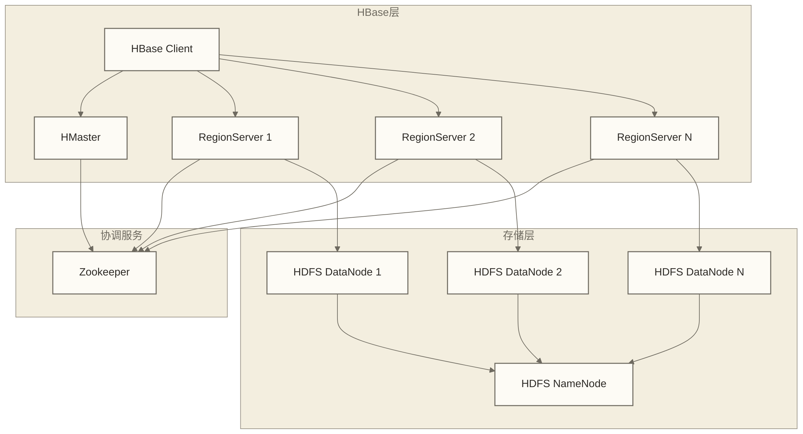
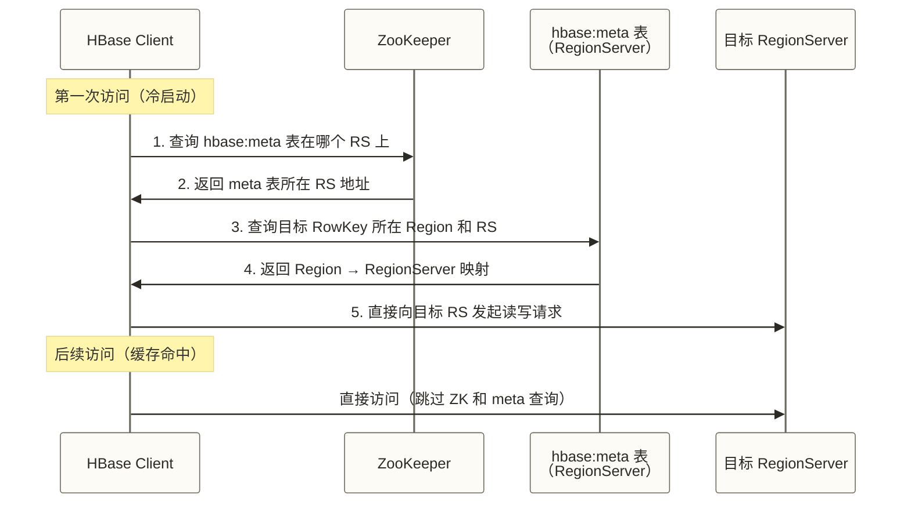
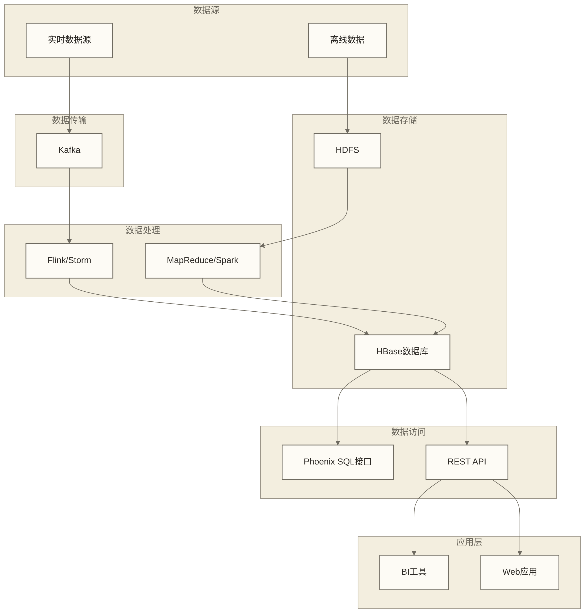

# 📚 HBase NoSQL数据库 - Hadoop生态中的实时存储

> [!abstract] 📋 学习目标
> - 🎯 **理解定位**：掌握HBase在Hadoop生态中的作用
> - 💾 **架构认知**：了解HBase与HDFS、Zookeeper的集成
> - 🔧 **应用场景**：理解HBase适用的业务场景
> - 📊 **性能特点**：掌握HBase的性能优势和限制

> [!note] 📖 深入学习指引
> 本文重点介绍HBase在Hadoop生态中的角色。详细的数据模型、API操作、性能调优等内容，请参考：
> - **[[【技术与工具】/HBase/00-HBase学习路线图|HBase]]** - 完整的HBase学习体系
> - **HBase架构与原理** - 深入的架构原理
> - **HBase数据模型** - 详细的数据模型设计
> - **HBase开发实战** - 实际开发操作指南

> [!tip] 💡 前置知识
> 建议先学习 [[【技术与工具】/Hadoop/03-HDFS分布式文件系统|HDFS分布式文件系统]] 和 [[【技术与工具】/Hadoop/09-YARN资源管理架构|YARN资源管理]]，了解Hadoop生态基础

---

## 🎯 HBase在Hadoop生态中的定位

### 核心价值

> [!note] 💡 HBase就像Hadoop的实时数据库
> 在Hadoop生态系统中：
> - **HDFS**：存储历史数据，批量处理（像仓库）
> - **HBase**：存储实时数据，随机读写（像便利店）
> 
> HBase基于HDFS构建，提供NoSQL数据库能力

**在Hadoop生态中的作用**：
- **🚀 实时数据层**：提供毫秒级的数据读写能力
- **🔗 在线服务**：支撑Web应用的实时数据访问
- **📊 时序数据存储**：适合存储大量时间序列数据
- **🔄 流批一体**：连接实时流处理和批量数据处理

---

## 🏗️ HBase与Hadoop组件集成

### 核心架构



### 与Hadoop组件的关系

| 组件 | 集成关系 | 作用 |
|---|---|---|
| **HDFS** | 底层存储 | 存储HBase的数据文件和WAL日志 |
| **Zookeeper** | 服务协调 | 管理HMaster选举、RegionServer注册 |
| **YARN** | 计算资源管理 | 可管理读取或写入HBase的MapReduce等计算任务；Phoenix提供SQL访问能力，与YARN职责不同 |
| **MapReduce** | 批量处理 | 通过TableInputFormat集成批量计算 |

---

## 📊 数据模型概述

### HBase vs 传统数据库

| 特性 | HBase | 传统关系数据库 |
|---|---|---|
| 🏗️ **数据模型** | 宽列模型，按列族组织存储，支持稀疏表；不同于分析型列存 | 关系模型，通常采用行存，也有列存实现 |
| 📏 **扩展性** | 支持水平扩展，实际容量取决于集群与数据设计 | 取决于产品和架构，可采用垂直扩展、分片或分布式实现 |
| 🎯 **查询方式** | 原生支持按RowKey点查询与范围扫描，不原生提供SQL；可通过Phoenix等提供SQL接口 | SQL查询，支持关联等操作 |
| ⚡ **性能特点** | 面向高吞吐写入和按RowKey访问；大范围扫描性能取决于数据布局、缓存与负载 | 通常支持事务处理及复杂查询优化，性能取决于具体实现 |
| 🔄 **一致性** | 强一致性（行级） | ACID事务 |

### 适合与不适合场景对比

| 维度 | 适合用 HBase | 不适合用 HBase |
|---|---|---|
| **数据规模** | TB 级以上，行数亿到百亿 | GB 级以下小数据集 |
| **访问模式** | 按 RowKey 的点查询、范围扫描 | 复杂多表关联（JOIN）查询 |
| **写入模式** | 高并发写入、按RowKey的行级更新，写入吞吐优先 | 需要跨行、跨表ACID事务的写入 |
| **数据结构** | 稀疏宽表（列数不固定） | 固定表结构的关系型数据 |
| **典型场景** | 用户行为记录、时序指标、消息存储、风控数据、监控日志 | 订单支付、银行转账、复杂报表 SQL |
| **读延迟要求** | 毫秒级（需要合理设计 RowKey） | 亚毫秒级（HBase 冷读有延迟） |

### 数据访问路径：ZooKeeper → hbase:meta所在RegionServer → 目标RegionServer

HBase 客户端的数据访问不经过 HMaster，这是 HBase 能做到低延迟的关键设计：



这个设计有两个重要含义：
1. **HMaster 不在常规数据读写路径上**：HMaster 不可用时，客户端通常仍可访问正常服务的已分配 Region；但 Region 分配、故障恢复、负载均衡等管理操作会受影响，因此不能保证所有读写始终不受影响
2. **Client 侧缓存**：Client 会缓存 RowKey → RegionServer 的路由信息，命中缓存后只需一次 RPC。当 Region 发生迁移导致缓存失效时，Client 会自动刷新

---

## 🔄 与其他组件的数据流

### 典型数据流架构



### 数据集成模式

**1. 流式写入**

```text
数据源 → Kafka → Flink处理 → HBase存储 → 应用查询
```

实时数据经 Kafka 缓冲，由 Flink 完成流式计算后写入 HBase，应用层直接从 HBase 查询最新状态。

**2. 批量导入**

```text
历史数据 → HDFS → MapReduce/Spark处理 → 批量写入HBase
```

离线数据存储在 HDFS，通过 MapReduce 或 Spark 清洗处理后，使用 `BulkLoad` 方式批量导入 HBase，效率远高于逐行写入。

**3. 混合查询**

```text
HBase（实时热数据，经 Phoenix 等访问）+ Hive/HDFS（历史冷数据）→ 支持两类数据源的查询引擎或应用层联合查询
```

Phoenix 主要提供对 HBase 数据的 SQL 访问，不能仅凭该接口直接联合查询 Hive 中的历史数据。冷热数据统一访问需另行选择支持两类数据源的查询引擎或在应用层组合结果，并核对连接器兼容性与查询语义。

---

## ⚡ 性能特点

### 在Hadoop环境中的优势

**1. 存储优势**
- **按列族组织存储**：适合稀疏宽表；压缩效果取决于数据分布与压缩算法，不等同于分析型列存
- **自动分区**：Region自动分裂和负载均衡
- **多版本**：支持数据的时间序列版本

**2. 读写性能**
- **写入优化**：MemStore缓存 + WAL持久化
- **读取优化**：BlockCache + Bloom Filter
- **扫描优化**：支持范围扫描和并行读取

**3. 可靠性**
- **数据副本**：基于HDFS的副本机制
- **自动恢复**：RegionServer故障自动恢复
- **一致性**：行级强一致性保证

---

## 🛠️ 环境集成要点

### 关键配置

```xml title="hbase-site.xml 核心配置"
<configuration>
    <!-- HDFS 集成：HBase 数据存储根目录 -->
    <property>
        <name>hbase.rootdir</name>
        <value>hdfs://namenode:9000/hbase</value>
    </property>

    <!-- ZooKeeper 集成：服务发现和协调 -->
    <property>
        <name>hbase.zookeeper.quorum</name>
        <value>node1,node2,node3</value>
    </property>

    <!-- 分布式模式（生产环境必须为 true） -->
    <property>
        <name>hbase.cluster.distributed</name>
        <value>true</value>
    </property>

    <!-- RegionServer 写缓冲区（MemStore）占堆内存的最大比例 -->
    <property>
        <name>hbase.regionserver.global.memstore.size</name>
        <value>0.4</value>
    </property>

    <!-- BlockCache 占堆内存的比例（读缓存） -->
    <property>
        <name>hfile.block.cache.size</name>
        <value>0.4</value>
    </property>
</configuration>
```

### 核心参数说明

| 参数名 | 默认值 | 说明 |
|---|---|---|
| `hbase.regionserver.global.memstore.size` | 0.4 | RegionServer 所有 MemStore（写缓冲）占 JVM 堆内存的最大比例。超过此值触发强制 Flush。写密集型场景可适当调高 |
| `hfile.block.cache.size` | 0.4 | BlockCache（读缓存）占 JVM 堆内存的比例。读密集型场景可调高至 0.5-0.6，但需保证 MemStore + BlockCache ≤ 0.8 |
| `hbase.hregion.memstore.flush.size` | 134217728（128MB） | 单个 Region 的 MemStore 超过此值时触发 Flush |
| `hbase.hregion.max.filesize` | 10737418240（10GB） | 分裂策略使用的文件大小阈值；实际触发条件取决于策略与版本，不能按 Region 文件总大小超过此值即分裂理解 |
| `hbase.regionserver.handler.count` | 30 | RegionServer 处理 RPC 请求的线程数。并发量大时可调高 |
| `hbase.client.retries.number` | 35 | 客户端操作失败后的最大重试次数 |
| `hbase.zookeeper.session.timeout` | 90000 | ZooKeeper 会话超时（毫秒）。超时则 RegionServer 被认为宕机 |

> [!tip] 内存分配参考：原稿建议堆内 MemStore + BlockCache 不超过 JVM 堆内存的 80%，此比例尚未结合版本与负载核验，不是通用安全保证；使用堆外缓存时需另行规划。应预留其他对象和请求处理空间，长时间 GC 停顿可能导致 ZooKeeper 会话超时，引发 RegionServer 被判定失联。

### 资源规划

| 组件 | 内存需求 | 磁盘需求 | 网络需求 |
|---|---|---|---|
| **HMaster** | 4-8GB | 普通磁盘 | 中等 |
| **RegionServer** | 16-64GB | SSD推荐 | 高 |
| **Zookeeper** | 2-4GB | 普通磁盘 | 中等 |

---

## 🔗 学习路径

### 下一步学习建议

1. **[[【技术与工具】/HBase/00-HBase学习路线图|HBase]]** - 系统学习HBase技术栈
2. **Hive学习路线图** - 学习数据仓库与批量SQL分析
3. **Phoenix学习路线** - HBase的SQL层
4. **[[【技术与工具】/Kafka/00-Kafka学习路线图|Kafka]]** - 流式数据集成

### 实践项目建议

- 搭建HBase on Hadoop环境
- 实现用户行为数据存储系统
- 构建实时数据分析平台
- 对比HBase与其他NoSQL数据库

---

> [!tip] 💡 关键收获
> - HBase提供Hadoop生态中的实时NoSQL能力
> - 基于HDFS和Zookeeper构建分布式架构
> - 适合大规模、高并发的实时数据访问场景
> - 与流处理、批处理系统形成完整的数据处理链路 