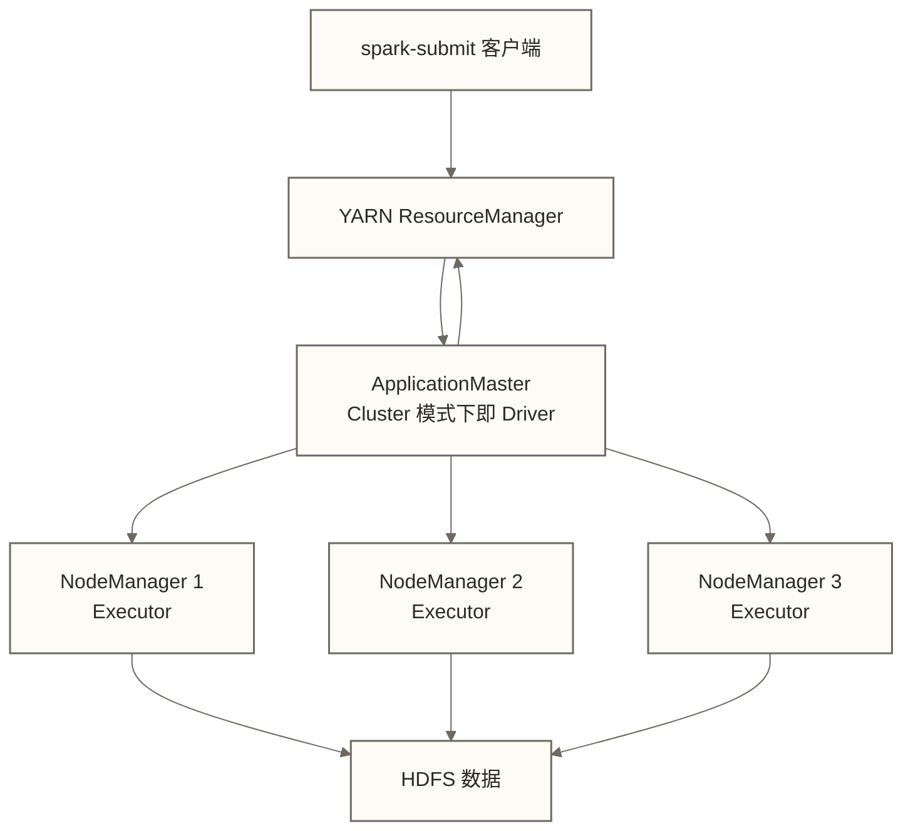

# Spark计算引擎 - Hadoop生态中的内存计算核心

> [!info] 前置知识
> 阅读本文前，建议先了解：
> - [[【技术与工具】/Hadoop/09-YARN资源管理架构|YARN资源管理架构]] - Spark on YARN 的资源层基础
> - [[【技术与工具】/Hadoop/03-HDFS分布式文件系统|HDFS分布式文件系统]] - Spark 读写数据的存储层
> - [[【技术与工具】/Hadoop/05-MapReduce编程模型|MapReduce编程模型]] - 理解 Spark 替代 MapReduce 的背景

> [!note] 深入学习指引
> 本文聚焦于 Spark 在 Hadoop 生态中的定位和集成方式，不重复 Spark 目录中已有的详细内容。
> 若要系统学习 Spark 编程、调优、流处理等内容，请前往：
> [[【技术与工具】/Spark/00-Spark学习路线图|Spark 完整学习体系]]

---

## Spark 在 Hadoop 生态中的定位

### 从 MapReduce 到 Spark

MapReduce 是 Hadoop 的原始计算引擎，解决了大规模数据批处理的问题，但多阶段作业通常需要将前一作业的输出写入 HDFS，再由下一作业读取；单个作业内的 Map 输出通常写入本地磁盘并经 Shuffle 传递，并非每个计算步骤都写入 HDFS。这意味着多阶段计算（如机器学习的迭代训练、复杂 ETL 的多次转换）会产生大量的磁盘 I/O，速度慢。

> [!note] 类比理解：笔记本 vs 黑板
> MapReduce 像一个必须把每步计算结果写在黑板上再擦掉、再写下一步的人。
> Spark 像一个能在脑子里（内存）连续思考的人，必要时也会把结果写下来；Shuffle、溢写和持久化等环节仍可能使用磁盘。

Spark 于 2009 年诞生于 UC Berkeley AMPLab，核心突破是**内存计算**：将中间结果缓存在内存中，避免反复的磁盘读写。这使得：

- **批处理速度**：原稿给出“比 MapReduce 快 10-100 倍”，但未提供基准与来源，仅作为未核实的性能示例；实际差异取决于任务、数据、缓存、I/O 和资源配置，不能作为通用结论
- **交互式查询**：通过 Spark Shell 实现近实时的数据探索
- **迭代计算**：机器学习训练、图计算等迭代场景下优势极为显著

### Spark 不是 Hadoop 的替代品

一个常见误解：Spark 是来替代 Hadoop 的。实际上，在 Hadoop 生态中，Spark 可作为 MapReduce 的**计算层替代**，而非整体替代；它也能独立于 Hadoop 部署。相关组件按部署方式和任务需要选择：

- **HDFS** 或其他存储系统（S3、OSS）来持久化数据
- 集群部署时使用 **YARN**、Kubernetes 或 Spark Standalone 等管理资源；原稿列出的 Mesos 是否可用须按 Spark 版本核对，本地模式不需要集群资源管理器
- 集成 Hive 表时可使用 **Hive Metastore** 管理元数据；它不是所有 Spark 作业的必需组件

在采用 Hadoop 的平台中，HDFS 和 YARN 可以继续承担存储层和资源层职责，Spark 可在计算层替代部分 MapReduce 作业；并非所有企业平台都采用这套组合。

---

## Spark on YARN：部署模式详解

在已有 YARN 的企业环境中，Spark on YARN 是一种常用部署方式，可复用 YARN 进行资源管理，无需另建 Spark Standalone 集群，但仍需维护 Spark 运行环境、依赖和配置。

### Client 模式 vs Cluster 模式

| 对比维度 | Client 模式 | Cluster 模式 |
|---------|------------|-------------|
| **Driver 运行位置** | 提交任务的客户端机器 | YARN 集群的某个 NodeManager |
| **适用场景** | 开发调试、交互式分析 | 生产环境定时任务、长期运行任务 |
| **日志查看** | Driver 日志直接输出到终端 | 需登录 YARN Web UI 或使用 yarn logs 命令 |
| **网络依赖** | 客户端与集群网络必须畅通（Driver 与 Executor 持续通信） | 客户端提交后可断开连接 |
| **资源占用** | 占用客户端机器资源（Driver 内存） | 完全由 YARN 统一管理资源 |
| **稳定性** | 客户端故障则 Driver 挂掉，任务失败 | 客户端故障不影响已提交任务 |

### spark-submit 关键参数

```bash
# 基本提交格式
spark-submit \
  --master yarn \
  --deploy-mode cluster \
  --name "MySparkJob" \
  --driver-memory 4g \
  --executor-memory 8g \
  --num-executors 20 \
  --executor-cores 4 \
  --conf spark.yarn.queue=default \
  --conf spark.sql.shuffle.partitions=400 \
  /path/to/your-app.jar \
  arg1 arg2
```

| 参数 | 说明 | 典型值 |
|------|------|--------|
| `--master yarn` | 使用 YARN 作为资源管理器 | yarn |
| `--deploy-mode` | 部署模式 | client / cluster |
| `--driver-memory` | Driver 进程内存 | 2g - 8g |
| `--executor-memory` | 每个 Executor 内存 | 4g - 16g |
| `--num-executors` | Executor 数量（静态分配） | 10 - 100 |
| `--executor-cores` | 每个 Executor 的 CPU 核数 | 2 - 4（建议不超过 5）|
| `--conf spark.yarn.queue` | 提交到哪个 YARN 队列 | default / production |
| `--conf spark.dynamicAllocation.enabled` | 开启动态资源分配 | true |

### ApplicationMaster 的角色

在 Spark on YARN 的架构中，有一个容易被忽略但非常重要的组件：**ApplicationMaster（AM）**。



- **Cluster 模式**：AM 和 Driver 运行在同一个 Container 中，AM 负责与 YARN 协商资源，Driver 负责任务调度
- **Client 模式**：AM 运行在集群中（只负责资源协商），Driver 运行在客户端机器上
- AM 会定期向 ResourceManager 发送心跳，汇报 Application 状态

---

## 与 HDFS 的集成

Spark 读写 HDFS 使用的是 Hadoop 的文件系统 API，配置与 Hadoop 客户端共享。

### 读取 HDFS 数据

```python
from pyspark.sql import SparkSession

spark = SparkSession.builder \
    .appName("HDFSExample") \
    .getOrCreate()

# 读取 Parquet 格式（推荐，列式存储，读取效率高）
df = spark.read.parquet("hdfs://namenode:9000/data/warehouse/orders/")

# 读取 ORC 格式（Hive 原生格式）
df = spark.read.orc("hdfs://namenode:9000/data/hive/dwd_orders/")

# 读取文本文件
df = spark.read.text("hdfs://namenode:9000/data/raw/logs/2024/01/01/")

# 使用通配符批量读取
df = spark.read.parquet("hdfs://namenode:9000/data/warehouse/orders/dt=2024-*")
```

### Hadoop Credential 配置

访问启用 Kerberos 的 HDFS，需要先具备正确的 Hadoop 客户端配置和有效凭据。在 Spark on YARN 中，应在启动前通过 spark-submit 的 --principal、--keytab 或相应提交配置安排认证与凭据分发；已有票据的使用还需考虑有效期和续期。以下 SparkSession 配置仅展示相关配置项，不能替代提交阶段认证，也不能由客户端配置开启服务端授权；keytab 路径和权限必须按实际环境设置：

```python
spark = SparkSession.builder \
    .config("spark.hadoop.hadoop.security.authentication", "kerberos") \
    .config("spark.hadoop.hadoop.security.authorization", "true") \
    .config("spark.kerberos.principal", "spark-user@REALM.COM") \
    .config("spark.kerberos.keytab", "/etc/security/spark.keytab") \
    .getOrCreate()
```

### 短路读取（Short-Circuit Read）

当 Spark Executor 与持有所读数据块的 HDFS DataNode 位于同一主机，且本地读取权限、域套接字和客户端原生库等条件满足时，短路读取可绕过 DataNode 的网络数据传输路径。以下是部分配置，需在相应 DataNode 和客户端配置中生效，并核对套接字目录权限；性能收益应实测：

```xml
<!-- hdfs-site.xml 中启用短路读取 -->
<property>
    <name>dfs.client.read.shortcircuit</name>
    <value>true</value>
</property>
<property>
    <name>dfs.domain.socket.path</name>
    <value>/var/lib/hadoop-hdfs/dn_socket</value>
</property>
```

---

## 与 Hive Metastore 的集成

Spark SQL 可以直接读写 Hive 表，共享 Hive Metastore 中的表元数据，实现 Spark 和 Hive 对同一份数据的互访。

### 启用 Hive 支持

```python
from pyspark.sql import SparkSession

# enableHiveSupport() 让 Spark SQL 能够读写 Hive 表
spark = SparkSession.builder \
    .appName("HiveIntegration") \
    .enableHiveSupport() \
    .getOrCreate()

# 直接操作 Hive 表
spark.sql("SHOW DATABASES").show()
spark.sql("USE data_warehouse")

# 读取 Hive 分区表
df = spark.sql("""
    SELECT user_id, SUM(amount) as total_amount
    FROM dwd_orders
    WHERE dt = '2024-01-01'
    GROUP BY user_id
""")

# 教学假设：目标表已存在，列顺序为 user_id、total_amount、dt，dt 为 STRING 分区列
# insertInto 按列位置匹配，执行前须核对实际表结构；追加写入重复执行可能产生重复数据
result = df.selectExpr("user_id", "total_amount", "'2024-01-01' AS dt")
result.write.mode("append").insertInto("ads_user_daily_summary")
```

### hive-site.xml 配置

要让 Spark 连接远程 Hive Metastore，需要将 `hive-site.xml` 放入 `$SPARK_HOME/conf/` 目录，或在 SparkSession 中显式指定：

```xml
<!-- hive-site.xml - Metastore 连接配置 -->
<configuration>
    <property>
        <name>hive.metastore.uris</name>
        <value>thrift://metastore-host:9083</value>
    </property>
    <property>
        <name>hive.metastore.warehouse.dir</name>
        <value>/user/hive/warehouse</value>
    </property>
</configuration>
```

> [!tip] 依赖注意
> 使用 `enableHiveSupport()` 需要运行环境具备兼容的 Spark Hive 支持模块及相关依赖；仅通过 `--jars` 添加 `hive-exec.jar` 不能保证具备完整支持。应核对所用发行包及 Spark 与 Hive Metastore 的兼容版本，不能仅凭文件名包含 `hadoop` 判断。

---

## Spark vs MapReduce 选型

两者不是完全的替代关系，根据场景选择合适的工具：

| 选型维度 | Spark | MapReduce |
|---------|-------|-----------|
| **计算模型** | DAG + 内存计算，多阶段流水线 | Map-Shuffle-Reduce，中间结果落盘 |
| **速度** | 原稿的批处理 10-100x、迭代计算 100x+ 为未核实示例，须按工作负载实测 | 性能和稳定性同样取决于工作负载与配置 |
| **内存需求** | 缓存和算子执行需要内存，但可处理超过总内存的数据；须关注分区与溢写 | 常依赖磁盘中间结果，但仍需为 Task 配置足够内存 |
| **开发体验** | DataFrame API / SQL，开发效率高 | Java/Python API，相对繁琐 |
| **流处理** | Structured Streaming / Spark Streaming | 不支持流处理 |
| **机器学习** | MLlib 内置支持 | 需要额外框架 |
| **生产稳定性** | 成熟，大规模生产验证 | 极度成熟，多年生产验证 |
| **容错机制** | Task 重试、丢失分区的血缘重算等 | Task 重试、失败任务重新执行等 |

**MapReduce 仍有优势的场景**：
- **超大规模批处理，内存预算有限**：可评估 MapReduce 的磁盘中间结果模型是否更适合任务，但超过集群总内存并不意味着 Spark 无法处理；两者均可能因单任务数据量、数据倾斜或配置不当而发生 OOM，须通过测试比较
- **极低并发的简单 ETL**：只需要单次 Map 或单次 Map-Reduce 的简单任务，引入 Spark 的启动开销反而得不偿失
- **存量 MR 作业维护**：遗留系统中已有大量稳定运行的 MR 作业，迁移成本高于收益时

> [!tip] 实践建议
> 新项目优先选择 Spark。存量 MapReduce 作业按优先级分批迁移，迭代计算类（机器学习特征工程、多次聚合 ETL）优先迁移，简单的单次批处理可以推后。

---

## 掌握检查

- [ ] 能解释 Spark 在 Hadoop 生态中替代的是哪个层，HDFS 和 YARN 在 Spark 架构中扮演什么角色
- [ ] 理解 spark-submit 的 client 模式和 cluster 模式的区别，知道生产环境应该用哪种
- [ ] 能写出 spark-submit 的基本命令，正确填写 --master、--deploy-mode、--executor-memory 等参数
- [ ] 理解 ApplicationMaster 在 Spark on YARN 中的职责

## 实践练习

**基础题**：在 YARN 集群上，以 cluster 模式提交一个 Spark 作业，分配 10 个 Executor，每个 Executor 4GB 内存、2 个核。写出完整的 spark-submit 命令。

**进阶题**：一个 Spark 作业处理 HDFS 上的 Hive 分区表，需要按日期分区写入结果到另一张 Hive 表。从 SparkSession 的创建到最终的 `insertInto` 写入，梳理完整的代码框架，并说明 `enableHiveSupport()` 为什么是必须的。

---

## 相关文档

- [[【技术与工具】/Spark/00-Spark学习路线图|Spark 完整学习体系]] - Spark 系统化学习路径
- [[【技术与工具】/Hadoop/09-YARN资源管理架构|YARN资源管理架构]] - 深入理解资源调度机制
- [[【技术与工具】/Hadoop/13-Hive数据仓库|Hive数据仓库]] - Hive Metastore 与 Spark 的集成背景
- [[【技术与工具】/Hadoop/16-ZooKeeper协调服务|ZooKeeper协调服务]] - 集群协调基础服务
- [[【技术与工具】/Hadoop/18-Hadoop集群规划|Hadoop集群规划]] - 整体集群规划视角
