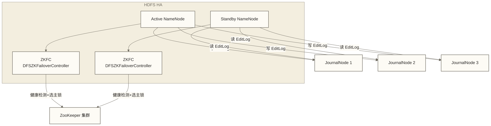

# ZooKeeper协调服务 - 分布式系统的神经中枢

> [!info] 前置知识
> 阅读本文前，建议先了解：
> - [[【技术与工具】/Hadoop/01-Hadoop概念与生态|Hadoop概念与生态]] - 理解分布式系统的基本挑战
> - [[【技术与工具】/Hadoop/09-YARN资源管理架构|YARN资源管理架构]] - YARN HA 中 ZooKeeper 的应用背景
> - [[【技术与工具】/Hadoop/14-HBase NoSQL数据库|HBase NoSQL数据库]] - ZooKeeper 在 HBase 协调中的角色

分布式系统面临的最难问题，往往不是计算本身，而是"协调"：多个节点如何就某件事达成一致？哪个节点是主节点？一个节点挂掉了，其他节点怎么知道？ZooKeeper 就是解决这类问题的通用基础设施。

---

## ZooKeeper 核心概念

### ZNode：树形结构的数据节点

ZooKeeper 的数据模型类似于文件系统，所有数据组织成一棵树，每个节点称为 **ZNode**。

```text
/                           # 根节点
├── hadoop-ha               # HDFS HA 用于 NameNode 选主
│   └── nameservice1
│       ├── ActiveBreadCrumb
│       └── ActiveStandbyElectorLock
├── hbase                   # HBase 集群协调
│   ├── master
│   ├── rs                  # RegionServer 注册
│   └── meta-region-server
├── kafka                   # Kafka Controller 选举（旧版本）
│   ├── controller
│   └── brokers
└── my-app                  # 自定义应用
    └── leader
```

ZNode 可以存储少量数据，默认数据大小限制约为 1MB，不适合存放大对象；持久节点可以拥有子节点，临时节点不能拥有子节点。下表介绍四种常见基础类型，并非所有版本支持的节点类型全集：

| 类型 | 特点 | 典型用途 |
|------|------|---------|
| **持久节点（Persistent）** | 创建后一直存在，直到显式删除 | 存储配置信息、服务注册的持久数据 |
| **临时节点（Ephemeral）** | 与 Session 绑定，会话过期或被显式关闭后自动删除；短暂断连不立即删除 | 服务健康检测、Leader 选举锁 |
| **持久有序节点（Persistent Sequential）** | 持久存在，节点名自动追加递增序号 | 分布式队列、分布式锁排队 |
| **临时有序节点（Ephemeral Sequential）** | 临时存在，节点名自动追加递增序号 | 公平锁实现、Leader 选举排队 |

> [!note] 临时节点是 ZooKeeper 实现故障检测的核心机制
> 服务启动时在 ZooKeeper 创建一个临时节点注册自己。如果服务宕机，与 ZooKeeper 的 Session 超时，临时节点自动消失，其他服务通过 Watcher 机制感知到这个变化，从而知道某个节点不可用了。

### Watcher 机制：事件驱动的变更通知

Watcher 是 ZooKeeper 的核心机制之一，允许客户端注册监听，当 ZNode 发生变化时收到通知。

**三种注册方式**：
- `getData(path, watcher)` - 监听节点数据变化
- `getChildren(path, watcher)` - 监听子节点列表变化（增删子节点）
- `exists(path, watcher)` - 监听节点是否存在（创建/删除）

**触发的事件类型**：

| 事件类型 | 触发条件 |
|---------|---------|
| `NodeCreated` | 节点被创建（exists 监听） |
| `NodeDeleted` | 节点被删除 |
| `NodeDataChanged` | 节点数据被修改 |
| `NodeChildrenChanged` | 子节点列表发生变化 |

> [!warning] 本节介绍的传统 Watcher 是一次性的
> 通过 getData、getChildren、exists 注册的传统 Watcher 触发一次后自动失效，持续监听需要重新注册并重新读取状态，不能将通知当作完整的变更日志。支持持久 Watcher 的版本另有相应 API，不受这里的一次性描述涵盖。

### Session 会话：客户端与 ZooKeeper 的生命线

客户端与 ZooKeeper 建立连接后形成一个 Session，有以下关键特性：

- **sessionTimeout**：会话超时时间，客户端必须在此时间内发送心跳，否则 Session 过期
- **心跳（Ping）**：客户端通过通信及必要的心跳维持 Session；心跳发送时机取决于客户端实现、协商后的会话超时和通信活动，不能统一视为每隔 `sessionTimeout/3` 发送一次
- **临时节点与 Session 绑定**：Session 过期后，该 Session 创建的所有临时节点自动删除
- **Session 迁移**：ZooKeeper 集群中某个节点故障时，客户端可以自动连接到其他节点，Session 不会中断（只要在超时时间内完成重连）

```text
正常状态:  客户端 ←─通信及心跳─→ ZooKeeper（发送时机取决于客户端实现、协商超时及通信活动）
超时场景:  客户端宕机 → 心跳停止 → 超过 sessionTimeout → Session 过期 → 临时节点删除
```

---

## ZAB 协议：保证一致性的核心原理

ZooKeeper Atomic Broadcast（ZAB）是 ZooKeeper 实现分布式一致性的协议，理解它有助于解释 ZooKeeper 的很多行为。

### 三个阶段

**1. Leader 选举**

集群启动或 Leader 宕机时，所有节点进入选举状态。节点通过投票选出拥有最新事务日志的节点作为 Leader。

关键概念：
- **Epoch（纪元/轮次）**：每次 Leader 更换时递增，类似于"任期"。新 Leader 会以更大的 Epoch 值宣示主权，Follower 收到更大 Epoch 的消息时，会放弃旧 Leader
- **ZXID**：事务 ID，由 Epoch（高 32 位）+ 事务计数（低 32 位）组成，全局单调递增

**2. 数据同步**

新 Leader 选出后，将自己最新的数据状态同步给所有 Follower，确保集群数据一致。

**3. 消息广播**

正常运行时，Leader 负责处理所有写请求，将变更广播给所有 Follower：

```text
客户端写请求 → Leader 收到 → 向所有 Follower 发送 Proposal
→ 包括 Leader 在内的投票成员达到法定多数确认 → Leader 提交，广播 Commit 给 Follower
→ Follower 执行 Commit → 客户端收到成功响应
```

### 过半原则与奇数节点

在采用普通多数派配置时，ZAB 协议要求超过半数投票成员（Quorum）确认才能提交写操作，Observer 不计入投票多数派。下表以全部节点均为投票成员为前提，说明为什么通常推荐部署**奇数个投票节点**：

| 节点数 | 允许宕机节点数 | 容错说明 |
|--------|-------------|---------|
| 3 | 1 | 2 个节点存活仍能正常工作 |
| 4 | 1 | 3 个节点存活才过半，比 3 节点并不多容一个故障 |
| 5 | 2 | 3 个节点存活仍能工作，比 4 节点多容一个故障 |
| 7 | 3 | 4 个节点存活仍能工作 |

> [!note] 为什么 4 节点不比 3 节点更好
> 4 节点集群需要 3 个节点存活（超过 2 个），实际上也只能容忍 1 个节点故障。而 5 节点可以容忍 2 个故障，代价只多一台机器。所以生产环境常见的是 3 节点（小集群）和 5 节点（需要更高可用性）。

---

## ZooKeeper 在 Hadoop 生态中的角色

这是本文的核心内容。ZooKeeper 是整个 Hadoop 生态高可用架构的基石。

### HDFS HA：NameNode 自动切换

HDFS 的单点故障（NameNode 宕机导致整个集群不可用）通过 ZooKeeper 解决：



**ZKFC（DFSZKFailoverController）选主流程**：
1. 每个 NameNode 旁运行一个 ZKFC 进程
2. ZKFC 持续通过 HAServiceProtocol RPC 监控本地 NameNode 的健康状态，而非通过 JMX
3. ZKFC 在 ZooKeeper 中抢占临时节点（`/hadoop-ha/nameservice1/ActiveStandbyElectorLock`）
4. 抢到节点的 ZKFC 将本地 NameNode 设为 Active；另一个 ZKFC 监听此节点
5. Active NameNode 宕机 → ZKFC 检测到故障 → 主动删除 ZK 锁节点（或 Session 超时自动删除）
6. Standby 侧 ZKFC 的 Watcher 触发 → 抢占新锁 → 将 Standby NameNode 切换为 Active
7. 在切换前，ZKFC 会先 Fence（隔离）旧 Active，防止脑裂

### YARN HA：ResourceManager 高可用

YARN 的 ResourceManager 也通过类似机制实现高可用：

```properties
# yarn-site.xml 核心配置
yarn.resourcemanager.ha.enabled=true
yarn.resourcemanager.ha.rm-ids=rm1,rm2
yarn.resourcemanager.hostname.rm1=node1
yarn.resourcemanager.hostname.rm2=node2
yarn.resourcemanager.zk-address=node1:2181,node2:2181,node3:2181
```

ResourceManager 的选主原理与 HDFS NameNode 类似，都通过 ZooKeeper 临时节点实现主备切换，无需 ZKFC，由 RM 自身实现选主逻辑。

### HBase 协调：ZooKeeper 是 HBase 的元数据注册中心

HBase 对 ZooKeeper 的依赖最深，几乎所有协调操作都经过 ZooKeeper：

| ZooKeeper 节点 | 存储内容 | 作用 |
|---------------|---------|------|
| `/hbase/master` | Active HMaster 地址 | HMaster 选主，临时节点 |
| `/hbase/rs` | 各活跃 RegionServer 的注册子节点 | 父路径用于组织注册信息，其下各 RegionServer 的注册子节点为临时节点 |
| `/hbase/meta-region-server` | hbase:meta 表所在的 RegionServer | 客户端查找 meta 表的入口 |
| `/hbase/table` | 表的状态信息 | 表的创建、删除、禁用状态 |
| `/hbase/region-in-transition` | 正在迁移的 Region | Region 分裂、负载均衡过程中的状态同步 |

**使用 ZooKeeper 注册机制的 HBase 客户端访问 ZooKeeper 的时机**（具体机制及路径需按 HBase 版本确认）：
- 第一次连接时：查询 `/hbase/meta-region-server` 找到 meta 表位置
- 之后的正常读写：不经过 ZooKeeper，直接访问 RegionServer

### Kafka Controller 选举（旧版本）

Kafka 2.8 之前，集群 Controller 的选举通过 ZooKeeper 实现。Controller 负责 Partition Leader 选举、Broker 上下线管理等关键协调工作：

```text
/kafka/controller        # 当前 Controller 的 Broker ID（临时节点）
/kafka/brokers/ids       # 所有活跃 Broker 的注册（临时节点）
/kafka/brokers/topics    # Topic 的分区和副本信息
```

> [!note] Kafka KRaft 模式
> Kafka 2.8 引入了 KRaft 模式（Kafka Raft），用内置的 Raft 协议替代对 ZooKeeper 的依赖，简化了部署和运维。Kafka 3.3 正式标记 KRaft 为生产可用。如果你的 Kafka 版本低于 2.8，仍需要 ZooKeeper；新部署的集群推荐使用 KRaft 模式。

---

## 安装与配置

### zoo.cfg 核心参数

```properties
# zoo.cfg - ZooKeeper 核心配置文件

# 基础时间单位（毫秒），其他超时时间以此为倍数
tickTime=2000

# Follower 与 Leader 初始同步数据的超时：initLimit * tickTime = 10 * 2000 = 20秒
initLimit=10

# Follower 与 Leader 同步心跳的超时：syncLimit * tickTime = 5 * 2000 = 10秒
syncLimit=5

# 数据存储目录（存放快照和事务日志）
dataDir=/var/zookeeper/data

# 事务日志单独目录（生产环境强烈建议与 dataDir 分开，使用独立磁盘）
dataLogDir=/var/zookeeper/logs

# 客户端连接端口
clientPort=2181

# 集群节点配置（server.ID=主机名:数据同步端口:Leader选举端口）
server.1=node1:2888:3888
server.2=node2:2888:3888
server.3=node3:2888:3888

# 每个客户端 IP 到单台 ZooKeeper 服务器的最大连接数（不是集群总连接数上限）
maxClientCnxns=60

# 保留的快照数量（旧快照自动清理）
autopurge.snapRetainCount=3

# 自动清理周期（小时），0 表示禁用自动清理
autopurge.purgeInterval=24
```

### 3 节点集群配置示例

**步骤一：每个节点配置 myid 文件**

```bash
# node1 上执行
mkdir -p /var/zookeeper/data
echo "1" > /var/zookeeper/data/myid

# node2 上执行
mkdir -p /var/zookeeper/data
echo "2" > /var/zookeeper/data/myid

# node3 上执行
mkdir -p /var/zookeeper/data
echo "3" > /var/zookeeper/data/myid
```

**步骤二：所有节点使用相同的 zoo.cfg**（内容如上方示例）

**步骤三：启动集群**

```bash
# 每个节点上执行
$ZOOKEEPER_HOME/bin/zkServer.sh start

# 查看节点状态（会显示 leader 或 follower）
$ZOOKEEPER_HOME/bin/zkServer.sh status

# 停止
$ZOOKEEPER_HOME/bin/zkServer.sh stop
```

### zkCli.sh 常用命令速查

```bash
# 启动客户端，连接到本地 ZooKeeper
zkCli.sh -server localhost:2181

# 连接到远程集群（多节点）
zkCli.sh -server node1:2181,node2:2181,node3:2181
```

连接成功后，在交互式命令行中使用以下命令：

| 命令 | 说明 | 示例 |
|------|------|------|
| `ls /path` | 列出子节点 | `ls /hbase` |
| `ls2 /path` | 列出子节点并显示节点状态 | `ls2 /hbase` |
| `get /path` | 获取节点数据 | `get /hbase/master` |
| `stat /path` | 查看节点元信息（版本、时间戳等） | `stat /hbase/master` |
| `create /path data` | 创建持久节点 | `create /my-app "v1"` |
| `create -e /path data` | 创建临时节点 | `create -e /my-app/lock "node1"` |
| `create -s /path data` | 创建有序节点 | `create -s /my-app/req ""` |
| `set /path data` | 更新节点数据 | `set /my-app "v2"` |
| `delete /path` | 删除节点（无子节点时）| `delete /my-app` |
| `deleteall /path` | 递归删除节点及子节点 | `deleteall /my-app` |
| `get -w /path` | 获取数据并注册一次性 Watcher（适用于支持此语法的版本） | `get -w /hbase/master` |
| `quit` | 退出客户端 | |

---

## ZooKeeper 运维

### 四字命令

ZooKeeper 提供了一组简单的四字命令，通过 `nc`（netcat）工具发送，用于快速获取服务状态：

```bash
# 检查进程是否响应（返回 imok 不代表已加入法定多数或可正常处理读写）
echo ruok | nc localhost 2181

# 查看服务统计信息（连接数、请求量、延迟等）
echo stat | nc localhost 2181

# 查看完整监控指标（用于 Prometheus/Grafana 集成）
echo mntr | nc localhost 2181

# 查看 Session 和临时节点列表
echo dump | nc localhost 2181

# 查看当前配置
echo conf | nc localhost 2181

# 查看连接中的客户端列表
echo cons | nc localhost 2181
```

> [!tip] 四字命令应按需加入白名单
> 支持四字命令白名单的版本会限制可执行命令，不能笼统认为 ZooKeeper 3.5+ 默认禁用所有四字命令；具体默认值需查对应版本文档。可在 zoo.cfg 中按需配置 `4lw.commands.whitelist=mntr,stat,ruok`。`4lw.commands.whitelist=*` 会放开全部命令，不宜作为生产环境默认建议，还需限制客户端端口的访问来源。

### JMX 监控关键指标

ZooKeeper 通过 JMX 暴露运行时指标，具体名称和统计范围需按版本及采集方式确认。以下阈值是原稿未核实的教学参考，应结合业务延迟目标、负载与容量测试建立告警基线，不能直接作为生产标准：

| 指标名 | 含义 | 告警阈值参考 |
|--------|------|------------|
| `OutstandingRequests` | 队列中等待处理的请求数 | 持续 > 10 需关注 |
| `AvgRequestLatency` | 平均请求延迟（毫秒） | > 50ms 需关注 |
| `MaxRequestLatency` | 最大请求延迟 | > 1000ms 需告警 |
| `NumAliveConnections` | 活跃客户端连接总数 | 结合服务器容量与客户端 IP 分布评估；不能直接与每 IP 的 maxClientCnxns 比较并据此扩容 |
| `ZnodeCount` | ZNode 总数 | 超过 100w 需关注内存 |
| `WatchCount` | 注册的 Watcher 总数 | 过多 Watcher 增加服务器压力 |
| `PacketsSent` / `PacketsReceived` | 网络包收发量 | 用于流量监控 |

### 常见问题与解决

**问题 1：脑裂（Split-Brain）如何防止**

ZooKeeper 通过 Quorum（过半原则）从协议层面防止脑裂：写操作必须得到超过半数节点确认，网络分区时，少数派节点无法形成 Quorum，无法接受写请求，保证只有一个分区能正常工作。

在 HDFS HA 中，ZKFC 还会在切换前对旧 Active NameNode 执行 Fence（隔离）操作，防止两个 NameNode 同时处于 Active 状态导致数据损坏。

**问题 2：ZNode 数据大小限制**

ZNode 数据的默认大小限制约为 **1MB**，具体限制受版本、配置及协议缓冲区约束，不能将 1MB 视为任意环境下都可写入的有效载荷保证。ZooKeeper 设计为协调服务，不是大数据存储，应存储少量元数据（如服务地址、状态标志、配置项）。如果需要存储大量数据，应将数据放在外部存储（HDFS、数据库），ZooKeeper 只存储指向数据的引用。

**问题 3：Leader 选举期间服务不可用**

Leader 选举及恢复期间，ZooKeeper 暂不能正常处理写请求，普通模式下读服务也可能中断，不能假定 Follower 会持续返回读结果；是否允许只读服务取决于只读模式配置及客户端支持。原稿给出的选举耗时（200ms - 2s）是未核实的示例范围，不代表性能保证，实际耗时受网络、故障检测、选举和数据同步等因素影响。减少选举耗时的方法：
- 保证节点间网络低延迟
- 将 `dataLogDir` 放在低延迟 SSD 上（事务日志写入是关键路径）
- 不要在 ZooKeeper 节点上运行其他重负载程序

---

## 掌握检查

- [ ] 能说出 ZNode 四种类型及各自的使用场景，尤其是临时节点与故障检测的关系
- [ ] 理解 Watcher 机制，知道 Watcher 一次性触发的含义和应对方式
- [ ] 能解释 ZAB 协议的三个阶段，以及为什么 ZooKeeper 推荐奇数节点
- [ ] 理解 HDFS HA 中 ZKFC 的选主流程，能说出 `/hadoop-ha` 节点的作用
- [ ] 知道 HBase 对 ZooKeeper 的几个关键 ZNode 路径及其存储内容

## 实践练习

**基础题**：在隔离实验环境中使用 zkCli.sh 完成以下操作：先创建持久父节点 `/practice`（已存在则不重复创建）；在其下以 `/practice/seq-` 为前缀创建一个持久有序节点，写入数据 "hello"，记录命令返回的完整节点路径；然后创建临时节点 `/practice/lock`；使用 `ls` 和 `get` 查看节点信息；最后退出客户端，思考临时节点会发生什么变化，并区分正常关闭会话与异常断连等待会话过期两种情况。

**进阶题**：解释以下场景中 ZooKeeper 的工作机制：在一个 3 节点 ZooKeeper 集群中，其中一个节点突然宕机。此时集群的读写能力是否受影响？如果宕机的恰好是 Leader，会发生什么？如果继续有一个节点宕机，集群会怎样？

---

## 相关文档

- [[【技术与工具】/Hadoop/03-HDFS分布式文件系统|HDFS分布式文件系统]] - ZooKeeper 在 HDFS HA 中协调 NameNode 切换
- [[【技术与工具】/Hadoop/09-YARN资源管理架构|YARN资源管理架构]] - ZooKeeper 在 YARN HA 中协调 ResourceManager 切换
- [[【技术与工具】/Hadoop/14-HBase NoSQL数据库|HBase NoSQL数据库]] - ZooKeeper 在 HBase 中的协调角色
- [[【技术与工具】/Hadoop/19-高可用架构设计|高可用架构设计]] - Hadoop 集群整体高可用设计
- [[【技术与工具】/Hadoop/15-Spark计算引擎|Spark计算引擎]] - Spark on YARN 中 ZooKeeper 的间接作用
