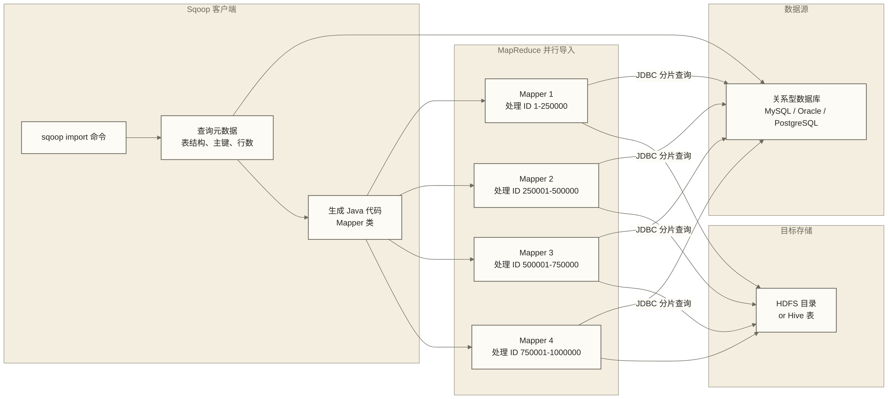

# Sqoop数据迁移 - 关系型数据库与Hadoop之间的数据搬运工

> [!info] 前置知识
> 阅读本文前，建议先了解：
> - [[【技术与工具】/Hadoop/03-HDFS分布式文件系统|HDFS分布式文件系统]] - 数据迁移的目标存储系统
> - [[【技术与工具】/Hadoop/05-MapReduce编程模型|MapReduce编程模型]] - Sqoop 底层使用 MapReduce 并行导入
> - [[【技术与工具】/Hadoop/13-Hive数据仓库|Hive数据仓库]] - Sqoop 直接导入 Hive 表的目标

数据仓库建设中，一个绕不开的任务是：把业务系统（MySQL、Oracle、PostgreSQL）中的数据搬运到 Hadoop 平台。Sqoop 就是专为这个场景设计的工具，负责关系型数据库（RDBMS）与 Hadoop 生态（HDFS、Hive、HBase）之间的数据双向迁移。

---

## Sqoop 1 vs Sqoop 2

Sqoop 存在两个版本，生产环境绝大多数使用 Sqoop 1，本文聚焦 Sqoop 1：

| 对比维度 | Sqoop 1 | Sqoop 2 |
|---------|---------|---------|
| **架构** | 纯客户端工具，无服务端进程 | 有独立的 Sqoop Server |
| **易用性** | 命令行直接使用，上手简单 | 需要额外维护 Server 组件 |
| **连接器** | JDBC 通用连接器，各数据库专用连接器 | 基于新连接器框架 |
| **安全性** | 密码可能暴露在命令行历史 | Server 集中管理凭据 |
| **生产现状** | 绝大多数企业在用，文档丰富 | 社区活跃度低，生产案例少 |
| **维护状态** | Apache 已停止主动开发（稳定版） | 基本停滞 |

> [!note] Sqoop 的现状与替代
> Apache Sqoop 项目已于 2021 年正式退役，进入 Apache Attic，并非退出 Apache 孵化器。生产环境中仍大量使用 Sqoop 1 做离线同步，但新建系统推荐评估 DataX（阿里开源）或 SeaTunnel（Apache）等活跃项目。Sqoop 的命令和概念仍是大数据工程师的必备知识，面试中频繁出现。

---

## 核心架构：MapReduce 并行导入

Sqoop 的聪明之处在于把数据迁移任务转化为 MapReduce 作业，实现并行导入。



**为什么用 MapReduce 并行导入**：
- 单线程 JDBC 导出大表可能受吞吐限制（原稿“每秒几千行”为未核实的教学示例，不是通用性能基准）
- 将表按主键范围分成多个区间，每个 Mapper 处理一个区间，并行 JDBC 查询
- 原稿的“4 个 Mapper 理论上速度是单线程的 4 倍”仅作为未核实的理想线性加速示例；实际收益取决于分片均衡、数据库负载、网络和作业开销，不能保证四倍加速
- 导入结果作为多个文件写入 HDFS，自然支持分布式存储

---

## 安装配置

### JDBC 驱动安装

Sqoop 本身不包含数据库驱动，需要手动将对应数据库的 JDBC 驱动 JAR 放入 Sqoop 的 lib 目录：

```bash
# MySQL 驱动安装
cp mysql-connector-java-8.0.30.jar $SQOOP_HOME/lib/

# Oracle 驱动安装（需从 Oracle 官网下载，有许可证限制）
cp ojdbc8.jar $SQOOP_HOME/lib/

# PostgreSQL 驱动安装
cp postgresql-42.5.0.jar $SQOOP_HOME/lib/
```

### sqoop-env.sh 配置

```bash
# $SQOOP_HOME/conf/sqoop-env.sh

# 指向 Hadoop 安装目录（必须）
export HADOOP_COMMON_HOME=/opt/hadoop

# 指向 Hive 安装目录（需要导入 Hive 表时配置）
export HIVE_HOME=/opt/hive

# 指向 HBase 安装目录（需要导入 HBase 时配置）
export HBASE_HOME=/opt/hbase

# 指向 ZooKeeper 安装目录
export ZOOCFGDIR=/opt/zookeeper/conf
```

### 连接测试

```bash
# 列出 MySQL 数据库中的所有 Schema
sqoop list-databases \
  --connect jdbc:mysql://mysql-host:3306/ \
  --username sqoop_user \
  --password sqoop_password

# 列出某个数据库下的所有表
sqoop list-tables \
  --connect jdbc:mysql://mysql-host:3306/business_db \
  --username sqoop_user \
  --password sqoop_password
```

> [!tip] 密码安全处理
> 在命令行中明文使用 `--password` 会将密码记录在 Shell 历史中。可使用 `--password-file` 参数从受限访问的 HDFS 文件读取密码。以下示例保存的是明文密码，`chmod 400` 只限制访问权限，不提供加密，且含密码的 `echo` 命令仍可能进入 Shell 历史；生产环境应另行落实安全的凭据写入、存储加密和权限管理：
> ```bash
> echo -n "your_password" | hdfs dfs -put - /user/sqoop/.sqoop_pwd
> hdfs dfs -chmod 400 /user/sqoop/.sqoop_pwd
> # 之后命令中使用
> --password-file hdfs:///user/sqoop/.sqoop_pwd
> ```

---

## 核心命令详解

### sqoop import：从 RDBMS 导入到 Hadoop

**基础全量导入**：

```bash
sqoop import \
  --connect jdbc:mysql://mysql-host:3306/business_db \
  --username sqoop_user \
  --password sqoop_password \
  --table orders \
  --target-dir /data/raw/orders \
  --num-mappers 4 \
  --split-by order_id \
  --fields-terminated-by '\t' \
  --delete-target-dir
```

**--split-by 分片列选择原则**：

`--split-by` 指定用于分割数据范围的列，Sqoop 会查询该列的 MIN 和 MAX 值，然后均匀划分成 `num-mappers` 个区间。选择原则：

| 原则 | 说明 |
|------|------|
| **高基数** | 列的不同值要足够多，确保每个 Mapper 分到足够多的数据 |
| **均匀分布** | 列值分布要均匀，避免某个 Mapper 处理的数据远多于其他 Mapper（数据倾斜）|
| **数值类型** | 整数主键是最理想的选择，支持精确范围划分 |
| **有索引** | 分片列在数据库端要有索引，否则范围查询会全表扫描，给数据库造成压力 |

> [!warning] 没有主键的表
> 如果表没有主键，Sqoop 默认会报错。解决方案：
> 1. 添加 `--num-mappers 1`，使用单线程导入（放弃并行）
> 2. 手动指定 `--split-by` 为一个合适的非主键列
> 3. 使用 `--query` 自定义查询语句，加入 `$CONDITIONS` 占位符并指定 `--target-dir`；并行查询仍须指定合适的 `--split-by`，否则使用 `--num-mappers 1`，仅添加占位符不能解决无主键分片问题

### sqoop import --incremental：增量导入

增量导入解决了"只同步新增/更新数据"的需求，有两种模式：

**append 模式**（追加新增行，基于自增 ID 或时间戳）：

```bash
sqoop import \
  --connect jdbc:mysql://mysql-host:3306/business_db \
  --username sqoop_user \
  --password sqoop_password \
  --table orders \
  --target-dir /data/raw/orders \
  --incremental append \
  --check-column order_id \
  --last-value 1000000 \
  --num-mappers 4
```

**lastmodified 模式**（同步更新行，基于时间戳列）：

```bash
sqoop import \
  --connect jdbc:mysql://mysql-host:3306/business_db \
  --username sqoop_user \
  --password sqoop_password \
  --table orders \
  --target-dir /data/raw/orders \
  --incremental lastmodified \
  --check-column updated_at \
  --last-value "2024-01-01 00:00:00" \
  --merge-key order_id \
  --num-mappers 4
```

**两种增量模式对比**：

| 对比维度 | append 模式 | lastmodified 模式 |
|---------|------------|------------------|
| **适用场景** | 只有新增，不会更新的数据（如日志、流水） | 既有新增又有更新的数据（如订单状态变更）|
| **check-column 要求** | 单调递增的列（自增 ID 或时间戳） | 记录最后更新时间的时间戳列 |
| **结果处理** | 直接追加到已有数据 | 需要与已有数据 merge（按 --merge-key 去重）|
| **实现代价** | 简单，性能好 | 需要额外的 merge 操作，耗时更长 |

### sqoop export：从 Hadoop 导出到 RDBMS

```bash
# 基础导出：HDFS 文件导出到 MySQL 表
sqoop export \
  --connect jdbc:mysql://mysql-host:3306/report_db \
  --username sqoop_user \
  --password sqoop_password \
  --table ads_user_summary \
  --export-dir /data/output/ads_user_summary \
  --input-fields-terminated-by '\t' \
  --num-mappers 4

# Upsert 模式：有则更新，无则插入
sqoop export \
  --connect jdbc:mysql://mysql-host:3306/report_db \
  --username sqoop_user \
  --password sqoop_password \
  --table ads_user_summary \
  --export-dir /data/output/ads_user_summary \
  --update-key user_id \
  --update-mode allowinsert \
  --input-fields-terminated-by '\t' \
  --num-mappers 4
```

> [!warning] export 前确保目标表已存在
> 与 import 不同，sqoop export 不会自动创建目标表，需要提前在数据库中建好表结构，且列顺序要与 HDFS 文件中的字段顺序完全对应。

### sqoop job：保存和复用增量作业

对于需要定期执行的增量导入，sqoop job 可以保存作业配置，并自动记录上次的 `last-value`，下次执行时从上次结束的位置继续：

```bash
# 创建增量导入作业
sqoop job --create import_orders_job \
  -- import \
  --connect jdbc:mysql://mysql-host:3306/business_db \
  --username sqoop_user \
  --password sqoop_password \
  --table orders \
  --target-dir /data/raw/orders \
  --incremental append \
  --check-column order_id \
  --last-value 0 \
  --num-mappers 4

# 列出所有已保存的作业
sqoop job --list

# 执行作业（自动更新 last-value）
sqoop job --exec import_orders_job

# 查看作业详情
sqoop job --show import_orders_job

# 删除作业
sqoop job --delete import_orders_job
```

---

## 常用参数速查表

| 参数 | 分类 | 说明 | 示例值 |
|------|------|------|--------|
| `--connect` | 连接 | JDBC 连接字符串 | `jdbc:mysql://host:3306/db` |
| `--username` | 连接 | 数据库用户名 | `sqoop_user` |
| `--password` | 连接 | 数据库密码 | `password` |
| `--password-file` | 连接 | 从 HDFS 文件读取密码 | `hdfs:///user/sqoop/.pwd` |
| `--table` | 数据源 | 源数据库表名 | `orders` |
| `--query` | 数据源 | 自定义 SQL 查询（含 `$CONDITIONS`，Shell 中须防止变量展开）| `'SELECT * FROM orders WHERE $CONDITIONS'` |
| `--columns` | 数据源 | 只导入指定列 | `order_id,user_id,amount` |
| `--where` | 数据源 | 过滤条件 | `"status = 'paid'"` |
| `--split-by` | 并行 | 数据分片依据的列 | `order_id` |
| `--num-mappers` | 并行 | Mapper 并行数 | `4` |
| `--target-dir` | 目标(import) | HDFS 目标目录 | `/data/raw/orders` |
| `--delete-target-dir` | 目标(import) | 导入前删除目标目录 | （标志，无值）|
| `--hive-import` | Hive | 直接导入 Hive | （标志，无值）|
| `--hive-table` | Hive | 目标 Hive 表名 | `ods.orders` |
| `--hive-overwrite` | Hive | 覆盖 Hive 表数据 | （标志，无值）|
| `--create-hive-table` | Hive | 自动创建 Hive 表 | （标志，无值）|
| `--hive-partition-key` | Hive | Hive 分区键名 | `dt` |
| `--hive-partition-value` | Hive | Hive 分区键值 | `2024-01-01` |
| `--export-dir` | 目标(export) | HDFS 源数据目录 | `/data/output/summary` |
| `--update-key` | export | Upsert 的主键列 | `order_id` |
| `--fields-terminated-by` | 格式 | 字段分隔符 | `'\t'` |
| `--null-string` | 格式 | String 类型 NULL 替换值 | `'\N'` |
| `--null-non-string` | 格式 | 非 String 类型 NULL 替换值 | `'\N'` |
| `--compress` | 性能 | 开启压缩 | （标志，无值）|
| `--compression-codec` | 性能 | 压缩格式 | `snappy` |
| `--fetch-size` | 性能 | JDBC 每批次拉取行数 | `10000` |

---

## 生产实践

### 按日期分区导入 Hive

实际项目中，每天同步昨天的数据到 Hive 分区表是最常见的场景，通常通过 Shell 脚本驱动：

```bash
#!/bin/bash
# daily_import_orders.sh - 每日增量同步订单表到 Hive 分区

YESTERDAY=$(date -d "yesterday" +%Y-%m-%d)

sqoop import \
  --connect "jdbc:mysql://mysql-host:3306/business_db?useSSL=false&characterEncoding=UTF-8" \
  --username sqoop_user \
  --password-file hdfs:///user/sqoop/.sqoop_pwd \
  --query "SELECT order_id, user_id, amount, status, created_time
           FROM orders
           WHERE DATE(created_time) = '${YESTERDAY}'
           AND \$CONDITIONS" \
  --split-by order_id \
  --num-mappers 4 \
  --hive-import \
  --hive-table ods.ods_orders \
  --target-dir "/data/staging/ods_orders/dt=${YESTERDAY}" \
  --hive-partition-key dt \
  --hive-partition-value "${YESTERDAY}" \
  --hive-overwrite \
  --null-string '\N' \
  --null-non-string '\N' \
  --fields-terminated-by '\t' \
  --compress \
  --compression-codec snappy

if [ $? -eq 0 ]; then
    echo "[$(date)] 订单数据同步成功: ${YESTERDAY}"
else
    echo "[$(date)] 订单数据同步失败: ${YESTERDAY}" >&2
    exit 1
fi
```

### 性能调优

| 调优方向 | 参数/方法 | 说明 |
|---------|---------|------|
| **增大 JDBC 批次** | `--fetch-size 10000` | 每次从数据库拉取更多行，减少网络往返次数 |
| **增加并行度** | `--num-mappers 8` | 根据数据库和集群承受能力调整，通常 4-16 |
| **开启压缩** | `--compress --compression-codec snappy` | 减少 HDFS 存储空间，加快写入速度 |
| **直接写 HFile** | `--hbase-bulkload` | 批量导入 HBase 时，绕过 RegionServer 直接生成 HFile |
| **调大 Mapper 内存** | `-Dmapreduce.map.memory.mb=4096` | 大表导入时防止 Mapper OOM |

### 避坑清单

| 问题场景 | 现象 | 解决方案 |
|---------|------|---------|
| **表没有主键** | Sqoop 报错 `No primary key could be found` | 加 `--num-mappers 1` 单线程，或手动指定 `--split-by` 列 |
| **数据倾斜** | 某个 Mapper 数据量远大于其他 | 优先选择分布均匀的列作为 `--split-by`；`--boundary-query` 只设置整体分片上下界，不能自动实现等行数分片或消除区间内部倾斜 |
| **特殊字符乱码** | 中文或特殊字符显示乱码 | JDBC URL 加 `characterEncoding=UTF-8`，Hive 表也设置 `STORED AS TEXTFILE` 时加字符集配置 |
| **NULL 值处理不一致** | Hive 中 NULL 显示为 `null` 字符串而非真正的 NULL | 明确设置 `--null-string '\N' --null-non-string '\N'`，并确认 Hive 表的 NULL 标记配置一致；Shell 单引号内只写一个反斜杠 |
| **时区问题** | 时间字段偏差 8 小时 | 核对数据库、JVM 和业务时区及字段类型；按 MySQL JDBC 驱动版本配置时区参数，如 `serverTimezone=Asia/Shanghai`，不要为修复时区而关闭 SSL |

---

## Sqoop vs DataX 选型对比

| 对比维度 | Sqoop | DataX（阿里开源）|
|---------|-------|----------------|
| **架构模式** | MapReduce 分布式并行 | 单机多线程（部分关系型数据库 Reader 支持通过 splitPk 配置并行切分，须按插件确认） |
| **数据源支持** | 主要是 RDBMS ↔ Hadoop | 超过 20 种数据源，含 MongoDB、Elasticsearch、Hive 等 |
| **部署方式** | 依赖 YARN 集群 | 单机 Python 脚本驱动，部署简单 |
| **吞吐量** | 大表并行导入吞吐量高 | 单机瓶颈，超大表需要拆分任务 |
| **增量同步** | 原生支持 incremental append/lastmodified | 需要在 JSON 配置中自定义 WHERE 条件 |
| **任务配置** | 命令行参数，简单直接 | JSON 配置文件，可视化配置更丰富 |
| **社区活跃度** | 已退役，维护状态 | 活跃开发中 |
| **适合场景** | 大规模 RDBMS → HDFS/Hive 批量导入 | 多数据源之间的通用数据同步 |

> [!tip] 选型建议
> 已有 Hadoop 集群且主要场景是 MySQL/Oracle → Hive 的大表批量同步，Sqoop 成熟可用。新建平台或需要同步多种异构数据源，优先选择 DataX 或 Apache SeaTunnel，生态更完整、维护更活跃。

---

## 掌握检查

- [ ] 能解释 Sqoop 为什么使用 MapReduce 并行导入，`--split-by` 和 `--num-mappers` 参数如何影响并行度
- [ ] 理解 incremental append 和 lastmodified 两种增量模式的区别，知道各自的适用场景
- [ ] 能写出将 MySQL 表按日期分区导入 Hive 的 sqoop import 命令，包含正确的分区参数
- [ ] 知道 NULL 值处理、特殊字符编码等常见坑及解决方法

## 实践练习

**基础题**：写一条 sqoop import 命令，将 MySQL 数据库 `sales_db` 中的 `orders` 表全量导入到 HDFS 的 `/data/raw/orders/dt=2024-01-15` 目录。要求：4 个 Mapper，按 `order_id` 分片，字段用 `\t` 分隔，NULL 值替换为 `\N`。

**进阶题**：业务方要求每天凌晨 2 点将昨天新增的订单（`created_time` 字段）同步到 Hive 的 `ods_orders` 表对应日期分区。设计完整的增量同步方案：选择使用哪种增量模式？关键参数如何设置？如何保证幂等性（重跑时不产生重复数据）？用 Shell 脚本框架描述执行逻辑。

---

## 相关文档

- [[【技术与工具】/Hadoop/03-HDFS分布式文件系统|HDFS分布式文件系统]] - Sqoop 导入数据的目标存储
- [[【技术与工具】/Hadoop/13-Hive数据仓库|Hive数据仓库]] - Sqoop 直接导入 Hive 表的集成方式
- [[【技术与工具】/Hadoop/05-MapReduce编程模型|MapReduce编程模型]] - Sqoop 底层执行引擎的工作原理
- [[【技术与工具】/Hadoop/18-Hadoop集群规划|Hadoop集群规划]] - 数据同步在整体平台架构中的位置
- [[【技术与工具】/Hadoop/16-ZooKeeper协调服务|ZooKeeper协调服务]] - Sqoop 任务依赖的 Hadoop 集群协调基础
