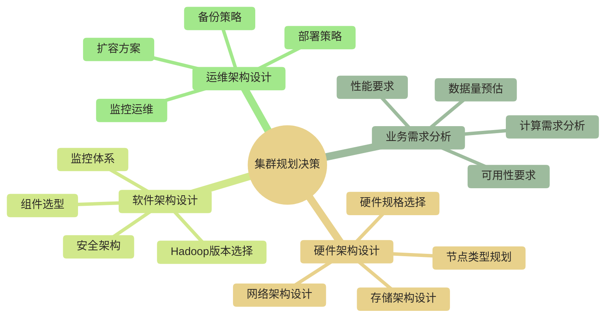
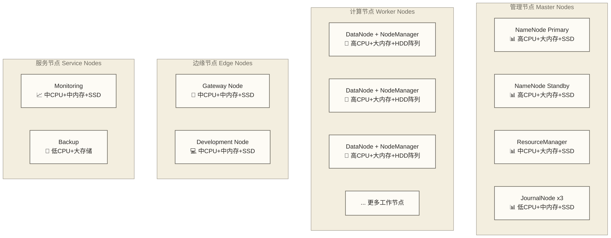
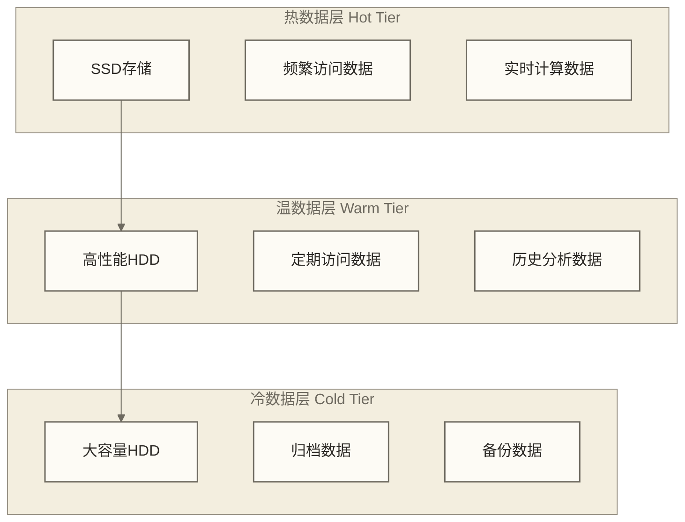
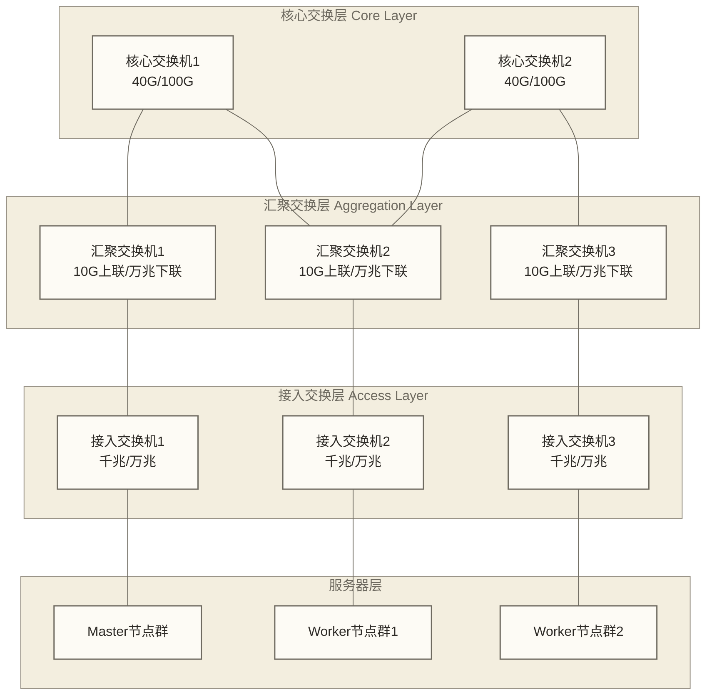
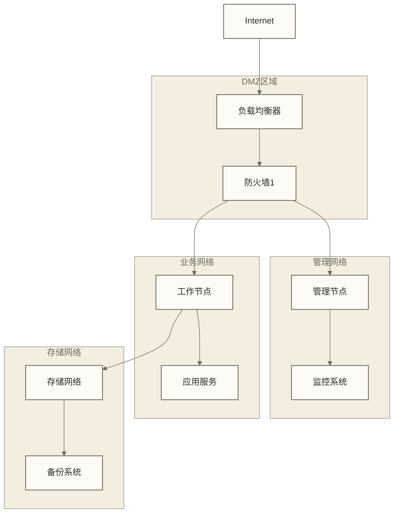
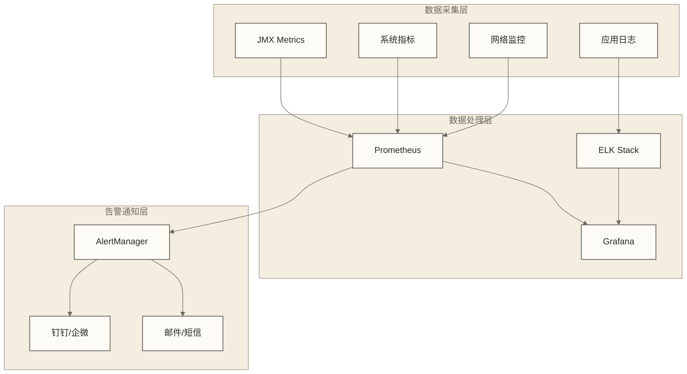

# 🏗️ Hadoop集群规划 - 企业级大数据平台设计

> [!abstract] 📋 本节概览
> - 🎯 **学习目标**：掌握企业级Hadoop集群的全方位规划设计
> - 📚 **前置知识**：[[【技术与工具】/Hadoop/11-YARN集群管理|YARN集群]] | [[【技术与工具】/Hadoop/09-YARN资源管理架构|YARN资源管理]] | 企业IT架构基础
> - ⏱️ **预计用时**：120分钟
> - 🔧 **技术重点**：硬件选型、网络设计、容量规划、成本控制

> [!tip] 💡 前置知识
> 建议先学习集群管理和运维相关内容，了解Hadoop集群的运行特点

---

## 🎯 集群规划概览

### 规划的重要性

> [!note] 💡 集群规划就像建设一座城市
> 想象规划建设一座现代化城市：
> - **基础设施**：道路、水电、通信（网络架构）
> - **建筑规划**：住宅、商业、工业区域（节点分布）
> - **交通设计**：地铁、公交、道路（数据流量规划）
> - **资源配置**：医院、学校、商场（计算资源分配）
> - **扩展预留**：未来发展空间（可扩展性设计）

### 规划阶段的关键决策



---

## 📊 业务需求分析

### 1. 数据量评估

```bash title="数据量评估框架"
# !/bin/bash
# 📊 数据量评估工具

analyze_data_requirements() {
    echo "=== 数据量需求分析 ==="
    
 # 当前数据量评估
    echo "1. 当前数据量评估:"
    echo "   - 结构化数据: ___TB"
    echo "   - 半结构化数据: ___TB" 
    echo "   - 非结构化数据: ___TB"
    echo "   - 总计: ___TB"
    
 # 增长率预测
    echo "2. 数据增长预测:"
    echo "   - 年增长率: ___%"
    echo "   - 3年后预计: ___TB"
    echo "   - 5年后预计: ___TB"
    
 # 数据类型分析
    echo "3. 数据类型分布:"
    echo "   - 日志数据: ___%"
    echo "   - 业务数据: ___%"
    echo "   - 用户数据: ___%"
    echo "   - 其他数据: ___%"
}

# 数据量计算示例
calculate_storage_needs() {
    local raw_data_tb=$1
    local replication_factor=${2:-3}
    local compression_ratio=${3:-0.3}
    local overhead_ratio=${4:-0.2}
    
 # 计算存储需求
    compressed_size=$(echo "$raw_data_tb * $compression_ratio" | bc)
    replicated_size=$(echo "$compressed_size * $replication_factor" | bc)
    total_size=$(echo "$replicated_size * (1 + $overhead_ratio)" | bc)
    
    echo "原始数据: ${raw_data_tb}TB"
    echo "压缩后: ${compressed_size}TB (压缩比${compression_ratio})"
    echo "副本后: ${replicated_size}TB (副本数${replication_factor})"
    echo "总需求: ${total_size}TB (包含${overhead_ratio}开销)"
}

# 示例计算
calculate_storage_needs 100 3 0.3 0.2
```

### 2. 计算需求分析

| 应用场景 | CPU需求 | 内存需求 | 存储需求 | 网络需求 |
|---|---|---|---|---|
| **批量ETL** | 中等 | 高 | 高吞吐 | 中等 |
| **实时分析** | 高 | 很高 | 低延迟 | 高 |
| **机器学习** | 很高 | 很高 | 随机读写 | 中等 |
| **数据仓库** | 中等 | 高 | 顺序读写 | 中等 |
| **日志分析** | 中等 | 中等 | 高吞吐 | 中等 |

### 3. 性能要求定义

```yaml title="性能要求规格"
# 性能要求矩阵
performance_requirements:
  batch_processing:
    - latency: "小时级"
    - throughput: "TB/小时"
    - concurrency: "中等"
    
  interactive_query:
    - latency: "秒级"
    - throughput: "GB/秒"
    - concurrency: "高"
    
  streaming_processing:
    - latency: "毫秒级"
    - throughput: "百万条/秒"
    - concurrency: "很高"
    
  data_loading:
    - latency: "分钟级"
    - throughput: "GB/分钟"
    - concurrency: "低"
```

---

## 🔧 硬件架构设计

### 1. 节点类型规划



### 2. 硬件规格选择矩阵

#### Master节点硬件规格

| 组件 | CPU | 内存 | 存储 | 网络 | 备注 |
|---|---|---|---|---|---|
| **NameNode** | 16-32核 2.4GHz+ | 64-256GB | 1-2TB SSD | 万兆 | 内存是关键瓶颈 |
| **ResourceManager** | 8-16核 | 32-64GB | 500GB SSD | 万兆 | CPU和内存均衡 |
| **JournalNode** | 4-8核 | 8-16GB | 200GB SSD | 千兆 | 写入性能重要 |

#### Worker节点硬件规格

```bash title="Worker节点配置计算器"
# !/bin/bash
# 🔧 Worker节点规格计算器

calculate_worker_specs() {
    local data_size_tb=$1
    local worker_count=$2
    local cpu_core_per_tb=${3:-2}
    local memory_gb_per_tb=${4:-8}
    local disk_multiplier=${5:-1.5}
    
    echo "=== Worker节点规格计算 ==="
    echo "数据总量: ${data_size_tb}TB"
    echo "节点数量: ${worker_count}个"
    
 # 计算每个节点的数据量
    data_per_node=$(echo "scale=2; $data_size_tb / $worker_count" | bc)
    
 # 计算硬件需求
    cpu_cores=$(echo "scale=0; $data_per_node * $cpu_core_per_tb" | bc)
    memory_gb=$(echo "scale=0; $data_per_node * $memory_gb_per_tb" | bc)
    storage_tb=$(echo "scale=1; $data_per_node * $disk_multiplier" | bc)
    
    echo "每节点数据: ${data_per_node}TB"
    echo "推荐CPU: ${cpu_cores}核"
    echo "推荐内存: ${memory_gb}GB"
    echo "推荐存储: ${storage_tb}TB"
    
 # 存储配置建议
    if (( $(echo "$storage_tb > 20" | bc -l) )); then
        echo "存储建议: 12-24块 2TB HDD + 2块 500GB SSD"
    elif (( $(echo "$storage_tb > 10" | bc -l) )); then
        echo "存储建议: 6-12块 2TB HDD + 1块 500GB SSD"
    else
        echo "存储建议: 4-8块 2TB HDD + 1块 500GB SSD"
    fi
}

# 示例计算
calculate_worker_specs 1000 50 2 8 1.5
```

### 3. 存储架构设计

#### 分层存储策略



#### 存储配置建议

```yaml title="存储配置规范"
storage_configuration:
  namenode:
    - type: "SSD"
    - capacity: "1-2TB"
    - raid: "RAID 1"
    - purpose: "元数据存储"
    
  datanode_hot:
    - type: "NVMe SSD"
    - capacity: "1-2TB per disk"
    - count: "2-4 disks"
    - purpose: "热数据、缓存"
    
  datanode_warm:
    - type: "SATA SSD"
    - capacity: "2-4TB per disk"
    - count: "4-8 disks"
    - purpose: "常用数据"
    
  datanode_cold:
    - type: "SATA HDD 7200RPM"
    - capacity: "8-14TB per disk"
    - count: "8-12 disks"
    - purpose: "大容量存储"
```

---

## 🌐 网络架构设计

### 1. 网络拓扑规划



### 2. 网络带宽规划

```bash title="网络带宽计算器"
# !/bin/bash
# 🌐 网络带宽需求计算

calculate_network_bandwidth() {
    local worker_nodes=$1
    local data_per_node_gb=$2
    local replication_factor=${3:-3}
    local concurrent_jobs=${4:-10}
    local transfer_window_seconds=${5:-3600}
    # 教学假设：data_per_node_gb为每作业每节点在该窗口内处理的GB数据量。
    # worker_nodes、concurrent_jobs和transfer_window_seconds须为正数。
    
    echo "=== 网络带宽需求分析（简化教学估算） ==="
    
 # 数据复制带宽需求
    replication_bandwidth=$(echo "scale=4; $data_per_node_gb * ($replication_factor - 1) * 8 / $transfer_window_seconds" | bc)
    echo "数据复制带宽需求: ${replication_bandwidth}Gbps per node"
    
 # MapReduce Shuffle带宽需求
    # 0.3为未实测的教学Shuffle流量比例，不是固定规律。
    shuffle_bandwidth=$(echo "scale=4; $data_per_node_gb * 0.3 * 8 / $transfer_window_seconds" | bc)
    echo "Shuffle带宽需求: ${shuffle_bandwidth}Gbps per node"
    
 # 总带宽需求
    # 假设各并发作业同时产生上述流量；未计协议开销和流量峰值。
    total_per_node=$(echo "scale=4; ($replication_bandwidth + $shuffle_bandwidth) * $concurrent_jobs" | bc)
    cluster_total=$(echo "scale=4; $total_per_node * $worker_nodes" | bc)
    
    echo "每节点总需求: ${total_per_node}Gbps"
    echo "集群各节点需求合计: ${cluster_total}Gbps（不是单条上联链路需求）"
    
 # 建议网络配置
    if (( $(echo "$total_per_node > 10" | bc -l) )); then
        echo "建议: 评估高于10Gbps的网卡与交换容量，并预留峰值余量"
    elif (( $(echo "$total_per_node > 1" | bc -l) )); then
        echo "建议: 评估万兆或更高带宽，并预留峰值余量"
    else
        echo "建议: 千兆可作为候选，仍须验证峰值、协议开销和上联超售比"
    fi
}

# 示例计算
calculate_network_bandwidth 50 100 3 10
```

---

## 📈 容量规划

### 1. 存储容量规划

```python title="容量规划计算器"
# !/usr/bin/env python3
# 📊 Hadoop集群容量规划工具

import math

class HadoopCapacityPlanner:
    def __init__(self):
        self.compression_ratios = {
            'text': 0.3,
            'json': 0.4,
            'parquet': 0.1,
            'avro': 0.2,
            'raw': 1.0
        }
    
    def calculate_storage_capacity(self, raw_data_tb, data_types, 
                                 replication_factor=3, overhead_ratio=0.2):
        """计算存储容量需求"""
        print("=== 存储容量规划 ===")
        
 # 计算压缩后大小
        compressed_size = 0
        for data_type, size_tb in data_types.items():
            compression_ratio = self.compression_ratios.get(data_type, 1.0)
            compressed = size_tb * compression_ratio
            compressed_size += compressed
            print(f"{data_type}数据: {size_tb}TB -> {compressed:.1f}TB (压缩比{compression_ratio})")
        
 # 计算副本和开销
        replicated_size = compressed_size * replication_factor
        total_size = replicated_size * (1 + overhead_ratio)
        
        print(f"\n压缩后总计: {compressed_size:.1f}TB")
        print(f"副本后总计: {replicated_size:.1f}TB (副本数{replication_factor})")
        print(f"最终需求: {total_size:.1f}TB (包含{overhead_ratio*100:.0f}%开销)")
        
        return total_size
    
    def calculate_compute_capacity(self, workload_specs):
        """计算计算容量需求"""
        print("\n=== 计算容量规划 ===")
        
        total_cpu_cores = 0
        total_memory_gb = 0
        
        for workload, specs in workload_specs.items():
            cpu_cores = specs['cpu_cores']
            memory_gb = specs['memory_gb']
            concurrency = specs['concurrency']
            
            workload_cpu = cpu_cores * concurrency
            workload_memory = memory_gb * concurrency
            
            total_cpu_cores += workload_cpu
            total_memory_gb += workload_memory
            
            print(f"{workload}: {workload_cpu}核CPU, {workload_memory}GB内存")
        
        print(f"\n总计算需求: {total_cpu_cores}核CPU, {total_memory_gb}GB内存")
        return total_cpu_cores, total_memory_gb
    
    def recommend_cluster_size(self, total_storage_tb, total_cpu_cores, total_memory_gb):
        """推荐集群规模"""
        print("\n=== 集群规模建议 ===")
        
 # 基于存储计算节点数
        storage_per_node_tb = 24  # 假设每个节点24TB存储
        nodes_for_storage = math.ceil(total_storage_tb / storage_per_node_tb)
        
 # 基于计算资源计算节点数
        cpu_per_node = 32  # 假设每个节点32核
        memory_per_node_gb = 128  # 假设每个节点128GB内存
        
        nodes_for_cpu = math.ceil(total_cpu_cores / cpu_per_node)
        nodes_for_memory = math.ceil(total_memory_gb / memory_per_node_gb)
        
 # 取最大值
        recommended_nodes = max(nodes_for_storage, nodes_for_cpu, nodes_for_memory)
        
        print(f"基于存储需求: {nodes_for_storage}个节点")
        print(f"基于CPU需求: {nodes_for_cpu}个节点") 
        print(f"基于内存需求: {nodes_for_memory}个节点")
        print(f"推荐节点数: {recommended_nodes}个节点")
        
        return recommended_nodes

# 使用示例
if __name__ == "__main__":
    planner = HadoopCapacityPlanner()
    
 # 数据类型分布
    data_types = {
        'text': 50,      # 50TB文本数据
        'json': 30,      # 30TB JSON数据
        'parquet': 20,   # 20TB Parquet数据
    }
    
 # 工作负载规格
    workload_specs = {
        'ETL作业': {'cpu_cores': 8, 'memory_gb': 32, 'concurrency': 5},
        '实时查询': {'cpu_cores': 4, 'memory_gb': 16, 'concurrency': 10},
        '机器学习': {'cpu_cores': 16, 'memory_gb': 64, 'concurrency': 2},
    }
    
 # 计算容量需求
    total_storage = planner.calculate_storage_capacity(100, data_types)
    total_cpu, total_memory = planner.calculate_compute_capacity(workload_specs)
    nodes = planner.recommend_cluster_size(total_storage, total_cpu, total_memory)
```

### 2. 成本评估模型

```bash title="成本评估工具"
# !/bin/bash
# 💰 Hadoop集群成本评估

calculate_cluster_cost() {
    local worker_nodes=$1
    local master_nodes=${2:-4}
    local edge_nodes=${3:-2}
    
    echo "=== 集群成本评估 ==="
    
 # 硬件成本 (单位: 万元；以下单价、固定费用及20%年运维比例均为原稿未核实教学假设，不是市场报价或完整TCO)
    local worker_cost_per_node=8    # 8万/节点
    local master_cost_per_node=15   # 15万/节点
    local edge_cost_per_node=5      # 5万/节点
    
 # 网络设备成本
    local network_cost=50           # 50万网络设备
    
 # 机柜和基础设施成本
    local infrastructure_cost=30    # 30万基础设施
    
 # 计算硬件总成本
    local worker_total=$(($worker_nodes * $worker_cost_per_node))
    local master_total=$(($master_nodes * $master_cost_per_node))
    local edge_total=$(($edge_nodes * $edge_cost_per_node))
    local hardware_total=$(($worker_total + $master_total + $edge_total))
    
 # 计算项目总成本
    local project_total=$(($hardware_total + $network_cost + $infrastructure_cost))
    
    echo "Worker节点 ($worker_nodes个): ${worker_total}万元"
    echo "Master节点 ($master_nodes个): ${master_total}万元"
    echo "Edge节点 ($edge_nodes个): ${edge_total}万元"
    echo "网络设备: ${network_cost}万元"
    echo "基础设施: ${infrastructure_cost}万元"
    echo "--------------------"
    echo "硬件总成本: ${hardware_total}万元"
    echo "项目总成本: ${project_total}万元"
    
 # 年度运维成本
    local annual_ops_cost=$(($project_total / 5))  # 20%的年运维成本
    echo "年运维成本: ${annual_ops_cost}万元"
}

# 示例计算
calculate_cluster_cost 50 4 2
```

---

## 🔒 安全架构规划

### 1. 网络安全设计



### 2. 身份认证架构

```yaml title="安全配置规范"
security_architecture:
  authentication:
    - type: "Kerberos"
    - kdc_servers: 3
    - realm: "与Hadoop生态集成.COMPANY.COM"
    
  authorization:
    - ranger_enabled: true
    - policy_engine: "Apache Ranger"
    - fine_grained_access: true
    
  encryption:
    - data_at_rest: "AES-256"
    - data_in_transit: "TLS 1.2+"
    - rpc_encryption: true
    
  auditing:
    - audit_logs: "centralized"
    - log_retention: "7 years"  # 原稿未核实的教学留存示例，并非通用法定期限
    - compliance: "SOX, GDPR"  # 原稿列举的待评估要求，不表示已满足合规
```

---

## 📊 监控架构规划

### 1. 监控系统设计



### 2. 关键监控指标

```yaml title="监控指标规范"
monitoring_metrics:
  cluster_level:
    - cluster_health: "整体健康状态"
    - resource_utilization: "资源使用率"
    - job_success_rate: "作业成功率"
    - data_throughput: "数据吞吐量"
    
  node_level:
    - cpu_usage: "CPU使用率"
    - memory_usage: "内存使用率"
    - disk_usage: "磁盘使用率"
    - network_io: "网络IO"
    
  application_level:
    - job_duration: "作业执行时间"
    - queue_wait_time: "队列等待时间"
    - error_rate: "错误率"
    - sla_compliance: "SLA达成率"
```

---

## 🔗 学习路径

### 下一步学习建议

1. **[[【技术与工具】/Hadoop/19-高可用架构设计|高可用架构]]** - 设计高可用的Hadoop集群
2. **[[【技术与工具】/Hadoop/20-性能监控与调优|性能监控与调优]]** - 建立监控和性能优化体系
3. **[[【技术与工具】/Hadoop/21-数据备份与恢复|数据备份与恢复]]** - 数据保护和灾备策略
4. **[[【技术与工具】/Hadoop/22-故障排查与运维|故障排查与运维]]** - 运维和故障处理

### 实践项目建议

- 设计100节点的企业级Hadoop集群
- 编写集群规划报告和TCO分析
- 设计监控和安全架构方案
- 制定扩容和升级计划

---

> [!tip] 💡 关键收获
> - 集群规划是成功部署的基础，需要综合考虑业务需求、技术架构、成本控制
> - 硬件选型要平衡性能、成本和可扩展性
> - 网络架构设计直接影响集群性能和可靠性
> - 安全和监控架构需要在设计阶段就充分考虑 