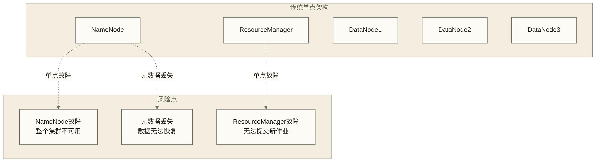
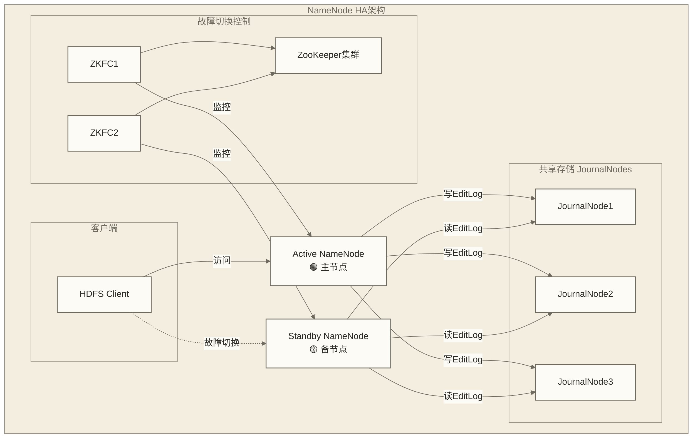
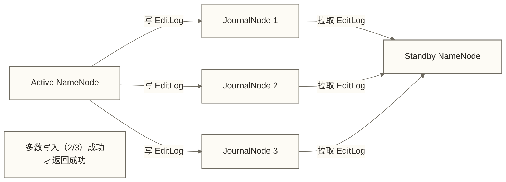
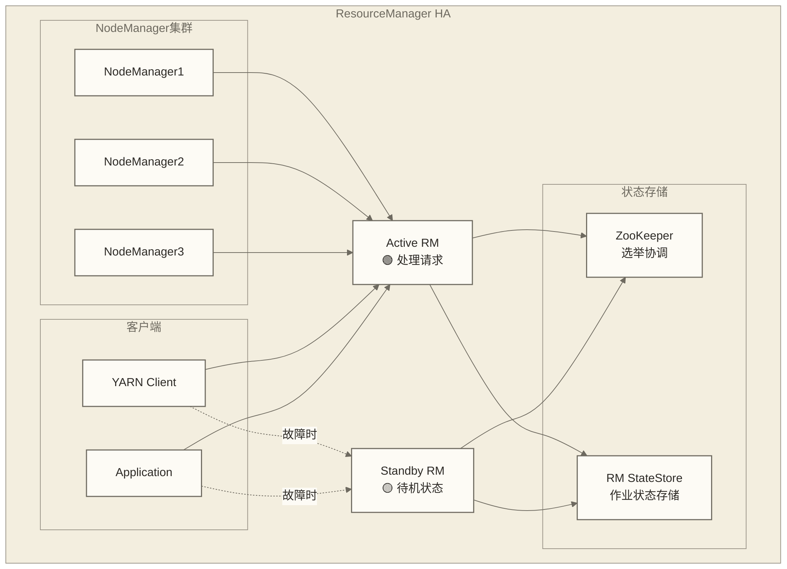
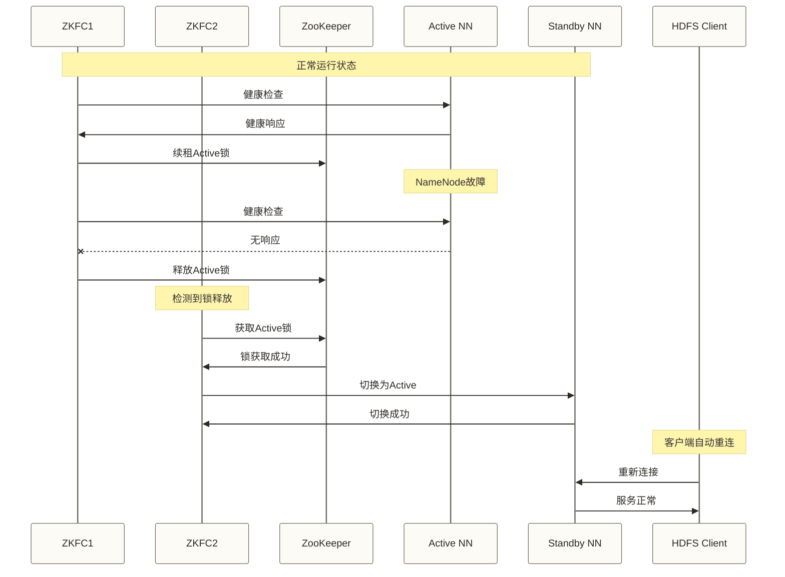

# 🔄 Hadoop高可用架构设计 - 企业级容错与自动恢复

> [!abstract] 📋 本节概览
> - 🎯 **学习目标**：掌握Hadoop集群高可用架构设计和实现
> - 📚 **前置知识**：[[【技术与工具】/Hadoop/18-Hadoop集群规划|Hadoop集群规划]] | [[【技术与工具】/Hadoop/09-YARN资源管理架构|YARN资源管理]] | [[【技术与工具】/Hadoop/03-HDFS分布式文件系统|HDFS分布式文件系统]]
> - ⏱️ **预计用时**：120分钟
> - 🔧 **技术重点**：NameNode HA、ResourceManager HA、故障自动切换

> [!tip] 💡 前置知识
> 建议先学习集群规划和HDFS/YARN基础架构，了解单点故障风险

---

## 🎯 高可用性概览

### 🏗️ 架构设计挑战

构建可靠的数据系统时，Hadoop高可用架构设计是核心考虑因素，直接影响系统的稳定性和扩展性。

在实际工作环境中，这样的挑战每天都在发生。理解相关知识不仅能解决当前问题，更能提升整体的专业能力。
### 单点故障风险分析



### 高可用架构目标

以下数值为原稿未验证的设计目标示例，不是Hadoop HA的默认能力或已测得成果；需明确统计周期、故障模型、负载和数据持久化边界后验收，“100%”不构成所有故障下无数据丢失的保证。

| 指标 | 目标值 | 说明 |
|---|---|---|
| **可用性** | 99.9%+ | 年故障时间<8.76小时 |
| **恢复时间** | <30秒 | 自动故障切换时间 |
| **数据一致性** | 100% | 无数据丢失 |
| **故障检测** | <10秒 | 快速发现故障 |

---

## 🏗️ NameNode高可用架构

### 1. NameNode HA 架构原理



### 2. NameNode HA 配置实现

#### 核心配置文件

```xml title="hdfs-site.xml"
<!-- NameNode HA 核心配置 -->
<configuration>
    <!-- 启用NameNode HA -->
    <property>
        <name>dfs.nameservices</name>
        <value>mycluster</value>
        <description>NameService ID</description>
    </property>
    
    <!-- NameNode节点列表 -->
    <property>
        <name>dfs.ha.namenodes.mycluster</name>
        <value>nn1,nn2</value>
        <description>NameNode列表</description>
    </property>
    
    <!-- Active NameNode配置 -->
    <property>
        <name>dfs.namenode.rpc-address.mycluster.nn1</name>
        <value>namenode1:8020</value>
    </property>
    
    <property>
        <name>dfs.namenode.http-address.mycluster.nn1</name>
        <value>namenode1:50070</value>
    </property>
    
    <!-- Standby NameNode配置 -->
    <property>
        <name>dfs.namenode.rpc-address.mycluster.nn2</name>
        <value>namenode2:8020</value>
    </property>
    
    <property>
        <name>dfs.namenode.http-address.mycluster.nn2</name>
        <value>namenode2:50070</value>
    </property>
    
    <!-- JournalNode配置 -->
    <property>
        <name>dfs.namenode.shared.edits.dir</name>
        <value>qjournal://journal1:8485;journal2:8485;journal3:8485/mycluster</value>
        <description>共享存储路径</description>
    </property>
    
    <!-- 故障切换配置 -->
    <property>
        <name>dfs.client.failover.proxy.provider.mycluster</name>
        <value>org.apache.hadoop.hdfs.server.namenode.ha.ConfiguredFailoverProxyProvider</value>
    </property>
    
    <!-- 自动故障切换 -->
    <property>
        <name>dfs.ha.automatic-failover.enabled</name>
        <value>true</value>
    </property>
    
    <property>
        <name>dfs.ha.fencing.methods</name>
        <value>sshfence</value>
    </property>
    
    <property>
        <name>dfs.ha.fencing.ssh.private-key-files</name>
        <value>/home/hadoop/.ssh/id_rsa</value>
    </property>
</configuration>
```

#### 自动故障切换配置

```xml title="core-site.xml"
<!-- ZooKeeper配置 -->
<configuration>
    <property>
        <name>ha.zookeeper.quorum</name>
        <value>zk1:2181,zk2:2181,zk3:2181</value>
        <description>ZooKeeper集群地址</description>
    </property>
    
    <property>
        <name>ha.zookeeper.session-timeout.ms</name>
        <value>5000</value>
        <description>ZK会话超时时间</description>
    </property>
</configuration>
```

### 3. HDFS HA 核心原理：QJM 写入机制

> [!note] QJM（Quorum Journal Manager）是 HDFS HA 的关键组件
> Active NameNode 的每一次 EditLog 写入，必须同时写入 **2N+1 个 JournalNode 中的多数（N+1 个）** 才算成功。Standby NameNode 持续从 JournalNode 中拉取 EditLog 进行回放，保持与 Active 的状态同步。
>
> - 这确保了：即使 Active NameNode 突然宕机，Standby 已经有了几乎最新的元数据状态，切换延迟可控制在秒级。
> - JournalNode 本身是高可用的：只要多数（如 3 个中的 2 个）JournalNode 在线，集群就能正常写入。



### 4. 手动切换与 haadmin 命令

在 HA 自动故障切换的基础上，运维人员也需要掌握手动操作命令用于计划性维护：

```bash title="hdfs haadmin 常用命令"
# 查看 NameNode 当前角色（active / standby）
hdfs haadmin -getServiceState nn1
hdfs haadmin -getServiceState nn2

# 查看所有 NameNode 状态（一次性）
hdfs haadmin -getAllServiceState

# 手动触发故障切换（将 nn2 切换为 Active）
# 此处使用协调故障切换；不要将强制角色转换作为常规维护操作
hdfs haadmin -failover nn1 nn2

# 手动将 nn2 强制切换为 Active（危险操作，可能导致脑裂）
hdfs haadmin -transitionToActive nn2 --forceactive

# 手动将 nn1 切换为 Standby
hdfs haadmin -transitionToStandby nn1

# 检查 NameNode 健康状态
hdfs haadmin -checkHealth nn1
```

> [!warning] `--forceactive` 用于强制激活并绕过目标服务的就绪检查，不是通用的 Fencing 绕过开关；直接 `-transitionToActive` 不会替你协调旧 Active 的降级或隔离。启用自动故障切换时，直接角色转换通常还会受到保护性限制，应优先使用协调切换，并按目标版本核对命令；旧 Active 未被可靠隔离时不得强制激活。

### 5. NameNode HA 部署脚本

```bash title="deploy_namenode_ha.sh"
#!/bin/bash
# 🚀 NameNode HA部署脚本

set -e

# 配置变量
HADOOP_HOME="/opt/hadoop"
HADOOP_USER="hadoop"
NAMENODE1="namenode1"
NAMENODE2="namenode2"
JOURNAL_NODES="journal1,journal2,journal3"

echo "=== Hadoop NameNode HA 部署开始 ==="

# 1. 格式化ZooKeeper
format_zookeeper() {
    echo "1. 格式化ZooKeeper..."
    sudo -u $HADOOP_USER $HADOOP_HOME/bin/hdfs zkfc -formatZK -force
    echo "ZooKeeper格式化完成"
}

# 2. 启动JournalNode
start_journalnodes() {
    echo "2. 启动JournalNode服务..."
    IFS=',' read -ra NODES <<< "$JOURNAL_NODES"
    for node in "${NODES[@]}"; do
        echo "启动 $node 上的JournalNode..."
        ssh $HADOOP_USER@$node "$HADOOP_HOME/sbin/hadoop-daemon.sh start journalnode"
    done
    echo "JournalNode启动完成"
}

# 3. 格式化第一个NameNode
format_first_namenode() {
    echo "3. 格式化第一个NameNode..."
    ssh $HADOOP_USER@$NAMENODE1 "$HADOOP_HOME/bin/hdfs namenode -format -force"
    echo "第一个NameNode格式化完成"
}

# 4. 启动第一个NameNode
start_first_namenode() {
    echo "4. 启动第一个NameNode..."
    ssh $HADOOP_USER@$NAMENODE1 "$HADOOP_HOME/sbin/hadoop-daemon.sh start namenode"
    echo "第一个NameNode启动完成"
    sleep 10
}

# 5. 同步第二个NameNode
bootstrap_standby_namenode() {
    echo "5. 同步第二个NameNode..."
    ssh $HADOOP_USER@$NAMENODE2 "$HADOOP_HOME/bin/hdfs namenode -bootstrapStandby"
    echo "第二个NameNode同步完成"
}

# 6. 启动第二个NameNode
start_standby_namenode() {
    echo "6. 启动第二个NameNode..."
    ssh $HADOOP_USER@$NAMENODE2 "$HADOOP_HOME/sbin/hadoop-daemon.sh start namenode"
    echo "第二个NameNode启动完成"
    sleep 5
}

# 7. 启动ZKFC服务
start_zkfc() {
    echo "7. 启动ZKFC服务..."
    ssh $HADOOP_USER@$NAMENODE1 "$HADOOP_HOME/sbin/hadoop-daemon.sh start zkfc"
    ssh $HADOOP_USER@$NAMENODE2 "$HADOOP_HOME/sbin/hadoop-daemon.sh start zkfc"
    echo "ZKFC服务启动完成"
}

# 8. 验证HA状态
verify_ha_status() {
    echo "8. 验证HA状态..."
    echo "Active NameNode状态:"
    ssh $HADOOP_USER@$NAMENODE1 "$HADOOP_HOME/bin/hdfs haadmin -getServiceState nn1"
    echo "Standby NameNode状态:"
    ssh $HADOOP_USER@$NAMENODE2 "$HADOOP_HOME/bin/hdfs haadmin -getServiceState nn2"
}

# 执行部署流程
main() {
    format_zookeeper
    start_journalnodes
    format_first_namenode
    start_first_namenode
    bootstrap_standby_namenode
    start_standby_namenode
    start_zkfc
    verify_ha_status
    
    echo "=== NameNode HA部署完成 ==="
    echo "可以使用以下命令管理HA状态："
    echo "  查看状态: hdfs haadmin -getServiceState nn1"
    echo "  协调切换（先确认nn1为Active、nn2为Standby）: hdfs haadmin -failover nn1 nn2"
    echo "  故障恢复: hdfs haadmin -transitionToStandby nn1"
}

# 运行主函数
main "$@"
```

---

## 🎯 ResourceManager高可用架构

### 1. ResourceManager HA 架构



### 2. ResourceManager HA 配置

```xml title="yarn-site.xml"
<!-- ResourceManager HA配置 -->
<configuration>
    <!-- 启用ResourceManager HA -->
    <property>
        <name>yarn.resourcemanager.ha.enabled</name>
        <value>true</value>
    </property>
    
    <!-- RM集群标识 -->
    <property>
        <name>yarn.resourcemanager.cluster-id</name>
        <value>yarn-cluster</value>
    </property>
    
    <!-- RM实例列表 -->
    <property>
        <name>yarn.resourcemanager.ha.rm-ids</name>
        <value>rm1,rm2</value>
    </property>
    
    <!-- RM1配置 -->
    <property>
        <name>yarn.resourcemanager.hostname.rm1</name>
        <value>resourcemanager1</value>
    </property>
    
    <property>
        <name>yarn.resourcemanager.webapp.address.rm1</name>
        <value>resourcemanager1:8088</value>
    </property>
    
    <!-- RM2配置 -->
    <property>
        <name>yarn.resourcemanager.hostname.rm2</name>
        <value>resourcemanager2</value>
    </property>
    
    <property>
        <name>yarn.resourcemanager.webapp.address.rm2</name>
        <value>resourcemanager2:8088</value>
    </property>
    
    <!-- ZooKeeper配置 -->
    <property>
        <name>yarn.resourcemanager.zk-address</name>
        <value>zk1:2181,zk2:2181,zk3:2181</value>
    </property>
    
    <!-- 状态存储 -->
    <property>
        <name>yarn.resourcemanager.store.class</name>
        <value>org.apache.hadoop.yarn.server.resourcemanager.recovery.ZKRMStateStore</value>
    </property>
    
    <!-- 自动故障恢复 -->
    <property>
        <name>yarn.resourcemanager.recovery.enabled</name>
        <value>true</value>
    </property>
    
    <!-- 客户端故障切换 -->
    <property>
        <name>yarn.client.failover-proxy-provider</name>
        <value>org.apache.hadoop.yarn.client.ConfiguredRMFailoverProxyProvider</value>
    </property>
</configuration>
```

### 3. ResourceManager HA 管理脚本

```bash title="manage_resourcemanager_ha.sh"
#!/bin/bash
# 🔧 ResourceManager HA管理工具

HADOOP_HOME="/opt/hadoop"
HADOOP_USER="hadoop"
RM1_HOST="resourcemanager1"
RM2_HOST="resourcemanager2"

# 检查RM状态
check_rm_status() {
    echo "=== ResourceManager HA状态检查 ==="
    
    echo "RM1状态 ($RM1_HOST):"
    ssh $HADOOP_USER@$RM1_HOST "$HADOOP_HOME/bin/yarn rmadmin -getServiceState rm1" 2>/dev/null || echo "RM1无响应"
    
    echo "RM2状态 ($RM2_HOST):"
    ssh $HADOOP_USER@$RM2_HOST "$HADOOP_HOME/bin/yarn rmadmin -getServiceState rm2" 2>/dev/null || echo "RM2无响应"
}

# 手动故障切换
manual_failover() {
    local target_rm=$1
    if [[ "$target_rm" != "rm1" && "$target_rm" != "rm2" ]]; then
        echo "使用方法: $0 failover <rm1|rm2>"
        return 1
    fi
    
    echo "=== 手动切换到 $target_rm ==="
    $HADOOP_HOME/bin/yarn rmadmin -transitionToActive $target_rm
    
    if [[ $? -eq 0 ]]; then
        echo "切换成功！"
        check_rm_status
    else
        echo "切换失败！"
        return 1
    fi
}

# 重启RM服务
restart_rm() {
    local rm_host=$1
    local rm_id=$2
    
    echo "=== 重启 $rm_id ($rm_host) ==="
    
 # 停止服务
    ssh $HADOOP_USER@$rm_host "$HADOOP_HOME/sbin/yarn-daemon.sh stop resourcemanager"
    sleep 5
    
 # 启动服务
    ssh $HADOOP_USER@$rm_host "$HADOOP_HOME/sbin/yarn-daemon.sh start resourcemanager"
    sleep 10
    
 # 检查状态
    ssh $HADOOP_USER@$rm_host "$HADOOP_HOME/bin/yarn rmadmin -getServiceState $rm_id"
}

# 故障恢复
recover_from_failure() {
    echo "=== ResourceManager故障恢复 ==="
    
 # 检查当前状态
    check_rm_status
    
 # 尝试重启无响应的RM
    if ! ssh $HADOOP_USER@$RM1_HOST "$HADOOP_HOME/bin/yarn rmadmin -getServiceState rm1" 2>/dev/null; then
        echo "RM1故障，尝试重启..."
        restart_rm $RM1_HOST rm1
    fi
    
    if ! ssh $HADOOP_USER@$RM2_HOST "$HADOOP_HOME/bin/yarn rmadmin -getServiceState rm2" 2>/dev/null; then
        echo "RM2故障，尝试重启..."
        restart_rm $RM2_HOST rm2
    fi
    
 # 再次检查状态
    echo "恢复后状态："
    check_rm_status
}

# 主函数
case "$1" in
    status)
        check_rm_status
        ;;
    failover)
        manual_failover $2
        ;;
    restart)
        if [[ "$2" == "rm1" ]]; then
            restart_rm $RM1_HOST rm1
        elif [[ "$2" == "rm2" ]]; then
            restart_rm $RM2_HOST rm2
        else
            echo "使用方法: $0 restart <rm1|rm2>"
        fi
        ;;
    recover)
        recover_from_failure
        ;;
    *)
        echo "使用方法: $0 {status|failover|restart|recover}"
        echo "  status   - 检查HA状态"
        echo "  failover - 手动故障切换"
        echo "  restart  - 重启指定RM"
        echo "  recover  - 自动故障恢复"
        exit 1
        ;;
esac
```

---

## 🔒 脑裂防护（Fencing）

### 什么是脑裂

脑裂（Split-brain）是 HA 系统中最危险的场景：两个节点同时认为自己是 Active，都在接受写入请求，导致数据状态不一致，极难修复。

**HDFS HA 中脑裂的典型场景**：
1. Active NameNode 发生 Full GC，ZKFC 误判其宕机，触发切换
2. Standby NN 切换为 Active，开始提供服务
3. 旧 Active NN 从 GC 中恢复，可能仍认为自己是 Active，并尝试继续写入 JournalNode
4. 正确配置的 QJM 通过写入 epoch 拒绝旧 Active 在新 Active 接管后获得多数写入成功，防止两个节点同时成功提交 EditLog；仍需服务隔离，避免旧 Active 继续响应客户端并提供过时状态

### Fencing 机制

Fencing（隔离/防护）的目的是在切换发生时，**强制确保旧 Active 停止服务**，再让新 Active 接管。HDFS 的 ZKFC 在需要隔离旧 Active 的切换流程中执行配置的 Fencing 方法；YARN ResourceManager 使用内嵌的自动故障切换选举机制，而不是 ZKFC，采用 ZKRMStateStore 时还通过状态存储隔离机制防止旧 RM 继续写入状态：

#### sshfence（最常用）

通过 SSH 远程登录旧 Active 节点，强制 kill 其 NameNode 进程：

```xml title="hdfs-site.xml - sshfence 配置"
<configuration>
    <!-- 指定 Fencing 方法（可配置多个，按顺序尝试） -->
    <property>
        <name>dfs.ha.fencing.methods</name>
        <value>sshfence</value>
    </property>

    <!-- SSH 私钥路径（需要能无密码登录对方节点） -->
    <property>
        <name>dfs.ha.fencing.ssh.private-key-files</name>
        <value>/home/hadoop/.ssh/id_rsa</value>
    </property>

    <!-- SSH 连接超时（毫秒，避免 SSH 挂起阻塞切换） -->
    <property>
        <name>dfs.ha.fencing.ssh.connect-timeout</name>
        <value>30000</value>
    </property>
</configuration>
```

#### shellfence（更灵活）

执行自定义 shell 脚本，可以通过 IPMI/iLO 断电、调用云平台 API 停止实例等更强硬的方式隔离旧节点：

```xml title="hdfs-site.xml - shellfence 配置"
<configuration>
    <property>
        <name>dfs.ha.fencing.methods</name>
        <!-- 先尝试 sshfence，失败再执行自定义脚本 -->
        <value>sshfence
shell(/etc/hadoop/scripts/fence-namenode.sh $target_host)</value>
    </property>
</configuration>
```

```bash title="fence-namenode.sh - 自定义 Fencing 脚本示例"
#!/bin/bash
# 自定义 Fencing 脚本
# 参数 $1 = 目标主机名
TARGET_HOST=$1

echo "Fencing target: $TARGET_HOST"

# 方案1：尝试 SSH kill 进程
if ssh -o ConnectTimeout=10 hadoop@${TARGET_HOST} \
    "ps aux | grep NameNode | grep -v grep | awk '{print \$2}' | xargs -r kill -9"; then
    echo "SSH fencing succeeded"
    exit 0
fi

# 方案2：通过 IPMI 强制断电（极端情况）
# ipmitool -H ${TARGET_HOST}-ipmi -U admin -P password chassis power off
# echo "IPMI power off succeeded"
# exit 0

echo "All fencing methods failed"
exit 1
```

#### Fencing 与 ZKFC 配置关系

| Fencing 方式 | 优点 | 缺点 | 适用场景 |
|---|---|---|---|
| **sshfence** | 配置简单，无需额外硬件 | 依赖 SSH 连通性，GC 场景可能误杀存活节点 | 大多数生产环境 |
| **shellfence** | 灵活可定制，可与硬件电源管理集成 | 需要额外开发和运维脚本 | 有 IPMI/iLO 硬件的机房环境 |
| **两者组合** | sshfence 优先，失败回退 shell | 配置稍复杂 | 高可靠要求的企业环境 |

> [!warning] 如果所有 Fencing 方法都失败，ZKFC 会**拒绝将 Standby 切换为 Active**，宁可让集群不可用，也不制造脑裂。这是正确的行为——"宁可不可用，不要不一致"（CP 优先）。

---

## ⚡ 自动故障切换机制

### 1. 故障检测与切换流程



### 2. 健康检查配置

```bash title="health_check_config.sh"
#!/bin/bash
# 🏥 健康检查配置工具

configure_health_checks() {
    echo "=== 配置HA健康检查 ==="
    
 # NameNode健康检查配置
    cat > $HADOOP_HOME/etc/hadoop/health-check-namenode.sh << 'EOF'
#!/bin/bash
# NameNode健康检查脚本

NAMENODE_PID=$(pgrep -f "org.apache.hadoop.hdfs.server.namenode.NameNode")
if [[ -z "$NAMENODE_PID" ]]; then
    echo "ERROR: NameNode进程不存在"
    exit 1
fi

# 检查JMX接口
curl -s "http://localhost:50070/jmx?qry=Hadoop:service=NameNode,name=NameNodeStatus" > /dev/null
if [[ $? -ne 0 ]]; then
    echo "ERROR: NameNode JMX接口无响应"
    exit 1
fi

# 检查RPC接口
hdfs dfsadmin -safemode get > /dev/null 2>&1
if [[ $? -ne 0 ]]; then
    echo "ERROR: NameNode RPC接口无响应"
    exit 1
fi

echo "OK: NameNode健康"
exit 0
EOF

 # ResourceManager健康检查配置
    cat > $HADOOP_HOME/etc/hadoop/health-check-resourcemanager.sh << 'EOF'
#!/bin/bash
# ResourceManager健康检查脚本

RM_PID=$(pgrep -f "org.apache.hadoop.yarn.server.resourcemanager.ResourceManager")
if [[ -z "$RM_PID" ]]; then
    echo "ERROR: ResourceManager进程不存在"
    exit 1
fi

# 检查Web接口
curl -s "http://localhost:8088/ws/v1/cluster/info" > /dev/null
if [[ $? -ne 0 ]]; then
    echo "ERROR: ResourceManager Web接口无响应"
    exit 1
fi

# 检查集群状态
yarn node -list > /dev/null 2>&1
if [[ $? -ne 0 ]]; then
    echo "ERROR: ResourceManager命令行接口无响应"
    exit 1
fi

echo "OK: ResourceManager健康"
exit 0
EOF

    chmod +x $HADOOP_HOME/etc/hadoop/health-check-*.sh
    echo "健康检查脚本配置完成"
}

# 配置监控告警
configure_monitoring_alerts() {
    echo "=== 配置监控告警 ==="
    
 # 创建监控脚本
    cat > $HADOOP_HOME/bin/ha-monitor.sh << 'EOF'
#!/bin/bash
# HA监控脚本

LOGFILE="/var/log/hadoop/ha-monitor.log"
ALERT_EMAIL="admin@company.com"

# 检查NameNode HA状态
check_namenode_ha() {
    local active_count=$(hdfs haadmin -getAllServiceState | grep -c "active")
    local standby_count=$(hdfs haadmin -getAllServiceState | grep -c "standby")
    
    if [[ "$active_count" -ne 1 || "$standby_count" -ne 1 ]]; then
        echo "[$(date)] WARNING: NameNode HA状态异常 - Active:$active_count, Standby:$standby_count" >> $LOGFILE
        send_alert "NameNode HA状态异常"
        return 1
    fi
    
    return 0
}

# 检查ResourceManager HA状态
check_resourcemanager_ha() {
    local active_count=$(yarn rmadmin -getAllServiceState | grep -c "active")
    local standby_count=$(yarn rmadmin -getAllServiceState | grep -c "standby")
    
    if [[ "$active_count" -ne 1 || "$standby_count" -ne 1 ]]; then
        echo "[$(date)] WARNING: ResourceManager HA状态异常 - Active:$active_count, Standby:$standby_count" >> $LOGFILE
        send_alert "ResourceManager HA状态异常"
        return 1
    fi
    
    return 0
}

# 发送告警
send_alert() {
    local message=$1
    echo "Hadoop集群HA异常: $message" | mail -s "Hadoop HA Alert" $ALERT_EMAIL
}

# 主循环
while true; do
    check_namenode_ha
    check_resourcemanager_ha
    sleep 30
done
EOF

    chmod +x $HADOOP_HOME/bin/ha-monitor.sh
    echo "监控告警配置完成"
}

# 执行配置
configure_health_checks
configure_monitoring_alerts

echo "=== HA健康检查和监控配置完成 ==="
```

---

## 🧪 故障切换测试

### 1. 故障切换测试套件

```python title="ha_failover_test.py"
#!/usr/bin/env python3
# 🧪 Hadoop HA故障切换测试工具

import subprocess
import time
import sys
import logging
from concurrent.futures import ThreadPoolExecutor

class HadoopHAFailoverTest:
    def __init__(self):
        self.logger = self._setup_logging()
        self.namenode1 = "namenode1"
        self.namenode2 = "namenode2"
        self.rm1 = "resourcemanager1"
        self.rm2 = "resourcemanager2"
    
    def _setup_logging(self):
        """配置日志"""
        logging.basicConfig(
            level=logging.INFO,
            format='%(asctime)s - %(levelname)s - %(message)s',
            handlers=[
                logging.FileHandler('/var/log/hadoop/ha-test.log'),
                logging.StreamHandler(sys.stdout)
            ]
        )
        return logging.getLogger(__name__)
    
    def run_command(self, command, timeout=30):
        """执行shell命令"""
        try:
            result = subprocess.run(
                command, shell=True, capture_output=True, 
                text=True, timeout=timeout
            )
            return result.returncode == 0, result.stdout, result.stderr
        except subprocess.TimeoutExpired:
            return False, "", "命令执行超时"
        except Exception as e:
            return False, "", str(e)
    
    def get_namenode_state(self, nn_id):
        """获取NameNode状态"""
        success, stdout, stderr = self.run_command(f"hdfs haadmin -getServiceState {nn_id}")
        if success:
            return stdout.strip()
        return "unknown"
    
    def get_resourcemanager_state(self, rm_id):
        """获取ResourceManager状态"""
        success, stdout, stderr = self.run_command(f"yarn rmadmin -getServiceState {rm_id}")
        if success:
            return stdout.strip()
        return "unknown"
    
    def test_namenode_failover(self):
        """测试NameNode故障切换"""
        self.logger.info("=== 开始NameNode故障切换测试 ===")
        
 # 1. 检查初始状态
        nn1_state = self.get_namenode_state("nn1")
        nn2_state = self.get_namenode_state("nn2")
        self.logger.info(f"初始状态 - NN1: {nn1_state}, NN2: {nn2_state}")
        
        if nn1_state != "active" or nn2_state != "standby":
            self.logger.error("初始状态不正确，测试终止")
            return False
        
 # 2. 创建测试文件
        test_file = f"/tmp/ha-test-{int(time.time())}.txt"
        success, _, _ = self.run_command(f"hdfs dfs -put /etc/hosts {test_file}")
        if not success:
            self.logger.error("创建测试文件失败")
            return False
        
 # 3. 模拟NN1故障（停止服务）
        self.logger.info("模拟NN1故障...")
        subprocess.Popen(f"ssh {self.namenode1} 'sudo systemctl stop hadoop-namenode'", shell=True)
        
 # 4. 等待故障切换
        self.logger.info("等待自动故障切换...")
        for i in range(30):  # 等待最多30秒
            time.sleep(1)
            nn2_state = self.get_namenode_state("nn2")
            if nn2_state == "active":
                self.logger.info(f"故障切换成功！用时 {i+1} 秒")
                break
        else:
            self.logger.error("故障切换超时")
            return False
        
 # 5. 测试服务可用性
        success, _, _ = self.run_command(f"hdfs dfs -ls {test_file}")
        if not success:
            self.logger.error("故障切换后服务不可用")
            return False
        
 # 6. 恢复NN1
        self.logger.info("恢复NN1服务...")
        subprocess.run(f"ssh {self.namenode1} 'sudo systemctl start hadoop-namenode'", shell=True)
        time.sleep(10)
        
 # 7. 清理测试文件
        self.run_command(f"hdfs dfs -rm {test_file}")
        
        self.logger.info("=== NameNode故障切换测试完成 ===")
        return True
    
    def test_resourcemanager_failover(self):
        """测试ResourceManager故障切换"""
        self.logger.info("=== 开始ResourceManager故障切换测试 ===")
        
 # 1. 检查初始状态
        rm1_state = self.get_resourcemanager_state("rm1")
        rm2_state = self.get_resourcemanager_state("rm2")
        self.logger.info(f"初始状态 - RM1: {rm1_state}, RM2: {rm2_state}")
        
 # 2. 提交测试作业
        self.logger.info("提交测试作业...")
        success, _, _ = self.run_command("yarn jar $HADOOP_HOME/share/hadoop/mapreduce/hadoop-mapreduce-examples-*.jar pi 2 10")
        if not success:
            self.logger.warning("测试作业提交失败，但继续测试故障切换")
        
 # 3. 模拟RM故障
        active_rm = "rm1" if rm1_state == "active" else "rm2"
        active_host = self.rm1 if active_rm == "rm1" else self.rm2
        
        self.logger.info(f"模拟 {active_rm} 故障...")
        subprocess.Popen(f"ssh {active_host} 'sudo systemctl stop hadoop-resourcemanager'", shell=True)
        
 # 4. 等待故障切换
        standby_rm = "rm2" if active_rm == "rm1" else "rm1"
        self.logger.info("等待自动故障切换...")
        
        for i in range(30):
            time.sleep(1)
            standby_state = self.get_resourcemanager_state(standby_rm)
            if standby_state == "active":
                self.logger.info(f"故障切换成功！用时 {i+1} 秒")
                break
        else:
            self.logger.error("故障切换超时")
            return False
        
 # 5. 测试新作业提交
        success, _, _ = self.run_command("yarn node -list")
        if not success:
            self.logger.error("故障切换后服务不可用")
            return False
        
 # 6. 恢复故障RM
        self.logger.info(f"恢复 {active_rm} 服务...")
        subprocess.run(f"ssh {active_host} 'sudo systemctl start hadoop-resourcemanager'", shell=True)
        time.sleep(10)
        
        self.logger.info("=== ResourceManager故障切换测试完成 ===")
        return True
    
    def run_stress_test(self, duration_minutes=10):
        """压力测试：在负载下进行故障切换"""
        self.logger.info(f"=== 开始{duration_minutes}分钟压力测试 ===")
        
        deadline = time.monotonic() + duration_minutes * 60

        def submit_continuous_jobs():
            """在指定时长内持续提交作业"""
            while time.monotonic() < deadline:
                self.run_command("yarn jar $HADOOP_HOME/share/hadoop/mapreduce/hadoop-mapreduce-examples-*.jar pi 1 10")
                time.sleep(5)
        
 # 启动后台作业提交
        with ThreadPoolExecutor(max_workers=2) as executor:
            executor.submit(submit_continuous_jobs)
            
 # 在压力下进行故障切换测试
            time.sleep(30)  # 等待作业启动
            self.test_namenode_failover()
            time.sleep(60)
            self.test_resourcemanager_failover()
        
        self.logger.info("=== 压力测试完成 ===")
    
    def run_all_tests(self):
        """运行所有测试"""
        tests = [
            ("NameNode故障切换", self.test_namenode_failover),
            ("ResourceManager故障切换", self.test_resourcemanager_failover),
        ]
        
        results = {}
        for test_name, test_func in tests:
            self.logger.info(f"开始执行: {test_name}")
            try:
                results[test_name] = test_func()
            except Exception as e:
                self.logger.error(f"{test_name} 执行异常: {e}")
                results[test_name] = False
            
            time.sleep(10)  # 测试间隔
        
 # 输出测试结果
        self.logger.info("=== 测试结果汇总 ===")
        for test_name, result in results.items():
            status = "通过" if result else "失败"
            self.logger.info(f"{test_name}: {status}")
        
        return all(results.values())

if __name__ == "__main__":
    tester = HadoopHAFailoverTest()
    
    if len(sys.argv) > 1:
        if sys.argv[1] == "namenode":
            tester.test_namenode_failover()
        elif sys.argv[1] == "resourcemanager":
            tester.test_resourcemanager_failover()
        elif sys.argv[1] == "stress":
            duration = int(sys.argv[2]) if len(sys.argv) > 2 else 10
            tester.run_stress_test(duration)
        else:
            print("使用方法: python3 ha_failover_test.py [namenode|resourcemanager|stress]")
    else:
        tester.run_all_tests()
```

---

## 📊 监控与告警

### 1. HA状态监控面板

```yaml title="prometheus_rules.yml"
# Prometheus监控规则
groups:
  - name: hadoop_ha_alerts
    rules:
 # NameNode HA告警
      - alert: NameNodeHADown
        expr: up{job="namenode"} == 0
        for: 30s
        labels:
          severity: critical
        annotations:
          summary: "NameNode实例下线"
          description: "NameNode {{ $labels.instance }} 已下线超过30秒"
      
      - alert: NameNodeNoActive
        expr: count(hadoop_namenode_ha_state{state="active"}) != 1
        for: 10s
        labels:
          severity: critical
        annotations:
          summary: "没有Active NameNode"
          description: "当前没有处于Active状态的NameNode"
      
 # ResourceManager HA告警
      - alert: ResourceManagerHADown
        expr: up{job="resourcemanager"} == 0
        for: 30s
        labels:
          severity: critical
        annotations:
          summary: "ResourceManager实例下线"
          description: "ResourceManager {{ $labels.instance }} 已下线超过30秒"
      
      - alert: ResourceManagerNoActive
        expr: count(hadoop_resourcemanager_ha_state{state="active"}) != 1
        for: 10s
        labels:
          severity: critical
        annotations:
          summary: "没有Active ResourceManager"
          description: "当前没有处于Active状态的ResourceManager"
      
 # 故障切换频率告警
      - alert: FrequentFailover
        expr: increase(hadoop_ha_failover_total[1h]) > 3
        for: 5m
        labels:
          severity: warning
        annotations:
          summary: "HA故障切换过于频繁"
          description: "{{ $labels.component }} 在过去1小时内故障切换超过3次"
```

---

## 🔗 学习路径

### 下一步学习建议

1. **[[【技术与工具】/Hadoop/20-性能监控与调优|性能监控与调优]]** - 建立完整的监控和调优体系
2. **[[【技术与工具】/Hadoop/21-数据备份与恢复|数据备份与恢复]]** - 数据保护和灾备策略
3. **[[【技术与工具】/Hadoop/22-故障排查与运维|故障排查与运维]]** - 运维自动化和故障处理

### 实践项目建议

- 搭建完整的HA测试环境
- 编写自动化故障切换测试脚本  
- 设计HA监控和告警方案
- 制定HA运维流程和应急预案

---

> [!tip] 💡 关键收获
> - 高可用架构是企业级Hadoop部署的必要条件
> - 自动故障切换机制可以大大降低系统故障时间
> - 完善的监控和测试体系是HA成功的关键
> - 定期的故障切换演练有助于及时发现和解决问题