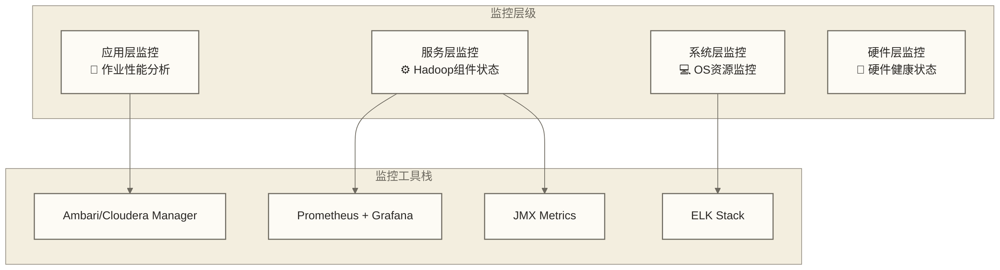

# 📊 Hadoop性能监控与调优 - 企业级运维实战

> [!abstract] 📋 本节概览
> - 🎯 **学习目标**：建立完整的Hadoop性能监控和调优体系
> - 📚 **前置知识**：[[【技术与工具】/Hadoop/19-高可用架构设计|高可用架构]] | [[【技术与工具】/Hadoop/11-YARN集群管理|YARN集群]] | 系统运维基础
> - ⏱️ **预计用时**：150分钟
> - 🔧 **技术重点**：监控指标、性能分析、调优策略、自动化运维

---

## 🎯 监控体系架构

### 1. 分层监控模型



### 2. 核心监控指标

```yaml title="监控指标体系"
cluster_metrics:
  capacity:
    - hdfs_capacity_total: "HDFS总容量"
    - hdfs_capacity_used: "HDFS已用容量"
    - hdfs_capacity_remaining: "HDFS剩余容量"
    
  performance:
    - cluster_throughput: "集群吞吐量"
    - job_completion_rate: "作业完成率"
    - average_job_duration: "平均作业时长"
    
  availability:
    - namenode_uptime: "NameNode正常运行时间"
    - datanode_live_count: "活跃DataNode数量"
    - failed_jobs_ratio: "失败作业比例"

node_metrics:
  system:
    - cpu_utilization: "CPU使用率"
    - memory_utilization: "内存使用率"
    - disk_io_rate: "磁盘IO速率"
    - network_bandwidth: "网络带宽使用"
    
  hadoop:
    - container_count: "容器数量"
    - block_count: "数据块数量"
    - rpc_call_rate: "RPC调用频率"

application_metrics:
  mapreduce:
    - map_task_duration: "Map任务耗时"
    - reduce_task_duration: "Reduce任务耗时"
    - shuffle_time: "Shuffle阶段耗时"
    
  yarn:
    - queue_wait_time: "队列等待时间"
    - application_memory: "应用内存使用"
    - vcores_allocated: "分配的虚拟核心数"
```

---

## 🛠️ 监控工具部署

### 1. Prometheus + Grafana 监控栈

```bash title="deploy_monitoring_stack.sh"
# !/bin/bash
# 🚀 部署Hadoop监控栈

set -e

MONITORING_HOME="/opt/monitoring"
HADOOP_HOME="/opt/hadoop"

# 部署Prometheus
deploy_prometheus() {
    echo "=== 部署Prometheus ==="
    
 # 下载并安装Prometheus
    cd /tmp
    wget https://github.com/prometheus/prometheus/releases/download/v2.40.0/prometheus-2.40.0.linux-amd64.tar.gz
    tar -xzf prometheus-2.40.0.linux-amd64.tar.gz
    sudo mv prometheus-2.40.0.linux-amd64 $MONITORING_HOME/prometheus
    
 # 配置Prometheus
    cat > $MONITORING_HOME/prometheus/prometheus.yml << 'EOF'
global:
  scrape_interval: 15s
  
rule_files:
  - "alerting_rules.yml"
  
alerting:
  alertmanagers:
    - static_configs:
        - targets:
          - alertmanager:9093

scrape_configs:
  - job_name: 'namenode'
    static_configs:
      - targets: ['namenode1:50070', 'namenode2:50070']
    
  - job_name: 'datanode'
    static_configs:
      - targets: ['datanode1:50075', 'datanode2:50075', 'datanode3:50075']
    
  - job_name: 'resourcemanager'
    static_configs:
      - targets: ['resourcemanager1:8088', 'resourcemanager2:8088']
    
  - job_name: 'nodemanager'
    static_configs:
      - targets: ['nodemanager1:8042', 'nodemanager2:8042']
    
  - job_name: 'node-exporter'
    static_configs:
      - targets: ['node1:9100', 'node2:9100', 'node3:9100']
EOF

 # 创建系统服务
    sudo tee /etc/systemd/system/prometheus.service > /dev/null << EOF
[Unit]
Description=Prometheus
After=network.target

[Service]
User=prometheus
Group=prometheus
Type=simple
ExecStart=$MONITORING_HOME/prometheus/prometheus \\
    --config.file=$MONITORING_HOME/prometheus/prometheus.yml \\
    --storage.tsdb.path=$MONITORING_HOME/prometheus/data \\
    --web.console.templates=$MONITORING_HOME/prometheus/consoles \\
    --web.console.libraries=$MONITORING_HOME/prometheus/console_libraries \\
    --web.listen-address=0.0.0.0:9090

[Install]
WantedBy=multi-user.target
EOF

    sudo systemctl enable prometheus
    sudo systemctl start prometheus
    echo "Prometheus部署完成"
}

# 部署Grafana
deploy_grafana() {
    echo "=== 部署Grafana ==="
    
 # 添加Grafana仓库
    sudo apt-get install -y apt-transport-https
    sudo apt-get install -y software-properties-common wget
    wget -q -O - https://packages.grafana.com/gpg.key | sudo apt-key add -
    echo "deb https://packages.grafana.com/oss/deb stable main" | sudo tee -a /etc/apt/sources.list.d/grafana.list
    
 # 安装Grafana
    sudo apt-get update
    sudo apt-get install grafana
    
 # 启动服务
    sudo systemctl enable grafana-server
    sudo systemctl start grafana-server
    
    echo "Grafana部署完成，访问地址：http://localhost:3000"
    echo "默认用户名/密码：admin/admin"
}

# 部署JMX Exporter
deploy_jmx_exporter() {
    echo "=== 部署JMX Exporter ==="
    
 # 下载JMX Exporter
    wget https://repo1.maven.org/maven2/io/prometheus/jmx/jmx_prometheus_javaagent/0.17.2/jmx_prometheus_javaagent-0.17.2.jar
    sudo mv jmx_prometheus_javaagent-0.17.2.jar $MONITORING_HOME/
    
 # 创建JMX配置
    cat > $MONITORING_HOME/hadoop-jmx-config.yml << 'EOF'
rules:
  - pattern: Hadoop<service=NameNode, name=(.*)><>(.*)
    name: hadoop_namenode_$1_$2
    
  - pattern: Hadoop<service=DataNode, name=(.*)><>(.*)
    name: hadoop_datanode_$1_$2
    
  - pattern: Hadoop<service=ResourceManager, name=(.*)><>(.*)
    name: hadoop_resourcemanager_$1_$2
    
  - pattern: Hadoop<service=NodeManager, name=(.*)><>(.*)
    name: hadoop_nodemanager_$1_$2
EOF

 # 配置Hadoop组件JMX
    echo "export HADOOP_NAMENODE_OPTS=\"\$HADOOP_NAMENODE_OPTS -javaagent:$MONITORING_HOME/jmx_prometheus_javaagent-0.17.2.jar=8001:$MONITORING_HOME/hadoop-jmx-config.yml\"" >> "$HADOOP_HOME/etc/hadoop/hadoop-env.sh"
    
    echo "JMX Exporter配置完成"
}

# 主执行函数
main() {
    sudo useradd --no-create-home --shell /bin/false prometheus
    sudo mkdir -p $MONITORING_HOME
    sudo chown prometheus:prometheus $MONITORING_HOME
    
    deploy_prometheus
    deploy_grafana
    deploy_jmx_exporter
    
    echo "=== 监控栈部署完成 ==="
}

main "$@"
```

### 2. Grafana Dashboard 配置

```json title="hadoop_dashboard.json"
{
  "dashboard": {
    "title": "Hadoop Cluster Monitoring",
    "panels": [
      {
        "title": "Cluster Overview",
        "type": "stat",
        "targets": [
          {
            "expr": "hadoop_namenode_capacity_total",
            "legendFormat": "Total Capacity"
          },
          {
            "expr": "hadoop_namenode_capacity_used",
            "legendFormat": "Used Capacity"
          }
        ]
      },
      {
        "title": "HDFS Capacity Trend",
        "type": "graph",
        "targets": [
          {
            "expr": "hadoop_namenode_capacity_used / hadoop_namenode_capacity_total * 100",
            "legendFormat": "HDFS Usage %"
          }
        ]
      },
      {
        "title": "DataNode Status",
        "type": "table",
        "targets": [
          {
            "expr": "hadoop_namenode_num_live_data_nodes",
            "legendFormat": "Live DataNodes"
          },
          {
            "expr": "hadoop_namenode_num_dead_data_nodes", 
            "legendFormat": "Dead DataNodes"
          }
        ]
      },
      {
        "title": "Job Performance",
        "type": "graph",
        "targets": [
          {
            "expr": "rate(hadoop_resourcemanager_apps_completed_total[5m])",
            "legendFormat": "Jobs Completed/sec"
          },
          {
            "expr": "rate(hadoop_resourcemanager_apps_failed_total[5m])",
            "legendFormat": "Jobs Failed/sec"
          }
        ]
      }
    ]
  }
}
```

---

## 🔍 性能分析工具

### 1. 自动化性能分析脚本

```python title="hadoop_performance_analyzer.py"
# !/usr/bin/env python3
# 📊 Hadoop性能分析工具

import requests
import json
import time
import subprocess
import pandas as pd
from datetime import datetime, timedelta

class HadoopPerformanceAnalyzer:
    def __init__(self, namenode_host="localhost", rm_host="localhost"):
        self.namenode_url = f"http://{namenode_host}:50070"
        self.rm_url = f"http://{rm_host}:8088"
        self.metrics = {}
    
    def collect_namenode_metrics(self):
        """收集NameNode指标"""
        try:
 # HDFS容量信息
            response = requests.get(f"{self.namenode_url}/jmx?qry=Hadoop:service=NameNode,name=FSNamesystemState")
            data = response.json()['beans'][0]
            
            capacity_metrics = {
                'total_capacity': data.get('CapacityTotal', 0),
                'used_capacity': data.get('CapacityUsed', 0),
                'remaining_capacity': data.get('CapacityRemaining', 0),
                'blocks_total': data.get('BlocksTotal', 0),
                'missing_blocks': data.get('MissingBlocks', 0),
                'corrupt_blocks': data.get('CorruptBlocks', 0)
            }
            
 # DataNode状态
            response = requests.get(f"{self.namenode_url}/jmx?qry=Hadoop:service=NameNode,name=FSNamesystem")
            data = response.json()['beans'][0]
            
            datanode_metrics = {
                'live_nodes': data.get('NumLiveDataNodes', 0),
                'dead_nodes': data.get('NumDeadDataNodes', 0),
                'decom_nodes': data.get('NumDecomLiveDataNodes', 0)
            }
            
            self.metrics['namenode'] = {**capacity_metrics, **datanode_metrics}
            return True
            
        except Exception as e:
            print(f"收集NameNode指标失败: {e}")
            return False
    
    def collect_resourcemanager_metrics(self):
        """收集ResourceManager指标"""
        try:
 # 集群资源信息
            response = requests.get(f"{self.rm_url}/ws/v1/cluster/metrics")
            data = response.json()['clusterMetrics']
            
            resource_metrics = {
                'apps_submitted': data.get('appsSubmitted', 0),
                'apps_completed': data.get('appsCompleted', 0),
                'apps_running': data.get('appsRunning', 0),
                'apps_failed': data.get('appsFailed', 0),
                'available_mb': data.get('availableMB', 0),
                'allocated_mb': data.get('allocatedMB', 0),
                'total_mb': data.get('totalMB', 0),
                'active_nodes': data.get('activeNodes', 0),
                'lost_nodes': data.get('lostNodes', 0)
            }
            
            self.metrics['resourcemanager'] = resource_metrics
            return True
            
        except Exception as e:
            print(f"收集ResourceManager指标失败: {e}")
            return False
    
    def analyze_performance_bottlenecks(self):
        """分析性能瓶颈"""
        analysis = {
            'warnings': [],
            'recommendations': [],
            'critical_issues': []
        }
        
 # HDFS容量分析
        if 'namenode' in self.metrics:
            nn_metrics = self.metrics['namenode']
            usage_ratio = nn_metrics['used_capacity'] / nn_metrics['total_capacity']
            
            if usage_ratio > 0.9:
                analysis['critical_issues'].append("HDFS使用率超过90%，需要立即扩容")
            elif usage_ratio > 0.8:
                analysis['warnings'].append("HDFS使用率超过80%，建议准备扩容")
            
            if nn_metrics['missing_blocks'] > 0:
                analysis['critical_issues'].append(f"检测到{nn_metrics['missing_blocks']}个丢失块")
            
            if nn_metrics['dead_nodes'] > 0:
                analysis['warnings'].append(f"检测到{nn_metrics['dead_nodes']}个不可用DataNode")
        
 # YARN资源分析
        if 'resourcemanager' in self.metrics:
            rm_metrics = self.metrics['resourcemanager']
            
            if rm_metrics['apps_failed'] > 0:
                failure_rate = rm_metrics['apps_failed'] / (rm_metrics['apps_completed'] + rm_metrics['apps_failed'])
                if failure_rate > 0.1:
                    analysis['warnings'].append(f"作业失败率{failure_rate:.2%}偏高")
            
            memory_usage = rm_metrics['allocated_mb'] / rm_metrics['total_mb']
            if memory_usage > 0.9:
                analysis['warnings'].append("集群内存使用率过高")
            
            if rm_metrics['lost_nodes'] > 0:
                analysis['critical_issues'].append(f"检测到{rm_metrics['lost_nodes']}个丢失的NodeManager")
        
        return analysis
    
    def generate_performance_report(self):
        """生成性能报告"""
        report_time = datetime.now().strftime("%Y-%m-%d %H:%M:%S")
        
        print("=" * 60)
        print(f"Hadoop集群性能报告 - {report_time}")
        print("=" * 60)
        
 # HDFS状态报告
        if 'namenode' in self.metrics:
            nn = self.metrics['namenode']
            print("\n🗄️  HDFS存储状态:")
            print(f"  总容量: {nn['total_capacity'] / (1024**4):.2f} TB")
            print(f"  已用容量: {nn['used_capacity'] / (1024**4):.2f} TB")
            print(f"  使用率: {nn['used_capacity']/nn['total_capacity']:.2%}")
            print(f"  活跃DataNode: {nn['live_nodes']}个")
            print(f"  总数据块: {nn['blocks_total']:,}个")
        
 # YARN资源报告
        if 'resourcemanager' in self.metrics:
            rm = self.metrics['resourcemanager']
            print("\n⚙️  YARN资源状态:")
            print(f"  总内存: {rm['total_mb'] / 1024:.2f} GB")
            print(f"  已分配内存: {rm['allocated_mb'] / 1024:.2f} GB")
            print(f"  内存使用率: {rm['allocated_mb']/rm['total_mb']:.2%}")
            print(f"  运行中应用: {rm['apps_running']}个")
            print(f"  活跃节点: {rm['active_nodes']}个")
        
 # 性能分析
        analysis = self.analyze_performance_bottlenecks()
        
        if analysis['critical_issues']:
            print("\n🚨 严重问题:")
            for issue in analysis['critical_issues']:
                print(f"  ❌ {issue}")
        
        if analysis['warnings']:
            print("\n⚠️  警告信息:")
            for warning in analysis['warnings']:
                print(f"  ⚠️  {warning}")
        
        if not analysis['critical_issues'] and not analysis['warnings']:
            print("\n✅ 集群运行状态良好")
    
    def run_continuous_monitoring(self, interval=60):
        """持续监控模式"""
        print(f"开始持续监控，采集间隔: {interval}秒")
        print("按Ctrl+C停止监控")
        
        try:
            while True:
                self.collect_namenode_metrics()
                self.collect_resourcemanager_metrics()
                self.generate_performance_report()
                time.sleep(interval)
        except KeyboardInterrupt:
            print("\n监控已停止")

if __name__ == "__main__":
    analyzer = HadoopPerformanceAnalyzer()
    
 # 收集指标
    analyzer.collect_namenode_metrics()
    analyzer.collect_resourcemanager_metrics()
    
 # 生成报告
    analyzer.generate_performance_report()
```

---

## ⚡ 性能调优策略

### 1. HDFS性能调优

```bash title="hdfs_tuning.sh"
# !/bin/bash
# 🔧 HDFS性能调优脚本

optimize_hdfs_performance() {
    echo "=== HDFS性能调优 ==="
    
 # 1. 数据本地性优化
    echo "配置数据本地性优化..."
    cat >> "$HADOOP_HOME/etc/hadoop/hdfs-site.xml" << 'EOF'
<!-- DataNode主机名连接配置，不保证提升数据本地性 -->
<property>
    <name>dfs.client.use.datanode.hostname</name>
    <value>true</value>
    <description>客户端使用DataNode主机名建立连接，需确保主机名解析和网络可达；不直接改变任务数据本地性</description>
</property>

<!-- 短路读取优化 -->
<property>
    <name>dfs.client.read.shortcircuit</name>
    <value>true</value>
</property>

<property>
    <name>dfs.domain.socket.path</name>
    <value>/var/lib/hadoop-hdfs/dn_socket</value>
</property>
EOF

 # 2. 块大小优化
    echo "优化HDFS块大小..."
    cat >> "$HADOOP_HOME/etc/hadoop/hdfs-site.xml" << 'EOF'
<!-- 块大小示例（256MB用于大文件处理演练，需按负载压测） -->
<property>
    <name>dfs.blocksize</name>
    <value>268435456</value>
</property>

<!-- 复制因子优化 -->
<property>
    <name>dfs.replication</name>
    <value>3</value>
</property>
EOF

 # 3. 内存配置优化
    echo "优化NameNode内存配置..."
    cat >> "$HADOOP_HOME/etc/hadoop/hadoop-env.sh" << 'EOF'
# NameNode堆内存优化（根据集群规模调整）
export HADOOP_NAMENODE_OPTS="-Xmx8g -Xms8g $HADOOP_NAMENODE_OPTS"

# DataNode堆内存优化
export HADOOP_DATANODE_OPTS="-Xmx2g -Xms2g $HADOOP_DATANODE_OPTS"

# GC优化
export HADOOP_NAMENODE_OPTS="-XX:+UseG1GC -XX:G1HeapRegionSize=32m $HADOOP_NAMENODE_OPTS"
EOF

    echo "HDFS性能调优完成"
}

# 存储分层配置
configure_storage_tiers() {
    echo "=== 配置存储分层 ==="
    
    cat >> "$HADOOP_HOME/etc/hadoop/hdfs-site.xml" << 'EOF'
<!-- 存储策略配置 -->
<property>
    <name>dfs.storage.policy.enabled</name>
    <value>true</value>
</property>

<!-- SSD存储类型 -->
<property>
    <name>dfs.datanode.data.dir</name>
    <value>[SSD]file:///data/ssd1,[DISK]file:///data/disk1,[DISK]file:///data/disk2</value>
</property>
EOF

    echo "存储分层配置完成"
}

optimize_hdfs_performance
configure_storage_tiers
```

### 2. YARN性能调优

```bash title="yarn_tuning.sh"
# !/bin/bash
# ⚙️ YARN性能调优脚本

optimize_yarn_performance() {
    echo "=== YARN性能调优 ==="
    
 # 1. 资源调度优化
    cat >> $HADOOP_HOME/etc/hadoop/yarn-site.xml << 'EOF'
<!-- 容量调度器配置 -->
<property>
    <name>yarn.resourcemanager.scheduler.class</name>
    <value>org.apache.hadoop.yarn.server.resourcemanager.scheduler.capacity.CapacityScheduler</value>
</property>

<!-- 内存配置优化 -->
<property>
    <name>yarn.nodemanager.resource.memory-mb</name>
    <value>14336</value>
    <description>NodeManager可用内存（留2GB给系统）</description>
</property>

<property>
    <name>yarn.scheduler.maximum-allocation-mb</name>
    <value>14336</value>
</property>

<property>
    <name>yarn.scheduler.minimum-allocation-mb</name>
    <value>1024</value>
</property>

<!-- CPU核心配置 -->
<property>
    <name>yarn.nodemanager.resource.cpu-vcores</name>
    <value>8</value>
</property>

<property>
    <name>yarn.scheduler.maximum-allocation-vcores</name>
    <value>8</value>
</property>
EOF

 # 2. 容器配置优化
    cat >> $HADOOP_HOME/etc/hadoop/yarn-site.xml << 'EOF'
<!-- 容器启动优化 -->
<property>
    <name>yarn.nodemanager.container-executor.class</name>
    <value>org.apache.hadoop.yarn.server.nodemanager.DefaultContainerExecutor</value>
</property>

<!-- 本地目录配置 -->
<property>
    <name>yarn.nodemanager.local-dirs</name>
    <value>/data/yarn/local1,/data/yarn/local2</value>
</property>

<property>
    <name>yarn.nodemanager.log-dirs</name>
    <value>/data/yarn/logs</value>
</property>
EOF

 # 3. 公平调度器配置
    cat > $HADOOP_HOME/etc/hadoop/fair-scheduler.xml << 'EOF'
<?xml version="1.0"?>
<allocations>
  <queue name="production">
    <minResources>4096 mb,4 vcores</minResources>
    <maxResources>8192 mb,8 vcores</maxResources>
    <maxRunningApps>10</maxRunningApps>
    <weight>3.0</weight>
    <schedulingPolicy>fair</schedulingPolicy>
  </queue>
  
  <queue name="development">
    <minResources>2048 mb,2 vcores</minResources>
    <maxResources>4096 mb,4 vcores</maxResources>
    <maxRunningApps>5</maxRunningApps>
    <weight>1.0</weight>
    <schedulingPolicy>fair</schedulingPolicy>
  </queue>
  
  <queuePlacementPolicy>
    <rule name="specified" create="false"/>
    <rule name="default" queue="development"/>
  </queuePlacementPolicy>
</allocations>
EOF

    echo "YARN性能调优完成"
}

optimize_yarn_performance
```

### 3. MapReduce性能调优

```xml title="mapred_optimization.xml"
<!-- MapReduce性能优化配置 -->
<configuration>
    <!-- Map任务优化 -->
    <property>
        <name>mapreduce.map.memory.mb</name>
        <value>2048</value>
        <description>Map任务内存</description>
    </property>
    
    <property>
        <name>mapreduce.map.java.opts</name>
        <value>-Xmx1640m</value>
    </property>
    
    <!-- Reduce任务优化 -->
    <property>
        <name>mapreduce.reduce.memory.mb</name>
        <value>4096</value>
    </property>
    
    <property>
        <name>mapreduce.reduce.java.opts</name>
        <value>-Xmx3276m</value>
    </property>
    
    <!-- Shuffle优化 -->
    <property>
        <name>mapreduce.task.io.sort.mb</name>
        <value>512</value>
        <description>排序缓冲区大小</description>
    </property>
    
    <property>
        <name>mapreduce.reduce.shuffle.parallelcopies</name>
        <value>10</value>
        <description>并行复制线程数</description>
    </property>
    
    <!-- 压缩优化 -->
    <property>
        <name>mapreduce.map.output.compress</name>
        <value>true</value>
    </property>
    
    <property>
        <name>mapreduce.map.output.compress.codec</name>
        <value>org.apache.hadoop.io.compress.SnappyCodec</value>
    </property>
</configuration>
```

---

## 🚨 智能告警系统

### 1. 告警规则配置

```yaml title="alerting_rules.yml"
groups:
  - name: hadoop_performance_alerts
    rules:
 # HDFS容量告警
      - alert: HDFSCapacityHigh
        expr: (hadoop_namenode_capacity_used / hadoop_namenode_capacity_total) > 0.85
        for: 5m
        labels:
          severity: warning
        annotations:
          summary: "HDFS容量使用过高"
          description: "HDFS使用率为{{ $value | humanizePercentage }}，建议清理或扩容"
      
 # DataNode健康告警
      - alert: DataNodeDown
        expr: hadoop_namenode_num_live_data_nodes < 3
        for: 1m
        labels:
          severity: critical
        annotations:
          summary: "DataNode数量不足"
          description: "当前只有{{ $value }}个活跃DataNode"
      
 # 作业失败率告警
      - alert: HighJobFailureRate
        expr: (rate(hadoop_resourcemanager_apps_failed_total[10m]) / (rate(hadoop_resourcemanager_apps_completed_total[10m]) + rate(hadoop_resourcemanager_apps_failed_total[10m]))) > 0.1
        for: 5m
        labels:
          severity: warning
        annotations:
          summary: "作业失败率过高"
          description: "过去10分钟作业失败率为{{ $value | humanizePercentage }}"
      
 # 内存使用告警
      - alert: YARNMemoryHigh
        expr: (hadoop_resourcemanager_allocated_mb / hadoop_resourcemanager_total_mb) > 0.9
        for: 3m
        labels:
          severity: warning
        annotations:
          summary: "YARN内存使用率过高"
          description: "当前内存使用率{{ $value | humanizePercentage }}"
```

### 2. 自动化运维脚本

```python title="auto_remediation.py"
# !/usr/bin/env python3
# 🤖 自动化运维响应系统

import subprocess
import logging
from datetime import datetime

class AutoRemediation:
    def __init__(self):
        self.logger = self._setup_logging()
    
    def _setup_logging(self):
        logging.basicConfig(
            level=logging.INFO,
            format='%(asctime)s - %(levelname)s - %(message)s',
            handlers=[
                logging.FileHandler('/var/log/hadoop/auto-remediation.log'),
                logging.StreamHandler()
            ]
        )
        return logging.getLogger(__name__)
    
    def handle_hdfs_capacity_high(self):
        """处理HDFS容量过高"""
        self.logger.info("开始处理HDFS容量过高问题")
        
 # 1. 清理临时文件
        subprocess.run("hdfs dfs -rm -r /tmp/* 2>/dev/null", shell=True)
        
 # 2. 清理回收站
        subprocess.run("hdfs dfs -expunge", shell=True)
        
 # 3. 使用HAR归档小文件（不压缩内容；保留源文件时不能视为容量清理）
        subprocess.run("hadoop jar $HADOOP_HOME/share/hadoop/tools/lib/hadoop-archive-*.jar -archiveName small_files.har /user/data /user/archive", shell=True)
        
        self.logger.info("HDFS容量清理完成")
    
    def handle_datanode_down(self):
        """处理DataNode下线"""
        self.logger.info("检测到DataNode下线，尝试自动恢复")
        
 # 获取下线的DataNode
        result = subprocess.run("hdfs dfsadmin -report | grep 'Dead datanodes'", 
                              shell=True, capture_output=True, text=True)
        
 # 尝试重启DataNode服务
        subprocess.run("$HADOOP_HOME/sbin/hadoop-daemon.sh start datanode", shell=True)
        
        self.logger.info("DataNode恢复尝试完成")
    
    def handle_high_memory_usage(self):
        """处理高内存使用率"""
        self.logger.info("处理YARN内存使用率过高")
        
 # 杀死长时间运行的异常作业
        result = subprocess.run("yarn application -list | grep 'RUNNING'", 
                              shell=True, capture_output=True, text=True)
        
        if result.stdout:
            lines = result.stdout.strip().split('\n')[2:]  # 跳过头部
            for line in lines:
                parts = line.split()
                if len(parts) > 1:
                    app_id = parts[0]
 # 原稿意图：检查作业运行时间，超过4小时后评估是否终止；当前未实现时长与异常判定
                    self.logger.warning(f"候选应用{app_id}尚未核验运行时长与异常状态，未执行终止；需人工审批")
        
        self.logger.info("高内存使用率检查结束，未执行自动终止作业")

if __name__ == "__main__":
    remediation = AutoRemediation()
    
 # 根据告警类型执行相应处理
    import sys
    if len(sys.argv) > 1:
        alert_type = sys.argv[1]
        
        if alert_type == "hdfs_capacity":
            remediation.handle_hdfs_capacity_high()
        elif alert_type == "datanode_down":
            remediation.handle_datanode_down()
        elif alert_type == "memory_high":
            remediation.handle_high_memory_usage()
```

---

## 🔗 学习路径

### 下一步学习建议

1. **[[【技术与工具】/Hadoop/21-数据备份与恢复|数据备份与恢复]]** - 数据保护和灾备策略
2. **[[【技术与工具】/Hadoop/22-故障排查与运维|故障排查与运维]]** - 运维自动化和故障处理

### 实践项目建议

- 搭建完整的监控告警系统
- 编写性能调优自动化脚本
- 设计智能运维响应机制
- 建立性能基准测试体系

---

> [!tip] 💡 关键收获
> - 完善的监控体系是集群稳定运行的基础
> - 性能调优需要基于实际业务场景进行针对性优化
> - 自动化运维可以大大降低人工运维成本
> - 持续的性能分析和优化是必要的 