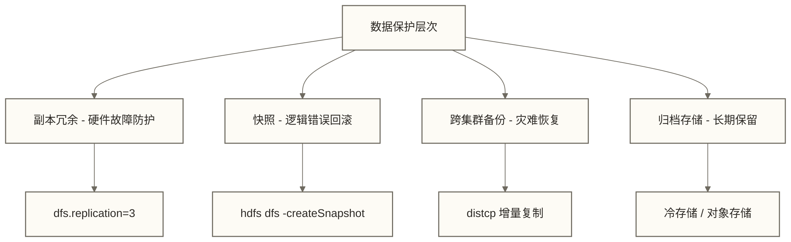

# Hadoop数据备份与恢复 - 企业级数据保护策略

> [!abstract] 本篇定位
> 本篇是企业级运维系列第四篇，承接 [[【技术与工具】/Hadoop/20-性能监控与调优|性能监控与调优]]，聚焦数据保护这一运维核心命题。一个精心调优的集群，如果没有可靠的数据保护机制，就像一栋没有消防系统的高楼——平时看不出问题，出事时代价惨烈。
>
> **前置阅读**：[[【技术与工具】/Hadoop/19-高可用架构设计|高可用架构设计]]、[[【技术与工具】/Hadoop/20-性能监控与调优|性能监控与调优]]

## 目录

- [[【技术与工具】/Hadoop/21-数据备份与恢复#HDFS数据备份核心机制|#HDFS数据备份核心机制]]
  - [[【技术与工具】/Hadoop/21-数据备份与恢复#distcp跨集群复制|#distcp跨集群复制]]
  - [[【技术与工具】/Hadoop/21-数据备份与恢复#快照机制|#快照机制]]
  - [[【技术与工具】/Hadoop/21-数据备份与恢复#副本策略配置|#副本策略配置]]
- [[【技术与工具】/Hadoop/21-数据备份与恢复#数据恢复场景与操作|#数据恢复场景与操作]]
  - [[【技术与工具】/Hadoop/21-数据备份与恢复#NameNode元数据恢复|#NameNode元数据恢复]]
  - [[【技术与工具】/Hadoop/21-数据备份与恢复#DataNode数据块恢复|#DataNode数据块恢复]]
  - [[【技术与工具】/Hadoop/21-数据备份与恢复#误删文件恢复|#误删文件恢复]]
- [[【技术与工具】/Hadoop/21-数据备份与恢复#企业级灾备方案设计|#企业级灾备方案设计]]
  - [[【技术与工具】/Hadoop/21-数据备份与恢复#同城双活与异地灾备|#同城双活与异地灾备]]
  - [[【技术与工具】/Hadoop/21-数据备份与恢复#RTO与RPO指标|#RTO与RPO指标]]
- [[【技术与工具】/Hadoop/21-数据备份与恢复#自动化备份脚本|#自动化备份脚本]]
- [[【技术与工具】/Hadoop/21-数据备份与恢复#备份数据完整性验证|#备份数据完整性验证]]
- [[【技术与工具】/Hadoop/21-数据备份与恢复#掌握检查与实践练习|#掌握检查与实践练习]]

---

## HDFS数据备份核心机制

在讨论备份策略之前，先要理解一个基本事实：HDFS 自带三副本机制，在正常运行条件下已具备一定的数据冗余能力。但这种冗余只能应对硬件故障，无法应对以下场景：

- 逻辑删除（误操作 `rm -r`）
- 集群整体故障（如机房断电、网络分区）
- 软件 Bug 导致的数据损坏
- 勒索软件攻击

因此，企业级数据保护需要在三副本之外，建立独立的备份体系。



---

### distcp跨集群复制

`distcp`（Distributed Copy）是 Hadoop 内置的跨集群数据复制工具，本质上是一个 MapReduce 任务，将数据并行地从源集群传输到目标集群。

> [!note] 为什么不用普通的 cp 或 scp？
> 普通 cp 或 scp 不具备 distcp 这样的分布式任务调度能力。distcp 将文件列表分片，用多个 Map 任务并行传输；实际吞吐受网络、源目标存储、文件分布和并发配置限制，不保证随节点数线性提升。

**基础语法**

```bash
# 全量复制：将生产集群的 /data/warehouse 复制到灾备集群
hadoop distcp \
  hdfs://prod-cluster:8020/data/warehouse \
  hdfs://dr-cluster:8020/data/warehouse

# 指定带宽限制（单位 MB/s），避免占满网络
hadoop distcp \
  -bandwidth 100 \
  hdfs://prod-cluster:8020/data/warehouse \
  hdfs://dr-cluster:8020/data/warehouse

# 增量同步：复制缺失或按比较规则判定不同的文件；-delete还会删除目标端多余文件，可能传播源端误删
hadoop distcp \
  -update \
  -delete \
  hdfs://prod-cluster:8020/data/warehouse \
  hdfs://dr-cluster:8020/data/warehouse
```

**关键参数说明**

| 参数 | 含义 | 使用场景 |
|------|------|----------|
| `-update` | 复制目标端缺失或按文件大小、校验和等适用比较规则判定不同的文件，不只比较大小 | 增量同步；比较行为需核对版本及校验选项 |
| `-delete` | 删除目标端源端没有的文件 | 保持目标与源严格一致 |
| `-overwrite` | 强制覆盖目标端所有文件 | 全量重建备份 |
| `-bandwidth N` | 限制每个 Map 的带宽为 N MB/s | 生产高峰期避免影响业务 |
| `-m N` | 指定 Map 任务数量 | 控制并发度，默认 20 |
| `-skipcrccheck` | 跳过部分CRC校验比较，不等于跳过所有完整性检查 | 仅在明确校验差异原因并具备替代内容验证时使用，不应因块大小不同而直接启用 |
| `-atomic` | 原子性复制（全部成功才生效） | 对一致性要求严格的场景 |
| `-strategy dynamic` | 动态任务分配策略 | 文件大小差异极大时效率更高 |

**跨 Hadoop 版本复制**

```bash
# 老集群（Hadoop 1.x）到新集群（Hadoop 2.x/3.x）迁移
hadoop distcp \
  -Dmapreduce.job.hdfs-servers=hdfs://old-cluster:9000 \
  hftp://old-cluster:50070/data/legacy \
  hdfs://new-cluster:8020/data/migrated
```

> [!warning] distcp 的注意事项
> - distcp 的 MapReduce 任务运行在提交配置所指向的计算集群，不必是目标集群；任务节点必须能访问源和目标文件系统
> - 跨版本复制须核对客户端、服务端协议及认证兼容性；上面的 `hftp://` 命令是历史版本示例，不能作为 Hadoop 2.x/3.x 间迁移的通用方案
> - 跨数据中心复制时，网络延迟会成为瓶颈，建议配合 `-bandwidth` 参数精细控制

---

### 快照机制

HDFS 快照是某一时刻文件系统状态的只读视图。创建时不复制实际数据块，主要记录元数据，因此通常开销较低；但后续删除或修改可能使旧数据块因快照引用而继续占用空间，不能将总存储开销理解为仅有元数据变化量，创建耗时也不保证为毫秒级。

**启用快照功能**

```bash
# 管理员开启指定目录的快照功能（必须先开启才能创建快照）
hdfs dfsadmin -allowSnapshot /data/warehouse

# 关闭快照功能（必须先删除所有快照）
hdfs dfsadmin -disallowSnapshot /data/warehouse
```

**快照生命周期管理**

```bash
# 创建快照（不指定名称时自动生成时间戳名称）
hdfs dfs -createSnapshot /data/warehouse daily-2026-03-21

# 列出目录下的所有快照
hdfs dfs -ls /data/warehouse/.snapshot

# 查看快照内容（可以像普通目录一样浏览）
hdfs dfs -ls /data/warehouse/.snapshot/daily-2026-03-21/

# 对比两个快照之间的差异（用于审计变化）
hdfs snapshotDiff /data/warehouse daily-2026-03-20 daily-2026-03-21

# 删除快照
hdfs dfs -deleteSnapshot /data/warehouse daily-2026-03-21
```

**快照差异输出解读**

```text
M       ./sales/orders_2026_03_21.parquet   # M = 文件被修改
+       ./sales/returns_2026_03_21.parquet  # + = 文件被新增
-       ./sales/temp_staging.csv            # - = 文件被删除
R       ./archive -> ./archive_old          # R = 文件被重命名
```

> [!tip] 快照的最佳实践
> - 快照保留策略建议：每日快照保留 7 天，每周快照保留 4 周，每月快照保留 12 个月
> - 快照本身不能替代跨集群备份，它只防逻辑错误，不防集群整体故障
> - 对写入频繁的目录（如 Kafka 数据目录）谨慎使用快照，快照元数据开销会随变化量增大

---

### 副本策略配置

HDFS 的副本放置策略直接影响数据的可靠性和读取性能。

**默认副本放置策略（机架感知）**

```text
副本1: Writer位于符合条件的DataNode时优先本地放置；外部客户端写入时由策略选择合适的DataNode
副本2: 与副本1不同机架的随机节点
副本3: 与副本2相同机架的不同节点
```

**调整副本数量**

```bash
# 针对特定目录调整副本数（重要数据使用更高副本数）
hdfs dfs -setrep -R 5 /data/critical/

# 仅在已有独立且已验证可恢复备份时考虑降低归档数据副本数；单副本无法容忍该副本丢失
hdfs dfs -setrep -R 1 /data/archive/cold/

# 查看当前副本状态
hdfs fsck /data/critical/ -files -blocks -racks
```

**全局副本数配置（hdfs-site.xml）**

```xml
<property>
    <name>dfs.replication</name>
    <value>3</value>
    <description>默认副本数，生产环境建议保持3</description>
</property>
```

**机架感知配置（core-site.xml）**

```xml
<property>
    <name>net.topology.script.file.name</name>
    <value>/etc/hadoop/conf/rack-topology.sh</value>
</property>
```

```bash
#!/bin/bash
# rack-topology.sh 示例：根据 IP 返回机架标识
for IP in "$@"; do
    case "$IP" in
        10.1.1.*)  echo "/dc1/rack1" ;;
        10.1.2.*)  echo "/dc1/rack2" ;;
        10.2.1.*)  echo "/dc2/rack1" ;;
        *)          echo "/default/rack0" ;;
    esac
done
```

---

## 数据恢复场景与操作

### NameNode元数据恢复

NameNode 是 HDFS 的大脑，存储所有文件和目录的元数据。NameNode 故障通常是最严重的事故。

**元数据文件结构**

```text
${dfs.namenode.name.dir}/
├── current/
│   ├── fsimage_0000000000012345678       # 文件系统快照（完整状态）
│   ├── fsimage_0000000000012345678.md5
│   ├── edits_0000000000012345679-...     # 历史编辑日志
│   ├── edits_inprogress_0000000000013000000  # 当前编辑日志
│   └── VERSION
```

**场景一：NameNode 进程崩溃（元数据完好）**

```bash
# 直接重启即可，fsimage 和 edits 会自动合并
hadoop-daemon.sh start namenode

# 观察启动日志，确认 fsimage 加载成功
tail -f /var/log/hadoop/hadoop-hdfs-namenode-*.log \
    | grep -E "loaded|checkpoint|started"
```

**场景二：fsimage 损坏（有备份）**

```bash
# 第一步：停止 NameNode
hadoop-daemon.sh stop namenode

# 第二步：仅针对使用SecondaryNameNode的非HA部署评估检查点恢复
# SecondaryNameNode 的检查点在 dfs.namenode.checkpoint.dir
# 执行下方覆盖命令前，须离线备份current并校验集群标识、检查点事务号及后续edits连续性
# 此片段不是完整恢复规程；不满足上述条件时不得覆盖
rsync -av secondary-namenode:/hadoop/namesecondary/current/ \
      /hadoop/namenode/current/

# 第三步：以恢复模式启动（交互式，选择最佳恢复方案）
hdfs namenode -recover

# 第四步：正常启动
hadoop-daemon.sh start namenode
```

**场景三：高可用模式下的 NameNode 切换**

```bash
# 查看当前 HA 状态
hdfs haadmin -getServiceState nn1
hdfs haadmin -getServiceState nn2

# 手动触发 Standby 切换为 Active
hdfs haadmin -failover nn1 nn2

# 强制切换示例：无响应不等于已隔离；须先确认旧Active已可靠fencing并核对自动故障转移配置，禁止直接照抄执行
hdfs haadmin -failover --forcefence --forceactive nn1 nn2
```

> [!warning] NameNode 恢复的黄金原则
> - 高可用集群中，绝对不要同时操作两个 NameNode，脑裂（split-brain）会导致数据损坏
> - 恢复前务必备份当前的 fsimage 和 edits 文件，防止恢复操作本身造成二次破坏
> - 使用 `-recover` 参数时，Hadoop 会尝试自动恢复，但可能丢失最近的写入操作

---

### DataNode数据块恢复

DataNode 故障相对 NameNode 更为常见，恢复过程也更为系统化。

```bash
# 检查 DataNode 状态（哪些节点不可用）
hdfs dfsadmin -report | grep -A 5 "Dead datanodes"

# 检查数据块健康状况（关注 CORRUPT FILES 和 MISSING BLOCKS）
hdfs fsck / -blocks -locations 2>&1 | grep -E "Status:|CORRUPT|MISSING|Total"

# 退役仍可读取数据的DataNode；已失联节点不能通过退役迁出不可读取的数据，需依赖其他健康副本补足
# 步骤1：确认hdfs-site.xml中的dfs.hosts.exclude指向下列文件，并检查剩余健康副本及容量，再加入排除列表
echo "datanode-05.example.com" >> /etc/hadoop/conf/dfs.exclude

# 步骤2：刷新 NameNode 的节点列表
hdfs dfsadmin -refreshNodes

# 步骤3：监控退役进度（等待 Decommission Status 变为 Decommissioned）
watch -n 30 "hdfs dfsadmin -report | grep -A 3 'datanode-05'"
```

---

### 误删文件恢复

HDFS 的 Trash 机制是应对误操作的第一道防线，类似操作系统的回收站。

**Trash 机制配置（core-site.xml）**

```xml
<property>
    <name>fs.trash.interval</name>
    <value>10080</value>
    <!-- 回收站保留时间（分钟），10080 = 7天，生产环境建议至少7天 -->
</property>
<property>
    <name>fs.trash.checkpoint.interval</name>
    <value>60</value>
    <!-- 定期清理回收站过期文件的间隔（分钟） -->
</property>
```

**从 Trash 恢复文件**

```bash
# 查看回收站内容（每个用户有独立的回收站路径）
hdfs dfs -ls /user/hadoop/.Trash/Current/

# 恢复误删文件（从回收站移回原位置）
hdfs dfs -mv \
  /user/hadoop/.Trash/Current/data/warehouse/sales/orders_2026_03_20.parquet \
  /data/warehouse/sales/

# 如果 Trash 已过期，从快照恢复
hdfs dfs -cp \
  /data/warehouse/.snapshot/daily-2026-03-20/sales/orders_2026_03_20.parquet \
  /data/warehouse/sales/
```

> [!tip] Trash 机制的局限性
> - 使用 `-skipTrash` 参数删除的文件会绕过回收站，无法通过此方式恢复
> - Trash 保留期过后，文件被永久删除，此时只能依赖快照或跨集群备份
> - Trash 保护的是逻辑删除，物理节点故障导致的数据丢失需要副本机制保护

---

## 企业级灾备方案设计

### 同城双活与异地灾备

**三种主流灾备架构对比**

下表时效和成本为原稿未核实的教学示例，不是拓扑天然具备的能力或固定成本排序；须结合复制机制、规模、故障范围和恢复演练重新评估。

| 方案 | 拓扑结构 | RTO | RPO | 成本 | 适用场景 |
|------|----------|-----|-----|------|----------|
| 同城双活 | 两个数据中心同时承载业务 | 秒级 | 接近零 | 最高 | 金融、电信核心系统 |
| 同城冷备 | 主集群运行，备集群待机 | 分钟~小时级 | 分钟级 | 适中 | 互联网中型平台 |
| 异地灾备 | 主备跨地域，异步复制 | 小时级 | 分钟~小时级 | 最低 | 合规要求、超大规模平台 |

**同城主写、备端只读的数据同步示例**

下图不是双端同时写入架构；图中的“延迟 < 5min”为原稿未核实的示例目标，distcp异步复制本身不保证该延迟或零数据丢失。


**跨数据中心的 distcp 配置**

```bash
# 配置跨数据中心复制，限制带宽避免占满专线
hadoop distcp \
  -bandwidth 50 \
  -m 10 \
  -update \
  -log /data/distcp_logs/dr-sync-$(date +%Y%m%d%H%M) \
  hdfs://prod-dc1:8020/data/warehouse \
  hdfs://dr-dc2:8020/data/warehouse
```

---

### RTO与RPO指标

这是灾备方案设计中最重要的两个指标，务必在方案设计阶段与业务方明确约定。

> [!note] 核心定义
> **RTO（Recovery Time Objective，恢复时间目标）**：从故障发生到业务恢复正常所允许的最长时间。
>
> **RPO（Recovery Point Objective，恢复点目标）**：故障发生时，业务能接受的最大数据丢失时间窗口。
>
> 简单记忆：**RTO 关注恢复速度，RPO 关注数据损失量**。

**不同业务场景的 RTO/RPO 参考**

下表保留原稿数值作为教学目标示例，不代表行业统一要求或已验证能力；“零丢失”等目标必须明确故障范围、写入确认与复制语义，并以演练验证。

| 业务类型 | RTO 要求 | RPO 要求 | 建议方案 |
|----------|----------|----------|----------|
| 实时交易数据 | 小于 1 分钟 | 零丢失 | 同城双活 + 同步复制 |
| 核心数仓 | 小于 30 分钟 | 小于 5 分钟 | 同城双活 + 异步复制 |
| 历史分析数据 | 小于 4 小时 | 小于 1 小时 | 同城冷备 + 定时 distcp |
| 归档数据 | 小于 24 小时 | 小于 24 小时 | 异地灾备 + 每日备份 |

> [!warning] 灾备方案必须定期演练
> 纸面上的 RTO 不等于实际恢复时间。建议每季度进行一次灾备切换演练，验证实际 RTO 是否满足目标。未经演练的灾备方案，其实际恢复能力尚未得到验证，不能据纸面设计作出可靠恢复承诺。

---

## 自动化备份脚本

以下是用于隔离测试环境的自动化备份脚本示例，集成了快照创建、增量复制、文件数初筛和源端快照保留策略。它尚缺少完整失败处理、目标备份版本保留及可靠内容验证，不能直接用于生产环境。

```bash
#!/bin/bash
# =============================================================
# HDFS 自动化备份脚本
# 功能：快照创建 + distcp 增量备份 + 文件数校验 + 过期清理
# 部署：crontab -e 添加 "0 2 * * * /opt/scripts/hdfs_backup.sh"
# =============================================================

# ---------- 配置区（按实际环境修改） ----------
SOURCE_CLUSTER="hdfs://prod-namenode:8020"
TARGET_CLUSTER="hdfs://dr-namenode:8020"
SOURCE_DIR="/data/warehouse"
TARGET_DIR="/data/warehouse"
SNAPSHOT_RETAIN_DAYS=7
BACKUP_LOG_DIR="/var/log/hdfs-backup"
ALERT_EMAIL="ops-team@example.com"
DISTCP_MAPPERS=20
DISTCP_BANDWIDTH=100   # MB/s，每个 Map 的带宽上限
# --------------------------------------------

DATE=$(date +%Y%m%d_%H%M%S)
SNAPSHOT_NAME="auto-backup-${DATE}"
LOG_FILE="${BACKUP_LOG_DIR}/backup-${DATE}.log"
mkdir -p "${BACKUP_LOG_DIR}"

log() { echo "[$(date '+%Y-%m-%d %H:%M:%S')] $1" | tee -a "${LOG_FILE}"; }

send_alert() {
    log "ALERT: $1"
    echo "$2" | mail -s "[HDFS备份告警] $1" "${ALERT_EMAIL}" 2>/dev/null \
        || log "邮件发送失败，请检查 MTA 配置"
}

# --- 步骤1：创建快照 ---
log "===== 开始备份任务：${SNAPSHOT_NAME} ====="
log "步骤1：在源集群创建快照"

hdfs dfs -createSnapshot "${SOURCE_CLUSTER}${SOURCE_DIR}" "${SNAPSHOT_NAME}" >> "${LOG_FILE}" 2>&1
if [ $? -ne 0 ]; then
    send_alert "快照创建失败" \
        "集群 ${SOURCE_CLUSTER} 目录 ${SOURCE_DIR} 快照创建失败，详见 ${LOG_FILE}"
    exit 1
fi
log "快照创建成功：${SOURCE_DIR}/.snapshot/${SNAPSHOT_NAME}"

# --- 步骤2：distcp 增量复制 ---
log "步骤2：执行 distcp 增量备份到灾备集群"

hadoop distcp \
    -update \
    -m "${DISTCP_MAPPERS}" \
    -bandwidth "${DISTCP_BANDWIDTH}" \
    -log "${BACKUP_LOG_DIR}/distcp-log-${DATE}" \
    "${SOURCE_CLUSTER}${SOURCE_DIR}/.snapshot/${SNAPSHOT_NAME}" \
    "${TARGET_CLUSTER}${TARGET_DIR}" \
    >> "${LOG_FILE}" 2>&1

if [ $? -ne 0 ]; then
    send_alert "distcp 备份失败" \
        "distcp 任务异常退出，详见 ${LOG_FILE}"
    exit 2
fi
log "distcp 备份完成"

# --- 步骤3：文件数一致性校验 ---
log "步骤3：校验备份数据完整性"

SOURCE_COUNT=$(hdfs dfs -count "${SOURCE_CLUSTER}${SOURCE_DIR}/.snapshot/${SNAPSHOT_NAME}" \
    2>/dev/null | awk '{print $2}')
TARGET_COUNT=$(hdfs dfs -count "${TARGET_CLUSTER}${TARGET_DIR}" \
    2>/dev/null | awk '{print $2}')

log "源端文件数：${SOURCE_COUNT}，目标端文件数：${TARGET_COUNT}"

if [ "${SOURCE_COUNT}" != "${TARGET_COUNT}" ]; then
    send_alert "文件数不一致" \
        "源端 ${SOURCE_COUNT} 个，目标端 ${TARGET_COUNT} 个，请检查 distcp 日志"
fi

SOURCE_SIZE=$(hdfs dfs -du -s -h "${SOURCE_CLUSTER}${SOURCE_DIR}/.snapshot/${SNAPSHOT_NAME}" \
    2>/dev/null | awk '{print $1,$2}')
TARGET_SIZE=$(hdfs dfs -du -s -h "${TARGET_CLUSTER}${TARGET_DIR}" \
    2>/dev/null | awk '{print $1,$2}')
log "源端数据量：${SOURCE_SIZE}，目标端数据量：${TARGET_SIZE}"

# --- 步骤4：清理过期快照 ---
log "步骤4：清理超过 ${SNAPSHOT_RETAIN_DAYS} 天的快照"

# 计算截止日期（兼容 Linux 和 macOS）
CUTOFF_DATE=$(date -d "${SNAPSHOT_RETAIN_DAYS} days ago" +%Y%m%d 2>/dev/null \
    || date -v -${SNAPSHOT_RETAIN_DAYS}d +%Y%m%d)

hdfs dfs -ls "${SOURCE_CLUSTER}${SOURCE_DIR}/.snapshot" 2>/dev/null \
    | grep "auto-backup-" \
    | awk '{print $NF}' \
    | while read SNAP_PATH; do
        SNAP_NAME=$(basename "${SNAP_PATH}")
        SNAP_DATE=$(echo "${SNAP_NAME}" | grep -oE '[0-9]{8}' | head -1)
        if [ -n "${SNAP_DATE}" ] && [ "${SNAP_DATE}" -lt "${CUTOFF_DATE}" ]; then
            log "删除过期快照：${SNAP_NAME}"
            hdfs dfs -deleteSnapshot "${SOURCE_CLUSTER}${SOURCE_DIR}" "${SNAP_NAME}" \
                >> "${LOG_FILE}" 2>&1
        fi
    done

# --- 清理过期日志文件（保留 30 天）---
find "${BACKUP_LOG_DIR}" -name "backup-*.log" -mtime +30 -delete

log "===== 备份任务完成：${SNAPSHOT_NAME} ====="
exit 0
```

**配置定时任务**

```bash
# 以 hdfs 用户身份编辑 crontab
sudo -u hdfs crontab -e

# 添加以下条目（每天凌晨 2:00 执行，业务低峰期）
0 2 * * * /opt/scripts/hdfs_backup.sh >> /var/log/hdfs-backup/cron.log 2>&1
```

---

## 备份数据完整性验证

备份的价值在于能够可靠地恢复，因此验证备份的完整性是备份流程不可缺少的环节。

**层次一：文件数量和数据量对比**

```bash
#!/bin/bash
# 快速完整性检查脚本
SOURCE="hdfs://prod-namenode:8020/data/warehouse"
TARGET="hdfs://dr-namenode:8020/data/warehouse"

echo "=== 文件数量对比 ==="
echo "源端：$(hdfs dfs -count ${SOURCE} | awk '{print $2}') 个文件"
echo "目标：$(hdfs dfs -count ${TARGET} | awk '{print $2}') 个文件"

echo "=== 数据量对比 ==="
echo "源端：$(hdfs dfs -du -s -h ${SOURCE} | awk '{print $1,$2}')"
echo "目标：$(hdfs dfs -du -s -h ${TARGET} | awk '{print $1,$2}')"
```

**层次二：HDFS fsck 块级健康校验**

```bash
# 在灾备集群运行 fsck，确认数据块完整性
hdfs fsck /data/warehouse -files -blocks 2>&1 \
    | grep -E "Status:|CORRUPT|MISSING|Total blocks"

# 期望的正常输出：
# Status: HEALTHY
# Total blocks: 204800 (avg. block size 5242880 B)
# UNDER_REPLICATED blocks: 0
# CORRUPT FILES: 0
# MISSING BLOCKS: 0
```

**层次三：抽样文件 CRC 校验**

HDFS文件校验值可能受块布局、每块校验配置及组合方式影响；跨集群不相等不一定意味着内容损坏，应先确认校验条件可比，必要时使用独立内容摘要。以下抽样仅作初筛，须包含零字节文件、核对实际样本数并显式指定源集群。

```bash
#!/bin/bash
# 随机抽取若干文件，对比源端和目标端的 CRC 校验值
SAMPLE_COUNT=20
SOURCE_BASE="hdfs://prod-namenode:8020"
TARGET_BASE="hdfs://dr-namenode:8020"

hdfs dfs -ls -R /data/warehouse/ 2>/dev/null \
    | awk '$5 > 0 {print $NF}' \
    | shuf | head -${SAMPLE_COUNT} > /tmp/sample_files.txt

FAIL_COUNT=0
while read FILE_PATH; do
    SRC_CRC=$(hdfs dfs -checksum "${SOURCE_BASE}${FILE_PATH}" 2>/dev/null \
        | awk '{print $NF}')
    TGT_CRC=$(hdfs dfs -checksum "${TARGET_BASE}${FILE_PATH}" 2>/dev/null \
        | awk '{print $NF}')

    if [ "${SRC_CRC}" = "${TGT_CRC}" ] && [ -n "${SRC_CRC}" ]; then
        echo "OK   ${FILE_PATH}"
    else
        echo "FAIL ${FILE_PATH}"
        FAIL_COUNT=$((FAIL_COUNT + 1))
    fi
done < /tmp/sample_files.txt

echo ""
echo "抽样校验结果：共 ${SAMPLE_COUNT} 个文件，${FAIL_COUNT} 个校验不通过"
[ ${FAIL_COUNT} -eq 0 ] && exit 0 || exit 1
```

**层次四：业务可用性验证（恢复演练）**

```bash
# 每月从灾备集群恢复一个非关键分区，验证完整恢复流程
RESTORE_TEST_DIR="/tmp/dr-restore-test-$(date +%Y%m%d)"

# 从灾备集群复制数据到生产集群的临时目录
hadoop distcp \
    hdfs://dr-namenode:8020/data/warehouse/test_partition/ \
    hdfs://prod-namenode:8020${RESTORE_TEST_DIR}/

# 验证数据可被查询引擎读取
hive -e "
    CREATE EXTERNAL TABLE IF NOT EXISTS restore_verify
    LIKE sales_orders
    LOCATION '${RESTORE_TEST_DIR}';
    SELECT COUNT(*) FROM restore_verify;
    DROP TABLE restore_verify;
"

# 清理临时数据
hdfs dfs -rm -r -skipTrash ${RESTORE_TEST_DIR}
echo "恢复演练完成"
```

> [!tip] 备份验证的四个维度
> 完整的备份验证需要覆盖：**文件数量是否一致**、**数据块是否健康**、**文件内容是否一致**、**业务逻辑是否可用**。最可靠的验证是定期进行实际恢复演练，而不是仅仅检查备份文件是否存在。

---

## 掌握检查与实践练习

### 掌握检查

完成本篇学习后，请确认你能够回答以下问题：

- [ ] 能够区分 HDFS 三副本、快照、跨集群备份三种机制的适用场景和各自的局限性
- [ ] 能够独立编写 distcp 命令完成全量备份和增量同步，并正确使用 `-update`、`-bandwidth`、`-m` 等关键参数
- [ ] 能够在 NameNode 元数据损坏时，按步骤完成恢复操作（区分 HA 和非 HA 两种情况）
- [ ] 能够解释 RTO 和 RPO 的含义，并根据业务需求选择合适的灾备方案
- [ ] 能够设计并实现包含快照、增量复制、完整性校验、过期清理的自动化备份方案

### 实践练习

**练习一：完整备份链路搭建**

在你的测试集群中完成以下操作序列：
1. 对 `/test/data` 目录启用快照功能，创建名为 `baseline` 的快照
2. 向 `/test/data` 写入若干文件，再创建名为 `increment-01` 的快照
3. 使用 `hdfs snapshotDiff` 查看两个快照之间的文件变化列表
4. 使用 distcp 将 `increment-01` 快照内容同步到另一个目录 `/test/data-backup`
5. 在源目录中删除一个文件，再从 `increment-01` 快照中恢复该文件

**练习二：灾备方案设计**

给定以下业务场景，设计完整的灾备方案（需明确 RTO/RPO 目标、备份频率、验证机制、成本说明）：

> 某互联网公司的数据仓库存储了 500TB 的用户行为数据，每天新增约 2TB。该数据主要用于 T+1 离线分析报表，核心报表延误时业务可接受最多 4 小时的恢复时间。公司预算仅支持同城灾备，没有异地灾备条件。请设计完整的灾备方案，并说明每个技术选型的理由。

---

## 学习路径

本篇完成了企业级运维系列的数据保护部分，下一篇进入整个系列的终结篇：

**[[【技术与工具】/Hadoop/22-故障排查与运维|故障排查与运维]]** - 系统化故障诊断方法论、HDFS/YARN/MR 常见故障处理、运维自动化实践

---

> [!tip] 关键收获
> - HDFS 三副本应对硬件故障，快照应对逻辑错误，跨集群备份应对灾难性事故，三者缺一不可
> - distcp 是跨集群数据复制的核心工具，掌握 `-update`、`-bandwidth`、`-m` 参数是运维必备技能
> - RTO 和 RPO 是灾备方案的核心约束，务必在方案设计初期与业务方明确对齐，而不是技术团队单方面决定
> - 从未经过演练的灾备方案，在真实故障中几乎不可信赖
