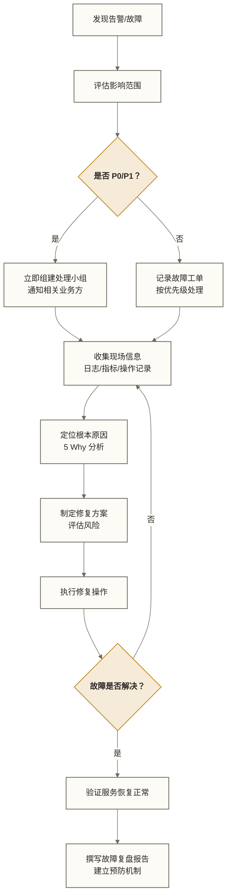

# Hadoop故障排查与运维 - 系统化故障处理方法论

> [!abstract] 本篇定位
> 本篇是企业级运维系列终结篇，也是整个第五阶段的收官之作。承接 [[【技术与工具】/Hadoop/21-数据备份与恢复|数据备份与恢复]] 和 [[【技术与工具】/Hadoop/20-性能监控与调优|性能监控与调优]]，从方法论层面建立系统化的故障处理框架，并针对 HDFS、YARN、MapReduce 三大核心组件梳理高频故障的排查步骤和修复命令。
>
> 学完本篇，你应当能够运用系统化方法收集故障证据，并参考常见组件的命令与日志开展排查；未知故障仍需结合实际版本、配置和现场证据分析。

## 目录

- [[【技术与工具】/Hadoop/22-故障排查与运维#故障诊断方法论|#故障诊断方法论]]
  - [[【技术与工具】/Hadoop/22-故障排查与运维#5-Why分析法|#5-Why分析法]]
  - [[【技术与工具】/Hadoop/22-故障排查与运维#故障分级体系|#故障分级体系]]
  - [[【技术与工具】/Hadoop/22-故障排查与运维#故障处理标准流程|#故障处理标准流程]]
- [[【技术与工具】/Hadoop/22-故障排查与运维#HDFS常见故障|#HDFS常见故障]]
  - [[【技术与工具】/Hadoop/22-故障排查与运维#NameNode OOM|#NameNode OOM]]
  - [[【技术与工具】/Hadoop/22-故障排查与运维#DataNode掉线|#DataNode掉线]]
  - [[【技术与工具】/Hadoop/22-故障排查与运维#磁盘写满|#磁盘写满]]
  - [[【技术与工具】/Hadoop/22-故障排查与运维#Safe Mode卡住|#Safe Mode卡住]]
- [[【技术与工具】/Hadoop/22-故障排查与运维#YARN常见故障|#YARN常见故障]]
  - [[【技术与工具】/Hadoop/22-故障排查与运维#ResourceManager不可用|#ResourceManager不可用]]
  - [[【技术与工具】/Hadoop/22-故障排查与运维#任务长时间ACCEPTED|#任务长时间ACCEPTED]]
  - [[【技术与工具】/Hadoop/22-故障排查与运维#Container内存超限|#Container内存超限]]
- [[【技术与工具】/Hadoop/22-故障排查与运维#MapReduce故障|#MapReduce故障]]
  - [[【技术与工具】/Hadoop/22-故障排查与运维#任务失败重试机制|#任务失败重试机制]]
  - [[【技术与工具】/Hadoop/22-故障排查与运维#Shuffle阶段失败|#Shuffle阶段失败]]
  - [[【技术与工具】/Hadoop/22-故障排查与运维#数据倾斜导致的超时|#数据倾斜导致的超时]]
- [[【技术与工具】/Hadoop/22-故障排查与运维#日志分析技巧|#日志分析技巧]]
- [[【技术与工具】/Hadoop/22-故障排查与运维#运维自动化|#运维自动化]]
- [[【技术与工具】/Hadoop/22-故障排查与运维#掌握检查与实践练习|#掌握检查与实践练习]]

---

## 故障诊断方法论

在深入具体故障之前，先建立正确的诊断思维框架。没有方法论的故障排查往往是"乱枪打鸟"——凭直觉猜测，随机尝试，不仅效率低，而且容易在排查过程中制造新的问题。

### 5-Why分析法

5 Why 分析法源自丰田生产系统，核心思想是连续追问"为什么"，直到找到根本原因，而不是满足于表面症状的修复。

> [!example] 5 Why 在大数据运维中的应用（教学假设：下述数据量、内存和增长倍数用于演示推理链，并非已核实的真实事故；实际根因须逐层取证）
>
> **现象**：每日报表任务在凌晨 3:00 失败
>
> **Why 1**：为什么任务失败？
> → 因为 MapReduce 作业报告 Container 被杀死
>
> **Why 2**：为什么 Container 被杀死？
> → 因为 Container 使用内存超过了申请的上限
>
> **Why 3**：为什么内存超限？
> → 因为 Reduce 阶段需要聚合 3 亿条数据，而申请内存仅 2GB
>
> **Why 4**：为什么申请内存不够？
> → 因为上个月数据量增长了 4 倍，但作业参数没有随之调整
>
> **Why 5**：为什么参数没有随数据量调整？
> → 因为没有建立"数据量变化 → 作业参数复查"的运维机制
>
> **根本原因**：缺乏数据量监控与作业参数联动机制
> **治本方案**：建立数据量增长告警，并定期自动评估作业资源配置

### 故障分级体系

在企业级运维中，故障分级是合理调配响应资源的前提。下表是教学用分级与响应时限示例，并非统一行业标准；实际级别应按业务影响、冗余状态及组织 SLA 确定。

| 级别 | 定义 | 响应时间 | 典型场景 |
|------|------|----------|----------|
| P0（致命） | 核心业务完全不可用，数据丢失风险 | 立即响应，15 分钟内介入 | NameNode 宕机、数据仓库写入全部失败 |
| P1（严重） | 核心业务部分受损，影响大多数用户 | 30 分钟内响应 | 多个 DataNode 掉线、YARN 队列积压 |
| P2（一般） | 非核心功能异常，影响有限 | 2 小时内响应 | 单个任务失败、监控图表异常 |
| P3（轻微） | 轻微问题，不影响业务运行 | 工作日内处理 | 配置参数非最优、日志级别过高 |

### 故障处理标准流程



> [!warning] 故障处理的黄金纪律
> 1. **先保存现场，再动手操作**：在任何修复操作之前，先保存日志、截图、指标快照
> 2. **每次只改一个变量**：避免同时修改多个配置，否则无法判断是哪个改动生效
> 3. **重要操作先备份**：修改配置文件前先备份原文件（`cp hadoop.xml hadoop.xml.bak`）
> 4. **记录每一步操作**：实时记录操作日志，便于复盘和回滚

---

## HDFS常见故障

### NameNode OOM

NameNode 将所有文件系统元数据加载到内存中，当集群规模增大（文件数量极多）时，NameNode 堆内存可能耗尽。

**症状识别**

```markdown
# NameNode 日志中出现以下关键字
java.lang.OutOfMemoryError: Java heap space
java.lang.OutOfMemoryError: GC overhead limit exceeded
```

**排查步骤**

```bash
# 步骤1：确认当前堆内存使用情况
# 通过 NameNode Web UI（默认 50070 端口）查看 JVM 指标
curl -s http://namenode:50070/jmx?qry=java.lang:type=Memory \
    | python3 -m json.tool | grep -A 3 "HeapMemoryUsage"

# 步骤2：统计当前文件总数（文件数过多是主因）
# dfsadmin -report 不提供文件总数；下行 fsck 可统计文件数，但全量扫描须评估负载
hdfs fsck / -files 2>&1 | grep "Total files"

# 步骤3：查找小文件集中目录（小文件是元数据膨胀的主因）
hdfs dfs -count -q /data/warehouse | sort -k3 -rn | head -20
```

**修复方案**

```bash
# 方案一：增加 NameNode 堆内存（临时方案）
# 修改 hadoop-env.sh
export HADOOP_NAMENODE_OPTS="-Xmx16g -Xms16g \
    -XX:+UseG1GC \
    -XX:MaxGCPauseMillis=200 \
    ${HADOOP_NAMENODE_OPTS}"

# 方案二：合并小文件（治本方案）
# 使用 Hive 合并小文件
hive -e "
    SET hive.merge.mapfiles=true;
    SET hive.merge.mapredfiles=true;
    SET hive.merge.size.per.task=268435456;  -- 256MB
    INSERT OVERWRITE TABLE target_table PARTITION(dt='2026-03-21')
    SELECT * FROM target_table WHERE dt='2026-03-21';
"

# 方案三：归档冷数据（HAR 不会自动删除源文件；验证归档完整性、读取兼容性和备份后，另行审批清理源文件，才可能减少 NameNode 管理的文件数）
# 将大量小文件打包为 HAR（Hadoop Archive）
hadoop archive -archiveName logs_2025.har \
    -p /data/logs/2025/ \
    /data/archive/
```

---

### DataNode掉线

DataNode 掉线是 HDFS 最常见的故障，可能由硬件故障、网络问题、磁盘满或进程崩溃引起。

**排查步骤**

```bash
# 步骤1：确认掉线节点数量和名称
hdfs dfsadmin -report 2>&1 | grep -E "Dead datanodes|^Name:" | head -20

# 步骤2：检查具体 DataNode 上的错误日志
# 登录到问题节点
ssh datanode-05.example.com
tail -200 /var/log/hadoop/hadoop-hdfs-datanode-datanode-05.log \
    | grep -E "ERROR|WARN|Exception|killed"

# 步骤3：检查磁盘状态（常见原因：磁盘故障或空间满）
df -h | grep -v tmpfs
dmesg | tail -50 | grep -iE "disk|error|bad|sector"

# 步骤4：检查网络连通性
ping -c 3 namenode.example.com
telnet namenode.example.com 8020
```

**修复步骤**

```bash
# 情况一：DataNode 进程崩溃（磁盘正常）
# 直接重启 DataNode 进程
hadoop-daemon.sh start datanode

# 情况二：磁盘满
# 先核对 dfs.datanode.data.dir；不能凭目录名认定数据可删除
# 以下删除命令仅供隔离环境示例：须确认路径不含有效块、完成备份并获审批后才可执行
rm -rf /hadoop/data/tmp/*
hadoop-daemon.sh start datanode

# 情况三：硬件故障，需要永久退役该节点
# 将节点加入黑名单，触发数据迁移
echo "datanode-05.example.com" >> /etc/hadoop/conf/dfs.exclude
hdfs dfsadmin -refreshNodes

# 监控数据迁移进度（等待 Decommissioned 状态）
hdfs dfsadmin -report 2>&1 | grep -A 5 "datanode-05"
```

---

### 磁盘写满

HDFS DataNode 或 NameNode 的磁盘写满会直接导致写入失败，是生产环境中高频的 P1 级故障。

**症状**

```yaml
# 客户端写入时报错
org.apache.hadoop.hdfs.server.datanode.DiskOutOfSpaceException:
    No space left on device
```

**排查与修复**

```bash
# 步骤1：确认哪个节点、哪个磁盘满了
hdfs dfsadmin -report | grep -E "DFS Used|Non DFS Used|Available"

# 步骤2：登录到问题节点，查找占用空间最大的目录
ssh datanode-xx.example.com
du -sh /hadoop/data/* | sort -rh | head -10

# 步骤3：清理常见的空间占用
# 不得直接清理有效 DataNode 存储目录；tmp 名称不代表其中数据可安全删除
# 以下命令仅供隔离环境示例：须确认路径用途、完成备份并获审批后才可执行
rm -rf /hadoop/data/tmp/

# 清理 YARN 本地日志（注意保留最近的日志）
find /yarn/logs/ -name "*.log" -mtime +7 -delete

# 步骤4：降低副本数会削弱容错，且不保证立即释放空间；须先确认块健康、备份及审批，记录原副本策略并安排恢复，不能作为通用应急步骤
hdfs dfs -setrep 2 /data/

# 步骤5：中长期方案：扩容磁盘或添加新 DataNode
# 添加新磁盘后，在 hdfs-site.xml 中追加新路径
# dfs.datanode.data.dir = /hadoop/data1,/hadoop/data2,/hadoop/data3_new
```

---

### Safe Mode卡住

HDFS Safe Mode 是一种保护状态，在此状态下不接受任何写操作。NameNode 启动时会进入 Safe Mode，当足够多的数据块完成汇报后自动退出。但某些情况下会卡住不退出。

**排查步骤**

```bash
# 步骤1：查看 Safe Mode 的具体原因
hdfs dfsadmin -safemode get
# 输出示例：
# Safe mode is ON. The reported blocks 98765 needs additional 1234 blocks
# to reach the threshold 0.9990 of total blocks 100000.
# The number of live datanodes 45 has reached the minimum number 0.
# In safe mode extension. Safe mode will be turned off automatically in 24 seconds.

# 步骤2：检查是否有足够的 DataNode 在线
hdfs dfsadmin -report | grep -E "^Live datanodes|^Dead datanodes"

# 步骤3：等待 DataNode 汇报完成（正常启动时，耐心等待即可）
# 监控块汇报进度
watch -n 5 "hdfs dfsadmin -safemode get"
```

**强制退出 Safe Mode（谨慎操作）**

```bash
# 仅当确认集群状态正常但 Safe Mode 确实卡住时才使用
# 强制退出可能导致副本不足的数据块暂时不可用
hdfs dfsadmin -safemode leave

# 退出后立即检查数据块健康状态
hdfs fsck / 2>&1 | grep -E "Status:|CORRUPT|MISSING"
```

> [!warning] 关于强制退出 Safe Mode
> 不要轻易手动退出 Safe Mode。Safe Mode 可能与启动阶段的块汇报阈值、最少在线节点、资源不足或管理员手动进入有关，应先确认具体原因。`leave` 不会修复缺失块或补足副本，也不等同于恢复健康；它允许重新进行写入，可能在冗余不足时增加运行风险。应先检查块健康、NameNode 资源及退出条件，经审批后操作；缺少副本并不意味着新写入必然破坏已有数据。

---

## YARN常见故障

### ResourceManager不可用

ResourceManager 是 YARN 的核心调度器，不可用时所有新提交的任务都无法运行。

**排查步骤**

```bash
# 步骤1：检查 ResourceManager 进程状态
yarn rmadmin -getServiceState rm1
yarn rmadmin -getServiceState rm2

# 步骤2：查看 ResourceManager 日志
tail -300 /var/log/hadoop/hadoop-yarn-resourcemanager-*.log \
    | grep -E "ERROR|FATAL|Exception" | tail -30

# 步骤3：检查 ZooKeeper 连接（HA 模式下依赖 ZooKeeper）
# 确认 ZooKeeper 服务正常
echo ruok | nc zookeeper-01 2181

# 查看 YARN 在 ZooKeeper 上的 Leader 选举节点
/opt/zookeeper/bin/zkCli.sh -server zookeeper-01:2181 \
    ls /yarn-leader-election
```

**修复方案**

```bash
# 情况一：RM 进程崩溃
yarn-daemon.sh start resourcemanager

# 情况二：HA 模式下主 RM 无法选举
# yarn rmadmin 不提供 -failover 子命令；先核对自动故障转移配置与选举日志
# 手动状态切换须按目标版本支持的 transitionToStandby/transitionToActive 流程操作
# 未确认旧主隔离、fencing 和自动选举状态前，不得强制激活另一台 RM

# 情况三：检查 ZooKeeper 上的 RM 选举节点（极端情况）
# 下列递归删除仅保留为待验证示例，禁止直接执行：须确认配置指定的选举路径及其用途，隔离相关 RM、备份节点信息并获审批；误删可能干扰选举，rmr 是否支持也须核对 ZooKeeper 版本
/opt/zookeeper/bin/zkCli.sh -server zookeeper-01:2181 \
    rmr /yarn-leader-election/yarn-cluster
```

---

### 任务长时间ACCEPTED

任务提交后长时间处于 ACCEPTED 状态（而非 RUNNING），表示应用尚未进入运行状态；常见原因是 AM 资源或队列限制，也可能涉及 AM 启动失败、重试及恢复，须结合诊断信息判断。

**排查步骤**

```bash
# 步骤1：查看集群资源使用情况
yarn top

# 步骤2：检查具体任务在等待什么资源
yarn application -status <application_id>
# 关注输出中的：
# Queue: default
# Final-State: UNDEFINED
# Tracking-URL: ...
# AM Host: N/A  （当前未提供 AM 主机信息；不能仅凭此项认定资源不足，须结合诊断信息及 AM 尝试记录判断）

# 步骤3：查看队列资源配置和当前使用率
yarn queue -status default
# 查看调度器配置：通过 ResourceManager Web UI 或实际部署的配置文件查看；yarn 不提供通用 scheduler 子命令

# 步骤4：检查 NodeManager 是否都处于健康状态
yarn node -list -all | grep -v RUNNING | head -20
```

**常见原因与修复**

```bash
# 原因一：集群资源确实耗尽（正常等待）
# 等待运行中的任务完成，或扩容集群

# 原因二：任务申请的资源超过单节点上限
# 检查任务配置
yarn application -status <app_id> | grep "Resource"
# 修改任务的内存/CPU 申请值，不超过 yarn.scheduler.maximum-allocation-mb

# 原因三：队列设置了最大并发任务限制
# 修改 capacity-scheduler.xml
<property>
    <name>yarn.scheduler.capacity.root.default.maximum-applications</name>
    <value>10000</value>
</property>
```

---

### Container内存超限

Container 内存超过申请量时会被 NodeManager 直接杀死，是 MapReduce/Spark 作业失败的最常见原因之一。

**症状**

```markdown
# 任务日志中出现
Container killed on request. Exit code is 143
Container [pid=12345,containerID=container_xxx] is running beyond virtual memory limits.
Current usage: 2.1 GB of 2 GB physical memory used
```

**排查步骤**

```bash
# 步骤1：确认是内存超限还是其他原因杀死
yarn logs -applicationId <app_id> 2>/dev/null \
    | grep -E "killed|memory|OOM" | tail -20

# 步骤2：查看任务申请的内存配置
yarn application -status <app_id> | grep -i memory

# 步骤3：分析是否存在内存泄漏或数据量激增
yarn logs -applicationId <app_id> \
    | grep -E "GC|heap|memory" | tail -50
```

**修复方案**

```bash
# 方案一：提高任务的内存申请量
# 对于 MapReduce 作业
hadoop jar myJob.jar MyDriver \
    -D mapreduce.map.memory.mb=4096 \
    -D mapreduce.reduce.memory.mb=8192 \
    -D mapreduce.map.java.opts="-Xmx3686m" \
    -D mapreduce.reduce.java.opts="-Xmx7372m" \
    input/ output/

# 方案二：关闭虚拟内存检测（不推荐，治标不治本）
# 在 yarn-site.xml 中设置
<property>
    <name>yarn.nodemanager.vmem-check-enabled</name>
    <value>false</value>
</property>

# 方案三：调整虚拟内存与物理内存的比率（适当放宽限制）
<property>
    <name>yarn.nodemanager.vmem-pmem-ratio</name>
    <value>3.0</value>
    <!-- 默认 2.1，适当提高可减少误杀 -->
</property>
```

---

## MapReduce故障

### 任务失败重试机制

MapReduce 内置了容错重试机制，理解这个机制是排查任务失败的前提。

```text
任务失败流程：
Task → 失败 → ApplicationMaster 重新调度
          ↓
    已执行尝试次数 < mapreduce.map.maxattempts（Map 默认4，包含首次执行）
          ↓ 是              ↓ 否
    重新分配到         作业失败，AM
    其他节点运行       退出并报告失败
```

**查看任务重试历史**

```bash
# 通过 Job History Server 查看作业详细信息
# 默认地址：http://jobhistory:19888

# 命令行查看失败任务的日志
yarn logs -applicationId application_xxx \
    -containerId container_xxx \
    -nodeAddress datanode-05:8042
```

**关键重试相关配置**

```xml
<!-- mapred-site.xml -->
<property>
    <name>mapreduce.map.maxattempts</name>
    <value>4</value>
    <!-- Map 任务的最大尝试次数，包含首次执行；设为 4 时通常最多重试 3 次 -->
</property>
<property>
    <name>mapreduce.reduce.maxattempts</name>
    <value>4</value>
    <!-- Reduce 任务的最大尝试次数，包含首次执行；设为 4 时通常最多重试 3 次 -->
</property>
<property>
    <name>mapreduce.job.maxtaskfailures.per.tracker</name>
    <value>3</value>
    <!-- 单个 NodeManager 上允许失败的任务数，超过则将该节点列入黑名单 -->
</property>
```

---

### Shuffle阶段失败

Shuffle 是 MapReduce 最复杂的阶段，也是最容易出问题的地方。Map 输出数据需要通过网络传输到 Reduce 端，任何网络抖动、磁盘问题都会导致 Shuffle 失败。

**常见错误信息**

```markdown
# 错误一：Reduce 从 Map 端拉取数据失败
java.io.IOException: Failed to fetch mapoutput from ...
    at org.apache.hadoop.mapreduce.task.reduce.Fetcher.copyFromHost

# 错误二：连接 Map 输出服务失败；仅凭该日志不能判断输出文件已被删除
org.apache.hadoop.mapreduce.task.reduce.Fetcher: Failed to connect to maphost:50060

# 错误三：Shuffle 过程中 OOM
java.lang.OutOfMemoryError: Java heap space
    at org.apache.hadoop.mapred.Merger.merge
```

**排查与修复**

```bash
# 修复一：增加 Shuffle 相关内存配置
hadoop jar myJob.jar MyDriver \
    -D mapreduce.reduce.shuffle.parallelcopies=10 \
    -D mapreduce.reduce.shuffle.input.buffer.percent=0.70 \
    -D mapreduce.reduce.shuffle.merge.percent=0.66 \
    input/ output/

# 修复二：增加 Map 输出合并的溢写缓冲区（减少溢写次数）
# mapred-site.xml
<property>
    <name>mapreduce.task.io.sort.mb</name>
    <value>512</value>
    <!-- 默认 100MB，适当提高减少溢写频率 -->
</property>

# 修复三：开启 Map 输出压缩（减少 Shuffle 网络传输量）
<property>
    <name>mapreduce.map.output.compress</name>
    <value>true</value>
</property>
<property>
    <name>mapreduce.map.output.compress.codec</name>
    <value>org.apache.hadoop.io.compress.SnappyCodec</value>
</property>
```

---

### 数据倾斜导致的超时

数据倾斜是大数据处理中最常见的性能和稳定性问题：大量数据集中在少数几个 Reduce Task，导致这些 Task 运行时间极长，整个作业长时间等待。

**识别数据倾斜**

```bash
# 症状：作业进度长时间卡在 99%，只有少数 Task 还在运行
# 通过 YARN UI 可以看到大部分 Reduce Task 已完成，只剩 1-2 个运行了几小时

# 命令行检查 Task 运行时间分布
mapred job -status <job_id> 2>/dev/null | grep -E "reduce_[0-9]"

# 通过 Counters 确认数据量分布
yarn logs -applicationId <app_id> \
    | grep "reduce input records" | tail -20
```

**处理数据倾斜的常用方案**

```bash
# 方案一：增加 Reduce 数量（可缓解多个 Key 分区不均；同一热点 Key 仍进入同一分区，不能仅靠增加数量拆散）
hadoop jar myJob.jar MyDriver \
    -D mapreduce.job.reduces=200 \
    input/ output/

# 方案二：使用 Combiner 在 Map 端预聚合（仅适用于可安全局部聚合的计算；须保证不执行或重复执行 Combiner 都不改变最终语义）
# 在 Java 代码中设置 Combiner
job.setCombinerClass(MyCombinerClass.class);

# 方案三：对倾斜的 Key 加随机前缀（两阶段聚合）
# 第一阶段：key + 随机数(0-9) 作为新 Key，形成 10 个加盐 Key；须核对分区映射，不能保证恰好分散到 10 个 Reduce
# 第二阶段：去掉前缀，再次聚合

# 方案四：调整 Map 输出分区函数，隔离极端大 Key（不得跳过，否则可能丢失结果）
# 实现自定义 Partitioner，将超大 Key 单独路由；热点本身仍可能形成瓶颈，需另行设计保持计算语义的拆分方案
```

---

## 日志分析技巧

掌握日志文件的位置和快速定位方法，是运维效率的核心。

**核心日志文件路径（部署示例，须以实际日志配置为准，并非统一默认路径）**

| 组件 | 日志路径 | 关键文件 |
|------|----------|----------|
| HDFS NameNode | `/var/log/hadoop/hadoop-hdfs-namenode-*.log` | 启动日志、GC 日志 |
| HDFS DataNode | `/var/log/hadoop/hadoop-hdfs-datanode-*.log` | 磁盘错误、心跳超时 |
| YARN ResourceManager | `/var/log/hadoop/hadoop-yarn-resourcemanager-*.log` | 调度日志、任务状态 |
| YARN NodeManager | `/var/log/hadoop/hadoop-yarn-nodemanager-*.log` | Container 启停日志 |
| MapReduce 任务 | YARN Container 日志目录 | stdout、stderr、syslog |
| Job History Server | `/var/log/hadoop/hadoop-yarn-historyserver-*.log` | 历史作业信息 |

**常用日志分析命令**

```bash
# 技巧一：实时追踪日志，过滤 ERROR 和 WARN
tail -f /var/log/hadoop/hadoop-hdfs-namenode-*.log \
    | grep --line-buffered -E "ERROR|WARN|Exception"

# 技巧二：统计错误类型出现频率（快速定位高频问题）
grep "Exception" /var/log/hadoop/hadoop-hdfs-namenode-*.log \
    | awk -F': ' '{print $1}' \
    | sort | uniq -c | sort -rn | head -10

# 技巧三：提取特定时间段的日志（故障时间窗口分析）
awk '/2026-03-21 03:00/,/2026-03-21 03:30/' \
    /var/log/hadoop/hadoop-hdfs-namenode-*.log \
    | grep -E "ERROR|WARN"

# 技巧四：从 YARN 获取指定任务的完整日志
yarn logs -applicationId application_1711000000000_0042 \
    > /tmp/job_42_full.log 2>&1

# 从完整日志中提取关键错误信息
grep -n "ERROR\|Exception\|killed\|failed" /tmp/job_42_full.log | head -50

# 技巧五：查看 GC 日志（排查 NameNode JVM 问题）
grep -E "GC pause|Full GC|heap" \
    /var/log/hadoop/hadoop-hdfs-namenode-gc.log 2>/dev/null | tail -20
```

**配置更详细的 DataNode 日志（排查磁盘问题时开启）**

```xml
<!-- log4j.properties：临时将 DataNode 日志级别提升为 DEBUG -->
log4j.logger.org.apache.hadoop.hdfs.server.datanode.DataNode=DEBUG
<!-- 排查完毕后务必恢复为 INFO，DEBUG 级别会产生大量日志 -->
```

---

## 运维自动化

手动运维无法应对大规模集群的复杂性，自动化是提升运维能力的必经之路。

### Ambari和Cloudera Manager的告警配置思路

两款主流集群管理工具都支持可视化告警配置，核心思路一致：

1. **基础指标告警**：CPU、内存、磁盘使用率超过阈值（推荐：警告 75%，危急 90%）
2. **服务状态告警**：NameNode、ResourceManager 进程存活检测
3. **业务指标告警**：HDFS 剩余空间、YARN 队列积压任务数、数据块丢失数

**Ambari 通过 REST API 配置告警（自动化脚本化）**

```bash
# 查询当前所有告警定义
curl -u admin:password \
    http://ambari-server:8080/api/v1/clusters/MyCluster/alert_definitions \
    | python3 -m json.tool | grep '"name"' | head -20

# 触发手动检查（用于验证告警是否正常工作）
curl -u admin:password -X POST \
    http://ambari-server:8080/api/v1/clusters/MyCluster/alert_definitions/42/alerts
```

### 脚本化健康检查示例

```bash
#!/bin/bash
# =============================================================
# Hadoop 集群健康检查脚本
# 待验证教学示例，勿直接部署 crontab：先修复交互式采集、超时、返回码及漏报处理，并评估全量 fsck 负载后确定频率
# =============================================================

CLUSTER_NAME="prod-cluster"
ALERT_WEBHOOK="http://192.168.8.3:5678/webhook/ops-alert"
NN_HOST="namenode.example.com"
RM_HOST="resourcemanager.example.com"

log() { echo "[$(date '+%Y-%m-%d %H:%M:%S')] $1"; }

send_webhook_alert() {
    local level="$1"
    local message="$2"
    curl -s -X POST "${ALERT_WEBHOOK}" \
        -H "Content-Type: application/json" \
        -d "{\"cluster\":\"${CLUSTER_NAME}\",\"level\":\"${level}\",\"message\":\"${message}\"}" \
        > /dev/null 2>&1
}

# 检查1：HDFS Safe Mode
SAFE_MODE=$(hdfs dfsadmin -safemode get 2>/dev/null | grep -o "ON\|OFF")
if [ "${SAFE_MODE}" = "ON" ]; then
    send_webhook_alert "WARNING" "HDFS 处于 Safe Mode 状态，请检查集群状态"
fi

# 检查2：HDFS 容量使用率
HDFS_USED=$(hdfs dfsadmin -report 2>/dev/null \
    | grep "DFS Used%:" | awk '{print $3}' | tr -d '%' | head -1)
if [ -n "${HDFS_USED}" ] && (( $(echo "${HDFS_USED} > 85" | bc -l) )); then
    send_webhook_alert "WARNING" "HDFS 使用率 ${HDFS_USED}%，请关注磁盘空间"
fi

# 检查3：Dead DataNode 数量
DEAD_DN=$(hdfs dfsadmin -report 2>/dev/null \
    | grep "Dead datanodes" | awk '{print $3}')
if [ -n "${DEAD_DN}" ] && [ "${DEAD_DN}" -gt 0 ]; then
    send_webhook_alert "CRITICAL" "检测到 ${DEAD_DN} 个 DataNode 不可用，请立即检查"
fi

# 检查4：数据块完整性（全量 fsck，可能耗时并增加 NameNode 负载；输出解析须按实际版本验证）
MISSING=$(hdfs fsck / 2>/dev/null | grep "MISSING BLOCKS" | awk '{print $3}')
if [ -n "${MISSING}" ] && [ "${MISSING}" -gt 0 ]; then
    send_webhook_alert "CRITICAL" "检测到 ${MISSING} 个丢失数据块，存在数据丢失风险"
fi

# 检查5：YARN 队列积压任务
PENDING_APPS=$(yarn top -d 1 2>/dev/null | grep "Pending Apps" | awk '{print $NF}')
if [ -n "${PENDING_APPS}" ] && [ "${PENDING_APPS}" -gt 50 ]; then
    send_webhook_alert "WARNING" "YARN 队列积压 ${PENDING_APPS} 个待执行任务"
fi

log "健康检查完成"
```

---

## 掌握检查与实践练习

### 掌握检查

完成本篇学习后，请确认你能够回答以下问题：

- [ ] 能够使用 5 Why 分析法对一个具体故障现象进行根因分析，而不是停留在表象修复
- [ ] 能够按 P0/P1/P2/P3 对故障进行准确分级，并匹配相应的响应速度和处理流程
- [ ] 能够独立处理 NameNode OOM、DataNode 掉线、Safe Mode 卡住三种 HDFS 高频故障
- [ ] 能够识别数据倾斜的症状，并说出至少两种处理方案
- [ ] 能够根据故障现象快速定位到对应的日志文件，并使用 grep/awk 提取关键错误信息

### 实践练习

**练习一：故障场景诊断**

阅读以下故障现象，用 5 Why 分析法找出根本原因，并给出修复步骤：

> **现象**：每天上午 9:00，数仓日报任务提交后在 ACCEPTED 状态等待超过 2 小时，而昨天同样的任务只需 20 分钟完成。运维监控显示集群当前有 30 个 NodeManager，CPU 使用率均在 10% 以下，内存使用率 40%。
>
> **日志片段**：
> ```text
> 2026-03-21 09:02:33 INFO RMAppAttemptImpl: Recovering attempt ...
> 2026-03-21 09:02:35 WARN CapacityScheduler: Application xxx is trying to use
>     resource <memory:32768, vCores:16> which exceeds per-application limit
>     <memory:8192, vCores:4> in queue default
> ```

**提示**：重点关注日志中的 `exceeds per-application limit` 信息，思考为什么之前能跑而现在不行。

---

**练习二：命令填空**

根据描述填写完整的 Hadoop 运维命令：

1. 将 HDFS `/data/archive` 目录下所有文件的副本数调整为 1（节省存储空间）：
   ```bash
   hdfs dfs __________ 1 /data/archive
   ```

2. 查看 application_1711000000000_0100 这个 YARN 任务的完整日志并保存到文件：
   ```bash
   yarn logs __________ application_1711000000000_0100 > /tmp/job_log.txt
   ```

3. 将 NameNode 从 Safe Mode 中强制退出：
   ```bash
   hdfs dfsadmin __________ leave
   ```

4. 安全退役 `datanode-10.example.com` 节点（刷新节点列表使配置生效）：
   ```bash
   # 已将节点写入 dfs.exclude 文件，执行刷新命令：
   hdfs dfsadmin __________
   ```

---

## 学习路径

恭喜你完成了企业级运维系列的全部五篇内容！

**第五阶段完整学习路径回顾**：

- [[【技术与工具】/Hadoop/18-Hadoop集群规划|Hadoop集群规划]] - 硬件选型、网络规划、容量评估
- [[【技术与工具】/Hadoop/19-高可用架构设计|高可用架构设计]] - NameNode HA、ResourceManager HA、自动故障转移
- [[【技术与工具】/Hadoop/20-性能监控与调优|性能监控与调优]] - 监控体系建设、性能分析、智能告警
- [[【技术与工具】/Hadoop/21-数据备份与恢复|数据备份与恢复]] - 数据保护策略、灾备方案、自动化备份
- **本篇** - 故障诊断方法论、高频故障处理、运维自动化

**下一步学习方向（第六阶段）**：

云原生与新技术方向，包括 AWS EMR / 阿里云 EMR 的云上部署、Kubernetes 容器化、Delta Lake / Apache Iceberg 数据湖架构，以及与 [[【技术与工具】/Spark/00-Spark学习路线图|Spark]]、[[【技术与工具】/Flink/00-Flink学习路线图|Flink]] 的深度集成。

---

> [!tip] 关键收获
> - 方法论先于工具：5 Why 分析和故障分级是所有运维技能的基础
> - 故障排查的顺序应当是：收集现场 → 定位根因 → 制定方案 → 执行修复 → 验证恢复 → 总结预防
> - 日志是重要的故障证据，应与指标、配置和操作记录交叉验证；掌握关键日志文件位置和 grep/awk 技巧有助于提高定位效率
> - 自动化是规模化运维的必然选择，但自动化脚本本身也需要被测试和监控
