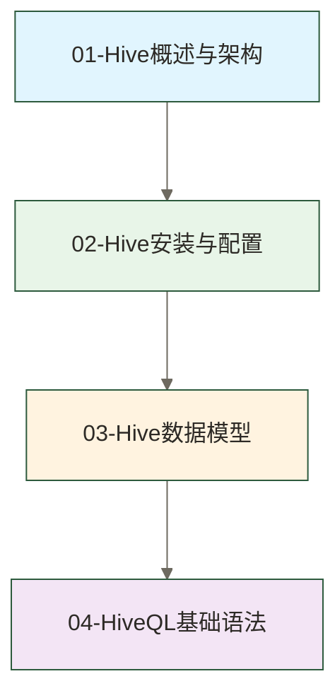
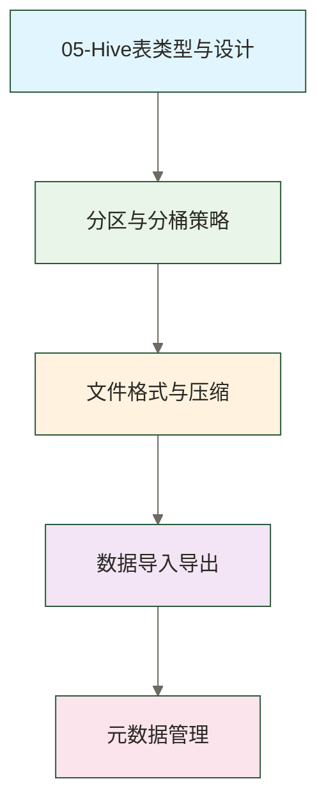
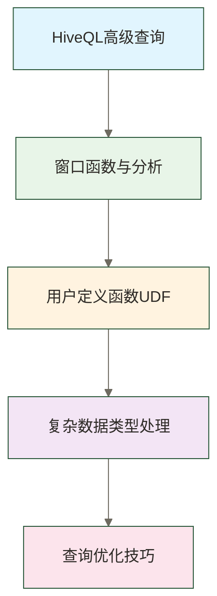
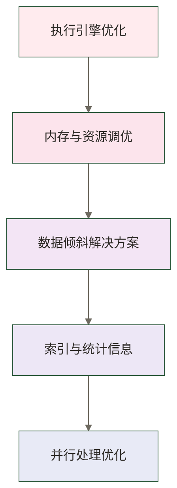
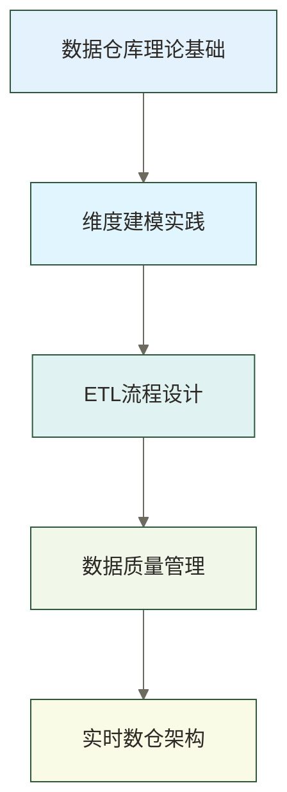
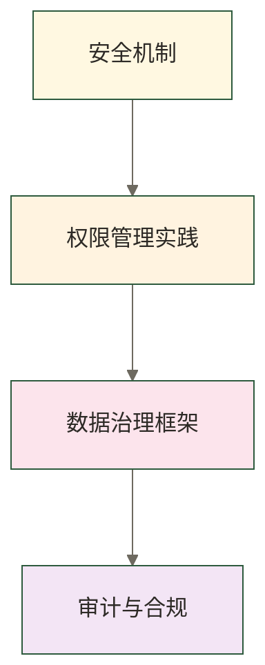
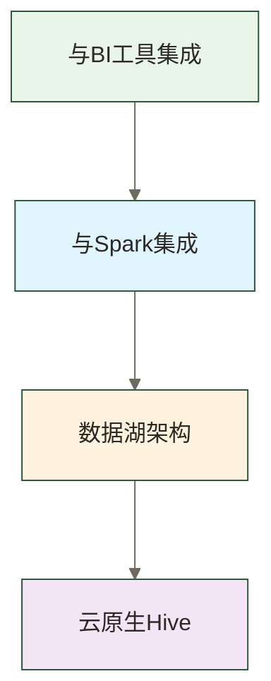
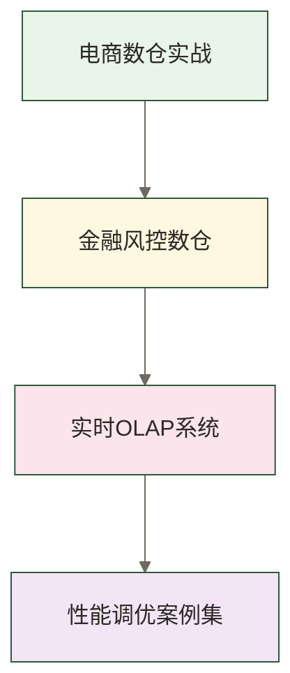

# 🏠 Hive学习路线图 - SQL on Hadoop数据仓库完整指南

> [!abstract] 📋 学习路线概览
> - 🎯 **学习目标**：系统掌握Hive数据仓库的设计、开发和优化
> - 📚 **适用人群**：数据工程师、数据分析师、ETL开发者、数据架构师
> - ⏱️ **总体用时**：建议4-8个月系统学习
> - 🎓 **学习成果目标**：通过配套项目实践逐步培养企业级数据仓库建设和性能调优能力，是否达到目标需结合实际项目验收评估

> [!tip] 💡 与其他技术栈的关系
> Hive构建在Hadoop生态之上，与[[【技术与工具】/Hadoop/00-Hadoop学习路线图|Hadoop]]、[[【技术与工具】/PostgreSQL/00-PostgreSQL学习路线图|PostgreSQL]]和[[【技术与工具】/Spark/00-Spark学习路线图|Spark]]紧密结合

## 🎯 学习阶段划分

### 🟢 第一阶段：Hive基础入门（2-3周）
**目标**：理解Hive架构原理，掌握基本安装配置



**学习文件顺序**：
1. [[【技术与工具】/Hive/01-Hive概述与架构|Hive概述与]] - Hive定义、架构组件、工作原理、生态定位
2. [[【技术与工具】/Hive/02-Hive安装与配置|Hive安装与配置]] - 环境准备、安装部署、配置优化、连接方式
3. [[【技术与工具】/Hive/03-Hive数据模型|Hive数据]] - 数据库、表、分区、桶、数据类型、存储格式
4. [[【技术与工具】/Hive/04-HiveQL基础语法|HiveQL基础语法]] - DDL、DML、查询语法、数据导入导出

> [!tip] 💡 第一阶段重点
> - 理解Hive作为SQL on Hadoop的作用
> - 掌握Hive与传统数据库的区别
> - 熟练使用Hive CLI和Beeline客户端

---

### 🟡 第二阶段：数据存储与管理（3-4周）
**目标**：深入掌握Hive数据存储机制和表设计



**学习文件顺序**：
5. [[【技术与工具】/Hive/05-Hive表类型与设计|Hive表类型与]] - 内部表、外部表、临时表、视图、表设计原则
6. [[【技术与工具】/Hive/06-分区与分桶策略|分区与分桶]] - 分区设计、动态分区、分桶原理、性能优化
7. [[【技术与工具】/Hive/07-文件格式与压缩|文件格式与压缩]] - TextFile、ORC、Parquet、Avro、压缩算法选择
8. [[【技术与工具】/ClickHouse/06-ClickHouse数据导入导出|ClickHouse数据导入导出]] - LOAD、INSERT、Sqoop、DataX、实时导入
9. [[【技术与工具】/Impala/13-元数据管理|元数据]] - Metastore原理、HMS配置、元数据备份恢复

> [!tip] 💡 第二阶段重点
> - 掌握分区表的设计和优化策略
> - 理解不同文件格式的适用场景
> - 学会选择合适的数据导入方案

---

### 🟠 第三阶段：高级查询与分析（4-5周）
**目标**：精通HiveQL高级功能和分析函数



**学习文件顺序**：
10. [[【技术与工具】/Hive/10-HiveQL高级查询|HiveQL高级查询]] - 复杂JOIN、子查询、CTE、UNION、集合操作
11. [[【技术与工具】/Hive/11-窗口函数与分析|窗口函数与]] - ROW_NUMBER、RANK、LAG/LEAD、聚合窗口函数
12. [[【技术与工具】/Hive/12-用户定义函数UDF|用户定义函数UDF]] - UDF、UDAF、UDTF开发、Python UDF

> [!tip] 💡 第三阶段重点
> - 掌握窗口函数在数据分析中的应用
> - 学会开发自定义函数扩展Hive功能
> - 理解查询优化的原理和技巧

---

### 🔴 第四阶段：性能调优与优化（4-5周）
**目标**：掌握Hive性能调优的方法和最佳实践



**学习文件顺序**：
15. 15-Hive执行引擎优化|Hive执行引擎优化 - MapReduce、Tez、Spark引擎对比与选择
16. 16-内存与资源调优|内存与资源调优 - 内存配置、Container设置、资源队列管理
17. 17-数据倾斜解决方案|数据倾斜解决方案 - 倾斜检测、Skew Join、数据预处理、负载均衡
18. 18-索引与统计信息|索引与统计信息 - 历史版本索引机制（Hive 3.0及以后已移除旧式索引功能）、统计信息收集、CBO优化器
19. 19-并行处理优化|并行处理优化 - 并行度调整、小文件合并、任务调度优化

> [!tip] 💡 第四阶段重点
> - 在确认目标Hive版本及发行版支持后，学习Hive on Spark的配置和优化；不支持时按实际可用执行引擎安排实践
> - 学会诊断和解决数据倾斜问题
> - 理解基于成本的查询优化器原理

---

### 🟣 第五阶段：数据仓库建模（5-6周）
**目标**：掌握基于Hive的企业级数据仓库设计



**学习文件顺序**：
20. 20-数据仓库架构|数据仓库架构 - 数仓概念、架构模式、分层设计、建模方法论
21. 21-维度建模实践|维度建模实践 - 星形模型、雪花模型、事实表、维度表设计
22. 22-ETL流程设计|ETL流程设计 - 数据抽取、转换、加载、调度、监控
23. 23-数据质量管理|数据质量管理 - 数据校验、异常处理、血缘关系、元数据管理
24. 24-实时数仓架构|实时数仓架构 - Lambda架构、Kappa架构、流批一体化

> [!tip] 💡 第五阶段重点
> - 掌握Kimball维度建模方法论
> - 学会设计高效的ETL流程
> - 理解实时数据仓库的架构设计

---

### 🔵 第六阶段：安全与治理（3-4周）
**目标**：建立完善的数据安全和治理体系



**学习文件顺序**：
25. 25-Hive安全机制|Hive安全机制 - Kerberos认证、SSL加密、Ranger授权
26. 26-权限管理实践|权限管理实践 - 行级安全、列级安全、动态权限、角色管理
27. 27-数据治理框架|数据治理框架 - 数据标准、数据目录、数据血缘、影响分析
28. 28-审计与合规|审计与合规 - 操作审计、访问日志、合规检查、GDPR支持

> [!tip] 💡 第六阶段重点
> - 建立企业级的数据安全体系
> - 掌握细粒度的权限控制机制
> - 理解数据治理的最佳实践

---

### 🟠 第七阶段：集成与扩展（4-5周）
**目标**：掌握Hive与其他系统的集成和扩展



**学习文件顺序**：
29. 29-Hive与BI工具集成|Hive与BI工具集成 - Tableau、PowerBI、Superset、JDBC/ODBC
30. Hive与Spark集成 - [[【技术与工具】/Spark/00-Spark学习路线图|Spark]]、Hive Warehouse Connector、统一元数据
31. [[【数据开发与数据架构】/05-数据存储架构/05-数据湖架构|数据湖]] - Delta Lake、Iceberg、Hudi集成、ACID事务
32. 32-云原生Hive|云原生Hive - EMR、HDInsight、DataProc、容器化部署

> [!tip] 💡 第七阶段重点
> - 掌握Hive与现代数据栈的集成
> - 理解数据湖技术的发展趋势
> - 学会云原生环境下的Hive部署

---

### 🎓 第八阶段：企业实战与案例（持续学习）
**目标**：通过实际项目提升综合解决问题的能力



**学习文件顺序**：
33. 33-电商数仓实战|电商数仓实战 - 用户行为分析、商品推荐、实时大屏
34. 34-金融风控数仓|金融风控数仓 - 风险建模、反欺诈、监管报表
35. 35-实时OLAP系统|实时OLAP系统 - 多维分析、实时查询、交互式分析
36. 36-性能调优案例集|性能调优案例集 - 真实调优案例、问题排查、最佳实践

---

## 📅 建议学习计划

> [!info] 💡 学习计划制定原则
> 就像**规划一次环球旅行** 🌍
> - **数据工程师**：深度探索每个景点（技术细节）
> - **数据分析师**：重点体验文化特色（分析应用）  
> - **数据架构师**：设计整个旅行路线（系统架构）

### 🗓️ 数据工程师学习计划（6个月）

| 阶段 | 重点掌握 | 实践项目 |
|------|----------|----------|
| 第1-3周：Hive基础 + 数据模型 | 架构原理、安装配置、数据类型 | 搭建本地Hive环境 |
| 第4-7周：数据存储与管理 | 分区分桶、文件格式、数据导入 | 设计电商数据仓库基础表 |
| 第8-12周：高级查询 + 性能调优 | 复杂SQL、窗口函数、执行优化 | 构建用户行为分析系统 |
| 第13-18周：数据仓库建模（重点） | 维度建模、ETL设计、数据治理 | 完整数据仓库项目交付 |
| 第19-24周：安全治理 + 企业实战 | 权限管理、监控运维、云原生部署 | 生产级Hive集群运维 |

### 🗓️ 数据分析师学习计划（4个月）

| 阶段 | 重点掌握 | 配套学习 |
|------|----------|----------|
| 第1-2周：Hive基础概念 | Hive与传统数据库差异、基础语法 | SQL基础回顾 |
| 第3-6周：HiveQL语法掌握 | JOIN操作、子查询、聚合分析 | 统计学 |
| 第7-10周：高级分析功能 | 窗口函数、时间序列分析、用户画像 | Python数据分析 |
| 第11-16周：数据仓库理论 + BI集成 | 维度建模理解、报表开发、可视化 | BI工具使用 |

### 🗓️ 数据架构师学习计划（8个月）

| 阶段 | 重点掌握 | 配套学习 |
|------|----------|----------|
| 第1-4周：Hive基础 + 存储管理 | 架构设计、存储策略、元数据管理 | Hadoop |
| 第5-12周：性能调优 + 查询优化 | 执行引擎选择、资源调优、瓶颈诊断 | [[【技术与工具】/Spark/00-Spark学习路线图|Spark]] |
| 第13-20周：数据仓库建模（深入） | 企业级建模、数据治理、质量管控 | 数据治理方法论、行业最佳实践 |
| 第21-28周：安全治理 + 架构集成 | 安全架构、多集群管理、灾备方案 | 企业安全框架、合规要求 |
| 第29-32周：云原生 + 前沿技术 | 容器化部署、云原生架构、湖仓一体 | Kubernetes、数据湖技术栈 |

---

## 🛠️ 技能树与进阶路线

### 🌱 初级工程师（0-6个月）
```text
✅ 掌握Hive基本概念和架构
✅ 熟练使用HiveQL进行数据查询
✅ 理解分区表和文件格式
✅ 能够设计简单的数据模型
```

### 🌿 中级工程师（6-18个月）
```text
✅ 精通复杂SQL和窗口函数
✅ 掌握性能调优和优化技巧
✅ 能够设计企业级数据仓库
✅ 熟悉ETL流程和数据治理
```

### 🌳 高级工程师（18个月以上）
```text
✅ 具备大规模数据仓库架构能力
✅ 精通Hive内核和执行引擎
✅ 能够解决复杂的性能和数据问题
✅ 具备团队技术领导能力
```

---

## 📚 学习资源推荐

### 🔗 官方资源
- [Apache Hive官方文档](https://hive.apache.org/)
- [Hive Language Manual](https://cwiki.apache.org/confluence/display/Hive/LanguageManual)
- [HiveQL参考手册](https://cwiki.apache.org/confluence/display/Hive/LanguageManual+DDL)

### 📖 推荐书籍
- 《Hive编程指南》- Edward Capriolo
- 《大数据技术原理与应用》- 林子雨
- 《数据仓库工具箱》- Ralph Kimball

### 🎥 在线课程
- Coursera: Big Data Specialization
- Udacity: Data Engineering Nanodegree
- [[【技术与工具】/Spark/00-Spark学习路线图|Spark]]

---

## 🎯 职业发展路径

### 🚀 技术专家路线
```text
Hive开发工程师 → 大数据工程师 → 数据架构师 → 技术专家
```

### 💼 管理路线
```text
数据工程师 → 高级工程师 → Team Lead → 技术经理 → CTO
```

### 🔬 产品路线
```text
数据分析师 → 数据科学家 → 产品经理 → 数据产品专家
```

---

## 🤝 学习交流

### 💬 社区参与
- Stack Overflow Hive标签
- Apache Hive邮件列表
- GitHub Hive项目贡献
- 技术博客分享

### 🏆 技能认证
- Cloudera Data Engineer
- Hortonworks Data Platform
- AWS Big Data Specialty
- Google Cloud Data Engineer

---

> [!tip] 💡 学习建议
> - **理论与实践结合**：每学习一个知识点，都要动手实践
> - **项目驱动学习**：通过真实项目需求来推动学习进度
> - **持续关注发展**：大数据技术发展迅速，保持学习新技术
> - **构建知识体系**：注重技术栈的整体性和系统性

> [!note] 🔗 相关学习路径
> - **前置学习**：[[【技术与工具】/PostgreSQL/00-PostgreSQL学习路线图|PostgreSQL]] → [[【技术与工具】/Hadoop/00-Hadoop学习路线图|Hadoop]]
> - **并行学习**：[[【技术与工具】/Spark/00-Spark学习路线图|Spark]] + [[【技术与工具】/Kafka/00-Kafka学习路线图|Kafka]]
> - **后续深入**：[[【技术与工具】/Flink/00-Flink学习路线图|Flink]] → 数据湖架构 → AI/ML平台 