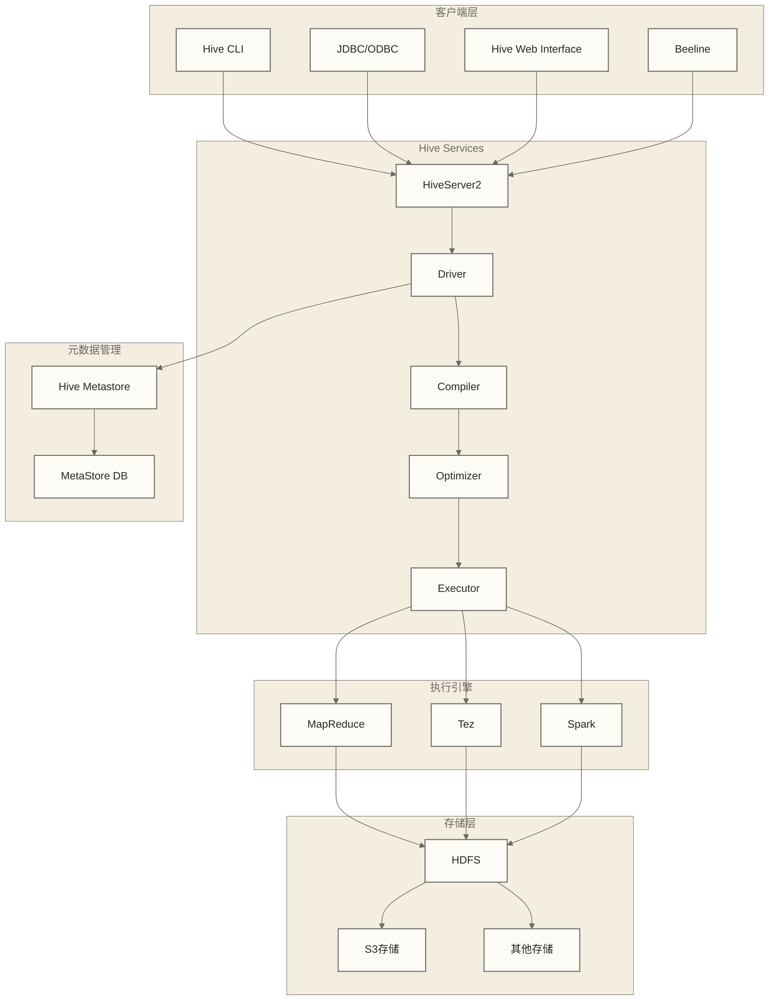
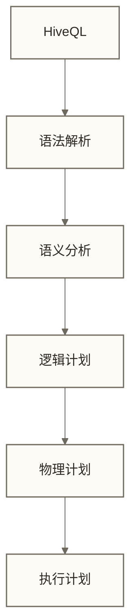
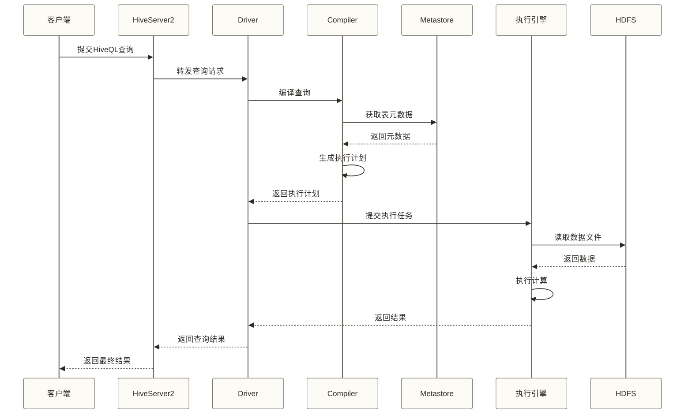
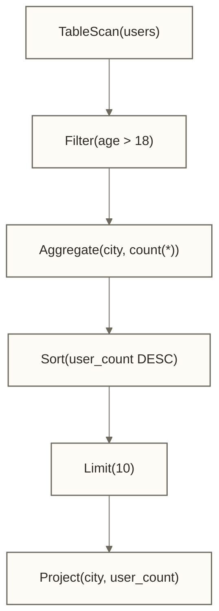
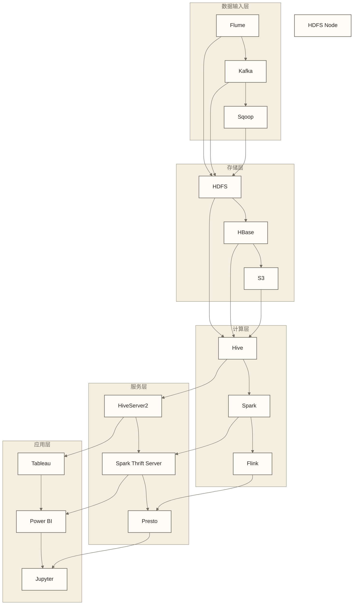

# 🏗️ Hive概述与架构 - SQL on Hadoop的数据仓库解决方案

> [!abstract] 📋 本节概览
> - 🎯 **学习目标**：深入理解Hive的核心概念、架构设计和在大数据生态中的定位
> - 📚 **前置知识**：Hadoop | SQL 
> - ⏱️ **预计用时**：90分钟
> - 🔧 **技术重点**：Hive架构、组件交互、工作原理、应用场景

> [!tip] 💡 前置知识
> 建议先掌握Hadoop基础概念和SQL基本语法，了解分布式存储和计算的基本原理

---

## 🎯 Hive是什么？

### 定义与核心概念

> [!note] 💡 Hive就像一座"数据超市的智能购物助手" 🛒
> 想象你面对一个超大型仓储超市（Hadoop生态系统）：
> - **原始商品**：堆积如山的各种商品（海量原始数据）
> - **传统购物**：需要自己找遍每个货架，手工清点和计算（编写MapReduce代码）
> - **Hive助手**：一个智能购物助手，你只需说"我要统计所有电子产品的销量"（SQL查询）
> - **自动执行**：助手自动规划路线，帮你找到商品并完成统计（自动转换为分布式任务）
> - **结构化管理**：将杂乱的商品按类别整理成易于浏览的货架（数据仓库结构）

Apache Hive是一个构建在Hadoop生态系统之上的**数据仓库软件**，它提供了：

| 核心功能 | 说明 | 优势 | 类比理解 |
|---|---|---|---|
| **SQL接口** | 将SQL查询编译为执行计划，由配置的执行引擎运行；可用引擎取决于Hive版本 | 降低大数据处理门槛 | 🗣️ 智能翻译器：说中文，自动翻译成各种方言执行 |
| **数据管理** | 提供数据定义、组织和管理能力 | 结构化管理海量数据 | 📚 图书管理员：自动分类整理，快速检索定位 |
| **查询优化** | 基于成本的查询优化器（CBO） | 自动优化查询性能 | 🚗 GPS导航：自动选择最快路径到达目的地 |
| **扩展性** | 支持PB级数据处理 | 处理超大规模数据集 | 🏗️ 积木系统：需要更大空间就添加更多积木块 |

> [!tip] 💡 与传统数据库的关键差异
> - **设计目标**：传统OLTP数据库通常侧重**低延迟事务处理**，Hive主要面向**海量数据分析**；SQL是查询语言，本身不决定响应时间
> - **数据规模**：MySQL适合GB-TB级，Hive适合TB-PB级
> - **查询特点**：MySQL适合高频OLTP，Hive适合复杂分析OLAP
> - **一致性与事务**：不能仅按MySQL与Hive名称划分强一致性或最终一致性；具体语义取决于事务、复制、存储及部署配置，Hive也支持符合条件的ACID表

### Hive的核心价值

```mermaid
%%{init: {"theme":"base","themeVariables":{"fontFamily":"PingFang SC, -apple-system, Source Han Serif SC, serif","fontSize":"16px","background":"#FDFBF5","primaryColor":"#FDFBF5","primaryTextColor":"#2D2A26","primaryBorderColor":"#6E6A60","secondaryColor":"#E8EFE8","secondaryBorderColor":"#8FA890","secondaryTextColor":"#2D2A26","tertiaryColor":"#FDFBF5","tertiaryBorderColor":"#9A9488","tertiaryTextColor":"#6E6A60","lineColor":"#6E6A60","textColor":"#2D2A26","mainBkg":"#FDFBF5","nodeBorder":"#2D5A3D","clusterBkg":"#F3EEDF","clusterBorder":"#9A9488","edgeLabelBackground":"#FDFBF5"},"flowchart":{"htmlLabels":true,"curve":"basis","padding":20,"nodeSpacing":60,"rankSpacing":70,"useMaxWidth":false},"themeCSS":".node rect, .node polygon, .node circle { stroke-width: 1.5px; } .edgePath .path { stroke-width: 1.5px; } .cluster-label .nodeLabel, .cluster-label foreignObject { color: #2D2A26 !important; } .edgeLabel, .edgeLabel foreignObject { color: #2D2A26 !important; background-color: #FDFBF5; } .edgeLabel rect { fill: #FDFBF5; }"}}%%
flowchart TD
    subgraph "传统数据处理"
        A1[原始数据] --> B1[复杂编程]
        B1 --> C1[MapReduce代码]
        C1 --> D1[分析结果]
    end
    subgraph "Hive数据处理"
        A2[原始数据] --> B2[SQL查询]
        B2 --> C2[自动转换]
        C2 --> D2[分析结果]
    end
    style B2 fill:#e1f5fe
    style C2 fill:#e8f5e8
```



**主要价值**：
- 🔄 **降低门槛**：SQL开发者可直接处理大数据
- ⚡ **提高效率**：无需编写复杂的MapReduce程序
- 📊 **数据仓库**：提供企业级数据仓库解决方案
- 🔌 **生态集成**：与Hadoop生态无缝集成

---

## 🏛️ Hive架构深度解析

### 整体架构图



### 核心组件详解

#### 1. 客户端接口层

**Hive提供多种客户端接口**：

```bash
# Hive CLI (已废弃，但仍可用)
$ hive -e "SELECT * FROM users LIMIT 10"

# Beeline (推荐使用)
$ beeline -u jdbc:hive2://localhost:10000 -e "SHOW TABLES"

# JDBC连接示例
jdbc:hive2://hiveserver:10000/default
```

### 📝 **代码说明**
- **hive -e**：直接执行SQL语句（已不推荐使用）
- **beeline -u**：通过JDBC连接HiveServer2执行查询
- **jdbc:hive2://**：Hive的标准JDBC连接URL格式

> [!tip] 💡 **使用建议**
> - 生产环境推荐使用 **Beeline** 客户端
> - 开发调试可以使用 Hive CLI
> - 应用程序集成使用 JDBC/ODBC 接口

| 客户端 | 特点 | 适用场景 |
|---|---|---|
| **Beeline** | 基于JDBC的命令行工具 | 生产环境、脚本化操作 |
| **Hive CLI** | 传统命令行接口 | 简单测试、学习 |
| **JDBC/ODBC** | 标准数据库连接协议 | 应用程序集成 |
| **Web UI** | 图形化界面 | 可视化查询、监控 |

#### 2. HiveServer2服务

> [!note] 🔑 HiveServer2是Hive的核心服务
> - **多用户支持**：支持并发连接和查询
> - **安全认证**：集成Kerberos、LDAP等认证机制
> - **连接管理**：管理客户端连接和会话
> - **查询协调**：协调查询的执行和结果返回

**HiveServer2配置示例**：

```xml
<!-- hive-site.xml -->
<configuration>
<property>
<name>hive.server2.thrift.port</name>
<value>10000</value>
<description>HiveServer2的端口</description>
</property>

<property>
<name>hive.server2.thrift.bind.host</name>
<value>0.0.0.0</value>
<description>绑定的主机地址</description>
</property>

<property>
<name>hive.server2.authentication</name>
<value>NONE</value>
<description>认证方式: NONE, NOSASL, KERBEROS, LDAP</description>
</property>
</configuration>
```

#### 3. 查询处理组件

**Driver（驱动器）**：
- 接收查询语句
- 管理查询生命周期
- 协调各组件工作
- 返回查询结果

**Compiler（编译器）**：


**查询编译过程**：

> [!example] 💻 **代码示例**
> 以下是查询编译流程的伪代码示例：

```java
// 伪代码：查询编译流程
public class HiveCompiler {
    public Plan compile(String hiveQL) {
        // 1. 词法和语法分析
        ASTNode ast = parseQuery(hiveQL);
        
        // 2. 语义分析
        SemanticAnalyzer analyzer = new SemanticAnalyzer();
        QueryBlock queryBlock = analyzer.analyze(ast);
        
        // 3. 逻辑计划生成
        LogicalPlan logicalPlan = generateLogicalPlan(queryBlock);
        
        // 4. 优化器优化
        LogicalPlan optimizedPlan = optimizer.optimize(logicalPlan);
        
        // 5. 物理计划生成
        PhysicalPlan physicalPlan = generatePhysicalPlan(optimizedPlan);
        
        return physicalPlan;
    }
}
```

### 📝 **关键步骤说明**
- **词法和语法分析**: 将HiveQL转换为抽象语法树（AST）
- **语义分析**: 检查表、列是否存在，验证数据类型
- **逻辑计划生成**: 创建查询的逻辑执行计划
- **优化器优化**: 应用各种优化规则提高查询性能
- **物理计划生成**: 将逻辑计划转换为具体的执行任务

#### 4. Metastore（元数据存储）

> [!note] 📚 Metastore是Hive的"数据字典"
> - **表结构**：存储表的schema信息
> - **分区信息**：管理表分区的元数据
> - **存储位置**：记录数据文件的HDFS路径
> - **统计信息**：保存表和列的统计数据用于查询优化

**Metastore架构模式**：

```mermaid
%%{init: {"theme":"base","themeVariables":{"fontFamily":"PingFang SC, -apple-system, Source Han Serif SC, serif","fontSize":"16px","background":"#FDFBF5","primaryColor":"#FDFBF5","primaryTextColor":"#2D2A26","primaryBorderColor":"#6E6A60","secondaryColor":"#E8EFE8","secondaryBorderColor":"#8FA890","secondaryTextColor":"#2D2A26","tertiaryColor":"#FDFBF5","tertiaryBorderColor":"#9A9488","tertiaryTextColor":"#6E6A60","lineColor":"#6E6A60","textColor":"#2D2A26","mainBkg":"#FDFBF5","nodeBorder":"#2D5A3D","clusterBkg":"#F3EEDF","clusterBorder":"#9A9488","edgeLabelBackground":"#FDFBF5"},"flowchart":{"htmlLabels":true,"curve":"basis","padding":20,"nodeSpacing":60,"rankSpacing":70,"useMaxWidth":false},"themeCSS":".node rect, .node polygon, .node circle { stroke-width: 1.5px; } .edgePath .path { stroke-width: 1.5px; } .cluster-label .nodeLabel, .cluster-label foreignObject { color: #2D2A26 !important; } .edgeLabel, .edgeLabel foreignObject { color: #2D2A26 !important; background-color: #FDFBF5; } .edgeLabel rect { fill: #FDFBF5; }"}}%%
flowchart TB
    classDef default fill:#FDFBF5,stroke:#6E6A60,color:#2D2A26,stroke-width:1.5px
    classDef startend fill:#2D2A26,stroke:#2D2A26,color:#FDFBF5,font-weight:bold
    classDef decision fill:#F6EAD8,stroke:#C08A1A,color:#2D2A26,font-weight:bold
    classDef hub fill:#3B5A80,stroke:#3B5A80,color:#FDFBF5,font-weight:bold
    classDef io fill:#E5EAF0,stroke:#3B5A80,color:#2D2A26
    classDef accent fill:#A6432C,stroke:#A6432C,color:#FDFBF5,font-weight:bold
    classDef storage fill:#F3EEDF,stroke:#9A9488,color:#2D2A26
    subgraph "嵌入式模式"
        A1[Hive Service] --> A2[Derby DB]
    end
    subgraph "本地模式"
        B1[Hive Service] --> B2[MySQL/PostgreSQL]
    end
    subgraph "远程模式"
        C1[Hive Service] --> C2[Metastore Service]
        C2 --> C3[MySQL Cluster]
        C4[Other Hive Services] --> C2
    end
    class A1,A2,B1,B2,C1,C2,C3,C4 default
```



**推荐的生产环境配置**：

```xml
<!-- 远程Metastore配置 -->
<configuration>
<property>
<name>javax.jdo.option.ConnectionURL</name>
<value>jdbc:mysql://metastore-db:3306/hive_metastore</value>
</property>

<property>
<name>javax.jdo.option.ConnectionDriverName</name>
<value>com.mysql.jdbc.Driver</value>
</property>

<property>
<name>hive.metastore.uris</name>
<value>thrift://metastore-server:9083</value>
</property>
</configuration>
```

---

## ⚙️ Hive工作原理

### 查询执行流程



### 具体执行示例

让我们通过一个具体的查询来理解Hive的工作原理：

```sql
-- 示例查询：统计每个城市的用户数量
SELECT city, COUNT(*) as user_count
FROM users 
WHERE age > 18 
GROUP BY city
ORDER BY user_count DESC
LIMIT 10;
```

**执行步骤详解**：

1️⃣ **语法解析阶段**
| AST节点 | 内容 |
|---------|------|
| SELECT | city, COUNT(*) |
| FROM | users |
| WHERE | age > 18 |
| GROUP BY | city |
| ORDER BY | user_count DESC |
| LIMIT | 10 |

2️⃣ **语义分析阶段**
```java
// 检查表是否存在
Table usersTable = metastore.getTable("users");

// 检查列是否存在
Column cityColumn = usersTable.getColumn("city");
Column ageColumn = usersTable.getColumn("age");

// 验证数据类型
assert ageColumn.getType() == IntegerType;
```

3️⃣ **逻辑计划生成**


4️⃣ **物理计划优化**
以下仅为MapReduce执行方式的简化示意，实际阶段划分与是否使用Combine需以具体版本、配置及EXPLAIN结果为准。

| 阶段 | 子步骤 | 操作 |
|------|--------|------|
| MapReduce Job 1 | Map | Filter(age > 18)，按city输出计数记录 |
| MapReduce Job 1 | Combine（如启用） | Partial COUNT(*) |
| MapReduce Job 1 | Reduce | 按city计算Final COUNT(*) |
| MapReduce Job 2 | Map | 读取城市聚合结果，准备按user_count排序 |
| MapReduce Job 2 | Reduce | 全局降序排序并输出Top 10 results |

5️⃣ **代码生成与执行**
```java
// 教学示意：手写Mapper展示过滤与计数逻辑，并非Hive实际生成的Java源码；假设输入为无引号、无缺失值的简单逗号分隔记录
public class UserCityMapper extends Mapper<LongWritable, Text, Text, IntWritable> {
    public void map(LongWritable key, Text value, Context context) {
        String[] fields = value.toString().split(",");
        int age = Integer.parseInt(fields[2]);
        String city = fields[1];
        
        if (age > 18) {
            context.write(new Text(city), new IntWritable(1));
        }
    }
}
```

---

## 🌍 Hive在大数据生态中的定位

### 与其他组件的关系



### 技术对比与选择

| 技术 | 适用场景 | 优势 | 劣势 |
|---|---|---|---|
| **Hive** | 批处理数据仓库 | SQL友好、成熟稳定 | 延迟较高 |
| **Spark** | 混合负载处理 | 内存计算、速度快 | 资源消耗大 |
| **Presto** | 交互式查询 | 低延迟、跨源查询 | 容错性较弱 |
| **Impala** | 实时分析 | 近实时查询 | 依赖内存 |

### 应用场景分析

#### 🎯 适合使用Hive的场景

✅ **数据仓库建设**
```sql
-- ETL流程示例
INSERT OVERWRITE TABLE dwh.fact_sales
SELECT 
    date_id,
    product_id,
    customer_id,
    SUM(amount) as total_amount,
    COUNT(*) as transaction_count
FROM staging.raw_transactions
WHERE dt = '${today}'
GROUP BY date_id, product_id, customer_id;
```

✅ **历史数据分析**
```sql
-- 分析过去一年的销售趋势
SELECT 
    DATE_FORMAT(sale_date, 'yyyy-MM') as month,
    SUM(amount) as monthly_sales
FROM sales_fact
WHERE sale_date >= DATE_SUB(CURRENT_DATE, 365)
GROUP BY DATE_FORMAT(sale_date, 'yyyy-MM')
ORDER BY month;
```

✅ **大规模数据聚合**
```sql
-- 处理TB级别的日志数据
SELECT 
    ip_address,
    COUNT(*) as visit_count,
    SUM(response_time) as total_response_time
FROM web_logs
WHERE dt BETWEEN '2024-01-01' AND '2024-12-31'
GROUP BY ip_address
HAVING visit_count > 1000;
```

#### ❌ 不适合使用Hive的场景

❌ **实时查询需求**（秒级响应）
❌ **低延迟、高并发的OLTP事务处理**（Hive支持符合条件的ACID表，但不以此类事务负载为主要设计目标）
❌ **小数据量快速查询**（MB级别数据）
❌ **复杂的递归查询**

---

## 📊 Hive版本演进与特性

### 主要版本对比

| 版本 | 发布时间 | 主要特性 | 执行引擎 |
|---|---|---|---|
| **1.x** | 2011-2014 | 基础SQL、MapReduce | MapReduce |
| **2.x** | 2015-2018 | ACID事务、LLAP | MapReduce + Tez |
| **3.x** | 2018-至今 | 物化视图、CBO优化 | Tez + LLAP |
| **4.x** | 2022-至今 | Iceberg集成、Cloud优化 | All Engines |

### Hive 3.x的重要特性

#### 1. ACID事务支持
```sql
-- 启用ACID事务
SET hive.support.concurrency = true;
SET hive.enforce.bucketing = true;
SET hive.exec.dynamic.partition.mode = nonstrict;
SET hive.txn.manager = org.apache.hadoop.hive.ql.lockmgr.DbTxnManager;

-- 创建支持ACID的表
CREATE TABLE transactions (
    id INT,
    amount DECIMAL(10,2),
    timestamp TIMESTAMP
) 
CLUSTERED BY (id) INTO 10 BUCKETS
STORED AS ORC
TBLPROPERTIES ('transactional'='true');

-- 支持UPDATE和DELETE操作
UPDATE transactions SET amount = amount * 1.1 WHERE id > 1000;
DELETE FROM transactions WHERE amount < 0;
```

#### 2. 物化视图
```sql
-- 创建物化视图
CREATE MATERIALIZED VIEW mv_monthly_sales AS
SELECT 
    YEAR(sale_date) as sale_year,
    MONTH(sale_date) as sale_month,
    SUM(amount) as total_sales
FROM sales
GROUP BY YEAR(sale_date), MONTH(sale_date);

-- 对基础表进行与物化视图同粒度的聚合查询
SELECT
    YEAR(sale_date) AS sale_year,
    MONTH(sale_date) AS sale_month,
    SUM(amount) AS total_sales
FROM sales
WHERE YEAR(sale_date) = 2024
GROUP BY YEAR(sale_date), MONTH(sale_date);
-- 是否重写为使用物化视图取决于优化器配置、视图有效性及查询匹配条件，需用EXPLAIN确认
```

#### 3. LLAP（Live Long and Process，亦称Low Latency Analytical Processing）
```xml
<!-- 启用LLAP -->
<property>
    <name>hive.llap.execution.mode</name>
    <value>all</value>
</property>

<property>
    <name>hive.llap.daemon.service.hosts</name>
    <value>@llap-cluster</value>
</property>
```

---

## 🔧 Hive配置最佳实践

### 基础配置模板

```xml title="hive-site.xml"
<?xml version="1.0"?>
<configuration>
    <!-- 基础配置 -->
    <property>
        <name>hive.metastore.uris</name>
        <value>thrift://metastore:9083</value>
        <description>Metastore服务地址</description>
    </property>
    
    <!-- 执行引擎配置 -->
    <property>
        <name>hive.execution.engine</name>
        <value>tez</value>
        <description>执行引擎：mr/tez/spark</description>
    </property>
    
    <!-- 性能优化配置 -->
    <property>
        <name>hive.exec.parallel</name>
        <value>true</value>
        <description>启用并行执行</description>
    </property>
    
    <property>
        <name>hive.exec.parallel.thread.number</name>
        <value>8</value>
        <description>并行线程数</description>
    </property>
    
    <!-- 内存配置 -->
    <property>
        <name>hive.exec.reducers.bytes.per.reducer</name>
        <value>256000000</value>
        <description>每个reducer处理的数据量</description>
    </property>
    
    <!-- 压缩配置 -->
    <property>
        <name>hive.exec.compress.output</name>
        <value>true</value>
        <description>启用输出压缩</description>
    </property>
    
    <property>
        <name>mapred.output.compression.codec</name>
        <value>org.apache.hadoop.io.compress.SnappyCodec</value>
        <description>压缩格式</description>
    </property>
</configuration>
```

### 环境变量配置

```bash title="hive-env.sh"
#!/bin/bash

# Hadoop配置
export HADOOP_CONF_DIR="/opt/hadoop/etc/hadoop"
export HADOOP_HOME="/opt/hadoop"

# Java配置
export JAVA_HOME="/usr/lib/jvm/java-8-openjdk"

# Hive配置
export HIVE_CONF_DIR="/opt/hive/conf"
export HIVE_AUX_JARS_PATH="/opt/hive/auxlibs"

# 内存配置
export HADOOP_HEAPSIZE=1024
export HIVE_HEAP_SIZE=1024

# 日志配置
export HIVE_LOG_DIR="/var/log/hive"
export HIVE_LOG_FILE="hive.log"
```

---

## 🔗 学习路径

### 下一步学习建议

1. [[【技术与工具】/Hive/02-Hive安装与配置|Hive安装与配置]] - 动手搭建Hive环境
2. [[【技术与工具】/Hive/03-Hive数据模型|Hive数据]] - 深入理解Hive的数据组织方式
3. [[【技术与工具】/Hive/04-HiveQL基础语法|HiveQL基础语法]] - 掌握Hive SQL的基本用法

### 实践建议

- 搭建一个简单的Hive开发环境
- 创建测试表并导入示例数据
- 尝试不同类型的查询操作
- 观察查询的执行计划和性能

---

## 📚 参考资料

### 官方文档
- [Apache Hive官方网站](https://hive.apache.org/)
- [Hive Wiki](https://cwiki.apache.org/confluence/display/Hive)
- [HiveQL Language Manual](https://cwiki.apache.org/confluence/display/Hive/LanguageManual)

### 推荐阅读
- 《Hive编程指南》
- 《大数据技术原理与应用》
- 《数据仓库工具箱》

---

> [!tip] 💡 关键收获
> - Hive是构建在Hadoop之上的数据仓库工具，提供SQL接口操作大数据
> - 核心架构包括客户端、HiveServer2、Driver、Compiler、Metastore等组件
> - 通过查询编译优化，将SQL转换为分布式计算任务
> - 适合批处理、数据仓库、历史数据分析等场景
> - 不适合实时查询、OLTP事务等需要低延迟的场景

> [!warning] ⚠️ 常见误区
> - Hive不是面向低延迟OLTP的传统关系数据库；符合条件的ACID表支持UPDATE和DELETE，但不能据此推断具备实时事务处理性能
> - 查询延迟取决于执行引擎、配置和负载；批处理场景通常延迟较高，采用LLAP等方案时也可服务部分交互式分析需求
> - Schema on Read模式，需要理解其与传统数据库的区别 