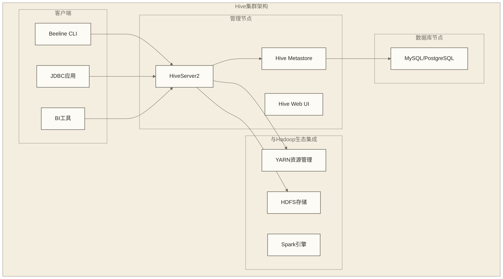

# 🚀 Hive安装与配置 - 从零搭建企业级数据仓库环境

> [!abstract] 📋 本节概览
> - 🎯 **学习目标**：掌握Hive的安装配置流程，在满足依赖与权限前提的隔离开发环境中完成部署演练；生产部署还需兼容性、安全性、容量及高可用验证
> - 📚 **前置知识**：[[【技术与工具】/Hive/01-Hive概述与架构|Hive概述与]] | Hadoop | MySQL
> - ⏱️ **预计用时**：120分钟
> - 🔧 **技术重点**：环境准备、组件安装、配置优化、服务启动、故障排查

> [!tip] 💡 前置知识链接
> - **Hive架构理解**：[[【技术与工具】/Hive/01-Hive概述与架构|Hive概述与]]
> - **Hadoop环境**：Hadoop
> - **数据库基础**：MySQL
> - **Linux系统**：掌握基本的用户管理、服务管理、网络配置

---

## 🏗️ 环境准备与规划

### 系统架构设计

> [!note] 💡 Hive部署就像建设一个现代化工厂
> 想象建设一个汽车制造工厂：
> - **原料仓库**：HDFS存储原始数据（钢材、橡胶等）
> - **生产线**：Hive执行引擎处理数据（组装、加工）
> - **管理中心**：Metastore管理所有信息（生产计划、质量标准）
> - **控制室**：HiveServer2协调整个生产流程
> - **工人入口**：客户端工具连接到生产系统



### 硬件资源规划

| 组件 | 最小配置 | 推荐配置 | 生产环境 |
|---|---|---|---|
| **HiveServer2** | 2核4G | 4核8G | 8核16G+ |
| **Metastore** | 2核4G | 4核8G | 8核16G+ |
| **MySQL** | 2核4G | 4核8G | 高可用集群 |
| **磁盘空间** | 50GB | 200GB | 1TB+ |
| **网络带宽** | 100Mbps | 1Gbps | 10Gbps |

### 软件版本兼容性

```bash
# 原稿列出的软件版本候选（未提供兼容性实测，不代表任意组合均受支持）
Java: OpenJDK 8 或 11
Hadoop: 3.1.x 或 3.2.x
Hive: 3.1.x（本文安装示例为3.1.3）
MySQL: 5.7+ 或 8.0+
# 执行前须核对选定Hive版本与Java、Hadoop、MySQL及执行引擎的兼容条件
```

---

## 📦 Hive软件安装

### 1. 下载与解压

```bash
# !/bin/bash
# 🔽 下载Hive安装包

# 设置版本变量
HIVE_VERSION="3.1.3"
HADOOP_VERSION="3.2.3"

# 创建安装目录
sudo mkdir -p /opt/hive
sudo mkdir -p /opt/hive/logs
sudo mkdir -p /opt/hive/warehouse

# 下载Hive
cd /tmp
wget https://archive.apache.org/dist/hive/hive-${HIVE_VERSION}/apache-hive-${HIVE_VERSION}-bin.tar.gz

# 解压安装
tar -xzf apache-hive-${HIVE_VERSION}-bin.tar.gz
sudo mv apache-hive-${HIVE_VERSION}-bin/* /opt/hive/

# 设置目录权限；所有权须在下一步创建hive用户后设置
sudo chmod -R 755 /opt/hive

echo "✅ Hive安装包解压完成"
```

> [!note] 安装目录说明
> - `/opt/hive/bin/`：可执行文件（hive、beeline、schematool 等命令）
> - `/opt/hive/conf/`：配置文件目录（hive-site.xml、hive-env.sh 等）
> - `/opt/hive/lib/`：JAR 依赖目录（需将 MySQL JDBC 驱动放在此处）
> - `/opt/hive/logs/`：运行时日志目录
>
> 安装完成后，**首要任务**是将 MySQL JDBC 驱动（`mysql-connector-java-x.x.x.jar`）复制到 `/opt/hive/lib/`，否则 Metastore 无法连接 MySQL。

### 2. 创建系统用户

```bash
# !/bin/bash
# 👤 创建Hive系统用户

# 创建hive用户组和用户
sudo groupadd hive
sudo useradd -g hive -d /home/hive -m -s /bin/bash hive

# 用户创建后设置安装目录所有权
sudo chown -R hive:hive /opt/hive

# 设置密码
sudo passwd hive

# 添加sudo权限（可选）
echo "hive ALL=(ALL) NOPASSWD:ALL" | sudo tee /etc/sudoers.d/hive

echo "✅ Hive用户创建完成"
```

### 3. 环境变量配置

```bash title="/etc/profile.d/hive.sh"
# !/bin/bash
# 🌍 Hive环境变量配置

# Java环境
export JAVA_HOME="/usr/lib/jvm/java-8-openjdk"

# Hadoop环境
export HADOOP_HOME="/opt/hadoop"
export HADOOP_CONF_DIR="${HADOOP_HOME}/etc/hadoop"

# Hive环境
export HIVE_HOME="/opt/hive"
export HIVE_CONF_DIR="${HIVE_HOME}/conf"
export HIVE_LOG_DIR="${HIVE_HOME}/logs"

# 路径配置
export PATH="${HIVE_HOME}/bin:${HADOOP_HOME}/bin:${HADOOP_HOME}/sbin:${PATH}"

# 类路径配置
export CLASSPATH="${HIVE_HOME}/lib/*:${HADOOP_HOME}/share/hadoop/common/*:${HADOOP_HOME}/share/hadoop/common/lib/*:${CLASSPATH}"
```

```bash
# 使环境变量生效
source /etc/profile.d/hive.sh

# 验证环境变量
echo "HIVE_HOME: $HIVE_HOME"
echo "Java版本: $(java -version 2>&1 | head -1)"
echo "Hadoop版本: $(hadoop version | head -1)"
```

---

## 🗄️ Metastore数据库配置

### 1. MySQL安装与配置

```bash
# !/bin/bash
# 🔧 MySQL数据库安装配置

# 安装MySQL (Ubuntu/Debian)
sudo apt update
sudo apt install -y mysql-server mysql-client

# 或者安装MySQL (CentOS/RHEL)
# sudo yum install -y mysql-server mysql

# 启动MySQL服务
sudo systemctl start mysql
sudo systemctl enable mysql

# 安全配置
sudo mysql_secure_installation

echo "✅ MySQL安装完成"
```

### 2. 创建Hive数据库

```sql
-- 🏗️ 创建Hive Metastore数据库
-- 连接到MySQL
mysql -u root -p

-- 创建hive数据库
CREATE DATABASE hive_metastore DEFAULT CHARACTER SET utf8mb4 COLLATE utf8mb4_unicode_ci;

-- 创建hive用户
CREATE USER 'hive'@'%' IDENTIFIED BY 'StrongPassword123!';
CREATE USER 'hive'@'localhost' IDENTIFIED BY 'StrongPassword123!';

-- 授权
GRANT ALL PRIVILEGES ON hive_metastore.* TO 'hive'@'%';
GRANT ALL PRIVILEGES ON hive_metastore.* TO 'hive'@'localhost';

-- 刷新权限
FLUSH PRIVILEGES;

-- 验证连接
SHOW DATABASES;
EXIT;
```

### 3. MySQL JDBC驱动安装

```bash
# !/bin/bash
# 📚 安装MySQL JDBC驱动

# 下载MySQL Connector/J
cd /tmp
wget https://dev.mysql.com/get/Downloads/Connector-J/mysql-connector-java-8.0.33.tar.gz

# 解压并复制驱动
tar -xzf mysql-connector-java-8.0.33.tar.gz
sudo cp mysql-connector-java-8.0.33/mysql-connector-java-8.0.33.jar ${HIVE_HOME}/lib/

# 验证驱动文件
ls -la ${HIVE_HOME}/lib/mysql-connector-java-*.jar

echo "✅ MySQL JDBC驱动安装完成"
```

---

## ⚙️ Hive核心配置

### 1. hive-site.xml配置

```xml title="${HIVE_CONF_DIR}/hive-site.xml"
<?xml version="1.0"?>
<configuration>
    <!-- ==================== Metastore配置 ==================== -->
    <!-- Metastore数据库连接 -->
    <property>
        <name>javax.jdo.option.ConnectionURL</name>
        <value>jdbc:mysql://localhost:3306/hive_metastore?useSSL=false&amp;serverTimezone=UTC</value>
        <description>Metastore数据库连接URL</description>
    </property>
    
    <property>
        <name>javax.jdo.option.ConnectionDriverName</name>
        <value>com.mysql.cj.jdbc.Driver</value>
        <description>数据库驱动类名</description>
    </property>
    
    <property>
        <name>javax.jdo.option.ConnectionUserName</name>
        <value>hive</value>
        <description>数据库用户名</description>
    </property>
    
    <property>
        <name>javax.jdo.option.ConnectionPassword</name>
        <value>StrongPassword123!</value>
        <description>数据库密码</description>
    </property>
    
    <!-- Metastore服务配置 -->
    <property>
        <name>hive.metastore.uris</name>
        <value>thrift://localhost:9083</value>
        <description>Metastore服务地址</description>
    </property>
    
    <property>
        <name>hive.metastore.port</name>
        <value>9083</value>
        <description>Metastore服务端口</description>
    </property>
    
    <!-- ==================== HiveServer2配置 ==================== -->
    <!-- 服务端口配置 -->
    <property>
        <name>hive.server2.thrift.port</name>
        <value>10000</value>
        <description>HiveServer2端口</description>
    </property>
    
    <property>
        <name>hive.server2.thrift.bind.host</name>
        <value>0.0.0.0</value>
        <description>HiveServer2绑定地址</description>
    </property>
    
    <property>
        <name>hive.server2.webui.host</name>
        <value>0.0.0.0</value>
        <description>Web UI绑定地址</description>
    </property>
    
    <property>
        <name>hive.server2.webui.port</name>
        <value>10002</value>
        <description>Web UI端口</description>
    </property>
    
    <!-- 认证配置 -->
    <property>
        <name>hive.server2.authentication</name>
        <value>NONE</value>
        <description>认证方式: NONE, NOSASL, KERBEROS, LDAP</description>
    </property>
    
    <!-- ==================== 执行引擎配置 ==================== -->
    <property>
        <name>hive.execution.engine</name>
        <value>spark</value>
        <description>执行引擎: mr, tez, spark</description>
    </property>
    
    <!-- ==================== 存储配置 ==================== -->
    <!-- 数据仓库目录 -->
    <property>
        <name>hive.metastore.warehouse.dir</name>
        <value>/user/hive/warehouse</value>
        <description>Hive数据仓库在HDFS中的目录</description>
    </property>
    
    <!-- 临时目录 -->
    <property>
        <name>hive.exec.scratchdir</name>
        <value>/tmp/hive</value>
        <description>Hive临时目录</description>
    </property>
    
    <!-- ==================== 性能优化配置 ==================== -->
    <!-- 并行执行 -->
    <property>
        <name>hive.exec.parallel</name>
        <value>true</value>
        <description>启用并行执行</description>
    </property>
    
    <property>
        <name>hive.exec.parallel.thread.number</name>
        <value>8</value>
        <description>并行线程数</description>
    </property>
    
    <!-- 动态分区 -->
    <property>
        <name>hive.exec.dynamic.partition</name>
        <value>true</value>
        <description>启用动态分区</description>
    </property>
    
    <property>
        <name>hive.exec.dynamic.partition.mode</name>
        <value>nonstrict</value>
        <description>动态分区模式: strict, nonstrict</description>
    </property>
    
    <!-- 压缩配置 -->
    <property>
        <name>hive.exec.compress.output</name>
        <value>true</value>
        <description>启用输出压缩</description>
    </property>
    
    <property>
        <name>mapred.output.compression.codec</name>
        <value>org.apache.hadoop.io.compress.SnappyCodec</value>
        <description>压缩编码器</description>
    </property>
    
    <!-- ==================== 统计信息配置 ==================== -->
    <!-- 启用统计信息自动收集 -->
    <property>
        <name>hive.stats.autogather</name>
        <value>true</value>
        <description>自动收集统计信息</description>
    </property>
    
    <!-- 启用列统计信息 -->
    <property>
        <name>hive.stats.column.autogather</name>
        <value>true</value>
        <description>自动收集列统计信息</description>
    </property>
    
    <!-- ==================== 事务配置 ==================== -->
    <!-- ACID事务支持 -->
    <property>
        <name>hive.support.concurrency</name>
        <value>true</value>
        <description>启用并发支持</description>
    </property>
    
    <property>
        <name>hive.enforce.bucketing</name>
        <value>true</value>
        <description>强制分桶</description>
    </property>
    
    <property>
        <name>hive.txn.manager</name>
        <value>org.apache.hadoop.hive.ql.lockmgr.DbTxnManager</value>
        <description>事务管理器</description>
    </property>
    
    <property>
        <name>hive.compactor.initiator.on</name>
        <value>true</value>
        <description>启用压缩器初始化</description>
    </property>
    
    <property>
        <name>hive.compactor.worker.threads</name>
        <value>1</value>
        <description>压缩器工作线程数</description>
    </property>
</configuration>
```

### 2. hive-env.sh配置

```bash title="${HIVE_CONF_DIR}/hive-env.sh"
# !/bin/bash
# 🌍 Hive环境配置文件

# Java配置
export JAVA_HOME="/usr/lib/jvm/java-8-openjdk"

# Hadoop配置
export HADOOP_HOME="/opt/hadoop"
export HADOOP_CONF_DIR="${HADOOP_HOME}/etc/hadoop"

# Hive配置
export HIVE_CONF_DIR="/opt/hive/conf"
export HIVE_AUX_JARS_PATH="/opt/hive/auxlib"

# 内存配置
export HADOOP_HEAPSIZE=2048
export HIVE_HEAPSIZE=2048

# HiveServer2内存配置
export HIVE_SERVER2_HEAPSIZE=4096

# Metastore内存配置  
export HIVE_METASTORE_HEAPSIZE=2048

# 日志配置
export HIVE_LOG_DIR="/opt/hive/logs"
export HIVE_LOGFILE="hive.log"

# JVM参数配置
# JVM参数通过HADOOP_OPTS传递；堆大小由上方HEAPSIZE变量设置
export HADOOP_OPTS="$HADOOP_OPTS -Djava.net.preferIPv4Stack=true"
export HADOOP_OPTS="$HADOOP_OPTS -Dhadoop.log.dir=${HIVE_LOG_DIR}"
export HADOOP_OPTS="$HADOOP_OPTS -Dhadoop.log.file=${HIVE_LOGFILE}"

# 安全配置 (Kerberos环境使用)
# export HADOOP_OPTS="$HADOOP_OPTS -Djava.security.krb5.conf=/etc/krb5.conf"

echo "Hive环境变量配置完成"
```

### 3. 日志配置

```xml title="${HIVE_CONF_DIR}/hive-log4j2.properties"
# Hive日志配置
status = INFO
name = HiveLog4j2

# 控制台输出配置
appender.console.type = Console
appender.console.name = console
appender.console.target = SYSTEM_ERR
appender.console.layout.type = PatternLayout
appender.console.layout.pattern = %d{ISO8601} %5p [%t] %c{2}: %m%n

# 文件输出配置
appender.DRFA.type = RollingRandomAccessFile
appender.DRFA.name = DRFA
appender.DRFA.fileName = ${sys:hive.log.dir}/${sys:hive.log.file}
appender.DRFA.filePattern = ${sys:hive.log.dir}/${sys:hive.log.file}.%d{yyyy-MM-dd}
appender.DRFA.layout.type = PatternLayout
appender.DRFA.layout.pattern = %d{ISO8601} %5p [%t] %c{2}: %m%n
appender.DRFA.policies.type = Policies
appender.DRFA.policies.time.type = TimeBasedTriggeringPolicy
appender.DRFA.policies.time.interval = 1
appender.DRFA.policies.time.modulate = true
appender.DRFA.strategy.type = DefaultRolloverStrategy
appender.DRFA.strategy.max = 30

# 根日志配置
rootLogger.level = INFO
rootLogger.appenderRefs = root
rootLogger.appenderRef.root.ref = DRFA

# 特定包的日志级别
logger.DataNucleus.name = DataNucleus
logger.DataNucleus.level = ERROR

logger.Datastore.name = Datastore
logger.Datastore.level = ERROR

logger.JPOX.name = JPOX
logger.JPOX.level = ERROR
```

---

## 🚀 服务启动与验证

### 1. 初始化Metastore Schema

```bash
# !/bin/bash
# 🔧 初始化Hive Metastore数据库Schema

echo "🚀 开始初始化Hive Metastore Schema..."

# 切换到hive用户
sudo -u hive bash << 'EOF'

# 设置环境变量
source /etc/profile.d/hive.sh

# 初始化Schema
cd $HIVE_HOME/bin

# 检查现有Schema版本
./schematool -dbType mysql -info

# 初始化Schema (首次安装使用)
./schematool -dbType mysql -initSchema

# 验证Schema
./schematool -dbType mysql -validate

echo "✅ Metastore Schema初始化完成"

EOF
```

### 2. 启动Metastore服务

```bash title="start-metastore.sh"
# !/bin/bash
# 🔄 启动Hive Metastore服务

echo "🚀 启动Hive Metastore服务..."

# 切换到hive用户执行
sudo -u hive bash << 'EOF'

# 设置环境变量
source /etc/profile.d/hive.sh

# 创建必要的目录
hdfs dfs -mkdir -p /user/hive/warehouse
hdfs dfs -mkdir -p /tmp/hive
hdfs dfs -chmod 777 /tmp/hive

# 启动Metastore服务 (后台运行)
nohup $HIVE_HOME/bin/hive --service metastore \
    > $HIVE_LOG_DIR/metastore.log 2>&1 &

# 记录PID
METASTORE_PID=$!
echo $METASTORE_PID > $HIVE_LOG_DIR/metastore.pid

echo "✅ Metastore服务已启动，PID: $METASTORE_PID"
echo "📝 日志文件: $HIVE_LOG_DIR/metastore.log"

# 等待服务启动
sleep 10

# 检查服务状态
if netstat -tln | grep -q ":9083"; then
    echo "✅ Metastore服务启动成功，监听端口9083"
else
    echo "❌ Metastore服务启动失败，请检查日志"
    exit 1
fi

EOF
```

### 3. 启动HiveServer2服务

```bash title="start-hiveserver2.sh"
# !/bin/bash
# 🔄 启动HiveServer2服务

echo "🚀 启动HiveServer2服务..."

# 切换到hive用户执行
sudo -u hive bash << 'EOF'

# 设置环境变量
source /etc/profile.d/hive.sh

# 启动HiveServer2服务 (后台运行)
nohup $HIVE_HOME/bin/hive --service hiveserver2 \
    > $HIVE_LOG_DIR/hiveserver2.log 2>&1 &

# 记录PID
HIVESERVER2_PID=$!
echo $HIVESERVER2_PID > $HIVE_LOG_DIR/hiveserver2.pid

echo "✅ HiveServer2服务已启动，PID: $HIVESERVER2_PID"
echo "📝 日志文件: $HIVE_LOG_DIR/hiveserver2.log"

# 等待服务启动
echo "⏳ 等待HiveServer2服务完全启动..."
sleep 30

# 检查服务状态
if netstat -tln | grep -q ":10000"; then
    echo "✅ HiveServer2服务启动成功，监听端口10000"
    echo "🌐 Web UI地址: http://$(hostname):10002"
else
    echo "❌ HiveServer2服务启动失败，请检查日志"
    exit 1
fi

EOF
```

### 4. 创建系统服务

```bash title="create-systemd-services.sh"
# !/bin/bash
# ⚙️ 创建systemd服务文件

# 创建Metastore服务文件
sudo tee /etc/systemd/system/hive-metastore.service > /dev/null << 'EOF'
[Unit]
Description=Hive Metastore Service
After=network.target
Requires=mysql.service

[Service]
Type=simple
User=hive
Group=hive
Environment=JAVA_HOME=/usr/lib/jvm/java-8-openjdk
Environment=HIVE_HOME=/opt/hive
Environment=HADOOP_HOME=/opt/hadoop
Environment=HADOOP_CONF_DIR=/opt/hadoop/etc/hadoop
ExecStart=/opt/hive/bin/hive --service metastore
ExecStop=/bin/kill -TERM $MAINPID
Restart=on-failure
RestartSec=30

[Install]
WantedBy=multi-user.target
EOF

# 创建HiveServer2服务文件
sudo tee /etc/systemd/system/hive-server2.service > /dev/null << 'EOF'
[Unit]
Description=Hive Server2 Service
After=network.target hive-metastore.service
Requires=hive-metastore.service

[Service]
Type=simple
User=hive
Group=hive
Environment=JAVA_HOME=/usr/lib/jvm/java-8-openjdk
Environment=HIVE_HOME=/opt/hive
Environment=HADOOP_HOME=/opt/hadoop
Environment=HADOOP_CONF_DIR=/opt/hadoop/etc/hadoop
ExecStart=/opt/hive/bin/hive --service hiveserver2
ExecStop=/bin/kill -TERM $MAINPID
Restart=on-failure
RestartSec=30

[Install]
WantedBy=multi-user.target
EOF

# 重新加载systemd配置
sudo systemctl daemon-reload

# 启用服务
sudo systemctl enable hive-metastore
sudo systemctl enable hive-server2

echo "✅ systemd服务文件创建完成"
echo "使用以下命令管理服务:"
echo "  sudo systemctl start hive-metastore"
echo "  sudo systemctl start hive-server2"
echo "  sudo systemctl status hive-metastore"
echo "  sudo systemctl status hive-server2"
```

---

## 🧪 安装验证与测试

### 1. 连接测试

```bash title="test-connection.sh"
# !/bin/bash
# 🧪 测试Hive连接

echo "🧪 开始测试Hive连接..."

# 测试Beeline连接
echo "1. 测试Beeline连接到HiveServer2..."
sudo -u hive $HIVE_HOME/bin/beeline -u jdbc:hive2://localhost:10000 -e "SHOW DATABASES;"

if [ $? -eq 0 ]; then
    echo "✅ Beeline连接测试成功"
else
    echo "❌ Beeline连接测试失败"
    exit 1
fi

# 测试基本SQL操作
echo "2. 测试基本SQL操作..."
sudo -u hive $HIVE_HOME/bin/beeline -u jdbc:hive2://localhost:10000 << 'EOF'
-- 创建测试数据库
CREATE DATABASE IF NOT EXISTS test_db;

-- 使用测试数据库
USE test_db;

-- 创建测试表
CREATE TABLE IF NOT EXISTS test_table (
    id INT,
    name STRING,
    age INT
) 
ROW FORMAT DELIMITED 
FIELDS TERMINATED BY ','
STORED AS TEXTFILE;

-- 插入测试数据
INSERT INTO test_table VALUES 
(1, 'Alice', 25),
(2, 'Bob', 30),
(3, 'Charlie', 35);

-- 查询测试数据
SELECT * FROM test_table;

-- 聚合查询测试
SELECT AVG(age) as avg_age FROM test_table;

-- 退出
!quit
EOF

echo "✅ 基本SQL操作测试完成"
```

### 2. 性能基准测试

```bash title="benchmark-test.sh"
# !/bin/bash
# 📊 Hive性能基准测试

echo "📊 开始Hive性能基准测试..."

# 创建大数据集测试
sudo -u hive $HIVE_HOME/bin/beeline -u jdbc:hive2://localhost:10000 << 'EOF'

-- 创建基准测试数据库
CREATE DATABASE IF NOT EXISTS benchmark;
USE benchmark;

-- 创建大表测试
CREATE TABLE large_table (
    id BIGINT,
    user_id STRING,
    event_type STRING,
    timestamp_col TIMESTAMP,
    amount DECIMAL(10,2)
)
PARTITIONED BY (dt STRING)
STORED AS ORC;

-- 生成教学用合成数据：下方十个两行子查询交叉连接最多产生1024行
-- LIMIT 100000仅限制结果上限，不会生成100000行；本例不能代表生产性能基准
INSERT INTO large_table PARTITION(dt='2024-01-01')
SELECT 
    row_number() OVER () as id,
    concat('user_', cast(rand()*10000 as int)) as user_id,
    case when rand() > 0.5 then 'click' else 'view' end as event_type,
    from_unixtime(unix_timestamp() + cast(rand()*86400 as int)) as timestamp_col,
    rand() * 1000 as amount
FROM (
    SELECT 1 as dummy
    FROM (SELECT 1 UNION ALL SELECT 1) t1
    CROSS JOIN (SELECT 1 UNION ALL SELECT 1) t2
    CROSS JOIN (SELECT 1 UNION ALL SELECT 1) t3
    CROSS JOIN (SELECT 1 UNION ALL SELECT 1) t4
    CROSS JOIN (SELECT 1 UNION ALL SELECT 1) t5
    CROSS JOIN (SELECT 1 UNION ALL SELECT 1) t6
    CROSS JOIN (SELECT 1 UNION ALL SELECT 1) t7
    CROSS JOIN (SELECT 1 UNION ALL SELECT 1) t8
    CROSS JOIN (SELECT 1 UNION ALL SELECT 1) t9
    CROSS JOIN (SELECT 1 UNION ALL SELECT 1) t10
    LIMIT 100000
) dummy_table;

-- 执行聚合查询测试
SELECT 
    event_type,
    COUNT(*) as event_count,
    AVG(amount) as avg_amount,
    MAX(amount) as max_amount
FROM large_table 
WHERE dt = '2024-01-01'
GROUP BY event_type;

!quit
EOF

echo "✅ 性能基准测试完成"
```

### 3. 监控与诊断工具

```bash title="monitoring-tools.sh"
# !/bin/bash
# 📡 Hive监控诊断工具

echo "📡 Hive系统监控与诊断工具"

# 检查服务状态
check_service_status() {
    echo "=== 服务状态检查 ==="
    
 # 检查端口监听
    echo "1. 端口监听状态:"
    netstat -tln | grep -E ":9083|:10000|:10002"
    
 # 检查进程状态
    echo "2. 进程状态:"
    ps aux | grep -E "metastore|hiveserver2" | grep -v grep
    
 # 检查系统资源
    echo "3. 系统资源使用:"
    free -h
    df -h | grep -E "hdfs|/$"
}

# 检查日志
check_logs() {
    echo "=== 日志检查 ==="
    
    echo "1. Metastore日志 (最后50行):"
    tail -50 /opt/hive/logs/metastore.log | grep -E "ERROR|WARN"
    
    echo "2. HiveServer2日志 (最后50行):"
    tail -50 /opt/hive/logs/hiveserver2.log | grep -E "ERROR|WARN"
}

# 检查数据库连接
check_database() {
    echo "=== 数据库连接检查 ==="
    
    mysql -u hive -p'StrongPassword123!' -h localhost -e "
    USE hive_metastore;
    SELECT COUNT(*) as table_count FROM TBLS;
    SELECT COUNT(*) as database_count FROM DBS;
    "
}

# 性能监控
performance_monitor() {
    echo "=== 性能监控 ==="
    
 # HiveServer2连接数
    echo "1. HiveServer2连接数:"
    netstat -an | grep :10000 | grep ESTABLISHED | wc -l
    
 # 内存使用情况
    echo "2. Java进程内存使用:"
    ps aux | grep -E "metastore|hiveserver2" | grep -v grep | awk '{print $2, $4, $6, $11}'
}

# 执行检查
check_service_status
echo ""
check_database
echo ""
performance_monitor

echo "✅ 监控诊断完成"
```

---

## 🔧 常见问题排查

### 1. 连接问题解决

```bash title="troubleshooting.sh"
# !/bin/bash
# 🔧 常见问题排查工具

echo "🔧 Hive常见问题排查指南"

# 问题1: 连接被拒绝
fix_connection_refused() {
    echo "=== 修复连接被拒绝问题 ==="
    
 # 检查防火墙
    echo "1. 检查防火墙设置:"
    sudo ufw status
    
 # 开放必要端口
    echo "2. 开放Hive端口:"
    sudo ufw allow 9083/tcp  # Metastore
    sudo ufw allow 10000/tcp # HiveServer2
    sudo ufw allow 10002/tcp # Web UI
    
 # 检查服务绑定地址
    echo "3. 检查服务绑定地址:"
    netstat -tln | grep -E ":9083|:10000"
}

# 问题2: 内存不足
fix_memory_issues() {
    echo "=== 修复内存问题 ==="
    
 # 调整JVM内存设置
    echo "1. 调整hive-env.sh中的内存配置:"
    echo "export HIVE_HEAPSIZE=4096"
    echo "export HIVE_SERVER2_HEAPSIZE=6144"
    
 # 检查系统内存
    echo "2. 系统内存使用情况:"
    free -h
    
 # 清理日志文件
    echo "3. 清理旧日志文件:"
    find /opt/hive/logs -name "*.log" -mtime +7 -delete
}

# 问题3: Metastore连接失败
fix_metastore_issues() {
    echo "=== 修复Metastore连接问题 ==="
    
 # 测试数据库连接
    echo "1. 测试MySQL连接:"
    mysql -u hive -p'StrongPassword123!' -h localhost -e "SELECT 1;"
    
 # 检查JDBC驱动
    echo "2. 检查JDBC驱动:"
    ls -la $HIVE_HOME/lib/mysql-connector-java-*.jar
    
 # 验证Schema版本
    echo "3. 验证Schema版本:"
    $HIVE_HOME/bin/schematool -dbType mysql -info
}

# 选择要执行的修复操作
case "$1" in
    connection)
        fix_connection_refused
        ;;
    memory)
        fix_memory_issues
        ;;
    metastore)
        fix_metastore_issues
        ;;
    *)
        echo "使用方法: $0 {connection|memory|metastore}"
        echo "  connection - 修复连接问题"
        echo "  memory     - 修复内存问题"
        echo "  metastore  - 修复Metastore问题"
        ;;
esac
```

### 2. 配置优化建议

```xml title="performance-tuning.xml"
<!-- 生产环境性能优化配置 -->
<configuration>
    <!-- 执行引擎优化 -->
    <property>
        <name>hive.execution.engine</name>
        <value>spark</value>
        <description>仅在完成Hive与Spark兼容配置后使用；性能收益须按实际查询负载测试</description>
    </property>
    
    <!-- 并行优化 -->
    <property>
        <name>hive.exec.parallel</name>
        <value>true</value>
    </property>
    
    <property>
        <name>hive.exec.parallel.thread.number</name>
        <value>16</value>
        <description>根据CPU核数调整</description>
    </property>
    
    <!-- 向量化执行 -->
    <property>
        <name>hive.vectorized.execution.enabled</name>
        <value>true</value>
    </property>
    
    <!-- CBO优化器 -->
    <property>
        <name>hive.cbo.enable</name>
        <value>true</value>
    </property>
    
    <!-- 自动收集统计信息 -->
    <property>
        <name>hive.stats.autogather</name>
        <value>true</value>
    </property>
</configuration>
```

---

## 🔗 学习路径

### 下一步学习建议

1. [[【技术与工具】/Hive/03-Hive数据模型|Hive数据]] - 深入理解Hive的数据组织方式
2. [[【技术与工具】/Hive/04-HiveQL基础语法|HiveQL基础语法]] - 掌握Hive SQL的核心语法
3. [[【技术与工具】/Hive/05-Hive表类型与设计|Hive表类型与]] - 学习表设计的最佳实践

### 实践建议

- 在开发环境中完整安装一次Hive
- 尝试不同的配置选项，观察性能差异
- 熟悉日志文件的位置和内容
- 练习常见问题的排查和解决

---

> [!tip] 💡 关键收获
> - Hive安装需要MySQL、Hadoop等依赖组件的支持
> - Metastore是Hive的元数据管理中心，需要单独配置
> - HiveServer2提供了JDBC/ODBC接口，支持多用户并发访问
> - 合理的配置对Hive性能至关重要
> - 生产环境建议使用systemd管理Hive服务

> [!warning] ⚠️ 注意事项
> - 确保MySQL数据库的安全配置
> - 定期备份Metastore数据库
> - 监控系统资源使用情况，及时调整配置
> - 生产环境建议使用高可用的Metastore部署 