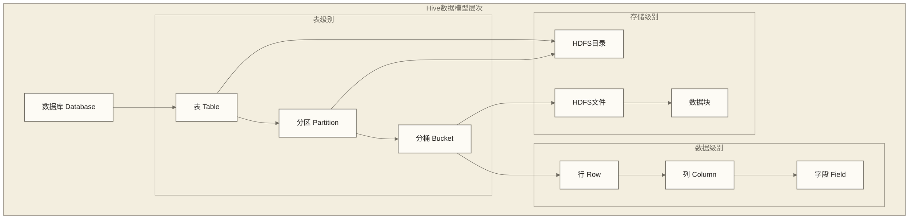
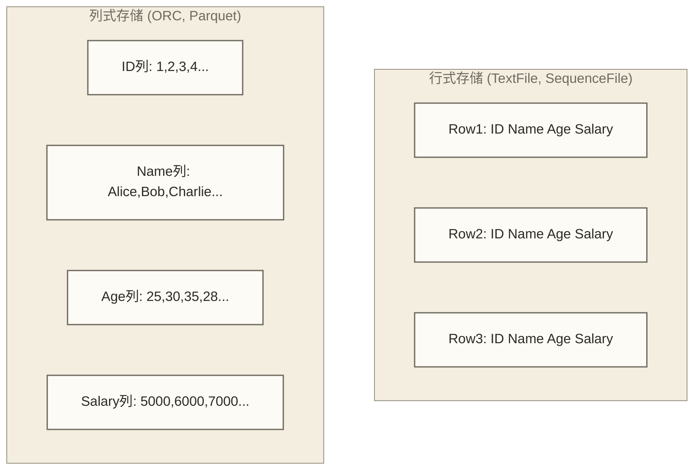

# 🏗️ Hive数据模型 - 构建结构化数据的艺术

> [!abstract] 📋 本节概览
> - 🎯 **学习目标**：深入理解Hive数据模型的设计理念和实现机制
> - 📚 **前置知识**：[[【技术与工具】/Hive/02-Hive安装与配置|Hive安装与配置]] | [[【数据分析与数据运营】/01-共同能力基础/03-工具掌握/01-SQL基本概念|SQL基本概念]] | [[【技术与工具】/Hadoop/01-Hadoop概念与生态|Hadoop概念与生态]]
> - ⏱️ **预计用时**：95分钟  
> - 🔧 **技术重点**：数据库和表概念、数据类型系统、分区分桶机制、存储格式选择

> [!tip] 💡 扩展学习资源
> - **SQL基础回顾**：[[【技术与工具】/SQL/05-SQL语言概述|SQL语言]]
> - **存储原理**：[[【技术与工具】/Hadoop/03-HDFS分布式文件系统|HDFS分布式文件系统]]
> - **数据建模**：数据建模理论与实践
> - **[[【技术与工具】/Hive/06-分区与分桶策略|分区与分桶]]**

---

## 🏛️ Hive数据模型概览

### 数据组织层次结构

> [!note] 💡 Hive数据模型就像一座现代化图书馆
> 想象一座大型图书馆的组织结构：
> - **图书馆**：Database（数据库）- 整个图书管理系统
> - **分区域**：Partition（分区）- 按主题、年代分类的区域
> - **书架**：Bucket（桶）- 细分的存储单元
> - **图书**：Row（行）- 具体的数据记录
> - **索引系统**：Metastore - 记录所有图书的位置和信息



### 核心概念对比

| 概念 | 传统数据库 | Hive | 物理存储 |
|---|---|---|---|
| **Database** | 数据库实例 | 命名空间 | HDFS目录 |
| **Table** | 表 | 表 | HDFS目录 |
| **Partition** | 无直接对应 | 分区 | HDFS子目录 |
| **Bucket** | 无直接对应 | 分桶 | HDFS文件 |
| **Row** | 行记录 | 行记录 | 文件中的行 |
| **Schema** | 强制模式 | 读时模式 | 元数据存储 |

---

## 🗂️ 数据库（Database）

### 数据库的作用和特点

Hive中的Database主要用于：
- **命名空间隔离**：避免表名冲突
- **权限管理**：基于数据库的访问控制
- **逻辑分组**：按业务领域组织表

```sql
-- 🏗️ 数据库管理示例

-- 创建数据库
CREATE DATABASE IF NOT EXISTS ecommerce
COMMENT '电商业务数据库'
LOCATION '/user/hive/warehouse/ecommerce.db'
WITH DBPROPERTIES (
    'creator' = 'data_team',
    'date' = '2024-06-29',
    'version' = '1.0'
);

-- 查看数据库信息
DESCRIBE DATABASE EXTENDED ecommerce;

-- 切换数据库
USE ecommerce;

-- 显示所有数据库
SHOW DATABASES;

-- 显示数据库中的表
SHOW TABLES;

-- 删除数据库
DROP DATABASE IF EXISTS test_db CASCADE;
```

### 数据库的物理存储

| HDFS路径 | 说明 |
|---------|------|
| `/user/hive/warehouse/` | 默认数据库的常见位置；以实际warehouse及数据库LOCATION配置为准 |
| `/user/hive/warehouse/ecommerce.db/` | 电商数据库 |
| `/user/hive/warehouse/ecommerce.db/users/` | 用户表 |
| `/user/hive/warehouse/ecommerce.db/products/` | 商品表 |
| `/user/hive/warehouse/ecommerce.db/orders/` | 订单表 |
| `/user/hive/warehouse/analytics.db/` | 分析数据库 |
| `/user/hive/warehouse/analytics.db/user_behavior/` | 用户行为表 |
| `/user/hive/warehouse/analytics.db/sales_report/` | 销售报告表 |

---

## 📊 表（Table）

### 表的类型分类

Hive支持多种类型的表，每种都有不同的用途和特性：

#### 1. 内部表（Managed Table）

```sql
-- 🏠 内部表示例
CREATE TABLE users_managed (
    user_id BIGINT,
    username STRING,
    email STRING,
    register_date DATE,
    last_login TIMESTAMP
)
COMMENT '用户信息表（内部表）'
STORED AS ORC
TBLPROPERTIES (
    'orc.compress' = 'SNAPPY',
    'orc.stripe.size' = '268435456'
);

-- 查看表结构
DESCRIBE FORMATTED users_managed;
```

**内部表特点**：
- Hive完全管理表的生命周期
- 删除表时，数据和元数据都会被删除
- 数据存储在Hive warehouse目录下
- 适合Hive专用的数据

#### 2. 外部表（External Table）

```sql
-- 🔗 外部表示例
CREATE EXTERNAL TABLE users_external (
    user_id BIGINT,
    username STRING,
    email STRING,
    register_date DATE,
    last_login TIMESTAMP
)
COMMENT '用户信息表（外部表）'
STORED AS PARQUET
LOCATION '/data/external/users'
TBLPROPERTIES (
    'parquet.compression' = 'SNAPPY'
);

-- 查看表信息
SHOW CREATE TABLE users_external;
```

**外部表特点**：
- 数据存储在外部指定位置
- 通常删除表时只删除元数据，保留数据文件；支持并启用外部表清理属性的环境可能同时删除数据，操作前须检查表属性与版本
- 可以与其他系统共享数据
- 适合数据湖架构

#### 3. 临时表（Temporary Table）

```sql
-- ⏰ 临时表示例
CREATE TEMPORARY TABLE temp_user_stats AS
SELECT 
    DATE(register_date) as reg_date,
    COUNT(*) as user_count
FROM users_managed
GROUP BY DATE(register_date);

-- 临时表只在当前会话中有效
SELECT * FROM temp_user_stats;
```

### 表的存储格式对比

| 格式 | 压缩支持 | 查询性能 | 存储效率 | 适用场景 |
|---|---|---|---|---|
| **TextFile** | Gzip, LZO | 低 | 低 | 简单数据交换 |
| **SequenceFile** | 多种 | 中 | 中 | 中间结果存储 |
| **RCFile** | 多种 | 中 | 中 | 传统数仓 |
| **ORC** | Snappy, ZLIB | 高 | 高 | OLAP查询 |
| **Parquet** | Snappy, GZIP | 高 | 高 | 跨引擎兼容 |
| **Avro** | 多种 | 中 | 中 | Schema演进 |

---

## 🗃️ 分区（Partition）

### 分区的概念和价值

> [!note] 🔑 分区是Hive性能优化的关键
> 分区就像给海量图书按照时间、类别进行分类存放：
> - **提高查询效率**：只扫描相关分区的数据
> - **便于数据管理**：可以独立操作某个分区的数据
> - **支持并行处理**：不同分区可以并行读取

### 静态分区

```sql
-- 📅 创建按日期分区的表
CREATE TABLE sales_partitioned (
    order_id BIGINT,
    customer_id BIGINT,
    product_id BIGINT,
    quantity INT,
    price DECIMAL(10,2),
    order_time TIMESTAMP
)
PARTITIONED BY (
    year INT,
    month INT,
    day INT
)
STORED AS ORC
TBLPROPERTIES (
    'orc.compress' = 'SNAPPY'
);

-- 添加分区
ALTER TABLE sales_partitioned 
ADD PARTITION (year=2024, month=6, day=29);

-- 向指定分区插入数据
INSERT INTO sales_partitioned PARTITION (year=2024, month=6, day=29)
VALUES 
    (1001, 501, 101, 2, 99.99, '2024-06-29 10:30:00'),
    (1002, 502, 102, 1, 149.99, '2024-06-29 11:15:00');

-- 查询特定分区
SELECT * FROM sales_partitioned 
WHERE year=2024 AND month=6 AND day=29;

-- 查看分区信息
SHOW PARTITIONS sales_partitioned;

-- 查看分区详细信息
DESCRIBE FORMATTED sales_partitioned PARTITION (year=2024, month=6, day=29);
```

### 动态分区

```sql
-- 🔄 启用动态分区
SET hive.exec.dynamic.partition = true;
SET hive.exec.dynamic.partition.mode = nonstrict;
SET hive.exec.max.dynamic.partitions = 1000;
SET hive.exec.max.dynamic.partitions.pernode = 100;

-- 创建源表
CREATE TABLE sales_raw (
    order_id BIGINT,
    customer_id BIGINT,
    product_id BIGINT,
    quantity INT,
    price DECIMAL(10,2),
    order_time TIMESTAMP,
    order_date DATE
)
STORED AS TEXTFILE;

-- 动态分区插入
INSERT INTO sales_partitioned PARTITION (year, month, day)
SELECT 
    order_id,
    customer_id,
    product_id,
    quantity,
    price,
    order_time,
    YEAR(order_date) as year,
    MONTH(order_date) as month,
    DAY(order_date) as day
FROM sales_raw;
```

### 分区的物理存储结构

| HDFS路径 | 说明 |
|---------|------|
| `.../sales_partitioned/year=2024/month=1/day=1/` | 2024年1月1日分区，含 000000_0.orc |
| `.../sales_partitioned/year=2024/month=1/day=2/` | 2024年1月2日分区，含 000000_0.orc |
| `.../sales_partitioned/year=2024/month=2/` | 2024年2月分区 |
| `.../sales_partitioned/year=2023/` | 2023年分区 |

### 分区管理最佳实践

```sql
-- 🔧 分区管理工具

-- 1. 修复分区（同步HDFS和元数据）
MSCK REPAIR TABLE sales_partitioned;

-- 2. 删除分区
ALTER TABLE sales_partitioned 
DROP PARTITION (year=2023, month=1, day=1);

-- 3. 重命名分区
ALTER TABLE sales_partitioned 
PARTITION (year=2024, month=6, day=29) 
RENAME TO PARTITION (year=2024, month=6, day=30);

-- 4. 查看分区大小（以下为依赖自定义元数据视图的示意SQL，非通用Hive查询；须先提供information_schema.partitions及所用字段的实现）
SELECT 
    partition_name,
    size_in_bytes
FROM (
    SELECT 
        concat('year=', year, '/month=', month, '/day=', day) as partition_name,
        SUM(file_size_in_bytes) as size_in_bytes
    FROM information_schema.partitions
    WHERE table_name = 'sales_partitioned'
    GROUP BY year, month, day
) partition_sizes
ORDER BY size_in_bytes DESC;
```

---

## 🪣 分桶（Bucket）

### 分桶的作用机制

分桶是按分桶字段的哈希结果组织数据的方式，可用于分区表，也可用于非分区表：

```sql
-- 🪣 创建分桶表
CREATE TABLE user_behavior_bucketed (
    user_id BIGINT,
    session_id STRING,
    page_url STRING,
    action_type STRING,
    action_time TIMESTAMP,
    duration INT
)
PARTITIONED BY (dt STRING)
CLUSTERED BY (user_id) INTO 32 BUCKETS
STORED AS ORC
TBLPROPERTIES (
    'orc.compress' = 'SNAPPY',
    'transactional' = 'true'
);

-- 旧版Hive可能需要此配置；较新版本可能不再使用该参数，须按版本检查写入分桶行为
SET hive.enforce.bucketing = true;

-- 插入数据到分桶表
INSERT INTO user_behavior_bucketed PARTITION (dt='2024-06-29')
SELECT 
    user_id,
    session_id,
    page_url,
    action_type,
    action_time,
    duration
FROM user_behavior_raw
WHERE dt = '2024-06-29';
```

### 分桶的优势和使用场景

#### 1. 提高JOIN性能

```sql
-- 🔗 分桶表JOIN优化
-- 分桶字段类型、哈希规则及桶数满足兼容条件且优化器启用相应优化时，JOIN可能利用桶映射；须检查执行计划
SELECT 
    u.user_id,
    u.username,
    COUNT(b.session_id) as session_count
FROM users_bucketed u
JOIN user_behavior_bucketed b ON u.user_id = b.user_id
WHERE b.dt = '2024-06-29'
GROUP BY u.user_id, u.username;
```

#### 2. 高效抽样

```sql
-- 📊 基于分桶的高效抽样
-- 选择4组哈希桶中的1组；不保证返回行数恰好为总行数的1/4
SELECT * FROM user_behavior_bucketed
TABLESAMPLE(BUCKET 1 OUT OF 4 ON user_id)
WHERE dt = '2024-06-29';

-- 基于输入数据大小的百分比抽样；不是按行数精确抽取25%，支持条件须按版本与输入格式确认
SELECT * FROM user_behavior_bucketed
TABLESAMPLE(25 PERCENT)
WHERE dt = '2024-06-29';
```

#### 3. 支持ACID事务

```sql
-- 🔄 ACID事务操作（需要符合目标Hive版本要求的事务表与事务配置；早期版本要求分桶，较新版本不一定要求）
-- 更新操作
UPDATE user_behavior_bucketed 
SET duration = duration + 10
WHERE user_id = 12345 AND dt = '2024-06-29';

-- 删除操作
DELETE FROM user_behavior_bucketed 
WHERE action_type = 'invalid' AND dt = '2024-06-29';
```

---

## 📋 数据类型系统

### 基本数据类型

```sql
-- 📋 Hive数据类型示例表
CREATE TABLE data_types_demo (
    -- 数值类型
    tiny_col TINYINT,           -- 1字节整数 (-128 to 127)
    small_col SMALLINT,         -- 2字节整数 (-32768 to 32767)
    int_col INT,                -- 4字节整数
    big_col BIGINT,             -- 8字节整数
    float_col FLOAT,            -- 4字节浮点数
    double_col DOUBLE,          -- 8字节浮点数
    decimal_col DECIMAL(10,2),  -- 精确小数
    
    -- 字符串类型
    string_col STRING,          -- 变长字符串
    varchar_col VARCHAR(50),    -- 限长字符串
    char_col CHAR(10),          -- 定长字符串
    
    -- 日期时间类型
    date_col DATE,              -- 日期 (YYYY-MM-DD)
    timestamp_col TIMESTAMP,    -- 时间戳
    
    -- 布尔类型
    boolean_col BOOLEAN,        -- true/false
    
    -- 二进制类型
    binary_col BINARY           -- 二进制数据
)
STORED AS ORC;

-- 插入测试数据
INSERT INTO data_types_demo VALUES (
    127,                        -- tiny_col
    32767,                      -- small_col
    2147483647,                 -- int_col
    9223372036854775807,        -- big_col
    3.14,                       -- float_col
    3.141592653589793,          -- double_col
    12345.67,                   -- decimal_col
    'Hello Hive',               -- string_col
    'Variable',                 -- varchar_col
    'Fixed',                    -- char_col
    '2024-06-29',               -- date_col
    '2024-06-29 15:30:45',      -- timestamp_col
    true,                       -- boolean_col
    unhex('48697665')           -- binary_col (hex encoded 'Hive')
);
```

### 复杂数据类型

```sql
-- 🧩 复杂数据类型示例
CREATE TABLE complex_types_demo (
    id BIGINT,
    
    -- 数组类型
    tags ARRAY<STRING>,
    scores ARRAY<INT>,
    
    -- Map类型
    properties MAP<STRING, STRING>,
    metrics MAP<STRING, DOUBLE>,
    
    -- Struct类型
    address STRUCT<
        street: STRING,
        city: STRING,
        state: STRING,
        zipcode: STRING
    >,
    
    -- 嵌套复杂类型
    order_items ARRAY<STRUCT<
        product_id: BIGINT,
        product_name: STRING,
        quantity: INT,
        price: DECIMAL(10,2),
        attributes: MAP<STRING, STRING>
    >>
)
STORED AS ORC;

-- 插入复杂数据
INSERT INTO complex_types_demo VALUES (
    1,
    ARRAY('electronics', 'mobile', 'smartphone'),
    ARRAY(95, 87, 92),
    MAP('brand', 'Apple', 'model', 'iPhone15', 'color', 'Blue'),
    MAP('rating', 4.5, 'price_score', 8.2),
    NAMED_STRUCT(
        'street', '123 Main St',
        'city', 'San Francisco',
        'state', 'CA',
        'zipcode', '94105'
    ),
    ARRAY(
        NAMED_STRUCT(
            'product_id', 101,
            'product_name', 'iPhone 15',
            'quantity', 1,
            'price', 999.99,
            'attributes', MAP('color', 'Blue', 'storage', '128GB')
        ),
        NAMED_STRUCT(
            'product_id', 102,
            'product_name', 'AirPods Pro',
            'quantity', 1,
            'price', 249.99,
            'attributes', MAP('color', 'White', 'noise_cancelling', 'true')
        )
    )
);

-- 查询复杂数据类型
SELECT 
    id,
    tags[0] as first_tag,                           -- 数组访问
    properties['brand'] as brand,                   -- Map访问
    address.city as city,                          -- Struct访问
    order_items[0].product_name as first_product   -- 嵌套访问
FROM complex_types_demo;
```

### 复杂类型操作函数

```sql
-- 🔧 复杂数据类型操作示例

-- 数组操作
SELECT 
    id,
    SIZE(tags) as tag_count,                    -- 数组大小
    SORT_ARRAY(scores) as sorted_scores,        -- 数组排序
    ARRAY_CONTAINS(tags, 'mobile') as has_mobile -- 包含检查
FROM complex_types_demo;

-- Map操作
SELECT 
    id,
    SIZE(properties) as prop_count,             -- Map大小
    MAP_KEYS(properties) as prop_keys,          -- 获取所有key
    MAP_VALUES(metrics) as metric_values        -- 获取所有value
FROM complex_types_demo;

-- 数组展开
SELECT 
    id,
    tag
FROM complex_types_demo
LATERAL VIEW EXPLODE(tags) tag_table AS tag;

-- Map展开
SELECT 
    id,
    prop_key,
    prop_value
FROM complex_types_demo
LATERAL VIEW EXPLODE(properties) prop_table AS prop_key, prop_value;

-- 嵌套数组展开
SELECT 
    id,
    item.product_id,
    item.product_name,
    item.quantity,
    item.price
FROM complex_types_demo
LATERAL VIEW EXPLODE(order_items) item_table AS item;
```

---

## 💾 存储格式详解

### 行式存储 vs 列式存储



### ORC格式深度解析

```sql
-- 📊 ORC格式表创建
CREATE TABLE sales_orc (
    order_id BIGINT,
    customer_id BIGINT,
    product_id BIGINT,
    quantity INT,
    price DECIMAL(10,2),
    order_date DATE,
    order_time TIMESTAMP
)
PARTITIONED BY (year INT, month INT)
STORED AS ORC
TBLPROPERTIES (
    -- 压缩设置
    'orc.compress' = 'SNAPPY',
    'orc.compress.size' = '262144',
    
    -- 条带设置
    'orc.stripe.size' = '268435456',  -- 256MB
    'orc.row.index.stride' = '10000',
    
    -- 布隆过滤器
    'orc.bloom.filter.columns' = 'customer_id,product_id',
    'orc.bloom.filter.fpp' = '0.01',
    
    -- 事务支持
    'transactional' = 'true'
);
```

**ORC格式特点**：
- **高压缩比**：原稿给出的70-80%为未核实示例，未提供数据集、比较基准和测试配置；实际压缩效果须实测
- **快速查询**：列式存储，谓词下推
- **ACID支持**：ORC可用于Hive完整ACID事务表，但事务能力还依赖表属性、Hive版本及事务配置，不由文件格式单独提供
- **Schema演进**：支持一定范围的Schema演进；列增删、重命名和类型变更须结合Hive版本、读取映射规则及历史文件验证

### Parquet格式配置

```sql
-- 📋 Parquet格式表创建
CREATE TABLE sales_parquet (
    order_id BIGINT,
    customer_id BIGINT,
    product_id BIGINT,
    quantity INT,
    price DECIMAL(10,2),
    order_date DATE,
    order_time TIMESTAMP
)
PARTITIONED BY (year INT, month INT)
STORED AS PARQUET
TBLPROPERTIES (
    -- 压缩设置
    'parquet.compression' = 'SNAPPY',
    
    -- 块大小设置
    'parquet.block.size' = '134217728',  -- 128MB
    'parquet.page.size' = '1048576',     -- 1MB
    
    -- 字典编码
    'parquet.enable.dictionary' = 'true'
);
```

**Parquet格式特点**：
- **跨引擎兼容**：Spark、Impala等都支持
- **高效压缩**：字典编码和RLE编码
- **嵌套数据**：原生支持复杂数据类型
- **Schema演进**：部分Schema变更可兼容历史数据，但并非任意变更都向前、向后兼容，须验证读取引擎和字段映射规则

### 存储格式性能对比测试

```sql
-- 📈 存储格式性能测试

-- 创建测试数据
CREATE TABLE test_data_source AS
SELECT 
    ROW_NUMBER() OVER () as id,
    concat('user_', cast(rand()*1000000 as int)) as user_id,
    concat('product_', cast(rand()*10000 as int)) as product_id,
    cast(rand()*100 as int) as quantity,
    cast(rand()*1000 as decimal(10,2)) as price,
    date_add('2024-01-01', cast(rand()*365 as int)) as order_date
FROM (
    SELECT 1 FROM 
    (SELECT 1 UNION ALL SELECT 1) t1
    CROSS JOIN (SELECT 1 UNION ALL SELECT 1) t2
    CROSS JOIN (SELECT 1 UNION ALL SELECT 1) t3
    -- 当前三组两行集合交叉连接仅产生8行；原稿未提供大量数据生成步骤，LIMIT不会扩增行数
) dummy_table
LIMIT 1000000;

-- 创建不同格式的表进行比较
CREATE TABLE test_textfile LIKE test_data_source STORED AS TEXTFILE;
CREATE TABLE test_orc LIKE test_data_source STORED AS ORC;
CREATE TABLE test_parquet LIKE test_data_source STORED AS PARQUET;

-- 插入相同数据
INSERT INTO test_textfile SELECT * FROM test_data_source;
INSERT INTO test_orc SELECT * FROM test_data_source;
INSERT INTO test_parquet SELECT * FROM test_data_source;

-- 以下查询仅演示相同过滤条件下的计数与时间戳输出，未测量存储大小或查询耗时；性能比较须另行记录实际数据量、文件大小及执行耗时
SELECT 
    'TextFile' as format,
    COUNT(*) as row_count,
    unix_timestamp() as query_start_time
FROM test_textfile
WHERE quantity > 50;

SELECT 
    'ORC' as format,
    COUNT(*) as row_count,
    unix_timestamp() as query_start_time
FROM test_orc
WHERE quantity > 50;

SELECT 
    'Parquet' as format,
    COUNT(*) as row_count,
    unix_timestamp() as query_start_time
FROM test_parquet
WHERE quantity > 50;
```

---

## 🔧 Schema演进与管理

### Schema演进示例

```sql
-- 🔄 Schema演进管理

-- 原始表结构
CREATE TABLE user_profile_v1 (
    user_id BIGINT,
    username STRING,
    email STRING,
    register_date DATE
)
STORED AS ORC;

-- 版本2：添加新列
ALTER TABLE user_profile_v1 
ADD COLUMNS (
    phone STRING COMMENT '用户手机号',
    birth_date DATE COMMENT '出生日期'
);

-- 版本3：通过新表迁移重命名列并新增字段；本例未修改已有列的数据类型
CREATE TABLE user_profile_v3 (
    user_id BIGINT,
    username STRING,
    email STRING,
    register_date DATE,
    mobile_phone STRING,  -- 重命名
    birth_date DATE,
    age INT,              -- 新增计算字段
    last_login TIMESTAMP  -- 新增字段
)
STORED AS ORC;

-- 数据迁移
INSERT INTO user_profile_v3
SELECT 
    user_id,
    username,
    email,
    register_date,
    phone as mobile_phone,
    birth_date,
    CASE 
        WHEN birth_date IS NOT NULL 
        THEN YEAR(CURRENT_DATE) - YEAR(birth_date)
             - CASE WHEN DATE_FORMAT(CURRENT_DATE, 'MMdd') < DATE_FORMAT(birth_date, 'MMdd') THEN 1 ELSE 0 END
        ELSE NULL 
    END as age,
    CURRENT_TIMESTAMP as last_login -- 教学占位值：这是迁移时刻，不是真实最近登录时间；业务使用须接入登录记录
FROM user_profile_v1;
```

### 表版本管理策略

```sql
-- 📝 表版本管理最佳实践

-- 1. 使用表属性记录版本信息
ALTER TABLE user_profile_v3 
SET TBLPROPERTIES (
    'version' = '3.0',
    'created_by' = 'data_team',
    'created_date' = '2024-06-29',
    'schema_version' = '3.0',
    'description' = '用户画像表第三版'
);

-- 2. 创建视图提供向后兼容
CREATE VIEW user_profile_v1_compat AS
SELECT 
    user_id,
    username,
    email,
    register_date
FROM user_profile_v3;

-- 3. 使用表别名管理当前版本
CREATE VIEW user_profile AS
SELECT * FROM user_profile_v3;
```

---

## 🔗 学习路径

### 下一步学习建议

1. **[[【技术与工具】/Hive/04-HiveQL基础语法|HiveQL基础语法]]** - 掌握Hive SQL的核心语法
2. **[[【技术与工具】/Hive/05-Hive表类型与设计|Hive表类型与]]** - 深入学习表设计最佳实践
3. **[[【技术与工具】/Hive/06-分区与分桶策略|分区与分桶]]** - 掌握高级分区分桶技巧

### 实践建议

- 创建不同类型的表，观察存储差异
- 尝试使用复杂数据类型解决实际问题
- 比较不同存储格式的性能表现
- 练习分区和分桶的设计策略

---

## 📚 参考资料

### 官方文档
- [Hive Data Types](https://cwiki.apache.org/confluence/display/Hive/LanguageManual+Types)
- [Hive DDL](https://cwiki.apache.org/confluence/display/Hive/LanguageManual+DDL)
- [ORC File Format](https://orc.apache.org/)

---

> [!tip] 💡 关键收获
> - Hive数据模型采用Schema on Read，提供灵活的数据组织方式
> - 分区是性能优化的关键，合理的分区策略可以大幅提升查询效率
> - 分桶可辅助特定JOIN优化；数据更新依赖ACID事务表及环境配置，是否要求分桶取决于Hive版本
> - 选择合适的存储格式（ORC、Parquet）对性能影响巨大
> - 复杂数据类型支持半结构化数据的原生存储和查询

> [!warning] ⚠️ 设计注意事项
> - 避免过度分区（小文件问题）
> - 选择合适的分桶字段（数据分布均匀）
> - 考虑查询模式选择存储格式
> - 复杂数据类型虽然强大，但会增加查询复杂度 