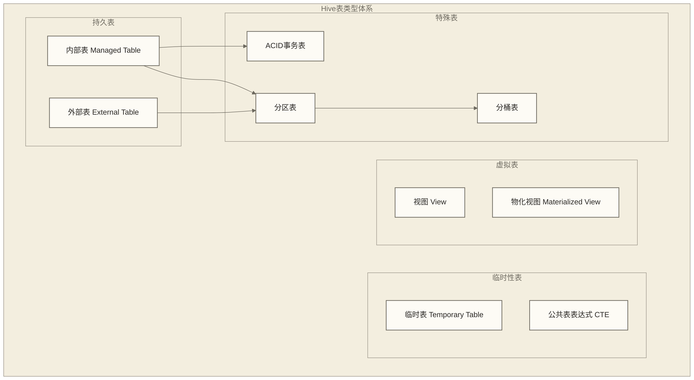

# 🏗️ Hive表类型与设计 - 构建高效数据架构的基石

> [!abstract] 📋 本节概览
> - 🎯 **学习目标**：掌握不同表类型的特点和应用场景，学会设计高效的表结构
> - 📚 **前置知识**：[[【技术与工具】/Hive/04-HiveQL基础语法|HiveQL基础语法]] | [[【技术与工具】/Hive/03-Hive数据模型|Hive数据]]
> - ⏱️ **预计用时**：110分钟
> - 🔧 **技术重点**：表类型选择、设计原则、性能优化、最佳实践

> [!tip] 💡 前置知识
> 建议先掌握HiveQL基础语法和Hive数据模型概念

---

## 🎭 Hive表类型详解

### 表类型概览

> [!note] 💡 Hive表类型就像不同用途的建筑
> 想象设计一个现代化园区：
> - **内部表**：自建办公楼（完全控制，拆除时建筑和地基都清理）
> - **外部表**：租赁写字楼（只使用，退租时保留建筑）
> - **临时表**：临时帐篷（会议期间使用，结束后自动清理）
> - **视图**：观景台（提供特定角度的风景，本身不占用土地）



---

## 🏠 内部表（Managed Table）

### 内部表的特点和机制

内部表是Hive完全管理的表，Hive负责表的整个生命周期：

```sql
-- 🏠 内部表创建示例

-- 基础内部表
CREATE TABLE customers_managed (
    customer_id BIGINT COMMENT '客户ID',
    first_name STRING COMMENT '名',
    last_name STRING COMMENT '姓',
    email STRING COMMENT '邮箱',
    phone STRING COMMENT '电话',
    address STRUCT<
        street: STRING,
        city: STRING,
        state: STRING,
        zipcode: STRING
    > COMMENT '地址信息',
    registration_date DATE COMMENT '注册日期',
    last_purchase_date DATE COMMENT '最后购买日期',
    lifetime_value DECIMAL(12,2) COMMENT '客户终身价值',
    preferences ARRAY<STRING> COMMENT '偏好列表',
    metadata MAP<STRING, STRING> COMMENT '元数据'
)
COMMENT '客户信息内部表'
PARTITIONED BY (
    region STRING COMMENT '地区',
    year INT COMMENT '年份'
)
CLUSTERED BY (customer_id) INTO 16 BUCKETS
STORED AS ORC
TBLPROPERTIES (
    'orc.compress' = 'SNAPPY',
    'orc.stripe.size' = '268435456',
    'orc.bloom.filter.columns' = 'customer_id,email',
    'transactional' = 'true',
    'table.type' = 'MANAGED_TABLE'
);

-- 查看表信息
DESCRIBE FORMATTED customers_managed;

-- 显示表的创建语句
SHOW CREATE TABLE customers_managed;
```

### 内部表的优势和适用场景

#### ✅ 优势

| 特性 | 说明 | 价值 |
|---|---|---|
| **生命周期管理** | Hive完全控制表和数据 | 简化管理，避免孤儿文件 |
| **ACID支持** | 按版本要求配置事务表、事务管理器及相关服务后支持事务操作 | 数据一致性保障 |
| **自动优化** | 事务表的自动compaction依赖相关服务和配置，并非所有内部表默认具备 | 有助于控制增量文件数量和查询开销 |
| **统计信息** | 自动收集取决于统计配置和写入方式，必要时需执行ANALYZE | 为查询优化器提供估算依据 |

#### 🎯 适用场景

```sql
-- 📊 适用场景示例

-- 1. 数据仓库核心表
CREATE TABLE fact_sales_managed (
    sale_id BIGINT,
    product_id BIGINT,
    customer_id BIGINT,
    sale_date DATE,
    quantity INT,
    unit_price DECIMAL(10,2),
    total_amount DECIMAL(12,2),
    discount_amount DECIMAL(10,2),
    tax_amount DECIMAL(10,2)
)
PARTITIONED BY (year INT, month INT, day INT)
CLUSTERED BY (sale_id) INTO 32 BUCKETS
STORED AS ORC
TBLPROPERTIES (
    'transactional' = 'true',
    'orc.compress' = 'ZLIB'
);

-- 2. 需要频繁更新的业务表
CREATE TABLE inventory_managed (
    product_id BIGINT,
    warehouse_id INT,
    quantity_on_hand INT,
    reserved_quantity INT,
    last_updated TIMESTAMP
)
CLUSTERED BY (product_id) INTO 16 BUCKETS
STORED AS ORC
TBLPROPERTIES ('transactional' = 'true');

-- 支持UPDATE/DELETE操作
UPDATE inventory_managed 
SET quantity_on_hand = quantity_on_hand - 10,
    last_updated = CURRENT_TIMESTAMP
WHERE product_id = 12345;

-- 3. 中间计算结果表（普通持久表，需自行清理）
CREATE TABLE temp_calculation_results AS
SELECT 
    customer_id,
    SUM(total_amount) as total_spent,
    COUNT(*) as order_count,
    AVG(total_amount) as avg_order_value
FROM fact_sales_managed
WHERE year = 2024 AND month = 6
GROUP BY customer_id;
```

### 内部表的管理操作

```sql
-- 🔧 内部表管理操作

-- 1. 表属性管理
ALTER TABLE customers_managed 
SET TBLPROPERTIES (
    'last_modified_time' = '2024-06-29',
    'data_quality_score' = '95',
    'backup_status' = 'completed'
);

-- 2. 压缩和优化
-- 手动触发major compaction
ALTER TABLE customers_managed COMPACT 'major';

-- 手动触发minor compaction
ALTER TABLE customers_managed COMPACT 'minor';

-- 3. 统计信息管理
-- 计算表统计信息
ANALYZE TABLE customers_managed COMPUTE STATISTICS;

-- 计算列统计信息
ANALYZE TABLE customers_managed COMPUTE STATISTICS FOR COLUMNS;

-- 4. 分区管理
-- 添加分区
ALTER TABLE customers_managed 
ADD PARTITION (region='north', year=2024);

-- 删除分区
ALTER TABLE customers_managed 
DROP PARTITION (region='south', year=2023);

-- 5. 表维护
-- 按目录结构修复分区元数据，不执行数据完整性校验
MSCK REPAIR TABLE customers_managed;
```

---

## 🔗 外部表（External Table）

### 外部表的设计理念

外部表提供了对外部数据的访问接口，而不移动或复制数据：

```sql
-- 🔗 外部表创建示例

-- 1. 日志文件外部表
CREATE EXTERNAL TABLE web_access_logs (
    timestamp_col STRING,
    ip_address STRING,
    user_agent STRING,
    request_method STRING,
    request_url STRING,
    http_status INT,
    response_size BIGINT,
    referer STRING,
    processing_time DOUBLE
)
COMMENT '网站访问日志外部表'
PARTITIONED BY (
    year INT,
    month INT,
    day INT
)
ROW FORMAT SERDE 'org.apache.hadoop.hive.serde2.RegexSerDe'
WITH SERDEPROPERTIES (
    'input.regex' = '([^ ]*) ([^ ]*) ([^ ]*) \\[([^\\]]*)\\] "([^"]*)" ([0-9]*) ([0-9]*) "([^"]*)" "([^"]*)" ([0-9.]*)',
    'output.format.string' = '%1$s %2$s %3$s %4$s %5$s %6$s %7$s %8$s %9$s %10$s'
)
STORED AS TEXTFILE
LOCATION '/data/logs/web_access/'
TBLPROPERTIES (
    'table.type' = 'EXTERNAL_TABLE',
    'data_source' = 'nginx_logs',
    'update_frequency' = 'hourly'
);

-- 2. Parquet格式外部表
CREATE EXTERNAL TABLE sales_data_external (
    transaction_id STRING,
    customer_id BIGINT,
    product_id BIGINT,
    quantity INT,
    unit_price DECIMAL(10,2),
    total_amount DECIMAL(12,2),
    transaction_timestamp TIMESTAMP
)
COMMENT 'Parquet格式销售数据'
PARTITIONED BY (
    transaction_date STRING
)
STORED AS PARQUET
LOCATION '/data/external/sales/'
TBLPROPERTIES (
    'parquet.compression' = 'SNAPPY',
    'table.type' = 'EXTERNAL_TABLE'
);

-- 3. CSV文件外部表
CREATE EXTERNAL TABLE customer_data_csv (
    customer_id STRING,  -- OpenCSVSerde按字符串读取；下游按需CAST为BIGINT
    name STRING,
    email STRING,
    signup_date STRING,
    country STRING
)
COMMENT 'CSV格式客户数据'
ROW FORMAT SERDE 'org.apache.hadoop.hive.serde2.OpenCSVSerde'
WITH SERDEPROPERTIES (
    'separatorChar' = ',',
    'quoteChar' = '"',
    'escapeChar' = '\\'
)
STORED AS TEXTFILE
LOCATION '/data/external/customers/'
TBLPROPERTIES (
    'skip.header.line.count' = '1',
    'table.type' = 'EXTERNAL_TABLE'
);
```

### 外部表的高级应用

#### 1. 数据湖集成

```sql
-- 🏞️ 数据湖集成示例

-- Delta Lake表集成
CREATE EXTERNAL TABLE delta_orders (
    order_id BIGINT,
    customer_id BIGINT,
    order_date DATE,
    total_amount DECIMAL(12,2),
    status STRING
)
STORED BY 'io.delta.hive.DeltaStorageHandler'
LOCATION '/data/delta/orders/'
TBLPROPERTIES (
    'table.type' = 'EXTERNAL_TABLE'
);

-- Iceberg表集成
CREATE EXTERNAL TABLE iceberg_events (
    event_id STRING,
    user_id BIGINT,
    event_type STRING,
    event_timestamp TIMESTAMP,
    properties MAP<STRING, STRING>
)
STORED BY 'org.apache.iceberg.mr.hive.HiveIcebergStorageHandler'
LOCATION '/data/iceberg/events/'
TBLPROPERTIES (
    'iceberg.catalog' = 'hadoop.catalog',
    'table.type' = 'EXTERNAL_TABLE'
);
```

#### 2. 实时数据接入

```sql
-- ⚡ 实时数据接入外部表

-- Kafka Connect输出的Parquet文件
CREATE EXTERNAL TABLE streaming_events (
    event_id STRING,
    user_id BIGINT,
    event_type STRING,
    event_data MAP<STRING, STRING>,
    event_timestamp TIMESTAMP
)
PARTITIONED BY (
    event_date STRING,
    event_hour INT
)
STORED AS PARQUET
LOCATION '/data/streaming/events/'
TBLPROPERTIES (
    'table.type' = 'EXTERNAL_TABLE',
    'data.source' = 'kafka_connect',
    'refresh.interval' = '5min'
);

-- 自动发现新分区
MSCK REPAIR TABLE streaming_events;

-- 或使用动态分区发现
ALTER TABLE streaming_events 
SET TBLPROPERTIES ('discover.partitions' = 'true');
```

#### 3. 跨系统数据共享

```sql
-- 🔄 跨系统数据共享

-- 与Spark共享的Parquet表
CREATE EXTERNAL TABLE shared_analytics (
    metric_name STRING,
    metric_value DOUBLE,
    dimensions MAP<STRING, STRING>,
    measurement_time TIMESTAMP
)
PARTITIONED BY (
    metric_date STRING,
    metric_category STRING
)
STORED AS PARQUET
LOCATION '/shared/analytics/'
TBLPROPERTIES (
    'table.type' = 'EXTERNAL_TABLE',
    'shared.systems' = 'hive,spark,presto',
    'data.format' = 'parquet'
);

-- Presto/Trino兼容的表结构
CREATE EXTERNAL TABLE presto_compatible (
    id BIGINT,
    name STRING,
    data ARRAY<STRUCT<
        key: STRING,
        value: STRING
    >>,
    created_at TIMESTAMP
)
STORED AS PARQUET
LOCATION '/shared/presto_data/'
TBLPROPERTIES (
    'table.type' = 'EXTERNAL_TABLE',
    'presto.compatible' = 'true'
);
```

### 外部表的管理策略

```sql
-- 📋 外部表管理策略

-- 1. 数据刷新策略
-- 创建刷新脚本表
CREATE TABLE external_table_refresh_log (
    table_name STRING,
    refresh_time TIMESTAMP,
    records_processed BIGINT,
    status STRING
)
STORED AS ORC;

-- 刷新外部表分区
ALTER TABLE web_access_logs 
ADD PARTITION (year=2024, month=6, day=29)
LOCATION '/data/logs/web_access/2024/06/29/';

-- 2. 数据质量检查
CREATE VIEW external_data_quality AS
SELECT 
    'web_access_logs' as table_name,
    COUNT(*) as total_records,
    COUNT(DISTINCT ip_address) as unique_ips,
    MIN(timestamp_col) as earliest_log,
    MAX(timestamp_col) as latest_log,
    SUM(CASE WHEN http_status >= 400 THEN 1 ELSE 0 END) as error_count
FROM web_access_logs
WHERE year = 2024 AND month = 6 AND day = 29;

-- 3. 性能监控
CREATE TABLE external_table_performance (
    table_name STRING,
    query_time TIMESTAMP,
    query_duration_ms BIGINT,
    rows_scanned BIGINT,
    data_size_mb DOUBLE
)
PARTITIONED BY (query_date STRING)
STORED AS ORC;
```

---

## ⏰ 临时表（Temporary Table）

### 临时表的特性和用途

临时表只在当前会话中存在，会话结束时自动删除：

```sql
-- ⏰ 临时表示例

-- 1. 创建临时计算表
CREATE TEMPORARY TABLE session_calculations AS
SELECT 
    customer_id,
    COUNT(*) as session_count,
    SUM(page_views) as total_page_views,
    AVG(session_duration) as avg_duration,
    MAX(last_activity) as last_seen
FROM user_sessions
WHERE session_date >= DATE_SUB(CURRENT_DATE, 30)
GROUP BY customer_id;

-- 2. 临时数据清洗表
CREATE TEMPORARY TABLE cleaned_data AS
SELECT 
    customer_id,
    TRIM(UPPER(name)) as clean_name,
    LOWER(email) as clean_email,
    REGEXP_REPLACE(phone, '[^0-9]', '') as clean_phone,
    CASE 
        WHEN country IN ('USA', 'US', 'United States') THEN 'US'
        WHEN country IN ('China', 'CN', '中国') THEN 'CN'
        ELSE country
    END as standardized_country
FROM raw_customer_data
WHERE email IS NOT NULL 
    AND email RLIKE '^[A-Za-z0-9._%+-]+@[A-Za-z0-9.-]+\\.[A-Za-z]{2,}$';

-- 3. 临时聚合表
CREATE TEMPORARY TABLE daily_metrics AS
SELECT 
    metric_date,
    SUM(revenue) as total_revenue,
    COUNT(DISTINCT customer_id) as unique_customers,
    SUM(order_count) as total_orders,
    CASE WHEN SUM(order_count) > 0
         THEN SUM(revenue) / SUM(order_count)
         ELSE NULL END as overall_aov
FROM daily_sales_summary
WHERE metric_date BETWEEN '2024-06-01' AND '2024-06-30'
GROUP BY metric_date;

-- 使用临时表进行复杂分析
SELECT 
    sc.customer_id,
    sc.session_count,
    sc.total_page_views,
    cd.clean_name,
    cd.clean_email,
    CASE 
        WHEN sc.session_count > 10 THEN 'High Activity'
        WHEN sc.session_count > 5 THEN 'Medium Activity'
        ELSE 'Low Activity'
    END as activity_level
FROM session_calculations sc
JOIN cleaned_data cd ON sc.customer_id = cd.customer_id
WHERE sc.avg_duration > 300;  -- 会话时长超过5分钟
```

### 临时表的高级模式

#### 1. 多步骤数据处理

```sql
-- 🔄 多步骤数据处理流水线

-- 步骤1：数据预处理
CREATE TEMPORARY TABLE step1_preprocessed AS
SELECT 
    user_id,
    event_timestamp,
    event_type,
    CASE 
        WHEN event_type = 'page_view' THEN get_json_object(event_data, '$.page_url')
        WHEN event_type = 'click' THEN get_json_object(event_data, '$.element_id')
        ELSE NULL
    END as parsed_data,
    unix_timestamp(event_timestamp) as event_ts
FROM raw_events
WHERE event_timestamp >= DATE_SUB(CURRENT_DATE, 7);

-- 步骤2：会话分析
CREATE TEMPORARY TABLE step2_sessions AS
SELECT 
    user_id,
    event_ts,
    event_type,
    parsed_data,
    -- 先计算前一事件时间，再累计会话边界，避免嵌套窗口函数
    SUM(CASE WHEN previous_event_ts IS NULL OR event_ts - previous_event_ts > 1800 THEN 1 ELSE 0 END)
        OVER (PARTITION BY user_id ORDER BY event_ts ROWS UNBOUNDED PRECEDING) as session_id
FROM (
    SELECT
        user_id,
        event_ts,
        event_type,
        parsed_data,
        LAG(event_ts, 1) OVER (PARTITION BY user_id ORDER BY event_ts) as previous_event_ts
    FROM step1_preprocessed
) previous_events;

-- 步骤3：会话汇总
CREATE TEMPORARY TABLE step3_session_summary AS
SELECT 
    user_id,
    session_id,
    MIN(event_ts) as session_start,
    MAX(event_ts) as session_end,
    MAX(event_ts) - MIN(event_ts) as session_duration,
    COUNT(*) as event_count,
    COUNT(DISTINCT event_type) as unique_event_types,
    COLLECT_LIST(parsed_data) as session_events
FROM step2_sessions
GROUP BY user_id, session_id;

-- 最终结果
SELECT 
    user_id,
    COUNT(*) as total_sessions,
    AVG(session_duration) as avg_session_duration,
    SUM(event_count) as total_events,
    MAX(session_duration) as longest_session
FROM step3_session_summary
GROUP BY user_id
HAVING total_sessions > 5;
```

#### 2. A/B测试分析

```sql
-- 📊 A/B测试分析临时表

-- 实验用户分组
CREATE TEMPORARY TABLE experiment_users AS
SELECT 
    user_id,
    CASE 
        WHEN user_id % 2 = 0 THEN 'control'
        ELSE 'treatment'
    END as experiment_group,
    registration_date,
    user_segment
FROM users
WHERE registration_date >= '2024-06-01'
    AND user_segment IN ('new', 'returning');

-- 用户行为数据
CREATE TEMPORARY TABLE user_metrics AS
SELECT 
    eu.user_id,
    eu.experiment_group,
    eu.user_segment,
    COUNT(DISTINCT o.order_id) as order_count,
    COALESCE(SUM(o.total_amount), 0) as total_spent,  -- 无订单用户按零消费计入每用户收入
    AVG(o.total_amount) as avg_order_value,
    COUNT(DISTINCT DATE(o.order_date)) as active_days
FROM experiment_users eu
LEFT JOIN orders o ON eu.user_id = o.customer_id
    AND o.order_date >= '2024-06-01'
GROUP BY eu.user_id, eu.experiment_group, eu.user_segment;

-- A/B测试结果分析
SELECT 
    experiment_group,
    user_segment,
    COUNT(*) as user_count,
    AVG(order_count) as avg_orders_per_user,
    AVG(total_spent) as avg_revenue_per_user,
    AVG(avg_order_value) as avg_order_value,
    STDDEV(total_spent) as revenue_stddev,
    PERCENTILE_APPROX(total_spent, 0.5) as median_revenue
FROM user_metrics
GROUP BY experiment_group, user_segment;
```

---

## 👁️ 视图（View）

### 视图的设计模式

视图提供了数据的逻辑抽象层，简化复杂查询并提供安全控制：

```sql
-- 👁️ 视图设计示例

-- 1. 简化复杂查询的视图
CREATE VIEW customer_360_view AS
SELECT 
    c.customer_id,
    c.first_name,
    c.last_name,
    c.email,
    c.registration_date,
    -- 订单统计
    o.total_orders,
    o.total_spent,
    o.avg_order_value,
    o.last_order_date,
    -- 行为统计
    b.total_page_views,
    b.total_sessions,
    b.avg_session_duration,
    -- 客户分类
    CASE 
        WHEN o.total_spent > 10000 THEN 'VIP'
        WHEN o.total_spent > 5000 THEN 'Premium'
        WHEN o.total_spent > 1000 THEN 'Regular'
        ELSE 'Basic'
    END as customer_tier,
    -- 活跃度评分
    CASE 
        WHEN DATEDIFF(CURRENT_DATE, o.last_order_date) <= 30 THEN 'Active'
        WHEN DATEDIFF(CURRENT_DATE, o.last_order_date) <= 90 THEN 'Inactive'
        ELSE 'Dormant'
    END as activity_status
FROM customers c
LEFT JOIN (
    SELECT 
        customer_id,
        COUNT(*) as total_orders,
        SUM(total_amount) as total_spent,
        AVG(total_amount) as avg_order_value,
        MAX(order_date) as last_order_date
    FROM orders
    GROUP BY customer_id
) o ON c.customer_id = o.customer_id
LEFT JOIN (
    SELECT 
        user_id,
        SUM(page_views) as total_page_views,
        COUNT(*) as total_sessions,
        AVG(session_duration) as avg_session_duration
    FROM user_sessions
    GROUP BY user_id
) b ON c.customer_id = b.user_id;

-- 2. 安全访问控制视图
CREATE VIEW sensitive_customer_data AS
SELECT 
    customer_id,
    concat(substr(first_name, 1, 1), '***') as masked_first_name,
    concat(substr(last_name, 1, 1), '***') as masked_last_name,
    concat(substr(email, 1, 3), '***@', 
           substr(email, instr(email, '@')+1, length(email))) as masked_email,
    registration_date,
    customer_tier,
    activity_status
FROM customer_360_view;

-- 3. 业务指标仪表板视图
CREATE VIEW daily_business_metrics AS
SELECT 
    order_date as metric_date,
    COUNT(DISTINCT order_id) as daily_orders,
    COUNT(DISTINCT customer_id) as daily_customers,
    SUM(total_amount) as daily_revenue,
    AVG(total_amount) as avg_order_value,
    SUM(total_amount) / COUNT(DISTINCT customer_id) as revenue_per_customer,
    -- 移动平均
    AVG(SUM(total_amount)) OVER (
        ORDER BY order_date 
        ROWS BETWEEN 6 PRECEDING AND CURRENT ROW
    ) as weekly_avg_revenue,
    -- 相对前7行的增长；仅每天连续一行时对应周环比，需处理零分母
    (SUM(total_amount) - LAG(SUM(total_amount), 7) OVER (ORDER BY order_date)) / 
    LAG(SUM(total_amount), 7) OVER (ORDER BY order_date) * 100 as week_over_week_growth
FROM orders
WHERE order_date >= DATE_SUB(CURRENT_DATE, 90)
GROUP BY order_date;
```

### 视图的高级应用

#### 1. 数据血缘和依赖管理

```sql
-- 🔗 数据血缘视图

-- 基础数据源视图
CREATE VIEW raw_data_sources AS
SELECT 
    'customers' as table_name,
    'CRM System' as source_system,
    'Daily' as refresh_frequency,
    last_modified_date as last_updated_time
FROM table_metadata 
WHERE table_name = 'customers'
UNION ALL
SELECT 
    'orders' as table_name,
    'Order Management System' as source_system,
    'Real-time' as refresh_frequency,
    last_modified_date as last_updated_time
FROM table_metadata 
WHERE table_name = 'orders';

-- 数据质量监控视图
CREATE VIEW data_quality_dashboard AS
SELECT 
    table_name,
    check_date,
    total_records,
    null_count,
    duplicate_count,
    (1 - (null_count + duplicate_count) / total_records) * 100 as quality_score,
    CASE 
        WHEN (1 - (null_count + duplicate_count) / total_records) * 100 >= 95 THEN 'Excellent'
        WHEN (1 - (null_count + duplicate_count) / total_records) * 100 >= 90 THEN 'Good'
        WHEN (1 - (null_count + duplicate_count) / total_records) * 100 >= 80 THEN 'Fair'
        ELSE 'Poor'
    END as quality_grade
FROM data_quality_checks
WHERE check_date >= DATE_SUB(CURRENT_DATE, 30);
```

#### 2. 权限控制和数据脱敏

```sql
-- 🔒 权限控制视图

-- 部分脱敏展示视图（仍含客户标识，公开前需隐私评估和授权配置）
CREATE VIEW public_customer_info AS
SELECT 
    customer_id,
    CASE 
        WHEN LENGTH(first_name) > 1 THEN concat(substr(first_name, 1, 1), repeat('*', LENGTH(first_name)-1))
        ELSE first_name
    END as masked_first_name,
    customer_tier,
    activity_status,
    registration_date,
    total_orders,
    -- 收入区间而非具体金额
    CASE 
        WHEN total_spent > 10000 THEN '10000+'
        WHEN total_spent > 5000 THEN '5000-10000'
        WHEN total_spent > 1000 THEN '1000-5000'
        ELSE '0-1000'
    END as spending_range
FROM customer_360_view;

-- 分析师视图（部分脱敏）
CREATE VIEW analyst_customer_data AS
SELECT 
    customer_id,
    HASH(email) as email_hash,  -- 非密码学哈希，存在碰撞和可关联风险，不代表匿名化
    customer_tier,
    activity_status,
    registration_date,
    total_orders,
    total_spent,
    avg_order_value,
    last_order_date
FROM customer_360_view;

-- 管理员视图（完整数据）
CREATE VIEW admin_customer_data AS
SELECT * FROM customer_360_view;
```

---

## 🎯 表设计最佳实践

### 1. 性能优化导向的设计

```sql
-- ⚡ 性能优化表设计

-- 高性能事实表设计
CREATE TABLE optimized_sales_fact (
    -- 主键和外键
    sale_id BIGINT COMMENT '销售ID（主键）',
    product_id BIGINT COMMENT '商品ID（外键）',
    customer_id BIGINT COMMENT '客户ID（外键）',
    store_id INT COMMENT '门店ID（外键）',
    
    -- 时间维度
    sale_datetime TIMESTAMP COMMENT '销售时间',
    sale_date DATE COMMENT '销售日期',
    
    -- 度量值
    quantity DECIMAL(10,3) COMMENT '销售数量',
    unit_price DECIMAL(12,4) COMMENT '单价',
    discount_amount DECIMAL(10,2) COMMENT '折扣金额',
    tax_amount DECIMAL(10,2) COMMENT '税额',
    total_amount DECIMAL(12,2) COMMENT '总金额',
    
    -- 业务标识
    transaction_type STRING COMMENT '交易类型',
    payment_method STRING COMMENT '支付方式',
    sales_channel STRING COMMENT '销售渠道',
    
    -- 审计字段
    created_time TIMESTAMP COMMENT '创建时间',
    updated_time TIMESTAMP COMMENT '更新时间',
    data_source STRING COMMENT '数据来源'
)
COMMENT '销售事实表'
PARTITIONED BY (
    year INT COMMENT '年份',
    month INT COMMENT '月份',
    day INT COMMENT '日期'
)
CLUSTERED BY (sale_id) INTO 32 BUCKETS
STORED AS ORC
TBLPROPERTIES (
    -- ORC优化配置
    'orc.compress' = 'ZLIB',
    'orc.stripe.size' = '268435456',
    'orc.row.index.stride' = '10000',
    
    -- 布隆过滤器
    'orc.bloom.filter.columns' = 'sale_id,product_id,customer_id',
    'orc.bloom.filter.fpp' = '0.01',
    
    -- 事务支持
    'transactional' = 'true',
    
    -- 表级别统计信息
    'auto.stats' = 'true'
);
```

### 2. 维度表设计模式

```sql
-- 📊 维度表设计

-- 客户维度表（SCD Type 2）
CREATE TABLE dim_customer_scd2 (
    customer_sk BIGINT COMMENT '客户代理键（主键）',
    customer_id BIGINT COMMENT '客户业务键',
    
    -- 客户属性
    first_name STRING,
    last_name STRING,
    full_name STRING,
    email STRING,
    phone STRING,
    birth_date DATE,
    gender STRING,
    
    -- 地址信息
    address_line1 STRING,
    address_line2 STRING,
    city STRING,
    state STRING,
    postal_code STRING,
    country STRING,
    
    -- 客户分类
    customer_segment STRING,
    vip_level STRING,
    credit_rating STRING,
    
    -- SCD Type 2字段
    effective_start_date DATE COMMENT '生效开始日期',
    effective_end_date DATE COMMENT '生效结束日期',
    is_current BOOLEAN COMMENT '是否当前版本',
    version_number INT COMMENT '版本号',
    
    -- 审计字段
    created_time TIMESTAMP,
    created_by STRING,
    updated_time TIMESTAMP,
    updated_by STRING
)
STORED AS ORC
TBLPROPERTIES (
    'orc.compress' = 'SNAPPY',
    'dimension.type' = 'SCD2',
    'business.key' = 'customer_id'
);

-- 产品维度表（SCD Type 1）
CREATE TABLE dim_product (
    product_id BIGINT COMMENT '商品ID（主键）',
    
    -- 基本信息
    product_name STRING,
    product_description STRING,
    brand STRING,
    model STRING,
    sku STRING,
    
    -- 分类信息
    category_l1 STRING COMMENT '一级分类',
    category_l2 STRING COMMENT '二级分类',
    category_l3 STRING COMMENT '三级分类',
    
    -- 价格信息
    list_price DECIMAL(12,2),
    cost_price DECIMAL(12,2),
    margin_percent DECIMAL(5,2),
    
    -- 产品属性
    color STRING,
    size STRING,
    weight DECIMAL(8,3),
    dimensions STRING,
    
    -- 状态信息
    status STRING,
    is_active BOOLEAN,
    launch_date DATE,
    discontinue_date DATE,
    
    -- 审计字段
    created_time TIMESTAMP,
    updated_time TIMESTAMP,
    data_version INT
)
STORED AS ORC
TBLPROPERTIES (
    'orc.compress' = 'SNAPPY',
    'dimension.type' = 'SCD1'
);
```

### 3. 数据质量保障设计

```sql
-- 🛡️ 数据质量保障

-- 数据质量规则表
CREATE TABLE data_quality_rules (
    rule_id INT,
    table_name STRING,
    column_name STRING,
    rule_type STRING,  -- NOT_NULL, UNIQUE, RANGE, PATTERN, REFERENCE
    rule_definition STRING,
    severity STRING,   -- ERROR, WARNING, INFO
    is_active BOOLEAN
)
STORED AS ORC;

-- 数据质量检查结果表
CREATE TABLE data_quality_results (
    check_id BIGINT,
    rule_id INT,
    table_name STRING,
    column_name STRING,
    check_timestamp TIMESTAMP,
    total_records BIGINT,
    failed_records BIGINT,
    failure_rate DECIMAL(5,4),
    status STRING,     -- PASSED, FAILED, WARNING
    error_details STRING
)
PARTITIONED BY (check_date STRING)
STORED AS ORC;

-- 数据质量监控视图
CREATE VIEW data_quality_summary AS
SELECT 
    table_name,
    check_date,
    COUNT(*) as total_checks,
    SUM(CASE WHEN status = 'PASSED' THEN 1 ELSE 0 END) as passed_checks,
    SUM(CASE WHEN status = 'FAILED' THEN 1 ELSE 0 END) as failed_checks,
    SUM(CASE WHEN status = 'WARNING' THEN 1 ELSE 0 END) as warning_checks,
    ROUND(SUM(CASE WHEN status = 'PASSED' THEN 1 ELSE 0 END) * 100.0 / COUNT(*), 2) as pass_rate
FROM data_quality_results
GROUP BY table_name, check_date;
```

### 4. 表版本管理策略

```sql
-- 📋 表版本管理

-- 表元数据管理
CREATE TABLE table_metadata (
    table_name STRING,
    schema_name STRING,
    table_type STRING,  -- MANAGED, EXTERNAL, VIEW
    version STRING,
    created_date DATE,
    created_by STRING,
    last_modified_date DATE,
    last_modified_by STRING,
    description STRING,
    business_owner STRING,
    technical_owner STRING,
    data_classification STRING,  -- PUBLIC, INTERNAL, CONFIDENTIAL, RESTRICTED
    retention_policy STRING,
    backup_policy STRING,
    table_properties MAP<STRING, STRING>
)
STORED AS ORC;

-- 表结构变更历史
CREATE TABLE table_schema_history (
    change_id BIGINT,
    table_name STRING,
    change_type STRING,  -- CREATE, ALTER, DROP
    change_description STRING,
    schema_before STRING,
    schema_after STRING,
    change_timestamp TIMESTAMP,
    changed_by STRING,
    impact_assessment STRING
)
PARTITIONED BY (change_date STRING)
STORED AS ORC;

-- 表依赖关系
CREATE TABLE table_dependencies (
    source_table STRING,
    target_table STRING,
    dependency_type STRING,  -- DIRECT, INDIRECT, VIEW
    created_date DATE,
    is_active BOOLEAN
)
STORED AS ORC;
```

---

## 🔗 学习路径

### 下一步学习建议

1. **[[【技术与工具】/Hive/06-分区与分桶策略|分区与分桶]]** - 深入学习分区分桶的优化策略
2. **[[【技术与工具】/Hive/07-文件格式与压缩|文件格式与压缩]]** - 掌握不同存储格式的特点
3. **[[【技术与工具】/Impala/13-元数据管理|元数据]]** - 学习元数据管理和治理

### 实践建议

- 设计一个完整的数据仓库表结构
- 比较不同表类型的性能差异
- 实践视图的权限控制功能
- 建立数据质量监控体系

---

## 📚 参考资料

### 官方文档
- [Hive Table DDL](https://cwiki.apache.org/confluence/display/Hive/LanguageManual+DDL)
- [Hive Views](https://cwiki.apache.org/confluence/display/Hive/LanguageManual+DDL#LanguageManualDDL-CreateView)
- [Hive ACID](https://cwiki.apache.org/confluence/display/Hive/Hive+Transactions)

---

> [!tip] 💡 关键收获
> - 选择合适的表类型是数据架构设计的基础
> - 内部表适合完全由Hive管理的核心业务数据
> - 外部表适合数据湖场景和跨系统数据共享
> - 视图提供了安全控制和查询简化的双重价值
> - 表设计需要平衡性能、管理复杂度和业务需求

> [!warning] ⚠️ 设计注意事项
> - 避免过度复杂的表结构设计
> - 考虑数据增长对分区策略的影响
> - 外部表的数据一致性需要额外关注
> - 视图的嵌套层次不宜过深，影响性能
> - 表设计变更需要充分评估对下游系统的影响 