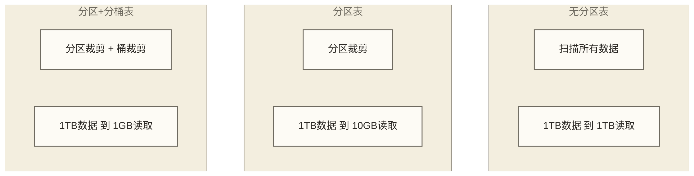

# 🗂️ 分区与分桶策略 - Hive高性能数据组织的核心技术

> [!abstract] 📋 本节概览
> - 🎯 **学习目标**：深入掌握分区分桶的设计原理和优化策略
> - 📚 **前置知识**：[[【技术与工具】/Hive/05-Hive表类型与设计|Hive表类型与]] | [[【技术与工具】/Hive/03-Hive数据模型|Hive数据]]
> - ⏱️ **预计用时**：120分钟
> - 🔧 **技术重点**：分区设计、动态分区、分桶策略、性能调优

> [!tip] 💡 前置知识
> 建议先掌握Hive表设计和基本的数据模型概念

---

## 🎯 分区与分桶的核心价值

### 性能优化的基础原理

> [!note] 💡 分区分桶就像图书馆的智能分类系统
> 想象管理一个巨大的图书馆：
> - **不分区**：所有书籍堆在一起（全表扫描）
> - **分区**：按主题、年代分成不同区域（分区裁剪）
> - **分桶**：每个区域内按指定字段的哈希值分配到不同桶（哈希分布，不保证桶内排序）
> - **结果**：找书速度从几小时缩短到几分钟



### 性能提升效果对比

以下表格及上图中的扫描量数字均为原稿未核实的教学示例，不是实测结果或性能承诺；扫描比例与耗时提升不是等价指标，实际效果取决于过滤条件、数据分布、存储布局和执行计划。

| 场景 | 无分区 | 分区 | 分区+分桶 | 性能提升 |
|---|---|---|---|---|
| **全表查询** | 100% | 100% | 100% | 无提升 |
| **按日期查询** | 100% | 1-5% | 1-5% | 20-100倍 |
| **JOIN操作** | 100% | 10-50% | 1-10% | 10-100倍 |
| **聚合分析** | 100% | 10-30% | 5-15% | 3-20倍 |

---

## 🗂️ 分区策略深度解析

### 1. 分区设计原则

#### 选择合适的分区字段

```sql
-- ✅ 好的分区字段示例

-- 1. 时间分区（最常用）
CREATE TABLE sales_by_date (
    order_id BIGINT,
    customer_id BIGINT,
    product_id BIGINT,
    amount DECIMAL(10,2),
    order_timestamp TIMESTAMP
)
PARTITIONED BY (
    year INT,
    month INT,
    day INT
)
STORED AS ORC;

-- 2. 地理分区
CREATE TABLE user_events_by_region (
    user_id BIGINT,
    event_type STRING,
    event_data MAP<STRING, STRING>,
    event_time TIMESTAMP
)
PARTITIONED BY (
    country STRING,
    state STRING
)
STORED AS ORC;

-- 3. 业务分区
CREATE TABLE transactions_by_type (
    transaction_id BIGINT,
    amount DECIMAL(12,2),
    currency STRING,
    transaction_time TIMESTAMP
)
PARTITIONED BY (
    transaction_type STRING,  -- 'payment', 'refund', 'transfer'
    processing_status STRING  -- 'pending', 'completed', 'failed'
)
STORED AS ORC;

-- 4. 复合分区（多级分区）
CREATE TABLE web_logs_multi_partition (
    session_id STRING,
    user_id BIGINT,
    page_url STRING,
    action STRING,
    timestamp_col TIMESTAMP
)
PARTITIONED BY (
    year INT,
    month INT,
    day INT,
    hour INT,
    source STRING  -- 'web', 'mobile', 'api'
)
STORED AS ORC;
```

#### 分区大小控制

```sql
-- 📊 分区大小控制策略

-- 查看分区大小分布
SELECT 
    partition_name,
    size_mb,
    file_count,
    avg_file_size_mb,
    CASE 
        WHEN size_mb < 64 THEN 'Too Small (< 64MB)'
        WHEN size_mb > 1024 THEN 'Too Large (> 1GB)'
        ELSE 'Good Size'
    END as size_category
FROM (
    SELECT 
        concat_ws('/', 
            concat('year=', year),
            concat('month=', month),
            concat('day=', day)
        ) as partition_name,
        SUM(file_size_bytes) / 1024 / 1024 as size_mb,
        COUNT(*) as file_count,
        AVG(file_size_bytes) / 1024 / 1024 as avg_file_size_mb
    FROM partition_file_stats
    WHERE table_name = 'sales_by_date'
    GROUP BY year, month, day
) partition_summary
ORDER BY size_mb DESC;

-- 合并小分区的策略
INSERT OVERWRITE TABLE sales_by_date PARTITION (year=2024, month=6, day=29)
SELECT 
    order_id,
    customer_id,
    product_id,
    amount,
    order_timestamp
FROM (
    -- 合并多个小时的数据到天级别
    SELECT * FROM sales_hourly WHERE year=2024 AND month=6 AND day=29
) hourly_data;
```

### 2. 动态分区实践

#### 动态分区配置

```sql
-- 🔄 动态分区配置参数

-- 启用动态分区
SET hive.exec.dynamic.partition = true;
SET hive.exec.dynamic.partition.mode = nonstrict;

-- 控制分区数量
SET hive.exec.max.dynamic.partitions = 2000;
SET hive.exec.max.dynamic.partitions.pernode = 100;

-- 防止误操作
SET hive.exec.max.created.files = 150000;

-- 显示动态分区详情
SET hive.exec.dynamic.partition.verbose = true;
```

#### 动态分区插入模式

```sql
-- 📥 动态分区插入示例

-- 1. 完全动态分区
INSERT INTO TABLE sales_by_date PARTITION (year, month, day)
SELECT 
    order_id,
    customer_id,
    product_id,
    amount,
    order_timestamp,
    YEAR(order_date) as year,
    MONTH(order_date) as month,
    DAY(order_date) as day
FROM raw_sales_data
WHERE order_date >= '2024-01-01';

-- 2. 混合分区（静态+动态）
INSERT INTO TABLE web_logs_multi_partition 
PARTITION (year=2024, month=6, day, hour, source)
SELECT 
    session_id,
    user_id,
    page_url,
    action,
    timestamp_col,
    DAY(log_date) as day,
    HOUR(timestamp_col) as hour,
    source_system as source
FROM raw_web_logs
WHERE YEAR(log_date) = 2024 AND MONTH(log_date) = 6;

-- 3. 复杂动态分区处理
INSERT INTO TABLE user_events_by_region PARTITION (country, state)
SELECT 
    user_id,
    event_type,
    event_data,
    event_time,
    -- 数据清洗和标准化
    CASE 
        WHEN upper(country_raw) IN ('US', 'USA', 'UNITED STATES') THEN 'US'
        WHEN upper(country_raw) IN ('CN', 'CHINA', '中国') THEN 'CN'
        ELSE upper(country_raw)
    END as country,
    -- 处理空值和异常值
    COALESCE(
        CASE WHEN state_raw RLIKE '^[A-Z]{2}$' THEN state_raw ELSE NULL END,
        'UNKNOWN'
    ) as state
FROM raw_user_events
WHERE event_date >= CURRENT_DATE - 7;
```

### 3. 分区管理和维护

#### 分区生命周期管理

```sql
-- 🔧 分区生命周期管理

-- 1. 自动添加分区脚本
CREATE TABLE partition_schedule (
    table_name STRING,
    partition_pattern STRING,
    retention_days INT,
    auto_create BOOLEAN,
    auto_drop BOOLEAN
)
STORED AS ORC;

-- 2. 分区清理策略
-- 固定范围删除示例：删除2023年10月以前的该年分区，不等同于滚动保留90天
ALTER TABLE sales_by_date 
DROP PARTITION (year=2023, month < 10);

-- 批量删除分区
SET hive.exec.dynamic.partition = true;
SET hive.exec.dynamic.partition.mode = nonstrict;

-- 使用脚本自动清理
-- cleanup_old_partitions.sql
SELECT 
    concat('ALTER TABLE ', table_name, ' DROP PARTITION (', partition_spec, ');') as cleanup_sql
FROM (
    SELECT 
        'sales_by_date' as table_name,
        concat('year=', year, ', month=', month, ', day=', day) as partition_spec,
        CAST(concat(CAST(year AS STRING), '-', lpad(CAST(month AS STRING), 2, '0'), '-', lpad(CAST(day AS STRING), 2, '0')) AS DATE) as partition_date
    FROM (
        SELECT DISTINCT year, month, day 
        FROM sales_by_date 
        WHERE year IS NOT NULL
    ) partitions
) partition_info
WHERE partition_date < CURRENT_DATE - INTERVAL 90 DAYS;

-- 3. 分区修复和维护
-- 修复分区元数据
MSCK REPAIR TABLE sales_by_date;

-- 更新表统计信息
ANALYZE TABLE sales_by_date PARTITION(year=2024, month=6, day=29) 
COMPUTE STATISTICS;

-- 收集列统计信息
ANALYZE TABLE sales_by_date PARTITION(year=2024, month=6, day=29) 
COMPUTE STATISTICS FOR COLUMNS;
```

#### 分区监控和诊断

```sql
-- 📊 分区监控查询

-- 1. 分区大小监控
CREATE VIEW partition_size_monitor AS
SELECT 
    table_name,
    partition_name,
    num_files,
    size_bytes,
    size_bytes / 1024 / 1024 as size_mb,
    avg_file_size_mb,
    CASE 
        WHEN size_bytes / 1024 / 1024 < 64 THEN 'Small'
        WHEN size_bytes / 1024 / 1024 > 1024 THEN 'Large'
        ELSE 'Normal'
    END as size_category,
    CASE 
        WHEN num_files > 1000 THEN 'Too Many Files'
        WHEN num_files < 5 AND size_bytes / 1024 / 1024 > 100 THEN 'Few Large Files'
        ELSE 'Normal'
    END as file_distribution
FROM partition_metadata
WHERE table_name LIKE '%_by_date';

-- 2. 分区查询热度分析
CREATE VIEW partition_access_pattern AS
SELECT 
    table_name,
    partition_name,
    query_count_7d,
    query_count_30d,
    last_accessed,
    days_since_last_access,
    CASE 
        WHEN days_since_last_access <= 7 THEN 'Hot'
        WHEN days_since_last_access <= 30 THEN 'Warm' 
        WHEN days_since_last_access <= 90 THEN 'Cold'
        ELSE 'Frozen'
    END as access_tier
FROM partition_access_log
WHERE table_name IN (
    SELECT table_name 
    FROM important_tables
);

-- 3. 分区倾斜检测
SELECT 
    table_name,
    partition_column,
    partition_value,
    record_count,
    size_mb,
    record_count / SUM(record_count) OVER (PARTITION BY table_name) * 100 as data_percentage,
    CASE 
        WHEN record_count / SUM(record_count) OVER (PARTITION BY table_name) > 0.3 THEN 'Highly Skewed'
        WHEN record_count / SUM(record_count) OVER (PARTITION BY table_name) > 0.1 THEN 'Moderately Skewed'
        ELSE 'Balanced'
    END as skew_level
FROM partition_stats
WHERE table_name = 'sales_by_date'
ORDER BY record_count DESC;
```

---

## 🪣 分桶策略深度实践

### 1. 分桶设计原理

#### 哈希分桶机制

```sql
-- 🪣 分桶表设计示例

-- 1. 基础分桶表
CREATE TABLE orders_bucketed (
    order_id BIGINT,
    customer_id BIGINT,
    product_id BIGINT,
    order_date DATE,
    amount DECIMAL(10,2),
    status STRING
)
PARTITIONED BY (year INT, month INT)
CLUSTERED BY (customer_id) INTO 32 BUCKETS
STORED AS ORC
TBLPROPERTIES (
    'transactional' = 'true',
    'orc.compress' = 'SNAPPY'
);

-- 2. 多字段分桶
CREATE TABLE user_behavior_multi_bucket (
    user_id BIGINT,
    session_id STRING,
    page_id BIGINT,
    action_type STRING,
    timestamp_col TIMESTAMP,
    duration INT
)
PARTITIONED BY (dt STRING)
CLUSTERED BY (user_id, session_id)
SORTED BY (timestamp_col) INTO 64 BUCKETS
STORED AS ORC;

-- 3. 针对JOIN优化的分桶
-- 用户表
CREATE TABLE users_for_join (
    user_id BIGINT,
    username STRING,
    email STRING,
    registration_date DATE
)
CLUSTERED BY (user_id) INTO 16 BUCKETS
STORED AS ORC;

-- 订单表（使用相同的分桶字段和数量）
CREATE TABLE orders_for_join (
    order_id BIGINT,
    user_id BIGINT,
    product_id BIGINT,
    order_date DATE,
    amount DECIMAL(10,2)
)
CLUSTERED BY (user_id) INTO 16 BUCKETS
STORED AS ORC;
```

#### 分桶数量的选择策略

```sql
-- 📊 分桶数量选择指南

-- 分桶数量计算函数
CREATE TEMPORARY FUNCTION calculate_bucket_count AS 'org.example.BucketCalculatorUDF';

-- 根据数据量计算理想分桶数
SELECT 
    table_name,
    total_size_gb,
    estimated_records,
    -- 目标：每个桶64-256MB
    CEIL(total_size_gb * 1024 / 128) as recommended_buckets_by_size,
    -- 目标：每个桶100万-500万条记录
    CEIL(estimated_records / 2500000) as recommended_buckets_by_count,
    -- 示例推荐（取较大值并向上取2的幂次；Hive不强制桶数为2的幂次）
    POWER(2, CEIL(LOG2(GREATEST(
        CEIL(total_size_gb * 1024 / 128),
        CEIL(estimated_records / 2500000)
    )))) as final_recommendation
FROM table_size_estimates
WHERE table_name IN ('orders', 'user_behavior', 'transactions');

-- 分桶效果验证
SELECT 
    bucket_id,
    COUNT(*) as record_count,
    SUM(size_bytes) / 1024 / 1024 as size_mb,
    COUNT(*) / SUM(COUNT(*)) OVER () * 100 as data_percentage
FROM (
    SELECT 
        HASH(customer_id) % 32 as bucket_id,
        CAST(NULL AS BIGINT) as size_bytes  -- 本文DDL无此列；物理桶大小须另行采集，此处保留NULL占位
    FROM orders_bucketed 
    WHERE year = 2024 AND month = 6
) bucket_distribution
GROUP BY bucket_id
ORDER BY record_count DESC;
```

### 2. 分桶的高级应用

#### Bucket Map Join优化

```sql
-- 🚀 分桶JOIN优化

-- 启用桶映射JOIN
SET hive.auto.convert.join = true;
SET hive.auto.convert.join.noconditionaltask = true;
SET hive.auto.convert.join.noconditionaltask.size = 268435456; -- 256MB

-- 启用分桶优化
SET hive.optimize.bucketmapjoin = true;
SET hive.optimize.bucketmapjoin.sortedmerge = true;

-- 高效的分桶JOIN查询
SELECT 
    u.username,
    u.email,
    COUNT(o.order_id) as order_count,
    SUM(o.amount) as total_spent,
    AVG(o.amount) as avg_order_value
FROM users_for_join u
JOIN orders_for_join o ON u.user_id = o.user_id
WHERE o.order_date >= DATE_SUB(CURRENT_DATE, 30)
GROUP BY u.user_id, u.username, u.email
HAVING order_count > 5;

-- 分桶JOIN性能对比测试
CREATE TEMPORARY TABLE join_performance_test AS
SELECT 
    'bucketed_join' as join_type,
    unix_timestamp() as start_time
FROM (
    SELECT COUNT(*) 
    FROM users_for_join u 
    JOIN orders_for_join o ON u.user_id = o.user_id
) test_result;
```

#### 分桶采样技术

```sql
-- 📊 基于分桶的高效采样

-- 1. 桶采样
SELECT * FROM orders_bucketed
TABLESAMPLE(BUCKET 1 OUT OF 4 ON customer_id);

-- 2. 百分比采样
SELECT * FROM orders_bucketed
TABLESAMPLE(25 PERCENT);

-- 3. 行数采样
SELECT * FROM orders_bucketed
TABLESAMPLE(1000 ROWS);

-- 4. 分层采样
WITH stratified_sample AS (
    SELECT 
        *,
        ROW_NUMBER() OVER (
            PARTITION BY status 
            ORDER BY RAND()
        ) as rn
    FROM orders_bucketed
    WHERE year = 2024 AND month = 6
)
SELECT *
FROM stratified_sample
WHERE rn <= 1000;  -- 每个状态采样1000条

-- 5. 时间窗口采样
SELECT *
FROM orders_bucketed
TABLESAMPLE(BUCKET 1 OUT OF 8 ON order_id)
WHERE year = 2024 
    AND month = 6
    AND order_date BETWEEN '2024-06-15' AND '2024-06-21';
```

### 3. 分桶维护和监控

```sql
-- 🔧 分桶维护策略

-- 1. 分桶分布检查
CREATE VIEW bucket_distribution_analysis AS
SELECT 
    table_name,
    partition_spec,
    bucket_id,
    record_count,
    size_mb,
    record_count / SUM(record_count) OVER (PARTITION BY table_name, partition_spec) * 100 as data_percentage,
    ABS(record_count - AVG(record_count) OVER (PARTITION BY table_name, partition_spec)) / 
    AVG(record_count) OVER (PARTITION BY table_name, partition_spec) * 100 as deviation_percentage
FROM bucket_stats
WHERE table_name LIKE '%_bucketed';

-- 2. 分桶效率评估
SELECT 
    table_name,
    bucket_count,
    join_efficiency_score,
    sampling_efficiency_score,
    storage_efficiency_score,
    (join_efficiency_score + sampling_efficiency_score + storage_efficiency_score) / 3 as overall_score,
    CASE 
        WHEN (join_efficiency_score + sampling_efficiency_score + storage_efficiency_score) / 3 >= 80 THEN 'Excellent'
        WHEN (join_efficiency_score + sampling_efficiency_score + storage_efficiency_score) / 3 >= 60 THEN 'Good'
        ELSE 'Needs Optimization'
    END as bucket_grade
FROM bucket_performance_metrics;

-- 3. 自动重分桶建议
-- 以下ALTER语句仅表达元数据调整建议，不会自动重写存量数据；实际迁移需创建目标布局、重写数据并验证桶分布。
CREATE VIEW rebucket_recommendations AS
SELECT 
    table_name,
    current_bucket_count,
    recommended_bucket_count,
    reason,
    CAST(NULL AS STRING) as expected_improvement,  -- 待基准测试评估，内层查询未提供该字段
    CAST(NULL AS STRING) as migration_complexity,  -- 待迁移方案评估，内层查询未提供该字段
    concat(
        'ALTER TABLE ', table_name, 
        ' CLUSTERED BY (', bucket_column, ') INTO ', 
        recommended_bucket_count, ' BUCKETS;'
    ) as migration_sql
FROM (
    SELECT 
        table_name,
        current_bucket_count,
        CASE 
            WHEN avg_bucket_size_mb < 32 THEN current_bucket_count / 2
            WHEN avg_bucket_size_mb > 512 THEN current_bucket_count * 2
            WHEN bucket_skew_ratio > 2.0 THEN POWER(2, CEIL(LOG2(current_bucket_count * 1.5)))
            ELSE current_bucket_count
        END as recommended_bucket_count,
        CASE 
            WHEN avg_bucket_size_mb < 32 THEN 'Buckets too small, merge recommended'
            WHEN avg_bucket_size_mb > 512 THEN 'Buckets too large, split recommended'
            WHEN bucket_skew_ratio > 2.0 THEN 'High skew detected, rebalancing needed'
            ELSE 'Current bucketing is optimal'
        END as reason,
        bucket_column
    FROM bucket_analysis
) recommendations
WHERE recommended_bucket_count != current_bucket_count;
```

---

## ⚡ 性能优化综合策略

### 1. 查询优化配置

```sql
-- ⚡ 查询性能优化配置

-- 动态分区写入保护（不是查询分区裁剪开关）
SET hive.exec.dynamic.partition.mode = strict;  -- 要求至少一个静态分区，完全动态写入需另行评估
SET hive.optimize.metadataonly = true;
SET hive.optimize.index.filter = true;

-- 分桶优化
SET hive.enforce.bucketing = true;
SET hive.enforce.sorting = true;
SET hive.optimize.bucketmapjoin = true;
SET hive.optimize.bucketmapjoin.sortedmerge = true;

-- 谓词下推
SET hive.optimize.ppd = true;
SET hive.optimize.ppd.storage = true;

-- 相关性优化（不是投影下推开关）
SET hive.optimize.cp = true;

-- ReduceSink去重优化（不是列裁剪开关）
SET hive.optimize.reducededuplication = true;
```

### 2. 复合优化策略

```sql
-- 🔥 复合优化案例

-- 案例1：大表关联优化
CREATE TABLE fact_orders_optimized (
    order_id BIGINT,
    customer_id BIGINT,
    product_id BIGINT,
    store_id INT,
    order_datetime TIMESTAMP,
    quantity INT,
    unit_price DECIMAL(10,2),
    total_amount DECIMAL(12,2),
    discount_amount DECIMAL(10,2)
)
COMMENT '优化后的订单事实表'
PARTITIONED BY (
    year INT,
    month INT,
    day INT
)
CLUSTERED BY (customer_id)
SORTED BY (order_datetime) INTO 64 BUCKETS
STORED AS ORC
TBLPROPERTIES (
    'orc.compress' = 'ZLIB',
    'orc.stripe.size' = '268435456',
    'orc.row.index.stride' = '10000',
    'orc.bloom.filter.columns' = 'customer_id,product_id',
    'orc.bloom.filter.fpp' = '0.01',
    'transactional' = 'true'
);

-- 高效的关联查询
WITH daily_customer_metrics AS (
    SELECT 
        customer_id,
        COUNT(*) as order_count,
        SUM(total_amount) as daily_total,
        AVG(total_amount) as avg_order_value
    FROM fact_orders_optimized
    WHERE year = 2024 AND month = 6 AND day = 29
        AND total_amount > 0
    GROUP BY customer_id
)
SELECT 
    c.customer_id,
    c.customer_name,
    c.customer_tier,
    m.order_count,
    m.daily_total,
    m.avg_order_value,
    -- 客户价值评分
    CASE 
        WHEN m.daily_total > 1000 THEN 'High Value'
        WHEN m.daily_total > 500 THEN 'Medium Value'
        ELSE 'Low Value'
    END as value_segment
FROM dim_customer c
JOIN daily_customer_metrics m ON c.customer_id = m.customer_id
WHERE c.is_active = true
ORDER BY m.daily_total DESC
LIMIT 1000;
```

### 3. 监控和诊断工具

```sql
-- 📊 性能监控仪表板

-- 1. 查询性能监控
CREATE VIEW query_performance_monitor AS
SELECT 
    query_id,
    user_name,
    query_string,
    start_time,
    end_time,
    duration_seconds,
    input_bytes,
    output_bytes,
    input_bytes / 1024 / 1024 / 1024 as input_gb,
    output_bytes / 1024 / 1024 / 1024 as output_gb,
    duration_seconds / 60 as duration_minutes,
    CASE 
        WHEN duration_seconds > 3600 THEN 'Very Slow (>1h)'
        WHEN duration_seconds > 1800 THEN 'Slow (>30m)'
        WHEN duration_seconds > 300 THEN 'Moderate (>5m)'
        ELSE 'Fast (<5m)'
    END as performance_category
FROM query_execution_log
WHERE query_date >= CURRENT_DATE - 7;

-- 2. 分区访问模式分析
CREATE VIEW partition_access_efficiency AS
SELECT 
    table_name,
    partition_path,
    access_count_7d,
    bytes_scanned_7d,
    bytes_scanned_7d / 1024 / 1024 / 1024 as gb_scanned_7d,
    query_count_7d,
    avg_scan_ratio,
    CASE 
        WHEN avg_scan_ratio < 0.1 THEN 'Highly Efficient'
        WHEN avg_scan_ratio < 0.3 THEN 'Efficient'
        WHEN avg_scan_ratio < 0.7 THEN 'Moderate'
        ELSE 'Inefficient'
    END as efficiency_rating
FROM partition_scan_stats
WHERE table_name IN (
    SELECT table_name 
    FROM critical_tables
);

-- 3. 小文件问题检测
CREATE VIEW small_files_analysis AS
SELECT 
    table_name,
    partition_path,
    file_count,
    avg_file_size_mb,
    total_size_gb,
    CASE 
        WHEN file_count > 1000 AND avg_file_size_mb < 64 THEN 'Critical'
        WHEN file_count > 500 AND avg_file_size_mb < 128 THEN 'Warning'
        ELSE 'Normal'
    END as small_files_severity,
    CEIL(total_size_gb * 1024 / 256) as recommended_file_count
FROM table_file_stats
WHERE avg_file_size_mb < 256;
```

---

## 🔗 学习路径

### 下一步学习建议

1. **[[【技术与工具】/Hive/07-文件格式与压缩|文件格式与压缩]]** - 掌握不同存储格式的特点
2. **SQL** - 深入学习查询优化策略
3. **数据倾斜解决方案** - 处理数据倾斜问题

### 实践建议

- 在真实数据集上测试不同分区策略的效果
- 比较分桶表和非分桶表的JOIN性能
- 建立分区分桶的监控和预警机制
- 定期评估和优化现有表的分区分桶策略

---

> [!tip] 💡 关键收获
> - 分区是Hive性能优化的最重要手段，能够显著减少数据扫描量
> - 合理的分区设计需要平衡查询模式、数据分布和管理复杂度
> - 分桶主要用于优化JOIN性能和支持高效采样
> - 动态分区简化了数据导入，但需要合理控制分区数量
> - 分区分桶策略需要持续监控和优化

> [!warning] ⚠️ 设计注意事项
> - 避免过度分区导致的小文件问题
> - 选择合适的分桶数量，避免数据倾斜
> - 定期清理过期分区，控制元数据大小
> - 分区字段的变更需要充分评估影响
> - 注意分区分桶对事务表的特殊要求 