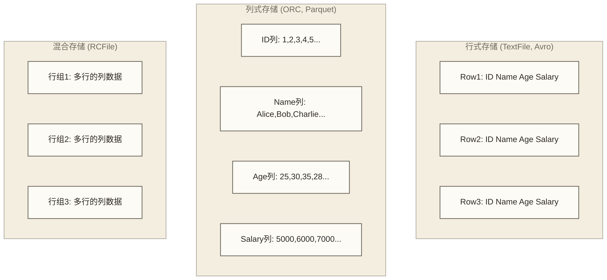
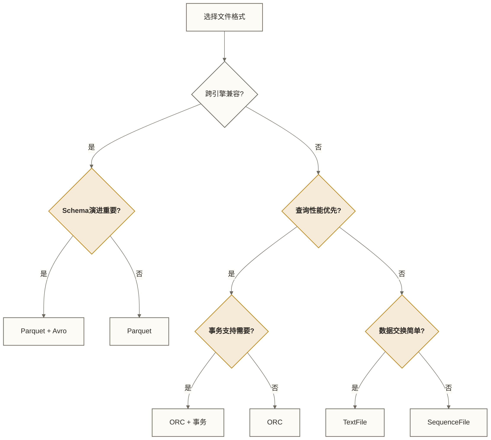

# 💾 文件格式与压缩 - 优化存储和查询性能的关键技术

> [!abstract] 📋 本节概览
> - 🎯 **学习目标**：深入理解各种文件格式特点，掌握压缩算法选择策略
> - 📚 **前置知识**：[[【技术与工具】/Hive/06-分区与分桶策略|分区与分桶]] | [[【技术与工具】/Hive/03-Hive数据模型|Hive数据]]
> - ⏱️ **预计用时**：100分钟
> - 🔧 **技术重点**：格式对比、压缩选择、性能测试、存储优化

---

## 📊 文件格式全景对比

### 格式特性矩阵

| 格式 | 存储方式 | 压缩比 | 查询性能 | Schema演进 | 跨平台兼容性 | 适用场景 |
|---|---|---|---|---|---|---|
| **TextFile** | 行式 | 低 | 低 | 差 | 最好 | 数据交换、调试 |
| **SequenceFile** | 行式 | 中 | 中 | 差 | 好 | 中间结果存储 |
| **RCFile** | 列式 | 高 | 中 | 中 | 中 | 传统数仓 |
| **ORC** | 列式 | 最高 | 最高 | 好 | 中 | Hive生态最优 |
| **Parquet** | 列式 | 高 | 高 | 最好 | 最好 | 跨引擎共享 |
| **Avro** | 行式 | 中 | 中 | 最好 | 好 | Schema演进 |

### 存储原理对比



---

## 🔤 TextFile格式详解

### 基础使用

```sql
-- 📝 TextFile格式表创建

-- 基础TextFile表
CREATE TABLE users_textfile (
    user_id BIGINT,
    username STRING,
    email STRING,
    age INT,
    salary DECIMAL(10,2),
    registration_date DATE
)
ROW FORMAT DELIMITED
FIELDS TERMINATED BY '\t'
LINES TERMINATED BY '\n'
STORED AS TEXTFILE
LOCATION '/data/users_textfile';

-- 自定义分隔符
CREATE TABLE log_data_textfile (
    timestamp_col STRING,
    level STRING,
    message STRING,
    thread_id STRING
)
ROW FORMAT DELIMITED
FIELDS TERMINATED BY '|'
ESCAPED BY '\\'
NULL DEFINED AS 'NULL'
STORED AS TEXTFILE;

-- CSV格式支持
-- OpenCSVSerde按字符串处理列；id需要数值类型时，在查询中显式CAST
CREATE TABLE csv_data (
    id STRING,
    name STRING,
    description STRING
)
ROW FORMAT SERDE 'org.apache.hadoop.hive.serde2.OpenCSVSerde'
WITH SERDEPROPERTIES (
   'separatorChar' = ',',
   'quoteChar' = '"',
   'escapeChar' = '\\'
)
STORED AS TEXTFILE
TBLPROPERTIES ('skip.header.line.count'='1');
```

### TextFile的优势和局限

#### ✅ 优势
- **人类可读**：可以直接查看文件内容
- **兼容性好**：任何系统都能处理
- **调试方便**：问题排查简单
- **格式灵活**：支持各种分隔符

#### ❌ 局限
- **存储效率低**：缺少列式编码与列裁剪优化，但可使用外部压缩
- **查询性能差**：全列扫描
- **文件不自带类型信息**：数据以文本保存，读取时由表Schema和SerDe解释类型

---

## 🗜️ ORC格式深度解析

### ORC文件结构

```mermaid
%%{init: {"theme":"base","themeVariables":{"fontFamily":"PingFang SC, -apple-system, Source Han Serif SC, serif","fontSize":"16px","background":"#FDFBF5","primaryColor":"#FDFBF5","primaryTextColor":"#2D2A26","primaryBorderColor":"#6E6A60","secondaryColor":"#E8EFE8","secondaryBorderColor":"#8FA890","secondaryTextColor":"#2D2A26","tertiaryColor":"#FDFBF5","tertiaryBorderColor":"#9A9488","tertiaryTextColor":"#6E6A60","lineColor":"#6E6A60","textColor":"#2D2A26","mainBkg":"#FDFBF5","nodeBorder":"#2D5A3D","clusterBkg":"#F3EEDF","clusterBorder":"#9A9488","edgeLabelBackground":"#FDFBF5"},"flowchart":{"htmlLabels":true,"curve":"basis","padding":20,"nodeSpacing":60,"rankSpacing":70,"useMaxWidth":false},"themeCSS":".node rect, .node polygon, .node circle { stroke-width: 1.5px; } .edgePath .path { stroke-width: 1.5px; } .cluster-label .nodeLabel, .cluster-label foreignObject { color: #2D2A26 !important; } .edgeLabel, .edgeLabel foreignObject { color: #2D2A26 !important; background-color: #FDFBF5; } .edgeLabel rect { fill: #FDFBF5; }"}}%%
flowchart TB
    classDef default fill:#FDFBF5,stroke:#6E6A60,color:#2D2A26,stroke-width:1.5px
    classDef startend fill:#2D2A26,stroke:#2D2A26,color:#FDFBF5,font-weight:bold
    classDef decision fill:#F6EAD8,stroke:#C08A1A,color:#2D2A26,font-weight:bold
    classDef hub fill:#3B5A80,stroke:#3B5A80,color:#FDFBF5,font-weight:bold
    classDef io fill:#E5EAF0,stroke:#3B5A80,color:#2D2A26
    classDef accent fill:#A6432C,stroke:#A6432C,color:#FDFBF5,font-weight:bold
    classDef storage fill:#F3EEDF,stroke:#9A9488,color:#2D2A26
    subgraph "ORC文件结构"
        Header[File Header]
        subgraph "Stripe 1"
            S1I[Index Section]
            S1D[Data Section]
            S1F[Stripe Footer]
        end
        subgraph "Stripe 2"
            S2I[Index Section]
            S2D[Data Section]
            S2F[Stripe Footer]
        end
        FileMetadata[Metadata]
        FileFooter[File Footer]
        PostScript[PostScript]
    end
    Header --> S1I --> S1D --> S1F
    S1F --> S2I --> S2D --> S2F
    S2F --> FileMetadata --> FileFooter --> PostScript
    class Header,S1D,S1I,S1F,S2D,S2I,S2F,FileMetadata,FileFooter,PostScript default
```



### ORC高级特性配置

```sql
-- 🏆 ORC优化配置

-- 高性能ORC表
CREATE TABLE sales_orc_optimized (
    sale_id BIGINT,
    customer_id BIGINT,
    product_id BIGINT,
    sale_date DATE,
    quantity INT,
    unit_price DECIMAL(10,2),
    total_amount DECIMAL(12,2),
    discount_percent DECIMAL(5,2),
    tax_amount DECIMAL(10,2),
    sales_rep_id INT,
    store_id INT,
    channel STRING,
    payment_method STRING
)
PARTITIONED BY (year INT, month INT)
CLUSTERED BY (customer_id) INTO 64 BUCKETS
STORED AS ORC
TBLPROPERTIES (
    -- 压缩设置
    'orc.compress' = 'ZLIB',                    -- 压缩算法
    'orc.compress.size' = '262144',             -- 压缩块大小
    
    -- 条带设置
    'orc.stripe.size' = '268435456',            -- 256MB条带
    'orc.row.index.stride' = '10000',           -- 行索引步长
    
    -- 布隆过滤器
    'orc.bloom.filter.columns' = 'customer_id,product_id,sales_rep_id',
    'orc.bloom.filter.fpp' = '0.01',            -- 假阳性率1%
    
    -- 编码优化
    'orc.encoding.strategy' = 'COMPRESSION',     -- 编码策略
    'orc.dictionary.key.threshold' = '0.8',     -- 字典编码阈值
    
    -- 事务支持
    'transactional' = 'true',
    'transactional_properties' = 'default'
);

-- ORC表性能测试
INSERT INTO sales_orc_optimized PARTITION (year=2024, month=6)
SELECT 
    ROW_NUMBER() OVER (ORDER BY RAND()) as sale_id,
    FLOOR(RAND() * 100000) + 1 as customer_id,
    FLOOR(RAND() * 10000) + 1 as product_id,
    DATE_ADD('2024-06-01', FLOOR(RAND() * 30)) as sale_date,
    FLOOR(RAND() * 10) + 1 as quantity,
    ROUND(RAND() * 1000 + 10, 2) as unit_price,
    ROUND((FLOOR(RAND() * 10) + 1) * (RAND() * 1000 + 10), 2) as total_amount,
    ROUND(RAND() * 20, 2) as discount_percent,
    ROUND(((FLOOR(RAND() * 10) + 1) * (RAND() * 1000 + 10)) * 0.08, 2) as tax_amount,
    FLOOR(RAND() * 100) + 1 as sales_rep_id,
    FLOOR(RAND() * 50) + 1 as store_id,
    CASE FLOOR(RAND() * 3)
        WHEN 0 THEN 'online'
        WHEN 1 THEN 'retail'
        ELSE 'wholesale'
    END as channel,
    CASE FLOOR(RAND() * 4)
        WHEN 0 THEN 'credit_card'
        WHEN 1 THEN 'debit_card'
        WHEN 2 THEN 'cash'
        ELSE 'check'
    END as payment_method
FROM (
    SELECT 1 FROM 
    (SELECT 1 UNION ALL SELECT 1) t1
    CROSS JOIN (SELECT 1 UNION ALL SELECT 1) t2
    CROSS JOIN (SELECT 1 UNION ALL SELECT 1) t3
    CROSS JOIN (SELECT 1 UNION ALL SELECT 1) t4
    CROSS JOIN (SELECT 1 UNION ALL SELECT 1) t5
    CROSS JOIN (SELECT 1 UNION ALL SELECT 1) t6
    CROSS JOIN (SELECT 1 UNION ALL SELECT 1) t7
    CROSS JOIN (SELECT 1 UNION ALL SELECT 1) t8
    CROSS JOIN (SELECT 1 UNION ALL SELECT 1) t9
    CROSS JOIN (SELECT 1 UNION ALL SELECT 1) t10
    CROSS JOIN (SELECT 1 UNION ALL SELECT 1) t11
    CROSS JOIN (SELECT 1 UNION ALL SELECT 1) t12
    CROSS JOIN (SELECT 1 UNION ALL SELECT 1) t13
    CROSS JOIN (SELECT 1 UNION ALL SELECT 1) t14
    CROSS JOIN (SELECT 1 UNION ALL SELECT 1) t15
    CROSS JOIN (SELECT 1 UNION ALL SELECT 1) t16
    CROSS JOIN (SELECT 1 UNION ALL SELECT 1) t17
    CROSS JOIN (SELECT 1 UNION ALL SELECT 1) t18
    CROSS JOIN (SELECT 1 UNION ALL SELECT 1) t19
    CROSS JOIN (SELECT 1 UNION ALL SELECT 1) t20
    LIMIT 1000000
) dummy_data;
```

### ORC性能优化技巧

```sql
-- ⚡ ORC性能优化查询

-- 1. 利用谓词下推
EXPLAIN EXTENDED
SELECT 
    customer_id,
    SUM(total_amount) as total_sales,
    COUNT(*) as transaction_count
FROM sales_orc_optimized
WHERE year = 2024 
    AND month = 6
    AND customer_id BETWEEN 1000 AND 2000  -- 可利用min/max统计过滤；布隆过滤器主要用于等值或IN过滤
    AND total_amount > 100                 -- 谓词下推到ORC reader
GROUP BY customer_id
HAVING SUM(total_amount) > 5000;

-- 2. 向量化执行优化
SET hive.vectorized.execution.enabled = true;
SET hive.vectorized.execution.reduce.enabled = true;
SET hive.vectorized.use.vector.serde.deserialize = true;

-- 向量化查询示例
SELECT 
    channel,
    payment_method,
    COUNT(*) as transaction_count,
    SUM(total_amount) as total_revenue,
    AVG(total_amount) as avg_transaction,
    STDDEV(total_amount) as revenue_stddev
FROM sales_orc_optimized
WHERE year = 2024 AND month = 6
GROUP BY channel, payment_method;

-- 3. 统计信息优化
ANALYZE TABLE sales_orc_optimized PARTITION(year=2024, month=6) 
COMPUTE STATISTICS;

ANALYZE TABLE sales_orc_optimized PARTITION(year=2024, month=6) 
COMPUTE STATISTICS FOR COLUMNS;
```

---

## 📄 Parquet格式实践

### Parquet表创建和配置

```sql
-- 📄 Parquet格式表

-- 基础Parquet表
CREATE TABLE analytics_parquet (
    event_id STRING,
    user_id BIGINT,
    session_id STRING,
    event_type STRING,
    event_timestamp TIMESTAMP,
    page_url STRING,
    referrer STRING,
    user_agent STRING,
    ip_address STRING,
    geo_country STRING,
    geo_city STRING,
    device_type STRING,
    browser STRING,
    os STRING,
    custom_properties MAP<STRING, STRING>
)
PARTITIONED BY (
    event_date STRING,
    event_hour INT
)
STORED AS PARQUET
TBLPROPERTIES (
    'parquet.compression' = 'SNAPPY',           -- 压缩格式
    'parquet.block.size' = '134217728',         -- 128MB块大小
    'parquet.page.size' = '1048576',            -- 1MB页大小
    'parquet.dictionary.page.size' = '1048576', -- 字典页大小
    'parquet.enable.dictionary' = 'true',       -- 启用字典编码
    'parquet.writer.max-padding' = '8388608'    -- 最大填充
);

-- 复杂数据类型Parquet表
CREATE TABLE user_profiles_parquet (
    user_id BIGINT,
    profile_data STRUCT<
        personal: STRUCT<
            first_name: STRING,
            last_name: STRING,
            age: INT,
            gender: STRING
        >,
        contact: STRUCT<
            email: STRING,
            phone: STRING,
            address: STRUCT<
                street: STRING,
                city: STRING,
                state: STRING,
                zipcode: STRING
            >
        >,
        preferences: ARRAY<STRING>,
        scores: MAP<STRING, DOUBLE>
    >,
    created_at TIMESTAMP,
    updated_at TIMESTAMP
)
STORED AS PARQUET
TBLPROPERTIES (
    'parquet.compression' = 'SNAPPY'
);
```

### Parquet与Spark集成

```sql
-- 🔥 Parquet与Spark集成示例

-- 1. 创建Spark兼容的Parquet表
CREATE TABLE spark_hive_shared (
    transaction_id STRING,
    customer_id BIGINT,
    amount DECIMAL(18,2),
    currency STRING,
    transaction_time TIMESTAMP,
    metadata MAP<STRING, STRING>
)
PARTITIONED BY (
    transaction_date STRING
)
STORED AS PARQUET
LOCATION '/shared/spark_hive_data/'
TBLPROPERTIES (
    'spark.sql.create.table.columnTypes' = 'transaction_id:string,customer_id:bigint,amount:decimal(18,2),currency:string,transaction_time:timestamp,metadata:map<string,string>',
    'spark.sql.sources.provider' = 'parquet',
    'parquet.compression' = 'snappy'
);

-- 2. Schema演进支持
-- 添加新列（向后兼容）
ALTER TABLE user_profiles_parquet 
ADD COLUMNS (
    last_login_ip STRING,
    login_count INT
);

-- 3. 跨引擎查询验证
-- Hive查询
SELECT 
    COUNT(*) as total_records,
    COUNT(DISTINCT user_id) as unique_users,
    MIN(created_at) as earliest_record,
    MAX(updated_at) as latest_update
FROM user_profiles_parquet;

-- 确保Spark也能正确读取相同数据
```

---

## 🔄 Avro格式和Schema演进

### Avro表设计

```sql
-- 🔄 Avro格式表

-- 基础Avro表
CREATE TABLE events_avro (
    event_id STRING,
    user_id BIGINT,
    event_type STRING,
    event_data STRING,  -- JSON格式的事件数据
    created_at TIMESTAMP
)
PARTITIONED BY (event_date STRING)
STORED AS AVRO
TBLPROPERTIES (
    'avro.schema.literal' = '{
        "type": "record",
        "name": "Event",
        "fields": [
            {"name": "event_id", "type": "string"},
            {"name": "user_id", "type": "long"},
            {"name": "event_type", "type": "string"},
            {"name": "event_data", "type": "string"},
            {"name": "created_at", "type": {"type": "long", "logicalType": "timestamp-millis"}}
        ]
    }'
);

-- Schema演进示例
CREATE TABLE user_events_avro_v2 (
    event_id STRING,
    user_id BIGINT,
    event_type STRING,
    event_data STRING,
    created_at TIMESTAMP,
    -- 新增字段（向后兼容）
    session_id STRING,
    device_info STRING
)
PARTITIONED BY (event_date STRING)
STORED AS AVRO
TBLPROPERTIES (
    'avro.schema.literal' = '{
        "type": "record",
        "name": "Event",
        "fields": [
            {"name": "event_id", "type": "string"},
            {"name": "user_id", "type": "long"},
            {"name": "event_type", "type": "string"},
            {"name": "event_data", "type": "string"},
            {"name": "created_at", "type": {"type": "long", "logicalType": "timestamp-millis"}},
            {"name": "session_id", "type": ["null", "string"], "default": null},
            {"name": "device_info", "type": ["null", "string"], "default": null}
        ]
    }'
);
```

---

## 🗜️ 压缩算法详解

### 压缩算法特性对比

以下压缩比数字为原稿未核实示例，保留用于讨论，不是实测结果或算法固定属性；速度、CPU使用和压缩比取决于数据、压缩等级及实现。可分割性还取决于容器格式、输入格式和索引：LZO通常需要配套索引与输入格式，ORC和Parquet可按条带或行组读取，不能直接套用裸压缩流的可分割性结论。

| 压缩算法 | 压缩比 | 压缩速度 | 解压速度 | CPU使用 | 可分割性 | 适用场景 |
|---|---|---|---|---|---|---|
| **None** | 1.0 | 最快 | 最快 | 无 | 是 | 网络足够快 |
| **Gzip** | 4.0 | 慢 | 中 | 高 | 否 | 存储优先 |
| **Bzip2** | 5.0 | 最慢 | 慢 | 最高 | 是 | 最高压缩比 |
| **LZO** | 2.5 | 快 | 快 | 低 | 是 | 平衡选择 |
| **Snappy** | 2.0 | 最快 | 最快 | 最低 | 否 | 计算密集型 |
| **LZ4** | 2.2 | 最快 | 最快 | 最低 | 否 | 实时处理 |
| **Zstd** | 3.5 | 中 | 快 | 中 | 否 | 新一代压缩 |

### 压缩配置实践

```sql
-- 🗜️ 压缩配置示例

-- 1. 不同压缩算法的ORC表
-- 保留原示例表名；ORC使用ZLIB而不是GZIP，二者并非相同文件封装
CREATE TABLE sales_gzip_orc LIKE sales_orc_optimized
STORED AS ORC
TBLPROPERTIES ('orc.compress' = 'ZLIB');

CREATE TABLE sales_snappy_orc LIKE sales_orc_optimized
STORED AS ORC
TBLPROPERTIES ('orc.compress' = 'SNAPPY');

CREATE TABLE sales_zstd_orc LIKE sales_orc_optimized
STORED AS ORC
TBLPROPERTIES ('orc.compress' = 'ZSTD');

-- 2. Parquet压缩配置
CREATE TABLE analytics_gzip_parquet LIKE analytics_parquet
STORED AS PARQUET
TBLPROPERTIES ('parquet.compression' = 'GZIP');

CREATE TABLE analytics_lz4_parquet LIKE analytics_parquet
STORED AS PARQUET
TBLPROPERTIES ('parquet.compression' = 'LZ4');

-- 3. 动态压缩设置
SET hive.exec.compress.output = true;
SET hive.exec.compress.intermediate = true;

-- 设置Map输出压缩
SET mapred.map.output.compress = true;
SET mapred.map.output.compress.codec = org.apache.hadoop.io.compress.SnappyCodec;

-- 设置Reduce输出压缩
SET mapred.output.compress = true;
SET mapred.output.compression.codec = org.apache.hadoop.io.compress.GzipCodec;
```

### 压缩性能测试

```sql
-- 📊 压缩性能测试框架

-- 创建测试数据
CREATE TEMPORARY TABLE compression_test_data AS
SELECT 
    ROW_NUMBER() OVER (ORDER BY RAND()) as id,
    concat('user_', FLOOR(RAND() * 1000000)) as username,
    concat('user', FLOOR(RAND() * 1000000), '@example.com') as email,
    FLOOR(RAND() * 80) + 18 as age,
    ROUND(RAND() * 100000 + 30000, 2) as salary,
    concat('Description for user with very long text to test compression efficiency. User ID: ', 
           ROW_NUMBER() OVER (ORDER BY RAND()),
           '. This text is intentionally verbose to simulate real-world data with repeating patterns.') as description,
    CURRENT_TIMESTAMP as created_at
FROM (
    SELECT 1 FROM 
    (SELECT 1 UNION ALL SELECT 1) t1
    CROSS JOIN (SELECT 1 UNION ALL SELECT 1) t2
    CROSS JOIN (SELECT 1 UNION ALL SELECT 1) t3
    CROSS JOIN (SELECT 1 UNION ALL SELECT 1) t4
    CROSS JOIN (SELECT 1 UNION ALL SELECT 1) t5
    CROSS JOIN (SELECT 1 UNION ALL SELECT 1) t6
    CROSS JOIN (SELECT 1 UNION ALL SELECT 1) t7
    CROSS JOIN (SELECT 1 UNION ALL SELECT 1) t8
    CROSS JOIN (SELECT 1 UNION ALL SELECT 1) t9
    CROSS JOIN (SELECT 1 UNION ALL SELECT 1) t10
    CROSS JOIN (SELECT 1 UNION ALL SELECT 1) t11
    CROSS JOIN (SELECT 1 UNION ALL SELECT 1) t12
    CROSS JOIN (SELECT 1 UNION ALL SELECT 1) t13
    CROSS JOIN (SELECT 1 UNION ALL SELECT 1) t14
    CROSS JOIN (SELECT 1 UNION ALL SELECT 1) t15
    CROSS JOIN (SELECT 1 UNION ALL SELECT 1) t16
    CROSS JOIN (SELECT 1 UNION ALL SELECT 1) t17
    CROSS JOIN (SELECT 1 UNION ALL SELECT 1) t18
    CROSS JOIN (SELECT 1 UNION ALL SELECT 1) t19
    CROSS JOIN (SELECT 1 UNION ALL SELECT 1) t20
    LIMIT 100000
) dummy_data;

-- 压缩比测试报告
CREATE VIEW compression_analysis AS
SELECT 
    table_name,
    compression_type,
    file_count,
    total_size_bytes,
    total_size_mb,
    avg_file_size_mb,
    compression_ratio,
    estimated_query_time_seconds,
    storage_cost_per_month,
    CASE 
        WHEN compression_ratio > 4.0 THEN 'Excellent'
        WHEN compression_ratio > 3.0 THEN 'Good'
        WHEN compression_ratio > 2.0 THEN 'Fair'
        ELSE 'Poor'
    END as compression_grade
FROM compression_test_results
ORDER BY compression_ratio DESC;
```

---

## 🎯 格式选择决策框架

### 选择决策树



### 场景化选择指南

```sql
-- 🎯 不同场景的格式选择

-- 1. 数据仓库核心表（推荐ORC）
CREATE TABLE dwh_fact_sales (
    -- 大量历史数据，主要用于分析查询
    sale_id BIGINT,
    product_id BIGINT,
    customer_id BIGINT,
    sale_amount DECIMAL(12,2),
    sale_date DATE
)
PARTITIONED BY (year INT, month INT)
CLUSTERED BY (customer_id) INTO 64 BUCKETS
STORED AS ORC
TBLPROPERTIES (
    'orc.compress' = 'ZLIB',  -- 高压缩比，节省存储
    'transactional' = 'true'   -- 支持更新操作
);

-- 2. 跨引擎共享表（推荐Parquet）
CREATE TABLE shared_analytics (
    -- 需要被Spark、Presto、Hive同时访问
    event_id STRING,
    user_id BIGINT,
    event_data MAP<STRING, STRING>,
    event_timestamp TIMESTAMP
)
PARTITIONED BY (event_date STRING)
STORED AS PARQUET
TBLPROPERTIES (
    'parquet.compression' = 'SNAPPY'  -- 平衡压缩比和速度
);

-- 3. 实时流数据表（推荐Avro）
CREATE TABLE streaming_events (
    -- Schema可能频繁变化
    message_id STRING,
    payload STRING,  -- JSON格式，schema灵活
    metadata MAP<STRING, STRING>,
    ingestion_time TIMESTAMP
)
PARTITIONED BY (ingest_date STRING, ingest_hour INT)
STORED AS AVRO;

-- 4. 临时数据交换（推荐TextFile）
CREATE TABLE temp_data_exchange (
    -- 临时数据导入导出
    raw_data STRING
)
STORED AS TEXTFILE;
```

### 性能基准测试

```sql
-- 📈 格式性能基准测试

-- 查询结构示例，不是有效的耗时测量：同一SELECT内的unix_timestamp()不能测量子查询耗时
-- 须先建立并装载相同数据的三张sales测试表，再由客户端或引擎记录分别计时
CREATE TEMPORARY TABLE performance_test_results AS
SELECT 
    'TextFile' as format_type,
    unix_timestamp() as start_time,
    (SELECT COUNT(*) FROM sales_textfile WHERE amount > 1000) as result_count,
    unix_timestamp() as end_time
UNION ALL
SELECT 
    'ORC' as format_type,
    unix_timestamp() as start_time,
    (SELECT COUNT(*) FROM sales_orc WHERE amount > 1000) as result_count,
    unix_timestamp() as end_time
UNION ALL
SELECT 
    'Parquet' as format_type,
    unix_timestamp() as start_time,
    (SELECT COUNT(*) FROM sales_parquet WHERE amount > 1000) as result_count,
    unix_timestamp() as end_time;

-- 存储效率分析
CREATE VIEW storage_efficiency_analysis AS
SELECT 
    table_name,
    file_format,
    record_count,
    total_size_mb,
    avg_record_size_bytes,
    compression_ratio,
    query_avg_time_seconds,
    storage_efficiency_score,
    query_performance_score,
    (storage_efficiency_score + query_performance_score) / 2 as overall_score
FROM format_comparison_metrics
ORDER BY overall_score DESC;
```

---

## 🔧 最佳实践和优化建议

### 1. 生产环境配置模板

```sql
-- 🏭 生产环境最佳实践

-- 大型事实表（ORC + ZLIB）
CREATE TABLE production_fact_table (
    -- 核心业务数据，查询频繁，存储成本敏感
    fact_id BIGINT,
    dimension_keys...,
    measures...
)
PARTITIONED BY (year INT, month INT, day INT)
CLUSTERED BY (primary_key) INTO 128 BUCKETS
STORED AS ORC
TBLPROPERTIES (
    'orc.compress' = 'ZLIB',               -- 偏重压缩率，实际效果需测试
    'orc.stripe.size' = '268435456',       -- 256MB条带
    'orc.bloom.filter.columns' = 'key_columns',
    'orc.bloom.filter.fpp' = '0.01',
    'transactional' = 'true'
);

-- 维度表（ORC + SNAPPY）
CREATE TABLE production_dim_table (
    -- 相对较小，查询频繁，更新较少
    dim_key BIGINT,
    attributes...
)
STORED AS ORC
TBLPROPERTIES (
    'orc.compress' = 'SNAPPY',             -- 平衡压缩和性能
    'orc.dictionary.key.threshold' = '0.8'
);

-- 日志表（Parquet + LZ4）
CREATE TABLE production_log_table (
    -- 写入频繁，偶尔查询，跨引擎访问
    log_id STRING,
    log_data STRING,
    timestamp_col TIMESTAMP
)
PARTITIONED BY (log_date STRING, log_hour INT)
STORED AS PARQUET
TBLPROPERTIES (
    'parquet.compression' = 'LZ4',         -- 快速压缩解压
    'parquet.block.size' = '134217728'     -- 128MB块
);
```

### 2. 监控和维护策略

```sql
-- 📊 文件格式监控

-- 文件健康检查
CREATE VIEW file_health_monitor AS
SELECT 
    table_name,
    partition_path,
    file_format,
    file_count,
    avg_file_size_mb,
    total_size_gb,
    compression_ratio,
    CASE 
        WHEN file_count > 1000 AND avg_file_size_mb < 64 THEN 'Small Files Issue'
        WHEN avg_file_size_mb > 1024 THEN 'Large Files Issue'
        WHEN compression_ratio < 1.5 THEN 'Poor Compression'
        ELSE 'Healthy'
    END as health_status,
    CASE 
        WHEN file_count > 1000 AND avg_file_size_mb < 64 THEN 'Consider file merging'
        WHEN avg_file_size_mb > 1024 THEN 'Consider file splitting'
        WHEN compression_ratio < 1.5 THEN 'Check compression settings'
        ELSE 'No action needed'
    END as recommendation
FROM table_file_statistics;

-- 格式迁移建议
CREATE VIEW format_migration_recommendations AS
SELECT 
    table_name,
    current_format,
    recommended_format,
    migration_priority,
    expected_space_savings_percent,
    expected_query_improvement_percent,
    migration_complexity,
    concat(
        '-- 仅修改元数据，不转换已有文件；须先设计数据重写并校验的迁移流程。 ALTER TABLE ', table_name, 
        ' SET FILEFORMAT ', recommended_format, ';'
    ) as metadata_only_command
FROM format_analysis
WHERE current_format != recommended_format
ORDER BY migration_priority DESC;
```

---

## 🔗 学习路径

### 下一步学习建议

1. **[[【技术与工具】/ClickHouse/06-ClickHouse数据导入导出|ClickHouse数据导入导出]]** - 掌握不同格式的数据导入导出
2. **SQL** - 学习基于格式的查询优化
3. **内存与资源调优** - 了解格式对资源使用的影响

### 实践建议

- **测试不同格式**：在真实数据集上测试TextFile、ORC、Parquet的性能差异
- 在生产环境中逐步迁移到最优格式
- 建立格式选择的标准化流程
- 定期监控和评估格式效率

---

> [!tip] 💡 关键收获
> - 文件格式选择直接影响存储成本和查询性能
> - ORC适合Hive生态的OLAP查询，Parquet适合跨引擎共享
> - 压缩算法需要平衡压缩比、速度和CPU使用
> - 列式存储显著提升分析查询性能
> - 格式迁移需要综合考虑收益和成本

> [!warning] ⚠️ 注意事项
> - 格式变更需要重写数据，成本较高
> - 不同格式的兼容性和功能支持有差异
> - 修改压缩设置通常只影响后续写入；已有文件需重写才能统一采用新压缩设置
> - 小文件问题在任何格式下都需要注意
> - 跨引擎使用时要考虑格式兼容性 