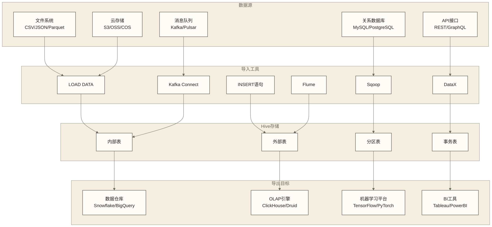

# 🔄 数据导入导出 - 构建高效的数据传输管道

> [!abstract] 📋 本节概览
> - 🎯 **学习目标**：掌握多种数据导入导出方式，构建企业级数据传输方案
> - 📚 **前置知识**：[[【技术与工具】/Hive/07-文件格式与压缩|文件格式与压缩]] | [[【技术与工具】/Hive/05-Hive表类型与设计|Hive表类型与]]
> - ⏱️ **预计用时**：130分钟
> - 🔧 **技术重点**：LOAD语句、INSERT操作、Sqoop集成、实时导入、性能优化

---

## 🎯 数据导入导出概览

### 数据流转架构



### 导入导出方式对比

| 方式 | 数据源 | 性能 | 复杂度 | 实时性 | 适用场景 |
|---|---|---|---|---|---|
| **LOAD DATA** | 文件系统 | 高 | 低 | 批处理 | 大文件批量导入 |
| **INSERT语句** | Hive表 | 中 | 低 | 批处理 | 表间数据转换 |
| **Sqoop** | 关系数据库 | 高 | 中 | 批处理 | 数据库同步 |
| **DataX** | 多源异构 | 高 | 中 | 批处理 | 企业级ETL |
| **Kafka Connect** | 消息队列 | 高 | 高 | 准实时 | 流数据接入 |
| **Flume** | 日志文件 | 中 | 中 | 准实时 | 日志收集 |

---

## 📥 LOAD DATA详解

### 基础LOAD操作

```sql
-- 📁 LOAD DATA基础语法

-- 1. 从本地文件系统导入
LOAD DATA LOCAL INPATH '/tmp/sales_data.txt'
INTO TABLE sales_raw;

-- 2. 从HDFS导入
LOAD DATA INPATH '/data/input/sales_data.txt'
INTO TABLE sales_raw;

-- 3. 覆盖导入
LOAD DATA INPATH '/data/input/sales_data_new.txt'
OVERWRITE INTO TABLE sales_raw;

-- 4. 导入到分区表
LOAD DATA INPATH '/data/input/sales_20240629.txt'
INTO TABLE sales_partitioned 
PARTITION (year=2024, month=6, day=29);

-- 5. 动态分区导入
LOAD DATA INPATH '/data/input/sales_multi_partition.txt'
INTO TABLE sales_partitioned 
PARTITION (year, month, day);
```

### 高级LOAD技巧

```sql
-- 🚀 高级LOAD操作

-- 1. 批量文件导入脚本
CREATE TABLE file_import_log (
    file_name STRING,
    import_time TIMESTAMP,
    record_count BIGINT,
    status STRING,
    error_message STRING
)
STORED AS ORC;

-- 批量导入处理
SET hive.exec.dynamic.partition = true;
SET hive.exec.dynamic.partition.mode = nonstrict;

-- 2. 错误处理和验证
CREATE TABLE sales_staging (
    order_id STRING,
    customer_id STRING,
    product_id STRING,
    quantity STRING,
    price STRING,
    order_date STRING,
    original_line STRING
)
STORED AS TEXTFILE;

-- 加载原始数据
LOAD DATA INPATH '/data/input/sales_raw.csv'
INTO TABLE sales_staging;

-- 数据清洗和验证
INSERT INTO TABLE sales_clean PARTITION (load_date)
SELECT 
    CASE 
        WHEN order_id RLIKE '^[0-9]+$' THEN CAST(order_id AS BIGINT)
        ELSE NULL 
    END as order_id,
    CASE 
        WHEN customer_id RLIKE '^[0-9]+$' THEN CAST(customer_id AS BIGINT)
        ELSE NULL 
    END as customer_id,
    CASE 
        WHEN product_id RLIKE '^[0-9]+$' THEN CAST(product_id AS BIGINT)
        ELSE NULL 
    END as product_id,
    CASE 
        WHEN quantity RLIKE '^[0-9]+$' AND CAST(quantity AS INT) > 0 
        THEN CAST(quantity AS INT)
        ELSE NULL 
    END as quantity,
    CASE 
        WHEN price RLIKE '^[0-9]+\\.?[0-9]*$' AND CAST(price AS DECIMAL(10,2)) > 0 
        THEN CAST(price AS DECIMAL(10,2))
        ELSE NULL 
    END as price,
    CASE 
        WHEN order_date RLIKE '^[0-9]{4}-[0-9]{2}-[0-9]{2}$' 
        THEN CAST(order_date AS DATE)
        ELSE NULL 
    END as order_date,
    CURRENT_DATE as load_date
FROM sales_staging
WHERE order_id IS NOT NULL 
    AND customer_id IS NOT NULL
    AND product_id IS NOT NULL;

-- 3. 文件格式自适应导入
CREATE TABLE multi_format_staging (
    file_type STRING,
    file_path STRING,
    raw_content STRING
)
STORED AS TEXTFILE;

-- CSV文件导入
CREATE EXTERNAL TABLE csv_files (
    col1 STRING,
    col2 STRING,
    col3 STRING
)
ROW FORMAT SERDE 'org.apache.hadoop.hive.serde2.OpenCSVSerde'
STORED AS TEXTFILE
LOCATION '/data/csv/';

-- JSON文件导入
CREATE EXTERNAL TABLE json_files (
    json_data STRING
)
STORED AS TEXTFILE
LOCATION '/data/json/';

-- Parquet文件导入
CREATE EXTERNAL TABLE parquet_files (
    id BIGINT,
    name STRING,
    value DOUBLE
)
STORED AS PARQUET
LOCATION '/data/parquet/';
```

---

## 📝 INSERT操作深度实践

### 基础INSERT模式

```sql
-- 📝 INSERT语句详解

-- 1. 简单插入
INSERT INTO sales_fact VALUES 
(1, 1001, 2001, '2024-06-29', 5, 99.99, 499.95),
(2, 1002, 2002, '2024-06-29', 3, 149.99, 449.97);

-- 2. 查询插入
INSERT INTO sales_summary
SELECT 
    customer_id,
    COUNT(*) as order_count,
    SUM(total_amount) as total_spent,
    AVG(total_amount) as avg_order_value,
    MAX(order_date) as last_order_date
FROM sales_fact
WHERE order_date >= DATE_SUB(CURRENT_DATE, 30)
GROUP BY customer_id;

-- 3. 覆盖插入
INSERT OVERWRITE TABLE monthly_sales
SELECT 
    YEAR(order_date) as year,
    MONTH(order_date) as month,
    SUM(total_amount) as monthly_revenue,
    COUNT(DISTINCT customer_id) as unique_customers,
    COUNT(*) as total_orders
FROM sales_fact
WHERE order_date >= DATE_SUB(CURRENT_DATE, 365)
GROUP BY YEAR(order_date), MONTH(order_date);

-- 4. 分区插入
INSERT INTO sales_fact PARTITION (year=2024, month=6)
SELECT 
    order_id,
    customer_id,
    product_id,
    order_date,
    quantity,
    unit_price,
    total_amount
FROM sales_staging
WHERE YEAR(order_date) = 2024 AND MONTH(order_date) = 6;
```

### 高性能INSERT策略

```sql
-- ⚡ 高性能INSERT优化

-- 1. 并行插入配置
SET hive.exec.parallel = true;
SET hive.exec.parallel.thread.number = 8;
SET hive.exec.reducers.bytes.per.reducer = 256000000;

-- 2. 动态分区插入
SET hive.exec.dynamic.partition = true;
SET hive.exec.dynamic.partition.mode = nonstrict;
SET hive.exec.max.dynamic.partitions = 1000;
SET hive.exec.max.dynamic.partitions.pernode = 100;

-- 大数据量动态分区插入
INSERT INTO sales_partitioned PARTITION (year, month, day)
SELECT 
    order_id,
    customer_id,
    product_id,
    quantity,
    unit_price,
    total_amount,
    order_date,
    YEAR(order_date) as year,
    MONTH(order_date) as month,
    DAY(order_date) as day
FROM (
    SELECT *,
           ROW_NUMBER() OVER (PARTITION BY order_id ORDER BY updated_time DESC) as rn
    FROM sales_raw_data
    WHERE load_date = CURRENT_DATE
) deduplicated
WHERE rn = 1;

-- 3. 多表插入
FROM sales_staging ss
INSERT OVERWRITE TABLE high_value_customers
    SELECT customer_id, SUM(total_amount) as total_spent
    WHERE total_amount > 1000
    GROUP BY customer_id
INSERT OVERWRITE TABLE low_value_customers  
    SELECT customer_id, SUM(total_amount) as total_spent
    WHERE total_amount <= 1000
    GROUP BY customer_id;

-- 4. 条件插入
INSERT INTO sales_archive PARTITION (archive_year, archive_month)
SELECT 
    *,
    YEAR(order_date) as archive_year,
    MONTH(order_date) as archive_month
FROM sales_fact
WHERE order_date < DATE_SUB(CURRENT_DATE, 365)
    AND order_id NOT IN (
        SELECT order_id FROM sales_archive 
        WHERE archive_year >= YEAR(DATE_SUB(CURRENT_DATE, 365))
    );
```

### INSERT性能监控

```sql
-- 📊 INSERT性能监控

-- 插入性能跟踪表
CREATE TABLE insert_performance_log (
    operation_id STRING,
    table_name STRING,
    operation_type STRING,  -- INSERT, INSERT_OVERWRITE
    start_time TIMESTAMP,
    end_time TIMESTAMP,
    duration_seconds BIGINT,
    records_processed BIGINT,
    bytes_written BIGINT,
    partitions_affected INT,
    resource_usage MAP<STRING, STRING>
)
PARTITIONED BY (operation_date STRING)
STORED AS ORC;

-- 性能分析视图
CREATE VIEW insert_performance_analysis AS
SELECT 
    table_name,
    operation_type,
    COUNT(*) as operation_count,
    AVG(duration_seconds) as avg_duration_seconds,
    AVG(records_processed) as avg_records_processed,
    AVG(bytes_written / 1024 / 1024) as avg_mb_written,
    AVG(records_processed / duration_seconds) as avg_records_per_second,
    MAX(duration_seconds) as max_duration_seconds,
    MIN(duration_seconds) as min_duration_seconds
FROM insert_performance_log
WHERE operation_date >= DATE_SUB(CURRENT_DATE, 30)
GROUP BY table_name, operation_type
ORDER BY avg_records_per_second DESC;
```

---

## 🔄 Sqoop集成实践

### Sqoop导入配置

```bash
# !/bin/bash
# 🔄 Sqoop导入脚本

# 基础数据库导入
sqoop import \
    --connect jdbc:mysql://mysql-server:3306/ecommerce \
    --username sqoop_user \
    --password-file /user/sqoop/mysql.password \
    --table orders \
    --target-dir /user/hive/warehouse/orders_sqoop \
    --fields-terminated-by '\t' \
    --lines-terminated-by '\n' \
    --null-string '\\N' \
    --null-non-string '\\N' \
    --num-mappers 8

# 增量导入
sqoop import \
    --connect jdbc:mysql://mysql-server:3306/ecommerce \
    --username sqoop_user \
    --password-file /user/sqoop/mysql.password \
    --table orders \
    --target-dir /user/hive/warehouse/orders_incremental \
    --incremental lastmodified \
    --check-column updated_time \
    --last-value '2024-06-28 23:59:59' \
    --num-mappers 4

# 条件导入
sqoop import \
    --connect jdbc:mysql://mysql-server:3306/ecommerce \
    --username sqoop_user \
    --password-file /user/sqoop/mysql.password \
    --table orders \
    --where "order_date >= '2024-06-01' AND status = 'completed'" \
    --target-dir /user/hive/warehouse/completed_orders \
    --split-by order_id \
    --num-mappers 6

# 自定义查询导入
sqoop import \
    --connect jdbc:mysql://mysql-server:3306/ecommerce \
    --username sqoop_user \
    --password-file /user/sqoop/mysql.password \
    --query "SELECT o.order_id, o.customer_id, o.total_amount, c.customer_name 
             FROM orders o JOIN customers c ON o.customer_id = c.customer_id 
             WHERE o.order_date >= '2024-06-01' AND \$CONDITIONS" \
    --target-dir /user/hive/warehouse/order_customer_join \
    --split-by o.order_id \
    --num-mappers 4
```

### Sqoop与Hive集成

```bash
# !/bin/bash
# 🎯 Sqoop Hive集成

# 直接导入到Hive表
sqoop import \
    --connect jdbc:mysql://mysql-server:3306/ecommerce \
    --username sqoop_user \
    --password-file /user/sqoop/mysql.password \
    --table products \
    --hive-import \
    --hive-table products_from_mysql \
    --create-hive-table \
    --hive-overwrite \
    --fields-terminated-by '\t'

# 分区表导入
sqoop import \
    --connect jdbc:mysql://mysql-server:3306/ecommerce \
    --username sqoop_user \
    --password-file /user/sqoop/mysql.password \
    --table orders \
    --hive-import \
    --hive-table orders_partitioned \
    --hive-partition-key order_date \
    --hive-partition-value '2024-06-29' \
    --where "DATE(order_date) = '2024-06-29'"

# 高级Hive集成配置
sqoop import \
    --connect jdbc:mysql://mysql-server:3306/ecommerce \
    --username sqoop_user \
    --password-file /user/sqoop/mysql.password \
    --table customer_profiles \
    --hive-import \
    --hive-table customer_profiles_orc \
    --create-hive-table \
    --compression-codec snappy \
    --as-parquetfile \
    --delete-target-dir \
    --num-mappers 8
```

### Sqoop导出操作

```bash
# !/bin/bash
# 📤 Sqoop导出脚本

# 基础导出
sqoop export \
    --connect jdbc:mysql://mysql-server:3306/analytics \
    --username sqoop_user \
    --password-file /user/sqoop/mysql.password \
    --table customer_analytics \
    --export-dir /user/hive/warehouse/customer_summary \
    --input-fields-terminated-by '\t' \
    --input-lines-terminated-by '\n' \
    --num-mappers 4

# 更新模式导出
sqoop export \
    --connect jdbc:mysql://mysql-server:3306/analytics \
    --username sqoop_user \
    --password-file /user/sqoop/mysql.password \
    --table daily_metrics \
    --export-dir /user/hive/warehouse/daily_summary \
    --update-key metric_date \
    --update-mode allowinsert \
    --input-fields-terminated-by '\t'

# 批量导出配置
sqoop export \
    --connect jdbc:mysql://mysql-server:3306/analytics \
    --username sqoop_user \
    --password-file /user/sqoop/mysql.password \
    --table sales_summary \
    --export-dir /user/hive/warehouse/sales_aggregated \
    --batch \
    --input-fields-terminated-by '\t' \
    --num-mappers 6
```

---

## 🚀 DataX企业级ETL

### DataX配置文件

```json
{
    "job": {
        "setting": {
            "speed": {
                "channel": 8,
                "byte": 104857600
            },
            "errorLimit": {
                "record": 100,
                "percentage": 0.1
            }
        },
        "content": 
            {
                "reader": {
                    "name": "mysqlreader",
                    "parameter": {
                        "username": "datax_user",
                        "password": "password",
                        "connection": 
                            {
                                "querySql": 
                                    "SELECT order_id, customer_id, product_id, quantity, unit_price, total_amount, order_date FROM orders WHERE order_date >= '2024-06-01'"
                                ],
                                "jdbcUrl": 
                                    "jdbc:mysql://mysql-server:3306/ecommerce"
                                ]
                            }
                        ]
                    }
                },
                "writer": {
                    "name": "hdfswriter",
                    "parameter": {
                        "defaultFS": "hdfs://namenode:9000",
                        "fileType": "orc",
                        "path": "/user/hive/warehouse/orders_datax",
                        "fileName": "orders",
                        "column": 
                            {"name": "order_id", "type": "BIGINT"},
                            {"name": "customer_id", "type": "BIGINT"},
                            {"name": "product_id", "type": "BIGINT"},
                            {"name": "quantity", "type": "INT"},
                            {"name": "unit_price", "type": "DECIMAL"},
                            {"name": "total_amount", "type": "DECIMAL"},
                            {"name": "order_date", "type": "DATE"}
                        ],
                        "writeMode": "append",
                        "fieldDelimiter": "\t",
                        "compress": "snappy"
                    }
                }
            }
        ]
    }
}
```

### DataX高级功能

```json
{
    "job": {
        "setting": {
            "speed": {
                "channel": 16,
                "byte": 209715200,
                "record": 100000
            },
            "errorLimit": {
                "record": 1000,
                "percentage": 0.5
            }
        },
        "content": 
            {
                "reader": {
                    "name": "oraclereader",
                    "parameter": {
                        "username": "datax_user",
                        "password": "password",
                        "connection": 
                            {
                                "table": ["CUSTOMER_TRANSACTIONS"],
                                "jdbcUrl": ["jdbc:oracle:thin:@oracle-server:1521:orcl"]
                            }
                        ],
                        "where": "TRANSACTION_DATE >= DATE '2024-06-01'",
                        "splitPk": "TRANSACTION_ID"
                    }
                },
                "transformer": 
                    {
                        "name": "dx_groovy",
                        "parameter": {
                            "code": "
                                // 数据转换逻辑
                                if (record.getColumn(2).asString().equals('USD')) {
                                    record.setColumn(3, record.getColumn(3).asBigDecimal().multiply(new BigDecimal('6.5')));
                                    record.setColumn(2, 'CNY');
                                }
                                return record;
                            "
                        }
                    }
                ],
                "writer": {
                    "name": "hdfswriter",
                    "parameter": {
                        "defaultFS": "hdfs://namenode:9000",
                        "fileType": "parquet",
                        "path": "/user/hive/warehouse/transformed_transactions",
                        "fileName": "transactions",
                        "writeMode": "truncate",
                        "compress": "snappy"
                    }
                }
            }
        ]
    }
}
```

---

## 🌊 实时数据导入

### Kafka Connect集成

```json
{
    "name": "hive-sink-connector",
    "config": {
        "connector.class": "io.confluent.connect.hdfs.HdfsSinkConnector",
        "tasks.max": "4",
        "topics": "user_events,purchase_events,page_views",
        "hdfs.url": "hdfs://namenode:9000",
        "flush.size": "10000",
        "hadoop.conf.dir": "/opt/hadoop/etc/hadoop",
        "partitioner.class": "io.confluent.connect.hdfs.partitioner.TimeBasedPartitioner",
        "partition.duration.ms": "3600000",
        "path.format": "'year'=YYYY/'month'=MM/'day'=dd/'hour'=HH",
        "locale": "en",
        "timezone": "UTC",
        "format.class": "io.confluent.connect.hdfs.parquet.ParquetFormat",
        "schema.generator.class": "io.confluent.connect.hdfs.HiveSchemaGenerator",
        "hive.integration": "true",
        "hive.metastore.uris": "thrift://hive-metastore:9083",
        "hive.database": "streaming_data"
    }
}
```

### Flume配置

```properties
# Flume配置文件
agent.sources = spooldir-source
agent.sinks = hive-sink
agent.channels = memory-channel

# Spooldir Source配置
agent.sources.spooldir-source.type = spooldir
agent.sources.spooldir-source.spoolDir = /opt/flume/spool
agent.sources.spooldir-source.channels = memory-channel
agent.sources.spooldir-source.deserializer = org.apache.flume.serialization.LineDeserializer$Builder

# Memory Channel配置
agent.channels.memory-channel.type = memory
agent.channels.memory-channel.capacity = 100000
agent.channels.memory-channel.transactionCapacity = 10000

# Hive Sink配置
agent.sinks.hive-sink.type = hive
agent.sinks.hive-sink.hive.metastore = thrift://hive-metastore:9083
agent.sinks.hive-sink.hive.database = log_data
agent.sinks.hive-sink.hive.table = web_logs
agent.sinks.hive-sink.hive.partition = year=%Y,month=%m,day=%d
agent.sinks.hive-sink.serializer = DELIMITED
agent.sinks.hive-sink.serializer.delimiter = "\t"
agent.sinks.hive-sink.serializer.serdeSeparator = "\t"
agent.sinks.hive-sink.serializer.fieldnames = timestamp,ip,url,status,size
agent.sinks.hive-sink.channel = memory-channel
```

---

## 📊 性能优化和监控

### 导入性能优化

```sql
-- ⚡ 导入性能优化策略

-- 1. 批量导入配置
SET hive.exec.compress.output = true;
SET hive.exec.compress.intermediate = true;
SET mapred.output.compression.codec = org.apache.hadoop.io.compress.SnappyCodec;

-- 2. 并行度调整
SET mapreduce.job.maps = 16;
SET mapreduce.job.reduces = 8;
SET hive.exec.reducers.bytes.per.reducer = 256000000;

-- 3. 内存优化
SET mapreduce.map.memory.mb = 2048;
SET mapreduce.reduce.memory.mb = 4096;
SET mapreduce.map.java.opts = -Xmx1638m;
SET mapreduce.reduce.java.opts = -Xmx3276m;

-- 4. 小文件合并
SET hive.merge.mapfiles = true;
SET hive.merge.mapredfiles = true;
SET hive.merge.size.per.task = 268435456;
SET hive.merge.smallfiles.avgsize = 134217728;

-- 高效批量导入示例
INSERT INTO target_table PARTITION (year, month, day)
SELECT 
    /*+ MAPJOIN(dim) */ 
    fact.*,
    YEAR(fact.date_col) as year,
    MONTH(fact.date_col) as month,
    DAY(fact.date_col) as day
FROM (
    SELECT * FROM source_table 
    WHERE load_date = CURRENT_DATE
    DISTRIBUTE BY HASH(key_column)
) fact
JOIN dimension_table dim ON fact.dim_key = dim.dim_key;
```

### 导入监控仪表板

```sql
-- 📊 数据导入监控

-- 导入作业监控表
CREATE TABLE data_import_monitor (
    job_id STRING,
    job_name STRING,
    source_system STRING,
    target_table STRING,
    start_time TIMESTAMP,
    end_time TIMESTAMP,
    duration_minutes DOUBLE,
    records_processed BIGINT,
    bytes_processed BIGINT,
    error_count BIGINT,
    status STRING,  -- SUCCESS, FAILED, RUNNING
    error_message STRING
)
PARTITIONED BY (import_date STRING)
STORED AS ORC;

-- 导入性能分析视图
CREATE VIEW import_performance_dashboard AS
SELECT 
    source_system,
    target_table,
    import_date,
    COUNT(*) as job_count,
    SUM(CASE WHEN status = 'SUCCESS' THEN 1 ELSE 0 END) as success_count,
    SUM(CASE WHEN status = 'FAILED' THEN 1 ELSE 0 END) as failed_count,
    AVG(duration_minutes) as avg_duration_minutes,
    SUM(records_processed) as total_records,
    SUM(bytes_processed) / 1024 / 1024 / 1024 as total_gb_processed,
    AVG(records_processed / duration_minutes) as avg_records_per_minute,
    MAX(duration_minutes) as max_duration_minutes
FROM data_import_monitor
WHERE import_date >= DATE_SUB(CURRENT_DATE, 30)
GROUP BY source_system, target_table, import_date;

-- 数据质量检查
CREATE VIEW data_quality_checks AS
SELECT 
    table_name,
    check_date,
    total_records,
    null_records,
    duplicate_records,
    invalid_records,
    (total_records - null_records - duplicate_records - invalid_records) / total_records * 100 as quality_score
FROM (
    SELECT 
        'orders' as table_name,
        CURRENT_DATE as check_date,
        COUNT(*) as total_records,
        SUM(CASE WHEN order_id IS NULL OR customer_id IS NULL THEN 1 ELSE 0 END) as null_records,
        COUNT(*) - COUNT(DISTINCT order_id) as duplicate_records,
        SUM(CASE WHEN total_amount <= 0 OR order_date > CURRENT_DATE THEN 1 ELSE 0 END) as invalid_records
    FROM orders
    WHERE load_date = CURRENT_DATE
) quality_metrics;
```

---

## 🔗 学习路径

### 下一步学习建议

1. **[[【技术与工具】/Impala/13-元数据管理|元数据]]** - 深入学习元数据管理和治理
2. **ETL流程设计** - 掌握完整的ETL流程设计
3. **实时数仓架构** - 学习实时数据处理架构

### 实践建议

- 搭建完整的数据导入导出管道
- 测试不同工具的性能差异
- 建立数据质量监控体系
- 实践实时数据接入方案

---

> [!tip] 💡 关键收获
> - 选择合适的导入导出工具需要考虑数据源、性能和复杂度
> - LOAD DATA适合大文件批量导入，INSERT适合表间数据转换
> - Sqoop可用于关系数据库批量同步，是否适用需结合现有环境、兼容性、维护状态及增量一致性要求评估
> - 实时数据导入需要结合流处理技术
> - 性能优化需要综合考虑并行度、内存和压缩

> [!warning] ⚠️ 注意事项
> - 大批量导入需要充分的资源规划
> - 数据质量检查必须纳入导入流程
> - 增量导入要注意数据一致性
> - 实时导入需要考虑容错和恢复机制
> - 跨系统数据传输要注意安全性 