# 🗃️ Hive元数据管理 - Metastore深度解析与最佳实践

> [!abstract] 📋 内容概览
> - 🎯 **核心目标**：深入理解Hive元数据存储机制和管理策略
> - 🏗️ **架构重点**：Metastore服务、存储后端、高可用部署
> - 🔧 **实践技能**：HMS配置、备份恢复、性能优化、故障排查
> - 📊 **企业应用**：元数据治理、版本管理、多集群管理

> [!tip] 💡 学习目标
> 掌握Hive元数据的完整生命周期管理，从原理理解到企业级部署实践

## 🎯 元数据概述与重要性

### 📚 什么是Hive元数据

> [!info] 💭 生动比喻
> 如果说Hive表是图书馆里的书籍，那么元数据就是图书馆的**目录卡片系统** 📚
> - **书籍信息**：每本书的名称、作者、位置（表结构、字段、存储位置）
> - **索引系统**：快速查找书籍的方法（分区信息、统计信息）
> - **管理规则**：借阅权限、分类标准（权限信息、表类型）

```mermaid
%%{init: {"theme":"base","themeVariables":{"fontFamily":"PingFang SC, -apple-system, Source Han Serif SC, serif","fontSize":"16px","background":"#FDFBF5","primaryColor":"#FDFBF5","primaryTextColor":"#2D2A26","primaryBorderColor":"#6E6A60","secondaryColor":"#E8EFE8","secondaryBorderColor":"#8FA890","secondaryTextColor":"#2D2A26","tertiaryColor":"#FDFBF5","tertiaryBorderColor":"#9A9488","tertiaryTextColor":"#6E6A60","lineColor":"#6E6A60","textColor":"#2D2A26","mainBkg":"#FDFBF5","nodeBorder":"#2D5A3D","clusterBkg":"#F3EEDF","clusterBorder":"#9A9488","edgeLabelBackground":"#FDFBF5"},"flowchart":{"htmlLabels":true,"curve":"basis","padding":20,"nodeSpacing":60,"rankSpacing":70,"useMaxWidth":false},"themeCSS":".node rect, .node polygon, .node circle { stroke-width: 1.5px; } .edgePath .path { stroke-width: 1.5px; } .cluster-label .nodeLabel, .cluster-label foreignObject { color: #2D2A26 !important; } .edgeLabel, .edgeLabel foreignObject { color: #2D2A26 !important; background-color: #FDFBF5; } .edgeLabel rect { fill: #FDFBF5; }"}}%%
flowchart TD
    classDef default fill:#FDFBF5,stroke:#6E6A60,color:#2D2A26,stroke-width:1.5px
    classDef startend fill:#2D2A26,stroke:#2D2A26,color:#FDFBF5,font-weight:bold
    classDef decision fill:#F6EAD8,stroke:#C08A1A,color:#2D2A26,font-weight:bold
    classDef hub fill:#3B5A80,stroke:#3B5A80,color:#FDFBF5,font-weight:bold
    classDef io fill:#E5EAF0,stroke:#3B5A80,color:#2D2A26
    classDef accent fill:#A6432C,stroke:#A6432C,color:#FDFBF5,font-weight:bold
    classDef storage fill:#F3EEDF,stroke:#9A9488,color:#2D2A26
    A[Hive元数据]
    A --> B[表定义信息]
    A --> C[存储位置信息]
    A --> D[分区信息]
    A --> E[权限信息]
    B --> B1[表名和数据库]
    B --> B2[字段名和类型]
    B --> B3[表属性]
    C --> C1[HDFS路径]
    C --> C2[文件格式]
    C --> C3[SerDe信息]
    D --> D1[分区键]
    D --> D2[分区值]
    D --> D3[分区路径]
    E --> E1[表级权限]
    E --> E2[字段级权限]
    E --> E3[用户角色]
    class A hub
    class B,C,D,E,B1,B2,B3,C1,C2,C3,D1,D2,D3,E1,E2,E3 default
```



### 🏗️ Metastore架构组件

```sql
-- 核心元数据表结构示例
-- 数据库信息表
CREATE TABLE DBS (
    DB_ID BIGINT PRIMARY KEY,
    DESC VARCHAR(4000),
    DB_LOCATION_URI VARCHAR(4000),
    NAME VARCHAR(128),
    OWNER_NAME VARCHAR(128),
    OWNER_TYPE VARCHAR(10)
);

-- 表信息表
CREATE TABLE TBLS (
    TBL_ID BIGINT PRIMARY KEY,
    CREATE_TIME INT,
    DB_ID BIGINT,
    LAST_ACCESS_TIME INT,
    OWNER VARCHAR(767),
    RETENTION INT,
    SD_ID BIGINT,
    TBL_NAME VARCHAR(256),
    TBL_TYPE VARCHAR(128),
    VIEW_EXPANDED_TEXT MEDIUMTEXT,
    VIEW_ORIGINAL_TEXT MEDIUMTEXT
);

-- 字段信息表
CREATE TABLE COLUMNS_V2 (
    CD_ID BIGINT,
    COMMENT VARCHAR(256),
    COLUMN_NAME VARCHAR(767),
    TYPE_NAME MEDIUMTEXT,
    INTEGER_IDX INT
);
```

## 🏗️ Metastore架构详解

### 📊 三种部署模式

#### 🟢 1. 嵌入式模式（Embedded Mode）
```bash
# 配置文件：hive-site.xml
<configuration>
    <property>
        <name>javax.jdo.option.ConnectionURL</name>
        <value>jdbc:derby:;databaseName=metastore_db;create=true</value>
    </property>
    <property>
        <name>javax.jdo.option.ConnectionDriverName</name>
        <value>org.apache.derby.jdbc.EmbeddedDriver</value>
    </property>
    <property>
        <name>hive.metastore.warehouse.dir</name>
        <value>/user/hive/warehouse</value>
    </property>
</configuration>
```

> [!warning] ⚠️ 使用限制
> - **仅供测试和学习使用**
> - 嵌入式Derby不适合多个独立进程同时打开同一数据库
> - 支持磁盘持久化，但不提供生产所需的服务级高可用，仍须备份数据库文件

#### 🟡 2. 本地模式（Local Mode）
```bash
# MySQL作为元数据存储
<configuration>
    <property>
        <name>javax.jdo.option.ConnectionURL</name>
        <value>jdbc:mysql://localhost:3306/hive_metastore?createDatabaseIfNotExist=true&amp;useSSL=false</value>
    </property>
    <property>
        <name>javax.jdo.option.ConnectionDriverName</name>
        <value>com.mysql.jdbc.Driver</value>
    </property>
    <property>
        <name>javax.jdo.option.ConnectionUserName</name>
        <value>hive</value>
    </property>
    <property>
        <name>javax.jdo.option.ConnectionPassword</name>
        <value>hive123</value>
    </property>
</configuration>
```

#### 🔴 3. 远程模式（Remote Mode） - **推荐生产环境**
```bash
# Metastore独立服务配置
<configuration>
    <property>
        <name>hive.metastore.uris</name>
        <value>thrift://metastore-server:9083</value>
    </property>
    <property>
        <name>hive.metastore.schema.verification</name>
        <value>true</value>
    </property>
    <property>
        <name>hive.metastore.server.max.threads</name>
        <value>200</value>
    </property>
</configuration>
```

### 🔄 Metastore服务启动与管理

```bash
# !/bin/bash
# metastore_manager.sh - Metastore服务管理脚本

# 1. 初始化元数据库结构
init_metastore() {
    echo "初始化Metastore数据库..."
    $HIVE_HOME/bin/schematool -dbType mysql -initSchema
    
    if [ $? -eq 0 ]; then
        echo "✅ Metastore初始化成功"
    else
        echo "❌ Metastore初始化失败"
        exit 1
    fi
}

# 2. 启动Metastore服务
start_metastore() {
    echo "启动Hive Metastore服务..."
    nohup $HIVE_HOME/bin/hive --service metastore \
        --hiveconf hive.log.dir=/var/log/hive \
        --hiveconf hive.log.file=metastore.log \
        > /dev/null 2>&1 &
    
    METASTORE_PID=$!
    echo "Metastore服务已启动，PID: $METASTORE_PID"
    echo $METASTORE_PID > /var/run/metastore.pid
}

# 3. 停止Metastore服务
stop_metastore() {
    if [ -f /var/run/metastore.pid ]; then
        PID=$(cat /var/run/metastore.pid)
        echo "停止Metastore服务，PID: $PID"
        kill $PID
        rm -f /var/run/metastore.pid
        echo "✅ Metastore服务已停止"
    else
        echo "⚠️ 未找到Metastore进程"
    fi
}

# 4. 检查服务状态
check_status() {
    if [ -f /var/run/metastore.pid ]; then
        PID=$(cat /var/run/metastore.pid)
        if ps -p $PID > /dev/null; then
            echo "✅ Metastore服务运行正常，PID: $PID"
        else
            echo "❌ Metastore服务异常停止"
            rm -f /var/run/metastore.pid
        fi
    else
        echo "🔴 Metastore服务未运行"
    fi
}

# 主程序
case "$1" in
    init)
        init_metastore
        ;;
    start)
        start_metastore
        ;;
    stop)
        stop_metastore
        ;;
    restart)
        stop_metastore
        sleep 3
        start_metastore
        ;;
    status)
        check_status
        ;;
    *)
        echo "用法: $0 {init|start|stop|restart|status}"
        exit 1
        ;;
esac
```

## 🗄️ 数据库后端配置

### 🐬 MySQL配置（推荐）

```sql
-- 1. 创建Metastore数据库和用户
-- 本节混有旧版MySQL配置：mysql.proc授权和查询缓存不适用于MySQL 8.0；须按目标版本调整后执行。
CREATE DATABASE hive_metastore CHARACTER SET utf8 COLLATE utf8_general_ci;

CREATE USER 'hive'@'%' IDENTIFIED BY 'SecurePassword123!';
GRANT ALL PRIVILEGES ON hive_metastore.* TO 'hive'@'%';
GRANT SELECT ON mysql.proc TO 'hive'@'%';

-- 2. 优化MySQL配置
-- /etc/my.cnf
[mysqld]
# 字符集设置
character-set-server = utf8
collation-server = utf8_general_ci

# 连接设置
max_connections = 1000
max_connect_errors = 100000

# InnoDB设置
innodb_buffer_pool_size = 2G
innodb_log_file_size = 256M
innodb_flush_log_at_trx_commit = 2

# 查询缓存
query_cache_type = 1
query_cache_size = 64M

# 慢查询日志
slow_query_log = 1
long_query_time = 2
```

### 🐘 PostgreSQL配置

```sql
-- 1. 创建数据库和用户
CREATE DATABASE hive_metastore;
CREATE USER hive WITH PASSWORD 'SecurePassword123!';
GRANT ALL PRIVILEGES ON DATABASE hive_metastore TO hive;

-- 2. 调整PostgreSQL配置
-- postgresql.conf
shared_buffers = 256MB
effective_cache_size = 1GB
work_mem = 4MB
maintenance_work_mem = 64MB
checkpoint_completion_target = 0.9
wal_buffers = 16MB
default_statistics_target = 100
```

### ⚙️ Hive配置优化

```xml
<!-- hive-site.xml 企业级配置 -->
<configuration>
    <!-- Metastore数据库连接 -->
    <property>
        <name>javax.jdo.option.ConnectionURL</name>
        <value>jdbc:mysql://mysql-master:3306,mysql-slave:3306/hive_metastore?useSSL=false&amp;useUnicode=true&amp;characterEncoding=UTF-8</value>
    </property>
    
    <!-- 连接池配置 -->
    <property>
        <name>javax.jdo.option.ConnectionPooling</name>
        <value>true</value>
    </property>
    
    <property>
        <name>datanucleus.connectionPool.maxPoolSize</name>
        <value>50</value>
    </property>
    
    <property>
        <name>datanucleus.connectionPool.minPoolSize</name>
        <value>5</value>
    </property>
    
    <!-- 缓存配置 -->
    <property>
        <name>hive.metastore.cache.pinobjtypes</name>
        <value>Table,Database,Type,FieldSchema,Order</value>
    </property>
    
    <property>
        <name>hive.metastore.client.cache.enabled</name>
        <value>true</value>
    </property>
    
    <!-- 安全配置 -->
    <property>
        <name>hive.metastore.execute.setugi</name>
        <value>true</value>
    </property>
    
    <property>
        <name>hive.metastore.schema.verification</name>
        <value>true</value>
    </property>
    
    <!-- 性能优化 -->
    <property>
        <name>hive.metastore.try.direct.sql</name>
        <value>true</value>
    </property>
    
    <property>
        <name>hive.metastore.batch.retrieve.max</name>
        <value>500</value>
    </property>
</configuration>
```

## 💾 元数据备份与恢复

### 📋 备份策略设计

```bash
# !/bin/bash
# metastore_backup.sh - 企业级备份脚本

# 配置参数
BACKUP_DIR="/backup/hive/metastore"
DB_HOST="mysql-server"
DB_NAME="hive_metastore"
DB_USER="backup_user"
DB_PASS="backup_password"
RETENTION_DAYS=30

# 1. 创建备份目录
create_backup_dir() {
    local backup_date=$(date +%Y%m%d_%H%M%S)
    local backup_path="$BACKUP_DIR/$backup_date"
    
    mkdir -p $backup_path
    echo $backup_path
}

# 2. 数据库备份
backup_database() {
    local backup_path=$1
    local backup_file="$backup_path/metastore_db.sql"
    
    echo "开始备份Metastore数据库..."
    mysqldump --host=$DB_HOST \
              --user=$DB_USER \
              --password=$DB_PASS \
              --single-transaction \
              --routines \
              --triggers \
              --quick \
              --lock-tables=false \
              $DB_NAME > $backup_file
    
    if [ $? -eq 0 ]; then
        echo "✅ 数据库备份完成: $backup_file"
        gzip $backup_file
    else
        echo "❌ 数据库备份失败"
        return 1
    fi
}

# 3. 配置文件备份
backup_configs() {
    local backup_path=$1
    local config_dir="$backup_path/configs"
    
    mkdir -p $config_dir
    
 # 备份Hive配置
    cp $HIVE_HOME/conf/hive-site.xml $config_dir/
    cp $HIVE_HOME/conf/hive-env.sh $config_dir/
    
 # 备份Hadoop配置
    cp $HADOOP_HOME/etc/hadoop/core-site.xml $config_dir/
    cp $HADOOP_HOME/etc/hadoop/hdfs-site.xml $config_dir/
    
    echo "✅ 配置文件备份完成"
}

# 4. 元数据统计信息备份
backup_metadata_stats() {
    local backup_path=$1
    local stats_file="$backup_path/metadata_stats.txt"
    
    {
        echo "=== Metastore备份统计 ==="
        echo "备份时间: $(date)"
        echo "备份路径: $backup_path"
        echo ""
        
        echo "=== 数据库统计 ==="
        mysql -h$DB_HOST -u$DB_USER -p$DB_PASS -e "
            SELECT 'databases' as type, COUNT(*) as count FROM $DB_NAME.DBS
            UNION ALL
            SELECT 'tables' as type, COUNT(*) as count FROM $DB_NAME.TBLS
            UNION ALL
            SELECT 'partitions' as type, COUNT(*) as count FROM $DB_NAME.PARTITIONS;"
        
    } > $stats_file
    
    echo "✅ 统计信息备份完成"
}

# 5. 清理旧备份
cleanup_old_backups() {
    echo "清理超过 $RETENTION_DAYS 天的备份..."
    find "$BACKUP_DIR" -mindepth 1 -maxdepth 1 -type d -mtime +"$RETENTION_DAYS" -exec rm -rf -- {} \;
    echo "✅ 旧备份清理完成"
}

# 主备份流程
main_backup() {
    echo "🚀 开始Metastore备份流程..."
    
    local backup_path=$(create_backup_dir)
    
    backup_database $backup_path
    if [ $? -ne 0 ]; then
        echo "❌ 备份失败，退出"
        exit 1
    fi
    
    backup_configs $backup_path
    backup_metadata_stats $backup_path
    cleanup_old_backups
    
    echo "🎉 Metastore备份完成: $backup_path"
}

# 执行备份
main_backup
```

### 🔄 恢复流程

```bash
# !/bin/bash
# metastore_restore.sh - 恢复脚本

restore_metastore() {
    local backup_path=$1
    local restore_db_name=${2:-"hive_metastore_restore"}
    
    echo "🔄 开始恢复Metastore..."
    
 # 1. 停止Metastore服务
    systemctl stop hive-metastore
    
 # 2. 创建恢复数据库
    mysql -h$DB_HOST -u$DB_USER -p$DB_PASS -e "
        DROP DATABASE IF EXISTS $restore_db_name;
        CREATE DATABASE $restore_db_name CHARACTER SET utf8;
    "
    
 # 3. 恢复数据
    local backup_file=$(find $backup_path -name "metastore_db.sql.gz")
    if [ -f "$backup_file" ]; then
        echo "恢复数据文件: $backup_file"
        gunzip -c $backup_file | mysql -h$DB_HOST -u$DB_USER -p$DB_PASS $restore_db_name
        
        if [ $? -eq 0 ]; then
            echo "✅ 数据恢复完成"
        else
            echo "❌ 数据恢复失败"
            return 1
        fi
    else
        echo "❌ 未找到备份文件"
        return 1
    fi
    
 # 4. 恢复配置文件
    local config_dir="$backup_path/configs"
    if [ -d "$config_dir" ]; then
        cp $config_dir/hive-site.xml $HIVE_HOME/conf/
        cp $config_dir/hive-env.sh $HIVE_HOME/conf/
        echo "✅ 配置文件恢复完成"
    fi
    
 # 5. 启动服务
    systemctl start hive-metastore
    echo "🎉 Metastore恢复完成"
}

# 使用示例
# ./metastore_restore.sh /backup/hive/metastore/20240629_143000
```

## 🚀 高可用架构设计

### 🔄 Metastore集群部署

```yaml
# docker-compose.yml - Metastore高可用部署
version: '3.8'

services:
 # MySQL主从复制
  mysql-master:
    image: mysql:8.0
    environment:
      MYSQL_ROOT_PASSWORD: rootpass
      MYSQL_DATABASE: hive_metastore
      MYSQL_USER: hive
      MYSQL_PASSWORD: hivepass
    volumes:
      - mysql-master-data:/var/lib/mysql
      - ./mysql-master.cnf:/etc/mysql/conf.d/mysql.cnf
    command: --server-id=1 --log-bin=mysql-bin --gtid-mode=ON --enforce-gtid-consistency=ON
    
  mysql-slave:
    image: mysql:8.0
    environment:
      MYSQL_ROOT_PASSWORD: rootpass
      MYSQL_DATABASE: hive_metastore
      MYSQL_USER: hive
      MYSQL_PASSWORD: hivepass
    volumes:
      - mysql-slave-data:/var/lib/mysql
      - ./mysql-slave.cnf:/etc/mysql/conf.d/mysql.cnf
    command: --server-id=2 --relay-log=mysql-relay-bin --gtid-mode=ON --enforce-gtid-consistency=ON
    depends_on:
      - mysql-master
      
 # Metastore集群
  metastore-1:
    image: apache/hive:3.1.3
    environment:
      DB_DRIVER: mysql
      SERVICE_NAME: metastore
      SERVICE_OPTS: "-Xmx1G"
    volumes:
      - ./hive-site.xml:/opt/hive/conf/hive-site.xml
    ports:
      - "9083:9083"
    depends_on:
      - mysql-master
      
  metastore-2:
    image: apache/hive:3.1.3
    environment:
      DB_DRIVER: mysql
      SERVICE_NAME: metastore
      SERVICE_OPTS: "-Xmx1G"
    volumes:
      - ./hive-site.xml:/opt/hive/conf/hive-site.xml
    ports:
      - "9084:9083"
    depends_on:
      - mysql-master
      
 # 负载均衡
  metastore-lb:
    image: haproxy:2.4
    volumes:
      - ./haproxy.cfg:/usr/local/etc/haproxy/haproxy.cfg
    ports:
      - "9085:9085"
    depends_on:
      - metastore-1
      - metastore-2

volumes:
  mysql-master-data:
  mysql-slave-data:
```

### ⚖️ 负载均衡配置

```bash
# haproxy.cfg - Metastore负载均衡
global
    daemon
    maxconn 4096

defaults
    mode tcp
    timeout connect 5000ms
    timeout client 50000ms
    timeout server 50000ms
    option tcplog

# Metastore后端
backend metastore_backend
    balance roundrobin
    option tcp-check
    tcp-check connect port 9083
    server metastore-1 metastore-1:9083 check
    server metastore-2 metastore-2:9083 check

# 前端监听
frontend metastore_frontend
    bind *:9085
    default_backend metastore_backend

# 统计页面
listen stats
    bind *:8404
    mode http
    stats enable
    stats uri /stats
    stats refresh 30s
```

## 📊 监控与运维

### 📈 关键指标监控

```python
# !/usr/bin/env python3
# metastore_monitor.py - Metastore监控脚本

import time
import logging
import mysql.connector
from thrift.transport import TSocket
from thrift.transport import TTransport
from thrift.protocol import TBinaryProtocol
from hive_metastore import ThriftHiveMetastore

class MetastoreMonitor:
    def __init__(self, config):
        self.db_config = config['database']
        self.metastore_config = config['metastore']
        self.setup_logging()
    
    def setup_logging(self):
        logging.basicConfig(
            level=logging.INFO,
            format='%(asctime)s - %(levelname)s - %(message)s',
            handlers=[
                logging.FileHandler('/var/log/metastore-monitor.log'),
                logging.StreamHandler()
            ]
        )
        self.logger = logging.getLogger(__name__)
    
    def check_database_connection(self):
        """检查数据库连接状态"""
        try:
            conn = mysql.connector.connect(**self.db_config)
            cursor = conn.cursor()
            
 # 检查连接数
            cursor.execute("SHOW STATUS LIKE 'Threads_connected'")
            connections = cursor.fetchone()[1]
            
 # 检查慢查询
            cursor.execute("SHOW STATUS LIKE 'Slow_queries'")
            slow_queries = cursor.fetchone()[1]
            
 # 检查表空间使用
            cursor.execute("""
                SELECT 
                    table_schema,
                    ROUND(SUM(data_length + index_length) / 1024 / 1024, 2) AS size_mb
                FROM information_schema.tables 
                WHERE table_schema = 'hive_metastore'
                GROUP BY table_schema
            """)
            db_size = cursor.fetchone()[1]
            
            self.logger.info(f"DB状态 - 连接数: {connections}, 慢查询: {slow_queries}, 大小: {db_size}MB")
            
            conn.close()
            return True
            
        except Exception as e:
            self.logger.error(f"数据库连接检查失败: {e}")
            return False
    
    def check_metastore_service(self):
        """检查Metastore服务状态"""
        try:
 # 连接Metastore
            transport = TSocket.TSocket(
                self.metastore_config['host'], 
                self.metastore_config['port']
            )
            transport = TTransport.TBufferedTransport(transport)
            protocol = TBinaryProtocol.TBinaryProtocol(transport)
            client = ThriftHiveMetastore.Client(protocol)
            
            transport.open()
            
 # 获取数据库列表
            databases = client.get_databases('.*')
            db_count = len(databases)
            
 # 获取总表数
            total_tables = 0
            for db in databases:
                tables = client.get_all_tables(db)
                total_tables += len(tables)
            
            transport.close()
            
            self.logger.info(f"Metastore状态 - 数据库: {db_count}, 表: {total_tables}")
            return True
            
        except Exception as e:
            self.logger.error(f"Metastore服务检查失败: {e}")
            return False
    
    def check_metadata_consistency(self):
        """检查元数据一致性"""
        try:
            conn = mysql.connector.connect(**self.db_config)
            cursor = conn.cursor()
            
 # 检查孤立的分区
            cursor.execute("""
                SELECT COUNT(*) FROM PARTITIONS p
                LEFT JOIN TBLS t ON p.TBL_ID = t.TBL_ID
                WHERE t.TBL_ID IS NULL
            """)
            orphan_partitions = cursor.fetchone()[0]
            
 # 检查无效的存储描述符
            cursor.execute("""
                SELECT COUNT(*) FROM SDS s
                LEFT JOIN TBLS t ON s.SD_ID = t.SD_ID
                LEFT JOIN PARTITIONS p ON s.SD_ID = p.SD_ID
                WHERE t.TBL_ID IS NULL AND p.PART_ID IS NULL
            """)
            invalid_sds = cursor.fetchone()[0]
            
            if orphan_partitions > 0 or invalid_sds > 0:
                self.logger.warning(f"元数据不一致 - 孤立分区: {orphan_partitions}, 无效存储描述: {invalid_sds}")
            else:
                self.logger.info("本次查询未发现孤立分区或未被表、分区引用的存储描述符；不代表完整元数据一致性验证")
            
            conn.close()
            return orphan_partitions == 0 and invalid_sds == 0
            
        except Exception as e:
            self.logger.error(f"元数据一致性检查失败: {e}")
            return False
    
    def generate_report(self):
        """生成监控报告"""
        report = {
            'timestamp': time.strftime('%Y-%m-%d %H:%M:%S'),
            'database_status': self.check_database_connection(),
            'metastore_status': self.check_metastore_service(),
            'metadata_consistency': self.check_metadata_consistency()
        }
        
        self.logger.info(f"监控报告: {report}")
        return report

# 配置
config = {
    'database': {
        'host': 'mysql-server',
        'database': 'hive_metastore',
        'user': 'monitor_user',
        'password': 'monitor_pass'
    },
    'metastore': {
        'host': 'metastore-server',
        'port': 9083
    }
}

# 运行监控
if __name__ == "__main__":
    monitor = MetastoreMonitor(config)
    while True:
        monitor.generate_report()
        time.sleep(300)  # 每5分钟检查一次
```

### 🔧 故障排查指南

```bash
# !/bin/bash
# metastore_troubleshoot.sh - 故障排查脚本

troubleshoot_metastore() {
    echo "🔍 开始Metastore故障排查..."
    
 # 1. 检查进程状态
    echo "=== 进程状态检查 ==="
    ps aux | grep -E "(metastore|mysql)" | grep -v grep
    
 # 2. 检查端口监听
    echo "=== 端口监听检查 ==="
    netstat -tlnp | grep -E ":(3306|9083)"
    
 # 3. 检查日志错误
    echo "=== 日志错误检查 ==="
    echo "Metastore日志最新错误:"
    tail -n 50 /var/log/hive/metastore.log | grep -i error
    
    echo "MySQL错误日志:"
    tail -n 20 /var/log/mysql/error.log
    
 # 4. 检查磁盘空间
    echo "=== 磁盘空间检查 ==="
    df -h | grep -E "(hive|mysql|tmp)"
    
 # 5. 检查数据库连接
    echo "=== 数据库连接检查 ==="
    mysql -e "SHOW PROCESSLIST;" | head -10
    
 # 6. 检查表锁
    echo "=== 表锁检查 ==="
    mysql -e "SHOW OPEN TABLES WHERE In_use > 0;"
    
 # 7. 检查Metastore连接
    echo "=== Metastore连接检查 ==="
    timeout 10 hive -e "SHOW DATABASES;" 2>&1 | head -5
}

# 常见问题修复
fix_common_issues() {
    echo "🔧 修复常见问题..."
    
 # 修复权限问题
    chown -R hive:hive /var/log/hive
    chmod 755 /var/log/hive
    
 # 清理临时文件
    find /tmp -name "hive*" -mtime +1 -delete
    
 # 重启MySQL连接池
    mysql -e "FLUSH HOSTS;"
    
    echo "✅ 常见问题修复完成"
}

# 执行排查
troubleshoot_metastore
fix_common_issues
```

## 🎯 最佳实践与优化建议

### 📋 配置优化清单

```bash
# 生产环境优化配置检查清单

# ✅ 数据库优化
□ 配置MySQL/PostgreSQL连接池
□ 按数据库版本评估缓存机制（MySQL 8.0已移除查询缓存）
□ 设置适当的超时参数
□ 配置主从复制

# ✅ Metastore服务优化
□ 调整JVM堆内存大小
□ 配置并发连接数限制
□ 启用元数据缓存
□ 设置合理的重试机制

# ✅ 安全配置
□ 启用SSL连接
□ 配置Kerberos认证
□ 设置访问控制列表
□ 定期更新密码

# ✅ 监控告警
□ 配置性能监控
□ 设置故障告警
□ 建立运维流程
□ 定期备份验证
```

### 🚀 性能调优策略

```xml
<!-- 高性能Metastore配置 -->
<configuration>
    <!-- 连接池优化 -->
    <property>
        <name>datanucleus.connectionPool.maxPoolSize</name>
        <value>100</value>
        <description>最大连接池大小</description>
    </property>
    
    <!-- 批量操作优化 -->
    <property>
        <name>hive.metastore.batch.retrieve.max</name>
        <value>1000</value>
        <description>批量检索分区的最大数量</description>
    </property>
    
    <!-- 缓存优化 -->
    <property>
        <name>hive.metastore.cache.pinobjtypes</name>
        <value>Table,Database,Type,FieldSchema,Order</value>
        <description>缓存的对象类型</description>
    </property>
    
    <!-- 并发优化 -->
    <property>
        <name>hive.metastore.server.max.threads</name>
        <value>200</value>
        <description>Metastore服务最大线程数</description>
    </property>
</configuration>
```

## 📚 实战案例

### 🎯 案例1：大规模分区表元数据管理

```sql
-- 场景：电商订单表，按日期分区，分区数量巨大

-- 1. 创建分区表
CREATE TABLE orders_fact (
    order_id BIGINT,
    customer_id BIGINT,
    product_id BIGINT,
    order_amount DECIMAL(10,2),
    order_status STRING
)
PARTITIONED BY (
    year INT,
    month INT,
    day INT
)
STORED AS ORC
TBLPROPERTIES (
    'orc.compress'='SNAPPY',
    'orc.create.index'='true'
);

-- 2. 批量添加分区元数据
-- 使用脚本批量创建分区
# !/bin/bash
# 以下为Bash脚本，依赖GNU date；与上方Hive SQL分开执行。
for year in {2020..2024}; do
    for month in {1..12}; do
        for day in {1..31}; do
            candidate=$(printf '%04d-%02d-%02d' "$year" "$month" "$day")
            if [ "$(date -d "$candidate" +%Y-%m-%d 2>/dev/null)" = "$candidate" ]; then
                hive -e "ALTER TABLE orders_fact ADD IF NOT EXISTS PARTITION (year=$year, month=$month, day=$day);"
            fi
        done
    done
done

-- 3. 分区元数据清理
-- 删除过期分区：下面是Shell管道，不是纯SQL；管理表删除分区可能同时删除数据。
-- 仅在隔离环境使用原稿固定历史基准演示；实际执行前须审核生成的DDL与保留策略。
hive -e "
    SHOW PARTITIONS orders_fact;
" | awk -F'/' '{
    split($1, year_part, "="); 
    split($2, month_part, "="); 
    split($3, day_part, "=");
    date = year_part[2] sprintf("%02d", month_part[2]) sprintf("%02d", day_part[2]);
    # 保留原稿2024-01-01作为教学基准，使用GNU date计算90天前的截止日期。
    cmd = "date -d \"2024-01-01 -90 days\" +%Y%m%d";
    cmd | getline cutoff_date;
    close(cmd);
    if (cutoff_date ~ /^[0-9]{8}$/ && date < cutoff_date) {
        print "ALTER TABLE orders_fact DROP IF EXISTS PARTITION (year=" year_part[2] ", month=" month_part[2] ", day=" day_part[2] ");";
    }
}' | hive -f -
```

### 🎯 案例2：元数据灾难恢复演练

```bash
# !/bin/bash
# disaster_recovery_drill.sh - 灾难恢复演练

# 模拟灾难场景
# 危险：以下操作直接删除元数据表并重建数据库，只能在独立、可销毁的演练环境执行。
# 执行前确认连接目标、备份可恢复性和回滚方案，禁止连接生产库。
simulate_disaster() {
    echo "🚨 模拟元数据损坏场景..."
    
 # 1. 备份当前状态
    mysqldump hive_metastore > /tmp/before_disaster.sql
    
 # 2. 模拟数据损坏
    mysql -e "DROP TABLE hive_metastore.PARTITIONS;"
    
    echo "❌ 分区元数据已损坏"
}

# 执行恢复
perform_recovery() {
    echo "🔄 开始灾难恢复..."
    
 # 1. 停止所有Hive服务
    systemctl stop hive-metastore
    systemctl stop hive-server2
    
 # 2. 从最新备份恢复
    latest_backup=$(ls -t /backup/hive/metastore/*/metastore_db.sql.gz | head -1)
    
    if [ -f "$latest_backup" ]; then
        echo "使用备份文件: $latest_backup"
        
 # 恢复数据库
        mysql -e "DROP DATABASE hive_metastore; CREATE DATABASE hive_metastore;"
        gunzip -c $latest_backup | mysql hive_metastore
        
        echo "✅ 数据库恢复完成"
    else
        echo "❌ 未找到可用备份"
        return 1
    fi
    
 # 3. 验证恢复结果
    mysql -e "SELECT COUNT(*) FROM hive_metastore.PARTITIONS;" > /tmp/recovery_result.txt
    
 # 4. 重启服务
    systemctl start hive-metastore
    systemctl start hive-server2
    
 # 5. 测试功能
    hive -e "SHOW DATABASES;" > /tmp/hive_test.log
    
    if [ $? -eq 0 ]; then
        echo "🎉 灾难恢复成功完成"
    else
        echo "❌ 恢复后测试失败"
        return 1
    fi
}

# 执行演练
echo "开始灾难恢复演练..."
simulate_disaster
sleep 5
perform_recovery
echo "演练结束"
```

## 📋 总结与回顾

### 🎯 核心要点
1. **架构选择**：生产环境推荐远程模式部署
2. **数据库选型**：MySQL/PostgreSQL作为元数据存储
3. **高可用设计**：Metastore集群 + 数据库主从复制
4. **备份策略**：定期备份 + 恢复验证
5. **监控运维**：全面监控 + 快速响应

### 🚀 下一步学习
- [[【技术与工具】/Hive/10-HiveQL高级查询|HiveQL高级查询]]
- [[【技术与工具】/Hive/11-窗口函数与分析|窗口函数与]]
- Hive执行引擎优化 - 性能调优策略

> [!tip] 💡 最佳实践提醒
> - 元数据是Hive的"大脑"，务必保证高可用和数据安全
> - 定期进行备份和恢复演练，确保关键时刻能够快速恢复
> - 建立完善的监控体系，及时发现和解决潜在问题