# 🔍 HiveQL高级查询 - 复杂查询技巧与性能优化

> [!abstract] 📋 内容概览
> - 🎯 **核心目标**：掌握HiveQL复杂查询语法和性能优化技巧
> - 🚀 **查询技能**：多表JOIN、子查询、CTE、窗口函数、集合操作
> - 🔧 **优化策略**：查询重写、索引利用、分区剪裁、谓词下推
> - 📊 **实战应用**：数据分析、报表开发、ETL处理、数据挖掘

> [!tip] 💡 学习目标
> 从基础查询进阶到企业级复杂查询，掌握高性能SQL编写技巧

## 🎯 高级查询概述

### 📚 查询复杂度层次

> [!info] 💭 生动比喻
> HiveQL查询就像**搭建乐高城市** 🏗️
> - **简单查询**：单个房子（单表查询）
> - **联表查询**：街区规划（多表JOIN）
> - **复杂查询**：整个城市系统（子查询、CTE、窗口函数）
> - **优化查询**：交通优化（性能调优、执行计划）

```mermaid
%%{init: {"theme":"base","themeVariables":{"fontFamily":"PingFang SC, -apple-system, Source Han Serif SC, serif","fontSize":"16px","background":"#FDFBF5","primaryColor":"#FDFBF5","primaryTextColor":"#2D2A26","primaryBorderColor":"#6E6A60","secondaryColor":"#E8EFE8","secondaryBorderColor":"#8FA890","secondaryTextColor":"#2D2A26","tertiaryColor":"#FDFBF5","tertiaryBorderColor":"#9A9488","tertiaryTextColor":"#6E6A60","lineColor":"#6E6A60","textColor":"#2D2A26","mainBkg":"#FDFBF5","nodeBorder":"#2D5A3D","clusterBkg":"#F3EEDF","clusterBorder":"#9A9488","edgeLabelBackground":"#FDFBF5"},"flowchart":{"htmlLabels":true,"curve":"basis","padding":20,"nodeSpacing":60,"rankSpacing":70,"useMaxWidth":false},"themeCSS":".node rect, .node polygon, .node circle { stroke-width: 1.5px; } .edgePath .path { stroke-width: 1.5px; } .cluster-label .nodeLabel, .cluster-label foreignObject { color: #2D2A26 !important; } .edgeLabel, .edgeLabel foreignObject { color: #2D2A26 !important; background-color: #FDFBF5; } .edgeLabel rect { fill: #FDFBF5; }"}}%%
flowchart TD
    classDef default fill:#FDFBF5,stroke:#6E6A60,color:#2D2A26,stroke-width:1.5px
    classDef startend fill:#2D2A26,stroke:#2D2A26,color:#FDFBF5,font-weight:bold
    classDef decision fill:#F6EAD8,stroke:#C08A1A,color:#2D2A26,font-weight:bold
    classDef hub fill:#3B5A80,stroke:#3B5A80,color:#FDFBF5,font-weight:bold
    classDef io fill:#E5EAF0,stroke:#3B5A80,color:#2D2A26
    classDef accent fill:#A6432C,stroke:#A6432C,color:#FDFBF5,font-weight:bold
    classDef storage fill:#F3EEDF,stroke:#9A9488,color:#2D2A26
    A[HiveQL高级查询] --> B[复杂JOIN操作]
    A --> C[子查询技巧]
    A --> D[公共表表达式CTE]
    A --> E[集合操作]
    A --> F[查询优化技术]
    B --> B1[内连接优化]
    B --> B2[外连接处理]
    B --> B3[交叉连接控制]
    B --> B4[不等值连接]
    C --> C1[标量子查询]
    C --> C2[表子查询]
    C --> C3[相关子查询]
    C --> C4[EXISTS/NOT EXISTS]
    D --> D1[递归CTE]
    D --> D2[多级CTE]
    D --> D3[CTE优化]
    E --> E1[UNION ALL/UNION]
    E --> E2[INTERSECT]
    E --> E3[EXCEPT]
    F --> F1[执行计划分析]
    F --> F2[索引利用]
    F --> F3[分区剪裁]
    F --> F4[谓词下推]
    class A hub
    class B,C,D,E,F,B1,B2,B3,B4,C1,C2,C3,C4,D1,D2,D3,E1,E2,E3,F1,F2,F3,F4 default
```



## 🔗 高级JOIN操作

### 📊 多表复杂JOIN

```sql
-- 🎯 示例场景：电商数据分析
-- 涉及表：用户表、订单表、商品表、分类表、评价表

-- 1. 多表内连接 - 用户购买行为分析
SELECT 
    u.user_id,
    u.user_name,
    u.register_date,
    c.category_name,
    p.product_name,
    p.price,
    o.order_date,
    o.quantity,
    o.total_amount,
    r.rating,
    r.review_text
FROM users u
    INNER JOIN orders o ON u.user_id = o.user_id
    INNER JOIN products p ON o.product_id = p.product_id
    INNER JOIN categories c ON p.category_id = c.category_id
    LEFT JOIN reviews r ON o.order_id = r.order_id
WHERE o.order_date >= '2024-01-01'
    AND u.status = 'active'
    AND p.status = 'available';

-- 2. 复杂外连接 - 用户完整画像
WITH user_stats AS (
    SELECT 
        u.user_id,
        u.user_name,
        u.email,
        u.register_date,
        COALESCE(order_stats.total_orders, 0) as total_orders,
        COALESCE(order_stats.total_amount, 0) as total_spent,
        COALESCE(review_stats.total_reviews, 0) as total_reviews,
        COALESCE(review_stats.avg_rating, 0) as avg_rating
    FROM users u
        LEFT JOIN (
            SELECT 
                user_id,
                COUNT(*) as total_orders,
                SUM(total_amount) as total_amount,
                AVG(total_amount) as avg_order_value
            FROM orders
            WHERE status = 'completed'
            GROUP BY user_id
        ) order_stats ON u.user_id = order_stats.user_id
        LEFT JOIN (
            SELECT 
                o.user_id,
                COUNT(r.review_id) as total_reviews,
                AVG(r.rating) as avg_rating
            FROM orders o
                LEFT JOIN reviews r ON o.order_id = r.order_id
            GROUP BY o.user_id
        ) review_stats ON u.user_id = review_stats.user_id
)
SELECT 
    user_id,
    user_name,
    email,
    register_date,
    total_orders,
    total_spent,
    total_reviews,
    avg_rating,
    CASE 
        WHEN total_spent > 10000 THEN 'VIP'
        WHEN total_spent > 5000 THEN 'Gold'
        WHEN total_spent > 1000 THEN 'Silver'
        ELSE 'Bronze'
    END as user_level
FROM user_stats
ORDER BY total_spent DESC;
```

### 🔄 自连接和不等值连接

```sql
-- 3. 自连接 - 找出重复购买的用户
SELECT DISTINCT
    o1.user_id,
    o1.product_id,
    p.product_name,
    COUNT(DISTINCT o1.order_id) OVER (PARTITION BY o1.user_id, o1.product_id) as purchase_count,
    MIN(o1.order_date) OVER (PARTITION BY o1.user_id, o1.product_id) as first_purchase,
    MAX(o1.order_date) OVER (PARTITION BY o1.user_id, o1.product_id) as last_purchase
FROM orders o1
    INNER JOIN orders o2 ON o1.user_id = o2.user_id 
        AND o1.product_id = o2.product_id 
        AND o1.order_id != o2.order_id
    INNER JOIN products p ON o1.product_id = p.product_id
WHERE o1.status = 'completed'
    AND o2.status = 'completed';

-- 4. 不等值连接 - 价格区间分析
SELECT 
    p1.product_id,
    p1.product_name,
    p1.price,
    COUNT(p2.product_id) as lower_priced_products,
    PERCENT_RANK() OVER (ORDER BY p1.price) as price_percentile
FROM products p1
    LEFT JOIN products p2 ON p1.category_id = p2.category_id 
        AND p1.price > p2.price
WHERE p1.status = 'available'
GROUP BY p1.product_id, p1.product_name, p1.price
ORDER BY p1.price;

-- 5. 区间连接 - 用户活跃时段分析
WITH time_slots AS (
    SELECT 
        '00:00:00' as start_time, '06:00:00' as end_time, '深夜' as time_period
    UNION ALL
    SELECT '06:00:00', '12:00:00', '上午'
    UNION ALL
    SELECT '12:00:00', '18:00:00', '下午'
    UNION ALL
    SELECT '18:00:00', '24:00:00', '晚上'
)
SELECT 
    ts.time_period,
    COUNT(o.order_id) as order_count,
    COUNT(DISTINCT o.user_id) as active_users,
    AVG(o.total_amount) as avg_amount
FROM orders o
    INNER JOIN time_slots ts ON 
        date_format(o.order_date, 'HH:mm:ss') >= ts.start_time
        AND date_format(o.order_date, 'HH:mm:ss') < ts.end_time
WHERE o.order_date >= '2024-01-01'
    AND o.status = 'completed'
GROUP BY ts.time_period, ts.start_time
ORDER BY ts.start_time;
```

## 🔍 高级子查询技巧

### 📈 标量子查询和表子查询

```sql
-- 6. 标量子查询 - 与平均值比较
SELECT 
    product_id,
    product_name,
    price,
    (price - (SELECT AVG(price) FROM products WHERE status = 'available')) as price_diff,
    (price / (SELECT AVG(price) FROM products WHERE status = 'available') - 1) * 100 as price_vs_avg_pct
FROM products
WHERE status = 'available'
    AND price > (SELECT AVG(price) FROM products WHERE status = 'available')
ORDER BY price_diff DESC;

-- 7. 派生表与窗口排名 - 每个类别的TOP N产品
SELECT 
    category_id,
    product_id,
    product_name,
    price,
    sales_rank
FROM (
    SELECT 
        p.*,
        ROW_NUMBER() OVER (PARTITION BY p.category_id ORDER BY p.sales_count DESC, p.price DESC) as sales_rank
    FROM products p
    WHERE p.status = 'available'
) ranked_products
WHERE sales_rank <= 3;

-- 8. EXISTS子查询 - 有购买记录的活跃用户
SELECT 
    u.user_id,
    u.user_name,
    u.register_date,
    u.last_login_date
FROM users u
WHERE EXISTS (
    SELECT 1 
    FROM orders o 
    WHERE o.user_id = u.user_id 
        AND o.order_date >= date_sub(current_date(), 30)
        AND o.status = 'completed'
)
AND NOT EXISTS (
    SELECT 1 
    FROM user_complaints uc 
    WHERE uc.user_id = u.user_id 
        AND uc.status = 'unresolved'
);

-- 9. NOT EXISTS子查询 - 从未购买的用户
SELECT 
    u.user_id,
    u.user_name,
    u.email,
    u.register_date,
    datediff(current_date(), u.register_date) as days_since_register
FROM users u
WHERE NOT EXISTS (
    SELECT 1 
    FROM orders o 
    WHERE o.user_id = u.user_id
)
AND u.register_date < date_sub(current_date(), 7)  -- 注册超过7天
AND u.status = 'active';
```

### 🎭 复杂子查询组合

```sql
-- 10. 多层嵌套子查询 - 高价值用户的购买模式
WITH high_value_users AS (
    SELECT user_id
    FROM (
        SELECT 
            user_id,
            SUM(total_amount) as total_spent,
            COUNT(*) as order_count
        FROM orders
        WHERE status = 'completed'
            AND order_date >= date_sub(current_date(), 365)
        GROUP BY user_id
        HAVING SUM(total_amount) > (
            SELECT PERCENTILE_APPROX(user_total, 0.8)
            FROM (
                SELECT 
                    user_id,
                    SUM(total_amount) as user_total
                FROM orders
                WHERE status = 'completed'
                    AND order_date >= date_sub(current_date(), 365)
                GROUP BY user_id
            ) user_totals
        )
    ) top_users
)
SELECT 
    c.category_name,
    COUNT(DISTINCT o.user_id) as high_value_buyers,
    COUNT(o.order_id) as total_orders,
    SUM(o.total_amount) as total_revenue,
    AVG(o.total_amount) as avg_order_value
FROM high_value_users hvu
    INNER JOIN orders o ON hvu.user_id = o.user_id
    INNER JOIN products p ON o.product_id = p.product_id
    INNER JOIN categories c ON p.category_id = c.category_id
WHERE o.status = 'completed'
    AND o.order_date >= date_sub(current_date(), 365)
GROUP BY c.category_id, c.category_name
ORDER BY total_revenue DESC;
```

## 🏗️ 公共表表达式(CTE)

### 📊 递归CTE和复杂层次查询

```sql
-- 11. 非递归CTE - 多步骤数据处理
WITH 
-- 第一步：计算用户月度统计
monthly_user_stats AS (
    SELECT 
        user_id,
        date_format(order_date, 'yyyy-MM') as order_month,
        COUNT(*) as monthly_orders,
        SUM(total_amount) as monthly_spent,
        COUNT(DISTINCT product_id) as unique_products
    FROM orders
    WHERE status = 'completed'
        AND order_date >= date_sub(current_date(), 365)
    GROUP BY user_id, date_format(order_date, 'yyyy-MM')
),
-- 第二步：计算用户趋势
user_trends AS (
    SELECT 
        user_id,
        COUNT(*) as active_months,
        AVG(monthly_orders) as avg_monthly_orders,
        AVG(monthly_spent) as avg_monthly_spent,
        STDDEV(monthly_spent) as spending_volatility,
        MAX(monthly_spent) as max_monthly_spent,
        MIN(monthly_spent) as min_monthly_spent
    FROM monthly_user_stats
    GROUP BY user_id
    HAVING COUNT(*) >= 3  -- 至少活跃3个月
),
-- 第三步：用户分层
user_segments AS (
    SELECT 
        ut.*,
        u.user_name,
        u.register_date,
        CASE 
            WHEN ut.avg_monthly_spent > 1000 AND ut.spending_volatility < 200 THEN 'Stable High Value'
            WHEN ut.avg_monthly_spent > 1000 AND ut.spending_volatility >= 200 THEN 'Volatile High Value'
            WHEN ut.avg_monthly_spent > 500 THEN 'Medium Value'
            ELSE 'Low Value'
        END as user_segment
    FROM user_trends ut
        INNER JOIN users u ON ut.user_id = u.user_id
)
-- 最终查询：各段用户特征分析
SELECT 
    user_segment,
    COUNT(*) as user_count,
    AVG(active_months) as avg_active_months,
    AVG(avg_monthly_orders) as avg_orders_per_month,
    AVG(avg_monthly_spent) as avg_spent_per_month,
    AVG(spending_volatility) as avg_spending_volatility,
    SUM(avg_monthly_spent * active_months) as total_segment_value
FROM user_segments
GROUP BY user_segment
ORDER BY total_segment_value DESC;

-- 12. 递归CTE方言对照 - 商品类别层次
-- 注意：以下WITH RECURSIVE不是Hive支持的语法，不能直接执行；Hive中需另行实现有限层级自连接或外部迭代。
WITH RECURSIVE category_hierarchy AS (
    -- 基础情况：顶级类别
    SELECT 
        category_id,
        category_name,
        parent_category_id,
        0 as level,
        category_name as path,
        category_id as root_category_id
    FROM categories
    WHERE parent_category_id IS NULL
    
    UNION ALL
    
    -- 递归情况：子类别
    SELECT 
        c.category_id,
        c.category_name,
        c.parent_category_id,
        ch.level + 1,
        concat(ch.path, ' > ', c.category_name) as path,
        ch.root_category_id
    FROM categories c
        INNER JOIN category_hierarchy ch ON c.parent_category_id = ch.category_id
    WHERE ch.level < 5  -- 防止无限递归
)
SELECT 
    ch.root_category_id,
    ch.category_id,
    ch.category_name,
    ch.level,
    ch.path,
    COUNT(p.product_id) as product_count,
    AVG(p.price) as avg_price
FROM category_hierarchy ch
    LEFT JOIN products p ON ch.category_id = p.category_id AND p.status = 'available'
GROUP BY ch.root_category_id, ch.category_id, ch.category_name, ch.level, ch.path
ORDER BY ch.root_category_id, ch.level, ch.category_id;
```

### 🔄 CTE性能优化

```sql
-- 13. CTE分解示例
-- Hive CTE不保证材料化；需要复用中间结果时应评估显式落表，不能依赖MATERIALIZE提示。
WITH 
large_dataset AS (
    SELECT 
        user_id,
        product_id,
        order_date,
        total_amount,
        ROW_NUMBER() OVER (PARTITION BY user_id ORDER BY order_date DESC) as order_rank
    FROM orders
    WHERE order_date >= date_sub(current_date(), 1095)  -- 3年数据
        AND status = 'completed'
),
recent_purchases AS (
    SELECT *
    FROM large_dataset
    WHERE order_rank <= 5  -- 每个用户最近5次购买
)
SELECT 
    rp.user_id,
    u.user_name,
    COUNT(*) as recent_order_count,
    SUM(rp.total_amount) as recent_total_spent,
    AVG(rp.total_amount) as avg_recent_order_value,
    concat_ws(', ', sort_array(collect_set(c.category_name))) as preferred_categories
FROM recent_purchases rp
    INNER JOIN users u ON rp.user_id = u.user_id
    INNER JOIN products p ON rp.product_id = p.product_id
    INNER JOIN categories c ON p.category_id = c.category_id
GROUP BY rp.user_id, u.user_name
HAVING COUNT(*) >= 3
ORDER BY recent_total_spent DESC;
```

## 🔄 集合操作

### 📊 UNION和INTERSECT操作

```sql
-- 14. UNION ALL - 合并多个数据源
-- 场景：合并线上线下销售数据
WITH online_sales AS (
    SELECT 
        'online' as channel,
        user_id as customer_id,
        product_id,
        order_date as sale_date,
        total_amount,
        'website' as source
    FROM orders
    WHERE order_date >= '2024-01-01'
        AND status = 'completed'
),
offline_sales AS (
    SELECT 
        'offline' as channel,
        customer_id,
        product_id,
        sale_date,
        amount as total_amount,
        store_name as source
    FROM store_sales
    WHERE sale_date >= '2024-01-01'
        AND status = 'completed'
),
mobile_sales AS (
    SELECT 
        'mobile' as channel,
        user_id as customer_id,
        product_id,
        order_date as sale_date,
        total_amount,
        'mobile_app' as source
    FROM mobile_orders
    WHERE order_date >= '2024-01-01'
        AND status = 'completed'
)
SELECT 
    channel,
    source,
    COUNT(*) as transaction_count,
    COUNT(DISTINCT customer_id) as unique_customers,
    SUM(total_amount) as total_revenue,
    AVG(total_amount) as avg_transaction_value
FROM (
    SELECT * FROM online_sales
    UNION ALL
    SELECT * FROM offline_sales
    UNION ALL
    SELECT * FROM mobile_sales
) all_sales
GROUP BY channel, source
ORDER BY total_revenue DESC;

-- 15. INTERSECT - 找出共同客户
-- 场景：分析多渠道重叠客户
SELECT customer_id
FROM (
    SELECT DISTINCT user_id as customer_id FROM orders WHERE order_date >= '2024-01-01'
    INTERSECT
    SELECT DISTINCT customer_id FROM store_sales WHERE sale_date >= '2024-01-01'
    INTERSECT
    SELECT DISTINCT user_id as customer_id FROM mobile_orders WHERE order_date >= '2024-01-01'
) multi_channel_customers;

-- 16. EXCEPT - 排除特定客户群体
-- 场景：找出有已完成线上订单、无待处理或调查中投诉且无线下购买记录的客户
SELECT 
    u.user_id,
    u.user_name,
    u.email,
    COUNT(o.order_id) as online_orders,
    SUM(o.total_amount) as total_spent
FROM users u
    INNER JOIN orders o ON u.user_id = o.user_id
WHERE u.user_id IN (
    SELECT DISTINCT user_id FROM orders WHERE status = 'completed'
    EXCEPT
    SELECT DISTINCT user_id FROM complaints WHERE status IN ('pending', 'investigating')
    EXCEPT
    SELECT DISTINCT customer_id FROM store_sales  -- 排除有线下购买的客户
)
GROUP BY u.user_id, u.user_name, u.email
HAVING COUNT(o.order_id) >= 5
ORDER BY total_spent DESC;
```

## ⚡ 查询性能优化

### 🎯 执行计划分析

```sql
-- 17. 查询执行计划分析
EXPLAIN EXTENDED
SELECT 
    c.category_name,
    COUNT(DISTINCT o.user_id) as unique_customers,
    COUNT(o.order_id) as total_orders,
    SUM(o.total_amount) as total_revenue,
    AVG(o.total_amount) as avg_order_value
FROM orders o
    INNER JOIN products p ON o.product_id = p.product_id
    INNER JOIN categories c ON p.category_id = c.category_id
WHERE o.order_date >= date_sub(current_date(), 90)
    AND o.status = 'completed'
    AND p.status = 'available'
GROUP BY c.category_id, c.category_name
HAVING COUNT(o.order_id) >= 100
ORDER BY total_revenue DESC;

-- 18. 成本基优化器(CBO)配置
SET hive.cbo.enable=true;
SET hive.compute.query.using.stats=true;
SET hive.stats.fetch.column.stats=true;

-- 更新表统计信息
ANALYZE TABLE orders COMPUTE STATISTICS;
ANALYZE TABLE orders COMPUTE STATISTICS FOR COLUMNS user_id, product_id, total_amount;

ANALYZE TABLE products COMPUTE STATISTICS;
ANALYZE TABLE products COMPUTE STATISTICS FOR COLUMNS category_id, price;
```

### 🔧 查询重写优化

```sql
-- 19. 查询重写 - 显式表达连接关系
-- 原写法：WHERE已包含连接条件，不等于实际执行笛卡尔积；性能需比较执行计划
SELECT DISTINCT
    u.user_name,
    p.product_name
FROM users u, orders o, products p
WHERE u.user_id = o.user_id
    AND o.product_id = p.product_id
    AND o.order_date >= '2024-01-01';

-- ✅ 优化写法
SELECT DISTINCT
    u.user_name,
    p.product_name
FROM users u
    INNER JOIN orders o ON u.user_id = o.user_id
    INNER JOIN products p ON o.product_id = p.product_id
WHERE o.order_date >= '2024-01-01';

-- 20. 分区剪裁优化
-- ❌ 未利用分区
SELECT COUNT(*)
FROM orders
WHERE order_date BETWEEN '2024-01-01' AND '2024-01-31';

-- ✅ 利用分区剪裁
SELECT COUNT(*)
FROM orders
WHERE year = 2024 
    AND month = 1
    AND order_date BETWEEN '2024-01-01' AND '2024-01-31';

-- 21. 谓词下推优化
-- 原写法：优化器可能自动下推WHERE谓词，SQL书写顺序不等于实际执行顺序
SELECT 
    u.user_name,
    o.total_amount
FROM users u
    INNER JOIN orders o ON u.user_id = o.user_id
WHERE u.register_date >= '2024-01-01'
    AND o.status = 'completed';

-- 改写：用CTE明确过滤逻辑，不保证比原写法更快，应比较执行计划
WITH filtered_users AS (
    SELECT user_id, user_name
    FROM users
    WHERE register_date >= '2024-01-01'
),
filtered_orders AS (
    SELECT user_id, total_amount
    FROM orders
    WHERE status = 'completed'
)
SELECT 
    fu.user_name,
    fo.total_amount
FROM filtered_users fu
    INNER JOIN filtered_orders fo ON fu.user_id = fo.user_id;
```

### 📊 索引和统计信息利用

```sql
-- 22. 旧版Hive索引机制示例
-- Hive 3.0起已移除该索引功能；以下DDL仅供旧版机制对照，INDEX提示不能视为通用有效的Hive优化指令。
-- 创建索引表
CREATE INDEX idx_orders_user_date ON TABLE orders (user_id, order_date) AS 'COMPACT' WITH DEFERRED REBUILD;
CREATE INDEX idx_products_category ON TABLE products (category_id) AS 'COMPACT' WITH DEFERRED REBUILD;

-- 重建索引
ALTER INDEX idx_orders_user_date ON orders REBUILD;
ALTER INDEX idx_products_category ON products REBUILD;

-- 查询时利用索引
SELECT /*+ INDEX(orders idx_orders_user_date) */
    o.user_id,
    COUNT(*) as order_count,
    SUM(o.total_amount) as total_spent
FROM orders o
WHERE o.user_id IN (SELECT user_id FROM high_value_users)
    AND o.order_date >= '2024-01-01'
GROUP BY o.user_id;

-- 23. Bucketing优化查询
-- 创建分桶表
CREATE TABLE orders_bucketed (
    order_id BIGINT,
    user_id BIGINT,
    product_id BIGINT,
    order_date DATE,
    total_amount DECIMAL(10,2),
    status STRING
)
CLUSTERED BY (user_id) INTO 32 BUCKETS
STORED AS ORC;

-- 利用分桶进行高效JOIN
SET hive.optimize.bucketmapjoin=true;
SET hive.optimize.bucketmapjoin.sortedmerge=true;

SELECT /*+ MAPJOIN(u) */
    u.user_name,
    COUNT(o.order_id) as order_count,
    SUM(o.total_amount) as total_spent
FROM users_bucketed u
    INNER JOIN orders_bucketed o ON u.user_id = o.user_id
WHERE o.order_date >= '2024-01-01'
GROUP BY u.user_id, u.user_name;
```

## 📊 实战案例分析

### 🎯 案例1：复杂的数据仓库ETL查询

```sql
-- 24. 综合案例：构建用户行为数据集市
WITH 
-- 用户基础信息
user_base AS (
    SELECT 
        user_id,
        user_name,
        email,
        register_date,
        date_format(register_date, 'yyyy-MM') as register_month,
        case 
            when register_date >= date_sub(current_date(), 30) then 'New'
            when register_date >= date_sub(current_date(), 365) then 'Recent'
            else 'Old'
        end as user_age_group
    FROM users
    WHERE status = 'active'
),
-- 订单汇总统计
order_summary AS (
    SELECT 
        user_id,
        COUNT(*) as total_orders,
        COUNT(DISTINCT date_format(order_date, 'yyyy-MM-dd')) as active_days,
        SUM(total_amount) as total_spent,
        AVG(total_amount) as avg_order_value,
        MIN(order_date) as first_order_date,
        MAX(order_date) as last_order_date,
        COUNT(DISTINCT product_id) as unique_products_bought,
        SUM(CASE WHEN order_date >= date_sub(current_date(), 30) THEN total_amount ELSE 0 END) as spent_last_30d,
        SUM(CASE WHEN order_date >= date_sub(current_date(), 90) THEN total_amount ELSE 0 END) as spent_last_90d
    FROM orders
    WHERE status = 'completed'
    GROUP BY user_id
),
-- 商品类别偏好
category_preference AS (
    SELECT 
        o.user_id,
        c.category_name,
        COUNT(*) as category_orders,
        SUM(o.total_amount) as category_spent,
        ROW_NUMBER() OVER (PARTITION BY o.user_id ORDER BY COUNT(*) DESC) as preference_rank
    FROM orders o
        INNER JOIN products p ON o.product_id = p.product_id
        INNER JOIN categories c ON p.category_id = c.category_id
    WHERE o.status = 'completed'
    GROUP BY o.user_id, c.category_id, c.category_name
),
-- 用户生命周期分析
user_lifecycle AS (
    SELECT 
        user_id,
        CASE 
            WHEN total_orders = 1 THEN 'One-time'
            WHEN last_order_date < date_sub(current_date(), 90) THEN 'Churned'
            WHEN spent_last_30d > 0 THEN 'Active'
            WHEN spent_last_90d > 0 THEN 'At Risk'
            ELSE 'Dormant'
        END as lifecycle_stage,
        CASE 
            WHEN total_spent >= 10000 THEN 'VIP'
            WHEN total_spent >= 5000 THEN 'High Value'
            WHEN total_spent >= 1000 THEN 'Medium Value'
            ELSE 'Low Value'
        END as value_segment
    FROM order_summary
)
-- 最终用户画像表
SELECT 
    ub.user_id,
    ub.user_name,
    ub.email,
    ub.register_date,
    ub.register_month,
    ub.user_age_group,
    
    -- 订单统计
    COALESCE(os.total_orders, 0) as total_orders,
    COALESCE(os.active_days, 0) as active_days,
    COALESCE(os.total_spent, 0) as total_spent,
    COALESCE(os.avg_order_value, 0) as avg_order_value,
    os.first_order_date,
    os.last_order_date,
    COALESCE(os.unique_products_bought, 0) as unique_products_bought,
    COALESCE(os.spent_last_30d, 0) as spent_last_30d,
    COALESCE(os.spent_last_90d, 0) as spent_last_90d,
    
    -- 行为分析
    CASE 
        WHEN os.total_orders > 0 THEN datediff(current_date(), os.last_order_date)
        ELSE NULL 
    END as days_since_last_order,
    
    CASE 
        WHEN os.active_days > 0 AND os.total_orders > 0 
        THEN os.total_orders / os.active_days 
        ELSE 0 
    END as orders_per_active_day,
    
    -- 偏好类别
    cp.category_name as preferred_category,
    cp.category_orders as preferred_category_orders,
    cp.category_spent as preferred_category_spent,
    
    -- 生命周期标签
    ul.lifecycle_stage,
    ul.value_segment,
    
    -- 综合得分
    CASE 
        WHEN ul.lifecycle_stage = 'Active' AND ul.value_segment IN ('VIP', 'High Value') THEN 'Star Customer'
        WHEN ul.lifecycle_stage = 'Active' AND ul.value_segment = 'Medium Value' THEN 'Core Customer'
        WHEN ul.lifecycle_stage = 'At Risk' AND ul.value_segment IN ('VIP', 'High Value') THEN 'At Risk VIP'
        WHEN ul.lifecycle_stage = 'Churned' AND ul.value_segment IN ('VIP', 'High Value') THEN 'Lost VIP'
        ELSE 'Standard Customer'
    END as customer_segment

FROM user_base ub
    LEFT JOIN order_summary os ON ub.user_id = os.user_id
    LEFT JOIN category_preference cp ON ub.user_id = cp.user_id AND cp.preference_rank = 1
    LEFT JOIN user_lifecycle ul ON ub.user_id = ul.user_id;
```

### 🎯 案例2：实时数据分析查询

```sql
-- 25. 实时销售监控大屏查询
WITH 
-- 实时销售数据
real_time_sales AS (
    SELECT 
        date_format(order_date, 'yyyy-MM-dd HH') as sale_hour,
        COUNT(*) as hourly_orders,
        SUM(total_amount) as hourly_revenue,
        COUNT(DISTINCT user_id) as hourly_customers,
        AVG(total_amount) as avg_order_value
    FROM orders
    WHERE order_date >= (current_timestamp() - INTERVAL '24' HOUR)
        AND status = 'completed'
    GROUP BY date_format(order_date, 'yyyy-MM-dd HH')
),
-- 同比数据
yoy_comparison AS (
    SELECT 
        date_format(order_date, 'MM-dd HH') as time_key,
        SUM(total_amount) as last_year_revenue,
        COUNT(*) as last_year_orders
    FROM orders
    WHERE order_date >= (current_timestamp() - INTERVAL '1' YEAR - INTERVAL '24' HOUR)
        AND order_date < (current_timestamp() - INTERVAL '1' YEAR)
        AND status = 'completed'
    GROUP BY date_format(order_date, 'MM-dd HH')
),
-- 热销商品
trending_products AS (
    SELECT 
        p.product_id,
        p.product_name,
        COUNT(o.order_id) as recent_sales,
        SUM(o.total_amount) as recent_revenue,
        ROW_NUMBER() OVER (ORDER BY COUNT(o.order_id) DESC) as sales_rank
    FROM orders o
        INNER JOIN products p ON o.product_id = p.product_id
    WHERE o.order_date >= (current_timestamp() - INTERVAL '1' HOUR)
        AND o.status = 'completed'
    GROUP BY p.product_id, p.product_name
    ORDER BY recent_sales DESC, p.product_id
    LIMIT 10
)
-- 综合监控视图
SELECT 
    'sales_summary' as metric_type,
    rts.sale_hour,
    rts.hourly_orders,
    rts.hourly_revenue,
    rts.hourly_customers,
    rts.avg_order_value,
    COALESCE(yoy.last_year_revenue, 0) as last_year_revenue,
    COALESCE(yoy.last_year_orders, 0) as last_year_orders,
    CASE 
        WHEN yoy.last_year_revenue > 0 
        THEN (rts.hourly_revenue - yoy.last_year_revenue) / yoy.last_year_revenue * 100
        ELSE NULL 
    END as revenue_growth_pct
FROM real_time_sales rts
    LEFT JOIN yoy_comparison yoy ON substr(rts.sale_hour, 6, 8) = yoy.time_key
ORDER BY rts.sale_hour DESC;
```

## 📋 查询优化最佳实践

### ✅ 性能优化检查清单

```sql
-- 26. 查询性能诊断
-- 检查查询是否利用分区剪裁
EXPLAIN DEPENDENCY 
SELECT COUNT(*) 
FROM orders 
WHERE year = 2024 AND month = 6;

-- 检查JOIN顺序和类型
SET hive.auto.convert.join=true;
SET hive.mapjoin.smalltable.filesize=25000000;

EXPLAIN
SELECT /*+ STREAMTABLE(o) */
    u.user_name,
    COUNT(o.order_id) as order_count
FROM users u
    INNER JOIN orders o ON u.user_id = o.user_id
WHERE u.status = 'active'
    AND o.status = 'completed'
GROUP BY u.user_id, u.user_name;

-- 检查数据倾斜
SET hive.optimize.skewjoin=true;
SET hive.skewjoin.key=100000;

-- 启用向量化执行
SET hive.vectorized.execution.enabled=true;
SET hive.vectorized.execution.reduce.enabled=true;
```

### 🎯 编写高效查询的原则

```sql
-- ✅ 查询优化原则总结

-- 1. 合理使用分区和分桶
-- 2. 优先使用列式存储格式（ORC/Parquet）
-- 3. 现代Hive优先评估分区、分桶和ORC数据跳过；不要套用已移除的旧版索引功能
-- 4. 避免SELECT *，明确指定需要的列
-- 5. 合理使用WHERE条件进行数据过滤
-- 6. 结合统计信息、执行计划和JOIN策略选择连接顺序；小表在右侧不是通用性能保证
-- 7. 使用适当的文件格式和压缩算法
-- 8. 定期更新表统计信息
-- 9. 合理使用LIMIT限制结果集大小
-- 10. 避免复杂的嵌套查询，考虑用CTE分解
```

## 📚 总结与回顾

### 🎯 核心要点
1. **JOIN策略**：选择合适的JOIN类型和顺序
2. **子查询优化**：合理使用EXISTS/NOT EXISTS
3. **CTE应用**：分解复杂查询，提高可读性
4. **集合操作**：正确使用UNION/INTERSECT/EXCEPT
5. **性能调优**：分区剪裁、谓词下推、索引利用

### 🚀 下一步学习
- 窗口函数与分析
- [[【技术与工具】/Hive/12-用户定义函数UDF|用户定义函数UDF]]
- SQL - 深入执行计划分析和性能调优策略
- 15-Hive执行引擎优化|Hive执行引擎优化 - 了解MapReduce、Tez、Spark引擎选择

### 📖 相关主题拓展

- **SQL进阶**：SQL高级查询对比学习
- **数据分析**：Python数据分析互补
- **性能优化**：Spark SQL性能对比
- **数据建模**：数据仓库架构

> [!tip] 💡 学习建议
> - **循序渐进**：从简单查询开始，逐步掌握复杂查询技巧
> - **实践为主**：每个查询技巧都要动手练习，结合实际业务场景
> - **性能意识**：始终关注查询性能，养成分析执行计划的习惯
> - **对比学习**：与传统SQL对比，理解大数据查询的特殊性