# 📊 Hive窗口函数与分析 - 高级数据分析利器

> [!abstract] 📋 内容概览
> - 🎯 **核心目标**：掌握Hive窗口函数的语法和应用场景
> - 🔍 **分析技能**：排名分析、时间序列分析、分组统计、移动计算
> - 🚀 **函数类型**：排名函数、偏移函数、聚合函数、分布函数
> - 📈 **实战应用**：业务指标计算、趋势分析、同期对比、异常检测

> [!tip] 💡 学习目标
> 从窗口函数基础到高级分析技巧，成为数据分析的"窗口大师"

## 🎯 窗口函数基础

### 📚 窗口函数概念

> [!info] 💭 生动比喻
> 窗口函数就像在**电影院里的观察窗** 🎬
> - **当前行**：你正在观察的座位
> - **窗口范围**：你能看到的座位范围（前后几排）
> - **分区**：不同影厅（按类别分组）
> - **排序**：座位号排列（数据排序规则）

```mermaid
%%{init: {"theme":"base","themeVariables":{"fontFamily":"PingFang SC, -apple-system, Source Han Serif SC, serif","fontSize":"16px","background":"#FDFBF5","primaryColor":"#FDFBF5","primaryTextColor":"#2D2A26","primaryBorderColor":"#6E6A60","secondaryColor":"#E8EFE8","secondaryBorderColor":"#8FA890","secondaryTextColor":"#2D2A26","tertiaryColor":"#FDFBF5","tertiaryBorderColor":"#9A9488","tertiaryTextColor":"#6E6A60","lineColor":"#6E6A60","textColor":"#2D2A26","mainBkg":"#FDFBF5","nodeBorder":"#2D5A3D","clusterBkg":"#F3EEDF","clusterBorder":"#9A9488","edgeLabelBackground":"#FDFBF5"},"flowchart":{"htmlLabels":true,"curve":"basis","padding":20,"nodeSpacing":60,"rankSpacing":70,"useMaxWidth":false},"themeCSS":".node rect, .node polygon, .node circle { stroke-width: 1.5px; } .edgePath .path { stroke-width: 1.5px; } .cluster-label .nodeLabel, .cluster-label foreignObject { color: #2D2A26 !important; } .edgeLabel, .edgeLabel foreignObject { color: #2D2A26 !important; background-color: #FDFBF5; } .edgeLabel rect { fill: #FDFBF5; }"}}%%
flowchart TD
    classDef default fill:#FDFBF5,stroke:#6E6A60,color:#2D2A26,stroke-width:1.5px
    classDef startend fill:#2D2A26,stroke:#2D2A26,color:#FDFBF5,font-weight:bold
    classDef decision fill:#F6EAD8,stroke:#C08A1A,color:#2D2A26,font-weight:bold
    classDef hub fill:#3B5A80,stroke:#3B5A80,color:#FDFBF5,font-weight:bold
    classDef io fill:#E5EAF0,stroke:#3B5A80,color:#2D2A26
    classDef accent fill:#A6432C,stroke:#A6432C,color:#FDFBF5,font-weight:bold
    classDef storage fill:#F3EEDF,stroke:#9A9488,color:#2D2A26
    A[窗口函数] --> B[排名函数]
    A --> C[偏移函数]
    A --> D[聚合函数]
    A --> E[分布函数]
    B --> B1[ROW_NUMBER]
    B --> B2[RANK]
    B --> B3[DENSE_RANK]
    B --> B4[NTILE]
    C --> C1[LAG]
    C --> C2[LEAD]
    C --> C3[FIRST_VALUE]
    C --> C4[LAST_VALUE]
    D --> D1[SUM OVER]
    D --> D2[AVG OVER]
    D --> D3[COUNT OVER]
    D --> D4[MAX/MIN OVER]
    E --> E1[PERCENT_RANK]
    E --> E2[CUME_DIST]
    E --> E3[PERCENTILE_CONT]
    E --> E4[PERCENTILE_DISC]
    class A hub
    class B,C,D,E,B1,B2,B3,B4,C1,C2,C3,C4,D1,D2,D3,D4,E1,E2,E3,E4 default
```



### 🏗️ 窗口函数语法结构

```sql
-- 基本语法模板
SELECT 
    column1,
    column2,
    WINDOW_FUNCTION() OVER (
        [PARTITION BY partition_columns]
        [ORDER BY sort_columns]
        [ROWS|RANGE BETWEEN frame_start AND frame_end]
    ) as window_result
FROM table_name;

-- 示例数据准备
CREATE TABLE sales_data (
    sale_id BIGINT,
    salesperson STRING,
    region STRING,
    product_category STRING,
    sale_date DATE,
    amount DECIMAL(10,2)
);

-- 插入示例数据
INSERT INTO sales_data VALUES
(1, 'Alice', 'North', 'Electronics', '2024-01-15', 1200.00),
(2, 'Bob', 'South', 'Electronics', '2024-01-16', 800.00),
(3, 'Charlie', 'North', 'Clothing', '2024-01-17', 450.00),
(4, 'Alice', 'North', 'Electronics', '2024-01-18', 950.00),
(5, 'David', 'West', 'Electronics', '2024-01-19', 1100.00);
```

## 🏆 排名函数详解

### 📈 ROW_NUMBER - 连续排名

```sql
-- 1. 基础排名 - 销售额排名
SELECT 
    salesperson,
    region,
    amount,
    ROW_NUMBER() OVER (ORDER BY amount DESC) as overall_rank,
    ROW_NUMBER() OVER (PARTITION BY region ORDER BY amount DESC) as region_rank
FROM sales_data;

-- 2. 分页查询应用
WITH ranked_sales AS (
    SELECT 
        *,
        ROW_NUMBER() OVER (ORDER BY sale_date DESC) as rn
    FROM sales_data
)
SELECT *
FROM ranked_sales
WHERE rn BETWEEN 11 AND 20;  -- 第二页数据（每页10条）

-- 3. 去重保留最新记录
WITH latest_sales AS (
    SELECT 
        *,
        ROW_NUMBER() OVER (
            PARTITION BY salesperson, product_category 
            ORDER BY sale_date DESC
        ) as rn
    FROM sales_data
)
SELECT 
    salesperson,
    product_category,
    sale_date,
    amount
FROM latest_sales
WHERE rn = 1;
```

### 🎖️ RANK和DENSE_RANK - 并列排名

```sql
-- 4. 排名函数对比
SELECT 
    salesperson,
    amount,
    ROW_NUMBER() OVER (ORDER BY amount DESC) as row_num,
    RANK() OVER (ORDER BY amount DESC) as rank_func,
    DENSE_RANK() OVER (ORDER BY amount DESC) as dense_rank_func
FROM sales_data
ORDER BY amount DESC;

-- 5. TOP N 分析
WITH sales_ranking AS (
    SELECT 
        region,
        salesperson,
        SUM(amount) as total_sales,
        DENSE_RANK() OVER (
            PARTITION BY region 
            ORDER BY SUM(amount) DESC
        ) as sales_rank
    FROM sales_data
    GROUP BY region, salesperson
)
SELECT 
    region,
    salesperson,
    total_sales,
    sales_rank
FROM sales_ranking
WHERE sales_rank <= 3;  -- 每个区域前3名

-- 6. 百分位排名
SELECT 
    salesperson,
    amount,
    PERCENT_RANK() OVER (ORDER BY amount) as percent_rank,
    ROUND(PERCENT_RANK() OVER (ORDER BY amount) * 100, 2) as percentile
FROM sales_data;
```

### 🗂️ NTILE - 分组排名

```sql
-- 7. 数据分桶分析
SELECT 
    salesperson,
    amount,
    NTILE(4) OVER (ORDER BY amount) as quartile,
    NTILE(10) OVER (ORDER BY amount) as decile,
    CASE 
        WHEN NTILE(4) OVER (ORDER BY amount) = 1 THEN 'Low Performer'
        WHEN NTILE(4) OVER (ORDER BY amount) = 2 THEN 'Below Average'
        WHEN NTILE(4) OVER (ORDER BY amount) = 3 THEN 'Above Average'
        ELSE 'Top Performer'
    END as performance_category
FROM sales_data;

-- 8. 客户分层分析
WITH customer_analysis AS (
    SELECT 
        customer_id,
        SUM(order_amount) as total_spent,
        COUNT(*) as order_count,
        NTILE(5) OVER (ORDER BY SUM(order_amount)) as value_tier
    FROM orders
    WHERE order_date >= '2024-01-01'
    GROUP BY customer_id
)
SELECT 
    value_tier,
    COUNT(*) as customer_count,
    AVG(total_spent) as avg_spent,
    AVG(order_count) as avg_orders,
    CASE value_tier
        WHEN 5 THEN 'VIP'
        WHEN 4 THEN 'Gold'
        WHEN 3 THEN 'Silver'
        WHEN 2 THEN 'Bronze'
        ELSE 'Basic'
    END as tier_name
FROM customer_analysis
GROUP BY value_tier
ORDER BY value_tier DESC;
```

## ⏰ 偏移函数应用

### 🔄 LAG和LEAD - 时间序列分析

```sql
-- 9. 相邻已记录月份对比分析（月份连续时才是月度环比）
WITH monthly_sales AS (
    SELECT 
        date_format(sale_date, 'yyyy-MM') as sale_month,
        SUM(amount) as monthly_total
    FROM sales_data
    GROUP BY date_format(sale_date, 'yyyy-MM')
)
SELECT 
    sale_month,
    monthly_total,
    LAG(monthly_total, 1) OVER (ORDER BY sale_month) as prev_month,
    LEAD(monthly_total, 1) OVER (ORDER BY sale_month) as next_month,
    monthly_total - LAG(monthly_total, 1) OVER (ORDER BY sale_month) as mom_change,
    ROUND(
        (monthly_total - LAG(monthly_total, 1) OVER (ORDER BY sale_month)) 
        / LAG(monthly_total, 1) OVER (ORDER BY sale_month) * 100, 2
    ) as mom_growth_pct
FROM monthly_sales
ORDER BY sale_month;

-- 10. 销售人员业绩趋势
SELECT 
    salesperson,
    sale_date,
    amount,
    LAG(amount, 1) OVER (
        PARTITION BY salesperson 
        ORDER BY sale_date
    ) as prev_sale,
    LAG(amount, 1, 0) OVER (  -- 默认值为0
        PARTITION BY salesperson 
        ORDER BY sale_date
    ) as prev_sale_with_default,
    amount - LAG(amount, 1, 0) OVER (
        PARTITION BY salesperson 
        ORDER BY sale_date
    ) as sale_change
FROM sales_data
ORDER BY salesperson, sale_date;

-- 11. 客户购买间隔分析
WITH customer_orders AS (
    SELECT 
        customer_id,
        order_date,
        order_amount,
        LAG(order_date) OVER (
            PARTITION BY customer_id 
            ORDER BY order_date
        ) as prev_order_date
    FROM orders
)
SELECT 
    customer_id,
    order_date,
    prev_order_date,
    DATEDIFF(order_date, prev_order_date) as days_between_orders,
    AVG(DATEDIFF(order_date, prev_order_date)) OVER (
        PARTITION BY customer_id
    ) as avg_days_between_orders
FROM customer_orders
WHERE prev_order_date IS NOT NULL;
```

### 🎯 FIRST_VALUE和LAST_VALUE

```sql
-- 12. 区间内首尾值分析
SELECT 
    salesperson,
    sale_date,
    amount,
    FIRST_VALUE(amount) OVER (
        PARTITION BY salesperson 
        ORDER BY sale_date 
        ROWS BETWEEN UNBOUNDED PRECEDING AND CURRENT ROW
    ) as first_sale_amount,
    LAST_VALUE(amount) OVER (
        PARTITION BY salesperson 
        ORDER BY sale_date 
        ROWS BETWEEN CURRENT ROW AND UNBOUNDED FOLLOWING
    ) as last_sale_amount,
    FIRST_VALUE(sale_date) OVER (
        PARTITION BY salesperson 
        ORDER BY sale_date
    ) as first_sale_date
FROM sales_data;

-- 13. 业绩对比基准分析
WITH performance_baseline AS (
    SELECT 
        *,
        FIRST_VALUE(amount) OVER (
            PARTITION BY salesperson 
            ORDER BY sale_date
        ) as baseline_performance,
        MAX(amount) OVER (
            PARTITION BY salesperson
        ) as best_performance
    FROM sales_data
)
SELECT 
    salesperson,
    sale_date,
    amount,
    baseline_performance,
    best_performance,
    amount - baseline_performance as improvement_from_baseline,
    ROUND((amount / baseline_performance - 1) * 100, 2) as improvement_pct,
    ROUND((amount / best_performance) * 100, 2) as pct_of_best
FROM performance_baseline;
```

## 📊 聚合窗口函数

### 📈 移动平均和累计统计

```sql
-- 14. 移动平均分析
SELECT 
    sale_date,
    amount,
    -- 最近3行移动平均（并非固定3个自然日，字段名沿用原示例）
    AVG(amount) OVER (
        ORDER BY sale_date 
        ROWS BETWEEN 2 PRECEDING AND CURRENT ROW
    ) as ma_3day,
    -- 最近7行移动平均（并非固定7个自然日，字段名沿用原示例）
    AVG(amount) OVER (
        ORDER BY sale_date 
        ROWS BETWEEN 6 PRECEDING AND CURRENT ROW
    ) as ma_7day,
    -- 累计平均
    AVG(amount) OVER (
        ORDER BY sale_date 
        ROWS BETWEEN UNBOUNDED PRECEDING AND CURRENT ROW
    ) as cumulative_avg
FROM sales_data
ORDER BY sale_date;

-- 15. 累计销售和增长率
SELECT 
    sale_date,
    amount,
    SUM(amount) OVER (
        ORDER BY sale_date 
        ROWS BETWEEN UNBOUNDED PRECEDING AND CURRENT ROW
    ) as cumulative_sales,
    COUNT(*) OVER (
        ORDER BY sale_date 
        ROWS BETWEEN UNBOUNDED PRECEDING AND CURRENT ROW
    ) as cumulative_count,
    amount / SUM(amount) OVER () * 100 as pct_of_total,
    SUM(amount) OVER (
        ORDER BY sale_date 
        ROWS BETWEEN UNBOUNDED PRECEDING AND CURRENT ROW
    ) / SUM(amount) OVER () * 100 as cumulative_pct
FROM sales_data
ORDER BY sale_date;

-- 16. 滚动窗口统计
WITH daily_sales AS (
    SELECT 
        sale_date,
        SUM(amount) as daily_total,
        COUNT(*) as daily_count
    FROM sales_data
    GROUP BY sale_date
)
SELECT 
    sale_date,
    daily_total,
    -- 最近7个有销售记录日期的滚动窗口（日期连续时才对应7个自然日）
    SUM(daily_total) OVER (
        ORDER BY sale_date 
        ROWS BETWEEN 6 PRECEDING AND CURRENT ROW
    ) as rolling_7day_sum,
    AVG(daily_total) OVER (
        ORDER BY sale_date 
        ROWS BETWEEN 6 PRECEDING AND CURRENT ROW
    ) as rolling_7day_avg,
    MAX(daily_total) OVER (
        ORDER BY sale_date 
        ROWS BETWEEN 6 PRECEDING AND CURRENT ROW
    ) as rolling_7day_max,
    MIN(daily_total) OVER (
        ORDER BY sale_date 
        ROWS BETWEEN 6 PRECEDING AND CURRENT ROW
    ) as rolling_7day_min
FROM daily_sales
ORDER BY sale_date;
```

### 🎯 分组内聚合分析

```sql
-- 17. 分组内占比分析
SELECT 
    region,
    salesperson,
    amount,
    SUM(amount) OVER (PARTITION BY region) as region_total,
    COUNT(*) OVER (PARTITION BY region) as region_sales_count,
    amount / SUM(amount) OVER (PARTITION BY region) * 100 as pct_of_region,
    amount / SUM(amount) OVER () * 100 as pct_of_total,
    AVG(amount) OVER (PARTITION BY region) as region_avg,
    amount - AVG(amount) OVER (PARTITION BY region) as deviation_from_avg
FROM sales_data;

-- 18. 业绩分布分析
WITH sales_stats AS (
    SELECT 
        salesperson,
        amount,
        AVG(amount) OVER (PARTITION BY salesperson) as personal_avg,
        STDDEV(amount) OVER (PARTITION BY salesperson) as personal_stddev,
        COUNT(*) OVER (PARTITION BY salesperson) as sale_count
    FROM sales_data
)
SELECT 
    salesperson,
    sale_count,
    personal_avg,
    personal_stddev,
    CASE 
        WHEN personal_stddev = 0 THEN 'Consistent'
        WHEN personal_stddev < personal_avg * 0.2 THEN 'Stable'
        WHEN personal_stddev < personal_avg * 0.5 THEN 'Variable'
        ELSE 'Volatile'
    END as performance_stability
FROM sales_stats
GROUP BY salesperson, sale_count, personal_avg, personal_stddev;
```

## 📊 实战案例分析

### 🎯 案例1：客户生命周期分析

```sql
-- 19. 客户生命周期价值分析
WITH customer_journey AS (
    SELECT 
        customer_id,
        order_date,
        order_amount,
        ROW_NUMBER() OVER (
            PARTITION BY customer_id 
            ORDER BY order_date
        ) as order_sequence,
        SUM(order_amount) OVER (
            PARTITION BY customer_id 
            ORDER BY order_date 
            ROWS BETWEEN UNBOUNDED PRECEDING AND CURRENT ROW
        ) as cumulative_value,
        AVG(order_amount) OVER (
            PARTITION BY customer_id 
            ORDER BY order_date 
            ROWS BETWEEN UNBOUNDED PRECEDING AND CURRENT ROW
        ) as avg_order_value,
        DATEDIFF(
            order_date,
            FIRST_VALUE(order_date) OVER (
                PARTITION BY customer_id 
                ORDER BY order_date
            )
        ) as days_since_first_order
    FROM orders
    WHERE order_date >= '2024-01-01'
),
customer_segments AS (
    SELECT 
        customer_id,
        MAX(order_sequence) as total_orders,
        SUM(order_amount) as total_value,
        AVG(order_amount) as final_avg_order_value,
        MAX(days_since_first_order) as customer_lifespan_days,
        CASE 
            WHEN MAX(order_sequence) = 1 THEN 'One-time'
            WHEN MAX(order_sequence) BETWEEN 2 AND 5 THEN 'Occasional'
            WHEN MAX(order_sequence) BETWEEN 6 AND 15 THEN 'Regular'
            ELSE 'Loyal'
        END as loyalty_segment,
        CASE 
            WHEN SUM(order_amount) < 500 THEN 'Low Value'
            WHEN SUM(order_amount) < 2000 THEN 'Medium Value'
            ELSE 'High Value'
        END as value_segment
    FROM customer_journey
    GROUP BY customer_id
)
SELECT 
    loyalty_segment,
    value_segment,
    COUNT(*) as customer_count,
    AVG(total_orders) as avg_orders,
    AVG(total_value) as avg_total_value,
    AVG(final_avg_order_value) as avg_order_value,
    AVG(customer_lifespan_days) as avg_lifespan_days
FROM customer_segments
GROUP BY loyalty_segment, value_segment
ORDER BY customer_count DESC;
```

### 🎯 案例2：销售趋势和异常检测

```sql
-- 20. 销售趋势和异常检测
WITH daily_metrics AS (
    SELECT 
        sale_date,
        SUM(amount) as daily_sales,
        COUNT(*) as daily_transactions,
        AVG(amount) as daily_avg_transaction
    FROM sales_data
    GROUP BY sale_date
),
trend_analysis AS (
    SELECT 
        sale_date,
        daily_sales,
        -- 最近7个有销售记录日期的移动平均作为趋势线（字段名沿用原示例）
        AVG(daily_sales) OVER (
            ORDER BY sale_date 
            ROWS BETWEEN 6 PRECEDING AND CURRENT ROW
        ) as trend_7day,
        -- 标准差用于异常检测
        STDDEV(daily_sales) OVER (
            ORDER BY sale_date 
            ROWS BETWEEN 6 PRECEDING AND CURRENT ROW
        ) as volatility_7day,
        -- 与上一条有销售记录的日期对比（日期连续时才是前一天）
        LAG(daily_sales, 1) OVER (ORDER BY sale_date) as prev_day_sales,
        -- 与前30条日期记录对比（仅作偏移演示，不是去年同期，也不保证为上月同期）
        LAG(daily_sales, 30) OVER (ORDER BY sale_date) as same_period_last_month
    FROM daily_metrics
)
SELECT 
    sale_date,
    daily_sales,
    trend_7day,
    volatility_7day,
    prev_day_sales,
    daily_sales - prev_day_sales as day_over_day_change,
    CASE 
        WHEN ABS(daily_sales - trend_7day) > 2 * volatility_7day THEN 'Anomaly'
        WHEN ABS(daily_sales - trend_7day) > volatility_7day THEN 'Unusual'
        ELSE 'Normal'
    END as anomaly_flag,
    CASE 
        WHEN daily_sales > trend_7day + volatility_7day THEN 'Above Trend'
        WHEN daily_sales < trend_7day - volatility_7day THEN 'Below Trend'
        ELSE 'Within Trend'
    END as trend_position
FROM trend_analysis
WHERE volatility_7day IS NOT NULL
ORDER BY sale_date;
```

## 🔧 窗口函数优化技巧

### ⚡ 性能优化策略

```sql
-- 21. 窗口函数优化技巧

-- 写法一：重复书写相同窗口定义，不代表必然重复排序或低效
SELECT 
    customer_id,
    order_date,
    order_amount,
    SUM(order_amount) OVER (PARTITION BY customer_id ORDER BY order_date) as cumulative,
    AVG(order_amount) OVER (PARTITION BY customer_id ORDER BY order_date) as running_avg,
    COUNT(*) OVER (PARTITION BY customer_id ORDER BY order_date) as running_count
FROM orders;

-- 写法二：使用WINDOW子句复用定义、改善可读性，性能收益需验证
SELECT 
    customer_id,
    order_date,
    order_amount,
    SUM(order_amount) OVER w as cumulative,
    AVG(order_amount) OVER w as running_avg,
    COUNT(*) OVER w as running_count
FROM orders
WINDOW w AS (PARTITION BY customer_id ORDER BY order_date);

-- 22. 分区剪裁优化
WITH partitioned_data AS (
    SELECT *
    FROM sales_data
    WHERE sale_date >= '2024-01-01'  -- 日期过滤；当前示例表未分区，不构成分区裁剪
        AND region = 'North'         -- 减少数据量
)
SELECT 
    salesperson,
    sale_date,
    amount,
    ROW_NUMBER() OVER (ORDER BY amount DESC) as rank
FROM partitioned_data;
```

## 📋 最佳实践总结

### ✅ 窗口函数使用指南

```sql
-- 23. 最佳实践示例
-- 综合应用：销售业绩仪表板

WITH sales_dashboard AS (
    SELECT 
        salesperson,
        region,
        sale_date,
        amount,
        
        -- 排名分析
        ROW_NUMBER() OVER (PARTITION BY region ORDER BY amount DESC) as region_rank,
        DENSE_RANK() OVER (ORDER BY amount DESC) as overall_rank,
        NTILE(4) OVER (PARTITION BY region ORDER BY amount) as performance_quartile,
        
        -- 趋势分析
        LAG(amount, 1) OVER (PARTITION BY salesperson ORDER BY sale_date) as prev_sale,
        amount - LAG(amount, 1) OVER (PARTITION BY salesperson ORDER BY sale_date) as sale_change,
        
        -- 累计统计
        SUM(amount) OVER (PARTITION BY salesperson ORDER BY sale_date) as cumulative_sales,
        AVG(amount) OVER (PARTITION BY salesperson ORDER BY sale_date) as running_avg,
        
        -- 基准对比
        amount / AVG(amount) OVER (PARTITION BY region) as vs_region_avg,
        amount / AVG(amount) OVER () as vs_overall_avg
        
    FROM sales_data
    WHERE sale_date >= '2024-01-01'
)
SELECT 
    salesperson,
    region,
    sale_date,
    amount,
    region_rank,
    overall_rank,
    CASE performance_quartile
        WHEN 4 THEN 'Top Performer'
        WHEN 3 THEN 'Above Average'
        WHEN 2 THEN 'Average'
        ELSE 'Needs Improvement'
    END as performance_category,
    prev_sale,
    sale_change,
    cumulative_sales,
    running_avg,
    ROUND(vs_region_avg, 2) as region_performance_ratio,
    ROUND(vs_overall_avg, 2) as overall_performance_ratio
FROM sales_dashboard
ORDER BY overall_rank;
```

## 📚 总结与回顾

### 🎯 核心要点
1. **排名函数**：ROW_NUMBER、RANK、DENSE_RANK、NTILE
2. **偏移函数**：LAG、LEAD、FIRST_VALUE、LAST_VALUE
3. **聚合函数**：SUM、AVG、COUNT、MAX/MIN OVER
4. **性能优化**：WINDOW子句、分区剪裁、合理框架定义

### 🚀 下一步学习
- [[【技术与工具】/Hive/12-用户定义函数UDF|用户定义函数UDF]]
- 窗口函数与分析 - 处理Array、Map、JSON等复杂数据结构
- SQL - 掌握窗口函数的性能优化策略
- 数据仓库架构 - 将窗口函数应用到数据仓库建模

### 📖 相关主题拓展  
- **统计分析**：时间序列分析方法
- **数据挖掘**：Python数据挖掘算法
- **商业分析**：用户行为分析实践
- **可视化应用**：将分析结果进行可视化展示

> [!tip] 💡 实战应用建议
> - **业务导向**：窗口函数要结合具体业务场景，如同期对比、趋势分析
> - **性能优化**：大数据量时评估分区设计与排序成本；WINDOW子句可复用窗口定义，性能收益需结合执行计划验证  
> - **可读性**：复杂窗口函数要添加注释，便于团队理解和维护
> - **验证准确性**：分析结果要与业务逻辑对比验证，确保准确性 