# 🔧 Hive用户定义函数UDF - 扩展数据处理能力的利器

> [!abstract] 📋 内容概览
> - 🎯 **核心目标**：掌握Hive自定义函数的开发、部署和应用
> - 🛠️ **函数类型**：UDF标量函数、UDAF聚合函数、UDTF表生成函数
> - 💻 **开发语言**：Java开发、Python UDF、脚本集成
> - 📊 **实战应用**：数据清洗、业务计算、复杂分析、系统集成

> [!tip] 💡 前置知识链接
> - 📚 **前置知识**：[[【技术与工具】/Hive/10-HiveQL高级查询|HiveQL高级查询]] 和 Java/Python基础
> - **Python脚本**：Python
> - **数据类型**：[[【技术与工具】/Hive/03-Hive数据模型|Hive数据]]

---

## 🎯 UDF概述与分类

### 📚 什么是用户定义函数

> [!info] 💭 生动比喻：UDF就像给你的"智能助手添加新技能" 🤖
> - **内置函数**：助手出厂时就会的基本技能（加减乘除、日期处理）
> - **UDF函数**：教会助手新的单项技能（身份证验证、地址解析）
> - **UDAF函数**：教会助手团队协作技能（多人协作完成复杂统计）
> - **UDTF函数**：教会助手一对多服务技能（一个输入产生多个输出）

```mermaid
%%{init: {"theme":"base","themeVariables":{"fontFamily":"PingFang SC, -apple-system, Source Han Serif SC, serif","fontSize":"16px","background":"#FDFBF5","primaryColor":"#FDFBF5","primaryTextColor":"#2D2A26","primaryBorderColor":"#6E6A60","secondaryColor":"#E8EFE8","secondaryBorderColor":"#8FA890","secondaryTextColor":"#2D2A26","tertiaryColor":"#FDFBF5","tertiaryBorderColor":"#9A9488","tertiaryTextColor":"#6E6A60","lineColor":"#6E6A60","textColor":"#2D2A26","mainBkg":"#FDFBF5","nodeBorder":"#2D5A3D","clusterBkg":"#F3EEDF","clusterBorder":"#9A9488","edgeLabelBackground":"#FDFBF5"},"flowchart":{"htmlLabels":true,"curve":"basis","padding":20,"nodeSpacing":60,"rankSpacing":70,"useMaxWidth":false},"themeCSS":".node rect, .node polygon, .node circle { stroke-width: 1.5px; } .edgePath .path { stroke-width: 1.5px; } .cluster-label .nodeLabel, .cluster-label foreignObject { color: #2D2A26 !important; } .edgeLabel, .edgeLabel foreignObject { color: #2D2A26 !important; background-color: #FDFBF5; } .edgeLabel rect { fill: #FDFBF5; }"}}%%
flowchart TD
    classDef default fill:#FDFBF5,stroke:#6E6A60,color:#2D2A26,stroke-width:1.5px
    classDef startend fill:#2D2A26,stroke:#2D2A26,color:#FDFBF5,font-weight:bold
    classDef decision fill:#F6EAD8,stroke:#C08A1A,color:#2D2A26,font-weight:bold
    classDef hub fill:#3B5A80,stroke:#3B5A80,color:#FDFBF5,font-weight:bold
    classDef io fill:#E5EAF0,stroke:#3B5A80,color:#2D2A26
    classDef accent fill:#A6432C,stroke:#A6432C,color:#FDFBF5,font-weight:bold
    classDef storage fill:#F3EEDF,stroke:#9A9488,color:#2D2A26
  A[Hive UDF体系] --> B[UDF - 标量函数]
  A --> C[UDAF - 聚合函数]
  A --> D[UDTF - 表生成函数]
  B --> B1[一行输入，一行输出]
  B --> B2[数据转换和计算]
  B --> B3[字符串处理、日期计算]
  C --> C1[多行输入，一行输出]
  C --> C2[聚合统计计算]
  C --> C3[自定义聚合逻辑]
  D --> D1[一行输入，多行输出]
  D --> D2[数据拆分和展开]
  D --> D3[JSON解析、数组展开]
    class A,B,C,D,B1,B2,B3,C1,C2,C3,D1,D2,D3 default
```



### 🔧 开发环境准备

```xml
<!-- pom.xml - Maven项目依赖 -->
<dependencies>
    <!-- Hive核心依赖 -->
    <dependency>
        <groupId>org.apache.hive</groupId>
        <artifactId>hive-exec</artifactId>
        <version>3.1.3</version>
        <scope>provided</scope>
    </dependency>
    
    <!-- Hadoop依赖 -->
    <dependency>
        <groupId>org.apache.hadoop</groupId>
        <artifactId>hadoop-client</artifactId>
        <version>3.2.3</version>
        <scope>provided</scope>
    </dependency>
</dependencies>
```

## 📊 UDF标量函数开发

### 🎯 基础UDF开发实战

```java
// 🔤 案例1：身份证信息解析UDF
package com.datawarehouse.hive.udf;

import org.apache.hadoop.hive.ql.exec.UDF;
import org.apache.hadoop.io.Text;

public class IdCardParserUDF extends UDF {
    
    public Text evaluate(Text idNumber, Text infoType) {
        if (idNumber == null || infoType == null) {
            return null;
        }
        
        String idStr = idNumber.toString();
        String type = infoType.toString().toLowerCase();
        
        try {
            switch (type) {
                case "age":
                    return new Text(String.valueOf(calculateAge(idStr)));
                case "gender":
                    return new Text(parseGender(idStr));
                case "province":
                    return new Text(parseProvince(idStr));
                default:
                    return new Text("UNSUPPORTED_TYPE");
            }
        } catch (Exception e) {
            return new Text("PARSE_ERROR");
        }
    }
    
    private int calculateAge(String idNumber) {
        String birthYear = idNumber.substring(6, 10);
        return java.time.Year.now().getValue() - Integer.parseInt(birthYear);
    }
    
    private String parseGender(String idNumber) {
        int genderCode = Integer.parseInt(idNumber.substring(16, 17));
        return genderCode % 2 == 0 ? "女" : "男";
    }
    
    private String parseProvince(String idNumber) {
        String provinceCode = idNumber.substring(0, 2);
        switch (provinceCode) {
            case "11": return "北京市";
            case "31": return "上海市";
            case "44": return "广东省";
            default: return "未知省份";
        }
    }
}
```

### 📝 **代码解释**
- **参数验证**: 检查输入参数是否为空
- **类型转换**: 将输入参数转换为字符串并处理
- **身份证解析**: 根据不同类型提取身份证信息
  - `age`: 用当前年份减出生年份得到近似年龄，未按生日计算周岁
  - `gender`: 提取性别信息（奇数为男，偶数为女）
  - `province`: 提取省份信息（前2位）
- **年份提取**: 对18位身份证号，使用substring(6, 10)提取第7至第10位出生年份；本示例未校验号码长度、出生日期或校验码

### 💰 客户价值评分UDF

```java
// 💰 案例2：RFM客户价值评分
public class CustomerValueScoreUDF extends UDF {
    
    public DoubleWritable evaluate(IntWritable recencyDays, 
                                   IntWritable frequency, 
                                   DoubleWritable monetary,
                                   Text membershipLevel) {
        
        if (recencyDays == null || frequency == null || monetary == null) {
            return new DoubleWritable(0.0);
        }
        
        double rScore = calculateRecencyScore(recencyDays.get());
        double fScore = calculateFrequencyScore(frequency.get());
        double mScore = calculateMonetaryScore(monetary.get());
        double membershipBonus = getMembershipBonus(membershipLevel);
        
        // 综合评分 = R*0.2 + F*0.3 + M*0.4 + 会员*0.1
        double totalScore = rScore * 0.2 + fScore * 0.3 + mScore * 0.4 + membershipBonus * 0.1;
        
        return new DoubleWritable(Math.max(0, Math.min(100, totalScore)));
    }
    
    private double calculateRecencyScore(int days) {
        if (days <= 7) return 100;
        if (days <= 30) return 80;
        if (days <= 90) return 60;
        if (days <= 180) return 40;
        return 20;
    }
    
    // 其他评分方法...
}
```

### 📝 **代码解释**
- **参数验证**: 检查RFM三个核心参数是否为空
- **计算各项评分**:
  - `rScore`: 计算最近购买时间评分
  - `fScore`: 计算购买频率评分
  - `mScore`: 计算消费金额评分
  - `membershipBonus`: 获取会员等级加分
- **综合评分公式**: R×0.2 + F×0.3 + M×0.4 + 会员×0.1；权重、分数及阈值均为教学假设，未经业务验证，不代表通用客户价值标准
- **评分逻辑**: 7天内购买给予满分100分

## 📈 UDAF聚合函数开发

### 🧮 加权平均值聚合函数

```java
// 📈 案例3：加权平均值UDAF
public class WeightedAverageUDAF extends UDAF {
    
    public static class WeightedAverageEvaluator implements UDAFEvaluator {
        
        public static class PartialResult {
            double totalWeightedValue = 0.0;
            double totalWeight = 0.0;
        }
        
        private PartialResult partial;
        
        public void init() {
            partial = new PartialResult();
        }
        
        public boolean iterate(DoubleWritable value, DoubleWritable weight) {
            if (value != null && weight != null && weight.get() > 0) {
                partial.totalWeightedValue += value.get() * weight.get();
                partial.totalWeight += weight.get();
            }
            return true;
        }
        
        public DoubleWritable terminate() {
            if (partial.totalWeight == 0.0) {
                return null;
            }
            return new DoubleWritable(partial.totalWeightedValue / partial.totalWeight);
        }
    }
}
```

## 🔄 UDTF表生成函数开发

### 📋 JSON数组展开函数

```java
// 🔍 案例4：JSON数组展开UDTF
public class ExplodeJsonArrayUDTF extends GenericUDTF {
    
    @Override
    public void process(Object[] args) throws HiveException {
        String jsonArrayStr = ((StringObjectInspector) stringOI).getPrimitiveJavaObject(args[0]);
        
        try {
            JSONArray jsonArray = JSON.parseArray(jsonArrayStr);
            
            for (int i = 0; i < jsonArray.size(); i++) {
                Object item = jsonArray.get(i);
                String itemStr = item != null ? item.toString() : null;
                
                Object[] result = new Object[1];
                result[0] = itemStr;
                forward(result);
            }
            
        } catch (Exception e) {
            throw new HiveException("Failed to parse JSON array: " + jsonArrayStr, e);
        }
    }
}
```

## 🐍 Python UDF开发

### 📜 文本情感分析脚本

```python
# !/usr/bin/env python3
# 🐍 Python UDF：情感分析

import sys
import json

class SentimentAnalyzer:
    def __init__(self):
        self.positive_words = {'好', '棒', '优秀', '满意', '推荐'}
        self.negative_words = {'差', '烂', '失望', '不好', '垃圾'}
    
    def analyze_sentiment(self, text):
        if not text:
            return {'sentiment': 'neutral', 'score': 0.0}
        
        words = text.lower().split()
        positive_count = sum(1 for word in words if word in self.positive_words)
        negative_count = sum(1 for word in words if word in self.negative_words)
        
        score = (positive_count - negative_count) / len(words) if words else 0
        
        if score > 0.1:
            sentiment = 'positive'
        elif score < -0.1:
            sentiment = 'negative' 
        else:
            sentiment = 'neutral'
            
        return {'sentiment': sentiment, 'score': round(score, 3)}

def main():
    analyzer = SentimentAnalyzer()
    
    for line in sys.stdin:
        line = line.rstrip('\r\n')
        if line:
            review_id, separator, review_text = line.partition('\t')
            if not separator:
                raise ValueError('Expected review_id and review_text separated by a tab')
            result = analyzer.analyze_sentiment(review_text)
            print(review_id + '\t' + json.dumps(result, ensure_ascii=False))

if __name__ == "__main__":
    main()
```

## 🚀 UDF部署与使用

### 📦 部署流程

```bash
# 1. 编译打包
mvn clean package

# 2. 上传JAR文件
hdfs dfs -put target/hive-udfs-1.0.jar /user/hive/lib/

# 3. 在Hive中注册函数
hive << EOF
ADD JAR hdfs://namenode:9000/user/hive/lib/hive-udfs-1.0.jar;

CREATE FUNCTION parse_idcard AS 'com.datawarehouse.hive.udf.IdCardParserUDF'
USING JAR 'hdfs://namenode:9000/user/hive/lib/hive-udfs-1.0.jar';

CREATE FUNCTION weighted_avg AS 'com.datawarehouse.hive.udaf.WeightedAverageUDAF'
USING JAR 'hdfs://namenode:9000/user/hive/lib/hive-udfs-1.0.jar';
EOF
```

### 🔧 使用示例

```sql
-- 🎯 UDF使用案例

-- 1. 身份证信息解析
SELECT 
    customer_id,
    parse_idcard(id_number, 'age') as age,
    parse_idcard(id_number, 'gender') as gender,
    parse_idcard(id_number, 'province') as province
FROM customers
WHERE id_number IS NOT NULL;

-- 2. 加权平均值计算
SELECT 
    product_category,
    weighted_avg(rating, review_count) as weighted_rating
FROM product_reviews
GROUP BY product_category;

-- 3. Python情感分析
ADD FILE sentiment_analysis.py;
SELECT
    TRANSFORM(review_id, review_text)
    ROW FORMAT DELIMITED FIELDS TERMINATED BY '\t'
    USING 'python3 sentiment_analysis.py'
    AS (review_id STRING, sentiment_result STRING)
    ROW FORMAT DELIMITED FIELDS TERMINATED BY '\t'
FROM reviews;
```

## 📊 实战应用案例

### 🏷️ 用户标签系统

```sql
-- 🎯 综合用户画像生成
WITH user_enriched AS (
    SELECT 
        u.user_id,
        u.id_number,
        
        -- 基础信息解析
        parse_idcard(u.id_number, 'age') as age,
        parse_idcard(u.id_number, 'gender') as gender,
        
        -- 客户价值评分
        customer_value_score(
            om.recency_days, 
            om.frequency, 
            om.monetary, 
            om.membership_level
        ) as value_score
        
    FROM users u
    LEFT JOIN order_metrics om ON u.user_id = om.user_id
)
SELECT 
    user_id,
    CASE
        WHEN CAST(age AS INT) IS NULL OR CAST(age AS INT) < 0 THEN 'Unknown'
        WHEN CAST(age AS INT) < 25 THEN 'Under_25'
        WHEN CAST(age AS INT) < 35 THEN 'Age_25_to_34'
        ELSE 'Age_35_and_over'
    END as age_group,
    
    CASE 
        WHEN value_score >= 80 THEN 'VIP'
        WHEN value_score >= 60 THEN 'High_Value'
        ELSE 'Standard'
    END as value_segment
    
FROM user_enriched;
```

## 🎯 性能优化最佳实践

### ✅ 优化策略

```sql
-- 📊 UDF性能优化

-- ❌ 避免：在大表上频繁调用复杂UDF
SELECT customer_id, complex_calculation(data)
FROM huge_table;  -- 千万级数据

-- ✅ 推荐：先过滤再计算
SELECT customer_id, complex_calculation(data)
FROM huge_table
WHERE data IS NOT NULL 
    AND customer_status = 'active'
    AND partition_date >= '2024-01-01';

-- ✅ 批量处理
CREATE TABLE processed_data AS
SELECT customer_id, complex_calculation(data) as result
FROM source_table;
```

## 📚 总结与下一步

### 🎯 核心要点
1. **UDF类型**：掌握UDF、UDAF、UDTF的不同应用场景
2. **开发技能**：Java开发为主，Python脚本为辅
3. **性能考虑**：合理使用，避免性能瓶颈
4. **部署管理**：建立规范的开发和发布流程

### 🚀 下一步学习
- 复杂数据类型处理 - 处理Array、Map、JSON等复杂数据结构
- SQL - UDF性能优化和执行计划分析
- Hive执行引擎优化 - 选择合适的执行引擎提升性能

### 📖 相关技术拓展

- **Java/Python**：掌握至少一门编程语言，用于开发复杂UDF
- **Python集成**：Python大数据生态集成  
- **Spark对比**：Spark UDF开发对比
- **数据处理**：数据质量保障

> [!tip] 💡 开发建议
> - **测试优先**：开发过程中充分测试，确保函数正确性
> - **文档完善**：为每个UDF编写详细的使用说明和示例
> - **版本管理**：建立UDF版本控制和向后兼容机制
> - **监控运维**：生产环境中监控UDF性能，及时优化 