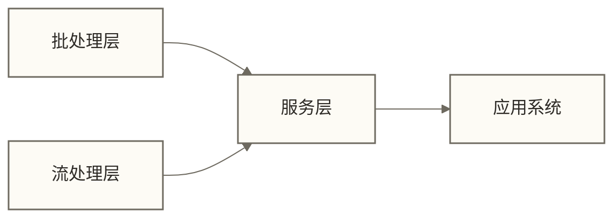

# 🌊 Apache Hudi概述与特性

## 📚 学习目标

通过本章节的学习，你将能够：

- **理解什么是Apache Hudi**及其在数据湖中的定位
- **掌握Hudi解决的核心问题**和应用场景
- **了解Hudi的主要特性**和技术优势
- **区分Hudi与传统数据处理方案**的差异

> [!tip] 💡 学习建议
> 刚开始接触Hudi时，你可能会觉得概念很多，**这是完全正常的**！先理解基本概念，然后在实践中逐步深化理解。不要着急，我们会一步步为你解释清楚。

## 🎯 什么是Apache Hudi

### 基本定义

**Apache Hudi** (Hadoop Upserts Deletes and Incrementals) 是一个**开源的数据湖框架**，专门用于在大数据存储系统上提供**流式数据处理**和**增量数据处理**能力。

> [!abstract] 📖 通俗理解
> 想象一下，传统的数据湖就像一个**巨大的仓库**，我们只能往里面添加新的货物，但很难修改或删除已有的货物。而Hudi就像给这个仓库装上了**智能管理系统**，让我们能够轻松地更新、删除货物，还能快速找到最近发生了什么变化。
>
> **专业表述**：Apache Hudi通过提供UPSERT、DELETE等操作，改善了仅依赖普通文件追加的数据湖在记录级更新和删除上的局限，实现了对大数据存储的灵活管理和增量处理能力；并非所有传统数据湖方案都只支持追加写入。

### 核心价值

Hudi的出现主要是为了解决传统数据湖的几个关键问题：

1. **数据更新困难**：传统数据湖很难进行数据的更新和删除操作
2. **实时性不足**：从数据写入到可查询往往需要很长时间
3. **增量处理复杂**：难以高效地处理增量数据变化
4. **数据一致性问题**：缺乏事务保证，容易出现数据不一致

> [!info] 📊 发展背景
> Hudi最初由Uber开发，用于解决其实时数据处理的挑战。后来贡献给Apache基金会，成为了数据湖领域的重要项目。目前已被众多大型互联网公司采用，如ByteDance、腾讯、京东等。

## 🔧 Hudi解决的核心问题

### 1. 数据更新与删除的挑战

**传统方案的问题**：
- 直接使用普通文件管理表数据时，记录级更新通常需要定位并重写相关文件，某些实现会重写整个分区；这不是HDFS本身对所有更新方案的统一要求
- 删除操作需要扫描大量数据文件
- 缺乏高效的索引机制

**Hudi的解决方案**：
```python
# 传统方案：需要重写整个分区
# 假设有一个用户表，需要更新用户信息
# 传统做法：
# 1. 读取整个分区数据
# 2. 在内存中进行更新
# 3. 重写整个分区

# Hudi方案：增量更新
from pyspark.sql import SparkSession

spark = SparkSession.builder \
    .appName("HudiExample") \
    .getOrCreate()

# 只需要提供变更的数据
updates = [
    {"user_id": 1, "name": "张三", "age": 25, "city": "北京"},
    {"user_id": 2, "name": "李四", "age": 30, "city": "上海"}
]

# Hudi会自动处理增量更新
df_updates = spark.createDataFrame(updates)
df_updates.write \
    .format("hudi") \
    .option("hoodie.table.name", "user_table") \
    .option("hoodie.datasource.write.recordkey.field", "user_id") \
    .option("hoodie.datasource.write.operation", "upsert") \
    .mode("append") \
    .save("/path/to/hudi/table")
```

> [!abstract] 🔍 核心优势
> 通过UPSERT操作，调用方只需提交变化的记录，而不需要重写整个数据集；底层仍可能重写受影响的文件，或先写入日志再合并，具体取决于表类型与配置。

### 2. 实时数据处理的需求

**业务场景**：
- 用户行为实时分析
- 实时推荐系统
- 实时风控系统

**Hudi的优势**：
- 支持**流式写入**，成功提交后可由兼容查询引擎读取；可见性和延迟取决于查询类型、引擎及配置，并非每条记录写入后都立即可查询
- 提供**增量查询**能力，只处理发生变化的数据
- 支持**多种查询类型**，适应不同的业务需求

> [!example] 🎯 实际应用场景
> 
> **电商场景**：
> - 用户浏览商品后，实时更新用户画像
> - 订单状态变化时，实时更新库存和推荐算法
> - 实时计算用户的购买倾向，用于个性化推荐
> 
> **金融场景**：
> - 实时更新用户的信用评分
> - 实时检测异常交易行为
> - 实时更新风险模型的特征

### 3. 数据一致性保证

**传统数据湖的问题**：
- 写入过程中可能出现部分失败
- 多个作业同时写入可能导致数据冲突
- 缺乏回滚机制

**Hudi的ACID特性**：
- **原子性(Atomicity)**：事务要么全部成功，要么全部失败
- **一致性(Consistency)**：数据始终保持一致状态
- **隔离性(Isolation)**：读写隔离与并发写入行为取决于支持的并发控制模式；多写入者需配置相应的冲突检测及锁机制，不能理解为任意并发事务都不会冲突
- **持久性(Durability)**：已提交的数据不会丢失

> [!tip] 💡 ACID优势
> **类比理解**：可以借银行转账理解原子性：同一事务范围内的变更应整体提交或回滚；这只是概念类比，Hudi的表级事务不能直接保证跨表、跨系统转账的端到端原子性。
> 
> **专业表述**：ACID特性确保了数据的可靠性和一致性，通过事务机制保证数据操作的原子性、一致性、隔离性和持久性，这是传统数据湖所缺失的重要能力。

## 🚀 Hudi的主要特性

### 1. 增量处理能力

**核心概念**：
- **增量查询**：只查询发生变化的数据
- **时间旅行**：查询仍有可用历史文件和时间线记录的指定时间点数据状态，受清理与历史保留策略限制
- **变更日志**：启用相应CDC能力后可获取记录级变更信息，其内容与可追溯范围取决于版本、配置和保留策略；普通增量查询不等于完整变更历史

```python
# 增量查询示例
# 查询示例提交时间范围内发生变化的数据；需使用目标表实际存在的时间线范围
incremental_df = spark.read \
    .format("hudi") \
    .option("hoodie.datasource.query.type", "incremental") \
    .option("hoodie.datasource.read.begin.instanttime", "20241201000000") \
    .option("hoodie.datasource.read.end.instanttime", "20241202000000") \
    .load("/path/to/hudi/table")

# 时间旅行查询
# 查询某个特定时间点的数据状态
historical_df = spark.read \
    .format("hudi") \
    .option("hoodie.datasource.query.type", "snapshot") \
    .option("as.of.instant", "20241201120000") \
    .load("/path/to/hudi/table")
```

### 2. 多种表类型支持

**Copy on Write (CoW)**：
- 适合**读多写少**的场景
- 写入时将更新合并到受影响的基础文件，读取通常不需要合并增量日志；实际查询性能需按工作负载测试
- 存储占用取决于更新模式、文件版本保留及清理策略，不能仅凭表类型确定成本较低

**Merge on Read (MoR)**：
- 适合**写多读少**的场景
- 写入可先追加增量日志以降低更新开销；快照查询需要合并基础文件与日志，读优化查询通常只读取基础文件，实际性能和数据新鲜度取决于查询类型与配置
- 增量日志和历史文件可能增加存储占用，但实际成本及写入性能还取决于合并、清理策略与工作负载

> [!tip] 💡 选择建议
> 
> **类比理解**：CoW就像是即时整理的图书馆，每次新书到达都立即分类上架，查找时速度很快；MoR则像是快速收书但延后整理，先把书堆放起来，查找时需要现场整理。
> 
> **专业表述**：
> - **选择CoW的场景**：分析型工作负载，查询频繁，对查询性能要求高，写入频率相对较低
> - **选择MoR的场景**：实时数据摄入，写入频繁，对写入延迟要求高，可以接受一定的查询延迟

### 3. 灵活的索引机制

**索引类型**：
- **Bloom Filter索引**：基于布隆过滤器的索引
- **Simple索引**：基于key的简单索引
- **HBase索引**：基于HBase的外部索引
- **Flink State索引**：基于Flink状态的索引

```python
# 配置索引类型
hudi_options = {
    "hoodie.index.type": "BLOOM",  # 使用布隆过滤器索引
    "hoodie.bloom.index.parallelism": "100",
    "hoodie.index.bloom.num_entries": "60000",
    "hoodie.index.bloom.fpp": "0.000000001"
}

# 写入时应用索引配置
df.write \
    .format("hudi") \
    .options(**hudi_options) \
    .mode("append") \
    .save("/path/to/hudi/table")
```

### 4. 存储优化特性

**日志合并(Compaction)**：
- 将MoR表的增量日志合并到基础文件，降低读取时的日志合并开销；小文件重组通常由Clustering等机制处理
- 支持同步和异步压缩
- 可配置压缩策略

**清理(Cleaning)**：
- 自动清理过期的数据文件
- 节省存储空间
- 保持指定数量的历史版本

```python
# 压缩配置
compaction_options = {
    "hoodie.compact.inline": "true",  # 启用内联压缩
    "hoodie.compact.inline.max.delta.commits": "5",  # 达到配置的delta commit阈值后触发内联合并，具体行为取决于调度策略
    "hoodie.compaction.strategy": "org.apache.hudi.table.action.compact.strategy.LogFileSizeBasedCompactionStrategy"
}

# 清理配置
cleaning_options = {
    "hoodie.clean.automatic": "true",  # 自动清理
    "hoodie.clean.async": "true",     # 异步清理
    "hoodie.cleaner.commits.retained": "3"  # KEEP_LATEST_COMMITS策略下的提交保留参数，不等于保留3个完整快照；清理会影响历史查询
}
```

## 🔄 Hudi与传统方案的对比

### 与传统数据仓库的对比

| 特性 | 传统数据仓库 | Apache Hudi |
|---|---|---|
| **数据更新** | 支持，但性能一般 | 高效的增量更新 |
| **实时性** | 分钟级到小时级 | 秒级到分钟级 |
| **扩展性** | 垂直扩展 | 水平扩展 |
| **成本** | 高 | 相对较低 |
| **数据格式** | 主要处理结构化表数据，部分产品支持半结构化数据 | 基于Schema的表数据，可表达嵌套结构；不是直接管理任意非结构化文件的通用格式 |

### 与传统数据湖的对比

| 特性 | 传统数据湖 | Apache Hudi |
|---|---|---|
| **ACID特性** | 不支持 | 完全支持 |
| **数据更新** | 困难 | 原生支持 |
| **查询性能** | 一般 | 优化的查询性能 |
| **数据一致性** | 弱一致性 | 强一致性 |
| **增量处理** | 复杂 | 原生支持 |

## 🎯 Hudi在现代数据架构中的位置

### 图书馆服务技术栈中的定位

陈技术员在白板上画出系统架构："让我为大家展示我们智慧图书馆在整个知识管理体系中的位置：

```mermaid
%%{init: {"theme":"base","themeVariables":{"fontFamily":"PingFang SC, -apple-system, Source Han Serif SC, serif","fontSize":"16px","background":"#FDFBF5","primaryColor":"#FDFBF5","primaryTextColor":"#2D2A26","primaryBorderColor":"#6E6A60","secondaryColor":"#E8EFE8","secondaryBorderColor":"#8FA890","secondaryTextColor":"#2D2A26","tertiaryColor":"#FDFBF5","tertiaryBorderColor":"#9A9488","tertiaryTextColor":"#6E6A60","lineColor":"#6E6A60","textColor":"#2D2A26","mainBkg":"#FDFBF5","nodeBorder":"#2D5A3D","clusterBkg":"#F3EEDF","clusterBorder":"#9A9488","edgeLabelBackground":"#FDFBF5"},"flowchart":{"htmlLabels":true,"curve":"basis","padding":20,"nodeSpacing":60,"rankSpacing":70,"useMaxWidth":false},"themeCSS":".node rect, .node polygon, .node circle { stroke-width: 1.5px; } .edgePath .path { stroke-width: 1.5px; } .cluster-label .nodeLabel, .cluster-label foreignObject { color: #2D2A26 !important; } .edgeLabel, .edgeLabel foreignObject { color: #2D2A26 !important; background-color: #FDFBF5; } .edgeLabel rect { fill: #FDFBF5; }"}}%%
flowchart TD
    subgraph APP["📚 读者服务层 (Reader Service Layer)"]
        A1[数据可视化<br/>📈 阅读分析]
        A2[智能推荐<br/>🤖 个性化服务]
        A3[实时查询<br/>⚡ 即时检索]
        A4[研究支持<br/>🔬 学术服务]
    end
    
    subgraph COMPUTE["⚙️ 信息处理层 (Information Processing)"]
        C1[图书分析引擎]
        C2[实时处理系统]
        C3[查询优化器]
        C4[检索加速器]
    end
    
    subgraph FRAMEWORK["🌊 智慧管理框架层 (Smart Management Framework)"]
        F1[智慧图书馆系统]
        F2[传统数字图书馆]
        F3[档案管理系统]
        F4[传统文件系统]
    end
    
    subgraph STORAGE["💾 存储层 (Storage Layer)"]
        S1[本地存储]
        S2[云端存储]
        S3[备份存储]
        S4[分布式存储]
    end
    
    APP --> COMPUTE --> FRAMEWORK --> STORAGE
    
    style F1 fill:#d4edda,stroke:#28a745,stroke-width:3px
    style APP fill:#e8f4f7,stroke:#6c757d
    style COMPUTE fill:#fff3cd,stroke:#6c757d
    style FRAMEWORK fill:#d1ecf1,stroke:#6c757d
    style STORAGE fill:#f8f9fa,stroke:#6c757d
```



### 在现代数据架构中的核心价值

#### 1. 连接数据湖与数据仓库的桥梁

> [!tip] 🎯 技术定位
> Apache Hudi巧妙地融合了数据湖的灵活性和数据仓库的可靠性：
> - 在数据湖基础上提供**数据仓库级的ACID事务特性**
> - 支持**Schema Evolution**和**数据治理**
> - 提供**统一的数据访问接口**

**传统架构的痛点**：
- 数据湖灵活但缺乏事务管理
- 数据仓库可靠但扩展性差
- 两者之间数据同步复杂

**Hudi的解决方案**：
- 在对象存储基础上提供类似数据仓库的严格管理特性
- 原生支持数据演进和版本管理
- 统一批流处理接口

#### 2. 批流一体化架构的核心

> [!example] 🔄 Lambda架构 vs Kappa架构
> Apache Hudi实现了真正的批流一体化处理，避免了传统Lambda架构的复杂性。

**传统分离架构的问题**：



> 问题：需要维护两套代码，数据一致性难以保证

**Hudi的统一架构**：

```mermaid
%%{init: {"theme":"base","themeVariables":{"fontFamily":"PingFang SC, -apple-system, Source Han Serif SC, serif","fontSize":"16px","background":"#FDFBF5","primaryColor":"#FDFBF5","primaryTextColor":"#2D2A26","primaryBorderColor":"#6E6A60","secondaryColor":"#E8EFE8","secondaryBorderColor":"#8FA890","secondaryTextColor":"#2D2A26","tertiaryColor":"#FDFBF5","tertiaryBorderColor":"#9A9488","tertiaryTextColor":"#6E6A60","lineColor":"#6E6A60","textColor":"#2D2A26","mainBkg":"#FDFBF5","nodeBorder":"#2D5A3D","clusterBkg":"#F3EEDF","clusterBorder":"#9A9488","edgeLabelBackground":"#FDFBF5"},"flowchart":{"htmlLabels":true,"curve":"basis","padding":20,"nodeSpacing":60,"rankSpacing":70,"useMaxWidth":false},"themeCSS":".node rect, .node polygon, .node circle { stroke-width: 1.5px; } .edgePath .path { stroke-width: 1.5px; } .cluster-label .nodeLabel, .cluster-label foreignObject { color: #2D2A26 !important; } .edgeLabel, .edgeLabel foreignObject { color: #2D2A26 !important; background-color: #FDFBF5; } .edgeLabel rect { fill: #FDFBF5; }"}}%%
flowchart LR
    classDef default fill:#FDFBF5,stroke:#6E6A60,color:#2D2A26,stroke-width:1.5px
    classDef startend fill:#2D2A26,stroke:#2D2A26,color:#FDFBF5,font-weight:bold
    classDef decision fill:#F6EAD8,stroke:#C08A1A,color:#2D2A26,font-weight:bold
    classDef hub fill:#3B5A80,stroke:#3B5A80,color:#FDFBF5,font-weight:bold
    classDef io fill:#E5EAF0,stroke:#3B5A80,color:#2D2A26
    classDef accent fill:#A6432C,stroke:#A6432C,color:#FDFBF5,font-weight:bold
    classDef storage fill:#F3EEDF,stroke:#9A9488,color:#2D2A26
    A["数据源"] --> B["Apache Hudi<br/>（批流一体化处理）"]
    B --> C["计算引擎"]
    C --> D["应用"]
    class A,B,C,D default
```



> 优势：批流任务可共享同一张Hudi表及其提交状态；端到端一致性仍取决于接入、计算、并发控制和下游消费机制。

这种架构让数据工程师可以围绕同一张表组织批量和流式处理，有机会减少重复逻辑；是否能复用同一套代码以及降低多少维护成本，取决于计算引擎、业务逻辑和运行方式。

### 与其他数据湖技术的对比

#### 主要竞争对手分析

以下为原稿的概括性比较，未指定产品版本或核实依据。成熟度、社区活跃度、引擎支持和小文件处理等评价不能视为经验证的排名；选型应按目标版本、连接器和工作负载逐项验证。

| 特性对比 | Apache Hudi | Delta Lake | Apache Iceberg |
|---|---|---|---|
| **开源性** | 开源项目 | 开源项目；需与Databricks商业平台功能区分 | 开源项目 |
| **成熟度** | 高（生产就绪） | 高 | 中等 |
| **社区活跃度** | 高 | 高 | 快速增长 |
| **主要支持者** | Uber、AWS | Databricks | Netflix、Apple |
| **计算引擎支持** | Spark 和 Flink | 主要Spark | Spark 和 Flink、Trino |
| **流式处理** | 原生支持 | 支持 | 基本支持 |
| **时间旅行** | 支持 | 支持 | 支持 |
| **Schema Evolution** | 支持 | 支持 | 强力支持 |
| **小文件问题** | 主动解决 | 主动解决 | 被动解决 |

#### 技术路线选择建议

> [!example] 🎯 选择Hudi的场景
> 
> **适合选择Hudi的情况**：
> - 需要**高频率的数据更新**（如用户画像、实时推荐）
> - 对**流式处理**有强烈需求
> - 需要**多种查询类型**（增量、时间旅行）
> - 已有**Spark 和 Flink**技术栈
> - 注重**开源生态**和**社区支持**

> [!example] 🎯 选择Delta Lake的场景
> 
> **适合选择Delta Lake的情况**：
> - 主要使用**Databricks平台**
> - 对**Spark生态**有深度依赖
> - 需要**商业化支持**
> - 重视**性能调优**的便利性

> [!example] 🎯 选择Iceberg的场景
> 
> **适合选择Iceberg的情况**：
> - 需要**多引擎支持**（Spark 和 Flink、Trino等）
> - 对**Schema Evolution**有复杂需求
> - 重视**元数据管理**
> - 大规模**分析型工作负载**

### 在企业数据架构中的角色

#### 1. 数据湖现代化的核心组件

| 演进阶段 | 特征 |
|----------|------|
| 传统数据湖 | 只能追加、缺乏事务、数据孤岛 |
| Hudi数据湖 | 支持更新、ACID特性、统一接口 |
| 智能数据湖 | 自动化治理、AI驱动优化、智能推荐 |

#### 2. 实时数据处理的基础设施

**在实时数据处理中的关键作用**：
- **数据接入层**：高效处理流式数据写入
- **存储层**：提供可靠的数据存储和索引
- **计算层**：支持多种计算引擎访问
- **服务层**：提供统一的数据访问接口

#### 3. 数据治理的技术支撑

**数据治理能力**：
- **血缘追踪**：提交及变更信息可作为血缘追踪的输入，完整业务血缘通常需要外部治理工具
- **权限控制**：细粒度访问控制通常依赖存储、计算引擎及权限管理系统，不是仅部署Hudi即可获得
- **质量保证**：事务机制提供表级一致性基础，业务完整性和数据质量规则仍需另行实现
- **合规支持**：提交历史和版本信息可辅助审计，但完整审计及合规能力需要额外配置和治理流程

### 行业应用与成功案例

#### 1. 互联网行业

**典型应用场景**：
- **用户行为分析**：实时更新用户画像
- **推荐系统**：增量更新推荐模型
- **A/B测试**：实时数据收集和分析
- **风控系统**：实时风险评估

**原稿所列企业应用（具体用途未经核实，不作为成功案例证据）**：
- **Uber**：最初的开发者，用于行程数据处理
- **ByteDance**：短视频推荐系统
- **腾讯**：游戏数据分析
- **滴滴**：实时位置数据处理

#### 2. 金融行业

**典型应用场景**：
- **交易数据处理**：实时交易记录更新
- **风险管理**：实时风险评估
- **监管报告**：合规数据管理
- **客户画像**：实时客户信息更新

**技术要求**：
- **数据一致性**：强一致性要求
- **审计追踪**：完整的操作记录
- **高可用性**：99.9%+为本节教学场景的示例目标，不是统一行业要求，也不是Hudi自身的可用性承诺
- **安全性**：数据加密和访问控制

#### 3. 电商行业

**典型应用场景**：
- **商品信息管理**：实时商品信息更新
- **库存管理**：实时库存数据同步
- **订单处理**：实时订单状态更新
- **用户行为分析**：购物行为实时分析

**业务价值**：
- **提升用户体验**：实时数据更新
- **降低运营成本**：自动化数据处理
- **增强决策能力**：实时数据分析
- **提高系统效率**：减少数据延迟

### 技术生态系统集成

#### 1. 计算引擎集成

**Apache Spark集成**：
- **原生支持**：Spark DataSource API
- **SQL支持**：Spark SQL直接查询
- **流处理**：Structured Streaming集成
- **性能优化**：向量化执行、代码生成

**Apache Flink集成**：
- **流式写入**：Flink Sink Connector
- **状态管理**：Flink State Backend
- **检查点**：容错和恢复机制
- **背压处理**：自适应流量控制

#### 2. 存储系统集成

**多种存储支持**：
- **HDFS**：传统Hadoop生态
- **Amazon S3**：云存储解决方案
- **Azure Data Lake**：微软云存储
- **Google Cloud Storage**：谷歌云存储

**存储优化**：
- **分层存储**：热、温、冷数据分离
- **压缩算法**：多种压缩格式支持
- **文件格式**：Parquet、ORC、Avro
- **缓存策略**：智能缓存管理

#### 3. 数据治理工具集成

**元数据管理**：
- **Apache Atlas**：数据血缘和分类
- **AWS Glue**：数据目录和ETL
- **Databricks Unity Catalog**：统一元数据管理
- **Hive Metastore**：传统元数据存储

**监控和运维**：
- **Prometheus**：指标收集和监控
- **Grafana**：可视化监控面板
- **ELK Stack**：日志分析和查询
- **Datadog**：APM和基础设施监控

### 未来发展趋势

以下条目仅作为可能的架构需求与发展方向讨论，不代表经核实的官方路线图或当前原生能力；尤其不能据此认定Hudi已提供跨表ACID、AI自动调优或边缘计算支持。

#### 1. 技术发展方向

**性能优化**：
- **向量化执行**：提升查询性能
- **智能索引**：自动索引优化
- **存储优化**：更高效的存储格式
- **计算下推**：减少数据传输

**功能增强**：
- **多表事务**：跨表ACID支持
- **自动调优**：AI驱动的参数优化
- **实时复制**：跨地域数据复制
- **数据版本管理**：更强大的版本控制

#### 2. 生态系统扩展

**云原生支持**：
- **Kubernetes数据部署**：容器化部署
- **云服务集成**：与各大云平台深度集成
- **Serverless**：无服务器数据处理
- **边缘计算**：边缘数据处理支持

**AI/ML集成**：
- **特征存储**：机器学习特征管理
- **模型训练**：在线学习支持
- **推理加速**：实时推理优化
- **AutoML**：自动机器学习

## 📊 适用场景分析

### 理想的应用场景

**1. 实时数据分析**
- 用户行为实时分析
- 实时报表生成
- 实时监控告警

**2. 数据同步与迁移**
- 从关系型数据库到数据湖的实时同步
- 跨数据中心的数据复制
- 数据仓库现代化改造

**3. 增量ETL处理**
- 只处理变化的数据，提高效率
- 支持复杂的数据转换逻辑
- 保证数据处理的一致性

### 不适用的场景

**1. 极高频次的小批量写入**
- 如果独立写入批次或提交频率过高，可能会影响性能；每秒千次仅为原稿未核实的示例，不是统一性能阈值，也不等于每秒千条记录的吞吐限制
- 建议先缓存后批量写入

**2. 纯粹的流式处理**
- 对于实时流处理，Kafka Streams或Flink可能更合适
- Hudi更适合准实时的数据湖场景

**3. 简单的日志存储**
- 如果只需要存储日志，不需要更新操作，传统方案可能更简单

> [!warning] ⚠️ 注意事项
> 
> **性能考虑**：
> - Hudi的性能取决于数据大小、写入频率、查询模式等多个因素
> - 建议在生产环境使用前进行充分的性能测试
> 
> **学习成本**：
> - Hudi有一定的学习成本，需要理解其核心概念
> - 建议团队成员先进行系统性的学习和培训

> [!warning] ⚠️ 注意事项
> 
> **性能考虑**：
> - Hudi的性能取决于数据大小、写入频率、查询模式等多个因素
> - 建议在生产环境使用前进行充分的性能测试
> 
> **学习成本**：
> - Hudi有一定的学习成本，需要理解其核心概念
> - 建议团队成员先进行系统性的学习和培训

## 🎯 小结

通过本章节的学习，我们了解到：

1. **Apache Hudi**是一个现代化的数据湖框架，专门解决传统数据湖的痛点
2. **核心特性**包括增量处理、ACID事务、时间旅行等
3. **适用场景**主要是需要实时数据更新和高效增量处理的业务场景
4. **技术优势**在于提供了传统数据湖缺失的更新、删除和事务能力

> [!abstract] 📚 下一步学习
> 现在你已经理解了Hudi的基本概念和价值，接下来我们将深入学习[[【技术与工具】/Hudi/02-Hudi架构与核心特性|Hudi架构与核心特性]]，了解它是如何实现这些强大特性的。

## 🔗 相关资源

- [[【技术与工具】/Hudi/00-Hudi学习路线图|Hudi]] - 返回学习路线图
- [[【技术与工具】/Spark/00-Spark学习路线图|Spark]] - 了解Hudi的计算引擎
- [[【技术与工具】/Hadoop/00-Hadoop学习路线图|Hadoop]] - 了解Hudi的存储基础

---

> 💡 **记住**：理解Hudi的核心概念是后续学习的基础，**不要急于求成**。每个概念都要充分理解后再进入下一个阶段。如果有任何疑问，建议多做实验和练习来加深理解。