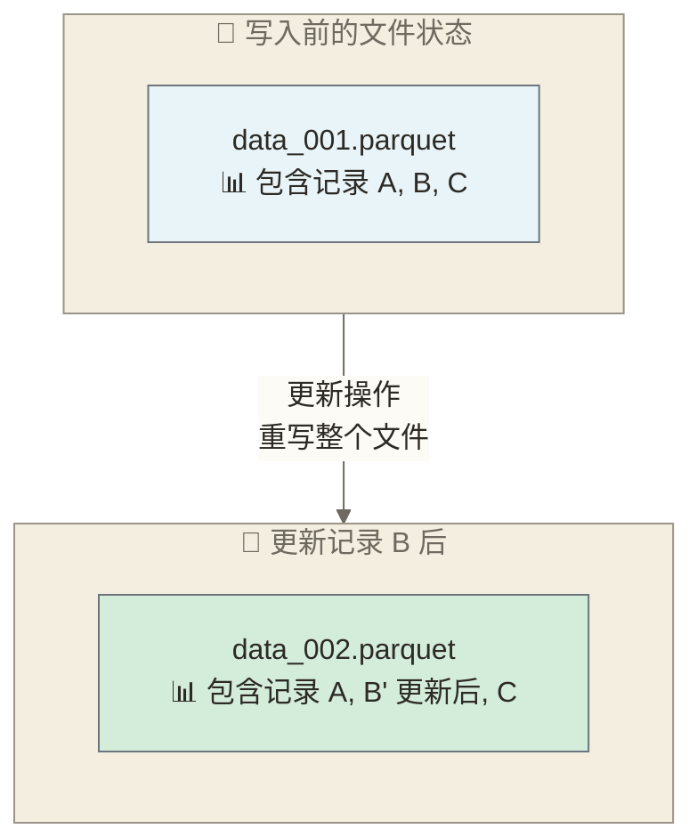
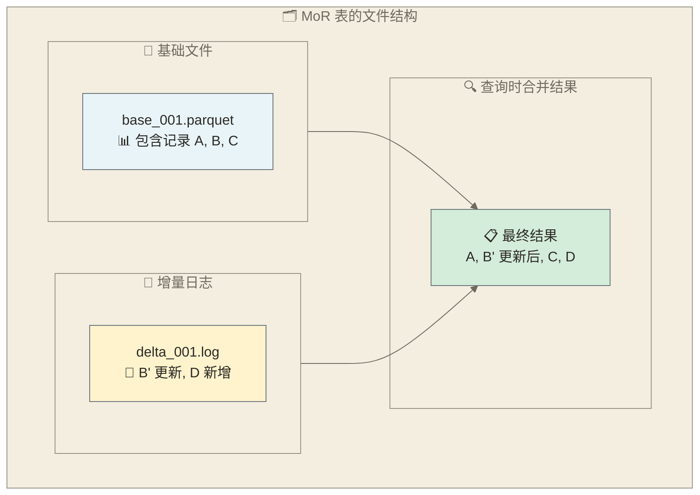
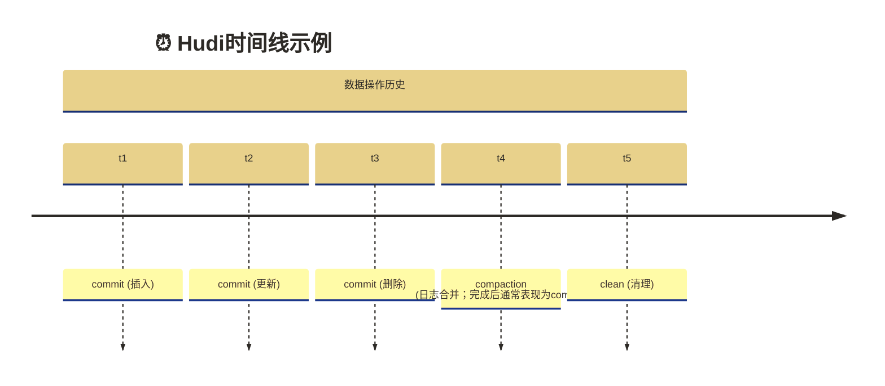

# 🏗️ Apache Hudi架构与核心特性

## 📚 学习目标

通过本章节的学习，你将能够：
- **理解Hudi的整体架构设计**和各个组件的作用
- **掌握CoW和MoR两种表类型**的原理和适用场景
- **了解索引机制的设计**和不同索引类型的特点
- **理解时间线管理**和元数据管理机制
- **掌握数据文件的组织结构**和存储优化策略

> [!tip] 💡 学习建议
> 架构设计是Hudi的核心，可能会涉及一些复杂的概念。**不要担心一开始理解不了所有细节**，就像理解一座建筑物的结构一样，我们先了解整体框架，然后逐步深入每个部分的细节。

## 🎯 Hudi整体架构

### 架构层次结构

```mermaid
%%{init: {"theme":"base","themeVariables":{"fontFamily":"PingFang SC, -apple-system, Source Han Serif SC, serif","fontSize":"16px","background":"#FDFBF5","primaryColor":"#FDFBF5","primaryTextColor":"#2D2A26","primaryBorderColor":"#6E6A60","secondaryColor":"#E8EFE8","secondaryBorderColor":"#8FA890","secondaryTextColor":"#2D2A26","tertiaryColor":"#FDFBF5","tertiaryBorderColor":"#9A9488","tertiaryTextColor":"#6E6A60","lineColor":"#6E6A60","textColor":"#2D2A26","mainBkg":"#FDFBF5","nodeBorder":"#2D5A3D","clusterBkg":"#F3EEDF","clusterBorder":"#9A9488","edgeLabelBackground":"#FDFBF5"},"flowchart":{"htmlLabels":true,"curve":"basis","padding":20,"nodeSpacing":60,"rankSpacing":70,"useMaxWidth":false},"themeCSS":".node rect, .node polygon, .node circle { stroke-width: 1.5px; } .edgePath .path { stroke-width: 1.5px; } .cluster-label .nodeLabel, .cluster-label foreignObject { color: #2D2A26 !important; } .edgeLabel, .edgeLabel foreignObject { color: #2D2A26 !important; background-color: #FDFBF5; } .edgeLabel rect { fill: #FDFBF5; }"}}%%
flowchart TD
    classDef default fill:#FDFBF5,stroke:#6E6A60,color:#2D2A26,stroke-width:1.5px
    classDef startend fill:#2D2A26,stroke:#2D2A26,color:#FDFBF5,font-weight:bold
    classDef decision fill:#F6EAD8,stroke:#C08A1A,color:#2D2A26,font-weight:bold
    classDef hub fill:#3B5A80,stroke:#3B5A80,color:#FDFBF5,font-weight:bold
    classDef io fill:#E5EAF0,stroke:#3B5A80,color:#2D2A26
    classDef accent fill:#A6432C,stroke:#A6432C,color:#FDFBF5,font-weight:bold
    classDef storage fill:#F3EEDF,stroke:#9A9488,color:#2D2A26
    subgraph APP["🎯 应用层 (Application Layer)"]
        A1[Spark SQL]
        A2[Flink SQL] 
        A3[Presto]
        A4[Trino]
    end
    
    subgraph API["🔌 API层 (API Layer)"]
        B1[Spark DataSource]
        B2[Flink Sink]
        B3[REST API]
    end
    
    subgraph CORE["⚡ 核心层 (Core Layer)"]
        C1[Timeline Service<br/>时间线服务]
        C2[Index Service<br/>索引服务]
        C3[Table Services<br/>表服务]
    end
    
    subgraph STORAGE["💾 存储层 (Storage Layer)"]
        D1[HDFS]
        D2[S3]
        D3[Azure Storage]
        D4[本地文件系统]
    end
    
    APP --> API --> CORE --> STORAGE
    class APP,A1,A2,A3,A4,API,B1,B2,B3,CORE,C1,C2,C3,STORAGE,D1,D2,D3,D4 default
```



### 核心组件概述

**1. 时间线机制与时间线服务 (Timeline / Timeline Service)**
- 时间线记录表操作及其状态，为版本视图提供依据
- 时间旅行查询还依赖目标版本的数据文件仍被保留
- Timeline Service提供文件系统视图等服务；并发控制还依赖写入客户端、并发模式与锁等机制

**2. 索引机制 (Index)**
- 写入索引用于定位记录所在的文件组
- 支持多种索引类型，适用性取决于引擎与版本
- 查询加速索引与写入索引需区分，不能将所有写入索引视为查询索引

**3. 表服务 (Table Services)**
- 管理表的元数据
- 处理压缩和清理
- 维护数据一致性

> [!abstract] 📖 架构设计理念
> **类比理解**：就像一座现代化的图书馆，有专门的管理系统（时间线服务）记录每本书的借还历史，有高效的索引系统（索引服务）帮助快速定位图书，还有专门的维护团队（表服务）负责图书的分类整理和空间清理。
> 
> **专业表述**：这里采用**分层解耦**的教学视图，而非完整的部署拓扑。时间线记录表操作及状态，Timeline Service提供文件系统视图等服务；写入索引帮助定位记录，Table Services处理compaction、clustering、cleaning等维护操作。不同计算引擎与存储系统的集成能力需按具体版本确认，图中的REST API也不应理解为通用数据读写接口。

## 🔄 表类型详解

### Copy on Write (CoW) 表

#### 工作原理

CoW表在**写入时立即合并**数据，所有的更新操作都会重写相关的数据文件。



#### 代码示例

```python
from pyspark.sql import SparkSession

spark = SparkSession.builder \
    .appName("HudiCoWExample") \
    .getOrCreate()

# 创建CoW表的配置
cow_options = {
    "hoodie.table.name": "user_cow_table",
    "hoodie.datasource.write.recordkey.field": "user_id",
    "hoodie.datasource.write.partitionpath.field": "city",
    "hoodie.datasource.write.table.name": "user_cow_table",
    "hoodie.datasource.write.table.type": "COPY_ON_WRITE",  # 指定CoW类型
    "hoodie.datasource.write.operation": "upsert"
}

# 初始数据写入
initial_data = [
    {"user_id": 1, "name": "张三", "age": 25, "city": "北京"},
    {"user_id": 2, "name": "李四", "age": 30, "city": "上海"},
    {"user_id": 3, "name": "王五", "age": 35, "city": "广州"}
]

df_initial = spark.createDataFrame(initial_data)
df_initial.write \
    .format("hudi") \
    .options(**cow_options) \
    .mode("overwrite") \
    .save("/path/to/hudi/cow_table")

# 更新数据
update_data = [
    {"user_id": 1, "name": "张三", "age": 26, "city": "北京"},  # 年龄更新
    {"user_id": 4, "name": "赵六", "age": 28, "city": "深圳"}   # 新增用户
]

df_update = spark.createDataFrame(update_data)
df_update.write \
    .format("hudi") \
    .options(**cow_options) \
    .mode("append") \
    .save("/path/to/hudi/cow_table")
```

#### 优势与局限

> [!info] 📚 CoW表类型理解
> **类比理解**：CoW表就像一本纸质百科全书，每当需要更新某个词条时，就要重新印刷整本书。虽然读者总是能拿到最新最完整的版本，但更新成本很高，需要大量时间和资源。
> 
> **专业表述**：Copy on Write表类型在数据更新时会重写包含变更记录的整个数据文件，确保数据文件始终保持最新状态。这种方式避免了读取时合并增量日志的开销，但实际查询性能取决于数据布局与执行引擎，在频繁更新场景下通常会产生较高的I/O开销。

**优势**：
- ✅ **读取路径较简单**：无需合并增量日志，读取当前可见版本的基础文件；实际性能需测试
- ✅ **存储效率高**：不需要存储增量日志文件
- ✅ **实现简单**：逻辑相对简单，易于理解

**局限**：
- ❌ **写入性能较低**：每次更新都需要重写整个文件
- ❌ **并发写入受限**：同一文件的并发更新会冲突
- ❌ **资源消耗大**：重写文件需要更多的CPU和内存

### Merge on Read (MoR) 表

#### 工作原理

MoR表使用**基础文件**和**增量日志文件**组织数据，更新通常可追加到日志；插入等写入路径也可能生成基础文件。快照查询按需合并基础文件与日志，只读优化查询仅读取基础文件。

> [!info] 📝 MoR表类型理解
> **类比理解**：MoR表就像一本活页笔记本，原始内容写在主页上（基础文件），后续的修改和补充都记在便利贴上（增量日志）。当需要查看完整内容时，要同时参考主页和所有便利贴。这样修改很快，但阅读时需要整合。
> 
> **专业表述**：Merge on Read表类型采用基础文件+增量日志的存储模式。更新通常可追加增量日志，降低立即重写基础文件的开销，但并非所有写入都只生成日志。查询时通过合并基础文件和增量日志来获得最新的数据视图，在写入性能和存储效率之间取得平衡。



#### 代码示例

```python
# 创建MoR表的配置
mor_options = {
    "hoodie.table.name": "user_mor_table",
    "hoodie.datasource.write.recordkey.field": "user_id",
    "hoodie.datasource.write.partitionpath.field": "city",
    "hoodie.datasource.write.table.name": "user_mor_table",
    "hoodie.datasource.write.table.type": "MERGE_ON_READ",  # 指定MoR类型
    "hoodie.datasource.write.operation": "upsert",
 # MoR 特有配置
    "hoodie.compact.inline": "false",  # 禁用内联压缩
    "hoodie.compact.inline.max.delta.commits": "5"  # 内联compaction启用时的阈值；当前禁用内联，不会仅凭此项自动执行
}

# 数据写入（与CoW类似）
df_initial.write \
    .format("hudi") \
    .options(**mor_options) \
    .mode("overwrite") \
    .save("/path/to/hudi/mor_table")

# 频繁的增量更新（MoR的优势场景）
for i in range(10):
    update_data = [
        {"user_id": 1, "name": "张三", "age": 25 + i, "city": "北京"},
        {"user_id": 2, "name": "李四", "age": 30 + i, "city": "上海"}
    ]
    
    df_update = spark.createDataFrame(update_data)
    df_update.write \
        .format("hudi") \
        .options(**mor_options) \
        .mode("append") \
        .save("/path/to/hudi/mor_table")
```

#### 查询类型

> [!info] 🔍 MoR查询类型理解
> **类比理解**：就像查阅一本经常更新的法律条文，你可以选择：
> 1. **完整版查询**（快照查询）：把主条文和所有修正案都看一遍，得到最准确但耗时的结果
> 2. **快速版查询**（只读优化查询）：只看主条文，快速获取信息但可能遗漏最新修正
> 
> **专业表述**：这里比较MoR表的两种常用读取模式，并非列举全部查询类型。快照查询读取当前可见文件切片，按需合并基础文件与日志；只读优化查询仅读取基础文件，可能遗漏尚未合入基础文件的变更，性能优势需按工作负载验证。

**1. 快照查询 (Snapshot Query)**
```python
# 查询最新的完整数据视图
snapshot_df = spark.read \
    .format("hudi") \
    .option("hoodie.datasource.query.type", "snapshot") \
    .load("/path/to/hudi/mor_table")
```

**2. 只读优化查询 (Read Optimized Query)**
```python
# 只查询基础文件，性能更好但可能不是最新数据
read_optimized_df = spark.read \
    .format("hudi") \
    .option("hoodie.datasource.query.type", "read_optimized") \
    .load("/path/to/hudi/mor_table")
```

#### 优势与局限

**优势**：
- ✅ **更新写入开销通常较低**：更新可追加日志，但实际表现取决于写入路径与表服务配置
- ✅ **支持高频更新**：适合实时数据摄入场景
- ✅ **可配置并发写入**：仍可能发生文件组级冲突，需按版本配置并发模式、锁与冲突处理；MoR本身不保证无冲突

**局限**：
- ❌ **查询性能复杂**：需要合并基础文件和日志文件
- ❌ **存储开销大**：需要额外的日志文件存储
- ❌ **压缩必要**：需要定期压缩以优化性能

## 📊 表类型选择指南

### 性能对比

| 特性 | Copy on Write | Merge on Read |
|---|---|---|
| **写入延迟** | 更新通常需重写受影响基础文件 | 更新通常可追加日志，仍有其他写入路径 |
| **查询性能** | 无日志合并开销，需实测 | 快照查询可能需合并；只读优化可避免合并 |
| **存储开销** | 受文件版本保留与清理策略影响 | 还需考虑日志及compaction期间的空间 |
| **并发写入** | 需配置并发控制，可能冲突 | 需配置并发控制，可能冲突 |
| **compaction需求** | 不需要日志合并型compaction，仍需其他表维护 | 通常需安排compaction以控制日志积累 |

### 选择建议

> [!example] 🎯 选择CoW的场景
> 
> **分析型工作负载**：
> - 数据主要用于报表和分析
> - 查询频率高，对查询性能要求严格
> - 写入频率相对较低（如日批次更新）
> 
> **示例**：
> - 每日用户行为分析报表
> - 月度销售数据分析
> - 历史数据归档查询

> [!example] 🎯 选择MoR的场景
> 
> **实时数据摄入**：
> - 需要高频率的数据更新
> - 对写入延迟要求高
> - 可以接受查询时的额外计算开销
> 
> **示例**：
> - 实时用户画像更新
> - 实时风控数据处理
> - IoT设备状态监控

## 🗂️ 索引机制详解

### 索引的作用

索引的主要作用是**快速定位需要更新的数据文件**，避免全表扫描。

> [!info] 📇 索引机制理解
> **类比理解**：就像图书馆的目录卡片系统，不用翻遍整个图书馆找一本书，而是先查目录卡片确定书在哪个区域哪个书架，然后直接去那里找。索引让数据定位从"大海捞针"变成"按图索骥"。
> 
> **专业表述**：Hudi索引机制通过维护record key到文件位置的映射关系，实现了对数据更新操作的高效定位。当执行UPSERT操作时，索引帮助快速确定哪些文件包含需要更新的记录，避免了全表扫描的性能开销。

```python
# 没有索引的更新过程
"""
1. 扫描所有数据文件
2. 在每个文件中查找目标记录
3. 更新找到的记录
4. 重写相关文件
"""

# 有索引的更新过程
"""
1. 通过索引快速定位目标文件
2. 只处理包含目标记录的文件
3. 更新并重写这些文件
"""
```

### 索引类型详解

#### 1. Bloom Filter索引（是否默认需按引擎与版本确认）

**工作原理**：
- 为每个文件创建布隆过滤器
- 快速判断记录是否**可能**存在于文件中
- 减少需要扫描的文件数量

```python
# Bloom Filter索引配置
bloom_index_options = {
    "hoodie.index.type": "BLOOM",
    "hoodie.index.bloom.num_entries": "60000",  # 布隆过滤器条目数
    "hoodie.index.bloom.fpp": "0.000000001",    # 误报率
    "hoodie.bloom.index.parallelism": "100",    # 并行度
    "hoodie.bloom.index.prune.by.ranges": "true",  # 启用范围剪枝
    "hoodie.bloom.index.use.caching": "true"    # 启用缓存
}
```

**优势**：
- 内存占用小
- 查询速度快
- 可利用记录键范围信息进行候选文件剪枝，不等同于通用范围查询索引

**局限**：
- 存在误报（但无漏报）
- 不支持范围查询
- 需要调优参数

#### 2. Simple索引

**工作原理**：
- 读取已有记录键及其位置，与待写入记录进行关联以定位记录
- 为写入记录标记已有文件位置，并非持久化的简单哈希索引
- 适用性取决于扫描与关联成本，需结合数据规模测试

```python
# Simple索引配置
simple_index_options = {
    "hoodie.index.type": "SIMPLE",
    "hoodie.simple.index.parallelism": "100",
    "hoodie.simple.index.use.caching": "true"
}
```

#### 3. HBase索引

**工作原理**：
- 使用外部HBase存储记录键到文件位置的映射
- 用于写入时的记录定位，不是通用复杂查询索引；规模适用性需测试
- 需要额外的HBase集群，并确认目标Hudi版本与引擎支持

```python
# HBase索引配置
hbase_index_options = {
    "hoodie.index.type": "HBASE",
    "hoodie.index.hbase.table": "hudi_index_table",
    "hoodie.index.hbase.zkquorum": "localhost:2181",
    "hoodie.index.hbase.zkport": "2181",
    "hoodie.index.hbase.update.partition.path": "true"
}
```

#### 4. Flink State索引

**工作原理**：
- 利用Flink的状态后端存储索引
- 适合流式处理场景
- 与Flink深度集成

```python
# Flink State索引配置（在Flink程序中）
flink_state_options = {
    "hoodie.index.type": "FLINK_STATE",
    "hoodie.index.state.ttl": "1800000"  # 状态TTL（毫秒）
}
```

### 索引性能优化

```python
# 索引性能优化配置
index_optimization = {
 # 启用索引缓存
    "hoodie.bloom.index.use.caching": "true",
    
 # 调整布隆过滤器参数
    "hoodie.index.bloom.num_entries": "60000",
    "hoodie.index.bloom.fpp": "0.000000001",
    
 # 启用范围剪枝
    "hoodie.bloom.index.prune.by.ranges": "true",
    
 # 调整并行度
    "hoodie.bloom.index.parallelism": "200",
    
 # 元数据相关索引配置（非增量索引开关，配置键及语义需按版本核对）
    "hoodie.index.bloom.use.metadata": "true"
}
```

## ⏰ 时间线管理

### 时间线概念

时间线是Hudi中的核心概念，记录了表的所有变更历史。



### 时间线操作类型

**1. Commit操作**
```python
# 提交操作会创建新的时间点
commit_options = {
    "hoodie.datasource.write.operation": "upsert",
    "hoodie.datasource.write.table.name": "test_table"
}
```

**2. Compaction操作**
```python
# 压缩操作会创建新的时间点
compaction_options = {
    "hoodie.compact.inline": "true",
    "hoodie.compact.inline.max.delta.commits": "5"
}
```

**3. Clean操作**
```python
# 清理操作会创建新的时间点
clean_options = {
    "hoodie.clean.automatic": "true",
    "hoodie.clean.async": "true",
    "hoodie.cleaner.commits.retained": "3"
}
```

### 时间旅行查询

```python
# 查询特定时间点的数据
def time_travel_query(spark, table_path, target_time):
    """
    时间旅行查询函数
    
    Args:
        spark: SparkSession
        table_path: 表路径
        target_time: 目标时间点
    """
    df = spark.read \
        .format("hudi") \
        .option("hoodie.datasource.query.type", "snapshot") \
        .option("as.of.instant", target_time) \
        .load(table_path)
    
    return df

# 使用示例
historical_df = time_travel_query(
    spark, 
    "/path/to/hudi/table", 
    "20241201120000"
)
```

### 增量查询

```python
# 增量查询实现
def incremental_query(spark, table_path, start_time, end_time):
    """
    增量查询函数
    
    Args:
        spark: SparkSession
        table_path: 表路径
        start_time: 开始时间
        end_time: 结束时间
    """
    df = spark.read \
        .format("hudi") \
        .option("hoodie.datasource.query.type", "incremental") \
        .option("hoodie.datasource.read.begin.instanttime", start_time) \
        .option("hoodie.datasource.read.end.instanttime", end_time) \
        .load(table_path)
    
    return df

# 使用示例：查询最近一小时的变化
recent_changes = incremental_query(
    spark,
    "/path/to/hudi/table",
    "20241201110000",
    "20241201120000"
)
```

## 📁 数据文件组织

### 文件结构

| 路径 | 说明 |
|------|------|
| `hudi_table/.hoodie/` | 元数据目录 |
| `hudi_table/.hoodie/hoodie.properties` | 表属性 |
| `.hoodie/`下的时间线文件（具体位置依表版本而异） | 提交等操作记录，不是统一的`.commits/`子目录 |
| 时间线中的`.inflight`状态文件 | 进行中的操作，不是统一的`.inflight/`子目录 |
| `hudi_table/.hoodie/.aux/` | 辅助文件 |
| `hudi_table/city=北京/` | 分区目录 |
| `hudi_table/city=北京/base_file_001.parquet` | 基础文件 |
| `hudi_table/city=北京/.log_file_001.log` | 日志文件（MoR） |
| `hudi_table/city=上海/base_file_003.parquet` | 基础文件 |
| `hudi_table/city=上海/base_file_004.parquet` | 基础文件 |

### 文件命名规则

```python
# Hudi 文件命名规则
"""
基础文件：
{fileId}_{writeToken}_{instantTime}.parquet

日志文件：
.{fileId}_{baseInstantTime}.log.{logVersion}_{writeToken}
"""

# 示例
example_files = {
    "base_file": "abc123_1-0-1_20241201120000.parquet",
    "log_file": ".abc123_20241201120000.log.1_1-0-1"
}
```

## 🔧 配置最佳实践

### 性能优化配置

```python
# 生产配置讨论示例：参数需按版本、工作负载与资源验证，不可直接作为推荐模板
production_config = {
 # 基础配置
    "hoodie.table.name": "production_table",
    "hoodie.datasource.write.recordkey.field": "id",
    "hoodie.datasource.write.partitionpath.field": "date",
    
 # 索引配置
    "hoodie.index.type": "BLOOM",
    "hoodie.index.bloom.num_entries": "60000",
    "hoodie.index.bloom.fpp": "0.000000001",
    
 # 并行配置
    "hoodie.insert.shuffle.parallelism": "400",
    "hoodie.upsert.shuffle.parallelism": "400",
    "hoodie.delete.shuffle.parallelism": "400",
    
 # 压缩配置
    "hoodie.compact.inline": "false",
    "hoodie.compact.inline.max.delta.commits": "5",
    "hoodie.compaction.strategy": "org.apache.hudi.table.action.compact.strategy.LogFileSizeBasedCompactionStrategy",
    
 # 清理配置
    "hoodie.clean.automatic": "true",
    "hoodie.clean.async": "true",
    "hoodie.cleaner.commits.retained": "3",
    
 # 内存配置
    "hoodie.memory.merge.max.size": "1073741824",  # 1GB
    "hoodie.memory.spillable.map.path": "/tmp/hudi-spillable-map",
    
 # 写入配置
    "hoodie.datasource.write.operation": "upsert",
    "hoodie.datasource.write.table.type": "MERGE_ON_READ",
    "hoodie.datasource.write.precombine.field": "ts"
}
```

### 监控配置

```python
# 监控和指标配置
monitoring_config = {
 # 启用指标
    "hoodie.metrics.on": "true",
    "hoodie.metrics.reporter.type": "PROMETHEUS",
    
 # 元数据与Hive同步配置（不是日志配置）
    "hoodie.datasource.meta.sync.enable": "true",
    "hoodie.datasource.hive_sync.enable": "true",
    
 # ZooKeeper锁配置（不是心跳配置；完整配置需按版本确认）
    "hoodie.write.lock.provider": "org.apache.hudi.client.transaction.lock.ZookeeperBasedLockProvider",
    "hoodie.write.lock.zookeeper.url": "localhost:2181",
    "hoodie.write.lock.zookeeper.port": "2181"
}
```

## 🎯 小结

通过本章节的学习，我们深入了解了：

1. **Hudi的分层架构**和各组件的职责分工
2. **CoW和MoR表类型**的原理、优缺点和选择策略
3. **索引机制**的设计和不同索引类型的特点
4. **时间线管理**和时间旅行查询的实现
5. **数据文件组织**和存储优化策略

> [!abstract] 📚 下一步学习
> 掌握了Hudi的架构原理后，接下来我们将学习[[【技术与工具】/Hudi/03-Hudi环境搭建与配置|Hudi环境搭建与配置]]，为实际操作做准备。

## 🔗 相关资源

- [[【技术与工具】/Hudi/01-Hudi概述与特性|Hudi概述与特性]] - 回顾基础概念
- [[【技术与工具】/Hudi/00-Hudi学习路线图|Hudi]] - 返回学习路线图
- [[【技术与工具】/Spark/00-Spark学习路线图|Spark]] - 了解Hudi的计算引擎基础

---

> 💡 **记住**：架构理解是使用Hudi的关键，**不要急于追求完美理解**每个细节。先掌握核心概念，在实践中逐步加深理解。每个架构设计都有其权衡，理解这些权衡有助于在实际项目中做出正确的选择。