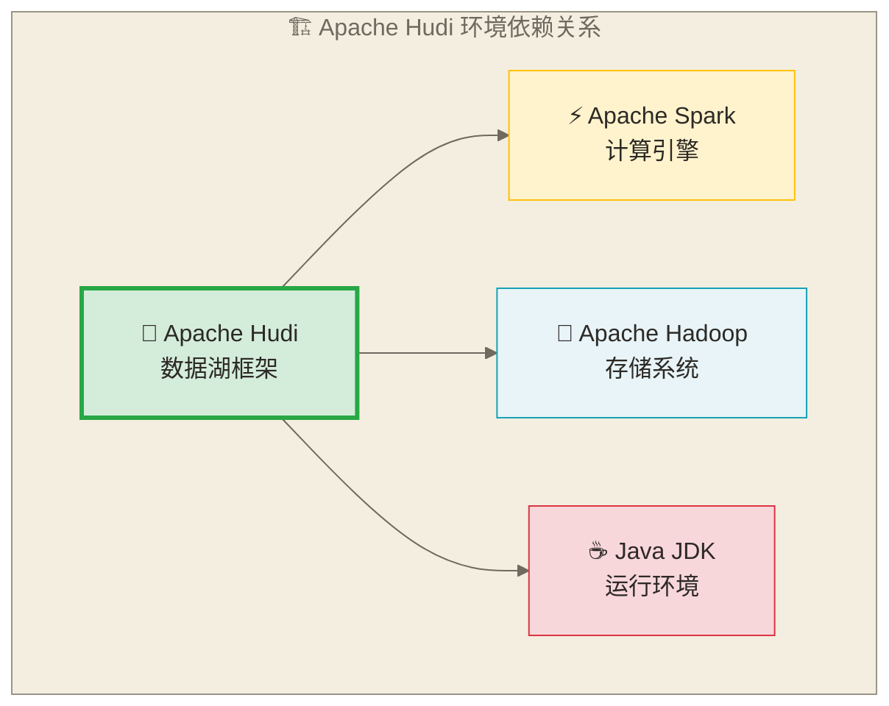

# 🛠️ Apache Hudi环境搭建与配置

## 📚 学习目标

通过本章节的学习，你将能够：
- **掌握Hudi的环境依赖**和版本兼容性要求
- **独立搭建Hudi开发环境**，包括本地和集群环境
- **配置Spark和Hadoop**与Hudi的集成
- **解决常见的安装和配置问题**
- **验证环境搭建的正确性**

> [!tip] 💡 学习建议
> 环境搭建是学习Hudi的第一步，**不要被复杂的配置吓到**！就像搭积木一样，我们一步一步来，每个步骤都会详细说明。遇到问题很正常，这是每个开发者必经的路。

## 🎯 环境依赖概述

### 核心依赖组件

> [!info] 🏗️ 环境依赖理解
> **类比理解**：搭建Hudi环境就像组装一台电脑，需要各个组件配合工作：Java是电源（提供基础运行环境），Hadoop是硬盘（提供存储），Spark是CPU（负责计算处理），Hudi是操作系统（协调所有组件工作）。
> 
> **专业表述**：本文采用Java运行时、HDFS存储和Spark计算引擎搭建Apache Hudi练习环境。HDFS并非Hudi的必需存储后端，Hudi也可使用兼容的对象存储或本地文件系统；下图表示本文所选环境的组件关系。



### 版本兼容性矩阵

| Hudi版本 | Java版本 | Spark版本 | Hadoop版本 | Scala版本 |
|---|---|---|---|---|
| 0.14.x  | 8, 11   | 3.3.x, 3.4.x | 2.10.x, 3.3.x | 2.12, 2.13 |
| 0.13.x  | 8, 11   | 3.2.x, 3.3.x | 2.10.x, 3.2.x | 2.12, 2.13 |
| 0.12.x  | 8, 11   | 3.1.x, 3.2.x | 2.10.x, 3.2.x | 2.12 |

> [!warning] ⚠️ 版本兼容性注意事项
> 
> **选择版本时需要考虑**：
> - 不同版本的性能和稳定性差异
> - 企业环境的现有技术栈
> - 长期维护和升级计划
> 
> **建议**：对于生产环境，优先选择稳定版本而非最新版本。

## 🔧 本地开发环境搭建

### 1. Java环境准备

#### 安装Java JDK

> [!info] ☕ Java环境理解
> **类比理解**：Java环境就像房子的地基，所有的大数据工具都建立在这个基础之上。没有稳固的Java地基，Spark和Hudi这些"上层建筑"就无法正常运行。
> 
> **专业表述**：Java Development Kit (JDK) 为Apache Hudi及其依赖组件提供了基础的运行时环境和开发工具。JDK版本的选择直接影响到组件间的兼容性和系统的稳定性。

```bash
# macOS 安装
brew install openjdk@11

# Ubuntu/Debian 安装
sudo apt-get update
sudo apt-get install openjdk-11-jdk

# CentOS/RHEL 安装
sudo yum install java-11-openjdk-devel

# 验证安装
java -version
javac -version
```

**预期输出**：
```text
openjdk version "11.0.x" 2023-xx-xx
OpenJDK Runtime Environment (build 11.0.x+xx)
OpenJDK 64-Bit Server VM (build 11.0.x+xx, mixed mode)
```

#### 配置环境变量

```bash
# 编辑 ~/.bashrc 或 ~/.zshrc
export JAVA_HOME=/usr/lib/jvm/java-11-openjdk-amd64  # Ubuntu路径
# export JAVA_HOME=/usr/lib/jvm/java-11-openjdk       # CentOS路径
# export JAVA_HOME=/opt/homebrew/opt/openjdk@11        # macOS路径

export PATH=$JAVA_HOME/bin:$PATH

# 使配置生效
source ~/.bashrc  # 或 source ~/.zshrc
```

**验证配置**：
```bash
echo $JAVA_HOME
which java
```

### 2. Hadoop环境配置

> [!info] 🐘 Hadoop环境理解
> **类比理解**：Hadoop就像一个巨大的仓库系统，HDFS是仓库的存储区域，我们需要先建好仓库（安装），然后制定管理规则（配置），最后启动仓库运营（启动服务）。
> 
> **专业表述**：Apache Hadoop为Hudi提供分布式存储基础设施，通过HDFS（Hadoop Distributed File System）实现数据的分布式存储和容错能力，是大数据生态系统的核心组件。

#### 下载和安装Hadoop

```bash
# 下载Hadoop 3.3.4
cd /opt
sudo wget https://archive.apache.org/dist/hadoop/common/hadoop-3.3.4/hadoop-3.3.4.tar.gz
sudo tar -xzf hadoop-3.3.4.tar.gz
sudo mv hadoop-3.3.4 hadoop
sudo chown -R $USER:$USER /opt/hadoop

# 配置环境变量
export HADOOP_HOME=/opt/hadoop
export HADOOP_CONF_DIR=$HADOOP_HOME/etc/hadoop
export PATH=$HADOOP_HOME/bin:$HADOOP_HOME/sbin:$PATH
```

**验证安装**：
```bash
hadoop version
hdfs version
```

#### 配置Hadoop

> [!info] 🔧 HDFS配置理解
> **类比理解**：配置HDFS就像设置仓库的地址簿和管理规则：告诉系统仓库总部在哪里（fs.defaultFS），临时文件放在哪里（hadoop.tmp.dir），每份重要文件要备份几份（dfs.replication），管理员办公室在哪里（namenode），仓库货架在哪里（datanode）。
> 
> **专业表述**：HDFS配置定义了文件系统的访问入口、数据副本策略、元数据存储位置和数据块存储位置，这些配置直接影响系统的可靠性、性能和可维护性。

**core-site.xml**
```xml
<?xml version="1.0" encoding="UTF-8"?>
<configuration>
  <property>
    <name>fs.defaultFS</name>
    <value>hdfs://localhost:9000</value>
    <description>HDFS的默认文件系统URI</description>
  </property>
  <property>
    <name>hadoop.tmp.dir</name>
    <value>/opt/hadoop/tmp</value>
    <description>Hadoop临时文件目录</description>
  </property>
</configuration>
```

**hdfs-site.xml**
```xml
<?xml version="1.0" encoding="UTF-8"?>
<configuration>
  <property>
    <name>dfs.replication</name>
    <value>1</value>
    <description>数据副本数（开发环境设为1）</description>
  </property>
  <property>
    <name>dfs.namenode.name.dir</name>
    <value>/opt/hadoop/data/namenode</value>
    <description>NameNode元数据存储目录</description>
  </property>
  <property>
    <name>dfs.datanode.data.dir</name>
    <value>/opt/hadoop/data/datanode</value>
    <description>DataNode数据存储目录</description>
  </property>
</configuration>
```

#### 启动Hadoop

```bash
# 1. 创建必要目录
sudo mkdir -p /opt/hadoop/data/namenode
sudo mkdir -p /opt/hadoop/data/datanode
sudo chown -R $USER:$USER /opt/hadoop/data

# 2. 仅在全新、无须保留数据的测试NameNode目录上初始化HDFS
# 已有HDFS不得执行此步骤；格式化会重建NameNode元数据，可能导致原数据不可访问
hdfs namenode -format

# 3. 启动HDFS服务
start-dfs.sh

# 4. 验证HDFS服务
hdfs dfs -ls /
hdfs dfs -mkdir -p /user/$USER

# 5. 检查服务状态
jps  # 应该看到NameNode和DataNode进程
```

**访问Web界面**：
- NameNode: http://localhost:9870
- DataNode: http://localhost:9864

### 3. Spark环境配置

#### 下载和安装Spark

```bash
# 下载Spark 3.4.0
cd /opt
sudo wget https://archive.apache.org/dist/spark 和 spark-3.4.0/spark-3.4.0-bin-hadoop3.tgz
sudo tar -xzf spark-3.4.0-bin-hadoop3.tgz
sudo mv spark-3.4.0-bin-hadoop3 spark
sudo chown -R $USER:$USER /opt/spark

# 配置环境变量
export SPARK_HOME=/opt/spark
export PATH=$SPARK_HOME/bin:$PATH
```

### 4. Hudi安装配置

#### 下载Hudi

```bash
# 创建Hudi目录
mkdir -p /opt/hudi
cd /opt/hudi

# 下载Hudi jar包（根据Spark版本选择）
wget https://repo1.maven.org/maven2/org/apache/hudi/hudi-spark3.4-bundle_2.12/0.14.0/hudi-spark3.4-bundle_2.12-0.14.0.jar

# 配置环境变量
export HUDI_HOME=/opt/hudi
export PATH=$HUDI_HOME:$PATH
```

**方法2：启动时动态指定 Hudi JAR（推荐开发阶段）**

```bash
# 启动 spark-shell 时指定 Hudi JAR 和必要配置
spark-shell \
  --jars /opt/hudi/hudi-spark3.4-bundle_2.12-0.14.0.jar \
  --conf 'spark.serializer=org.apache.spark.serializer.KryoSerializer' \
  --conf 'spark.sql.extensions=org.apache.spark.sql.hudi.HoodieSparkSessionExtension' \
  --conf 'spark.sql.catalog.spark_catalog=org.apache.spark.sql.hudi.catalog.HoodieCatalog' \
  --conf 'spark.kryo.registrator=org.apache.spark.HoodieSparkKryoRegistrar'
```

四个配置项的作用说明：

| 配置项 | 作用 |
|--------|------|
| `spark.serializer=KryoSerializer` | 本示例使用 Kryo 序列化；原稿“比默认 Java 序列化快 2-10 倍”为未核实示例数字，不是性能保证，实际收益需按数据与任务实测 |
| `spark.sql.extensions=HoodieSparkSessionExtension` | 注册 Hudi 的 SQL 扩展，支持 `CALL` 过程和 Hudi 特有 DDL 语法 |
| `spark.sql.catalog.spark_catalog=HoodieCatalog` | 将 Spark 默认 Catalog 替换为 Hudi Catalog，集成 Hudi 表的目录与 SQL 操作；`spark.read.table()` 仅用于读取，写入需使用相应写入 API 或 SQL |
| `spark.kryo.registrator=HoodieSparkKryoRegistrar` | 向 Kryo 注册 Hudi 相关类；注册器及依赖仍须在运行时类路径中，不能代替 JAR 加载或保证消除类缺失错误 |

**方法3：写入 spark-defaults.conf（本文仅作隔离测试环境配置示例）**

```bash
# $SPARK_HOME/conf/spark-defaults.conf
# 将以下配置追加进去，所有 Spark 任务都自动启用 Hudi
echo "spark.jars                  /opt/hudi/hudi-spark3.4-bundle_2.12-0.14.0.jar" >> $SPARK_HOME/conf/spark-defaults.conf
echo "spark.serializer             org.apache.spark.serializer.KryoSerializer" >> $SPARK_HOME/conf/spark-defaults.conf
echo "spark.sql.extensions         org.apache.spark.sql.hudi.HoodieSparkSessionExtension" >> $SPARK_HOME/conf/spark-defaults.conf
echo "spark.sql.catalog.spark_catalog org.apache.spark.sql.hudi.catalog.HoodieCatalog" >> $SPARK_HOME/conf/spark-defaults.conf
echo "spark.kryo.registrator       org.apache.spark.HoodieSparkKryoRegistrar" >> $SPARK_HOME/conf/spark-defaults.conf
```

### CoW vs MoR 表类型选择

Hudi 有两种核心表类型，本节写入配置通过 `hoodie.table.type` 指定；已有表不能仅靠改写入配置切换类型，迁移应按目标版本支持的流程单独验证：

**Copy-on-Write（CoW，写时复制）**：每次写入时，对涉及的 Parquet 文件做全量重写，生成新版本文件。
- 读取性能极佳（没有合并开销，直接读 Parquet）
- 写入延迟较高（需要重写整个文件）
- 适合：读多写少、批量写入、对查询延迟要求高的场景

**Merge-on-Read（MoR，读时合并）**：更新可写入包含日志块的 delta log 文件，插入是否直接生成 base 文件取决于写入路径及配置；快照读取按需合并 Parquet base 文件与日志，读优化查询只读取 base 文件。
- 可减少更新时重写 base 文件的开销，但并非所有写入都只追加日志
- 快照读取的合并开销取决于日志积累量及 Compaction 状态
- 可用于近实时数据摄入，实际延迟取决于任务调度、资源与表服务配置
- 适合：高频写入、流式摄入、对写入延迟敏感的场景

```python
# CoW 表配置示例
cow_options = {
    "hoodie.table.name": "orders_cow",
    "hoodie.table.type": "COPY_ON_WRITE",           # 写时复制
    "hoodie.datasource.write.recordkey.field": "order_id",
    "hoodie.datasource.write.precombine.field": "updated_at",
    "hoodie.datasource.write.operation": "upsert"
}

# MoR 表配置示例
mor_options = {
    "hoodie.table.name": "events_mor",
    "hoodie.table.type": "MERGE_ON_READ",            # 读时合并
    "hoodie.datasource.write.recordkey.field": "event_id",
    "hoodie.datasource.write.precombine.field": "event_time",
    "hoodie.datasource.write.operation": "insert",
    "hoodie.compact.inline": "false",               # 关闭同步 Compaction
    "hoodie.compact.inline.max.delta.commits": "5"  # inline compaction 已关闭；该值不会单独触发 Compaction，需另行安排调度与执行
}
```

> [!tip] 实际选型建议
> 数仓 ODS 层（高频 CDC 写入）→ MoR；DWD/DWS 层（批量 ETL 覆盖写）→ CoW。两者可以共存于同一数据湖。

## 快速验证

### 1. 环境验证脚本

```bash
#!/bin/bash
# 环境验证脚本 - check_hudi_env.sh

echo "=== Hudi环境检查 ==="

# 检查Java
echo "1. 检查Java版本:"
java -version

# 检查Hadoop
echo "2. 检查Hadoop版本:"
hadoop version

# 检查Spark
echo "3. 检查Spark版本:"
spark-submit --version

# 检查HDFS
echo "4. 检查HDFS状态:"
hdfs dfs -ls /

# 检查Hudi jar
echo "5. 检查Hudi jar文件:"
ls -la /opt/hudi/hudi-spark3.4-bundle_2.12-0.14.0.jar

echo "=== 环境检查完成 ==="
```

预期输出：
```text
=== Hudi环境检查 ===
1. 检查Java版本:
openjdk version "11.0.20" 2023-07-18
2. 检查Hadoop版本:
Hadoop 3.3.4
3. 检查Spark版本:
version 3.4.0
4. 检查HDFS状态:
Found 2 items
drwxr-xr-x   - hadoop supergroup          0 2024-01-01 10:00 /user
5. 检查Hudi jar文件:
-rw-r--r-- 1 hadoop hadoop 256M Jan  1 10:00 /opt/hudi/hudi-spark3.4-bundle_2.12-0.14.0.jar
=== 环境检查完成 ===
```

如果任何一步失败，根据报错信息逐项排查，常见问题参考本文"常见问题解决"章节。

### 2. 第一个Hudi程序

```python
# 创建测试文件 - test_hudi.py
from pyspark.sql import SparkSession

# 创建SparkSession
spark = SparkSession.builder \
    .appName("HudiTest") \
    .config("spark.jars", "/opt/hudi/hudi-spark3.4-bundle_2.12-0.14.0.jar") \
    .config("spark.serializer", "org.apache.spark.serializer.KryoSerializer") \
    .config("spark.sql.extensions", "org.apache.spark.sql.hudi.HoodieSparkSessionExtension") \
    .config("spark.sql.catalog.spark_catalog", "org.apache.spark.sql.hudi.catalog.HoodieCatalog") \
    .config("spark.kryo.registrator", "org.apache.spark.HoodieSparkKryoRegistrar") \
    .getOrCreate()

# 创建测试数据
data = [
    {"id": 1, "name": "张三", "age": 25, "city": "北京"},
    {"id": 2, "name": "李四", "age": 30, "city": "上海"},
    {"id": 3, "name": "王五", "age": 35, "city": "广州"}
]

df = spark.createDataFrame(data)

# Hudi写入配置
hudi_options = {
    "hoodie.table.name": "test_table",
    "hoodie.datasource.write.recordkey.field": "id",
    "hoodie.datasource.write.partitionpath.field": "city",
    "hoodie.datasource.write.table.name": "test_table",
    "hoodie.datasource.write.operation": "upsert",
    "hoodie.datasource.write.precombine.field": "age"
}

# 写入Hudi表
df.write \
    .format("hudi") \
    .options(**hudi_options) \
    .mode("overwrite") \
    .save("hdfs://localhost:9000/user/hudi/test_table")

# 读取验证
hudi_df = spark.read \
    .format("hudi") \
    .load("hdfs://localhost:9000/user/hudi/test_table")

hudi_df.show()
hudi_df.printSchema()

print("✅ Hudi环境测试成功!")
spark.stop()
```

运行测试：
```bash
# 运行Python测试
python test_hudi.py

# 或者使用spark-submit
spark-submit \
  --jars /opt/hudi/hudi-spark3.4-bundle_2.12-0.14.0.jar \
  test_hudi.py
```

## 🐳 Docker环境搭建

### Docker Compose配置

```yaml
# docker-compose.yml
version: '3.8'

services:
  namenode:
    image: bde2020/hadoop-namenode:2.0.0-hadoop3.2.1-java8
    container_name: namenode
    ports:
      - "9870:9870"
      - "9000:9000"
    environment:
      - CLUSTER_NAME=test
    volumes:
      - namenode:/hadoop/dfs/name
    networks:
      - hudi-network

  datanode:
    image: bde2020/hadoop-datanode:2.0.0-hadoop3.2.1-java8
    container_name: datanode
    depends_on:
      - namenode
    environment:
      - SERVICE_PRECONDITION=namenode:9870
    volumes:
      - datanode:/hadoop/dfs/data
    networks:
      - hudi-network

  spark-master:
    image: bitnami/spark:3.4.0
    container_name: spark-master
    command: bin/spark-class org.apache.spark.deploy.master.Master
    ports:
      - "8080:8080"
      - "7077:7077"
    environment:
      - SPARK_MODE=master
      - SPARK_RPC_AUTHENTICATION_ENABLED=no
      - SPARK_RPC_ENCRYPTION_ENABLED=no
      - SPARK_LOCAL_STORAGE_ENCRYPTION_ENABLED=no
      - SPARK_SSL_ENABLED=no
    networks:
      - hudi-network

  spark-worker:
    image: bitnami/spark:3.4.0
    container_name: spark-worker
    command: bin/spark-class org.apache.spark.deploy.worker.Worker spark://spark-master:7077
    depends_on:
      - spark-master
    environment:
      - SPARK_MODE=worker
      - SPARK_MASTER_URL=spark://spark-master:7077
      - SPARK_WORKER_MEMORY=2G
      - SPARK_WORKER_CORES=2
      - SPARK_RPC_AUTHENTICATION_ENABLED=no
      - SPARK_RPC_ENCRYPTION_ENABLED=no
      - SPARK_LOCAL_STORAGE_ENCRYPTION_ENABLED=no
      - SPARK_SSL_ENABLED=no
    networks:
      - hudi-network

  hudi-notebook:
    image: jupyter/pyspark-notebook:latest
    container_name: hudi-notebook
    ports:
      - "8888:8888"
    environment:
      - SPARK_MASTER=spark://spark-master:7077
    volumes:
      - ./notebooks:/home/jovyan/work
      - ./hudi-jars:/opt/hudi
    networks:
      - hudi-network

volumes:
  namenode:
  datanode:

networks:
  hudi-network:
    driver: bridge
```

### 启动Docker环境

```bash
# 创建项目目录
mkdir hudi-docker
cd hudi-docker

# 保存docker-compose.yml文件
# 创建必要的目录
mkdir -p notebooks hudi-jars

# 下载Hudi jar到hudi-jars目录
cd hudi-jars
wget https://repo1.maven.org/maven2/org/apache/hudi/hudi-spark3.4-bundle_2.12/0.14.0/hudi-spark3.4-bundle_2.12-0.14.0.jar

# 启动所有服务
cd ..
docker-compose up -d

# 检查服务状态
docker-compose ps
```

## 📊 IDE集成配置

### IntelliJ IDEA配置

#### 1. 项目设置

```xml
<!-- pom.xml -->
<project>
    <modelVersion>4.0.0</modelVersion>
    <groupId>com.example</groupId>
    <artifactId>hudi-demo</artifactId>
    <version>1.0.0</version>
    
    <properties>
        <maven.compiler.source>11</maven.compiler.source>
        <maven.compiler.target>11</maven.compiler.target>
        <scala.version>2.12.15</scala.version>
        <spark.version>3.4.0</spark.version>
        <hudi.version>0.14.0</hudi.version>
    </properties>
    
    <dependencies>
        <dependency>
            <groupId>org.apache.spark</groupId>
            <artifactId>spark-core_2.12</artifactId>
            <version>${spark.version}</version>
        </dependency>
        <dependency>
            <groupId>org.apache.spark</groupId>
            <artifactId>spark-sql_2.12</artifactId>
            <version>${spark.version}</version>
        </dependency>
        <dependency>
            <groupId>org.apache.hudi</groupId>
            <artifactId>hudi-spark3.4-bundle_2.12</artifactId>
            <version>${hudi.version}</version>
        </dependency>
    </dependencies>
</project>
```

#### 2. 运行配置

```java
// 创建 HudiExample.java
import org.apache.spark.sql.SparkSession;
import org.apache.spark.sql.Dataset;
import org.apache.spark.sql.Row;

public class HudiExample {
    public static void main(String[] args) {
        SparkSession spark = SparkSession.builder()
            .appName("HudiExample")
            .master("local[*]")
            .config("spark.serializer", "org.apache.spark.serializer.KryoSerializer")
            .config("spark.sql.extensions", "org.apache.spark.sql.hudi.HoodieSparkSessionExtension")
            .config("spark.sql.catalog.spark_catalog", "org.apache.spark.sql.hudi.catalog.HoodieCatalog")
            .config("spark.kryo.registrator", "org.apache.spark.HoodieSparkKryoRegistrar")
            .getOrCreate();

        // 创建测试数据
        Dataset<Row> df = spark.sql("SELECT 1 as id, 'test' as name, 25 as age, 'city' as location");
        
        // 写入Hudi表
        df.write()
            .format("hudi")
            .option("hoodie.table.name", "test_table")
            .option("hoodie.datasource.write.recordkey.field", "id")
            .option("hoodie.datasource.write.partitionpath.field", "location")
            .option("hoodie.datasource.write.precombine.field", "age")
            .option("hoodie.datasource.write.table.name", "test_table")
            .mode("overwrite")
            .save("/tmp/hudi-test");

        // 读取验证
        Dataset<Row> result = spark.read()
            .format("hudi")
            .load("/tmp/hudi-test");
        
        result.show();
        spark.stop();
    }
}
```

### VS Code配置

#### 1. 安装扩展

```json
{
    "recommendations": [
        "redhat.java",
        "vscjava.vscode-java-pack",
        "ms-python.python",
        "ms-toolsai.jupyter",
        "scala-lang.scala"
    ]
}
```

#### 2. 配置文件

```json
// .vscode/settings.json
{
    "java.configuration.runtimes": [
        {
            "name": "JavaSE-11",
            "path": "/usr/lib/jvm/java-11-openjdk-amd64"
        }
    ],
    "java.home": "/usr/lib/jvm/java-11-openjdk-amd64",
    "python.defaultInterpreterPath": "/usr/bin/python3",
    "jupyter.kernels.filter": [
        {
            "path": "/usr/local/share/jupyter/kernels/pyspark",
            "type": "pythonKernel"
        }
    ]
}
```

## 🔍 常见问题解决

### 1. 依赖冲突问题

> [!warning] ⚠️ 常见错误
> 
> **错误信息**：
> ```text
> java.lang.NoClassDefFoundError: org/apache/spark/HoodieSparkKryoRegistrar
> ```
> 
> **解决方案**：

```bash
# 检查Hudi jar包是否正确加载
spark-shell --jars /path/to/hudi-spark-bundle.jar

# 或者添加到spark-defaults.conf
spark.jars /path/to/hudi-spark-bundle.jar
```

### 2. 内存不足问题

> [!warning] ⚠️ 常见错误
> 
> **错误信息**：
> ```text
> java.lang.OutOfMemoryError: Java heap space
> ```
> 
> **解决方案**：

```bash
# 调整Spark内存配置
spark-submit \
  --driver-memory 4g \
  --executor-memory 4g \
  --conf spark.sql.adaptive.enabled=true \
  --conf spark.sql.adaptive.coalescePartitions.enabled=true \
  your_script.py
```

### 3. HDFS权限问题

> [!warning] ⚠️ 常见错误
> 
> **错误信息**：
> ```text
> Permission denied: user=xxx, access=WRITE, inode="/user":root:supergroup:drwxr-xr-x
> ```
> 
> **解决方案**：

```bash
# 方法1：仅限隔离且无敏感数据的临时练习环境；777允许所有用户写入，不用于共享或生产HDFS
hdfs dfs -chmod 777 /user

# 方法2：创建用户目录
hdfs dfs -mkdir /user/$USER
hdfs dfs -chown $USER:$USER /user/$USER
```

### 4. 版本兼容性问题

> [!warning] ⚠️ 常见错误
> 
> **错误信息**：
> ```text
> java.lang.NoSuchMethodError: org.apache.spark.sql.catalyst.expressions.XXX
> ```
> 
> **解决方案**：

```bash
# 检查版本兼容性
spark-submit --version
hadoop version
java -version

# 确保使用正确的Hudi版本
wget https://repo1.maven.org/maven2/org/apache/hudi/hudi-spark3.4-bundle_2.12/0.14.0/hudi-spark3.4-bundle_2.12-0.14.0.jar
```

## 🎯 性能优化配置

### 1. Spark配置优化

```bash
# spark-defaults.conf 参数示例：并非生产通用配置，需按资源、负载及Spark版本验证
spark.driver.memory              8g
spark.executor.memory            4g
spark.executor.cores             2
spark.executor.instances         10
spark.default.parallelism        200
spark.sql.adaptive.enabled      true
spark.sql.adaptive.coalescePartitions.enabled true
spark.sql.adaptive.coalescePartitions.minPartitionNum 1
spark.sql.adaptive.coalescePartitions.initialPartitionNum 200
spark.sql.adaptive.skewJoin.enabled true
spark.serializer                 org.apache.spark.serializer.KryoSerializer
spark.kryoserializer.buffer.max  256m
```

### 2. Hudi配置优化

```python
# Hudi性能参数示例：需验证索引、并行度及内存；关闭inline compaction后须另行安排Compaction，清理保留3次提交须评估长查询和增量消费风险
hudi_performance_config = {
 # 并行度配置
    "hoodie.insert.shuffle.parallelism": "400",
    "hoodie.upsert.shuffle.parallelism": "400",
    "hoodie.delete.shuffle.parallelism": "400",
    
 # 索引配置
    "hoodie.index.type": "BLOOM",
    "hoodie.bloom.index.parallelism": "200",
    "hoodie.index.bloom.num_entries": "60000",
    "hoodie.index.bloom.fpp": "0.000000001",
    
 # 压缩配置
    "hoodie.compact.inline": "false",
    "hoodie.compact.inline.max.delta.commits": "5",
    "hoodie.compaction.strategy": "org.apache.hudi.table.action.compact.strategy.LogFileSizeBasedCompactionStrategy",
    
 # 清理配置
    "hoodie.clean.automatic": "true",
    "hoodie.clean.async": "true",
    "hoodie.cleaner.commits.retained": "3",
    
 # 内存配置
    "hoodie.memory.merge.max.size": "1073741824",
    "hoodie.memory.spillable.map.path": "/tmp/hudi-spillable-map"
}
```

## 🔍 环境验证清单

### 完整验证步骤

```bash
#!/bin/bash
# 完整环境验证脚本

echo "=== Hudi环境完整验证 ==="

# 1. 基础环境检查
echo "1. 基础环境检查"
echo "Java版本: $(java -version 2>&1 | head -n 1)"
echo "Hadoop版本: $(hadoop version 2>&1 | head -n 1)"
echo "Spark版本: $(spark-submit --version 2>&1 | head -n 1)"

# 2. 服务状态检查
echo "2. 服务状态检查"
echo "HDFS状态: $(hdfs dfs -ls / 2>&1 | head -n 1)"
echo "Spark Master: $(curl -s http://localhost:8080 | grep -o 'Spark Master' || echo 'Not Running')"

# 3. Hudi jar检查
echo "3. Hudi jar检查"
HUDI_JAR="/opt/hudi/hudi-spark3.4-bundle_2.12-0.14.0.jar"
if [ -f "$HUDI_JAR" ]; then
    echo "✅ Hudi jar文件存在: $HUDI_JAR"
else
    echo "❌ Hudi jar文件不存在: $HUDI_JAR"
fi

# 4. 创建测试数据
echo "4. 创建测试Hudi表"
spark-submit \
  --jars $HUDI_JAR \
  --conf spark.serializer=org.apache.spark.serializer.KryoSerializer \
  --conf spark.sql.extensions=org.apache.spark.sql.hudi.HoodieSparkSessionExtension \
  --conf spark.sql.catalog.spark_catalog=org.apache.spark.sql.hudi.catalog.HoodieCatalog \
  --conf spark.kryo.registrator=org.apache.spark.HoodieSparkKryoRegistrar \
  test_hudi.py

# 5. 验证结果
HUDI_TEST_EXIT_CODE=$?
echo "5. 验证结果"
if [ "$HUDI_TEST_EXIT_CODE" -eq 0 ] && hdfs dfs -test -d /user/hudi/test_table; then
    echo "✅ Hudi表创建成功"
    echo "文件列表:"
    hdfs dfs -ls /user/hudi/test_table
else
    echo "❌ Hudi表创建失败"
fi

echo "=== 验证完成 ==="
```

## 🎯 小结

通过本章节的学习，我们完成了：

1. **了解了Hudi的环境依赖**和版本兼容性要求
2. **搭建了完整的本地开发环境**，包括Java、Hadoop、Spark和Hudi
3. **配置了Docker环境**，提供了快速部署方案
4. **解决了常见的配置问题**和性能优化
5. **验证了环境的正确性**，确保可以正常使用

> [!abstract] 📚 下一步学习
> 环境搭建完成后，接下来我们将学习[[【技术与工具】/Hudi/04-第一个Hudi应用|第一个Hudi]]，开始实际的数据操作。

## 🔗 相关资源

- [[【技术与工具】/Hudi/02-Hudi架构与核心特性|Hudi架构与核心特性]] - 回顾架构知识
- [[【技术与工具】/Hudi/00-Hudi学习路线图|Hudi]] - 返回学习路线图
- [[【技术与工具】/Spark/00-Spark学习路线图|Spark]] - 详细的Spark配置指南

---

> 💡 **记住**：环境搭建是一个相对复杂的过程，**遇到问题很正常**。重要的是要耐心解决问题，每个问题的解决都会让你对系统有更深入的理解。建议将成功的配置保存为脚本，方便后续使用。