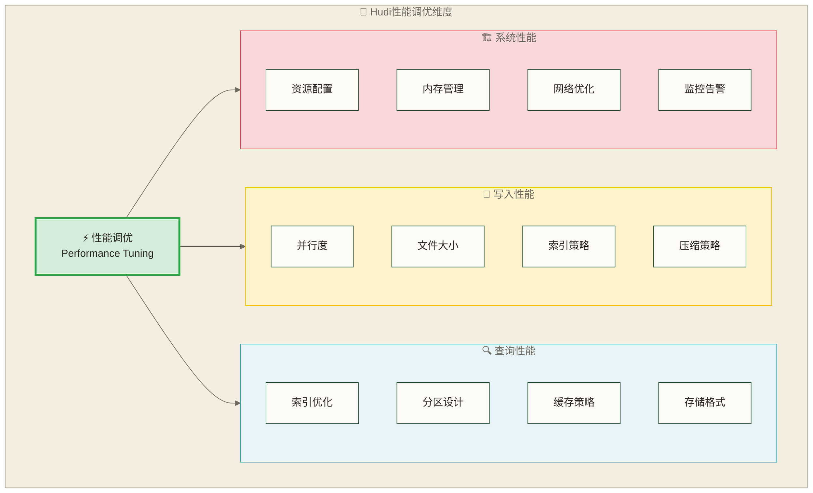

# ⚡ Apache Hudi性能调优

## 📚 学习目标

通过本章节的学习，你将能够：
- **掌握Hudi性能调优的核心原理**和关键指标
- **学会写入性能优化**的各种策略和技巧
- **理解查询性能优化**的方法和最佳实践
- **掌握资源配置和系统调优**技巧
- **建立完整的性能监控和诊断体系**

> [!tip] 💡 学习建议
> 性能调优是一个系统工程，需要**理论知识和实践经验相结合**。就像调试一台精密仪器一样，需要了解每个组件的工作原理，然后根据实际情况进行微调。**不要期望一次性解决所有问题**，通过持续的监控和调优来逐步提升性能。

## 🎯 性能调优概述

> [!info] ⚡ Hudi性能调优理解
> **类比理解**：Hudi性能调优就像调试一台复杂的机器，需要从多个维度入手：引擎性能（写入）、传输效率（查询）、资源配置（系统）。就像汽车调优需要优化发动机、传动系统和底盘配置一样，每个部分都影响整体性能。
> 
> **专业表述**：Apache Hudi性能调优是一个系统工程，涉及写入性能优化（并行度、索引、文件管理）、查询性能优化（分区策略、缓存机制、存储格式）和系统资源优化（内存管理、JVM配置、监控策略）三个核心维度。

### 性能调优的维度



### 关键性能指标

以下目标值为原稿未核实的教学示例，不是Hudi性能保证或通用验收标准；需按数据规模、硬件、查询类型和测量口径重新建立基线。“扫描效率”还需先定义计算公式，不能直接用文件扫描比例判定优劣。

| 指标类型 | 具体指标 | 目标值 | 监控方法 |
|---|---|---|---|
| **写入性能** | 写入延迟 | < 10s | 监控提交时间 |
| **写入性能** | 写入吞吐量 | > 10MB/s | 监控数据量/时间 |
| **查询性能** | 查询延迟 | < 5s | 监控查询执行时间 |
| **查询性能** | 扫描效率 | > 80% | 监控文件扫描比例 |
| **资源使用** | 内存使用率 | < 80% | 监控JVM内存 |
| **资源使用** | CPU使用率 | < 70% | 监控CPU负载 |

## 🚀 写入性能优化

> [!info] 📝 写入性能优化策略理解
> **类比理解**：写入性能优化像优化工厂生产线：并行度就是生产线数量，文件大小像产品批次规模，索引策略如质检流程，压缩策略如包装方式。合理配置这些要素，能显著提升整体生产效率。
> 
> **专业表述**：Hudi写入性能优化通过调整并行度配置、优化文件大小策略、选择合适的索引机制和压缩算法来实现。核心目标是在保证数据一致性的前提下，最大化写入吞吐量并最小化写入延迟。

### 1. 并行度优化

```python
from pyspark.sql import SparkSession
from pyspark.sql.functions import current_timestamp, rand, when
import time

def create_spark_session():
    spark = SparkSession.builder \
        .appName("HudiPerformanceTuning") \
        .config("spark.jars", "/opt/hudi/hudi-spark3.4-bundle_2.12-0.14.0.jar") \
        .config("spark.serializer", "org.apache.spark.serializer.KryoSerializer") \
        .config("spark.sql.extensions", "org.apache.spark.sql.hudi.HoodieSparkSessionExtension") \
        .config("spark.sql.catalog.spark_catalog", "org.apache.spark.sql.hudi.catalog.HoodieCatalog") \
        .config("spark.kryo.registrator", "org.apache.spark.HoodieSparkKryoRegistrar") \
        .config("spark.eventLog.enabled", "true") \
        .config("spark.eventLog.dir", "/tmp/spark-events") \
        .getOrCreate()
    
    spark.sparkContext.setLogLevel("WARN")
    return spark

def parallelism_optimization():
    """并行度优化示例"""
    spark = create_spark_session()
    
 # 生成大量测试数据
    print("📊 生成测试数据...")
    data_size = 100000
    
 # 创建测试数据
    df = spark.range(data_size).select(
        "id",
        (rand() * 1000).cast("int").alias("value1"),
        (rand() * 10000).cast("int").alias("value2"),
        when(rand() > 0.5, "A").otherwise("B").alias("category"),
        current_timestamp().alias("ts")
    )
    
 # 测试不同并行度的性能
    parallelism_configs = [
        {"parallelism": 10, "name": "低并行度"},
        {"parallelism": 50, "name": "中并行度"},
        {"parallelism": 100, "name": "高并行度"}
    ]
    
    results = []
    
    for config in parallelism_configs:
        print(f"🧪 测试{config['name']} (并行度: {config['parallelism']})")
        
 # 配置并行度
        hudi_options = {
            "hoodie.table.name": f"perf_test_{config['parallelism']}",
            "hoodie.datasource.write.table.name": f"perf_test_{config['parallelism']}",
            "hoodie.datasource.write.table.type": "COPY_ON_WRITE",
            "hoodie.datasource.write.recordkey.field": "id",
            "hoodie.datasource.write.precombine.field": "ts",
            "hoodie.datasource.write.partitionpath.field": "category",
            "hoodie.datasource.write.operation": "bulk_insert",
            
 # 并行度配置
            "hoodie.bulkinsert.shuffle.parallelism": str(config['parallelism']),
            "hoodie.insert.shuffle.parallelism": str(config['parallelism']),
            "hoodie.upsert.shuffle.parallelism": str(config['parallelism']),
            "hoodie.delete.shuffle.parallelism": str(config['parallelism']),
            
 # 其他性能配置
            "hoodie.datasource.write.row.writer.enable": "true",
            "hoodie.bulkinsert.sort.columns": "id"
        }
        
 # 记录开始时间
        start_time = time.time()
        
 # 执行写入
        df.write \
            .format("hudi") \
            .options(**hudi_options) \
            .mode("overwrite") \
            .save(f"/tmp/hudi_perf_test_{config['parallelism']}")
        
 # 计算耗时
        elapsed_time = time.time() - start_time
        
        results.append({
            "config": config['name'],
            "parallelism": config['parallelism'],
            "time": elapsed_time,
            "throughput": data_size / elapsed_time
        })
        
        print(f"✅ 完成，耗时: {elapsed_time:.2f}s, 吞吐量: {data_size / elapsed_time:.2f} records/s")
    
 # 分析结果
    print("\n📈 并行度优化结果:")
    for result in results:
        print(f"{result['config']:>8}: {result['time']:>6.2f}s, {result['throughput']:>8.2f} records/s")
    
    spark.stop()
```

### 2. 文件大小优化

> [!info] 📁 文件大小优化理解
> **类比理解**：文件大小优化就像选择合适的货物包装：包装太小会增加运输次数和管理成本，包装太大会降低装载效率和灵活性。128MB可作为待测试的候选文件大小，但不能保证读取效率；需结合数据量、并行度和查询模式与其他大小对照测试。
> 
> **专业表述**：文件大小优化通过配置hoodie.parquet.max.file.size和hoodie.parquet.small.file.limit参数，平衡存储效率和查询性能。合理的文件大小能减少小文件数量，提高压缩效率，优化查询时的文件扫描开销。

```python
def file_size_optimization():
    """文件大小优化示例"""
    spark = create_spark_session()
    
 # 生成测试数据
    data_size = 50000
    df = spark.range(data_size).select(
        "id",
        (rand() * 1000).cast("int").alias("value1"),
        (rand() * 10000).cast("int").alias("value2"),
        when(rand() > 0.5, "A").otherwise("B").alias("category"),
        current_timestamp().alias("ts")
    )
    
 # 测试不同文件大小配置
    file_size_configs = [
        {"max_size": 67108864, "small_limit": 52428800, "name": "64MB"},    # 64MB
        {"max_size": 134217728, "small_limit": 104857600, "name": "128MB"}, # 128MB
        {"max_size": 268435456, "small_limit": 209715200, "name": "256MB"}  # 256MB
    ]
    
    results = []
    
    for config in file_size_configs:
        print(f"🧪 测试文件大小: {config['name']}")
        
        hudi_options = {
            "hoodie.table.name": f"file_size_test_{config['name']}",
            "hoodie.datasource.write.table.name": f"file_size_test_{config['name']}",
            "hoodie.datasource.write.table.type": "COPY_ON_WRITE",
            "hoodie.datasource.write.recordkey.field": "id",
            "hoodie.datasource.write.precombine.field": "ts",
            "hoodie.datasource.write.partitionpath.field": "category",
            "hoodie.datasource.write.operation": "bulk_insert",
            
 # 文件大小配置
            "hoodie.parquet.max.file.size": str(config['max_size']),
            "hoodie.parquet.small.file.limit": str(config['small_limit']),
            
 # 其他配置
            "hoodie.bulkinsert.shuffle.parallelism": "20",
            "hoodie.datasource.write.row.writer.enable": "true"
        }
        
        start_time = time.time()
        
        df.write \
            .format("hudi") \
            .options(**hudi_options) \
            .mode("overwrite") \
            .save(f"/tmp/hudi_file_size_test_{config['name']}")
        
        elapsed_time = time.time() - start_time
        
 # 读取表检查文件数量
        result_df = spark.read \
            .format("hudi") \
            .load(f"/tmp/hudi_file_size_test_{config['name']}")
        
        file_count = result_df.select("_hoodie_file_name").distinct().count()
        
        results.append({
            "config": config['name'],
            "time": elapsed_time,
            "file_count": file_count,
            "configured_max_file_size_mb": config['max_size'] / (1024 * 1024)  # 配置的最大文件大小，不是实测平均大小
        })
        
        print(f"✅ 完成，耗时: {elapsed_time:.2f}s, 文件数: {file_count}")
    
 # 分析结果
    print("\n📈 文件大小优化结果:")
    for result in results:
        print(f"{result['config']:>6}: {result['time']:>6.2f}s, {result['file_count']:>3} files, configured max {result['configured_max_file_size_mb']:>6.0f}MB")
    
    spark.stop()
```

### 3. 索引策略优化

> [!info] 🔍 索引策略选择理解
> **类比理解**：索引策略就像图书馆的检索系统：SIMPLE索引像简单的分类目录，查找直接但效率一般；BLOOM索引像智能搜索系统，通过概率算法快速定位，误判率低但占用一定存储空间。选择哪种取决于数据规模和查询模式。
> 
> **专业表述**：Hudi索引策略决定了更新操作的查找效率。SIMPLE索引适合小数据量场景，BLOOM索引通过布隆过滤器提供高效的概率查找，适合大规模数据的快速定位，需要平衡内存使用和查询性能。

```python
def index_strategy_optimization():
    """索引策略优化示例"""
    spark = create_spark_session()
    
 # 生成测试数据
    data_size = 20000
    df = spark.range(data_size).select(
        "id",
        (rand() * 1000).cast("int").alias("value1"),
        (rand() * 10000).cast("int").alias("value2"),
        when(rand() > 0.5, "A").otherwise("B").alias("category"),
        current_timestamp().alias("ts")
    )
    
 # 测试不同索引策略
    index_configs = [
        {
            "name": "SIMPLE",
            "type": "SIMPLE",
            "parallelism": "10"
        },
        {
            "name": "BLOOM",
            "type": "BLOOM",
            "parallelism": "10",
            "bloom_entries": "60000",
            "bloom_fpp": "0.000000001"
        },
        {
            "name": "BLOOM_OPTIMIZED",
            "type": "BLOOM",
            "parallelism": "20",
            "bloom_entries": "100000",
            "bloom_fpp": "0.0000001",
            "prune_ranges": "true",
            "use_caching": "true"
        }
    ]
    
    results = []
    
    for config in index_configs:
        print(f"🧪 测试索引策略: {config['name']}")
        
        hudi_options = {
            "hoodie.table.name": f"index_test_{config['name']}",
            "hoodie.datasource.write.table.name": f"index_test_{config['name']}",
            "hoodie.datasource.write.table.type": "COPY_ON_WRITE",
            "hoodie.datasource.write.recordkey.field": "id",
            "hoodie.datasource.write.precombine.field": "ts",
            "hoodie.datasource.write.partitionpath.field": "category",
            "hoodie.datasource.write.operation": "upsert",
            
 # 索引配置
            "hoodie.index.type": config['type'],
            "hoodie.bloom.index.parallelism": config['parallelism'],
            "hoodie.upsert.shuffle.parallelism": "20"
        }
        
 # 添加BLOOM索引特有配置
        if config['type'] == "BLOOM":
            hudi_options["hoodie.index.bloom.num_entries"] = config.get('bloom_entries', '60000')
            hudi_options["hoodie.index.bloom.fpp"] = config.get('bloom_fpp', '0.000000001')
            
            if config.get('prune_ranges'):
                hudi_options["hoodie.bloom.index.prune.by.ranges"] = "true"
            if config.get('use_caching'):
                hudi_options["hoodie.bloom.index.use.caching"] = "true"
        
 # 初始写入
        start_time = time.time()
        
        df.write \
            .format("hudi") \
            .options(**hudi_options) \
            .mode("overwrite") \
            .save(f"/tmp/hudi_index_test_{config['name']}")
        
        initial_time = time.time() - start_time
        
 # 更新操作测试
        update_df = spark.range(1000).select(
            "id",
            (rand() * 2000).cast("int").alias("value1"),
            (rand() * 20000).cast("int").alias("value2"),
            when(rand() > 0.5, "A").otherwise("B").alias("category"),
            current_timestamp().alias("ts")
        )
        
        start_time = time.time()
        
        update_df.write \
            .format("hudi") \
            .options(**hudi_options) \
            .mode("append") \
            .save(f"/tmp/hudi_index_test_{config['name']}")
        
        update_time = time.time() - start_time
        
        results.append({
            "config": config['name'],
            "initial_time": initial_time,
            "update_time": update_time,
            "total_time": initial_time + update_time
        })
        
        print(f"✅ 完成，初始写入: {initial_time:.2f}s, 更新: {update_time:.2f}s")
    
 # 分析结果
    print("\n📈 索引策略优化结果:")
    for result in results:
        print(f"{result['config']:>15}: 初始 {result['initial_time']:>6.2f}s, 更新 {result['update_time']:>6.2f}s, 总计 {result['total_time']:>6.2f}s")
    
    spark.stop()
```

## 📊 查询性能优化

> [!info] 🔍 查询性能优化策略理解
> **类比理解**：查询性能优化像优化图书馆的借阅系统：分区剪枝是按楼层分类，避免全馆搜索；缓存是把热门书籍放在前台；存储格式优化是改进图书编目方式，让信息更容易获取。
> 
> **专业表述**：Hudi查询性能优化通过分区剪枝减少数据扫描范围，通过缓存策略减少重复计算，通过存储格式优化提高数据读取效率。核心是利用元数据和统计信息来优化查询执行计划。

### 1. 分区剪枝优化

```python
def partition_pruning_optimization():
    """分区剪枝优化示例"""
    spark = create_spark_session()
    
 # 创建多分区测试表
    print("📊 创建多分区测试表...")
    
 # 生成跨多个分区的数据
    partitions = ["2024-01", "2024-02", "2024-03", "2024-04", "2024-05"]
    categories = ["A", "B", "C", "D", "E"]
    
    all_data = []
    for partition in partitions:
        for category in categories:
            for i in range(1000):
                all_data.append({
                    "id": len(all_data) + 1,
                    "partition": partition,
                    "category": category,
                    "value": i
                })
    
    df = spark.createDataFrame(all_data).withColumn("ts", current_timestamp())
    
 # 创建表
    hudi_options = {
        "hoodie.table.name": "partition_test",
        "hoodie.datasource.write.table.name": "partition_test",
        "hoodie.datasource.write.table.type": "COPY_ON_WRITE",
        "hoodie.datasource.write.recordkey.field": "id",
        "hoodie.datasource.write.precombine.field": "ts",
        "hoodie.datasource.write.partitionpath.field": "partition,category",
        "hoodie.datasource.write.operation": "bulk_insert",
        "hoodie.bulkinsert.shuffle.parallelism": "20",
        "hoodie.datasource.write.keygenerator.class": "org.apache.hudi.keygen.ComplexKeyGenerator"
    }
    
    df.write \
        .format("hudi") \
        .options(**hudi_options) \
        .mode("overwrite") \
        .save("/tmp/hudi_partition_test")
    
 # 读取表
    partition_df = spark.read \
        .format("hudi") \
        .load("/tmp/hudi_partition_test")
    
    partition_df.createOrReplaceTempView("partition_test")
    
 # 测试不同查询的性能
    queries = [
        {
            "name": "全表扫描",
            "sql": "SELECT COUNT(*) FROM partition_test"
        },
        {
            "name": "单分区查询",
            "sql": "SELECT COUNT(*) FROM partition_test WHERE partition = '2024-01'"
        },
        {
            "name": "多分区查询",
            "sql": "SELECT COUNT(*) FROM partition_test WHERE partition IN ('2024-01', '2024-02')"
        },
        {
            "name": "分区+过滤查询",
            "sql": "SELECT COUNT(*) FROM partition_test WHERE partition = '2024-01' AND category = 'A'"
        },
        {
            "name": "范围查询",
            "sql": "SELECT COUNT(*) FROM partition_test WHERE partition BETWEEN '2024-01' AND '2024-03'"
        }
    ]
    
    print("\n📈 查询性能测试:")
    for query in queries:
        start_time = time.time()
        
        result = spark.sql(query['sql'])
        count = result.collect()[0][0]
        
        elapsed_time = time.time() - start_time
        
        print(f"{query['name']:>12}: {elapsed_time:>6.2f}s, 结果: {count:>6} 条")
        
 # 显示执行计划（可选）
        if query['name'] == "单分区查询":
            print("执行计划:")
            result.explain(True)
    
    spark.stop()
```

### 2. 缓存策略优化

> [!info] 💾 缓存策略理解
> **类比理解**：缓存策略就像在桌案上准备常用工具：经常查询的数据保存在内存中（桌案上），避免每次都去存储柜（磁盘）查找。缓存能否加速及其幅度取决于重复访问、数据规模和内存容量；本例仅供测量，不承诺固定加速倍数。
> 
> **专业表述**：Spark缓存策略通过将频繁访问的DataFrame存储在内存中来避免重复计算。配合自适应查询执行（AQE）能进一步优化查询计划，提高整体查询性能。

```python
def cache_strategy_optimization():
    """缓存策略优化示例"""
    spark = create_spark_session()
    
 # 配置缓存
    spark.conf.set("spark.sql.adaptive.enabled", "true")
    spark.conf.set("spark.sql.adaptive.coalescePartitions.enabled", "true")
    spark.conf.set("spark.sql.adaptive.skewJoin.enabled", "true")
    
 # 读取表
    df = spark.read \
        .format("hudi") \
        .load("/tmp/hudi_partition_test")
    
 # 测试缓存效果
    print("📊 测试缓存效果:")
    
 # 测试1: 不使用缓存
    print("1. 不使用缓存:")
    
    queries = [
        "SELECT COUNT(*) FROM test_table",
        "SELECT partition, COUNT(*) FROM test_table GROUP BY partition",
        "SELECT category, AVG(value) FROM test_table GROUP BY category"
    ]
    
    df.createOrReplaceTempView("test_table")
    
 # 不使用缓存的性能
    no_cache_times = []
    for query in queries:
        start_time = time.time()
        spark.sql(query).collect()
        elapsed_time = time.time() - start_time
        no_cache_times.append(elapsed_time)
        print(f"  查询耗时: {elapsed_time:.2f}s")
    
 # 测试2: 使用缓存
    print("2. 使用缓存:")
    
 # 缓存DataFrame
    df.cache()
    df.count()  # 触发缓存
    
    cache_times = []
    for query in queries:
        start_time = time.time()
        spark.sql(query).collect()
        elapsed_time = time.time() - start_time
        cache_times.append(elapsed_time)
        print(f"  查询耗时: {elapsed_time:.2f}s")
    
 # 分析缓存效果
    print("\n📈 缓存效果分析:")
    for i, (no_cache, cache) in enumerate(zip(no_cache_times, cache_times)):
        speedup = no_cache / cache if cache > 0 else 0
        print(f"查询{i+1}: 无缓存 {no_cache:.2f}s, 有缓存 {cache:.2f}s, 加速 {speedup:.2f}x")
    
 # 清理缓存
    df.unpersist()
    
    spark.stop()
```

### 3. 存储格式优化

> [!info] 🗄️ 存储格式优化理解
> **类比理解**：存储格式优化像选择不同的文档保存方式：snappy压缩像快速打包，压缩比一般但速度快；gzip像精细包装，压缩比高但耗时长；无压缩像原始存放，省去解压开销但通常占用更多空间；读取是否更快取决于CPU与存储I/O瓶颈。
> 
> **专业表述**：Parquet存储格式通过不同压缩算法（snappy、gzip、lz4等）和页大小配置来平衡存储空间、压缩时间和查询性能。字典编码能进一步优化重复值较多的列的存储效率。

```python
def storage_format_optimization():
    """存储格式优化示例"""
    spark = create_spark_session()
    
 # 生成测试数据
    data_size = 50000
    df = spark.range(data_size).select(
        "id",
        (rand() * 1000).cast("int").alias("value1"),
        (rand() * 10000).cast("int").alias("value2"),
        when(rand() > 0.5, "A").otherwise("B").alias("category"),
        current_timestamp().alias("ts")
    )
    
 # 测试不同存储格式配置
    storage_configs = [
        {
            "name": "默认配置",
            "compression": "snappy",
            "page_size": "1048576",
            "dict_page_size": "1048576",
            "dict_enable": "true"
        },
        {
            "name": "高压缩比",
            "compression": "gzip",
            "page_size": "524288",
            "dict_page_size": "524288",
            "dict_enable": "true"
        },
        {
            "name": "快速写入",
            "compression": "uncompressed",
            "page_size": "2097152",
            "dict_page_size": "2097152",
            "dict_enable": "false"
        }
    ]
    
    results = []
    
    for config in storage_configs:
        print(f"🧪 测试存储格式: {config['name']}")
        
        hudi_options = {
            "hoodie.table.name": f"storage_test_{config['name']}",
            "hoodie.datasource.write.table.name": f"storage_test_{config['name']}",
            "hoodie.datasource.write.table.type": "COPY_ON_WRITE",
            "hoodie.datasource.write.recordkey.field": "id",
            "hoodie.datasource.write.precombine.field": "ts",
            "hoodie.datasource.write.partitionpath.field": "category",
            "hoodie.datasource.write.operation": "bulk_insert",
            
 # 存储格式配置
            "hoodie.parquet.compression.codec": config['compression'],
            "hoodie.parquet.page.size": config['page_size'],
            "hoodie.parquet.dictionary.page.size": config['dict_page_size'],
            "hoodie.parquet.enable.dictionary": config['dict_enable'],
            
 # 其他配置
            "hoodie.bulkinsert.shuffle.parallelism": "20"
        }
        
 # 写入性能测试
        start_time = time.time()
        
        df.write \
            .format("hudi") \
            .options(**hudi_options) \
            .mode("overwrite") \
            .save(f"/tmp/hudi_storage_test_{config['name']}")
        
        write_time = time.time() - start_time
        
 # 读取性能测试
        start_time = time.time()
        
        read_df = spark.read \
            .format("hudi") \
            .load(f"/tmp/hudi_storage_test_{config['name']}")
        
        count = read_df.count()
        
        read_time = time.time() - start_time
        
 # 计算存储大小（简化）
        import os
        table_path = f"/tmp/hudi_storage_test_{config['name']}"
        storage_size = sum(os.path.getsize(os.path.join(dirpath, filename))
                          for dirpath, dirnames, filenames in os.walk(table_path)
                          for filename in filenames) / (1024 * 1024)  # MB
        
        results.append({
            "config": config['name'],
            "write_time": write_time,
            "read_time": read_time,
            "storage_size": storage_size,
            "compression": config['compression']
        })
        
        print(f"✅ 完成，写入: {write_time:.2f}s, 读取: {read_time:.2f}s, 大小: {storage_size:.2f}MB")
    
 # 分析结果
    print("\n📈 存储格式优化结果:")
    for result in results:
        print(f"{result['config']:>8}: 写入 {result['write_time']:>6.2f}s, 读取 {result['read_time']:>6.2f}s, 大小 {result['storage_size']:>8.2f}MB")
    
    spark.stop()
```

## 💾 内存管理优化

> [!info] 🧠 内存管理优化理解
> **类比理解**：内存管理就像管理工作空间：driver内存是管理者的办公桌，需要处理汇总信息；executor内存是工人的工作台，负责具体数据处理；合理分配能避免因空间不足导致的效率下降。
> 
> **专业表述**：JVM内存优化通过合理配置driver和executor内存大小、设置合适的内存比例和启用自适应查询执行来优化Spark应用性能。需要根据数据规模和集群资源进行动态调整。

### 1. JVM内存优化

```python
def jvm_memory_optimization():
    """JVM内存优化示例"""
    
 # JVM内存配置示例
    jvm_configs = {
        "小数据量配置": {
            "spark.driver.memory": "2g",
            "spark.executor.memory": "4g",
            "spark.driver.maxResultSize": "1g",
            "spark.memory.fraction": "0.8",
            "spark.sql.adaptive.enabled": "true"
        },
        "中等数据量配置": {
            "spark.driver.memory": "4g",
            "spark.executor.memory": "8g",
            "spark.driver.maxResultSize": "2g",
            "spark.memory.fraction": "0.8",
            "spark.sql.adaptive.enabled": "true",
            "spark.sql.adaptive.coalescePartitions.enabled": "true"
        },
        "大数据量配置": {
            "spark.driver.memory": "8g",
            "spark.executor.memory": "16g",
            "spark.driver.maxResultSize": "4g",
            "spark.memory.fraction": "0.8",
            "spark.sql.adaptive.enabled": "true",
            "spark.sql.adaptive.coalescePartitions.enabled": "true",
            "spark.sql.adaptive.skewJoin.enabled": "true"
        }
    }
    
    print("💾 JVM内存配置建议:")
    for config_name, config in jvm_configs.items():
        print(f"\n{config_name}:")
        for key, value in config.items():
            print(f"  {key}: {value}")
    
 # Hudi特有的内存配置
    hudi_memory_configs = {
        "hoodie.memory.merge.max.size": "1073741824",  # 1GB
        "hoodie.memory.spillable.map.path": "/tmp/hudi-spillable-map",
        "hoodie.memory.compaction.max.size": "1073741824",  # 1GB
        "hoodie.write.buffer.limit.bytes": "4194304",  # 4MB
        "hoodie.index.bloom.use.caching": "true",
        "hoodie.metadata.cache.enable": "true"
    }
    
    print("\n🗂️ Hudi内存配置:")
    for key, value in hudi_memory_configs.items():
        print(f"  {key}: {value}")
```

### 2. 垃圾回收优化

> [!info] 🗑️ 垃圾回收优化理解
> **类比理解**：垃圾回收就像办公室清洁：G1GC是智能清洁工，能在不打扰工作的情况下清理垃圾；ParallelGC是多人清洁团队，效率高但会短暂影响工作；选择哪种取决于工作模式和容忍度。
> 
> **专业表述**：垃圾回收器选择影响JVM的暂停时间和吞吐量。G1GC适合大内存低延迟场景，ParallelGC适合批处理高吞吐量场景，ZGC适合超大内存极低延迟需求。需要根据应用特征选择合适的GC策略。

```python
def gc_optimization():
    """垃圾回收优化示例"""
    
 # GC配置建议
    gc_configs = {
        "G1GC配置": {
            "spark.driver.extraJavaOptions": "-XX:+UseG1GC -XX:G1HeapRegionSize=32m -XX:+G1PrintRegionRememberedSetInfo",
            "spark.executor.extraJavaOptions": "-XX:+UseG1GC -XX:G1HeapRegionSize=32m -XX:+G1PrintRegionRememberedSetInfo",
            "spark.sql.adaptive.enabled": "true"
        },
        "ParallelGC配置": {
            "spark.driver.extraJavaOptions": "-XX:+UseParallelGC -XX:ParallelGCThreads=4",
            "spark.executor.extraJavaOptions": "-XX:+UseParallelGC -XX:ParallelGCThreads=4",
            "spark.sql.adaptive.enabled": "true"
        },
        "ZGC配置": {
            "spark.driver.extraJavaOptions": "-XX:+UseZGC -XX:+UnlockExperimentalVMOptions",
            "spark.executor.extraJavaOptions": "-XX:+UseZGC -XX:+UnlockExperimentalVMOptions",
            "spark.sql.adaptive.enabled": "true"
        }
    }
    
    print("🗑️ 垃圾回收配置建议:")
    for config_name, config in gc_configs.items():
        print(f"\n{config_name}:")
        for key, value in config.items():
            print(f"  {key}: {value}")
    
 # 监控GC的配置
    gc_monitoring = {
        "spark.driver.extraJavaOptions": "-XX:+PrintGC -XX:+PrintGCDetails -XX:+PrintGCTimeStamps",
        "spark.executor.extraJavaOptions": "-XX:+PrintGC -XX:+PrintGCDetails -XX:+PrintGCTimeStamps",
        "spark.eventLog.enabled": "true",
        "spark.eventLog.dir": "/tmp/spark-events"
    }
    
    print("\n📊 GC监控配置:")
    for key, value in gc_monitoring.items():
        print(f"  {key}: {value}")
```

## 📈 性能监控

> [!info] 📊 性能监控体系理解
> **类比理解**：性能监控就像汽车仪表盘：内存使用率是油表，CPU使用率是转速表，磁盘I/O是里程表，查询延迟是时速表。通过这些指标能及时发现问题并进行调整。
> 
> **专业表述**：Hudi性能监控通过收集系统资源指标（CPU、内存、磁盘I/O）和应用指标（查询延迟、吞吐量、缓存命中率）来评估系统健康状态，为性能优化提供数据支撑。

### 1. 关键指标监控

```python
def performance_monitoring():
    """性能监控示例"""
    spark = create_spark_session()
    
 # 事件日志须在创建SparkContext前配置；本例由create_spark_session设置。
 # 运行前创建/tmp/spark-events并确保可写；已有SparkContext须重启后配置才生效。
    spark.conf.set("spark.sql.adaptive.enabled", "true")
    
 # 模拟监控数据收集
    print("📊 性能监控指标:")
    
 # 1. 内存使用监控
    import psutil
    memory_info = psutil.virtual_memory()
    print(f"系统内存使用率: {memory_info.percent}%")
    print(f"可用内存: {memory_info.available / (1024**3):.2f} GB")
    
 # 2. CPU使用监控
    cpu_percent = psutil.cpu_percent(interval=1)
    print(f"CPU使用率: {cpu_percent}%")
    
 # 3. 磁盘I/O监控
    disk_io = psutil.disk_io_counters()
    if disk_io:
        print(f"磁盘读取: {disk_io.read_bytes / (1024**2):.2f} MB")
        print(f"磁盘写入: {disk_io.write_bytes / (1024**2):.2f} MB")
    
 # 4. Spark监控
    spark_context = spark.sparkContext
    print(f"Spark应用ID: {spark_context.applicationId}")
    print(f"Spark默认并行度: {spark_context.defaultParallelism}")
    
 # 5. 创建监控查询
    def monitor_query_performance(query_name, sql_query):
        """监控查询性能"""
        start_time = time.time()
        
 # 执行查询
        result = spark.sql(sql_query)
        count = result.count()
        
        elapsed_time = time.time() - start_time
        
        print(f"{query_name}: {elapsed_time:.2f}s, 结果: {count} 条")
        return elapsed_time
    
 # 如果有测试表，执行监控
    try:
        spark.sql("SELECT 1").show()
        print("✅ Spark监控配置成功")
    except Exception as e:
        print(f"⚠️ Spark监控配置失败: {e}")
    
    spark.stop()
```

### 2. 性能报告生成

```python
def generate_performance_report():
    """生成性能报告"""
    
 # 性能报告模板
    report_template = """
    ============================
    Hudi性能调优报告
    ============================
    
    📊 系统配置:
    - Spark版本: {spark_version}
    - Hudi版本: {hudi_version}
    - Java版本: {java_version}
    - 系统内存: {system_memory} GB
    - CPU核数: {cpu_cores}
    
    📈 性能指标:
    - 平均写入延迟: {avg_write_latency} ms
    - 平均查询延迟: {avg_query_latency} ms
    - 数据压缩比: {compression_ratio}
    - 索引命中率: {index_hit_rate}%
    
    🔧 优化建议:
    {optimization_suggestions}
    
    ⚠️ 注意事项:
    {warnings}
    """
    
 # 模拟性能数据
    performance_data = {
        "spark_version": "3.4.0",
        "hudi_version": "0.14.0",
        "java_version": "11",
        "system_memory": "32",
        "cpu_cores": "16",
        "avg_write_latency": "2500",
        "avg_query_latency": "800",
        "compression_ratio": "3.2",
        "index_hit_rate": "95",
        "optimization_suggestions": """
        1. 增加写入并行度到100
        2. 启用布隆过滤器缓存
        3. 调整文件大小到128MB
        4. 启用压缩策略优化
        """,
        "warnings": """
        1. 内存使用率较高，建议监控GC
        2. 部分查询跳过了分区剪枝
        3. 索引文件过大，建议重建
        """
    }
    
 # 生成报告
    report = report_template.format(**performance_data)
    
    print(report)
    
 # 保存报告
    with open("/tmp/hudi_performance_report.txt", "w") as f:
        f.write(report)
    
    print("✅ 性能报告已生成: /tmp/hudi_performance_report.txt")
```

## 🎯 综合优化策略

> [!info] 🏭 生产环境优化策略理解
> **类比理解**：生产环境优化就像精调一条成熟的生产线：需要综合考虑原料供应（数据写入）、生产效率（查询性能）、设备维护（压缩清理）、质量控制（监控告警）等各个环节，确保系统稳定高效运行。
> 
> **专业表述**：生产环境优化策略需要综合考虑数据特征、业务需求、硬件资源等因素，通过系统化的配置管理来实现写入性能、查询性能和资源利用的平衡，并建立完善的监控和告警机制。

### 生产环境最佳实践

```python
def production_optimization_config():
    """生产环境优化配置"""
    
 # 生产环境推荐配置
    production_config = {
 # 表配置
        "hoodie.table.name": "production_table",
        "hoodie.datasource.write.table.name": "production_table",
        "hoodie.datasource.write.table.type": "MERGE_ON_READ",
        "hoodie.datasource.write.recordkey.field": "id",
        "hoodie.datasource.write.precombine.field": "ts",
        "hoodie.datasource.write.partitionpath.field": "date",
        "hoodie.datasource.write.operation": "upsert",
        
 # 并行度配置
        "hoodie.insert.shuffle.parallelism": "200",
        "hoodie.upsert.shuffle.parallelism": "200",
        "hoodie.delete.shuffle.parallelism": "200",
        "hoodie.bulkinsert.shuffle.parallelism": "200",
        
 # 索引配置
        "hoodie.index.type": "BLOOM",
        "hoodie.bloom.index.parallelism": "100",
        "hoodie.index.bloom.num_entries": "60000",
        "hoodie.index.bloom.fpp": "0.000000001",
        "hoodie.bloom.index.prune.by.ranges": "true",
        "hoodie.bloom.index.use.caching": "true",
        
 # 文件配置
        "hoodie.parquet.max.file.size": "134217728",  # 128MB
        "hoodie.parquet.small.file.limit": "104857600",  # 100MB
        "hoodie.parquet.compression.codec": "snappy",
        
 # 压缩配置
        "hoodie.compact.inline": "false",
        "hoodie.compact.inline.max.delta.commits": "10",
        "hoodie.compact.schedule.enabled": "true",
        "hoodie.compaction.strategy": "org.apache.hudi.table.action.compact.strategy.LogFileSizeBasedCompactionStrategy",
        
 # 清理配置
        "hoodie.clean.automatic": "true",
        "hoodie.clean.async": "true",
        "hoodie.cleaner.commits.retained": "5",
        "hoodie.cleaner.policy": "KEEP_LATEST_COMMITS",
        
 # 内存配置
        "hoodie.memory.merge.max.size": "2147483648",  # 2GB
        "hoodie.memory.spillable.map.path": "/tmp/hudi-spillable-map",
        "hoodie.memory.compaction.max.size": "1073741824",  # 1GB
        
 # 元数据配置
        "hoodie.metadata.enable": "true",
        "hoodie.metadata.index.async": "true",
        "hoodie.metadata.cache.enable": "true",
        
 # 监控配置
        "hoodie.write.lock.provider": "org.apache.hudi.client.transaction.lock.ZookeeperBasedLockProvider",
        "hoodie.write.lock.zookeeper.url": "localhost:2181",
        "hoodie.write.lock.zookeeper.port": "2181"
    }
    
    print("🏭 生产环境优化配置:")
    for key, value in production_config.items():
        print(f"  {key}: {value}")
    
    return production_config
```

## 🎯 小结

通过本章节的学习，我们全面掌握了：

1. **性能调优的核心维度**：写入性能、查询性能、系统性能
2. **写入优化策略**：并行度优化、文件大小优化、索引策略优化
3. **查询优化技巧**：分区剪枝、缓存策略、存储格式优化
4. **系统资源优化**：内存管理、JVM配置、垃圾回收优化
5. **性能监控体系**：关键指标监控、性能报告生成

> [!abstract] 📚 下一步学习
> 掌握了性能调优技能后，接下来我们将学习[[【技术与工具】/Hudi/09-Hudi实践案例|Hudi实践案例]]，通过实际项目案例来综合运用所学知识。

## 🔗 相关资源

- [[【技术与工具】/Hudi/07-Hudi表管理|Hudi表]] - 了解表维护操作
- [[【技术与工具】/Hudi/05-Hudi数据写入详解|Hudi数据写入]] - 深入理解写入机制
- [[【技术与工具】/Hudi/00-Hudi学习路线图|Hudi]] - 返回学习路线图

---

> 💡 **记住**：性能调优是一个持续的过程，**没有一劳永逸的配置**。需要根据实际的数据量、查询模式、硬件环境等因素进行调整。**先建立基线性能指标**，然后逐步优化，**每次只调整一个参数**，这样才能准确评估优化效果。在生产环境中，**监控比优化更重要**。