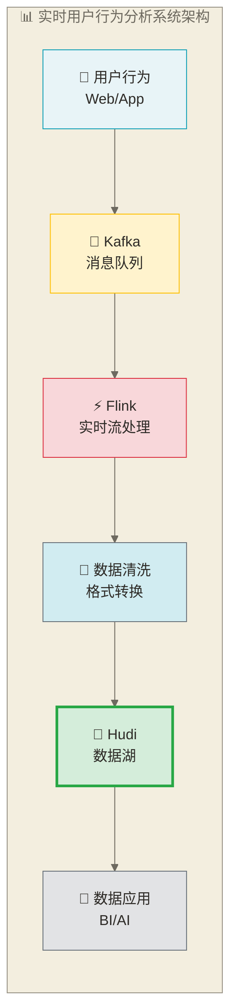

# 🏗️ Apache Hudi实践案例

## 📚 学习目标

通过本章节的学习，你将能够：
- **掌握Hudi在实际项目中的应用场景**和解决方案
- **学会设计和实现端到端的数据湖架构**
- **理解不同业务场景的技术选型**和最佳实践
- **具备解决实际问题的能力**和项目经验
- **建立完整的Hudi项目开发流程**

> [!tip] 💡 学习建议
> 实践案例是理论知识的综合应用，**不要只关注代码实现**。更重要的是理解业务需求、技术选型的依据、架构设计的思路。就像建造一座大楼，**先要理解设计图纸，再看具体的施工细节**。每个案例都包含了丰富的实战经验，建议多思考、多实践。

## 🎯 案例1：实时用户行为分析系统

> [!info] 📊 实时用户行为分析系统理解
> **类比理解**：实时用户行为分析系统就像一个高级的商店监控系统：实时跟踪每个顾客在店内的路径（浏览路径）、停留时间（浏览时长）、着重关注的商品（点击事件）和购买行为，然后即时调整店面布局和推荐策略。
> 
> **专业表述**：基于Apache Hudi的实时用户行为分析系统通过流式数据处理架构（Kafka + Flink + Hudi），实现从数据采集、实时处理到存储分析的全链路解决方案，支持个性化推荐、精准营销和运营决策。

### 业务背景

教学假设：某电商平台需要构建实时用户行为分析系统，实时跟踪用户的浏览、点击、购买等行为，为推荐系统和运营决策提供数据支持。下列“每秒10万+”保留为原稿未核实的需求示例，不代表真实企业负载或本方案已达到的吞吐。

### 技术挑战

1. **大量实时数据**：每秒10万+用户行为事件
2. **数据更新频繁**：用户状态需要实时更新
3. **历史数据保留**：需要保存完整的用户行为历史
4. **多维度查询**：支持按用户、商品、时间等多维度分析

### 解决方案架构



### 实现步骤

#### 1. 数据模型设计

> [!info] 📋 数据模型设计理解
> **类比理解**：数据模型设计就像设计一张表格来记录顾客信息：用户行为表像“购物清单”，记录每次操作的详细信息；用户画像表像“会员档案”，存储每个用户的基本信息和习惯偏好。
> 
> **专业表述**：数据模型采用星型模型设计，用户行为事件表作为事实表存储原始事件流数据，用户画像表作为维度表存储聚合后的用户属性信息。通过合理的分区策略和索引设计提高查询性能。

```python
from pyspark.sql import SparkSession
from pyspark.sql.types import StructType, StructField, StringType, IntegerType, TimestampType, LongType
from pyspark.sql.functions import current_timestamp, from_json, col, coalesce, count, countDistinct, sum, when, max, collect_set

def create_spark_session():
    spark = SparkSession.builder \
        .appName("UserBehaviorAnalysis") \
        .config("spark.jars", "/opt/hudi/hudi-spark3.4-bundle_2.12-0.14.0.jar") \
        .config("spark.serializer", "org.apache.spark.serializer.KryoSerializer") \
        .config("spark.sql.extensions", "org.apache.spark.sql.hudi.HoodieSparkSessionExtension") \
        .config("spark.sql.catalog.spark_catalog", "org.apache.spark.sql.hudi.catalog.HoodieCatalog") \
        .config("spark.kryo.registrator", "org.apache.spark.HoodieSparkKryoRegistrar") \
        .getOrCreate()
    return spark

def design_data_model():
    """设计数据模型"""
    
 # 用户行为事件表
    user_behavior_schema = StructType([
        StructField("event_id", StringType(), False),
        StructField("user_id", StringType(), False),
        StructField("session_id", StringType(), True),
        StructField("event_type", StringType(), False),  # click, view, purchase, etc.
        StructField("product_id", StringType(), True),
        StructField("category_id", StringType(), True),
        StructField("page_url", StringType(), True),
        StructField("timestamp", TimestampType(), False),
        StructField("properties", StringType(), True),  # JSON格式的扩展属性
        StructField("device_type", StringType(), True),
        StructField("browser", StringType(), True),
        StructField("location", StringType(), True),
        StructField("date", StringType(), False)  # 分区字段，格式：yyyy-MM-dd
    ])
    
 # 用户画像表
    user_profile_schema = StructType([
        StructField("user_id", StringType(), False),
        StructField("gender", StringType(), True),
        StructField("age_group", StringType(), True),
        StructField("city", StringType(), True),
        StructField("registration_date", TimestampType(), True),
        StructField("total_orders", IntegerType(), True),
        StructField("total_amount", LongType(), True),
        StructField("last_login", TimestampType(), True),
        StructField("favorite_categories", StringType(), True),
        StructField("updated_at", TimestampType(), False)
    ])
    
    print("✅ 数据模型设计完成")
    return user_behavior_schema, user_profile_schema
```

#### 2. 实时数据处理

> [!info] ⚡ 实时数据处理流程理解
> **类比理解**：实时数据处理像一个24小时运转的数据加工厂：Kafka是传送带，源源不断地输送原始数据；Spark Streaming是加工设备，实时清洗和转换数据；Hudi是智能仓库，自动分类存储并支持随时查询。
> 
> **专业表述**：本节代码采用Spark Structured Streaming从Kafka消费数据，经解析、过滤和字段转换后，以流式方式写入Hudi表；未实现独立批处理层，不能据此称为完整Lambda架构。架构图中的Flink是另一种处理引擎选项，并非本节代码实现。MERGE_ON_READ支持增量日志写入与合并读取，实际写入延迟和查询性能需结合压缩调度、资源与负载验证。

```python
def real_time_processing():
    """实时数据处理"""
    spark = create_spark_session()
    
 # 从Kafka读取实时数据
    kafka_df = spark \
        .readStream \
        .format("kafka") \
        .option("kafka.bootstrap.servers", "localhost:9092") \
        .option("subscribe", "user_behavior_events") \
        .option("startingOffsets", "latest") \
        .load()
    
 # 解析JSON数据
    user_behavior_schema, _ = design_data_model()
    
    parsed_df = kafka_df \
        .select(from_json(col("value").cast("string"), user_behavior_schema).alias("data")) \
        .select("data.*")
    
 # 数据清洗和转换
    cleaned_df = parsed_df \
        .filter(col("user_id").isNotNull()) \
        .filter(col("event_type").isin(["click", "view", "purchase", "add_to_cart"])) \
        .withColumn("timestamp", coalesce(col("timestamp"), current_timestamp())) \
        .withColumn("date", col("timestamp").cast("date").cast("string"))
    
 # 配置Hudi写入
    hudi_options = {
        "hoodie.table.name": "user_behavior_events",
        "hoodie.datasource.write.table.name": "user_behavior_events",
        "hoodie.datasource.write.table.type": "MERGE_ON_READ",
        "hoodie.datasource.write.recordkey.field": "event_id",
        "hoodie.datasource.write.precombine.field": "timestamp",
        "hoodie.datasource.write.partitionpath.field": "date",
        "hoodie.datasource.write.operation": "upsert",
        
 # 流式写入配置
        "hoodie.datasource.write.streaming.retry.count": "3",
        "hoodie.datasource.write.streaming.retry.interval.ms": "2000",
        "hoodie.datasource.write.streaming.ignore.failed.batch": "false",
        
 # 性能优化配置
        "hoodie.upsert.shuffle.parallelism": "200",
        "hoodie.compact.inline": "false",
        "hoodie.compact.inline.max.delta.commits": "10",
        
 # 检查点配置
        "checkpointLocation": "/tmp/user_behavior_checkpoint"
    }
    
 # 启动流式写入
    streaming_query = cleaned_df \
        .writeStream \
        .format("hudi") \
        .options(**hudi_options) \
        .trigger(processingTime="10 seconds") \
        .start("/data/hudi/user_behavior_events")
    
    print("✅ 实时数据处理已启动")
    return streaming_query
```

#### 3. 用户画像更新

> [!info] 🎭 用户画像更新机制理解
> **类比理解**：用户画像更新就像更新顾客档案：每当顾客在店内有新的行为时，就要更新他的个人档案（如喜好类别、购物频率、消费水平等）。这样下次推荐商品时就能更精准。
> 
> **专业表述**：用户画像更新通过定时作业或实时流处理，从用户行为事件表中聚合计算用户统计指标，并使用Hudi的Upsert操作更新用户画像表。利用预计算的统计值提高实时查询性能。

```python
def update_user_profile():
    """更新用户画像"""
    spark = create_spark_session()
    
 # 读取用户行为数据
    behavior_df = spark.read \
        .format("hudi") \
        .option("hoodie.datasource.query.type", "snapshot") \
        .load("/data/hudi/user_behavior_events")
    
 # 计算用户行为统计
    user_stats = behavior_df \
        .groupBy("user_id") \
        .agg(
            count("*").alias("total_events"),
            countDistinct("session_id").alias("total_sessions"),
            countDistinct("product_id").alias("unique_products_viewed"),
            sum(when(col("event_type") == "purchase", 1).otherwise(0)).alias("total_purchases"),
            max("timestamp").alias("last_activity"),
            collect_set("category_id").alias("viewed_categories")
        )
    
 # 读取现有用户画像
    try:
        existing_profile = spark.read \
            .format("hudi") \
            .load("/data/hudi/user_profile")
    except:
 # 如果表不存在，创建空表
        _, user_profile_schema = design_data_model()
        existing_profile = spark.createDataFrame([], user_profile_schema)
    
 # 更新用户画像
    updated_profile = user_stats \
        .withColumn("last_login", col("last_activity")) \
        .withColumn("favorite_categories", col("viewed_categories").cast("string")) \
        .withColumn("updated_at", current_timestamp()) \
        .select("user_id", "last_login", "favorite_categories", "updated_at")
    
 # 写入用户画像表
    profile_options = {
        "hoodie.table.name": "user_profile",
        "hoodie.datasource.write.table.name": "user_profile",
        "hoodie.datasource.write.table.type": "COPY_ON_WRITE",
        "hoodie.datasource.write.recordkey.field": "user_id",
        "hoodie.datasource.write.precombine.field": "updated_at",
        "hoodie.datasource.write.partitionpath.field": "",
        "hoodie.datasource.write.operation": "upsert",
        "hoodie.datasource.write.keygenerator.class": "org.apache.hudi.keygen.NonpartitionedKeyGenerator"
    }
    
    updated_profile.write \
        .format("hudi") \
        .options(**profile_options) \
        .mode("append") \
        .save("/data/hudi/user_profile")
    
    print("✅ 用户画像更新完成")
    
    spark.stop()
```

#### 4. 实时分析查询

```python
def real_time_analytics():
    """实时分析查询"""
    spark = create_spark_session()
    
 # 读取实时数据
    behavior_df = spark.read \
        .format("hudi") \
        .option("hoodie.datasource.query.type", "snapshot") \
        .load("/data/hudi/user_behavior_events")
    
    behavior_df.createOrReplaceTempView("user_behavior")
    
 # 1. 实时热门商品排行
    print("🔥 实时热门商品排行:")
    hot_products = spark.sql("""
        SELECT 
            product_id,
            COUNT(*) as view_count,
            COUNT(DISTINCT user_id) as unique_users
        FROM user_behavior
        WHERE event_type = 'view'
        AND date >= date_sub(current_date(), 1)
        GROUP BY product_id
        ORDER BY view_count DESC
        LIMIT 10
    """)
    hot_products.show()
    
 # 2. 用户活跃度分析
    print("👥 用户活跃度分析:")
    user_activity = spark.sql("""
        SELECT 
            hour(timestamp) as hour,
            COUNT(DISTINCT user_id) as active_users,
            COUNT(*) as total_events
        FROM user_behavior
        WHERE date = current_date()
        GROUP BY hour(timestamp)
        ORDER BY hour
    """)
    user_activity.show()
    
 # 3. 转化率分析
    print("📊 转化率分析:")
    conversion_analysis = spark.sql("""
        WITH user_funnel AS (
            SELECT 
                user_id,
                MAX(CASE WHEN event_type = 'view' THEN 1 ELSE 0 END) as viewed,
                MAX(CASE WHEN event_type = 'add_to_cart' THEN 1 ELSE 0 END) as added_to_cart,
                MAX(CASE WHEN event_type = 'purchase' THEN 1 ELSE 0 END) as purchased
            FROM user_behavior
            WHERE date >= date_sub(current_date(), 7)
            GROUP BY user_id
        )
        SELECT 
            COUNT(*) as total_users,
            SUM(viewed) as users_viewed,
            SUM(added_to_cart) as users_added_to_cart,
            SUM(purchased) as users_purchased,
            ROUND(SUM(added_to_cart) * 100.0 / SUM(viewed), 2) as cart_conversion_rate,
            ROUND(SUM(purchased) * 100.0 / SUM(added_to_cart), 2) as purchase_conversion_rate
        FROM user_funnel
        WHERE viewed = 1
    """)
    conversion_analysis.show()
    
 # 4. 实时异常检测
    print("⚠️ 实时异常检测:")
    anomaly_detection = spark.sql("""
        SELECT 
            user_id,
            COUNT(*) as event_count,
            COUNT(DISTINCT event_type) as event_types
        FROM user_behavior
        WHERE timestamp >= current_timestamp() - INTERVAL 1 HOUR
        GROUP BY user_id
        HAVING COUNT(*) > 1000  -- 异常高频用户
        ORDER BY event_count DESC
        LIMIT 10
    """)
    anomaly_detection.show()
    
    spark.stop()
```

## 🎯 案例2：金融数据实时风控系统

> [!info] 💰 金融实时风控系统理解
> **类比理解**：金融风控系统就像银行的智能安全系统：实时监控每一笔交易（像监控摄像头），立即识别异常行为（如異地登录、大额转账），自动触发安全措施（拦截或验证），并保存完整的处理记录。
> 
> **专业表述**：本案例用模拟批量交易数据演示风险规则计算与Hudi存储，不包含实时采集、在线决策执行或完整审计链路。Hudi的事务与历史查询能力可作为方案设计的一部分，但实际一致性、历史保留和审计要求仍需结合并发配置、清理策略与系统测试验证，不能据此认定已实现金融级数据管理。

### 业务背景

教学假设：某金融机构需要构建实时风控系统，对用户交易行为进行实时监控和风险评估，及时发现异常交易和欺诈行为。下列代码仅用模拟数据演示批量规则计算与Hudi存储，不证明毫秒级在线决策能力。

### 技术挑战

1. **极低延迟要求**：风控决策需要在毫秒级完成
2. **高可用性**：系统不能有单点故障
3. **数据一致性**：确保风控规则的数据一致性
4. **审计追踪**：完整的交易历史记录

### 解决方案

```python
def financial_risk_control_system():
    """金融风控系统"""
    spark = create_spark_session()
    
 # 交易数据模型
    transaction_schema = StructType([
        StructField("transaction_id", StringType(), False),
        StructField("user_id", StringType(), False),
        StructField("amount", LongType(), False),
        StructField("transaction_type", StringType(), False),
        StructField("merchant_id", StringType(), True),
        StructField("location", StringType(), True),
        StructField("timestamp", TimestampType(), False),
        StructField("risk_score", IntegerType(), True),
        StructField("status", StringType(), False),  # pending, approved, rejected
        StructField("date", StringType(), False)
    ])
    
 # 模拟交易数据
    import random
    from datetime import datetime, timedelta
    
    def generate_transaction_data():
        transactions = []
        for i in range(10000):
            transaction = {
                "transaction_id": f"txn_{i:06d}",
                "user_id": f"user_{random.randint(1, 1000):04d}",
                "amount": random.randint(100, 100000),
                "transaction_type": random.choice(["transfer", "payment", "withdrawal"]),
                "merchant_id": f"merchant_{random.randint(1, 100):03d}",
                "location": random.choice(["北京", "上海", "广州", "深圳"]),
                "timestamp": datetime.now() - timedelta(minutes=random.randint(0, 1440)),
                "risk_score": random.randint(0, 100),
                "status": "pending",
                "date": (datetime.now() - timedelta(days=random.randint(0, 30))).strftime("%Y-%m-%d")
            }
            transactions.append(transaction)
        return transactions
    
 # 生成交易数据
    transaction_data = generate_transaction_data()
    df = spark.createDataFrame(transaction_data, transaction_schema) \
        .withColumn("date", col("timestamp").cast("date").cast("string"))
    
 # 实时风控规则
    def apply_risk_rules(df):
        """应用风控规则"""
        from pyspark.sql.functions import when, col, lag
        from pyspark.sql.window import Window
        
 # 规则1: 大额交易检测
        df = df.withColumn("high_amount_risk", 
                          when(col("amount") > 50000, 100)
                          .when(col("amount") > 20000, 50)
                          .otherwise(0))
        
 # 规则2: 频繁交易检测
        window_spec = Window.partitionBy("user_id").orderBy("timestamp")
        df = df.withColumn("prev_timestamp", lag("timestamp").over(window_spec))
        df = df.withColumn("time_diff", 
                          (col("timestamp").cast("long") - col("prev_timestamp").cast("long")) / 60)
        df = df.withColumn("frequent_risk", 
                          when(col("time_diff") < 5, 80)
                          .when(col("time_diff") < 15, 40)
                          .otherwise(0))
        
 # 规则3: 异常地点检测
        df = df.withColumn("location_risk", 
                          when(col("location") == "深圳", 30)  # 虚构教学规则：仅演示地点条件，不表示深圳实际风险较高
                          .otherwise(0))
        
 # 计算综合风险评分
        df = df.withColumn("final_risk_score", 
                          col("high_amount_risk") + col("frequent_risk") + col("location_risk"))
        
 # 风控决策
        df = df.withColumn("risk_decision", 
                          when(col("final_risk_score") > 150, "rejected")
                          .when(col("final_risk_score") > 80, "manual_review")
                          .otherwise("approved"))
        
        return df
    
 # 应用风控规则
    risk_df = apply_risk_rules(df)
    
 # 写入Hudi表
    hudi_options = {
        "hoodie.table.name": "financial_transactions",
        "hoodie.datasource.write.table.name": "financial_transactions",
        "hoodie.datasource.write.table.type": "MERGE_ON_READ",
        "hoodie.datasource.write.recordkey.field": "transaction_id",
        "hoodie.datasource.write.precombine.field": "timestamp",
        "hoodie.datasource.write.partitionpath.field": "date",
        "hoodie.datasource.write.operation": "upsert",
        
 # 高性能配置
        "hoodie.upsert.shuffle.parallelism": "100",
        "hoodie.index.type": "BLOOM",
        "hoodie.bloom.index.parallelism": "50",
        
 # 一致性配置
        "hoodie.write.concurrency.mode": "optimistic_concurrency_control",
        "hoodie.cleaner.commits.retained": "10"
    }
    
    risk_df.write \
        .format("hudi") \
        .options(**hudi_options) \
        .mode("overwrite") \
        .save("/data/hudi/financial_transactions")
    
    print("✅ 金融风控系统数据处理完成")
    
 # 风险分析报告
    risk_analysis = spark.read \
        .format("hudi") \
        .load("/data/hudi/financial_transactions")
    
    risk_analysis.createOrReplaceTempView("transactions")
    
 # 风险统计报告
    print("📊 风险统计报告:")
    risk_stats = spark.sql("""
        SELECT 
            risk_decision,
            COUNT(*) as transaction_count,
            SUM(amount) as total_amount,
            AVG(final_risk_score) as avg_risk_score
        FROM transactions
        GROUP BY risk_decision
        ORDER BY transaction_count DESC
    """)
    risk_stats.show()
    
 # 高风险用户
    print("⚠️ 高风险用户:")
    high_risk_users = spark.sql("""
        SELECT 
            user_id,
            COUNT(*) as transaction_count,
            SUM(amount) as total_amount,
            AVG(final_risk_score) as avg_risk_score,
            COUNT(CASE WHEN risk_decision = 'rejected' THEN 1 END) as rejected_count
        FROM transactions
        GROUP BY user_id
        HAVING AVG(final_risk_score) > 60
        ORDER BY avg_risk_score DESC
        LIMIT 10
    """)
    high_risk_users.show()
    
    spark.stop()
```

## 🎯 案例3：IoT设备监控系统

> [!info] 🔧 IoT设备监控系统理解
> **类比理解**：IoT设备监控系统像一个智能工厂的“健康体检系统”：每台机器都带有传感器（体温计、血压仪），实时报告身体状况（温度、压力、振动），系统分析这些数据预测故障（像医生诊断），提前安排维护。
> 
> **专业表述**：基于Hudi的IoT设备监控系统处理大规模时间序列数据，通过复合键的分区策略（按日期+小时）优化存储和查询性能。利用Hudi的增量查询功能支持实时数据分析和设备健康度评估。

### 业务背景

教学假设：某制造企业需要构建IoT设备监控系统，实时收集和分析设备运行数据，预测设备故障，优化生产效率。下列代码仅用模拟批量数据演示阈值评分与查询，不代表已验证的故障预测成果。

### 解决方案

```python
def iot_monitoring_system():
    """IoT设备监控系统"""
    import random
    from datetime import datetime, timedelta
    spark = create_spark_session()
    
 # IoT设备数据模型
    device_data_schema = StructType([
        StructField("device_id", StringType(), False),
        StructField("device_type", StringType(), False),
        StructField("location", StringType(), False),
        StructField("temperature", LongType(), True),
        StructField("pressure", LongType(), True),
        StructField("vibration", LongType(), True),
        StructField("power_consumption", LongType(), True),
        StructField("status", StringType(), False),
        StructField("timestamp", TimestampType(), False),
        StructField("date", StringType(), False),
        StructField("hour", IntegerType(), False)
    ])
    
 # 生成IoT设备数据
    def generate_iot_data():
        devices = []
        device_types = ["motor", "pump", "sensor", "controller"]
        locations = ["workshop_A", "workshop_B", "workshop_C"]
        
        for i in range(50000):
            device = {
                "device_id": f"device_{random.randint(1, 100):03d}",
                "device_type": random.choice(device_types),
                "location": random.choice(locations),
                "temperature": random.randint(20, 80),
                "pressure": random.randint(100, 500),
                "vibration": random.randint(0, 100),
                "power_consumption": random.randint(50, 200),
                "status": random.choice(["normal", "warning", "error"]),
                "timestamp": datetime.now() - timedelta(seconds=random.randint(0, 86400)),
                "date": (datetime.now() - timedelta(days=random.randint(0, 7))).strftime("%Y-%m-%d"),
                "hour": random.randint(0, 23)
            }
            devices.append(device)
        
        return devices
    
 # 生成数据
    iot_data = generate_iot_data()
    from pyspark.sql.functions import hour
    df = spark.createDataFrame(iot_data, device_data_schema) \
        .withColumn("date", col("timestamp").cast("date").cast("string")) \
        .withColumn("hour", hour(col("timestamp")))
    
 # 设备健康度分析
    def calculate_device_health(df):
        """计算设备健康度"""
        from pyspark.sql.functions import when, col, avg, stddev
        from pyspark.sql.window import Window
        
 # 计算移动平均
        window_spec = Window.partitionBy("device_id").orderBy("timestamp").rowsBetween(-10, 0)
        
        df = df.withColumn("temp_avg", avg("temperature").over(window_spec))
        df = df.withColumn("pressure_avg", avg("pressure").over(window_spec))
        df = df.withColumn("vibration_avg", avg("vibration").over(window_spec))
        
 # 异常检测
        df = df.withColumn("temp_anomaly", 
                          when(col("temperature") > 70, 1)
                          .when(col("temperature") < 25, 1)
                          .otherwise(0))
        
        df = df.withColumn("pressure_anomaly", 
                          when(col("pressure") > 400, 1)
                          .when(col("pressure") < 150, 1)
                          .otherwise(0))
        
        df = df.withColumn("vibration_anomaly", 
                          when(col("vibration") > 80, 1)
                          .otherwise(0))
        
 # 健康度评分
        df = df.withColumn("health_score", 
                          100 - col("temp_anomaly") * 30 - col("pressure_anomaly") * 25 - col("vibration_anomaly") * 20)
        
 # 预测维护
        df = df.withColumn("maintenance_needed", 
                          when(col("health_score") < 60, "urgent")
                          .when(col("health_score") < 80, "soon")
                          .otherwise("normal"))
        
        return df
    
 # 计算设备健康度
    health_df = calculate_device_health(df)
    
 # 写入Hudi表
    hudi_options = {
        "hoodie.table.name": "iot_device_monitoring",
        "hoodie.datasource.write.table.name": "iot_device_monitoring",
        "hoodie.datasource.write.table.type": "MERGE_ON_READ",
        "hoodie.datasource.write.recordkey.field": "device_id,timestamp",
        "hoodie.datasource.write.precombine.field": "timestamp",
        "hoodie.datasource.write.partitionpath.field": "date,hour",
        "hoodie.datasource.write.operation": "upsert",
        
 # 时间序列优化
        "hoodie.datasource.write.keygenerator.class": "org.apache.hudi.keygen.ComplexKeyGenerator",
        "hoodie.upsert.shuffle.parallelism": "50",
        "hoodie.compact.inline": "false",
        "hoodie.compact.inline.max.delta.commits": "5"
    }
    
    health_df.write \
        .format("hudi") \
        .options(**hudi_options) \
        .mode("overwrite") \
        .save("/data/hudi/iot_device_monitoring")
    
    print("✅ IoT设备监控数据处理完成")
    
 # 设备监控分析
    monitoring_df = spark.read \
        .format("hudi") \
        .load("/data/hudi/iot_device_monitoring")
    
    monitoring_df.createOrReplaceTempView("device_monitoring")
    
 # 设备健康度报告
    print("📊 设备健康度报告:")
    health_report = spark.sql("""
        SELECT 
            device_type,
            location,
            COUNT(DISTINCT device_id) as device_count,
            AVG(health_score) as avg_health_score,
            COUNT(CASE WHEN maintenance_needed = 'urgent' THEN 1 END) as urgent_maintenance,
            COUNT(CASE WHEN maintenance_needed = 'soon' THEN 1 END) as soon_maintenance
        FROM device_monitoring
        WHERE date >= date_sub(current_date(), 1)
        GROUP BY device_type, location
        ORDER BY avg_health_score
    """)
    health_report.show()
    
 # 异常设备预警
    print("⚠️ 异常设备预警:")
    anomaly_devices = spark.sql("""
        SELECT 
            device_id,
            device_type,
            location,
            AVG(temperature) as avg_temp,
            AVG(pressure) as avg_pressure,
            AVG(vibration) as avg_vibration,
            AVG(health_score) as avg_health_score,
            maintenance_needed
        FROM device_monitoring
        WHERE date >= date_sub(current_date(), 1)
        AND maintenance_needed IN ('urgent', 'soon')
        GROUP BY device_id, device_type, location, maintenance_needed
        ORDER BY avg_health_score
        LIMIT 20
    """)
    anomaly_devices.show()
    
 # 能耗分析
    print("⚡ 能耗分析:")
    energy_analysis = spark.sql("""
        SELECT 
            location,
            device_type,
            hour,
            AVG(power_consumption) as avg_power,
            MAX(power_consumption) as max_power,
            MIN(power_consumption) as min_power
        FROM device_monitoring
        WHERE date = current_date()
        GROUP BY location, device_type, hour
        ORDER BY location, device_type, hour
    """)
    energy_analysis.show()
    
    spark.stop()
```

## 🎯 案例4：数据湖架构最佳实践

> [!info] 🏢 企业级数据湖架构理解
> **类比理解**：企业级数据湖就像一个现代化的图书馆系统：原始数据层像“首次面收入库区”，保存了最初的信息；清洗数据层像“精品书库”，进行了分类整理；治理数据层像“专业阅览室”，提供高质量的主题内容。
> 
> **专业表述**：采用分层数据湖架构设计，包括原始数据层、清洗数据层和治理数据层。每层采用不同的Hudi表类型和优化策略，统一的数据治理和元数据管理，支持多种数据应用场景。

### 企业级数据湖架构设计

```python
def enterprise_data_lake_architecture():
    """企业级数据湖架构"""
    
 # 数据湖分层架构
    data_lake_layers = {
        "raw_layer": {
            "description": "原始数据层",
            "table_type": "COPY_ON_WRITE",
            "partition_strategy": "date",
            "retention_policy": "365 days",
            "compression": "snappy"
        },
        "refined_layer": {
            "description": "清洗数据层",
            "table_type": "MERGE_ON_READ",
            "partition_strategy": "date,source_system",
            "retention_policy": "180 days",
            "compression": "gzip"
        },
        "curated_layer": {
            "description": "治理数据层",
            "table_type": "COPY_ON_WRITE",
            "partition_strategy": "date,domain",
            "retention_policy": "90 days",
            "compression": "snappy"
        }
    }
    
 # 数据治理配置
    governance_config = {
        "schema_validation": True,
        "data_quality_checks": True,
        "lineage_tracking": True,
        "access_control": True,
        "audit_logging": True
    }
    
 # 性能优化配置
    performance_config = {
        "auto_compaction": True,
        "intelligent_partitioning": True,
        "adaptive_indexing": True,
        "query_optimization": True,
        "resource_management": True
    }
    
    print("🏗️ 企业级数据湖架构:")
    print("=" * 50)
    
    for layer_name, layer_config in data_lake_layers.items():
        print(f"\n📊 {layer_name.upper()}:")
        for key, value in layer_config.items():
            print(f"  {key}: {value}")
    
    print(f"\n🔒 数据治理配置:")
    for key, value in governance_config.items():
        print(f"  {key}: {value}")
    
    print(f"\n⚡ 性能优化配置:")
    for key, value in performance_config.items():
        print(f"  {key}: {value}")
    
 # 数据湖建设路线图
    roadmap = {
        "Phase 1": ["基础设施搭建", "数据接入", "基本治理"],
        "Phase 2": ["数据清洗", "质量管控", "权限管理"],
        "Phase 3": ["高级分析", "机器学习", "实时处理"],
        "Phase 4": ["智能化运维", "自动化治理", "业务赋能"]
    }
    
    print(f"\n🗺️ 数据湖建设路线图:")
    for phase, tasks in roadmap.items():
        print(f"  {phase}: {', '.join(tasks)}")
```

## 🎯 项目实施指南

> [!info] 📈 Hudi项目实施指南理解
> **类比理解**：Hudi项目实施就像建造一座现代化大楼：需要从项目准备（立项申请）、设计规划（建筑设计）、施工建设（编码开发）到验收交付（测试上线）全流程管理。每个阶段都有关键节点和质量标准。
> 
> **专业表述**：Hudi项目实施遵循数据湖项目管理最佳实践，从需求分析、技术选型、架构设计到开发实现和运维保障的全生命周期管理。重点关注数据治理、性能优化和运维监控。

### 1. 项目准备阶段

```python
def project_preparation_guide():
    """项目准备指南"""
    
    preparation_checklist = {
        "需求分析": [
            "明确业务需求和目标",
            "评估数据量和增长趋势",
            "确定性能要求",
            "制定数据治理策略"
        ],
        "技术选型": [
            "评估硬件资源",
            "选择合适的Hudi表类型",
            "设计分区策略",
            "确定索引策略"
        ],
        "团队准备": [
            "技术培训",
            "角色分工",
            "开发规范",
            "测试策略"
        ],
        "环境搭建": [
            "开发环境",
            "测试环境",
            "生产环境",
            "监控系统"
        ]
    }
    
    print("📋 项目准备清单:")
    for category, items in preparation_checklist.items():
        print(f"\n{category}:")
        for item in items:
            print(f"  ☐ {item}")
```

### 2. 开发最佳实践

```python
def development_best_practices():
    """开发最佳实践"""
    
    best_practices = {
        "代码规范": [
            "使用统一的配置管理",
            "编写可复用的工具函数",
            "完善的错误处理",
            "详细的代码注释"
        ],
        "测试策略": [
            "单元测试覆盖",
            "集成测试验证",
            "性能测试评估",
            "数据质量测试"
        ],
        "部署策略": [
            "蓝绿部署",
            "灰度发布",
            "回滚机制",
            "监控告警"
        ],
        "运维管理": [
            "日志管理",
            "性能监控",
            "容量规划",
            "故障处理"
        ]
    }
    
    print("🛠️ 开发最佳实践:")
    for category, practices in best_practices.items():
        print(f"\n{category}:")
        for practice in practices:
            print(f"  ✅ {practice}")
```

### 3. 性能调优指南

```python
def performance_tuning_guide():
    """性能调优指南"""
    
    tuning_steps = {
        "第一步：基准测试": [
            "建立性能基线",
            "确定瓶颈点",
            "制定优化目标"
        ],
        "第二步：配置优化": [
            "调整并行度",
            "优化文件大小",
            "选择合适的索引"
        ],
        "第三步：系统优化": [
            "JVM参数调优",
            "资源分配优化",
            "网络配置优化"
        ],
        "第四步：持续监控": [
            "性能指标监控",
            "异常告警",
            "定期评估"
        ]
    }
    
    print("🚀 性能调优指南:")
    for step, tasks in tuning_steps.items():
        print(f"\n{step}:")
        for task in tasks:
            print(f"  📈 {task}")
```

## 🎯 小结

通过本章节的实践案例学习，我们掌握了：

1. **实时用户行为分析系统**：流式数据处理、用户画像更新、实时分析
2. **金融数据风控系统**：模拟批量交易的规则评分与存储，未实现毫秒级在线决策或完整审计追踪
3. **IoT设备监控系统**：模拟时间序列数据处理、阈值健康评分与维护提示，未验证故障预测能力
4. **企业级数据湖架构**：分层设计及治理、性能优化规划清单，相关配置尚未接入执行

这些案例展示了Hudi在不同场景下的实际应用，为你的项目实施提供了有价值的参考。

> [!abstract] 📚 学习完成
> 🎉 恭喜你完成了Apache Hudi学习路径的阅读！后续可通过环境搭建、练习与项目验证逐步积累：
> - 扎实的理论基础
> - 丰富的实践经验
> - 解决实际问题的能力
> - 项目实施的经验
> 
> 阅读完成不等于已具备上述能力，需以实际运行、测试和项目交付结果检验。
> 
> 建议继续关注Hudi社区的最新发展，在实际项目中不断提升技能。

## 🔗 相关资源

- [[【技术与工具】/Hudi/08-Hudi性能调优|Hudi性能调优]] - 性能优化详细指南
- [[【技术与工具】/Hudi/07-Hudi表管理|Hudi表]] - 表管理最佳实践
- [[【技术与工具】/Hudi/00-Hudi学习路线图|Hudi]] - 完整学习路径回顾

---

> 💡 **记住**：实践是检验真理的唯一标准。这些案例只是起点，**真正的经验需要在实际项目中积累**。遇到问题时，先查阅官方文档，然后寻求社区支持，最后才考虑其他解决方案。**保持学习的热情**，持续关注技术发展，你将在数据湖领域走得更远！