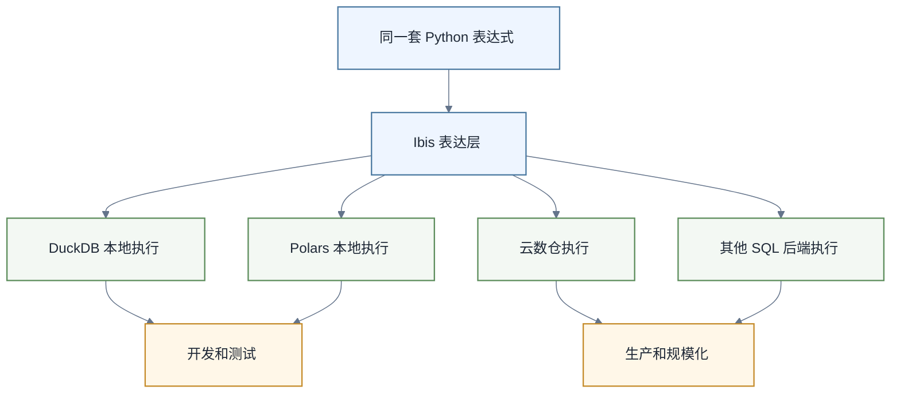

# Ibis学习路线图

> [!abstract] 一句话定位
> Ibis 是一个“可移植的 Python DataFrame API”：你用一套 Python 表达式写数据转换，Ibis 负责把它编译到 DuckDB、Polars、BigQuery、Snowflake、PostgreSQL 等后端执行。它适合想保留 Python 表达力，又不想被单一执行引擎锁死的数据人。

Ibis 比 DuckDB 和 Polars 更抽象：

- DuckDB：SQL 引擎。
- Polars：DataFrame 引擎。
- Ibis：统一表达层，可以编译到不同后端。

如果你只在本地写 SQL，先学 [[【技术与工具】/DuckDB/00-DuckDB学习路线图|DuckDB]]。如果你主要做 Python DataFrame 处理，先学 [[【技术与工具】/Polars/00-Polars学习路线图|Polars]]。如果你需要跨本地和云数仓复用逻辑，再看 Ibis。

---

## 1. Ibis解决什么问题



Ibis 官方说明中强调，它定义了一个能在多种查询引擎上执行的 Python DataFrame API。多数 SQL 后端会把 Ibis 表达式编译成 SQL；Polars 后端则可编译为 LazyFrame。

---

## 2. 学习路线

| 顺序 | 专题 | 学习结果 |
|---|---|---|
| 1 | [[【技术与工具】/Ibis/01-表达式与延迟执行|表达式与延迟执行]] | 构建、编译并在明确边界执行表达式 |
| 2 | [[【技术与工具】/Ibis/02-后端连接与数据读写|后端连接与数据读写]] | 安装正确后端并安全控制 I/O 与物化 |
| 3 | [[【技术与工具】/Ibis/03-跨后端迁移与测试|跨后端迁移与测试]] | 用能力矩阵与黄金数据验证可移植性 |

### 阶段一：理解表达式模型

Ibis 的核心不是“马上执行”，而是构建表达式。

你要理解：

- table expression
- column expression
- filter / mutate / aggregate
- join
- execute
- compile

示例：

```python
import ibis

con = ibis.duckdb.connect()
orders = con.read_parquet("orders.parquet", table_name="orders")

expr = (
    orders
    .filter(orders.status == "paid")
    .mutate(pay_date=orders.pay_time.date())
    .group_by("pay_date")
    .agg(gmv=orders.amount.sum(), orders=orders.order_id.nunique())
)

result = expr.execute()
```

### 阶段二：DuckDB后端

目标：把 Ibis 当作 Python 化的 DuckDB 表达层。

适合：

- 本地文件分析
- 统一 Python 风格
- 后续可能迁移云数仓
- 不想直接写大量 SQL 字符串

### 阶段三：Polars后端

Ibis 官方文档显示 Polars 后端可把表达式编译为 LazyFrame。这个方向适合想用 Polars 执行性能，但希望保持更通用表达层的团队。

### 阶段四：多后端迁移

这是 Ibis 真正的价值：

- 本地开发用 DuckDB。
- 中型任务用 Polars 或 DataFusion。
- 生产任务迁移到 BigQuery、Snowflake、PostgreSQL 等。

同一套逻辑不一定 100% 无痛迁移，但比散落在不同 SQL 方言和 Pandas 脚本里更可控。

---

## 3. Ibis适合和不适合

| 场景 | 是否适合 | 说明 |
|---|---|---|
| 想用Python写可迁移数据逻辑 | 适合 | Ibis核心价值 |
| 团队SQL能力很强 | 不一定 | 直接 dbt/SQL 可能更清晰 |
| 单纯本地SQL分析 | 不必优先 | DuckDB 更直接 |
| 单纯高性能DataFrame | 不必优先 | Polars 更直接 |
| 多后端数据产品 | 适合 | 降低后端绑定 |
| 初学数据分析 | 不建议首选 | 抽象层较高 |

---

## 4. AI时代为什么关注Ibis

AI 时代会出现一个新需求：让 AI 写的数据转换逻辑更可验证、更可迁移。

如果 AI 直接写不同后端 SQL，容易产生方言差异和迁移成本。Ibis 这种表达层提供了一个折中方案：

- 用 Python 表达业务逻辑。
- 编译到具体后端执行。
- 可检查表达式和生成 SQL。
- 可在本地 DuckDB 上先验证，再迁移到生产后端。

这和 [[【技术与工具】/dbt/14-dbt-Fusion与AI时代SQL语义工程|dbt Fusion与AI时代SQL语义工程]] 的方向相通：都在把数据逻辑变得更结构化、更可理解、更适合 AI 协作。

---

## 5. 学习建议

1. 先学 DuckDB 或 Polars，不要一上来学 Ibis。
2. 用一个小项目比较：SQL 写法、Polars 写法、Ibis 写法。
3. 学会 `compile()`，看 Ibis 生成的 SQL 或 LazyFrame。
4. 只在有多后端需求时引入 Ibis，不要为了抽象而抽象。
5. 把 Ibis 当成工程选择，不是信仰。

---

## 6. 外部参考

- [Ibis 10 minutes to Ibis](https://ibis-project.org/tutorials/getting_started)
- [Ibis Polars Backend](https://ibis-project.org/backends/polars)
- [Ibis Backends](https://ibis-project.org/backends)
- [Ibis Operation Support Matrix](https://ibis-project.org/backends/support_matrix)

---

## 7. 相关学习入口

- [[【技术与工具】/DuckDB/00-DuckDB学习路线图|DuckDB学习路线图]]
- [[【技术与工具】/Polars/00-Polars学习路线图|Polars学习路线图]]
- [[【技术与工具】/Python/41-从Pandas到Polars与DuckDB|从Pandas到Polars与DuckDB]]
- [[【技术与工具】/SQL/33-AI时代分析SQL实战|AI时代分析SQL实战]]
- [[【技术与工具】/dbt/14-dbt-Fusion与AI时代SQL语义工程|dbt Fusion与AI时代SQL语义工程]]
