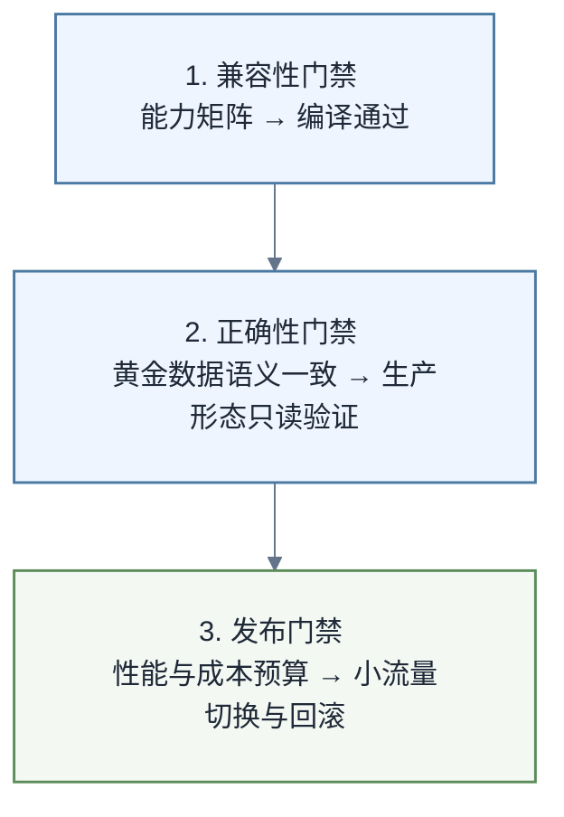

# Ibis跨后端迁移与测试

> [!abstract] 学习目标
> 把“同一套 API”转化为可验证的迁移流程：先查能力矩阵，再做编译、执行、schema 与语义测试，明确哪些差异必须由业务层处理。

Ibis 降低后端绑定，但不承诺所有表达式在所有引擎上完全等价。官方操作支持矩阵明确指出：SQL 方言与上游能力不同，因此各后端对 Ibis API 的覆盖不同。先完成 [[【技术与工具】/Ibis/01-表达式与延迟执行|表达式与延迟执行]] 与 [[【技术与工具】/Ibis/02-后端连接与数据读写|后端连接与数据读写]]。

## 1. 迁移前先定义合同

一段逻辑的合同至少包含：输入 schema、主键与允许空值、时间与时区、输出粒度、数值精度、排序要求、允许误差、失败行为。只有代码而没有合同，跨后端结果不一致时无法判断谁对谁错。

```python
import ibis
from ibis import _

schema = ibis.schema(
    {
        "order_id": "int64",
        "pay_time": "timestamp('UTC')",
        "status": "string",
        "amount": "decimal(18, 2)",
    }
)
orders = ibis.table(schema, name="orders")
```

这个 unbound table 适合先构建和编译表达式，但执行时必须绑定到真实后端对象。

## 2. 四层测试金字塔

### 2.1 表达式构建测试

验证函数返回 Ibis 表达式、schema 符合预期、不在内部执行：

```python
def paid_daily(table):
    return (
        table.filter(_.status == "paid")
        .mutate(pay_date=_.pay_time.date())
        .group_by(_.pay_date)
        .agg(gmv=_.amount.sum())
    )

expr = paid_daily(orders)
assert expr.schema()["gmv"].is_decimal()
```

### 2.2 编译测试

对目标后端编译，捕获不支持的操作与方言差异。编译测试速度快，但不会发现权限、数据或运行时函数缺失。

### 2.3 小数据语义测试

构造 NULL、重复键、夏令时、除零、负金额、Unicode 和边界日期，分别在本地后端与目标后端执行。比较行集合前先确定排序是否属于业务合同。

### 2.4 生产形态集成测试

使用最小权限账号、目标 catalog/schema 和小型真实形态数据验证网络、驱动、UDF、时区与资源限制。不得把本地 DuckDB 测试绿直接标记为生产迁移完成。

## 3. 一个可运行的后端测试夹具

```python
import ibis
import pandas as pd
from ibis import _

def sample_orders():
    return pd.DataFrame(
        {
            "order_id": [1, 2, 3, 4],
            "status": ["paid", "paid", "cancelled", None],
            "amount": [10.0, 20.0, 99.0, 5.0],
        }
    )

def metric(table):
    return table.filter(_.status == "paid").aggregate(gmv=_.amount.sum())

con = ibis.duckdb.connect()
table = con.create_table("orders", sample_orders(), overwrite=True)
result = metric(table).execute()
assert result.loc[0, "gmv"] == 30.0
```

可复用 `metric` 表达式；把 `con` 替换为 CI 中允许的目标后端连接时，还须验证或适配 DataFrame 装载、`create_table` 与 `overwrite` 支持、写入权限及类型推断，并按合同调整断言。正式测试应使用临时 schema、唯一表名与清理机制，避免覆盖共享对象。

## 4. 高风险语义差异

- NULL 排序位置与三值逻辑；
- 字符串大小写、Unicode 归一化与正则支持；
- 整数除法、decimal 精度和浮点容差；
- timestamp 精度、时区转换与夏令时；
- `group_by` 结果无默认顺序；
- 窗口函数在并列值下的稳定排序；
- JSON、数组、结构体和地理类型支持；
- UDF、近似聚合与后端特有函数。

对于重要金额，优先 decimal 与精确比较；对统计浮点结果使用业务可接受的绝对/相对误差。若必须使用后端特有能力，要显式隔离适配器并记录降级行为，而不是伪装成完全可移植。

## 5. 能力矩阵与最小公分母

官方支持矩阵是发现差异的入口，不是替代测试的保证。可选择三种策略：

1. 只用所有目标后端都支持的最小公分母；
2. 业务表达式统一，后端差异封装在窄适配层；
3. 对关键后端维护独立实现，但共享合同与黄金数据。

完全追求最小公分母会损失性能和能力；到处写条件分支又会让抽象失效。通常第二种更平衡。

## 6. 结果比较与诊断

比较前按合同统一列顺序、数据类型、时区和排序，统一过程中不得掩盖精度损失或语义差异。下例假定已取得包含 `pay_date` 的双后端结果 `result_a` 与 `result_b`，且合同允许对浮点结果使用容差；金额 decimal 应另行按合同精确比较，`rtol` 与 `atol` 均须明确设定。失败时依次保留：Ibis 版本、后端及驱动版本、表达式 repr、编译 SQL、输入样例、结果 schema 和差异行。敏感数据必须脱敏。

```python
left = result_a.sort_values(["pay_date"]).reset_index(drop=True)
right = result_b.sort_values(["pay_date"]).reset_index(drop=True)
pd.testing.assert_frame_equal(left, right, check_exact=False, rtol=1e-9, atol=0)
```

## 7. 迁移门禁



每个框包含两个必须连续通过的检查点。任何一层通过都不代表全部完成。尤其编译通过不等于执行成功，HTTP 或连接成功也不等于业务结果正确。

## 8. 练习

1. 为 NULL 排序、整数除法和 timestamp 写三组黄金数据。
2. 同一表达式在 DuckDB 与另一个可用后端上编译，比较 SQL。
3. 为后端不支持的操作设计明确报错或适配器，不允许静默改口径。
4. 制作迁移报告，分别记录源码测试、隔离环境、生产只读与真实切换状态。

## 9. 延伸阅读

- [[【技术与工具】/Ibis/00-Ibis学习路线图|Ibis学习路线图]]
- [[【技术与工具】/DuckDB/00-DuckDB学习路线图|DuckDB学习路线图]]
- [[【技术与工具】/DuckDB/02-Python集成与数据交换|DuckDB Python集成]]
- [[【技术与工具】/DuckDB/03-性能优化与扩展管理|DuckDB性能优化]]
- [[【技术与工具】/Polars/00-Polars学习路线图|Polars学习路线图]]
- [[【技术与工具】/Polars/01-表达式与常用数据操作|Polars表达式]]
- [[【技术与工具】/Polars/02-Lazy执行与性能优化|Polars Lazy执行]]
- [[【技术与工具】/Polars/03-从Pandas迁移到Polars|从Pandas迁移到Polars]]
- [[【技术与工具】/Python/11-Pandas数据清洗|Pandas数据清洗]]
- [[【技术与工具】/Python/27-模型评估与交叉验证|模型评估与交叉验证]]
- [[【技术与工具】/Python/33-系统监控|Python系统监控]]
- [[【技术与工具】/SQL/00-SQL学习路线图|SQL学习路线图]]
- [[【技术与工具】/SQL/33-AI时代分析SQL实战|AI时代分析SQL实战]]
- [[【技术与工具】/dbt/14-dbt-Fusion与AI时代SQL语义工程|dbt Fusion与AI时代SQL语义工程]]

## 官方来源

- [Ibis：操作支持矩阵](https://ibis-project.org/backends/support_matrix)
- [Ibis：后端列表](https://ibis-project.org/backends)
- [Ibis：贡献工作流与后端测试](https://ibis-project.org/contribute/02_workflow)
- [Ibis：DuckDB 后端 compile API](https://ibis-project.org/backends/duckdb)
