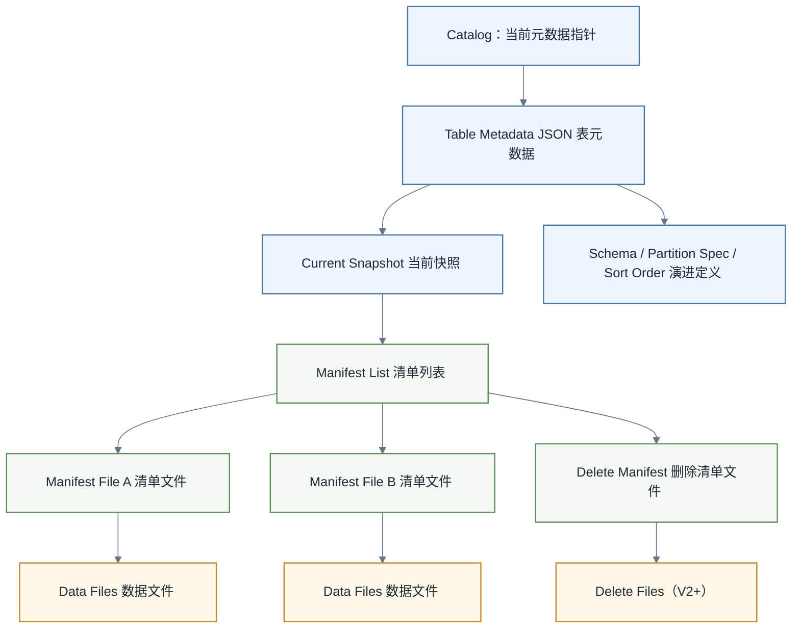

# Iceberg核心架构与表演进

> [!abstract] 本文目标
> - 区分对象存储、文件格式、表格式与计算引擎
> - 看懂 Iceberg 的快照、Manifest List、Manifest File 和数据文件
> - 理解 Schema Evolution、Partition Evolution 与 Sort Order Evolution
> - 能通过元数据表定位一次写入产生了什么变化

前置阅读：[[【数据开发与数据架构】/05-数据存储架构/05-数据湖架构|数据湖架构]]、[[【技术与工具】/Hadoop/03-HDFS分布式文件系统|HDFS分布式文件系统]]、[[【技术与工具】/Hive/00-Hive学习路线图|Hive学习路线图]]。

## Iceberg在湖仓中的位置

Iceberg 是**开放表格式**，负责定义一张分析表的元数据、快照、文件索引、分区规则和演进方式。它不负责保存对象存储本身，也不替代 Parquet，更不是 Spark 或 Flink 这样的计算引擎。

| 层次 | 典型组件 | 主要职责 |
|---|---|---|
| 计算引擎 | Spark、Flink、Trino | 解析 SQL、执行读取和写入 |
| 表格式 | Iceberg | 管理快照、文件清单、演进和事务提交 |
| 文件格式 | Parquet、ORC、Avro | 定义数据文件内部的列式或行式编码 |
| 存储系统 | S3、OSS、HDFS | 保存元数据文件和数据文件 |

这个分层解释了 Iceberg 的核心价值：多个计算引擎可以通过同一套表元数据看到一致的文件集合，而不是各自猜测目录结构。

## 元数据树如何工作

一次查询通常不会先递归扫描整张表的所有目录。引擎会从 Catalog 找到当前表元数据，再沿着快照和清单逐步缩小文件范围。

1. **Table Metadata JSON**：保存当前快照、Schema、Partition Spec、Sort Order 等表级信息。
2. **Snapshot**：表示表在某次提交后的完整逻辑状态，并指向 Manifest List。
3. **Manifest List**：列出本快照涉及的 Manifest File，并携带分区统计信息。
4. **Manifest File**：记录数据文件或删除文件及其列级统计信息。
5. **Data File / Delete File**：真正承载业务数据或行级删除信息。



> [!tip] 心智模型
> 快照不是一份完整数据副本。它是一组不可变文件及其元数据引用。新提交通常创建新的元数据和文件引用，旧快照仍可用于时间旅行，直到被安全过期。

## 为什么快照可以支持事务

Iceberg 的写入过程可以概括为“准备新文件—构造新元数据—原子替换当前元数据指针”。读任务绑定到某个快照后，后续提交不会改变这个快照已经引用的文件集合，因此能够获得一致视图。

并发写入是否成功，还取决于 Catalog 是否能提供原子提交以及写任务是否触发冲突校验。Iceberg 的事务能力不等于“所有对象存储操作天然有事务”，生产设计仍要确认 Catalog、引擎版本和写入模式。

## Schema Evolution

官方文档列出的 Schema 演进包括新增、删除、重命名、类型提升和字段重排。关键实现不是只匹配列名或列位置，而是为字段维护唯一 ID。

这解决了两个常见风险：

- 删除列后复用旧列名，不会意外读出旧列数据。
- 调整字段顺序，不会把另一列的数据错映射到当前列。

Schema 变更通常是元数据操作，并不立即重写全部历史文件。但“元数据操作”不表示没有兼容成本：下游引擎、消费代码、序列化类型和数据契约仍需验证。

## Hidden Partitioning与Partition Evolution

传统 Hive 表常要求用户显式维护分区列，并在查询条件中了解物理分区布局。Iceberg 根据分区变换从源列生成分区值，例如：

- `days(event_time)`：按日期分区。
- `hours(event_time)`：按小时分区。
- `bucket(16, user_id)`：按哈希桶分区。
- `truncate(8, category)`：按截断值分区。

查询仍然可以写 `WHERE event_time >= ...`，引擎负责把条件投影到对应的分区规则。分区策略发生变化时，旧文件保留旧 Spec，新文件使用新 Spec；规划器分别裁剪两套布局，再合并结果。这就是 Partition Evolution 不要求立即迁移全表数据的原因。

> [!warning] 不要误解“无需重写”
> 演进本身可以只改元数据，但如果旧文件布局已经导致大量扫描或小文件，仍可能需要后续重写数据文件。演进解决正确性和持续写入问题，不自动完成物理整理。

## Sort Order Evolution

Iceberg 还可以维护排序规则。新的写入可以采用最新 Sort Order，历史文件保持原样。排序并不是分区的替代品：分区主要减少候选文件范围，排序有助于文件内聚簇、数据跳过和压缩效果。

设计排序规则时应从稳定查询模式出发，而不是机械地把所有过滤列加入排序。高基数字段、写入成本和重写频率都需要权衡。

## 用元数据表验证

在支持 Iceberg 元数据表的引擎中，可以检查快照和文件，而不是只看查询是否成功：

```sql
SELECT committed_at, snapshot_id, parent_id, operation
FROM local.analytics.orders.snapshots
ORDER BY committed_at DESC;

SELECT file_path, file_size_in_bytes, record_count
FROM local.analytics.orders.files
ORDER BY file_size_in_bytes;
```

预期结果：第一条查询能看到提交链；第二条查询能看到当前快照引用的数据文件及大小，可作为小文件治理的输入。

## 掌握检查

- [ ] 能解释 Snapshot 与数据副本的区别
- [ ] 能画出 Metadata JSON 到 Data File 的引用链
- [ ] 能说明字段 ID 为什么比列名或列位置更安全
- [ ] 能说明两套分区 Spec 如何同时服务查询
- [ ] 能通过元数据表查看快照和文件分布

## 学习连接

- [[【技术与工具】/Iceberg/00-Iceberg学习路线图|Iceberg学习路线图]]
- [[【技术与工具】/Iceberg/01-Iceberg-V3深度解析|Iceberg V3深度解析]]
- [[【技术与工具】/Iceberg/03-Iceberg-Spark快速实践|Iceberg Spark快速实践]]
- [[【技术与工具】/Iceberg/04-Iceberg表维护与小文件治理|Iceberg表维护与小文件治理]]
- [[【技术与工具】/Spark/00-Spark学习路线图|Spark学习路线图]]
- [[【技术与工具】/Flink/00-Flink学习路线图|Flink学习路线图]]
- [[【数据开发与数据架构】/06-数据处理架构/02-批处理架构|批处理架构]]
- [[【数据开发与数据架构】/06-数据处理架构/05-实时处理架构|实时处理架构]]
- [[【技术与工具】/Hudi/01-Hudi概述与特性|Hudi概述与特性]]
- [[【技术与工具】/Paimon/01-Paimon概述与特性|Paimon概述与特性]]
- [[【技术与工具】/SQL/00-SQL学习路线图|SQL学习路线图]]

## 官方资料

- [Apache Iceberg Documentation](https://iceberg.apache.org/docs/latest/)
- [Apache Iceberg Evolution](https://iceberg.apache.org/docs/latest/evolution/)
- [Apache Iceberg Partitioning](https://iceberg.apache.org/docs/latest/partitioning/)
