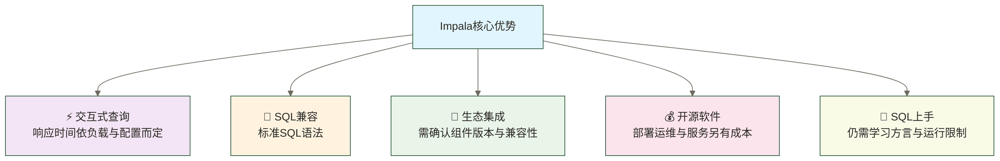
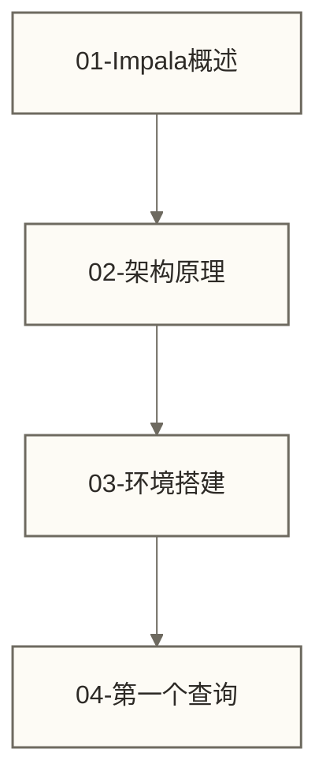
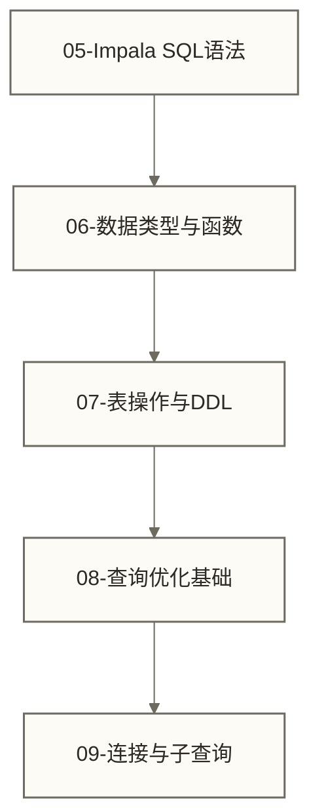
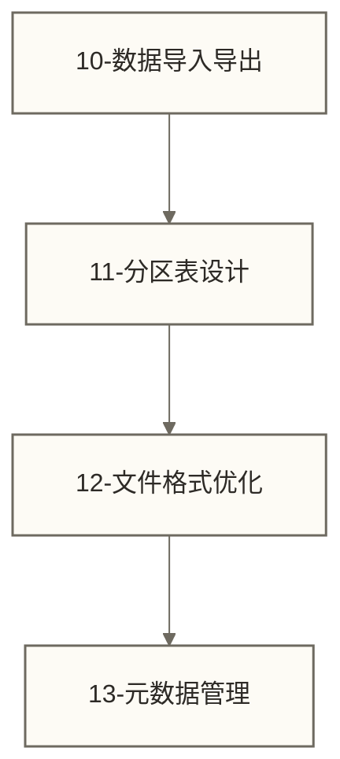
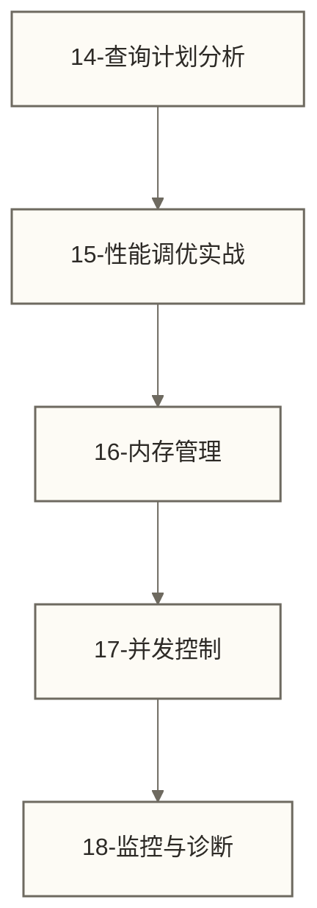
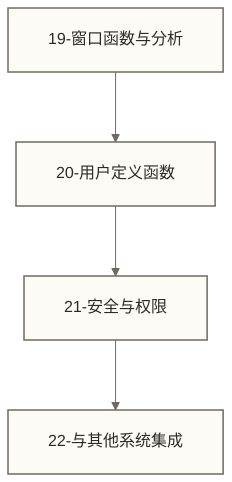
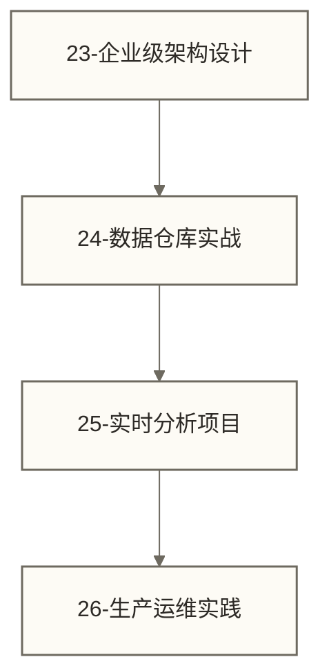
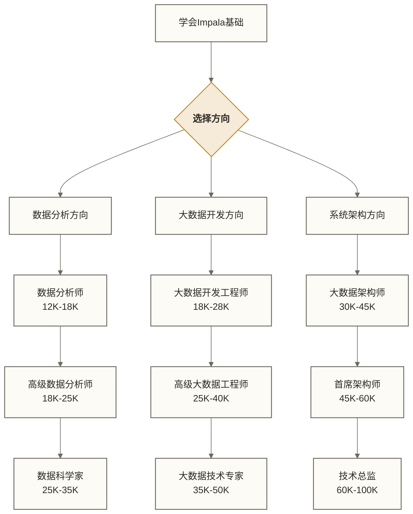

# Impala学习路线图 - 从零到精通的完整指南

> [!abstract] 📋 学习概览
> - 🎯 总体目标：系统掌握Impala高性能SQL查询引擎
> - 📚 适合人群：数据分析师、大数据工程师、SQL开发者
> - ⏱️ 完整学习周期：按下文六阶段顺序累计约15-21周；实际进度取决于基础、练习投入和环境条件，不保证在该周期内精通

## 🗺️ 学习路线图

> [!tip] 💝 给大数据新手的温暖提醒
> 
> 🤗 **学习Impala就像学会驾驶高速列车！**
> 
> 如果你现在担心：
> - "Impala听起来好高深，我能学会吗？"
> - "大数据查询这么复杂，会不会很难？"
> - "Hive我都还没完全搞懂，能直接学Impala吗？"
> 
> **别担心！** Impala的设计初衷就是让复杂的大数据查询变简单 ✨
> 
> 🚄 **想象Impala是数据世界的"高铁"**
> 
> 传统大数据查询就像普通火车：
> - 🚂 **基于MapReduce执行的Hive查询**可类比普通火车；Hive也可使用其他执行引擎，不能一概视为慢查询
> - 🚄 **Impala** = 高速列车（快速直达）
> - ⚡ **查询速度**：在适合的工作负载与配置下可能从分钟级降至秒级，实际效果须通过同条件测试确认
> - 🎯 **用户体验**：熟悉SQL有助于上手，但仍需学习Impala的语法差异、数据组织和运行限制
> 
> **掌握Impala = 获得大数据分析的"速度优势"！** 🌟

## 🎯 速度就是竞争力

以下为教学假设，原稿的30分钟与30秒数字未经实测核实，不代表真人成果或通用提速比例：假设数据分析师小陈每天都被慢查询折磨：同样的SQL查询，在Hive上要跑30分钟，业务部门等得不耐烦。"能不能快一点？"领导问。后来他接触到Impala，同样的查询只用30秒就完成了！"原来大数据分析也可以这么快！"小陈感叹。从此，他成了团队的"查询速度专家"。

在实际工作环境中，这样的挑战每天都在发生。理解相关知识不仅能解决当前问题，更能提升整体的专业能力。
### 🌟 Impala的核心优势



### 📊 市场地位与应用场景

**🏢 企业应用示例（以下企业与用途对应关系为原稿未核实信息，不作为实际采用情况的证据）**：
- 🌐 **Netflix**：用于实时推荐系统数据分析
- 📊 **Twitter**：处理海量用户行为数据
- 🛒 **阿里巴巴**：电商数据实时分析
- 🏦 **招商银行**：风控数据快速查询

**💰 职业价值（下列30%年增长率及20-30%薪资加成为原稿未核实数字，缺少统计口径与来源，不作为市场结论或收益承诺）**：
- 📈 **Impala技能需求增长**：30%年增长率
- 💵 **薪资加成**：掌握Impala比普通数据分析师高20-30%
- 🎯 **核心竞争力**：大数据时代的必备技能

## 📚 六阶段学习体系

### 🌱 第一阶段：基础认知（1-2周）

**学习目标**：理解Impala的定位和核心概念



**学习文件顺序**：
1. Impala介绍与特性 - 了解Impala的历史、特点和应用场景
2. Impala架构原理 - 深入理解Impala的技术架构
3. Impala环境搭建 - 搭建开发和测试环境
4. 第一个Impala查询 - 体验Impala的查询能力

> [!tip] 💡 第一阶段重点
> - 理解Impala在大数据生态中的定位
> - 掌握Impala与Hive的区别和联系
> - 搭建可用的Impala环境
> 
> **初学者教学假设** 🎆（下列小王故事及“几十倍”提速为原稿未核实示例，不代表真人成果或可复现承诺）
> 👨‍💼 **小王，数据分析师**：\"以前用Hive查询要等好几分钟，学了Impala后查询速度快了几十倍！现在可以做交互式数据探索了，工作效率大大提升！\"

---

### 🟡 第二阶段：SQL查询技能（3-4周）

**学习目标**：掌握Impala SQL查询的核心技能



**学习文件顺序**：
5. Impala SQL语法基础 - 掌握Impala特有的SQL语法
6. 数据类型与函数 - 了解Impala支持的数据类型和内置函数
7. 表操作与DDL - 创建和管理表结构
8. 查询优化基础 - 编写高效的SQL查询
9. 连接与子查询 - 处理复杂的多表查询

> [!tip] 💡 第二阶段重点
> - 熟练掌握Impala SQL语法差异
> - 学会编写高效的查询语句
> - 理解Impala查询执行原理

---

### 🟠 第三阶段：数据管理与操作（2-3周）

**学习目标**：掌握Impala数据管理的最佳实践



**学习文件顺序**：
10. 数据导入导出 - 高效的数据加载和导出策略
11. 分区表设计 - 分区策略对查询性能的影响
12. 文件格式优化 - 选择合适的存储格式
13. 元数据管理 - 管理表结构和统计信息

> [!tip] 💡 第三阶段重点
> - 掌握数据导入的最佳实践
> - 理解分区对性能的重要影响
> - 学会选择合适的文件格式

---

### 🔴 第四阶段：性能调优（3-4周）

**学习目标**：掌握Impala性能调优的核心技能



**学习文件顺序**：
14. 查询计划分析 - 理解和分析Impala查询计划
15. 性能调优实战 - 实际性能优化案例
16. 内存管理 - Impala内存使用优化
17. 并发控制 - 多用户环境下的资源管理
18. 性能监控与诊断 - 监控Impala集群健康状况

> [!tip] 💡 第四阶段重点
> - 学会分析和优化慢查询
> - 掌握内存和并发管理
> - 建立有效的监控体系

---

### 🟣 第五阶段：高级特性（2-3周）

**学习目标**：掌握Impala的高级功能和特性



**学习文件顺序**：
19. 窗口函数与分析 - 高级分析函数的使用
20. 用户定义函数UDF - 扩展Impala功能
21. 安全与权限 - 配置Impala安全机制
22. 与其他系统集成 - 与BI工具和其他系统的集成

> [!tip] 💡 第五阶段重点
> - 掌握高级分析功能
> - 了解企业级安全配置
> - 学会系统集成方案

---

### 🔵 第六阶段：企业实战（4-5周）

**学习目标**：通过实际项目掌握企业级应用



**学习文件顺序**：
23. 企业级架构设计 - 设计生产级Impala集群
24. 数据仓库实战项目 - 构建企业数据仓库
25. 实时分析项目 - 实时数据分析系统
26. 生产运维实践 - 生产环境运维经验

---

## 📅 学习计划建议

### 🗓️ 大数据工程师学习计划（10周）

```text
第1-2周：Impala基础认知
  - 理解Impala架构和原理
  - 搭建学习环境
  - 完成第一个查询

第3-6周：SQL查询技能提升
  - 掌握Impala SQL语法
  - 学会复杂查询编写
  - 理解查询优化基础

第7-8周：数据管理实践
  - 掌握数据导入导出
  - 学会分区表设计
  - 优化存储格式

第9-10周：性能调优
  - 学会查询计划分析
  - 掌握性能调优技巧
  - 建立监控体系
```

### 🗓️ 数据分析师学习计划（6周）

```text
第1周：快速入门
  - Impala概述和环境搭建
  - 基础SQL查询

第2-3周：查询技能
  - SQL语法和函数
  - 复杂查询编写

第4周：数据操作
  - 数据导入导出
  - 表操作技巧

第5-6周：优化应用
  - 查询优化
  - 实际项目应用
```

### 🗓️ 系统架构师学习计划（12周）

```text
第1-3周：深入理解架构
  - Impala架构原理
  - 与Hadoop生态集成
  - 性能特性分析

第4-7周：性能调优专精
  - 查询计划深度分析
  - 内存和并发管理
  - 监控和诊断

第8-10周：企业级部署
  - 集群规划设计
  - 安全配置
  - 高可用架构

第11-12周：项目实战
  - 企业级实施案例
  - 生产运维实践
```

## 💰 学会Impala，你的职业前景如何？

### 🚀 薪资前景（原稿标为2024年的未核实示例）

以下保留原稿薪资数字与学习时长，但未提供来源、地区、币种、计薪周期或样本，不能视为真实统计、当前行情或学习后的薪资保证。

| 技能水平 | 薪资范围 | 典型岗位 | 学习时长 |
|---|---|---|---|
| **Impala入门** | 12K-18K | 数据分析师、BI工程师 | 1-2个月 |
| **熟练使用** | 18K-28K | 大数据开发工程师 | 3-4个月 |
| **性能调优** | 25K-40K | 大数据架构师 | 6-8个月 |
| **企业专家** | 35K-60K | 大数据技术专家 | 1-2年 |

### 🏢 哪些行业可能涉及Impala相关工作？

以下保留原稿公司及场景清单；具体公司的Impala使用情况和招聘需求未核实，不代表这些公司当前急需Impala人才。

**互联网公司**：
- 🌐 **BAT等大厂**：用户行为分析、推荐系统
- 📱 **字节跳动、美团**：实时数据分析、业务监控
- 🛒 **电商平台**：交易数据分析、用户画像

**传统行业数字化**：
- 🏦 **金融机构**：风控分析、客户分析
- 🏥 **医疗行业**：患者数据分析、医疗数据挖掘
- 🏭 **制造业**：生产数据分析、质量分析

### 🎯 职业发展路径

下图仅为方向规划示意；薪资区间保留自原稿，未经核实且缺少统计口径。岗位晋升还需对应的工程、分析或管理能力，不能仅凭学会Impala推导。



## 🎯 学习建议与最佳实践

### 💡 高效学习策略

> [!tip] 🚀 **学习Impala的最佳路径**
> 
> **1. 建立正确认知**
> - 🎯 Impala不是替代Hive，而是补充
> - ⚡ 重点关注查询性能优化
> - 🔧 理解内存计算的原理
> 
> **2. 循序渐进实践**
> - 📊 从简单查询开始
> - 📈 逐步增加数据量和复杂度
> - 🎯 关注查询性能变化
> 
> **3. 企业场景导向**
> - 💼 学习企业级部署方案
> - 🔍 关注生产环境问题
> - 📊 积累调优经验

### 🛠️ 学习环境准备

**候选学习环境（原稿清单，不代表均已确认支持Impala）**：

使用下列发行版、云平台或容器方案前，应确认目标版本是否提供Impala、所需依赖及维护状态；监控工具也需确认与所选发行版兼容，不能默认通用。
- 💻 **本地虚拟机**：CDH/HDP发行版
- ☁️ **云平台**：AWS EMR、阿里云EMR
- 🐳 **容器化数据应用**：快速搭建测试环境

**必备工具**：
- 🔧 **查询工具**：Impala Shell、Hue、DBeaver
- 📊 **监控工具**：Cloudera Manager、Ambari
- 🔍 **性能分析**：Impala Profile Viewer

### 📚 学习资源推荐

**官方资源**：
- 📖 [Impala官方文档](https://impala.apache.org/docs.html)
- 🎥 [Cloudera培训视频](https://www.cloudera.com/about/training.html)

**实战项目**：
- 📊 TPC-DS基准测试
- 🛒 电商数据分析项目
- 📈 实时报表系统

## 🎉 开始你的Impala学习之旅

### 🎯 根据你的背景选择起点

**🟢 SQL基础扎实？**
👉 从这里开始：[[【技术与工具】/Impala/01-Impala概述与特性|Impala概述与特性]]

**🟡 有Hive经验？**
👉 重点学习：[[【技术与工具】/Impala/02-Impala架构原理|Impala架构]] 了解区别

**🟠 完全零基础？**
👉 建议先学：SQL → 再学Impala

**🔴 想做性能调优？**
👉 直接跳转：查询计划分析

---

### 🌟 学习成功的关键要素

> [!success] ✅ **Impala学习成功公式**
> 
> **理论基础** + **实践操作** + **性能调优** + **企业应用** 是形成Impala专业能力的重要积累，不保证自动达到专家水平
> 
> 1. **扎实的SQL基础** - Impala本质上是SQL引擎
> 2. **大数据思维** - 理解分布式计算原理
> 3. **性能敏感性** - 时刻关注查询性能
> 4. **实战经验** - 在真实项目中应用
> 5. **持续学习** - 跟上技术发展趋势

**下一步行动**：
1. 📥 **搭建学习环境**：准备Impala实验环境
2. 📖 **开始第一课**：阅读Impala概述文档
3. 📅 **制定学习计划**：选择适合的学习路径
4. 🎯 **设定学习目标**：明确想要达到的技能水平

**愿你在Impala的学习路上，体验到大数据高速查询的魅力！** ⚡

---

**创建时间**：2024-12-11  
**温度指数**：⭐⭐⭐⭐⭐ (适合各层次学习者)  
**预计学习总时长**：六阶段顺序累计约15-21周；6周、10周和12周的分角色计划覆盖选定主题，不等同于完成全路线或保证系统掌握  
**职业价值**：大数据时代的核心竞争技能

#Impala #大数据 #SQL查询 #性能优化 #学习路线 #Hadoop生态
