# Impala架构原理 - 深入理解MPP查询引擎

> [!abstract] 📋 本节概览
> - 🎯 学习目标：掌握Impala的核心组件、查询执行流程和MPP架构的精髓
> - 📚 前置知识：[[【技术与工具】/Impala/01-Impala概述与特性|Impala概述与特性]]、分布式系统基础
> - ⏱️ 预计用时：25分钟

## 🤔 Impala为什么这么快？架构是关键！

> [!tip] 💝 给技术爱好者的温暖引导
> 
> 🤗 **学习架构原理就像拆解一台精密的赛车引擎！**
> 
> 如果你现在好奇：
> - "Impala为什么这么快？背后的原理是什么？"
> - "它和传统数据库的架构有什么不同？"
> - "内存计算到底是怎么实现的？"
> 
> **让我们一起揭开Impala高性能的技术秘密！** ✨
> 
> 🏎️ **想象Impala就像一台F1赛车**
> 
> - 🚗 **传统数据库** = 家用轿车（功能全面，性能中规中矩）
> - 🚛 **Hive/MapReduce** = 重型卡车（载重大，但速度慢）
> - 🏎️ **Impala** = F1赛车（专为速度而生，每个部件都为性能优化）
> - ⚙️ **关键技术** = 赛车的核心技术（MPP、内存计算、向量化...）
> 
> **理解架构原理，你就掌握了Impala的"技术密码"！** 🌟

> - **Hive**：像一个**中央厨房**，接到订单（SQL）后，需要经过备料、切菜、烹饪、打包（MapReduce）等多个环节，流程长，适合处理大型宴席（批处理）。
> - **Impala**：像一个**开放式厨房的快餐店**，顾客（用户）直接点餐（SQL），多个厨师（Impalad）在各自的灶台（节点）上同时并行制作（MPP），**由本次查询的协调节点规划和分发任务，无需MapReduce式作业启动流程**，适合低延迟分析；实际速度取决于查询与资源条件。

## 核心组件解析

Impala的架构非常简洁，主要由三个核心组件构成：

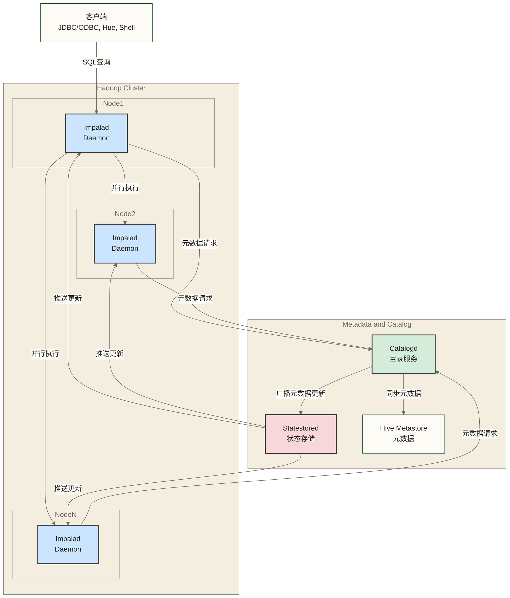

| 组件 | 角色 | 关键职责 |
| :--- | :--- | :--- |
| **Impalad (Impala Daemon)** | **核心执行引擎，"工人"** | - **接收查询**：接收来自客户端的SQL查询。<br/>- **查询编译与规划**：将SQL解析为物理执行计划。<br/>- **任务协调**：作为查询的**协调节点（Coordinator）**，将任务分发给其他节点。<br/>- **任务执行**：作为**执行节点（Executor）**，执行数据扫描和计算。<br/>- **结果聚合**：将各个节点的结果汇总，返回给客户端。<br/>- **部署**：传统HDFS共置部署常在数据节点（DataNode）上运行实例，以利用数据本地性；并非要求每个DataNode都部署，实际部署可分离协调与执行角色。 |
| **Catalogd (Catalog Service)** | **元数据中心，"图书管理员"** | - **元数据管理**：作为Impala元数据的中心枢纽，负责从Hive Metastore或其他源加载元数据。<br/>- **元数据广播**：当元数据发生变化时（如执行`CREATE TABLE`, `ALTER TABLE`等DDL操作），通过Statestored将更新广播给所有Impalad节点。<br/>- **避免重复加载**：确保每个Impalad节点无需自己去Hive Metastore拉取元数据，减轻Metastore的压力。<br/>- **部署**：通常部署在**主节点（Master Node）**上。 |
| **Statestored (State Store)** | **状态监控与广播，"广播站"** | - **集群状态维护**：持续监控所有Impalad节点的健康状况（心跳）。<br/>- **信息广播**：作为发布-订阅系统，将Catalogd发出的元数据更新广播给所有Impalad。<br/>- **故障检测**：当某个Impalad节点宕机时，Statestored会检测到并通知其他节点。<br/>- **部署**：通常部署在**主节点（Master Node）**上。 |

> [!IMPORTANT] 关键架构设计
> 1. **分布式执行**：Impalad可按配置承担协调或执行角色，查询片段在多个节点并行运行；单次查询仍依赖协调节点，不能据此断言没有单点瓶颈。
> 2. **中心化元数据管理**：通过Catalogd和Statestored管理与分发元数据更新，减少重复加载；缓存更新通常涉及异步传播，不能据此保证所有节点在任意时刻具有一致视图。

## 🔍 Impala查询执行流程

一个SQL查询在Impala中是如何从请求到返回结果的？

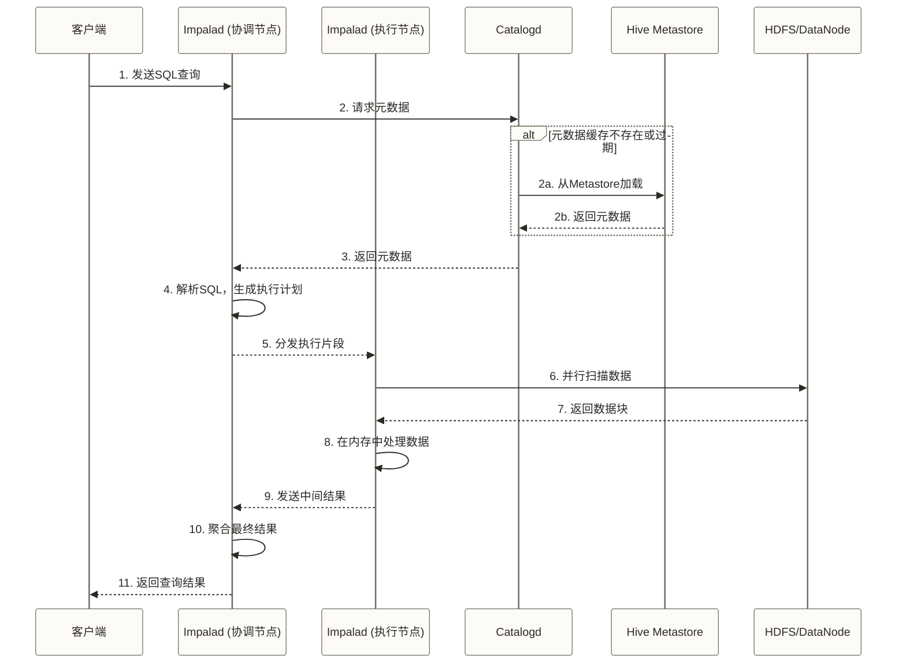

> [!info] 💡 **架构核心理念**
> 
> **Impala采用MPP分布式查询执行架构，并包含查询协调节点及目录、状态服务**：
> - 🎯 **分布式执行**：多个执行节点共同处理查询；协调节点及目录、状态服务仍有故障与可用性边界，不能等同于没有单点故障
> - ⚡ **并行处理**：查询任务在多个节点上并行执行
> - 💾 **数据本地性**：计算尽可能在数据所在节点执行
> - 🔗 **服务分离**：不同组件职责明确，便于扩展

## 🧩 核心组件详解

### 1. 🎯 Impala Daemon (impalad)

**角色定位**：Impala的核心执行引擎；传统HDFS共置部署常在数据节点上运行，实例也可按配置承担专用协调或执行角色

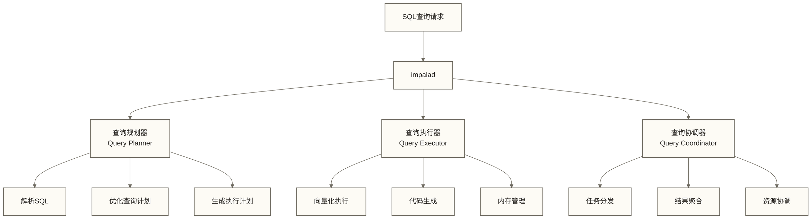

**主要职责**：
- 📝 **SQL解析和规划**：将SQL转换为执行计划
- ⚡ **查询执行**：执行具体的查询任务
- 🔗 **集群协调**：与其他impalad节点协作
- 💾 **数据访问**：直接读取HDFS数据

**技术特点**：
> [!example] 💻 **向量化执行核心概念**
> 
> Impala的向量化执行引擎是其高性能的关键技术之一：

```cpp
// 批处理与SIMD概念伪代码：不是Impala源码，也不证明其所有算子使用SIMD
class VectorizedProcessor {
public:
    // 批量处理数据，而非逐行处理
    void process_batch(RowBatch& batch) {
        // 按示例VECTOR_SIZE分批；实际批大小与尾批处理需由实现定义
        for (int i = 0; i < batch.size(); i += VECTOR_SIZE) {
            simd_process(batch.data() + i);
        }
    }
    
    // 运行时代码生成优化查询
    CompiledCode generate_query_code(QueryPlan& plan);
};
```

> [!info] 🔍 **向量化执行优势**
> 
> - **批处理效率**：一次处理多行数据，减少函数调用开销
> - **CPU缓存优化**：提高数据访问的局部性
> - **SIMD加速**：利用现代CPU的向量指令集


### 2. 🌐 Impala Statestore (statestored)

**角色定位**：集群状态管理器，维护集群成员信息

> [!example] 🔄 **Statestore工作机制**
> 
> **就像公司的HR部门**：
> - 👥 **员工花名册**：知道每个impalad节点的状态
> - 📢 **信息广播**：将集群变化通知给所有节点
> - ❤️ **健康检查**：定期检查节点是否正常工作
> - 🚨 **故障处理**：发现故障节点并从集群中移除

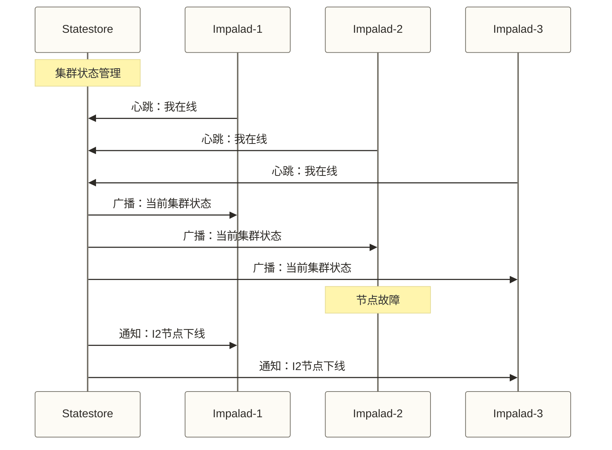

**核心功能**：
- 💓 **健康监控**：监控所有impalad节点状态
- 📡 **状态同步**：在集群中广播状态变化
- 🔄 **成员管理**：维护活跃节点列表
- 🚨 **故障检测**：快速发现和处理节点故障

### 3. 📚 Impala Catalog (catalogd)

**角色定位**：元数据服务器，管理表结构和统计信息

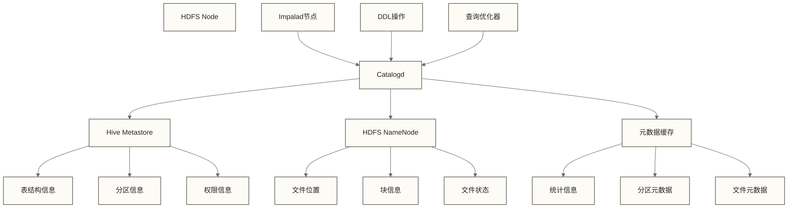

**主要职责**：
- 🗄️ **元数据管理**：缓存和管理表结构信息
- 📊 **统计信息**：收集和维护表统计数据
- 🔄 **增量更新**：高效同步元数据变化
- 🎯 **查询优化**：为查询优化器提供统计信息

**性能优化特性**：
```sql
-- Catalogd的增量更新机制
-- 当表结构发生变化时，只更新变化的部分
REFRESH table_name;                    -- 刷新已知表的元数据，具体更新范围取决于版本与表类型
INVALIDATE METADATA table_name;        -- 使表元数据失效，后续访问时按需重新加载
COMPUTE STATS table_name;              -- 重新计算统计信息
```

## ⚡ 核心技术原理

### 1. 🧠 MPP (大规模并行处理) 架构

> [!info] 💡 **MPP vs SMP架构对比**
> 
> **SMP (对称多处理) - 传统数据库**：
> ```json
> [CPU1] [CPU2] [CPU3] [CPU4]
>    \     |      |      /
>     \    |      |     /
>      [共享内存和存储]
> ```
> - ❌ 内存和I/O成为瓶颈
> - ❌ 扩展性有限
> 
> **MPP (大规模并行处理) - Impala**：
> ```json
> [节点1: CPU+内存+存储] [节点2: CPU+内存+存储] [节点3: CPU+内存+存储]
>            |                      |                      |
>         [网络互联] ——————————— [网络互联] ——————————— [网络互联]
> ```
> - ✅ 节点独立计算资源有助于分散负载，但网络、数据倾斜和协调仍可能成为瓶颈
> - ✅ 支持水平扩展，扩展效率取决于工作负载与部署条件，并不保证线性增长

**MPP执行模式**：
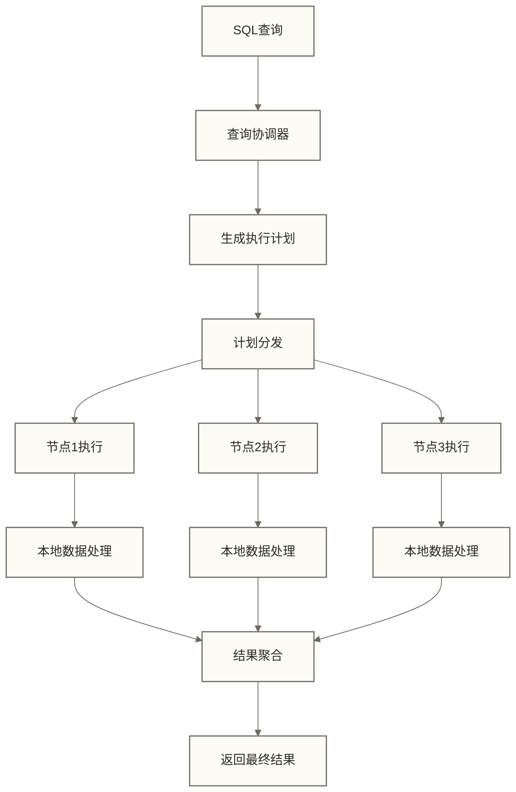

### 2. 💾 内存计算技术

**内存使用策略**：
```cpp
// 内存管理概念示意（伪代码）：不是Impala实际实现，以下回收、溢写与取消顺序不代表其通用策略
class MemoryManager {
private:
    // 查询内存池
    std::map<QueryId, MemoryPool*> query_pools_;
    
    // 全局内存限制
    int64_t process_memory_limit_;
    int64_t query_memory_limit_;
    
public:
    // 为查询分配内存池
    MemoryPool* CreateQueryPool(QueryId id) {
        auto pool = new MemoryPool(query_memory_limit_);
        query_pools_[id] = pool;
        return pool;
    }
    
    // 内存溢出处理
    void HandleMemoryPressure() {
        // 1. 释放缓存数据
        buffer_pool_.EvictCachedData();
        
        // 2. 将数据溢出到磁盘
        SpillToDisk();
        
        // 3. 终止低优先级查询
        CancelLowPriorityQueries();
    }
};
```

**内存使用分层**：
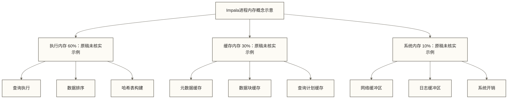

### 3. 🚀 向量化执行引擎

**传统行式处理 vs 向量化处理**：

```cpp
// 行式处理概念示例（性能需实测）
void traditional_processing(Table& table) {
    for (Row& row : table.rows) {
        // 逐行处理，CPU分支预测失败率高
        if (row.age > 25) {
            row.salary *= 1.1;
        }
        result.add(row);
    }
}

// 向量化处理概念伪代码（非Impala源码，性能需实测）
void vectorized_processing(Table& table) {
    const int VECTOR_SIZE = 1024;
    
    for (int i = 0; i < table.size(); i += VECTOR_SIZE) {
        // 批量处理，充分利用CPU缓存和SIMD指令
        Vector age_vec = table.get_column("age", i, VECTOR_SIZE);
        Vector salary_vec = table.get_column("salary", i, VECTOR_SIZE);
        
        // SIMD指令：一次比较多个值
        Bitmap mask = age_vec > 25;
        
        // SIMD指令：一次计算多个值
        salary_vec = select(mask, salary_vec * 1.1, salary_vec); // 概念选择操作：保留不满足条件的原工资
        
        result.append(salary_vec);
    }
}
```

**向量化的性能优势**：
- 🚀 **CPU效率提升**：减少分支预测失败
- 💾 **缓存友好**：提高CPU缓存命中率
- ⚡ **SIMD加速**：利用现代CPU的向量指令
- 📊 **吞吐量提升**：原稿给出的10-100倍为未核实示例，缺少基准、数据与硬件条件，不能作为Impala性能结论

### 4. 🔧 运行时代码生成

**LLVM代码生成机制**：
```cpp
// 查询运行时代码生成示例
class CodeGenerator {
public:
    // 为特定查询生成优化代码
    CompiledFunction GenerateCode(QueryPlan& plan) {
        LLVMBuilder builder;
        
        // 生成专门的过滤函数
        if (plan.has_filter()) {
            builder.AddFilter(plan.filter_expr());
        }
        
        // 生成专门的聚合函数
        if (plan.has_aggregation()) {
            builder.AddAggregation(plan.agg_expr());
        }
        
        // 编译为机器码
        return builder.Compile();
    }
};

// 运行时执行
void ExecuteQuery(QueryPlan& plan, Data& data) {
    // 生成优化的机器码
    auto compiled_func = code_gen.GenerateCode(plan);
    
    // 直接执行机器码（原稿10-50倍为未核实示例；实际收益需计入编译开销并实测）
    auto result = compiled_func.Execute(data);
}
```

**代码生成的优势**：
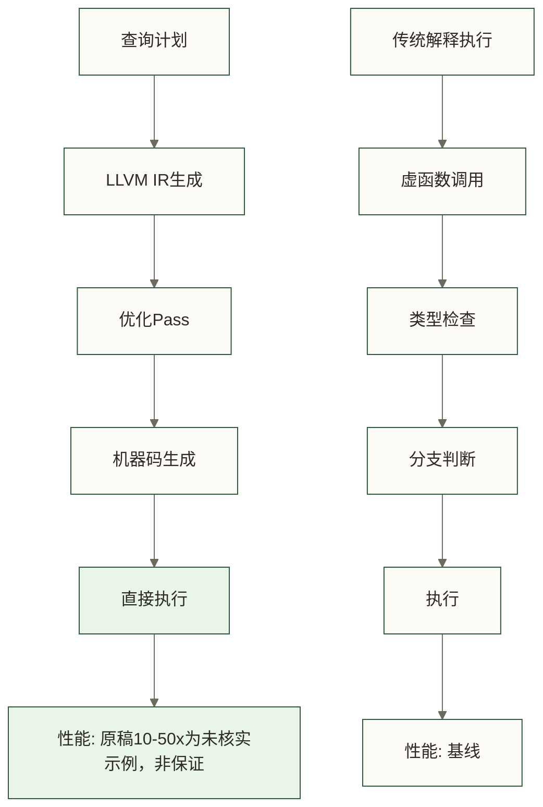

## 🔄 查询执行流程

### 📊 完整查询执行流程

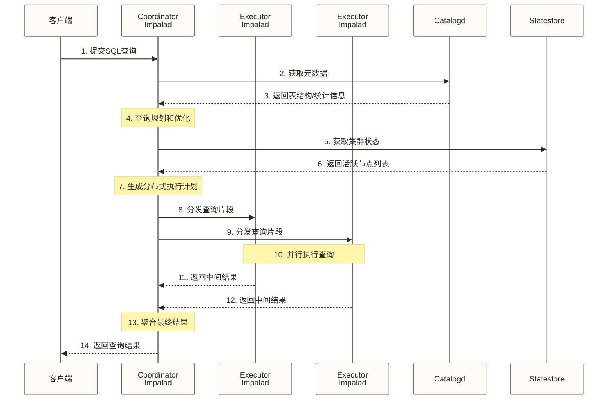

### 🎯 查询规划优化

**查询优化器的工作流程**：
```sql
-- 原始SQL查询
SELECT 
    region,
    COUNT(*) as customer_count,
    AVG(sales_amount) as avg_sales
FROM sales s
JOIN customers c ON s.customer_id = c.customer_id
WHERE s.sale_date >= '2024-01-01'
  AND c.customer_type = 'VIP'
GROUP BY region
ORDER BY avg_sales DESC
LIMIT 10;
```

**优化步骤**：
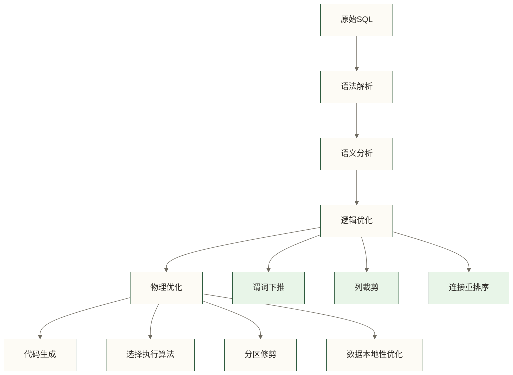

**优化后的执行计划（教学示意，非已验证的EXPLAIN输出；实际计划取决于表结构、统计信息和版本）**：
```text
01:MERGING-EXCHANGE [UNPARTITIONED]
|  order by: avg_sales DESC
|  limit: 10
|---|
00:TOP-N [LIMIT=10]
|  order by: avg_sales DESC
|---|
06:AGGREGATE [FINALIZE]
|  output: count(*), avg(sales_amount)
|  group by: region
|---|
05:EXCHANGE [HASH(region)]
|
04:AGGREGATE [STREAMING]
|  output: count(*), sum(sales_amount), count(sales_amount)
|  group by: region
|---|
03:HASH JOIN [INNER JOIN, BROADCAST]
|  hash predicates: s.customer_id = c.customer_id
|---|
|--02:EXCHANGE [BROADCAST]
|---|
|  01:SCAN HDFS [customers c]
|     predicates: c.customer_type = 'VIP'
|---|
00:SCAN HDFS [sales s]
   predicates: s.sale_date >= '2024-01-01'
```

## 🎯 性能优化原理

### 📊 数据本地性优化

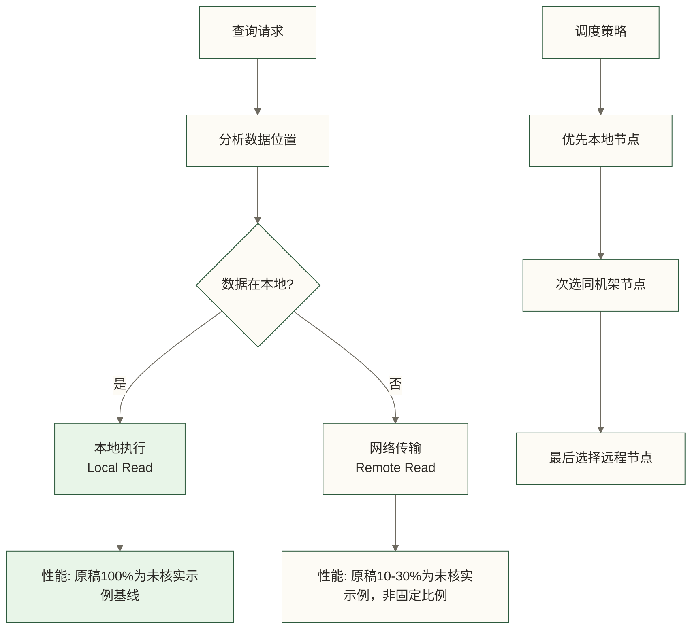

**数据本地性层次**：
1. 🎯 **进程本地性**：数据在同一进程内（最优）
2. 🖥️ **节点本地性**：数据在同一物理节点
3. 🏢 **机架本地性**：数据在同一机架
4. 🌐 **跨机架访问**：数据在不同机架（最差）

### ⚡ 内存管理优化

```cpp
// 内存优化概念伪代码：不是Impala源码，不代表实际缓存优先级或溢写策略
class QueryExecution {
private:
    // 内存使用优先级
    enum MemoryPriority {
        CRITICAL,    // 查询执行必需
        HIGH,        // 性能关键缓存
        MEDIUM,      // 一般缓存
        LOW          // 可选缓存
    };
    
public:
    void OptimizeMemoryUsage() {
        // 1. 预估内存需求
        int64_t estimated_memory = EstimateMemoryNeed();
        
        // 2. 动态调整缓存
        if (estimated_memory > available_memory_) {
            EvictLowPriorityCache();
        }
        
        // 3. 启用内存溢出
        if (estimated_memory > memory_limit_) {
            EnableSpillToDisk();
        }
    }
};
```

### 🔄 并发控制机制

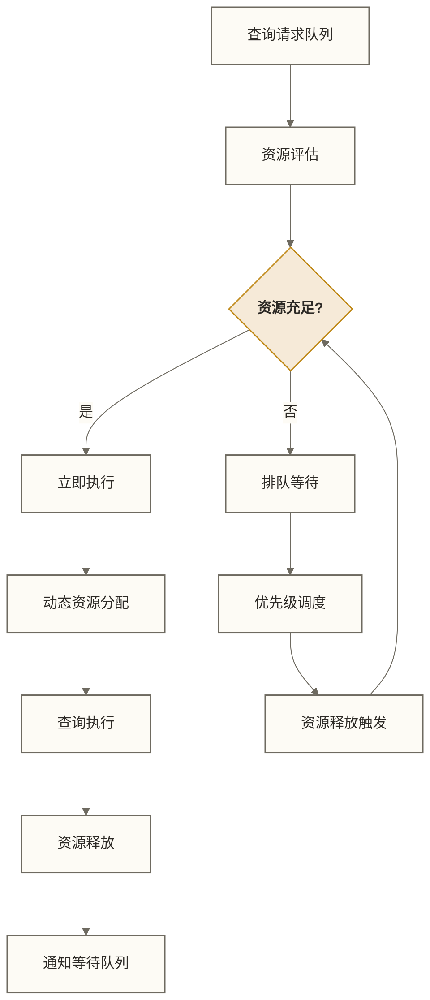

## 🎉 架构原理学习收获

> [!success] 🌟 **学完这节课，你已经掌握了**
> 
> - ✅ **架构组件**：impalad、statestore、catalogd的职责分工
> - ✅ **核心技术**：MPP、内存计算、向量化执行、代码生成
> - ✅ **执行流程**：从SQL解析到结果返回的完整过程
> - ✅ **优化原理**：数据本地性、内存管理、并发控制
> - ✅ **性能机制**：理解Impala可能降低查询延迟的原因；原稿10-100倍为未核实示例，不代表对传统工具的普遍优势
> 
> **你已经掌握了Impala的"技术精髓"！** 🚀

### 🎯 架构理解对实践的指导

> [!tip] 💡 **架构知识的实战价值**
> 
> **理解架构后，你能够**：
> - 🔧 **优化查询**：知道哪些操作消耗资源，如何避免瓶颈
> - 📊 **设计表结构**：基于数据本地性原理设计分区策略  
> - 💾 **配置内存**：合理设置内存参数，避免OOM错误
> - 🔍 **诊断问题**：从架构角度分析性能问题根因
> - 🏗️ **规划集群**：基于工作负载特点设计集群规模

### 🎯 下一步学习建议

**立即思考**：
- [ ] 对比Impala与你熟悉工具的架构差异
- [ ] 思考如何利用架构特点优化查询
- [ ] 分析你的业务场景是否适合Impala

**继续学习**：
- [ ] 学习 [[【技术与工具】/Impala/03-Impala环境搭建|Impala环境搭建]] - 动手搭建环境
- [ ] 学习 [[【技术与工具】/Impala/05-Impala SQL语法基础|Impala SQL语法]] - 掌握查询技能

> [!quote] 💭 **架构设计的智慧**
> 
> **Impala架构的设计哲学**：
> - 🎯 **专注性能**：每个组件都为查询速度优化
> - 🔧 **简单高效**：避免复杂的中间层，直接访问数据
> - 🔗 **开放兼容**：与Hadoop生态无缝集成
> - 📈 **水平扩展**：MPP架构支持增加节点分担负载，实际扩展效率取决于数据分布、网络与查询特征，不保证线性增长
> 
> **好的架构不是设计出来的，而是为了解决实际问题而演进的！** ✨

---

**创建时间**：2024-12-11  
**温度指数**：⭐⭐⭐⭐⭐ (技术深度与易懂性并重)  
**预计学习时长**：45-60分钟  
**下一步学习**：[[【技术与工具】/Impala/03-Impala环境搭建|Impala环境搭建]] → [[【技术与工具】/Impala/05-Impala SQL语法基础|Impala SQL语法]]

#Impala #架构原理 #MPP #内存计算 #向量化执行 #查询优化 #分布式系统
