# Impala SQL语法基础 - 掌握高效查询语言

> [!abstract] 📋 本节概览
> - 🎯 学习目标：掌握Impala SQL的核心语法和常用查询操作
> - 📚 前置知识：[[【技术与工具】/Impala/04-第一个Impala查询|第一个Impala查询]]、SQL基础语法
> - ⏱️ 预计用时：30分钟

## 🤔 为什么要学习Impala SQL语法？

> [!tip] 💝 给SQL学习者的温暖指导
> 
> 🤗 **学习Impala SQL就像学习一门美妙的语言！**
> 
> 如果你现在担心：
> - "SQL语法这么多，我能记住吗？"
> - "Impala的SQL和我熟悉的有什么不同？"
> - "复杂的查询要怎么写才高效？"
> 
> **放心！** SQL的设计本身就接近自然语言，很容易理解 ✨
> 
> 💬 **想象SQL就像和数据"对话"**
> 
> 与数据对话的方式：
> - 🗣️ **SELECT** = "请给我看看..."（我想看什么数据）
> - 🔍 **WHERE** = "但是要满足..."（设置筛选条件）
> - 📊 **GROUP BY** = "按照...分组"（数据如何归类）
> - 📈 **ORDER BY** = "按照...排序"（结果如何排列）
> - 🎯 **HAVING** = "分组后再筛选..."（组级别的条件）
> 
> **掌握这些"对话技巧"，你就能和数据流畅交流了！** 🌟

## 🎯 Impala SQL特色概览

### 📊 Impala vs 标准SQL的区别

```mermaid
%%{init: {"theme":"base","themeVariables":{"fontFamily":"PingFang SC, -apple-system, Source Han Serif SC, serif","fontSize":"16px","background":"#FDFBF5","primaryColor":"#FDFBF5","primaryTextColor":"#2D2A26","primaryBorderColor":"#6E6A60","secondaryColor":"#E8EFE8","secondaryBorderColor":"#8FA890","secondaryTextColor":"#2D2A26","tertiaryColor":"#FDFBF5","tertiaryBorderColor":"#9A9488","tertiaryTextColor":"#6E6A60","lineColor":"#6E6A60","textColor":"#2D2A26","mainBkg":"#FDFBF5","nodeBorder":"#2D5A3D","clusterBkg":"#F3EEDF","clusterBorder":"#9A9488","edgeLabelBackground":"#FDFBF5"},"flowchart":{"htmlLabels":true,"curve":"basis","padding":20,"nodeSpacing":60,"rankSpacing":70,"useMaxWidth":false}}}%%
flowchart TD
    A["Impala SQL特色"] --> B[🚀 性能优化语法]
    A --> C[🔧 大数据专用函数]
    A --> D[📊 列式存储优化]
    A --> E[⚡ 并行计算语法]
    B --> B1[COMPUTE STATS<br/>统计信息更新]
    B --> B2[REFRESH<br/>元数据刷新]
    B --> B3[PROFILE<br/>查询性能分析]
    C --> C1[窗口函数<br/>分析查询]
    C --> C2["复杂数据类型<br/>ARRAY, MAP, STRUCT"]
    C --> C3[字符串处理<br/>正则表达式]
    D --> D1[建表分区语法<br/>PARTITIONED BY]
    D --> D2[文件格式指定<br/>STORED AS PARQUET]
    D --> D3[写入压缩选项<br/>COMPRESSION_CODEC]
    E --> E1[并行查询选项<br/>MT_DOP，适用范围依版本确认]
    E --> E2[内存管理<br/>MEM_LIMIT]
    E --> E3[查询优化<br/>HINT语法]
    style A fill:#e1f5fe
    style B fill:#f3e5f5
    style C fill:#fff3e0
    style D fill:#e8f5e8
    style E fill:#fce4ec
```



### 🌟 学习重点分布

| 语法类别 | 重要程度 | 学习建议 | 实际应用 |
|---|---|---|---|
| **基础查询** | ⭐⭐⭐⭐⭐ | 必须熟练掌握 | 日常查询（原稿“90%”为未核实的示意比例） |
| **连接查询** | ⭐⭐⭐⭐⭐ | 重点练习 | 多表分析 |
| **聚合分析** | ⭐⭐⭐⭐ | 深入理解 | 统计报表 |
| **窗口函数** | ⭐⭐⭐⭐ | 逐步掌握 | 高级分析 |
| **性能优化** | ⭐⭐⭐ | 实践中学习 | 生产环境 |

## 📝 基础查询语法详解

### 🔍 SELECT语句的完整结构

```sql
-- Impala SQL查询的完整语法结构
SELECT [DISTINCT | ALL] 
    column1, column2, ..., 
    expression1, expression2, ...
FROM table_name [alias]
[WHERE condition]
[GROUP BY column1, column2, ...]
[HAVING group_condition]
[ORDER BY column1 [ASC|DESC], column2 [ASC|DESC], ...]
[LIMIT number]
[OFFSET number];
```

> [!info] 💡 **SQL执行顺序（重要！）**
> 
> **逻辑执行顺序**：
> 1. `FROM` - 确定数据源
> 2. `WHERE` - 行级过滤
> 3. `GROUP BY` - 数据分组
> 4. `HAVING` - 组级过滤
> 5. `SELECT` - 选择列
> 6. `DISTINCT` - 去重
> 7. `ORDER BY` - 排序
> 8. `LIMIT/OFFSET` - 限制结果
> 
> **理解执行顺序有助于写出正确高效的查询！**

### 📊 实战示例：销售数据分析

让我们先创建一个更丰富的测试数据集：

```sql
-- 创建销售数据表
CREATE TABLE sales_records (
    order_id STRING,
    customer_id STRING,
    customer_name STRING,
    product_category STRING,
    product_name STRING,
    unit_price DECIMAL(10,2),
    quantity INT,
    discount_rate DECIMAL(3,2),
    order_date DATE,
    sales_rep STRING,
    region STRING
) STORED AS PARQUET;

-- 插入测试数据
INSERT INTO sales_records VALUES
('ORD001', 'C001', '张三公司', '电子产品', 'iPhone 15', 6999.00, 2, 0.05, '2024-01-15', '李销售', '华东'),
('ORD002', 'C002', '李四商贸', '电子产品', 'MacBook Pro', 12999.00, 1, 0.10, '2024-01-16', '王销售', '华北'),
('ORD003', 'C003', '王五集团', '办公用品', '办公椅', 899.00, 5, 0.00, '2024-01-17', '李销售', '华东'),
('ORD004', 'C001', '张三公司', '电子产品', 'iPad Air', 4599.00, 3, 0.08, '2024-01-18', '赵销售', '华东'),
('ORD005', 'C004', '赵六企业', '办公用品', '打印机', 2199.00, 2, 0.15, '2024-01-19', '王销售', '华北'),
('ORD006', 'C005', '钱七科技', '电子产品', 'Apple Watch', 2899.00, 4, 0.12, '2024-01-20', '李销售', '华南'),
('ORD007', 'C002', '李四商贸', '办公用品', '会议桌', 3599.00, 1, 0.05, '2024-01-21', '赵销售', '华北'),
('ORD008', 'C006', '孙八工贸', '电子产品', 'AirPods Pro', 1899.00, 6, 0.20, '2024-01-22', '王销售', '华南');

-- 更新表统计信息（提升查询性能）
COMPUTE STATS sales_records;
```

## 🔍 基础查询操作

### 1. 数据选择和投影

```sql
-- 1.1 选择所有列
SELECT * FROM sales_records;

-- 1.2 选择特定列
SELECT 
    order_id,
    customer_name,
    product_name,
    unit_price,
    quantity
FROM sales_records;

-- 1.3 列别名和计算字段
SELECT 
    order_id AS 订单号,
    customer_name AS 客户名称,
    product_name AS 产品名称,
    unit_price AS 单价,
    quantity AS 数量,
    unit_price * quantity AS 小计金额,
    unit_price * quantity * (1 - discount_rate) AS 实际金额
FROM sales_records;
```

### 2. 条件筛选（WHERE子句）

```sql
-- 2.1 基础条件筛选
SELECT * FROM sales_records 
WHERE region = '华东';

-- 2.2 数值范围筛选
SELECT * FROM sales_records 
WHERE unit_price BETWEEN 2000 AND 10000;

-- 2.3 多条件组合
SELECT 
    customer_name,
    product_name,
    unit_price * quantity * (1 - discount_rate) AS 实际金额
FROM sales_records 
WHERE product_category = '电子产品' 
  AND unit_price > 3000 
  AND order_date >= '2024-01-18';

-- 2.4 模糊匹配
SELECT * FROM sales_records 
WHERE customer_name LIKE '%公司%' 
   OR customer_name LIKE '%科技%';

-- 2.5 IN操作符
SELECT * FROM sales_records 
WHERE sales_rep IN ('李销售', '王销售');

-- 2.6 NULL值处理
SELECT * FROM sales_records 
WHERE discount_rate IS NOT NULL 
  AND discount_rate > 0;
```

### 3. 排序（ORDER BY子句）

```sql
-- 3.1 单列排序
SELECT 
    customer_name,
    product_name,
    unit_price * quantity AS 订单金额
FROM sales_records 
ORDER BY unit_price * quantity DESC;

-- 3.2 多列排序
SELECT 
    region,
    sales_rep,
    customer_name,
    unit_price * quantity AS 订单金额
FROM sales_records 
ORDER BY region ASC, 订单金额 DESC;

-- 3.3 NULL值排序控制
SELECT 
    customer_name,
    discount_rate,
    unit_price
FROM sales_records 
ORDER BY discount_rate NULLS LAST, unit_price DESC;
```

### 4. 限制结果（LIMIT和OFFSET）

```sql
-- 4.1 限制返回行数
SELECT * FROM sales_records 
ORDER BY order_date DESC 
LIMIT 5;

-- 4.2 分页查询
SELECT * FROM sales_records 
ORDER BY order_id 
LIMIT 3 OFFSET 3;  -- 跳过前3行，取接下来的3行

-- 4.3 Top N查询
SELECT 
    customer_name,
    SUM(unit_price * quantity * (1 - discount_rate)) AS 总消费金额
FROM sales_records 
GROUP BY customer_name 
ORDER BY 总消费金额 DESC 
LIMIT 3;
```

## 📊 聚合查询和分组分析

### 1. 基础聚合函数

```sql
-- 1.1 数值统计
SELECT 
    COUNT(*) AS 订单总数,
    COUNT(DISTINCT customer_id) AS 客户数量,
    SUM(unit_price * quantity) AS 销售总额,
    AVG(unit_price * quantity) AS 平均订单金额,
    MAX(unit_price * quantity) AS 最大订单金额,
    MIN(unit_price * quantity) AS 最小订单金额
FROM sales_records;

-- 1.2 字符串聚合（Impala特色）
SELECT 
    region,
    GROUP_CONCAT(DISTINCT sales_rep) AS 销售代表列表
FROM sales_records 
GROUP BY region;
```

### 2. 分组分析（GROUP BY）

```sql
-- 2.1 按单个字段分组
SELECT 
    region AS 区域,
    COUNT(*) AS 订单数量,
    SUM(unit_price * quantity * (1 - discount_rate)) AS 实际销售额,
    AVG(unit_price * quantity * (1 - discount_rate)) AS 平均订单金额
FROM sales_records 
GROUP BY region
ORDER BY 实际销售额 DESC;

-- 2.2 按多个字段分组
SELECT 
    region AS 区域,
    product_category AS 产品类别,
    COUNT(*) AS 订单数量,
    SUM(unit_price * quantity * (1 - discount_rate)) AS 实际销售额
FROM sales_records 
GROUP BY region, product_category
ORDER BY region, 实际销售额 DESC;

-- 2.3 按计算字段分组
SELECT 
    CASE 
        WHEN unit_price * quantity < 5000 THEN '小订单'
        WHEN unit_price * quantity < 15000 THEN '中订单'
        ELSE '大订单'
    END AS 订单类型,
    COUNT(*) AS 订单数量,
    AVG(unit_price * quantity) AS 平均金额
FROM sales_records 
GROUP BY 
    CASE 
        WHEN unit_price * quantity < 5000 THEN '小订单'
        WHEN unit_price * quantity < 15000 THEN '中订单'
        ELSE '大订单'
    END
ORDER BY 平均金额 DESC;
```

### 3. 分组后筛选（HAVING子句）

```sql
-- 3.1 基础HAVING筛选
SELECT 
    customer_name AS 客户名称,
    COUNT(*) AS 订单数量,
    SUM(unit_price * quantity * (1 - discount_rate)) AS 总消费金额
FROM sales_records 
GROUP BY customer_name
HAVING COUNT(*) >= 2  -- 只显示有2个及以上订单的客户
ORDER BY 总消费金额 DESC;

-- 3.2 复杂HAVING条件
SELECT 
    sales_rep AS 销售代表,
    COUNT(*) AS 订单数量,
    SUM(unit_price * quantity * (1 - discount_rate)) AS 销售业绩,
    AVG(discount_rate) AS 平均折扣率
FROM sales_records 
GROUP BY sales_rep
HAVING SUM(unit_price * quantity * (1 - discount_rate)) > 20000  -- 业绩超过2万
   AND AVG(discount_rate) < 0.15  -- 平均折扣率低于15%
ORDER BY 销售业绩 DESC;
```

## 🔗 多表连接查询

### 📋 创建关联表

```sql
-- 创建客户信息表
CREATE TABLE customers (
    customer_id STRING,
    customer_name STRING,
    company_type STRING,
    credit_level STRING,
    contact_person STRING,
    phone STRING,
    address STRING
) STORED AS PARQUET;

-- 插入客户数据
INSERT INTO customers VALUES
('C001', '张三公司', '制造业', 'A级', '张三', '13800138001', '上海市浦东新区'),
('C002', '李四商贸', '贸易', 'B级', '李四', '13800138002', '北京市朝阳区'),
('C003', '王五集团', '服务业', 'A级', '王五', '13800138003', '上海市徐汇区'),
('C004', '赵六企业', '制造业', 'B级', '赵六', '13800138004', '北京市海淀区'),
('C005', '钱七科技', 'IT', 'A级', '钱七', '13800138005', '深圳市南山区'),
('C006', '孙八工贸', '制造业', 'C级', '孙八', '13800138006', '广州市天河区');

-- 创建产品信息表
CREATE TABLE products (
    product_id STRING,
    product_name STRING,
    category STRING,
    brand STRING,
    cost_price DECIMAL(10,2),
    standard_price DECIMAL(10,2)
) STORED AS PARQUET;

-- 插入产品数据
INSERT INTO products VALUES
('P001', 'iPhone 15', '电子产品', 'Apple', 5500.00, 6999.00),
('P002', 'MacBook Pro', '电子产品', 'Apple', 10000.00, 12999.00),
('P003', '办公椅', '办公用品', '联想', 600.00, 899.00),
('P004', 'iPad Air', '电子产品', 'Apple', 3500.00, 4599.00),
('P005', '打印机', '办公用品', 'HP', 1500.00, 2199.00),
('P006', 'Apple Watch', '电子产品', 'Apple', 2000.00, 2899.00),
('P007', '会议桌', '办公用品', '宜家', 2500.00, 3599.00),
('P008', 'AirPods Pro', '电子产品', 'Apple', 1200.00, 1899.00);

COMPUTE STATS customers;
COMPUTE STATS products;
```

### 1. 内连接（INNER JOIN）

```sql
-- 1.1 基础内连接
SELECT 
    s.order_id,
    c.customer_name,
    c.company_type,
    c.credit_level,
    s.product_name,
    s.unit_price,
    s.quantity,
    s.unit_price * s.quantity AS 订单金额
FROM sales_records s
INNER JOIN customers c ON s.customer_id = c.customer_id
ORDER BY s.order_date;

-- 1.2 三表连接
SELECT 
    s.order_id,
    c.customer_name,
    c.company_type,
    p.brand,
    s.product_name,
    p.cost_price,
    s.unit_price,
    s.unit_price - p.cost_price AS 毛利润,
    s.quantity
FROM sales_records s
INNER JOIN customers c ON s.customer_id = c.customer_id
INNER JOIN products p ON s.product_name = p.product_name
ORDER BY 毛利润 DESC;
```

### 2. 左连接（LEFT JOIN）

```sql
-- 2.1 查看所有客户的订单情况（包括没有订单的客户）
SELECT 
    c.customer_name,
    c.company_type,
    c.credit_level,
    COUNT(s.order_id) AS 订单数量,
    COALESCE(SUM(s.unit_price * s.quantity), 0) AS 总订单金额
FROM customers c
LEFT JOIN sales_records s ON c.customer_id = s.customer_id
GROUP BY c.customer_id, c.customer_name, c.company_type, c.credit_level
ORDER BY 总订单金额 DESC;
```

### 3. 右连接和全外连接

```sql
-- 3.1 右连接（查看所有订单的客户信息）
SELECT 
    s.order_id,
    s.customer_id,
    c.customer_name,
    c.credit_level
FROM customers c
RIGHT JOIN sales_records s ON c.customer_id = s.customer_id;

-- 3.2 全外连接（Impala支持FULL OUTER JOIN）
SELECT 
    COALESCE(c.customer_id, s.customer_id) AS customer_id,
    c.customer_name,
    s.order_id,
    s.product_name
FROM customers c
FULL OUTER JOIN sales_records s ON c.customer_id = s.customer_id;
```

## 🎯 子查询和派生表

### 1. 标量子查询

```sql
-- 1.1 查找高于平均订单金额的订单
SELECT 
    order_id,
    customer_name,
    product_name,
    unit_price * quantity AS 订单金额,
    (SELECT AVG(unit_price * quantity) FROM sales_records) AS 平均订单金额
FROM sales_records 
WHERE unit_price * quantity > (
    SELECT AVG(unit_price * quantity) FROM sales_records
)
ORDER BY 订单金额 DESC;

-- 1.2 查找每个区域的最大订单
SELECT 
    region,
    order_id,
    customer_name,
    unit_price * quantity AS 订单金额
FROM sales_records s1
WHERE unit_price * quantity = (
    SELECT MAX(unit_price * quantity) 
    FROM sales_records s2 
    WHERE s2.region = s1.region
);
```

### 2. 表子查询（IN/EXISTS）

```sql
-- 2.1 使用IN子查询
SELECT * FROM customers 
WHERE customer_id IN (
    SELECT DISTINCT customer_id 
    FROM sales_records 
    WHERE unit_price * quantity > 10000
);

-- 2.2 使用EXISTS子查询
SELECT c.* FROM customers c
WHERE EXISTS (
    SELECT 1 FROM sales_records s 
    WHERE s.customer_id = c.customer_id 
      AND s.product_category = '电子产品'
);

-- 2.3 使用NOT EXISTS查找没有订单的客户
SELECT c.* FROM customers c
WHERE NOT EXISTS (
    SELECT 1 FROM sales_records s 
    WHERE s.customer_id = c.customer_id
);
```

### 3. 派生表和公用表表达式（CTE）

```sql
-- 3.1 派生表
SELECT 
    region_summary.region,
    region_summary.订单数量,
    region_summary.总销售额,
    region_summary.总销售额 / (SELECT SUM(unit_price * quantity) FROM sales_records) * 100 AS 销售占比
FROM (
    SELECT 
        region,
        COUNT(*) AS 订单数量,
        SUM(unit_price * quantity) AS 总销售额
    FROM sales_records 
    GROUP BY region
) region_summary
ORDER BY 总销售额 DESC;

-- 3.2 公用表表达式（CTE）
WITH monthly_sales AS (
    SELECT 
        DATE_TRUNC('month', order_date) AS 月份,
        COUNT(*) AS 订单数量,
        SUM(unit_price * quantity * (1 - discount_rate)) AS 实际销售额
    FROM sales_records 
    GROUP BY DATE_TRUNC('month', order_date)
),
customer_stats AS (
    SELECT 
        DATE_TRUNC('month', order_date) AS 月份,
        customer_id,
        COUNT(*) AS 订单次数,
        AVG(unit_price * quantity) AS 平均订单金额
    FROM sales_records 
    GROUP BY DATE_TRUNC('month', order_date), customer_id
)
SELECT 
    ms.月份,
    ms.订单数量,
    ms.实际销售额,
    COUNT(DISTINCT cs.customer_id) AS 活跃客户数
FROM monthly_sales ms
JOIN customer_stats cs ON ms.月份 = cs.月份
GROUP BY ms.月份, ms.订单数量, ms.实际销售额
ORDER BY ms.月份;
```

## 🔧 Impala特色语法

### 1. 数据类型转换

```sql
-- 1.1 类型转换函数
SELECT 
    order_id,
    CAST(unit_price AS STRING) AS 价格文本,
    CAST(order_date AS TIMESTAMP) AS 订单时间戳,
    CAST(quantity AS BIGINT) AS 数量大整数
FROM sales_records;

-- 1.2 日期时间处理
SELECT 
    order_date,
    YEAR(order_date) AS 年份,
    MONTH(order_date) AS 月份,
    DAYOFWEEK(order_date) AS 星期几,
    DATE_ADD(order_date, 30) AS 付款期限,
    DATEDIFF(CURRENT_DATE(), order_date) AS 订单天数
FROM sales_records;
```

### 2. 字符串处理

```sql
-- 2.1 字符串函数
SELECT 
    customer_name,
    LENGTH(customer_name) AS 名称长度,
    UPPER(customer_name) AS 大写名称,
    LOWER(customer_name) AS 小写名称,
    SUBSTR(customer_name, 1, 2) AS 名称前缀,
    CONCAT(customer_name, '-', region) AS 客户区域标识
FROM sales_records;

-- 2.2 正则表达式（Impala特色）
SELECT 
    customer_name,
    REGEXP_EXTRACT(customer_name, '([\\u4e00-\\u9fa5]+)', 1) AS 中文名称,
    REGEXP_REPLACE(customer_name, '(公司|企业|集团)$', '') AS 简化名称
FROM sales_records
WHERE customer_name RLIKE '(公司|企业|集团)$';
```

### 3. 条件逻辑

```sql
-- 3.1 CASE WHEN表达式
SELECT 
    order_id,
    customer_name,
    unit_price * quantity AS 订单金额,
    CASE 
        WHEN unit_price * quantity >= 20000 THEN '大客户'
        WHEN unit_price * quantity >= 10000 THEN '中等客户'
        WHEN unit_price * quantity >= 5000 THEN '普通客户'
        ELSE '小客户'
    END AS 客户等级,
    CASE 
        WHEN discount_rate = 0 THEN '无折扣'
        WHEN discount_rate <= 0.1 THEN '低折扣'
        WHEN discount_rate <= 0.2 THEN '中折扣'
        ELSE '高折扣'
    END AS 折扣等级
FROM sales_records;

-- 3.2 NULL值处理
SELECT 
    customer_name,
    COALESCE(discount_rate, 0) AS 实际折扣率,
    NVL(discount_rate, 0) AS 折扣率_NVL,
    NULLIF(discount_rate, 0) AS 非零折扣率,
    (discount_rate IS NULL) AS 是否空折扣
FROM sales_records;
```

## ⚡ 性能优化语法

### 1. 查询提示（Hints）

```sql
-- 1.1 连接提示
SELECT
    s.order_id,
    c.customer_name,
    s.product_name
FROM sales_records s
JOIN /*+ BROADCAST */ customers c ON s.customer_id = c.customer_id;

-- 1.2 设置会话查询内存限制（练习后按需恢复原设置）
SET MEM_LIMIT='2GB';
SELECT
    region,
    COUNT(*) as order_count
FROM sales_records
GROUP BY region;
```

### 2. 统计信息管理

```sql
-- 2.1 计算表统计信息
COMPUTE STATS sales_records;

-- 2.2 计算增量统计信息
COMPUTE INCREMENTAL STATS sales_records;

-- 2.3 查看统计信息
SHOW TABLE STATS sales_records;
SHOW COLUMN STATS sales_records;
```

### 3. 元数据管理

```sql
-- 3.1 刷新表元数据
REFRESH sales_records;

-- 3.2 使所有表的缓存元数据失效（非逐表REFRESH；共享环境应谨慎执行）
INVALIDATE METADATA;

-- 3.3 使缓存失效
INVALIDATE METADATA sales_records;
```

## 🎉 SQL语法学习收获

> [!success] 🌟 **你已完成Impala SQL核心语法的学习示例，接下来请通过练习验证掌握程度。**
> 
> **本节练习目标**：
> - ✅ **基础查询**：SELECT、WHERE、ORDER BY、LIMIT的熟练运用
> - ✅ **聚合分析**：GROUP BY、HAVING、各种聚合函数
> - ✅ **多表操作**：各种JOIN连接查询技巧
> - ✅ **高级查询**：子查询、CTE；窗口函数需在后续材料中单独学习
> - ✅ **Impala特色**：性能优化语法、元数据管理
> - ✅ **实战能力**：能够分析真实业务数据
> 
> **完成练习并验证结果后，可继续尝试业务分析；真实场景还需确认数据口径、环境兼容性和执行性能。** 🚀

### 🎯 语法熟练度检验

**完成以下挑战来检验你的学习成果**：

```sql
-- 🎯 挑战1：复合条件查询
-- 查找华东地区、电子产品类别、折扣率大于10%的订单，
-- 按实际金额降序排列，只显示前5条
SELECT 
    order_id,
    customer_name,
    product_name,
    unit_price * quantity * (1 - discount_rate) AS 实际金额
FROM sales_records 
WHERE region = '华东' 
  AND product_category = '电子产品' 
  AND discount_rate > 0.1
ORDER BY 实际金额 DESC 
LIMIT 5;

-- 🎯 挑战2：分组统计分析
-- 按销售代表分组，计算每人的订单数量、总销售额、平均订单金额，
-- 只显示订单数量>=2且总销售额>20000的销售代表
SELECT 
    sales_rep,
    COUNT(*) AS 订单数量,
    SUM(unit_price * quantity * (1 - discount_rate)) AS 总销售额,
    AVG(unit_price * quantity * (1 - discount_rate)) AS 平均订单金额
FROM sales_records 
GROUP BY sales_rep
HAVING COUNT(*) >= 2 AND SUM(unit_price * quantity * (1 - discount_rate)) > 20000
ORDER BY 总销售额 DESC;

-- 🎯 挑战3：多表关联查询
-- 查询A级客户的所有订单信息，包括客户类型、产品品牌、毛利润
SELECT 
    s.order_id,
    c.customer_name,
    c.company_type,
    c.credit_level,
    p.brand,
    s.product_name,
    s.unit_price - p.cost_price AS 单位毛利润,
    (s.unit_price - p.cost_price) * s.quantity AS 总毛利润
FROM sales_records s
INNER JOIN customers c ON s.customer_id = c.customer_id
INNER JOIN products p ON s.product_name = p.product_name
WHERE c.credit_level = 'A级'
ORDER BY 总毛利润 DESC;
```

### 🎯 下一步学习建议

**立即练习**：
- [ ] 尝试更复杂的业务场景查询
- [ ] 练习优化查询性能
- [ ] 体验大数据量下的查询差异

**继续学习**：
- [ ] 学习 [[【技术与工具】/Impala/06-数据类型与函数|数据类型与函数]] - 掌握更多内置函数
- [ ] 学习 [[【技术与工具】/Presto/08-表操作与DDL|表操作与DDL]] - 学会创建和管理表结构

> [!quote] 💭 **SQL学习的真谛**
> 
> **SQL不仅仅是一种查询语言，更是与数据对话的艺术**：
> - 🎯 **简洁表达**：用最简单的语法表达复杂的业务逻辑
> - 📊 **性能意识**：时刻关注查询效率和资源消耗
> - 🔍 **业务理解**：SQL查询背后是对业务问题的深度理解
> - 🚀 **持续优化**：在实践中不断优化和改进查询方式
> 
> **掌握了SQL，你就掌握了数据分析的核心技能！** ✨

---

**创建时间**：2024-12-11  
**温度指数**：⭐⭐⭐⭐⭐ (语法全面，实例丰富)  
**预计学习时长**：60-90分钟  
**下一步学习**：[[【技术与工具】/Impala/06-数据类型与函数|数据类型与函数]] → [[【技术与工具】/Presto/08-表操作与DDL|表操作与DDL]]

#Impala #SQL语法 #查询优化 #多表连接 #聚合分析 #实战练习
