# 数据类型与函数 - Impala数据处理的核心工具

> [!abstract] 📋 本节概览
> - 🎯 学习目标：了解Impala常见数据类型，练习常用内置函数，并识别需要按版本核对的示例
> - 📚 前置知识：[[【技术与工具】/Impala/05-Impala SQL语法基础|Impala SQL语法]]
> - ⏱️ 预计用时：35分钟

## 🤔 为什么数据类型和函数很重要？

> [!tip] 💝 给数据处理新手的温暖指导
> 
> 🤗 **学习数据类型和函数就像学会使用专业工具箱！**
> 
> 如果你现在面对函数时想：
> - "这么多函数，我怎么记得住？"
> - "什么时候用哪个数据类型啊？"
> - "复杂的数据转换该怎么处理？"
> 
> **别担心！** 函数就像工具，用得多了自然就熟练了 ✨
> 
> 🔧 **想象数据类型和函数就像厨房用具**
> 
> 做菜时的工具选择：
> - 🔪 **字符串函数** = 切菜刀（处理文本数据）
> - 🥄 **数值函数** = 量杯（处理数字计算）
> - ⏰ **日期函数** = 定时器（处理时间数据）
> - 🍲 **聚合函数** = 大锅（汇总统计数据）
> - 🎯 **条件函数** = 调味料（根据条件处理）
> 
> **掌握了这些"工具"，你就能烹饪出完美的数据分析！** 🌟

## 🎯 Impala数据类型全景图

### 📊 数据类型分类体系

```mermaid
%%{init: {"theme":"base","themeVariables":{"fontFamily":"PingFang SC, -apple-system, Source Han Serif SC, serif","fontSize":"16px","background":"#FDFBF5","primaryColor":"#FDFBF5","primaryTextColor":"#2D2A26","primaryBorderColor":"#6E6A60","secondaryColor":"#E8EFE8","secondaryBorderColor":"#8FA890","secondaryTextColor":"#2D2A26","tertiaryColor":"#FDFBF5","tertiaryBorderColor":"#9A9488","tertiaryTextColor":"#6E6A60","lineColor":"#6E6A60","textColor":"#2D2A26","mainBkg":"#FDFBF5","nodeBorder":"#2D5A3D","clusterBkg":"#F3EEDF","clusterBorder":"#9A9488","edgeLabelBackground":"#FDFBF5"},"flowchart":{"htmlLabels":true,"curve":"basis","padding":20,"nodeSpacing":60,"rankSpacing":70,"useMaxWidth":false},"themeCSS":".node rect, .node polygon, .node circle { stroke-width: 1.5px; } .edgePath .path { stroke-width: 1.5px; } .cluster-label .nodeLabel, .cluster-label foreignObject { color: #2D2A26 !important; } .edgeLabel, .edgeLabel foreignObject { color: #2D2A26 !important; background-color: #FDFBF5; } .edgeLabel rect { fill: #FDFBF5; }"}}%%
flowchart TD
    A[Impala数据类型]
    A --> B[🔢 数值类型]
    A --> C[📝 文本类型]
    A --> D[⏰ 日期时间类型]
    A --> E[✅ 布尔类型]
    A --> F[📦 复杂类型]
    
    B --> B1[TINYINT<br/>-128到127]
    B --> B2[SMALLINT<br/>-32,768到32,767]
    B --> B3[INT<br/>-2,147,483,648到2,147,483,647]
    B --> B4[BIGINT<br/>更大的整数]
    B --> B5[FLOAT<br/>单精度浮点]
    B --> B6[DOUBLE<br/>双精度浮点]
    B --> B7[DECIMAL p,s<br/>精确小数]
    
    C --> C1[STRING<br/>可变长度字符串]
    C --> C2[CHAR n<br/>固定长度字符串]
    C --> C3[VARCHAR n<br/>可变长度限制字符串]
    
    D --> D1[TIMESTAMP<br/>日期和时间]
    D --> D2[DATE<br/>仅日期]
    
    E --> E1[BOOLEAN<br/>TRUE/FALSE]
    
    F --> F1[ARRAY<br/>数组类型]
    F --> F2[MAP<br/>键值对]
    F --> F3[STRUCT<br/>结构体]
    
    style A fill:#e1f5fe,stroke:#0277bd
    style B fill:#f3e5f5,stroke:#7b1fa2
    style C fill:#fff3e0,stroke:#ef6c00
    style D fill:#e8f5e8,stroke:#2e7d32
    style E fill:#fce4ec,stroke:#c2185b
    style F fill:#f9fbe7,stroke:#689f38
```



### 🎯 数据类型选择指南

| 数据场景 | 推荐类型 | 说明 | 示例 |
|---|---|---|---|
| **用户ID** | STRING | 可能包含字母数字 | 'U12345', 'USER_001' |
| **年龄** | TINYINT | 0-127范围足够 | 25, 45, 67 |
| **销售额** | DECIMAL(12,2) | 精确货币计算 | 12345.67 |
| **点击率** | DOUBLE | 精度要求高 | 0.0234567 |
| **用户名** | VARCHAR(50) | 限制长度防止异常 | '张三', 'John Smith' |
| **描述** | STRING | 长度不确定 | 长篇文本描述 |
| **创建时间** | TIMESTAMP | 完整时间信息 | '2024-01-15 14:30:25' |
| **生日** | DATE | 只需日期 | '1990-05-20' |

## 🔢 数值类型详解

### 📊 创建测试数据

```sql
-- 创建数值类型测试表
CREATE TABLE numeric_examples (
    id INT,
    tiny_num TINYINT,
    small_num SMALLINT,
    big_num BIGINT,
    float_num FLOAT,
    double_num DOUBLE,
    decimal_money DECIMAL(10,2),
    decimal_rate DECIMAL(5,4)
) STORED AS PARQUET;

-- 插入测试数据
INSERT INTO numeric_examples VALUES
(1, 100, 30000, 9223372036854775807, 3.14, 3.14159265359, 12345.67, 0.1234),
(2, -50, -15000, -1000000000000, 2.71, 2.71828182846, 98765.43, 0.9876),
(3, 127, 32767, 0, 1.41, 1.41421356237, 0.01, 0.0001);

COMPUTE STATS numeric_examples;
```

### 🧮 数值函数应用

#### 1. 基础数学函数

```sql
-- 1.1 基础数学运算
SELECT 
    id,
    decimal_money,
    -- 基础运算
    decimal_money + 1000 AS 加法运算,
    decimal_money * 1.1 AS 乘法运算,
    decimal_money / 100 AS 除法运算,
    decimal_money % 100 AS 取模运算,
    
    -- 数学函数
    ABS(decimal_money - 50000) AS 绝对值,
    ROUND(decimal_money, 0) AS 四舍五入整数,
    ROUND(decimal_money, 1) AS 四舍五入一位小数,
    CEIL(decimal_money) AS 向上取整,
    FLOOR(decimal_money) AS 向下取整,
    TRUNCATE(decimal_money, 1) AS 截断一位小数
FROM numeric_examples;

-- 1.2 高级数学函数
SELECT 
    id,
    double_num,
    SQRT(double_num) AS 平方根,
    POWER(double_num, 2) AS 平方,
    EXP(double_num) AS e的幂,
    LN(double_num) AS 自然对数,
    LOG10(double_num) AS 常用对数,
    SIN(double_num) AS 正弦值,
    COS(double_num) AS 余弦值,
    TAN(double_num) AS 正切值
FROM numeric_examples
WHERE double_num > 0;  -- 避免负数或零的对数运算
```

#### 2. 数值转换和格式化

```sql
-- 2.1 数据类型转换
SELECT 
    id,
    decimal_money,
    CAST(decimal_money AS INT) AS 转为整数,
    CAST(decimal_money AS STRING) AS 转为字符串,
    CAST(decimal_money AS BIGINT) AS 转为长整数,
    
    -- 安全转换（避免溢出）
    CASE 
        WHEN decimal_money > 32767 THEN 32767
        WHEN decimal_money < -32768 THEN -32768
        ELSE CAST(decimal_money AS SMALLINT)
    END AS 安全转为SMALLINT
FROM numeric_examples;

-- 2.2 数值格式化
SELECT 
    id,
    decimal_money,
    FORMAT_NUMBER(decimal_money, 0) AS 千分位整数,
    FORMAT_NUMBER(decimal_money, 2) AS 千分位两位小数,
    LPAD(CAST(id AS STRING), 5, '0') AS ID左补零,
    RPAD(CAST(decimal_money AS STRING), 10, '*') AS 右补星号
FROM numeric_examples;
```

#### 3. 统计和聚合函数

```sql
-- 3.1 基础统计函数
SELECT 
    COUNT(*) AS 记录数,
    COUNT(decimal_money) AS 非空金额数,
    SUM(decimal_money) AS 金额总和,
    AVG(decimal_money) AS 平均金额,
    MIN(decimal_money) AS 最小金额,
    MAX(decimal_money) AS 最大金额,
    
    -- 标准差和方差
    STDDEV(decimal_money) AS 标准差,
    VARIANCE(decimal_money) AS 方差,
    
    -- 中位数（近似）
    APPX_MEDIAN(decimal_money) AS 近似中位数
FROM numeric_examples;

-- 3.2 分组统计
SELECT 
    CASE 
        WHEN decimal_money < 10000 THEN '小额'
        WHEN decimal_money < 50000 THEN '中额'
        ELSE '大额'
    END AS 金额等级,
    COUNT(*) AS 数量,
    AVG(decimal_money) AS 平均金额,
    SUM(decimal_money) AS 总金额
FROM numeric_examples
GROUP BY 
    CASE 
        WHEN decimal_money < 10000 THEN '小额'
        WHEN decimal_money < 50000 THEN '中额'
        ELSE '大额'
    END;
```

## 📝 字符串类型和函数

### 📋 创建字符串测试数据

```sql
-- 创建字符串测试表
CREATE TABLE string_examples (
    id INT,
    name STRING,
    email STRING,
    phone STRING,
    address STRING,
    description STRING,
    tags STRING
) STORED AS PARQUET;

-- 插入测试数据
INSERT INTO string_examples VALUES
(1, '张三', 'zhangsan@gmail.com', '13800138001', '北京市朝阳区建国路88号', '优秀员工，工作认真负责', 'VIP,老客户,推荐'),
(2, 'John Smith', 'john.smith@company.com', '+86-13800138002', '上海市浦东新区陆家嘴金融中心', 'International customer with high value', 'International,High-Value'),
(3, '李四', 'lisi@163.com', '138-0013-8003', '广州市天河区珠江新城', NULL, '新客户'),
(4, '王五公司', 'contact@wangwu.com', '400-123-4567', '深圳市南山区科技园', '大客户，年采购额超过100万', 'Enterprise,Big-Client'),
(5, '', 'empty@test.com', NULL, '', '测试用空数据', '');

COMPUTE STATS string_examples;
```

### 🔤 字符串基础函数

#### 1. 字符串信息函数

```sql
-- 1.1 字符串长度和基本信息
SELECT 
    id,
    name,
    LENGTH(name) AS 名称长度,
    CHAR_LENGTH(name) AS 字符长度,
    BIT_LENGTH(name) AS 位长度,
    
    email,
    LENGTH(email) AS 邮箱长度,
    
    description,
    COALESCE(LENGTH(description), 0) AS 描述长度
FROM string_examples;

-- 1.2 字符串判断函数
SELECT 
    id,
    name,
    name = '' AS 是否空字符串,
    name IS NULL AS 是否NULL,
    name IS NOT NULL AND name != '' AS 是否有效字符串,
    LENGTH(TRIM(name)) > 0 AS 去空格后是否有内容
FROM string_examples;
```

#### 2. 字符串大小写和修饰

```sql
-- 2.1 大小写转换
SELECT 
    id,
    name,
    UPPER(name) AS 大写名称,
    LOWER(name) AS 小写名称,
    INITCAP(name) AS 首字母大写,
    
    email,
    LOWER(email) AS 标准邮箱格式
FROM string_examples;

-- 2.2 字符串修饰和填充
SELECT 
    id,
    name,
    TRIM(name) AS 去除首尾空格,
    LTRIM(name) AS 去除左侧空格,
    RTRIM(name) AS 去除右侧空格,
    
    LPAD(CAST(id AS STRING), 5, '0') AS ID左补零,
    RPAD(name, 20, '-') AS 名称右补横线,
    
    REVERSE(name) AS 反转字符串
FROM string_examples;
```

#### 3. 字符串截取和查找

```sql
-- 3.1 字符串截取
SELECT 
    id,
    name,
    SUBSTR(name, 1, 2) AS 前两个字符,
    SUBSTR(name, -2) AS 后两个字符,
    LEFT(name, 3) AS 左侧3个字符,
    RIGHT(name, 3) AS 右侧3个字符,
    
    email,
    SUBSTR(email, 1, LOCATE('@', email) - 1) AS 邮箱用户名,
    SUBSTR(email, LOCATE('@', email) + 1) AS 邮箱域名
FROM string_examples
WHERE email IS NOT NULL AND LOCATE('@', email) > 0;

-- 3.2 字符串查找和位置
SELECT 
    id,
    name,
    email,
    LOCATE('@', email) AS at符号位置,
    LOCATE('.', email) AS 点号位置,
    LOCATE('com', email) AS com位置,
    
    description,
    LOCATE('客户', description) AS 客户一词位置,
    
    -- 查找是否包含特定字符
    email LIKE '%gmail%' AS 是否gmail邮箱,
    email LIKE '%@%.com' AS 是否com域名
FROM string_examples;
```

### 🔧 字符串高级处理

#### 1. 字符串拼接和替换

```sql
-- 1.1 字符串拼接
SELECT 
    id,
    name,
    email,
    phone,
    
    -- 拼接函数
    CONCAT(name, ' (', email, ')') AS 名称邮箱,
    CONCAT_WS(' | ', name, email, phone) AS 管道分隔信息,
    
    -- 条件拼接
    CONCAT(
        name,
        CASE WHEN email IS NOT NULL THEN CONCAT(' <', email, '>') ELSE '' END
    ) AS 完整联系信息
FROM string_examples;

-- 1.2 字符串替换
SELECT 
    id,
    phone,
    
    -- 基础替换
    REPLACE(phone, '-', '') AS 去除横线电话,
    REPLACE(phone, '+86-', '') AS 去除国家代码,
    
    description,
    REPLACE(description, '客户', '用户') AS 替换客户为用户,
    
    tags,
    REPLACE(tags, ',', ' | ') AS 标签管道分隔
FROM string_examples;
```

#### 2. 正则表达式处理

```sql
-- 2.1 正则表达式匹配
SELECT 
    id,
    email,
    phone,
    
    -- 正则匹配
    email RLIKE '^[a-zA-Z0-9._%+-]+@[a-zA-Z0-9.-]+\\.[a-zA-Z]{2,}$' AS 邮箱格式正确,
    phone RLIKE '^1[3-9][0-9]{9}$' AS 手机号格式正确,
    phone RLIKE '^400-[0-9]{3}-[0-9]{4}$' AS 400号码格式,
    
    -- 提取内容
    REGEXP_EXTRACT(email, '^([^@]+)@', 1) AS 提取用户名,
    REGEXP_EXTRACT(email, '@([^.]+)', 1) AS 提取域名前缀,
    REGEXP_EXTRACT(phone, '([0-9]{3})', 1) AS 提取前三位数字
FROM string_examples
WHERE email IS NOT NULL;

-- 2.2 正则表达式替换
SELECT 
    id,
    phone,
    description,
    
    -- 正则替换
    REGEXP_REPLACE(phone, '[^0-9]', '') AS 只保留数字,
    REGEXP_REPLACE(phone, '^\\+86-?', '') AS 去除国际代码,
    REGEXP_REPLACE(description, '[，。！？]', ',') AS 统一标点符号,
    
    -- 复杂正则处理
    REGEXP_REPLACE(email, '([a-zA-Z0-9._%+-]+)@([a-zA-Z0-9.-]+)', '***@\\2') AS 隐藏邮箱用户名
FROM string_examples;
```

#### 3. 字符串分割（模拟）

```sql
-- 3.1 字符串分割（模拟）
SELECT 
    id,
    tags,
    
    -- 使用LOCATE和SUBSTR模拟分割
    CASE 
        WHEN LOCATE(',', tags) > 0 
        THEN SUBSTR(tags, 1, LOCATE(',', tags) - 1)
        ELSE tags
    END AS 第一个标签,
    
    CASE 
        WHEN LOCATE(',', tags) > 0 
        THEN SUBSTR(tags, LOCATE(',', tags) + 1)
        ELSE NULL
    END AS 剩余标签,
    
    -- 计算标签数量（逗号数量+1）
    LENGTH(tags) - LENGTH(REPLACE(tags, ',', '')) + 1 AS 标签数量
FROM string_examples
WHERE tags IS NOT NULL AND tags != '';
```

## ⏰ 日期时间类型和函数

### 📅 创建日期时间测试数据

```sql
-- 创建日期时间测试表
CREATE TABLE datetime_examples (
    id INT,
    event_name STRING,
    event_date DATE,
    event_timestamp TIMESTAMP,
    duration_minutes INT
) STORED AS PARQUET;

-- 插入测试数据
INSERT INTO datetime_examples VALUES
(1, '项目启动会', '2024-01-15', '2024-01-15 09:00:00', 60),
(2, '客户拜访', '2024-01-16', '2024-01-16 14:30:00', 120),
(3, '月度总结', '2024-01-31', '2024-01-31 16:00:00', 90),
(4, '培训会议', '2024-02-05', '2024-02-05 10:00:00', 180),
(5, '年度规划', '2024-12-01', '2024-12-01 09:30:00', 240);

COMPUTE STATS datetime_examples;
```

### 📆 日期时间基础函数

#### 1. 当前时间函数

```sql
-- 1.1 获取当前时间
SELECT 
    NOW() AS 当前时间戳,
    CURRENT_TIMESTAMP() AS 当前时间戳2,
    CURRENT_DATE() AS 当前日期,
    UNIX_TIMESTAMP() AS Unix时间戳,
    
    -- 时区相关
    UTC_TIMESTAMP() AS UTC时间,
    FROM_UNIXTIME(UNIX_TIMESTAMP()) AS 从Unix时间戳转换;

-- 1.2 时间计算基础
SELECT 
    id,
    event_name,
    event_date,
    event_timestamp,
    
    -- 当前时间与事件时间的差异
    DATEDIFF(CURRENT_DATE(), event_date) AS 距今天数,
    DATEDIFF(event_date, CURRENT_DATE()) AS 距事件天数,
    
    -- 时间戳差异（秒）
    UNIX_TIMESTAMP() - UNIX_TIMESTAMP(event_timestamp) AS 距现在秒数
FROM datetime_examples;
```

#### 2. 日期时间提取函数

```sql
-- 2.1 日期组件提取
SELECT 
    id,
    event_name,
    event_date,
    event_timestamp,
    
    -- 日期组件
    YEAR(event_date) AS 年份,
    MONTH(event_date) AS 月份,
    DAY(event_date) AS 日期,
    DAYOFWEEK(event_date) AS 星期几_数字,
    DAYNAME(event_date) AS 星期几_名称,
    DAYOFYEAR(event_date) AS 一年中第几天,
    WEEKOFYEAR(event_date) AS 一年中第几周,
    
    -- 时间组件
    HOUR(event_timestamp) AS 小时,
    MINUTE(event_timestamp) AS 分钟,
    SECOND(event_timestamp) AS 秒
FROM datetime_examples;

-- 2.2 日期格式化
SELECT 
    id,
    event_date,
    event_timestamp,
    
    -- 日期格式化
    DATE_FORMAT(event_date, 'yyyy-MM-dd') AS 标准日期格式,
    DATE_FORMAT(event_date, 'yyyy年MM月dd日') AS 中文日期格式,
    DATE_FORMAT(event_date, 'MM/dd/yyyy') AS 美式日期格式,
    
    -- 时间戳格式化
    DATE_FORMAT(event_timestamp, 'yyyy-MM-dd HH:mm:ss') AS 标准时间格式,
    DATE_FORMAT(event_timestamp, 'HH:mm') AS 时分格式
FROM datetime_examples;
```

#### 3. 日期时间计算

```sql
-- 3.1 日期加减运算
SELECT 
    id,
    event_name,
    event_date,
    duration_minutes,
    
    -- 日期加减
    DATE_ADD(event_date, 7) AS 一周后日期,
    DATE_SUB(event_date, 7) AS 一周前日期,
    ADD_MONTHS(event_date, 1) AS 一个月后,
    ADD_MONTHS(event_date, -1) AS 一个月前,
    
    -- 时间戳加减
    DATE_ADD(event_timestamp, INTERVAL duration_minutes MINUTE) AS 结束时间,
    DATE_ADD(event_timestamp, INTERVAL 1 HOUR) AS 一小时后,
    DATE_SUB(event_timestamp, INTERVAL 30 MINUTE) AS 半小时前
FROM datetime_examples;

-- 3.2 日期范围和工作日计算
SELECT 
    id,
    event_date,
    
    -- 日期范围判断
    event_date BETWEEN '2024-01-01' AND '2024-01-31' AS 是否一月份,
    MONTH(event_date) IN (1, 2, 12) AS 是否冬季月份,
    
    -- 工作日判断（1=周日，2=周一...7=周六）
    DAYOFWEEK(event_date) BETWEEN 2 AND 6 AS 是否工作日,
    CASE DAYOFWEEK(event_date)
        WHEN 1 THEN '周末'
        WHEN 7 THEN '周末'
        ELSE '工作日'
    END AS 日期类型,
    
    -- 月初月末
    DATE_FORMAT(event_date, 'yyyy-MM-01') AS 月初日期,
    LAST_DAY(event_date) AS 月末日期
FROM datetime_examples;
```

### 🎯 日期时间高级应用

#### 1. 时间段分析

```sql
-- 1.1 时间段分组分析
SELECT 
    CASE 
        WHEN MONTH(event_date) IN (1, 2, 3) THEN 'Q1'
        WHEN MONTH(event_date) IN (4, 5, 6) THEN 'Q2'
        WHEN MONTH(event_date) IN (7, 8, 9) THEN 'Q3'
        ELSE 'Q4'
    END AS 季度,
    
    CASE 
        WHEN HOUR(event_timestamp) BETWEEN 6 AND 11 THEN '上午'
        WHEN HOUR(event_timestamp) BETWEEN 12 AND 17 THEN '下午'
        WHEN HOUR(event_timestamp) BETWEEN 18 AND 23 THEN '晚上'
        ELSE '深夜'
    END AS 时间段,
    
    COUNT(*) AS 事件数量,
    AVG(duration_minutes) AS 平均时长
FROM datetime_examples
GROUP BY 
    CASE 
        WHEN MONTH(event_date) IN (1, 2, 3) THEN 'Q1'
        WHEN MONTH(event_date) IN (4, 5, 6) THEN 'Q2'
        WHEN MONTH(event_date) IN (7, 8, 9) THEN 'Q3'
        ELSE 'Q4'
    END,
    CASE 
        WHEN HOUR(event_timestamp) BETWEEN 6 AND 11 THEN '上午'
        WHEN HOUR(event_timestamp) BETWEEN 12 AND 17 THEN '下午'
        WHEN HOUR(event_timestamp) BETWEEN 18 AND 23 THEN '晚上'
        ELSE '深夜'
    END;

-- 1.2 时间序列生成（原稿使用递归CTE；Impala不支持此写法，以下代码保留作待改写示例，不可直接执行）
WITH RECURSIVE date_series AS (
    SELECT DATE '2024-01-01' AS date_value
    UNION ALL
    SELECT DATE_ADD(date_value, 1)
    FROM date_series
    WHERE date_value < DATE '2024-01-31'
)
SELECT 
    ds.date_value AS 日期,
    DAYNAME(ds.date_value) AS 星期,
    de.event_name AS 事件名称,
    CASE WHEN de.event_date IS NOT NULL THEN '有事件' ELSE '无事件' END AS 事件状态
FROM date_series ds
LEFT JOIN datetime_examples de ON ds.date_value = de.event_date
ORDER BY ds.date_value;
```

## 📦 复杂数据类型

### 🗂️ 数组（ARRAY）类型

```sql
-- 创建包含数组的表
CREATE TABLE array_examples (
    id INT,
    name STRING,
    skills ARRAY<STRING>,
    scores ARRAY<INT>
) STORED AS PARQUET;

-- 插入数组数据
INSERT INTO array_examples VALUES
(1, '张三', ARRAY('Java', 'Python', 'SQL'), ARRAY(85, 90, 95)),
(2, '李四', ARRAY('JavaScript', 'React', 'Node.js'), ARRAY(88, 92, 87)),
(3, '王五', ARRAY('Python', 'Machine Learning', 'SQL'), ARRAY(92, 89, 93));

-- 数组函数应用
SELECT 
    id,
    name,
    skills,
    scores,
    
    -- 数组大小
    SIZE(skills) AS 技能数量,
    SIZE(scores) AS 分数数量,
    
    -- 数组整列展示（不是首个元素访问；执行支持仍需按目标版本核对）
    skills AS 技能数组,
    scores AS 分数数组,
    
    -- 数组包含检查
    ARRAY_CONTAINS(skills, 'Python') AS 是否会Python,
    ARRAY_CONTAINS(skills, 'Java') AS 是否会Java
FROM array_examples;
```

### 🗝️ 映射（MAP）类型

```sql
-- 创建包含MAP的表
CREATE TABLE map_examples (
    id INT,
    name STRING,
    attributes MAP<STRING, STRING>
) STORED AS PARQUET;

-- 注意：以下为原稿的MAP构造与插入示例，不能作为Impala已支持的写入语法直接执行；需改用目标版本支持的复杂类型装载方式
INSERT INTO map_examples VALUES
(1, '产品A', MAP('category', 'electronics', 'brand', 'Apple', 'color', 'black')),
(2, '产品B', MAP('category', 'clothing', 'brand', 'Nike', 'size', 'L'));

-- MAP函数应用
SELECT 
    id,
    name,
    attributes,
    
    -- 获取MAP中的值
    attributes['category'] AS 类别,
    attributes['brand'] AS 品牌,
    attributes['color'] AS 颜色,
    
    -- MAP大小
    SIZE(attributes) AS 属性数量
FROM map_examples;
```

## 🔄 条件和转换函数

### 🎯 条件逻辑函数

```sql
-- 使用之前的sales_records表进行演示
SELECT 
    order_id,
    customer_name,
    unit_price,
    quantity,
    discount_rate,
    
    -- CASE WHEN 复杂条件
    CASE 
        WHEN unit_price * quantity >= 20000 THEN '大订单'
        WHEN unit_price * quantity >= 10000 THEN '中订单'
        WHEN unit_price * quantity >= 5000 THEN '普通订单'
        ELSE '小订单'
    END AS 订单等级,
    
    -- 简单条件函数
    IF(discount_rate > 0.1, '高折扣', '正常折扣') AS 折扣类型,
    
    -- NULL处理
    COALESCE(discount_rate, 0) AS 实际折扣率,
    NVL(discount_rate, 0) AS 折扣率_NVL,
    discount_rate IS NULL AS 是否空折扣,
    NULLIF(discount_rate, 0) AS 非零折扣率,
    
    -- 最大最小值
    GREATEST(unit_price, quantity * 100) AS 最大值,
    LEAST(unit_price, quantity * 1000) AS 最小值
FROM sales_records;
```

### 🔀 数据转换函数

```sql
-- 数据类型转换综合示例
SELECT 
    order_id,
    
    -- 字符串转数值
    CAST('123.45' AS DECIMAL(10,2)) AS 字符串转小数,
    CAST('2024' AS INT) AS 字符串转整数,
    
    -- 数值转字符串
    CAST(unit_price AS STRING) AS 价格转字符串,
    
    -- 日期转换
    CAST('2024-01-15' AS DATE) AS 字符串转日期,
    CAST(order_date AS TIMESTAMP) AS 日期转时间戳,
    
    -- 格式化转换
    DATE_FORMAT(order_date, 'yyyyMMdd') AS 日期转数字格式,
    UNIX_TIMESTAMP(order_date) AS 日期转Unix时间戳
FROM sales_records
LIMIT 3;
```

## 🎉 数据类型与函数学习收获

> [!success] 🌟 **恭喜！你已经掌握了Impala数据处理的核心工具！**
> 
> **你现在具备的能力**：
> - ✅ **类型选择**：能够为不同场景选择合适的数据类型
> - ✅ **数值处理**：掌握数学计算、统计分析、格式化等技能
> - ✅ **文本处理**：字符串操作、正则表达式、文本分析
> - ✅ **时间处理**：日期计算、时间分析、时间序列处理
> - ✅ **复杂类型**：数组、映射等复杂数据结构的处理
> - ✅ **条件逻辑**：灵活的条件判断和数据转换
> 
> **完成练习并核对目标版本后，你可以进一步尝试组合这些工具处理更复杂的数据；实际应用仍需验证类型、函数兼容性和业务规则。** 🚀

### 🎯 实战能力检验

**完成以下挑战来验证你的学习成果**：

```sql
-- 🎯 挑战1：综合数据清洗
-- 清洗客户电话号码，统一格式为：138-0013-8001
SELECT 
    id,
    name,
    phone AS 原始电话,
    CASE 
        WHEN phone IS NULL THEN NULL
        WHEN LENGTH(REGEXP_REPLACE(phone, '[^0-9]', '')) = 11 
        THEN CONCAT(
            SUBSTR(REGEXP_REPLACE(phone, '[^0-9]', ''), 1, 3),
            '-',
            SUBSTR(REGEXP_REPLACE(phone, '[^0-9]', ''), 4, 4),
            '-',
            SUBSTR(REGEXP_REPLACE(phone, '[^0-9]', ''), 8, 4)
        )
        ELSE phone
    END AS 标准电话格式
FROM string_examples;

-- 🎯 挑战2：复杂时间分析
-- 分析事件的时间分布和工作效率
SELECT 
    event_name,
    event_date,
    DAYNAME(event_date) AS 星期,
    HOUR(event_timestamp) AS 开始小时,
    duration_minutes,
    
    -- 计算结束时间
    DATE_ADD(event_timestamp, INTERVAL duration_minutes MINUTE) AS 结束时间,
    
    -- 判断是否工作时间
    CASE 
        WHEN DAYOFWEEK(event_date) BETWEEN 2 AND 6 
         AND HOUR(event_timestamp) BETWEEN 9 AND 17 
        THEN '工作时间'
        ELSE '非工作时间'
    END AS 时间类型,
    
    -- 效率评级
    CASE 
        WHEN duration_minutes <= 60 THEN '高效'
        WHEN duration_minutes <= 120 THEN '正常'
        ELSE '耗时'
    END AS 效率评级
FROM datetime_examples;

-- 🎯 挑战3：综合业务分析
-- 结合多种函数进行复杂业务分析
SELECT 
    customer_name,
    COUNT(*) AS 订单数量,
    SUM(unit_price * quantity) AS 订单总金额,
    AVG(unit_price * quantity) AS 平均订单金额,
    MAX(order_date) AS 最近订单日期,
    
    -- 客户价值评级
    CASE 
        WHEN SUM(unit_price * quantity) >= 50000 THEN 'VIP客户'
        WHEN SUM(unit_price * quantity) >= 20000 THEN '重要客户'
        WHEN SUM(unit_price * quantity) >= 10000 THEN '普通客户'
        ELSE '潜在客户'
    END AS 客户等级,
    
    -- 活跃度分析
    DATEDIFF(CURRENT_DATE(), MAX(order_date)) AS 距离最近订单天数,
    CASE 
        WHEN DATEDIFF(CURRENT_DATE(), MAX(order_date)) <= 30 THEN '活跃'
        WHEN DATEDIFF(CURRENT_DATE(), MAX(order_date)) <= 90 THEN '一般'
        ELSE '不活跃'
    END AS 活跃度,
    
    -- 客户标识生成
    CONCAT(
        UPPER(LEFT(customer_name, 2)),
        '-',
        LPAD(CAST(COUNT(*) AS STRING), 3, '0')
    ) AS 客户编码
FROM sales_records
GROUP BY customer_name
ORDER BY 订单总金额 DESC;
```

### 🎯 下一步学习建议

**立即练习**：
- [ ] 尝试处理真实的脏数据
- [ ] 练习复杂的数据转换场景
- [ ] 体验大数据量下的函数性能

**继续学习**：
- [ ] 学习 [[【技术与工具】/Presto/08-表操作与DDL|表操作与DDL]] - 掌握表结构管理
- [ ] 学习 [[【技术与工具】/Presto/09-查询优化基础|查询优化]] - 提升查询性能

> [!quote] 💭 **数据处理的艺术**
> 
> **数据类型和函数是数据分析的基石**：
> - 🎯 **精确选择**：选择合适的数据类型保证数据质量
> - 🔧 **灵活运用**：组合使用函数解决复杂业务问题
> - ⚡ **性能考虑**：了解函数性能影响，优化查询效率
> - 🎨 **创新思维**：用函数组合创造性地解决数据处理难题
> 
> **掌握了这些工具，你就能在数据的海洋中自由遨游！** ✨

---

**创建时间**：2024-12-11  
**温度指数**：⭐⭐⭐⭐⭐ (实用性强，示例丰富)  
**预计学习时长**：90-120分钟  
**下一步学习**：[[【技术与工具】/Presto/08-表操作与DDL|表操作与DDL]] → [[【技术与工具】/Presto/09-查询优化基础|查询优化]]

#Impala #数据类型 #函数应用 #字符串处理 #日期时间 #数据转换 #实战技能
