# 表操作与DDL - Impala数据结构管理

> [!abstract] 📋 本节概览
> - 🎯 学习目标：掌握Impala中数据库和表的创建、修改、删除等DDL操作
> - 📚 前置知识：[[【技术与工具】/Impala/06-数据类型与函数|数据类型与函数]]、SQL DDL基础
> - ⏱️ 预计用时：75-90分钟（原稿估计，含练习，未实测）

## 🤔 为什么要学习DDL操作？

> [!tip] 💝 给数据架构新手的温暖指导
> 
> 🤗 **学习表操作就像学会搭建房子的框架！**
> 
> 如果你现在面对DDL时想：
> - "创建表有这么多选项，我该选哪些？"
> - "分区表、存储格式...这些概念好复杂！"
> - "怎么设计表结构才能让查询更快？"
> 
> **别担心！** 每个数据架构师都是从第一张表开始的 ✨
> 
> 🏗️ **想象表操作就像建筑施工**
> 
> 建房子的过程：
> - 📐 **CREATE TABLE** = 画设计图（定义表结构）
> - 🧱 **分区设计** = 房间分割（数据分区存储）
> - 🎨 **存储格式** = 装修材料选择（性能优化）
> - 🔧 **ALTER TABLE** = 房屋改造（结构调整）
> - 🗑️ **DROP TABLE** = 拆除重建（删除表）
> 
> **掌握了表操作，你就能为数据建造稳固的"家"！** 🌟

## 🎯 Impala DDL概览

### 📊 DDL操作分类

```mermaid
%%{init: {"theme":"base","themeVariables":{"fontFamily":"PingFang SC, -apple-system, Source Han Serif SC, serif","fontSize":"16px","background":"#FDFBF5","primaryColor":"#FDFBF5","primaryTextColor":"#2D2A26","primaryBorderColor":"#6E6A60","secondaryColor":"#E8EFE8","secondaryBorderColor":"#8FA890","secondaryTextColor":"#2D2A26","tertiaryColor":"#FDFBF5","tertiaryBorderColor":"#9A9488","tertiaryTextColor":"#6E6A60","lineColor":"#6E6A60","textColor":"#2D2A26","mainBkg":"#FDFBF5","nodeBorder":"#2D5A3D","clusterBkg":"#F3EEDF","clusterBorder":"#9A9488","edgeLabelBackground":"#FDFBF5"},"flowchart":{"htmlLabels":true,"curve":"basis","padding":20,"nodeSpacing":60,"rankSpacing":70,"useMaxWidth":false},"themeCSS":".node rect, .node polygon, .node circle { stroke-width: 1.5px; } .edgePath .path { stroke-width: 1.5px; } .cluster-label .nodeLabel, .cluster-label foreignObject { color: #2D2A26 !important; } .edgeLabel, .edgeLabel foreignObject { color: #2D2A26 !important; background-color: #FDFBF5; } .edgeLabel rect { fill: #FDFBF5; }"}}%%
flowchart TD
    A["Impala DDL操作"] --> B[📋 表结构管理]
    A --> C[🗂️ 数据库管理]
    A --> D[📁 分区管理]
    A --> E[📊 统计信息管理]
    A --> F[🔗 视图管理]
    B --> B1[CREATE TABLE<br/>创建表]
    B --> B2[ALTER TABLE<br/>修改表结构]
    B --> B3[DROP TABLE<br/>删除表]
    B --> B4[TRUNCATE TABLE<br/>清空表数据]
    C --> C1[CREATE DATABASE<br/>创建数据库]
    C --> C2[ALTER DATABASE<br/>修改数据库]
    C --> C3[DROP DATABASE<br/>删除数据库]
    C --> C4[USE DATABASE<br/>切换数据库]
    D --> D1[ADD PARTITION<br/>添加分区]
    D --> D2[DROP PARTITION<br/>删除分区]
    D --> D3[ALTER PARTITION<br/>修改分区]
    D --> D4[RECOVER PARTITIONS<br/>恢复分区]
    E --> E1[COMPUTE STATS<br/>计算统计信息]
    E --> E2[SHOW STATS<br/>查看统计信息]
    E --> E3[DROP STATS<br/>删除统计信息]
    F --> F1[CREATE VIEW<br/>创建视图]
    F --> F2[DROP VIEW<br/>删除视图]
    style A fill:#e1f5fe
    style B fill:#f3e5f5
    style C fill:#fff3e0
    style D fill:#e8f5e8
    style E fill:#fce4ec
    style F fill:#f9fbe7
```



## 🗄️ 数据库管理

### 📋 创建和管理数据库

```sql
-- 1. 创建数据库
CREATE DATABASE IF NOT EXISTS sales_analytics
COMMENT '销售数据分析数据库'
LOCATION '/user/hive/warehouse/sales_analytics.db';

-- 2. 切换数据库
USE sales_analytics;

-- 3. 查看数据库信息
DESCRIBE DATABASE sales_analytics;

-- 4. 查看所有数据库
SHOW DATABASES;

-- 5. 查看数据库详细信息
SHOW CREATE DATABASE sales_analytics;
```

### 🔧 数据库属性管理

```sql
-- 修改数据库属性
ALTER DATABASE sales_analytics SET DBPROPERTIES (
    'department' = 'analytics',
    'owner' = 'data_team',
    'created_date' = '2024-01-15'
);

-- 查看数据库属性
DESCRIBE DATABASE EXTENDED sales_analytics;
```

## 🏗️ 表创建详解

### 📊 基础表创建

```sql
-- 1. 最简单的表创建
CREATE TABLE simple_customers (
    customer_id STRING,
    customer_name STRING,
    email STRING,
    phone STRING
);

-- 2. 带列注释和表注释的表（本例未声明约束）
CREATE TABLE customers_detailed (
    customer_id STRING COMMENT '客户唯一标识',
    customer_name STRING COMMENT '客户姓名',
    email STRING COMMENT '电子邮箱',
    phone STRING COMMENT '联系电话',
    registration_date DATE COMMENT '注册日期',
    credit_score INT COMMENT '信用评分',
    is_active BOOLEAN COMMENT '是否活跃客户'
) 
COMMENT '客户详细信息表'
STORED AS PARQUET;
```

### 🎯 高级表创建选项

```sql
-- 3. 完整的表创建语法示例
CREATE TABLE sales_fact (
    order_id STRING,
    customer_id STRING,
    product_id STRING,
    order_date DATE,
    quantity INT,
    unit_price DECIMAL(10,2),
    discount_rate DECIMAL(3,2),
    sales_amount DECIMAL(12,2),
    region STRING
)
COMMENT '销售事实表'
PARTITIONED BY (
    year INT COMMENT '年份分区',
    month INT COMMENT '月份分区'
)
STORED AS PARQUET
LOCATION '/user/data/sales_fact'
TBLPROPERTIES (
    'parquet.compression' = 'snappy',
    'impala.enable.stats.extrapolation' = 'true',
    'created_by' = 'data_team',
    'table_type' = 'fact'
);
```

### 📁 存储格式选择

```sql
-- 4. 不同存储格式的表创建

-- Parquet格式（推荐）
CREATE TABLE orders_parquet (
    order_id STRING,
    customer_id STRING,
    order_amount DECIMAL(12,2),
    order_date DATE
) 
STORED AS PARQUET
TBLPROPERTIES ('parquet.compression' = 'snappy');

-- ORC格式
CREATE TABLE orders_orc (
    order_id STRING,
    customer_id STRING,
    order_amount DECIMAL(12,2),
    order_date DATE
) 
STORED AS ORC
TBLPROPERTIES ('orc.compress' = 'ZLIB');

-- Avro格式
CREATE TABLE orders_avro (
    order_id STRING,
    customer_id STRING,
    order_amount DECIMAL(12,2),
    order_date DATE
) 
STORED AS AVRO;

-- 文本格式（用于数据导入）
CREATE TABLE orders_text (
    order_id STRING,
    customer_id STRING,
    order_amount DECIMAL(12,2),
    order_date DATE
) 
ROW FORMAT DELIMITED
FIELDS TERMINATED BY ','
LINES TERMINATED BY '\n'
STORED AS TEXTFILE;
```

## 🗂️ 分区表设计

### 📅 时间分区表

```sql
-- 1. 按日期分区的销售表
CREATE TABLE daily_sales (
    order_id STRING,
    customer_id STRING,
    product_id STRING,
    quantity INT,
    unit_price DECIMAL(10,2),
    order_time TIMESTAMP
)
PARTITIONED BY (
    order_date DATE
)
STORED AS PARQUET;

-- 2. 多级分区表（年-月-日）
CREATE TABLE sales_multi_partition (
    order_id STRING,
    customer_id STRING,
    product_id STRING,
    quantity INT,
    unit_price DECIMAL(10,2),
    order_timestamp TIMESTAMP
)
PARTITIONED BY (
    year INT,
    month INT,
    day INT
)
STORED AS PARQUET;

-- 3. 业务分区表（地区+日期）
CREATE TABLE regional_sales (
    order_id STRING,
    customer_id STRING,
    product_id STRING,
    quantity INT,
    unit_price DECIMAL(10,2)
)
PARTITIONED BY (
    region STRING,
    order_date DATE
)
STORED AS PARQUET;
```

### 🔧 分区操作管理

```sql
-- 添加分区
ALTER TABLE daily_sales ADD PARTITION (order_date='2024-01-15');
ALTER TABLE daily_sales ADD PARTITION (order_date='2024-01-16');

-- 添加多个分区
ALTER TABLE sales_multi_partition ADD PARTITION (year=2024, month=1, day=15);
ALTER TABLE sales_multi_partition ADD PARTITION (year=2024, month=1, day=16);

-- 添加分区并指定位置
ALTER TABLE daily_sales ADD PARTITION (order_date='2024-01-17')
LOCATION '/user/data/daily_sales/order_date=2024-01-17';

-- 删除分区
ALTER TABLE daily_sales DROP PARTITION (order_date='2024-01-15');

-- 删除多个分区
ALTER TABLE daily_sales DROP PARTITION (order_date < '2024-01-10');

-- 查看分区
SHOW PARTITIONS daily_sales;

-- 恢复分区（扫描符合分区目录命名规则的HDFS目录并补充元数据，不恢复已删除的数据）
-- MSCK REPAIR TABLE是Hive语法；在Impala中使用以下语句
ALTER TABLE daily_sales RECOVER PARTITIONS;
```

### 📊 分区数据插入

```sql
-- 1. 静态分区插入
INSERT INTO daily_sales PARTITION (order_date='2024-01-15')
VALUES 
('ORD001', 'C001', 'P001', 2, 999.99, '2024-01-15 10:30:00'),
('ORD002', 'C002', 'P002', 1, 1299.99, '2024-01-15 14:20:00');

-- 2. 动态分区插入
-- Impala动态分区插入无需设置Hive的hive.exec.dynamic.partition参数

INSERT INTO daily_sales PARTITION (order_date)
SELECT 
    order_id,
    customer_id,
    product_id,
    quantity,
    unit_price,
    order_time,
    CAST(order_time AS DATE) as order_date
FROM source_orders
WHERE CAST(order_time AS DATE) = '2024-01-15';

-- 3. 多级动态分区插入
INSERT INTO sales_multi_partition PARTITION (year, month, day)
SELECT 
    order_id,
    customer_id,
    product_id,
    quantity,
    unit_price,
    order_timestamp,
    YEAR(order_timestamp) as year,
    MONTH(order_timestamp) as month,
    DAY(order_timestamp) as day
FROM source_orders
WHERE order_timestamp >= '2024-01-15 00:00:00'
  AND order_timestamp < '2024-01-16 00:00:00';
```

## 🔄 表结构修改

### 📝 列操作

```sql
-- 1. 添加列
ALTER TABLE customers_detailed ADD COLUMNS (
    last_login_date DATE COMMENT '最后登录日期',
    lifetime_value DECIMAL(12,2) COMMENT '客户生命周期价值',
    preferred_contact STRING COMMENT '首选联系方式'
);

-- 2. 修改列名
ALTER TABLE customers_detailed CHANGE COLUMN phone contact_phone STRING COMMENT '联系电话';

-- 3. 修改列类型（需要兼容性）
ALTER TABLE customers_detailed CHANGE COLUMN credit_score credit_score BIGINT COMMENT '信用评分';

-- 4. 通过重建表删除列（是否支持直接DROP COLUMN须按目标版本核对）
-- 方法：创建新表，插入数据，删除原表，重命名新表
-- 仅在已备份的测试库执行：先核对行数、数据、格式、注释、属性和权限，再删除原表
CREATE TABLE customers_detailed_new AS
SELECT 
    customer_id,
    customer_name,
    email,
    contact_phone,
    registration_date,
    is_active,
    last_login_date,
    lifetime_value,
    preferred_contact
FROM customers_detailed;

DROP TABLE customers_detailed;
ALTER TABLE customers_detailed_new RENAME TO customers_detailed;
```

### 🏷️ 表属性修改

```sql
-- 1. 修改表注释
ALTER TABLE customers_detailed SET TBLPROPERTIES ('comment' = '客户详细信息表-更新版本');

-- 2. 修改存储属性
ALTER TABLE customers_detailed SET TBLPROPERTIES (
    'parquet.compression' = 'gzip',
    'impala.enable.stats.extrapolation' = 'true'
);

-- 3. 修改表位置
ALTER TABLE customers_detailed SET LOCATION '/user/data/new_location/customers_detailed';

-- 4. 重命名表
ALTER TABLE customers_detailed RENAME TO customer_master;
```

## 📊 外部表和临时表

### 🔗 外部表创建

```sql
-- 1. 创建外部表
CREATE EXTERNAL TABLE external_log_data (
    log_time TIMESTAMP,
    user_id STRING,
    action STRING,
    ip_address STRING,
    user_agent STRING
)
ROW FORMAT DELIMITED
FIELDS TERMINATED BY '\t'
LINES TERMINATED BY '\n'
STORED AS TEXTFILE
LOCATION '/external/log_data/';

-- 2. 外部Parquet表
CREATE EXTERNAL TABLE external_sales_data (
    order_id STRING,
    customer_id STRING,
    product_id STRING,
    order_amount DECIMAL(12,2),
    order_date DATE
)
STORED AS PARQUET
LOCATION '/external/sales_parquet/';

-- 3. 外部分区表
CREATE EXTERNAL TABLE external_partitioned_logs (
    log_time TIMESTAMP,
    user_id STRING,
    action STRING,
    ip_address STRING
)
PARTITIONED BY (log_date DATE)
STORED AS PARQUET
LOCATION '/external/partitioned_logs/';
```

### ⚡ 临时表和CTE

```sql
-- 1. 使用CTE定义仅在当前语句中有效的命名查询（不创建视图对象）
WITH temp_customer_summary AS (
    SELECT 
        customer_id,
        COUNT(*) as order_count,
        SUM(order_amount) as total_amount,
        MAX(order_date) as last_order_date
    FROM orders
    GROUP BY customer_id
),
temp_customer_segments AS (
    SELECT 
        customer_id,
        order_count,
        total_amount,
        CASE 
            WHEN total_amount >= 10000 THEN 'VIP'
            WHEN total_amount >= 5000 THEN 'Gold'
            WHEN total_amount >= 1000 THEN 'Silver'
            ELSE 'Bronze'
        END as customer_segment
    FROM temp_customer_summary
)
SELECT 
    customer_segment,
    COUNT(*) as customer_count,
    AVG(total_amount) as avg_amount
FROM temp_customer_segments
GROUP BY customer_segment;

-- 2. 使用CREATE TABLE AS创建普通持久表作为中间结果（使用后需显式删除）
CREATE TABLE temp_monthly_sales AS
SELECT 
    YEAR(order_date) as year,
    MONTH(order_date) as month,
    COUNT(*) as order_count,
    SUM(order_amount) as total_sales
FROM orders
WHERE order_date >= '2024-01-01'
GROUP BY YEAR(order_date), MONTH(order_date);
```

## 📈 视图管理

### 👁️ 创建和管理视图

```sql
-- 1. 创建简单视图
CREATE VIEW customer_summary AS
SELECT 
    c.customer_id,
    c.customer_name,
    c.email,
    COUNT(o.order_id) as total_orders,
    SUM(o.order_amount) as total_spent,
    MAX(o.order_date) as last_order_date
FROM customers c
LEFT JOIN orders o ON c.customer_id = o.customer_id
GROUP BY c.customer_id, c.customer_name, c.email;

-- 2. 创建复杂业务视图
CREATE VIEW sales_dashboard AS
SELECT 
    SUBSTR(CAST(order_date AS STRING), 1, 7) as month,
    region,
    product_category,
    COUNT(*) as order_count,
    SUM(quantity) as total_quantity,
    SUM(order_amount) as total_sales,
    AVG(order_amount) as avg_order_value,
    COUNT(DISTINCT customer_id) as unique_customers
FROM orders o
JOIN products p ON o.product_id = p.product_id
WHERE order_date >= DATE_SUB(CURRENT_DATE(), 365)
GROUP BY 
    SUBSTR(CAST(order_date AS STRING), 1, 7),
    region,
    product_category;

-- 3. 查看视图定义
SHOW CREATE VIEW customer_summary;

-- 4. 删除视图
DROP VIEW IF EXISTS customer_summary;
```

### 🔍 物化视图（通过表实现）

```sql
-- Impala不支持物化视图，但可以通过定期刷新的表来实现类似功能

-- 1. 创建"物化视图"表
CREATE TABLE mv_daily_sales_summary
STORED AS PARQUET
AS
SELECT 
    order_date,
    region,
    COUNT(*) as order_count,
    SUM(order_amount) as total_sales,
    AVG(order_amount) as avg_order_value
FROM orders
GROUP BY order_date, region;

-- 2. 创建刷新"物化视图"的存储过程（伪代码）
-- 实际中需要通过调度工具执行
/*
TRUNCATE TABLE mv_daily_sales_summary;
INSERT INTO mv_daily_sales_summary
SELECT 
    order_date,
    region,
    COUNT(*) as order_count,
    SUM(order_amount) as total_sales,
    AVG(order_amount) as avg_order_value
FROM orders
GROUP BY order_date, region;

COMPUTE STATS mv_daily_sales_summary;
*/
```

## 📊 统计信息管理

### 📈 表统计信息

```sql
-- 1. 计算表统计信息
COMPUTE STATS customers_detailed;
COMPUTE STATS orders;

-- 2. 计算增量统计信息（对分区表）
COMPUTE INCREMENTAL STATS daily_sales;

-- 3. 计算指定分区的统计信息
COMPUTE INCREMENTAL STATS daily_sales PARTITION (order_date='2024-01-15');

-- 4. 查看表统计信息
SHOW TABLE STATS customers_detailed;
SHOW TABLE STATS orders;

-- 5. 查看列统计信息
SHOW COLUMN STATS customers_detailed;
SHOW COLUMN STATS orders;

-- 6. 删除统计信息
DROP STATS customers_detailed;
DROP INCREMENTAL STATS daily_sales PARTITION (order_date='2024-01-15');
```

### 🎯 统计信息优化

```sql
-- 1. 设置表属性以启用统计信息外推
ALTER TABLE orders SET TBLPROPERTIES (
    'impala.enable.stats.extrapolation' = 'true'
);

-- 2. 对Parquet表尝试采样计算统计信息（先核对目标版本支持；采样比例不保证等于实际读取比例）
COMPUTE STATS customers_detailed TABLESAMPLE SYSTEM(10);

-- 3. 查看统计信息设置
DESCRIBE FORMATTED customers_detailed;
```

## 🔧 表维护操作

### 🧹 表清理和优化

```sql
-- 1. 清空表数据（保留结构）
TRUNCATE TABLE temp_monthly_sales;

-- 2. 刷新表元数据
REFRESH customers_detailed;
REFRESH orders;

-- 3. 使表元数据失效（重新加载）
INVALIDATE METADATA customers_detailed;
INVALIDATE METADATA;  -- 使所有表的元数据失效，后续按需重新加载；不是立即刷新所有表

-- 4. 检查表结构
DESCRIBE customers_detailed;
DESCRIBE FORMATTED customers_detailed;

-- 5. 显示建表语句
SHOW CREATE TABLE customers_detailed;
```

### 🔍 表信息查询

```sql
-- 1. 查看所有表
SHOW TABLES;
SHOW TABLES IN sales_analytics;

-- 2. 查看表模式匹配
SHOW TABLES LIKE 'customer*';
SHOW TABLES LIKE '*sales*';

-- 3. 查看表详细信息
DESCRIBE EXTENDED customers_detailed;

-- 4. 查看表的文件信息
SHOW FILES IN customers_detailed;

-- 5. 查看表的分区信息
SHOW PARTITIONS daily_sales;
SHOW PARTITIONS sales_multi_partition;
```

## 🎯 DDL最佳实践

### 📋 设计原则

> [!tip] 💡 **表设计最佳实践**
> 
> **1. 选择合适的存储格式**
> - 📊 **分析型查询**：使用Parquet格式
> - 🔍 **频繁查询小表**：使用Parquet + Snappy压缩
> - 📝 **日志数据**：可考虑ORC格式
> - 🔄 **临时数据交换**：使用文本格式
> 
> **2. 合理设计分区**
> - 📅 **时间分区**：按日、月、年分区，避免过细分区
> - 🌍 **业务分区**：按地区、部门、产品类别
> - ⚖️ **分区平衡**：原稿未核实的示例参考为每个分区256MB-1GB；实际应结合文件大小、查询过滤条件、数据增长和集群资源验证
> - 🚫 **避免过度分区**：原稿未核实的示例参考为分区数不超过几千个，并非Impala通用上限；应评估元数据开销和实际查询性能
> 
> **3. 优化查询性能**
> - 📊 **定期更新统计信息**：保证查询优化器准确
> - 🔧 **合理设置表属性**：启用性能优化选项
> - 📝 **规范命名约定**：便于维护和理解

### 🎯 性能优化建议

```sql
-- 1. 创建高性能表的模板
CREATE TABLE high_performance_table (
    id BIGINT,
    business_date DATE,
    category STRING,
    amount DECIMAL(12,2),
    quantity INT,
    description STRING
)
COMMENT '高性能表模板'
PARTITIONED BY (
    year INT,
    month INT
)
STORED AS PARQUET
TBLPROPERTIES (
    'parquet.compression' = 'snappy',
    'impala.enable.stats.extrapolation' = 'true',
    'parquet.page.size' = '1048576',  -- 1MB页大小
    'parquet.block.size' = '134217728'  -- 128MB块大小
);

-- 2. 批量创建分区（脚本示例）
-- 实际中可以通过脚本生成
ALTER TABLE high_performance_table ADD PARTITION (year=2024, month=1);
ALTER TABLE high_performance_table ADD PARTITION (year=2024, month=2);
ALTER TABLE high_performance_table ADD PARTITION (year=2024, month=3);
-- ... 更多分区

-- 3. 创建按指定列排序写入的普通表（不是索引，优化效果需结合查询验证）
CREATE TABLE indexed_customer_orders
STORED AS PARQUET
TBLPROPERTIES ('sort.columns' = 'customer_id,order_date')
AS
SELECT *
FROM orders
ORDER BY customer_id, order_date;
```

## 🎉 表操作与DDL学习收获

> [!success] 🌟 **完成练习并验证结果后，你将熟悉Impala表结构管理的核心操作！**
> 
> **你现在具备的能力**：
> - ✅ **数据库管理**：创建、修改、删除数据库的完整操作
> - ✅ **表结构设计**：合理选择数据类型、存储格式、分区策略
> - ✅ **分区管理**：设计和维护高效的分区表结构
> - ✅ **性能优化**：通过DDL优化查询性能
> - ✅ **统计信息管理**：维护查询优化器所需的统计数据
> - ✅ **视图设计**：创建业务视图简化复杂查询
> - ✅ **表维护**：日常表维护和优化操作
> 
> **完成并验证这些练习，可为数据仓库表设计打下基础；高性能设计仍需结合实际负载、版本和集群资源测试。** 🚀

### 🎯 实战技能验证

**完成以下挑战来验证你的DDL技能**：

```sql
-- 🎯 挑战1：设计电商数据仓库表结构
-- 创建订单事实表，考虑分区、性能、扩展性

CREATE TABLE ecommerce_orders (
    order_id STRING COMMENT '订单编号',
    customer_id STRING COMMENT '客户ID',
    product_id STRING COMMENT '产品ID',
    sku STRING COMMENT '产品SKU',
    quantity INT COMMENT '购买数量',
    unit_price DECIMAL(10,2) COMMENT '单价',
    discount_amount DECIMAL(10,2) COMMENT '折扣金额',
    tax_amount DECIMAL(10,2) COMMENT '税费',
    shipping_cost DECIMAL(10,2) COMMENT '运费',
    total_amount DECIMAL(12,2) COMMENT '订单总额',
    order_status STRING COMMENT '订单状态',
    payment_method STRING COMMENT '支付方式',
    shipping_address STRING COMMENT '收货地址',
    order_timestamp TIMESTAMP COMMENT '下单时间'
)
COMMENT '电商订单事实表'
PARTITIONED BY (
    order_date DATE COMMENT '订单日期分区',
    region STRING COMMENT '地区分区'
)
STORED AS PARQUET
TBLPROPERTIES (
    'parquet.compression' = 'snappy',
    'impala.enable.stats.extrapolation' = 'true'
);

-- 🎯 挑战2：创建客户维度表
CREATE TABLE customer_dimension (
    customer_id STRING COMMENT '客户唯一标识',
    customer_type STRING COMMENT '客户类型',
    registration_date DATE COMMENT '注册日期',
    first_name STRING COMMENT '名',
    last_name STRING COMMENT '姓',
    email STRING COMMENT '邮箱',
    phone STRING COMMENT '电话',
    birth_date DATE COMMENT '生日',
    gender STRING COMMENT '性别',
    city STRING COMMENT '城市',
    state STRING COMMENT '省份',
    country STRING COMMENT '国家',
    customer_segment STRING COMMENT '客户细分',
    lifetime_value DECIMAL(12,2) COMMENT '生命周期价值',
    last_updated TIMESTAMP COMMENT '最后更新时间'
)
COMMENT '客户维度表'
STORED AS PARQUET
TBLPROPERTIES (
    'parquet.compression' = 'snappy'
);

-- 🎯 挑战3：创建产品维度表并建立视图
CREATE TABLE product_dimension (
    product_id STRING COMMENT '产品ID',
    sku STRING COMMENT '产品SKU',
    product_name STRING COMMENT '产品名称',
    brand STRING COMMENT '品牌',
    category_l1 STRING COMMENT '一级类目',
    category_l2 STRING COMMENT '二级类目',
    category_l3 STRING COMMENT '三级类目',
    cost_price DECIMAL(10,2) COMMENT '成本价',
    list_price DECIMAL(10,2) COMMENT '标价',
    weight DECIMAL(8,3) COMMENT '重量',
    dimensions STRING COMMENT '尺寸',
    color STRING COMMENT '颜色',
    size STRING COMMENT '大小',
    is_active BOOLEAN COMMENT '是否有效',
    created_date DATE COMMENT '创建日期',
    last_updated TIMESTAMP COMMENT '最后更新时间'
)
COMMENT '产品维度表'
STORED AS PARQUET;

-- 创建销售分析视图
CREATE VIEW sales_analysis_view AS
SELECT 
    o.order_date,
    o.region,
    c.customer_segment,
    p.category_l1,
    p.brand,
    COUNT(*) as order_count,
    SUM(o.quantity) as total_quantity,
    SUM(o.total_amount) as total_sales,
    AVG(o.total_amount) as avg_order_value,
    COUNT(DISTINCT o.customer_id) as unique_customers
FROM ecommerce_orders o
JOIN customer_dimension c ON o.customer_id = c.customer_id
JOIN product_dimension p ON o.product_id = p.product_id
WHERE o.order_status NOT IN ('cancelled', 'refunded')
GROUP BY 
    o.order_date,
    o.region,
    c.customer_segment,
    p.category_l1,
    p.brand;
```

### 🎯 下一步学习建议

**立即练习**：
- [ ] 设计一个完整的业务数据仓库表结构
- [ ] 练习分区表的设计和维护
- [ ] 体验不同存储格式的性能差异

**继续学习**：
- [ ] 学习 [[【技术与工具】/Presto/09-查询优化基础|查询优化]] - 掌握性能调优技巧
- [ ] 学习 [[【技术与工具】/Impala/09-连接与子查询|连接与子查询]] - 深入多表查询技能

> [!quote] 💭 **数据架构设计的智慧**
> 
> **好的表设计是数据分析成功的基础**：
> - 🎯 **前瞻性设计**：考虑未来数据增长和查询需求
> - ⚡ **性能优先**：选择合适的分区和存储格式
> - 🔧 **维护友好**：设计易于维护和扩展的表结构
> - 📊 **业务理解**：表设计要体现业务逻辑和分析需求
> 
> **优秀的数据架构师不仅是技术专家，更是业务理解者！** ✨

---

**创建时间**：2024-12-11  
**温度指数**：⭐⭐⭐⭐⭐ (实用性强，案例完整)  
**预计学习时长**：75-90分钟  
**下一步学习**：08-查询优化基础|查询优化基本概念 → 09-连接与子查询|连接与子查询

#Impala #DDL #表设计 #分区管理 #存储优化 #数据架构 #性能调优
