# 查询优化基础 - 让Impala查询飞起来

> [!abstract] 📋 本节概览
> - 🎯 学习目标：掌握Impala查询优化的基本原理和实用技巧
> - 📚 前置知识：[[【技术与工具】/Presto/08-表操作与DDL|表操作与DDL]]、SQL查询基础
> - ⏱️ 预计用时：40分钟

## 🤔 为什么查询优化如此重要？

> [!tip] 💝 给性能优化新手的温暖指导
> 
> 🤗 **学习查询优化就像学会给汽车调校引擎！**
> 
> 如果你现在面对慢查询时想：
> - "我的查询为什么这么慢？"
> - "查询计划看起来好复杂，怎么分析？"
> - "有没有简单的方法让查询变快？"
> 
> **别急！** 每个性能专家都是从第一个慢查询开始学习的 ✨
> 
> 🏎️ **想象查询优化就像汽车改装**
> 
> 汽车性能调优的过程：
> - 🔍 **性能诊断** = 找出瓶颈在哪里（查询计划分析）
> - 🔧 **引擎调校** = 优化SQL语句结构
> - ⛽ **燃油优化** = 合理利用分区、列式存储和统计信息（本文Parquet表不使用传统关系型索引）
> - 🛣️ **路线规划** = 选择最佳执行路径
> - 🚀 **涡轮增压** = 使用查询提示和并行处理
> 
> **掌握优化技巧，让你的查询从"绿皮火车"变成"高速列车"！** 🌟

## 🎯 查询性能优化全景图

### 📊 性能优化层次结构

```mermaid
%%{init: {"theme":"base","themeVariables":{"fontFamily":"PingFang SC, -apple-system, Source Han Serif SC, serif","fontSize":"16px","background":"#FDFBF5","primaryColor":"#FDFBF5","primaryTextColor":"#2D2A26","primaryBorderColor":"#6E6A60","secondaryColor":"#E8EFE8","secondaryBorderColor":"#8FA890","secondaryTextColor":"#2D2A26","tertiaryColor":"#FDFBF5","tertiaryBorderColor":"#9A9488","tertiaryTextColor":"#6E6A60","lineColor":"#6E6A60","textColor":"#2D2A26","mainBkg":"#FDFBF5","nodeBorder":"#2D5A3D","clusterBkg":"#F3EEDF","clusterBorder":"#9A9488","edgeLabelBackground":"#FDFBF5"},"flowchart":{"htmlLabels":true,"curve":"basis","padding":20,"nodeSpacing":60,"rankSpacing":70,"useMaxWidth":false},"themeCSS":".node rect, .node polygon, .node circle { stroke-width: 1.5px; } .edgePath .path { stroke-width: 1.5px; } .cluster-label .nodeLabel, .cluster-label foreignObject { color: #2D2A26 !important; } .edgeLabel, .edgeLabel foreignObject { color: #2D2A26 !important; background-color: #FDFBF5; } .edgeLabel rect { fill: #FDFBF5; }"}}%%
flowchart TD
    A[Impala查询优化] --> B[🔍 问题诊断]
    A --> C[📝 SQL优化]
    A --> D[🏗️ 表设计优化]
    A --> E[⚙️ 系统配置优化]
    B --> B1[查询计划分析<br/>EXPLAIN]
    B --> B2[性能剖析<br/>PROFILE]
    B --> B3[资源监控<br/>Web UI]
    C --> C1[谓词下推<br/>WHERE条件优化]
    C --> C2[连接优化<br/>JOIN策略]
    C --> C3[聚合优化<br/>GROUP BY策略]
    D --> D1[分区设计<br/>分区修剪]
    D --> D2[存储格式<br/>Parquet优化]
    D --> D3[统计信息<br/>COMPUTE STATS]
    E --> E1[内存配置<br/>MEM_LIMIT]
    E --> E2[并发控制<br/>并行度设置]
    E --> E3[集群调优<br/>资源管理]
    style A fill:#e1f5fe
    style B fill:#f3e5f5
    style C fill:#fff3e0
    style D fill:#e8f5e8
    style E fill:#fce4ec
```



### 🎯 优化策略优先级

| 优化层面 | 性能提升 | 实施难度 | 优先级 | 典型场景 |
|---|---|---|---|---|
| **SQL语句优化** | ⭐⭐⭐⭐⭐ | ⭐⭐ | 🔴 最高 | 原稿未核实比例示例：90%的性能问题；实际优先级应由诊断确定 |
| **统计信息管理** | ⭐⭐⭐⭐ | ⭐ | 🟠 高 | 查询计划不准确 |
| **分区设计优化** | ⭐⭐⭐⭐ | ⭐⭐⭐ | 🟡 中高 | 大表查询 |
| **存储格式优化** | ⭐⭐⭐ | ⭐⭐ | 🟢 中 | I/O密集型查询 |
| **系统参数调优** | ⭐⭐ | ⭐⭐⭐⭐ | 🔵 低 | 系统级瓶颈 |

## 🔍 查询性能诊断

### 📈 创建性能测试数据

首先创建一些测试数据来演示优化技巧：

```sql
-- 创建大型销售事实表
CREATE TABLE sales_fact_large (
    order_id STRING,
    customer_id STRING,
    product_id STRING,
    store_id STRING,
    order_timestamp TIMESTAMP,
    quantity INT,
    unit_price DECIMAL(10,2),
    discount_rate DECIMAL(3,2),
    tax_rate DECIMAL(3,2),
    total_amount DECIMAL(12,2)
)
PARTITIONED BY (
    order_date DATE,
    region STRING
)
STORED AS PARQUET;

-- 创建客户维度表
CREATE TABLE customer_dim (
    customer_id STRING,
    customer_name STRING,
    customer_type STRING,
    city STRING,
    state STRING,
    country STRING,
    registration_date DATE,
    lifetime_value DECIMAL(12,2)
) STORED AS PARQUET;

-- 创建产品维度表
CREATE TABLE product_dim (
    product_id STRING,
    product_name STRING,
    category STRING,
    brand STRING,
    cost_price DECIMAL(10,2),
    list_price DECIMAL(10,2),
    margin_rate DECIMAL(4,2)
) STORED AS PARQUET;

-- 插入测试数据（示例）
INSERT INTO sales_fact_large PARTITION (order_date='2024-01-15', region='North')
VALUES 
('ORD001', 'C001', 'P001', 'S001', '2024-01-15 10:30:00', 2, 999.99, 0.05, 0.08, 1899.98),
('ORD002', 'C002', 'P002', 'S002', '2024-01-15 14:20:00', 1, 1299.99, 0.10, 0.08, 1247.99);

-- 重要：计算统计信息
COMPUTE STATS sales_fact_large;
COMPUTE STATS customer_dim;
COMPUTE STATS product_dim;
```

### 🔍 EXPLAIN：查询计划分析

#### 1. 基础查询计划分析

```sql
-- 1.1 简单查询的执行计划
EXPLAIN 
SELECT customer_id, SUM(total_amount) as total_sales
FROM sales_fact_large 
WHERE order_date = '2024-01-15'
GROUP BY customer_id;
```

**执行计划解读**：
```text
+---------------------------------------------------+
| Explain String                                    |
+---------------------------------------------------+
| Max Per-Host Resource Reservation: Memory=34.00MB|
| Per-Host Resource Estimates: Memory=42MB         |
| F01:PLAN FRAGMENT [UNPARTITIONED] hosts=1        |
| |  PLAN-ROOT SINK                                 |
| |  |  output exprs: customer_id, sum(total_amount)|
| |  04:AGGREGATE [FINALIZE]                        |
| |  |  output: sum:merge(total_amount)             |
| |  |  group by: customer_id                       |
| |  03:EXCHANGE [HASH(customer_id)]                |
|---|---|
| F00:PLAN FRAGMENT [RANDOM] hosts=1               |
| 02:AGGREGATE [STREAMING]                          |
| |  output: sum(total_amount)                      |
| |  group by: customer_id                          |
| 01:SCAN HDFS [sales_fact_large]                   |
|    HDFS partitions=1/1 files=1 size=2.28KB       |
|    predicates: order_date = DATE '2024-01-15'    |
+---------------------------------------------------+
```

> [!info] 💡 **执行计划关键信息解读**
> 
> **关注要点**：
> - 📊 **内存估算**：Memory=42MB（是否合理？）
> - 🗂️ **分区修剪**：HDFS partitions=1/1（分区是否被有效利用？）
> - 🔍 **谓词下推**：predicates显示过滤条件位置
> - 📈 **数据量**：size=2.28KB（计划中涉及文件的大小，不等于查询实际读取字节数；该数值为原稿未核实示例）
> - 🔄 **聚合标记**：STREAMING描述预聚合处理方式，FINALIZE表示输出最终聚合结果，二者不是互斥算法

#### 2. 复杂连接查询的执行计划

```sql
-- 2.1 多表连接查询
EXPLAIN 
SELECT 
    c.customer_name,
    p.product_name,
    s.total_amount
FROM sales_fact_large s
JOIN customer_dim c ON s.customer_id = c.customer_id
JOIN product_dim p ON s.product_id = p.product_id
WHERE s.order_date = '2024-01-15'
  AND s.total_amount > 1000;

-- 2.2 带查询提示的执行计划
EXPLAIN 
SELECT /*+ BROADCAST(c), BROADCAST(p) */
    c.customer_name,
    p.product_name,
    s.total_amount
FROM sales_fact_large s
JOIN customer_dim c ON s.customer_id = c.customer_id
JOIN product_dim p ON s.product_id = p.product_id
WHERE s.order_date = '2024-01-15'
  AND s.total_amount > 1000;
```

#### 3. 不同详细级别的执行计划

```sql
-- 3.1 设置不同的EXPLAIN级别
SET EXPLAIN_LEVEL=0;  -- 基础信息
EXPLAIN SELECT customer_id, COUNT(*) FROM sales_fact_large GROUP BY customer_id;

SET EXPLAIN_LEVEL=1;  -- 标准信息（默认）
EXPLAIN SELECT customer_id, COUNT(*) FROM sales_fact_large GROUP BY customer_id;

SET EXPLAIN_LEVEL=2;  -- 扩展信息
EXPLAIN SELECT customer_id, COUNT(*) FROM sales_fact_large GROUP BY customer_id;

SET EXPLAIN_LEVEL=3;  -- 详细信息
EXPLAIN SELECT customer_id, COUNT(*) FROM sales_fact_large GROUP BY customer_id;
```

### 📊 PROFILE：查询性能剖析

#### 1. 查询性能分析

```sql
-- 1.1 执行查询并查看性能剖析
SELECT 
    region,
    COUNT(*) as order_count,
    SUM(total_amount) as total_sales,
    AVG(total_amount) as avg_order_value
FROM sales_fact_large 
WHERE order_date >= '2024-01-01'
  AND order_date <= '2024-01-31'
GROUP BY region
ORDER BY total_sales DESC;

-- 查看刚执行查询的性能剖析
PROFILE;
```

**Profile信息解读**：
```yaml
Query Runtime Profile:
Query (id=464b75c4e7d31b8e:h3f86b1f800000000):
  Summary:
    Session ID: 464b75c4e7d31b8e:h3f86b1f800000000
    Session Type: BEESWAX
    Start Time: 2024-01-15 14:30:25.123456789
    End Time: 2024-01-15 14:30:27.234567890
    Query Type: QUERY
    Query State: FINISHED
    Query Status: OK
    Impala Version: impalad version 3.4.0
    User: admin
    Connected User: admin
    Delegated User: 
    Network Address: 127.0.0.1:52846
    Default Db: default
    SQL Statement: SELECT region, COUNT(*) as order_count...
  
  Execution Summary:
    Operator      #Hosts  Avg Time  Max Time  #Rows  Est. #Rows  Peak Mem  Est. Peak Mem
    01:AGGREGATE       1    10.00ms   10.00ms      3          -1    16.00KB         -1
    02:SCAN HDFS       1    20.00ms   20.00ms  1.00K          -1    32.00KB         -1
    
  PLAN-ROOT SINK
  |  Per-Host Resources: mem-estimate=10.00MB mem-reservation=0B
|---|
  01:AGGREGATE [FINALIZE]
  |  output: count:merge(*), sum:merge(total_amount), avg:merge(total_amount)
  |  group by: region
  |  mem-estimate=10.00MB mem-reservation=1.94MB spill-buffer=64.00KB
  |  tuple-ids=1 row-size=48B cardinality=3
  |  in pipelines: 01(GBY)
|---|
  00:SCAN HDFS [default.sales_fact_large]
     HDFS partitions=31/31 files=31 size=15.2MB
     predicates: order_date >= DATE '2024-01-01', order_date <= DATE '2024-01-31'
     stored statistics:
       table: rows=10.00K size=15.2MB
       partitions: 31/31 rows=10.00K
       columns: all
     extrapolated-rows=disabled max-scan-range-rows=323
     mem-estimate=128.00MB mem-reservation=32.00MB
     tuple-ids=0 row-size=48B cardinality=10.00K
     in pipelines: 00(CODEGEN)
```

> [!info] 💡 **Profile关键指标解读**
> 
> **重要性能指标**：
> - ⏱️ **执行时间**：End Time - Start Time = 总执行时间
> - 💾 **内存使用**：Peak Mem vs Est. Peak Mem（实际vs估算）
> - 📊 **行数估算**：#Rows vs Est. #Rows（实际vs估算）
> - 🗂️ **分区扫描**：HDFS partitions=31/31（扫描的分区数）
> - 📈 **数据量**：size=15.2MB（扫描节点涉及文件的大小，不等于实际读取字节数；该数值为原稿未核实示例，应结合Profile读取计数器分析）
> - 🔧 **优化机会**：cardinality准确性、内存估算偏差

### 🌐 Web UI监控

#### 1. Impala Web界面使用

```bash
# 访问Impala Daemon Web UI
http://impala-daemon-host:25000

# 主要功能：
# - /queries：查看查询历史和状态
# - /sessions：查看活跃会话
# - /backends：查看集群节点状态
# - /memory：查看内存使用情况
# - /metrics：查看性能指标
```

#### 2. 查询监控SQL

```sql
-- 查看当前运行的查询：访问Impala Web UI的查询页面
-- Impala没有通用的SHOW QUERIES SQL命令。

-- 查看查询历史（需要在Web UI中查看）
-- 无法通过SQL直接查询，需要访问Web界面

-- 查看表的统计信息
SHOW TABLE STATS sales_fact_large;
SHOW COLUMN STATS sales_fact_large;
```

## 📝 SQL语句优化

### 🎯 WHERE条件优化

#### 1. 谓词下推优化

```sql
-- ❌ 低效：在JOIN后过滤
SELECT c.customer_name, s.total_amount
FROM customer_dim c
JOIN sales_fact_large s ON c.customer_id = s.customer_id
WHERE s.order_date = '2024-01-15'
  AND c.customer_type = 'VIP';

-- ✅ 高效：先过滤再JOIN
WITH filtered_sales AS (
    SELECT customer_id, total_amount
    FROM sales_fact_large 
    WHERE order_date = '2024-01-15'
),
filtered_customers AS (
    SELECT customer_id, customer_name
    FROM customer_dim
    WHERE customer_type = 'VIP'
)
SELECT fc.customer_name, fs.total_amount
FROM filtered_customers fc
JOIN filtered_sales fs ON fc.customer_id = fs.customer_id;
```

#### 2. 分区过滤优化

```sql
-- ❌ 低效：函数操作阻止分区修剪
SELECT * FROM sales_fact_large 
WHERE YEAR(order_date) = 2024 
  AND MONTH(order_date) = 1;

-- ✅ 高效：直接分区过滤
SELECT * FROM sales_fact_large 
WHERE order_date >= '2024-01-01' 
  AND order_date < '2024-02-01';

-- ✅ 更高效：精确分区匹配
SELECT * FROM sales_fact_large 
WHERE order_date IN ('2024-01-15', '2024-01-16', '2024-01-17');
```

#### 3. 数据类型和匹配条件优化

```sql
-- ❌ 错误：比较值与字段类型不匹配，可能无法通过分析
SELECT * FROM sales_fact_large 
WHERE customer_id = 123;  -- customer_id是STRING类型；下例'C123'还改变了比较值，并非等价改写

-- ✅ 高效：正确的数据类型
SELECT * FROM sales_fact_large 
WHERE customer_id = 'C123';

-- ❌ 低效：LIKE模糊匹配
SELECT * FROM customer_dim 
WHERE customer_name LIKE '%张%';

-- ✅ 高效：精确匹配（如果可能）
SELECT * FROM customer_dim 
WHERE customer_name = '张三';

-- ✅ 较好：前缀匹配
SELECT * FROM customer_dim 
WHERE customer_name LIKE '张%';
```

### 🔗 JOIN优化策略

#### 1. JOIN顺序优化

```sql
-- ❌ 低效：大表在前
SELECT s.order_id, c.customer_name, p.product_name
FROM sales_fact_large s  -- 大表
JOIN customer_dim c ON s.customer_id = c.customer_id  -- 小表
JOIN product_dim p ON s.product_id = p.product_id;   -- 小表

-- ✅ 高效：使用查询提示优化JOIN策略
SELECT /*+ BROADCAST(c), BROADCAST(p) */ 
    s.order_id, c.customer_name, p.product_name
FROM sales_fact_large s
JOIN customer_dim c ON s.customer_id = c.customer_id
JOIN product_dim p ON s.product_id = p.product_id;
```

#### 2. JOIN算法选择

```sql
-- 2.1 广播JOIN（适合小表）
SELECT /*+ BROADCAST(c) */
    s.order_id, c.customer_name, s.total_amount
FROM sales_fact_large s
JOIN customer_dim c ON s.customer_id = c.customer_id
WHERE s.order_date = '2024-01-15';

-- 2.2 分区JOIN（适合大表）
SELECT /*+ SHUFFLE(s), SHUFFLE(c) */
    s.order_id, c.customer_name, s.total_amount
FROM sales_fact_large s
JOIN customer_dim c ON s.customer_id = c.customer_id
WHERE s.order_date >= '2024-01-01';

-- 2.3 桶映射JOIN（需要预分桶的表）
-- 注意：需要表在同一字段上预分桶
SELECT /*+ BUCKET(s), BUCKET(c) */
    s.order_id, c.customer_name, s.total_amount
FROM sales_fact_large s
JOIN customer_dim c ON s.customer_id = c.customer_id;
```

#### 3. 子查询优化

```sql
-- ❌ 低效：相关子查询
SELECT customer_id, total_amount
FROM sales_fact_large s1
WHERE total_amount > (
    SELECT AVG(total_amount) 
    FROM sales_fact_large s2 
    WHERE s2.customer_id = s1.customer_id
);

-- ✅ 高效：使用窗口函数
SELECT customer_id, total_amount
FROM (
    SELECT 
        customer_id, 
        total_amount,
        AVG(total_amount) OVER (PARTITION BY customer_id) as avg_amount
    FROM sales_fact_large
) t
WHERE total_amount > avg_amount;

-- ✅ 高效：使用JOIN替代EXISTS
-- ❌ 低效的EXISTS
SELECT DISTINCT c.customer_id, c.customer_name
FROM customer_dim c
WHERE EXISTS (
    SELECT 1 FROM sales_fact_large s 
    WHERE s.customer_id = c.customer_id 
      AND s.order_date = '2024-01-15'
);

-- ✅ 高效的JOIN
SELECT DISTINCT c.customer_id, c.customer_name
FROM customer_dim c
JOIN sales_fact_large s ON c.customer_id = s.customer_id
WHERE s.order_date = '2024-01-15';
```

### 📊 聚合查询优化

#### 1. GROUP BY优化

```sql
-- ❌ 低效：在大结果集上聚合
SELECT 
    customer_id,
    product_id,
    COUNT(*) as order_count,
    SUM(total_amount) as total_sales
FROM sales_fact_large
GROUP BY customer_id, product_id
HAVING SUM(total_amount) > 10000;

-- 对比示例：预聚合和过滤；新增日期条件改变了数据范围，并非原查询的等价优化
WITH pre_aggregated AS (
    SELECT 
        customer_id,
        product_id,
        SUM(total_amount) as total_sales,
        COUNT(*) as order_count
    FROM sales_fact_large
    WHERE order_date >= '2024-01-01'  -- 先过滤
    GROUP BY customer_id, product_id
)
SELECT *
FROM pre_aggregated
WHERE total_sales > 10000;
```

#### 2. 窗口函数优化

```sql
-- ❌ 低效：多次扫描表
SELECT 
    customer_id,
    order_date,
    total_amount,
    (SELECT MAX(total_amount) FROM sales_fact_large s2 WHERE s2.customer_id = s1.customer_id) as max_amount,
    (SELECT COUNT(*) FROM sales_fact_large s3 WHERE s3.customer_id = s1.customer_id) as order_count
FROM sales_fact_large s1;

-- ✅ 高效：使用窗口函数一次扫描
SELECT 
    customer_id,
    order_date,
    total_amount,
    MAX(total_amount) OVER (PARTITION BY customer_id) as max_amount,
    COUNT(*) OVER (PARTITION BY customer_id) as order_count
FROM sales_fact_large;
```

#### 3. DISTINCT优化

```sql
-- ❌ 低效：DISTINCT在大数据集上
SELECT DISTINCT customer_id
FROM sales_fact_large
WHERE order_date >= '2024-01-01';

-- ✅ 高效：使用GROUP BY替代DISTINCT
SELECT customer_id
FROM sales_fact_large
WHERE order_date >= '2024-01-01'
GROUP BY customer_id;

-- 对比示例：使用EXISTS筛选客户维表；仅在客户键唯一且覆盖符合条件的事实表客户时与上例结果等价，不保证避免重复扫描或更快
SELECT c.customer_id
FROM customer_dim c
WHERE EXISTS (
    SELECT 1 FROM sales_fact_large s 
    WHERE s.customer_id = c.customer_id 
      AND s.order_date >= '2024-01-01'
);
```

## 🏗️ 表设计优化

### 📁 分区设计最佳实践

#### 1. 合理的分区策略

```sql
-- ❌ 过度分区：每天一个分区（可能导致小文件问题）
CREATE TABLE daily_sales_over_partitioned (
    order_id STRING,
    customer_id STRING,
    total_amount DECIMAL(12,2)
)
PARTITIONED BY (
    order_date DATE,
    hour INT  -- 过度分区
)
STORED AS PARQUET;

-- ✅ 合理分区：按月或周分区
CREATE TABLE monthly_sales_optimized (
    order_id STRING,
    customer_id STRING,
    total_amount DECIMAL(12,2),
    order_date DATE
)
PARTITIONED BY (
    year INT,
    month INT
)
STORED AS PARQUET;

-- ✅ 业务分区：结合时间和地区
CREATE TABLE sales_business_partitioned (
    order_id STRING,
    customer_id STRING,
    total_amount DECIMAL(12,2),
    order_timestamp TIMESTAMP
)
PARTITIONED BY (
    region STRING,
    order_date DATE
)
STORED AS PARQUET;
```

#### 2. 分区修剪验证

```sql
-- 验证分区修剪是否生效
EXPLAIN 
SELECT COUNT(*) 
FROM sales_business_partitioned 
WHERE region = 'North' 
  AND order_date = '2024-01-15';

-- 应该看到：HDFS partitions=1/total_partitions
-- 如果看到扫描了所有分区，说明分区修剪没有生效
```

### 💾 存储格式优化

#### 1. 文件格式性能对比

```sql
-- 创建不同格式的表进行性能测试
CREATE TABLE sales_parquet_snappy (
    order_id STRING,
    customer_id STRING,
    total_amount DECIMAL(12,2),
    order_date DATE,
    region STRING
)
STORED AS PARQUET
TBLPROPERTIES ('parquet.compression' = 'snappy');

CREATE TABLE sales_parquet_gzip (
    order_id STRING,
    customer_id STRING, 
    total_amount DECIMAL(12,2),
    order_date DATE,
    region STRING
)
STORED AS PARQUET
TBLPROPERTIES ('parquet.compression' = 'gzip');

-- 性能测试查询
-- 执行相同查询比较执行时间
SELECT region, SUM(total_amount) 
FROM sales_parquet_snappy 
WHERE order_date >= '2024-01-01' 
GROUP BY region;

SELECT region, SUM(total_amount) 
FROM sales_parquet_gzip 
WHERE order_date >= '2024-01-01' 
GROUP BY region;
```

#### 2. 存储优化参数

```sql
-- 创建优化的Parquet表
CREATE TABLE sales_optimized_storage (
    order_id STRING,
    customer_id STRING,
    product_id STRING,
    quantity INT,
    unit_price DECIMAL(10,2),
    total_amount DECIMAL(12,2),
    order_timestamp TIMESTAMP
)
PARTITIONED BY (order_date DATE, region STRING)
STORED AS PARQUET
TBLPROPERTIES (
    'parquet.compression' = 'snappy',          -- 压缩算法
    'parquet.page.size' = '1048576',           -- 1MB页大小
    'parquet.block.size' = '134217728',        -- 128MB块大小
    'parquet.enable.dictionary' = 'true',      -- 启用字典编码
    'impala.enable.stats.extrapolation' = 'true'
);
```

### 📊 统计信息管理

#### 1. 统计信息策略

```sql
-- 1.1 完整统计信息计算
COMPUTE STATS sales_fact_large;

-- 1.2 增量统计信息（分区表）
COMPUTE INCREMENTAL STATS sales_fact_large;

-- 1.3 采样统计信息（大表）
COMPUTE STATS sales_fact_large TABLESAMPLE SYSTEM(10);  -- 10%采样

-- 1.4 指定列的统计信息
COMPUTE STATS sales_fact_large(customer_id, product_id, total_amount);
```

#### 2. 统计信息验证

```sql
-- 检查统计信息是否准确
SHOW TABLE STATS sales_fact_large;
SHOW COLUMN STATS sales_fact_large;

-- 检查查询是否使用了统计信息
EXPLAIN 
SELECT customer_id, COUNT(*) 
FROM sales_fact_large 
GROUP BY customer_id;

-- 查看cardinality估算是否准确
```

## ⚙️ 系统配置优化

### 💾 内存配置优化

#### 1. 查询级别内存配置

```sql
-- 1.1 设置查询内存限制
SET MEM_LIMIT=4GB;

-- 1.2 设置当前会话的查询选项
-- 服务默认查询选项应由管理员通过服务配置设置，不使用SET DEFAULT_QUERY_OPTIONS。
SET MEM_LIMIT=2GB;
SET QUERY_TIMEOUT_S=3600;

-- 1.3 针对大查询的内存配置
SET MEM_LIMIT=8GB;
SET BUFFER_POOL_LIMIT=4GB;

-- 执行内存密集型查询
SELECT 
    customer_id,
    COUNT(DISTINCT product_id) as unique_products,
    SUM(total_amount) as total_sales
FROM sales_fact_large
WHERE order_date >= '2024-01-01'
GROUP BY customer_id;
```

#### 2. 内存使用监控

```sql
-- 查看内存使用情况（通过Web UI）
-- http://impala-daemon:25000/memz

-- 通过查询选项监控
SET ENABLE_EXPR_REWRITES=false;  -- 关闭表达式重写的对照实验，不保证节省内存或改善性能
SET DISABLE_CODEGEN=true;       -- 调试用对照选项，可能降低执行性能，不保证节省内存
```

### 🔄 并发控制优化

#### 1. 查询并发管理

```sql
-- 1.1 设置查询队列
SET REQUEST_POOL='large_queries';  -- 使用大查询资源池

-- 1.2 设置查询超时与错误报告上限（不是查询优先级）
SET QUERY_TIMEOUT_S=1800;  -- 30分钟超时
SET MAX_ERRORS=1000;       -- 最大错误数

-- 1.3 TopN优化与批处理设置（不是并行度控制）
SET DISABLE_OUTERMOST_TOPN=false;  -- 启用TopN优化
SET BATCH_SIZE=1024;               -- 批处理大小
```

#### 2. 资源管理配置

```sql
-- 查看当前查询配置
SET;  -- 显示所有设置

-- 关键性能配置
SET PARQUET_FILE_SIZE=256MB;       -- Parquet文件大小
SET COMPRESSION_CODEC=snappy;       -- 压缩编码
SET SYNC_DDL=true;                 -- DDL同步执行
```

## 🎯 查询提示和高级优化

### 💡 查询提示使用

#### 1. JOIN提示

```sql
-- 1.1 广播JOIN提示
SELECT /*+ BROADCAST(c) */
    s.order_id, c.customer_name, s.total_amount
FROM sales_fact_large s
JOIN customer_dim c ON s.customer_id = c.customer_id;

-- 1.2 分区JOIN提示
SELECT /*+ SHUFFLE(s), SHUFFLE(c) */
    s.order_id, c.customer_name, s.total_amount
FROM sales_fact_large s
JOIN large_customer_table c ON s.customer_id = c.customer_id;

-- 1.3 多表JOIN提示组合
SELECT /*+ BROADCAST(c), BROADCAST(p), SHUFFLE(s) */
    s.order_id, c.customer_name, p.product_name, s.total_amount
FROM sales_fact_large s
JOIN customer_dim c ON s.customer_id = c.customer_id
JOIN product_dim p ON s.product_id = p.product_id;
```

#### 2. 其他查询提示

```sql
-- 2.1 通过会话查询选项设置内存限制，而非SELECT提示
SET MEM_LIMIT=4GB;
SELECT
    customer_id, COUNT(DISTINCT product_id)
FROM sales_fact_large
GROUP BY customer_id;

-- 2.2 并行度提示
SELECT /*+ PARALLEL_LEVELS=4 */
    region, SUM(total_amount)
FROM sales_fact_large
GROUP BY region;

-- 2.3 通过会话查询选项禁用代码生成，而非SELECT提示
SET DISABLE_CODEGEN=true;
SELECT
    customer_id, total_amount
FROM sales_fact_large
WHERE order_date = '2024-01-15';
```

### 🔧 高级优化技巧

#### 1. 预聚合表设计

```sql
-- 创建预聚合表
CREATE TABLE daily_sales_summary
STORED AS PARQUET
AS
SELECT 
    order_date,
    region,
    customer_type,
    COUNT(*) as order_count,
    SUM(total_amount) as total_sales,
    AVG(total_amount) as avg_order_value,
    COUNT(DISTINCT s.customer_id) as unique_customers
FROM sales_fact_large s
JOIN customer_dim c ON s.customer_id = c.customer_id
GROUP BY order_date, region, customer_type;

-- 使用预聚合表的快速查询
SELECT 
    region,
    SUM(total_sales) as region_sales
FROM daily_sales_summary
WHERE order_date >= '2024-01-01'
GROUP BY region;
```

#### 2. 物化视图模拟

```sql
-- 创建"物化视图"表
CREATE TABLE mv_customer_monthly_summary
STORED AS PARQUET
AS
SELECT 
    customer_id,
    YEAR(order_date) as year,
    MONTH(order_date) as month,
    COUNT(*) as order_count,
    SUM(total_amount) as total_sales,
    MAX(order_date) as last_order_date
FROM sales_fact_large
GROUP BY customer_id, YEAR(order_date), MONTH(order_date);

-- 定期刷新"物化视图"（通过调度任务）
-- TRUNCATE TABLE mv_customer_monthly_summary;
-- INSERT INTO mv_customer_monthly_summary SELECT ...;
-- COMPUTE STATS mv_customer_monthly_summary;
```

## 🎉 查询优化学习收获

> [!success] 🌟 **恭喜！你已经掌握了Impala查询优化的精髓！**
> 
> **你现在具备的优化技能**：
> - ✅ **问题诊断**：使用EXPLAIN和PROFILE分析性能瓶颈
> - ✅ **SQL优化**：掌握WHERE、JOIN、聚合查询的优化技巧
> - ✅ **表设计优化**：合理的分区设计和存储格式选择
> - ✅ **统计信息管理**：维护准确的统计信息提升查询性能
> - ✅ **系统调优**：内存配置、并发控制、查询提示
> - ✅ **高级技巧**：预聚合、物化视图等企业级优化策略
> 
> **原稿“解决99%查询性能问题”的比例未经核实，不作为能力或效果保证；完成练习后仍需通过真实执行计划、结果一致性和性能对照验证技能。** 🚀

### 🎯 性能优化实战验证

**完成以下优化挑战来验证你的技能**：

```sql
-- 🎯 挑战1：诊断并优化慢查询
-- 原始慢查询
SELECT 
    c.customer_name,
    p.product_name,
    YEAR(s.order_date) as year,
    SUM(s.total_amount) as total_sales
FROM sales_fact_large s
JOIN customer_dim c ON s.customer_id = c.customer_id
JOIN product_dim p ON s.product_id = p.product_id
WHERE s.order_date >= '2023-01-01'
  AND c.customer_type = 'VIP'
  AND p.category = 'Electronics'
GROUP BY c.customer_name, p.product_name, YEAR(s.order_date)
HAVING SUM(s.total_amount) > 10000
ORDER BY total_sales DESC;

-- 优化后的查询
WITH filtered_sales AS (
    SELECT customer_id, product_id, order_date, total_amount
    FROM sales_fact_large 
    WHERE order_date >= '2023-01-01'
),
vip_customers AS (
    SELECT customer_id, customer_name
    FROM customer_dim
    WHERE customer_type = 'VIP'
),
electronics_products AS (
    SELECT product_id, product_name
    FROM product_dim
    WHERE category = 'Electronics'
)
SELECT /*+ BROADCAST(vc), BROADCAST(ep) */
    vc.customer_name,
    ep.product_name,
    YEAR(fs.order_date) as year,
    SUM(fs.total_amount) as total_sales
FROM filtered_sales fs
JOIN vip_customers vc ON fs.customer_id = vc.customer_id
JOIN electronics_products ep ON fs.product_id = ep.product_id
GROUP BY vc.customer_name, ep.product_name, YEAR(fs.order_date)
HAVING SUM(fs.total_amount) > 10000
ORDER BY total_sales DESC;

-- 🎯 挑战2：设计高性能报表查询
-- 使用预聚合和分区优化
CREATE TABLE sales_performance_mart
PARTITIONED BY (year INT, quarter INT)
STORED AS PARQUET
TBLPROPERTIES ('parquet.compression' = 'snappy')
AS
SELECT 
    s.region,
    c.customer_type,
    p.category as product_category,
    COUNT(*) as order_count,
    SUM(s.total_amount) as total_sales,
    AVG(s.total_amount) as avg_order_value,
    COUNT(DISTINCT s.customer_id) as unique_customers,
    YEAR(order_date) as year,
    CEIL(MONTH(order_date) / 3.0) as quarter
FROM sales_fact_large s
JOIN customer_dim c ON s.customer_id = c.customer_id
JOIN product_dim p ON s.product_id = p.product_id
GROUP BY 
    s.region, c.customer_type, p.category,
    YEAR(order_date), CEIL(MONTH(order_date) / 3.0);

-- 高性能报表查询
SELECT 
    region,
    customer_type,
    SUM(total_sales) as region_sales,
    -- 各产品类别的去重客户数之和，不是地区与客户类型下的去重客户总数
    -- 若需去重客户总数，应从明细按目标粒度重新COUNT(DISTINCT customer_id)
    SUM(unique_customers) as customer_category_count
FROM sales_performance_mart
WHERE year = 2024 AND quarter = 1
GROUP BY region, customer_type
ORDER BY region_sales DESC;
```

### 🎯 下一步学习建议

**立即实践**：
- [ ] 分析你的实际业务查询，找出性能瓶颈
- [ ] 实践不同的优化技巧，对比性能提升
- [ ] 建立查询性能监控和优化流程

**继续学习**：
- [ ] 学习 [[【技术与工具】/Impala/09-连接与子查询|连接与子查询]] - 深入多表查询技巧
- [ ] 学习 [[【技术与工具】/ClickHouse/06-ClickHouse数据导入导出|ClickHouse数据导入导出]] - 掌握数据流转技能

> [!quote] 💭 **性能优化的哲学**
> 
> **查询优化是一门艺术，也是一门科学**：
> - 🔍 **科学诊断**：基于数据和指标进行客观分析
> - 🎨 **艺术优化**：结合业务理解和经验判断
> - ⚡ **持续改进**：性能优化是一个持续迭代的过程
> - 📊 **平衡取舍**：在性能、资源、复杂度之间找到平衡
> 
> **掌握了优化技能，你就能让数据查询从"龟速"变成"光速"！** ✨

---

**创建时间**：2024-12-11  
**温度指数**：⭐⭐⭐⭐⭐ (技术深度与实用性并重)  
**预计学习时长**：待统一评估（概览为40分钟，原稿文末为90-120分钟）  
**下一步学习**：[[【技术与工具】/Impala/09-连接与子查询|连接与子查询]] → [[【技术与工具】/ClickHouse/06-ClickHouse数据导入导出|ClickHouse数据导入导出]]

#Impala #查询优化 #性能调优 #执行计划 #SQL优化 #系统调优 #企业实战
