# 连接与子查询 - 复杂数据关联的艺术

> [!abstract] 📋 本节概览
> - 🎯 学习目标：掌握Impala中各种JOIN操作和子查询的高效使用方法
> - 📚 前置知识：[[【技术与工具】/Presto/09-查询优化基础|查询优化]]、SQL JOIN基础
> - ⏱️ 预计用时：概览阅读约35分钟；包含练习与挑战约90-120分钟

## 🤔 为什么要深入学习JOIN和子查询？

> [!tip] 💝 给多表查询新手的温暖指导
> 
> 🤗 **学习连接与子查询就像学会编织复杂的数据故事！**
> 
> 如果你现在面对多表查询时想：
> - "这么多表怎么连接才对？"
> - "子查询什么时候用，怎么写才高效？"
> - "复杂的业务逻辑该如何用SQL表达？"
> 
> **别担心！** 每个数据分析师都是从简单的两表连接开始的 ✨
> 
> 🧩 **想象多表查询就像拼图游戏**
> 
> 拼图的过程：
> - 🧩 **表关系** = 拼图片的边缘形状（主键外键关系）
> - 🔗 **JOIN连接** = 找到匹配的边缘（数据如何关联）
> - 🎯 **子查询** = 先拼好小块再组装（分步解决复杂问题）
> - 🖼️ **最终结果** = 完整的画面（业务需求的答案）
> - ⚡ **优化技巧** = 更聪明的拼图策略（提升查询性能）
> 
> **掌握了连接技巧，你就能把分散的数据拼成完整的业务画面！** 🌟

## 🎯 连接与子查询全景图

### 📊 连接类型分类体系

```mermaid
%%{init: {"theme":"base","themeVariables":{"fontFamily":"PingFang SC, -apple-system, Source Han Serif SC, serif","fontSize":"16px","background":"#FDFBF5","primaryColor":"#FDFBF5","primaryTextColor":"#2D2A26","primaryBorderColor":"#6E6A60","secondaryColor":"#E8EFE8","secondaryBorderColor":"#8FA890","secondaryTextColor":"#2D2A26","tertiaryColor":"#FDFBF5","tertiaryBorderColor":"#9A9488","tertiaryTextColor":"#6E6A60","lineColor":"#6E6A60","textColor":"#2D2A26","mainBkg":"#FDFBF5","nodeBorder":"#2D5A3D","clusterBkg":"#F3EEDF","clusterBorder":"#9A9488","edgeLabelBackground":"#FDFBF5"},"flowchart":{"htmlLabels":true,"curve":"basis","padding":20,"nodeSpacing":60,"rankSpacing":70,"useMaxWidth":false},"themeCSS":".node rect, .node polygon, .node circle { stroke-width: 1.5px; } .edgePath .path { stroke-width: 1.5px; } .cluster-label .nodeLabel, .cluster-label foreignObject { color: #2D2A26 !important; } .edgeLabel, .edgeLabel foreignObject { color: #2D2A26 !important; background-color: #FDFBF5; } .edgeLabel rect { fill: #FDFBF5; }"}}%%
flowchart TD
    A[Impala连接与子查询] --> B[🔗 连接查询]
    A --> C[📊 子查询]
    A --> D[🎯 高级查询技术]
    B --> B1[INNER JOIN<br/>内连接]
    B --> B2[LEFT JOIN<br/>左外连接]
    B --> B3[RIGHT JOIN<br/>右外连接]
    B --> B4[FULL OUTER JOIN<br/>全外连接]
    B --> B5[CROSS JOIN<br/>交叉连接]
    B --> B6[SEMI JOIN<br/>半连接]
    B --> B7[ANTI JOIN<br/>反连接]
    C --> C1[标量子查询<br/>返回单值]
    C --> C2[列子查询<br/>返回列表]
    C --> C3[表子查询<br/>返回表]
    C --> C4[相关子查询<br/>依赖外部查询]
    C --> C5[非相关子查询<br/>独立执行]
    D --> D1[公用表表达式<br/>CTE]
    D --> D2[窗口函数<br/>分析查询]
    D --> D3[递归查询<br/>层次数据]
    D --> D4[查询优化<br/>性能提升]
    style A fill:#e1f5fe
    style B fill:#f3e5f5
    style C fill:#fff3e0
    style D fill:#e8f5e8
```



### 🎯 学习重点和应用场景

| 查询类型 | 业务场景 | 复杂度 | 使用频率 | 性能影响 |
|---|---|---|---|---|
| **INNER JOIN** | 订单-客户匹配 | ⭐⭐ | ⭐⭐⭐⭐⭐ | ⭐⭐ |
| **LEFT JOIN** | 客户-订单（含无订单客户） | ⭐⭐ | ⭐⭐⭐⭐⭐ | ⭐⭐ |
| **子查询** | 复杂业务逻辑 | ⭐⭐⭐⭐ | ⭐⭐⭐⭐ | ⭐⭐⭐ |
| **CTE** | 多步骤分析 | ⭐⭐⭐ | ⭐⭐⭐ | ⭐⭐ |
| **窗口函数** | 排名和分析 | ⭐⭐⭐⭐ | ⭐⭐⭐ | ⭐⭐ |

## 🔗 JOIN连接查询详解

### 📋 准备测试数据

首先创建一个用于演示各种连接类型的教学测试数据集：其中客户、订单、价格、供应商名称及联系方式均按示例素材使用，不代表经核实的真实业务记录或有效联系方式。

```sql
-- 创建客户表
CREATE TABLE customers (
    customer_id STRING,
    customer_name STRING,
    customer_type STRING,
    city STRING,
    registration_date DATE,
    status STRING
) STORED AS PARQUET;

-- 创建订单表
CREATE TABLE orders (
    order_id STRING,
    customer_id STRING,
    order_date DATE,
    order_amount DECIMAL(12,2),
    order_status STRING,
    sales_rep STRING
) STORED AS PARQUET;

-- 创建产品表
CREATE TABLE products (
    product_id STRING,
    product_name STRING,
    category STRING,
    price DECIMAL(10,2),
    supplier_id STRING
) STORED AS PARQUET;

-- 创建订单明细表
CREATE TABLE order_items (
    order_id STRING,
    product_id STRING,
    quantity INT,
    unit_price DECIMAL(10,2),
    discount_rate DECIMAL(3,2)
) STORED AS PARQUET;

-- 创建供应商表
CREATE TABLE suppliers (
    supplier_id STRING,
    supplier_name STRING,
    country STRING,
    contact_email STRING
) STORED AS PARQUET;

-- 插入测试数据
INSERT INTO customers VALUES
('C001', '张三公司', 'Enterprise', '北京', '2023-01-15', 'Active'),
('C002', '李四贸易', 'SMB', '上海', '2023-02-20', 'Active'),
('C003', '王五集团', 'Enterprise', '深圳', '2023-03-10', 'Active'),
('C004', '赵六企业', 'SMB', '广州', '2023-04-05', 'Inactive'),
('C005', '钱七科技', 'Startup', '杭州', '2023-05-15', 'Active');

INSERT INTO orders VALUES
('O001', 'C001', '2024-01-15', 15000.00, 'Completed', 'Alice'),
('O002', 'C002', '2024-01-16', 8500.00, 'Completed', 'Bob'),
('O003', 'C001', '2024-01-18', 22000.00, 'Processing', 'Alice'),
('O004', 'C003', '2024-01-20', 12000.00, 'Completed', 'Charlie'),
('O005', 'C006', '2024-01-22', 5000.00, 'Cancelled', 'Alice');  -- C006不存在

INSERT INTO products VALUES
('P001', 'iPhone 15', 'Electronics', 6999.00, 'S001'),
('P002', 'MacBook Pro', 'Electronics', 12999.00, 'S001'),
('P003', '办公椅', 'Furniture', 899.00, 'S002'),
('P004', '会议桌', 'Furniture', 3599.00, 'S002'),
('P005', '投影仪', 'Electronics', 4599.00, 'S003');

INSERT INTO order_items VALUES
('O001', 'P001', 2, 6999.00, 0.05),
('O001', 'P003', 1, 899.00, 0.10),
('O002', 'P002', 1, 12999.00, 0.08),
('O003', 'P001', 3, 6999.00, 0.10),
('O003', 'P005', 1, 4599.00, 0.05),
('O004', 'P004', 3, 3599.00, 0.15);

INSERT INTO suppliers VALUES
('S001', 'Apple Inc.', 'USA', 'contact@apple.com'),
('S002', '宜家家居', 'Sweden', 'contact@ikea.com'),
('S003', '明基科技', 'Taiwan', 'contact@benq.com');

-- 计算统计信息
COMPUTE STATS customers;
COMPUTE STATS orders;
COMPUTE STATS products;
COMPUTE STATS order_items;
COMPUTE STATS suppliers;
```

### 🔗 INNER JOIN：内连接

#### 1. 基础内连接

```sql
-- 1.1 简单的两表内连接
SELECT 
    c.customer_name,
    o.order_id,
    o.order_date,
    o.order_amount
FROM customers c
INNER JOIN orders o ON c.customer_id = o.customer_id
ORDER BY o.order_date;
```

**结果说明**：只返回客户表和订单表中都存在的记录，订单O005（客户C006不存在）不会出现在结果中。

#### 2. 多表内连接

```sql
-- 2.1 客户-订单-订单明细-产品四表连接
SELECT 
    c.customer_name,
    o.order_id,
    o.order_date,
    p.product_name,
    oi.quantity,
    oi.unit_price,
    oi.quantity * oi.unit_price * (1 - oi.discount_rate) AS item_total
FROM customers c
INNER JOIN orders o ON c.customer_id = o.customer_id
INNER JOIN order_items oi ON o.order_id = oi.order_id
INNER JOIN products p ON oi.product_id = p.product_id
WHERE o.order_status = 'Completed'
ORDER BY c.customer_name, o.order_date;

-- 2.2 带聚合的多表连接
SELECT 
    c.customer_name,
    c.customer_type,
    COUNT(DISTINCT o.order_id) AS order_count,
    SUM(o.order_amount) AS total_amount,
    AVG(o.order_amount) AS avg_order_amount
FROM customers c
INNER JOIN orders o ON c.customer_id = o.customer_id
WHERE o.order_status = 'Completed'
GROUP BY c.customer_id, c.customer_name, c.customer_type
ORDER BY total_amount DESC;
```

#### 3. 复杂业务场景连接

```sql
-- 3.1 产品销售分析：产品-供应商-订单明细
SELECT 
    s.supplier_name,
    p.category,
    p.product_name,
    SUM(oi.quantity) AS total_quantity,
    SUM(oi.quantity * oi.unit_price * (1 - oi.discount_rate)) AS total_sales,
    COUNT(DISTINCT oi.order_id) AS order_count
FROM suppliers s
INNER JOIN products p ON s.supplier_id = p.supplier_id
INNER JOIN order_items oi ON p.product_id = oi.product_id
INNER JOIN orders o ON oi.order_id = o.order_id
WHERE o.order_status = 'Completed'
GROUP BY s.supplier_id, s.supplier_name, p.category, p.product_id, p.product_name
ORDER BY total_sales DESC;
```

### ⬅️ LEFT JOIN：左外连接

#### 1. 基础左连接

```sql
-- 1.1 查看所有客户的订单情况（包括没有订单的客户）
SELECT 
    c.customer_name,
    c.customer_type,
    c.status,
    o.order_id,
    o.order_date,
    o.order_amount,
    o.order_status
FROM customers c
LEFT JOIN orders o ON c.customer_id = o.customer_id
ORDER BY c.customer_name, o.order_date;
```

**结果说明**：所有客户都会出现，没有订单的客户（如钱七科技）的订单相关字段显示为NULL。

#### 2. 业务分析中的左连接

```sql
-- 2.1 客户活跃度分析
SELECT 
    c.customer_name,
    c.customer_type,
    c.registration_date,
    COUNT(o.order_id) AS order_count,
    COALESCE(SUM(o.order_amount), 0) AS total_spent,
    COALESCE(MAX(o.order_date), NULL) AS last_order_date,
    CASE 
        WHEN COUNT(o.order_id) = 0 THEN '无订单客户'
        WHEN COUNT(o.order_id) = 1 THEN '单次购买客户'
        WHEN COUNT(o.order_id) <= 3 THEN '低频客户'
        ELSE '高频客户'
    END AS customer_segment
FROM customers c
LEFT JOIN orders o ON c.customer_id = o.customer_id
WHERE c.status = 'Active'
GROUP BY c.customer_id, c.customer_name, c.customer_type, c.registration_date
ORDER BY order_count DESC, total_spent DESC;

-- 2.2 产品销售覆盖分析
SELECT 
    p.product_name,
    p.category,
    p.price,
    COUNT(oi.order_id) AS times_ordered,
    COALESCE(SUM(oi.quantity), 0) AS total_quantity_sold,
    COALESCE(SUM(oi.quantity * oi.unit_price * (1 - oi.discount_rate)), 0) AS total_revenue,
    CASE 
        WHEN COUNT(oi.order_id) = 0 THEN '未销售'
        WHEN COUNT(oi.order_id) <= 2 THEN '低销量'
        ELSE '正常销量'
    END AS sales_performance
FROM products p
LEFT JOIN order_items oi ON p.product_id = oi.product_id
LEFT JOIN orders o ON oi.order_id = o.order_id AND o.order_status = 'Completed'
GROUP BY p.product_id, p.product_name, p.category, p.price
ORDER BY total_revenue DESC;
```

### ➡️ RIGHT JOIN：右外连接

```sql
-- 右连接示例：查看所有订单的客户信息（包括客户不存在的订单）
SELECT 
    o.order_id,
    o.order_date,
    o.order_amount,
    o.order_status,
    c.customer_name,
    c.customer_type,
    CASE 
        WHEN c.customer_id IS NULL THEN '客户数据异常'
        ELSE '正常订单'
    END AS data_quality_flag
FROM customers c
RIGHT JOIN orders o ON c.customer_id = o.customer_id
ORDER BY o.order_date;
```

**结果说明**：所有订单都会出现，订单O005（客户C006不存在）会显示客户信息为NULL。

### 🔄 FULL OUTER JOIN：全外连接

```sql
-- 全外连接示例：完整的客户订单数据质量检查
SELECT 
    COALESCE(c.customer_id, o.customer_id) AS customer_id,
    c.customer_name,
    o.order_id,
    o.order_date,
    o.order_amount,
    CASE 
        WHEN c.customer_id IS NULL THEN '孤立订单-客户不存在'
        WHEN o.customer_id IS NULL THEN '无订单客户'
        ELSE '正常数据'
    END AS data_status
FROM customers c
FULL OUTER JOIN orders o ON c.customer_id = o.customer_id
ORDER BY data_status, customer_id;
```

### ❌ CROSS JOIN：交叉连接

```sql
-- 交叉连接示例：生成客户-产品组合矩阵（用于推荐分析）
SELECT 
    c.customer_name,
    c.customer_type,
    p.product_name,
    p.category,
    p.price,
    CASE 
        WHEN oi.product_id IS NOT NULL THEN '已购买'
        ELSE '未购买'
    END AS purchase_status
FROM customers c
CROSS JOIN products p
LEFT JOIN order_items oi ON EXISTS (
    SELECT 1 FROM orders o 
    WHERE o.customer_id = c.customer_id 
      AND o.order_id = oi.order_id 
      AND oi.product_id = p.product_id
)
WHERE c.status = 'Active'
ORDER BY c.customer_name, p.category, p.product_name;
```

> [!warning] ⚠️ **CROSS JOIN使用注意事项**
> 
> **谨慎使用CROSS JOIN**：
> - 🔢 **结果集大小**：两表行数的乘积（可能非常大）
> - ⚡ **性能影响**：计算和存储开销巨大
> - 🎯 **实际用途**：通常用于生成组合数据或测试数据
> - 💡 **替代方案**：大多数情况下可以用其他JOIN方式替代

## 📊 子查询技术详解

### 🎯 标量子查询

#### 1. 单值子查询

```sql
-- 1.1 查找高于平均订单金额的订单
SELECT 
    o.order_id,
    c.customer_name,
    o.order_amount,
    (SELECT AVG(order_amount) FROM orders WHERE order_status = 'Completed') AS avg_amount,
    o.order_amount - (SELECT AVG(order_amount) FROM orders WHERE order_status = 'Completed') AS amount_difference
FROM orders o
JOIN customers c ON o.customer_id = c.customer_id
WHERE o.order_amount > (
    SELECT AVG(order_amount) 
    FROM orders 
    WHERE order_status = 'Completed'
)
ORDER BY o.order_amount DESC;

-- 1.2 相关标量子查询：每个客户与其历史平均订单金额的比较
SELECT 
    c.customer_name,
    o.order_id,
    o.order_date,
    o.order_amount,
    (SELECT AVG(order_amount) 
     FROM orders o2 
     WHERE o2.customer_id = c.customer_id 
       AND o2.order_status = 'Completed') AS customer_avg_amount
FROM customers c
JOIN orders o ON c.customer_id = o.customer_id
WHERE o.order_status = 'Completed'
ORDER BY c.customer_name, o.order_date;
```

### 📋 列表子查询（IN/NOT IN）

#### 1. IN子查询

```sql
-- 1.1 查找购买过电子产品的客户
SELECT 
    c.customer_name,
    c.customer_type,
    c.city
FROM customers c
WHERE c.customer_id IN (
    SELECT DISTINCT o.customer_id
    FROM orders o
    JOIN order_items oi ON o.order_id = oi.order_id
    JOIN products p ON oi.product_id = p.product_id
    WHERE p.category = 'Electronics'
      AND o.order_status = 'Completed'
)
ORDER BY c.customer_name;

-- 1.2 查找购买过多种类别产品的客户
SELECT 
    c.customer_name,
    (SELECT COUNT(DISTINCT p.category)
     FROM orders o2
     JOIN order_items oi2 ON o2.order_id = oi2.order_id
     JOIN products p ON oi2.product_id = p.product_id
     WHERE o2.customer_id = c.customer_id
       AND o2.order_status = 'Completed') AS category_count
FROM customers c
WHERE c.customer_id IN (
    SELECT o.customer_id
    FROM orders o
    JOIN order_items oi ON o.order_id = oi.order_id
    JOIN products p ON oi.product_id = p.product_id
    WHERE o.order_status = 'Completed'
    GROUP BY o.customer_id
    HAVING COUNT(DISTINCT p.category) >= 2
)
ORDER BY category_count DESC;
```

#### 2. NOT IN子查询

```sql
-- 2.1 查找没有订单的客户
SELECT 
    c.customer_name,
    c.customer_type,
    c.registration_date,
    c.status
FROM customers c
WHERE c.customer_id NOT IN (
    SELECT DISTINCT customer_id 
    FROM orders 
    WHERE customer_id IS NOT NULL
)
ORDER BY c.registration_date;

-- 2.2 查找没有被订购过的产品
SELECT 
    p.product_name,
    p.category,
    p.price,
    s.supplier_name
FROM products p
JOIN suppliers s ON p.supplier_id = s.supplier_id
WHERE p.product_id NOT IN (
    SELECT DISTINCT product_id
    FROM order_items oi
    JOIN orders o ON oi.order_id = o.order_id
    WHERE o.order_status = 'Completed'
      AND oi.product_id IS NOT NULL
)
ORDER BY p.category, p.price DESC;
```

### 🔍 EXISTS/NOT EXISTS子查询

#### 1. EXISTS子查询

```sql
-- 1.1 查找有已完成订单的客户（使用EXISTS；与IN的性能差异需结合执行计划和实测判断）
SELECT 
    c.customer_name,
    c.customer_type,
    c.city
FROM customers c
WHERE EXISTS (
    SELECT 1 
    FROM orders o 
    WHERE o.customer_id = c.customer_id 
      AND o.order_status = 'Completed'
)
ORDER BY c.customer_name;

-- 1.2 查找购买了高价产品（>5000元）的客户
SELECT 
    c.customer_name,
    c.customer_type,
    (SELECT MAX(oi.unit_price)
     FROM orders o
     JOIN order_items oi ON o.order_id = oi.order_id
     WHERE o.customer_id = c.customer_id
       AND o.order_status = 'Completed') AS max_product_price
FROM customers c
WHERE EXISTS (
    SELECT 1
    FROM orders o
    JOIN order_items oi ON o.order_id = oi.order_id
    WHERE o.customer_id = c.customer_id
      AND oi.unit_price > 5000
      AND o.order_status = 'Completed'
)
ORDER BY max_product_price DESC;
```

#### 2. NOT EXISTS子查询

```sql
-- 2.1 查找没有购买过电子产品的客户
SELECT 
    c.customer_name,
    c.customer_type,
    c.city
FROM customers c
WHERE NOT EXISTS (
    SELECT 1
    FROM orders o
    JOIN order_items oi ON o.order_id = oi.order_id
    JOIN products p ON oi.product_id = p.product_id
    WHERE o.customer_id = c.customer_id
      AND p.category = 'Electronics'
      AND o.order_status = 'Completed'
)
AND EXISTS (
    SELECT 1 FROM orders o2 WHERE o2.customer_id = c.customer_id
)  -- 确保客户有订单
ORDER BY c.customer_name;
```

### 📊 表子查询

#### 1. FROM子句中的子查询

```sql
-- 1.1 计算每个客户的订单统计信息
SELECT 
    customer_stats.customer_name,
    customer_stats.customer_type,
    customer_stats.order_count,
    customer_stats.total_amount,
    customer_stats.avg_amount,
    CASE 
        WHEN customer_stats.total_amount >= 20000 THEN 'VIP客户'
        WHEN customer_stats.total_amount >= 10000 THEN '重要客户'
        ELSE '普通客户'
    END AS customer_level
FROM (
    SELECT 
        c.customer_id,
        c.customer_name,
        c.customer_type,
        COUNT(o.order_id) AS order_count,
        SUM(o.order_amount) AS total_amount,
        AVG(o.order_amount) AS avg_amount
    FROM customers c
    JOIN orders o ON c.customer_id = o.customer_id
    WHERE o.order_status = 'Completed'
    GROUP BY c.customer_id, c.customer_name, c.customer_type
) customer_stats
WHERE customer_stats.order_count >= 2
ORDER BY customer_stats.total_amount DESC;

-- 1.2 产品销售排名分析
SELECT 
    product_sales.*,
    RANK() OVER (ORDER BY product_sales.total_revenue DESC) AS revenue_rank,
    RANK() OVER (PARTITION BY product_sales.category ORDER BY product_sales.total_revenue DESC) AS category_rank
FROM (
    SELECT 
        p.product_id,
        p.product_name,
        p.category,
        s.supplier_name,
        SUM(oi.quantity) AS total_quantity,
        SUM(oi.quantity * oi.unit_price * (1 - oi.discount_rate)) AS total_revenue,
        COUNT(DISTINCT oi.order_id) AS order_count,
        AVG(oi.unit_price) AS avg_selling_price
    FROM products p
    JOIN suppliers s ON p.supplier_id = s.supplier_id
    JOIN order_items oi ON p.product_id = oi.product_id
    JOIN orders o ON oi.order_id = o.order_id
    WHERE o.order_status = 'Completed'
    GROUP BY p.product_id, p.product_name, p.category, s.supplier_name
) product_sales
ORDER BY revenue_rank;
```

## 🎯 公用表表达式（CTE）

### 📋 基础CTE使用

```sql
-- 1.1 使用CTE简化复杂查询
WITH customer_summary AS (
    SELECT 
        c.customer_id,
        c.customer_name,
        c.customer_type,
        COUNT(o.order_id) AS order_count,
        SUM(o.order_amount) AS total_spent,
        MAX(o.order_date) AS last_order_date
    FROM customers c
    LEFT JOIN orders o ON c.customer_id = o.customer_id 
        AND o.order_status = 'Completed'
    GROUP BY c.customer_id, c.customer_name, c.customer_type
),
product_summary AS (
    SELECT 
        p.category,
        COUNT(DISTINCT p.product_id) AS product_count,
        AVG(p.price) AS avg_price,
        SUM(COALESCE(oi.quantity, 0)) AS total_sold
    FROM products p
    LEFT JOIN order_items oi ON p.product_id = oi.product_id
    LEFT JOIN orders o ON oi.order_id = o.order_id 
        AND o.order_status = 'Completed'
    GROUP BY p.category
)
SELECT 
    cs.customer_type,
    COUNT(*) AS customer_count,
    AVG(cs.total_spent) AS avg_customer_value,
    SUM(cs.total_spent) AS total_revenue
FROM customer_summary cs
WHERE cs.order_count > 0
GROUP BY cs.customer_type
ORDER BY total_revenue DESC;
```

### 🔄 递归CTE（层次数据，仅作通用SQL思路展示，Impala不支持）

```sql
-- 2.1 模拟组织结构数据
CREATE TABLE departments (
    dept_id STRING,
    dept_name STRING,
    parent_dept_id STRING,
    manager_name STRING
) STORED AS PARQUET;

INSERT INTO departments VALUES
('D001', '总经理办公室', NULL, '张总'),
('D002', '销售部', 'D001', '李经理'),
('D003', '技术部', 'D001', '王经理'),
('D004', '华北销售', 'D002', '赵主管'),
('D005', '华南销售', 'D002', '钱主管'),
('D006', '后端开发', 'D003', '孙主管'),
('D007', '前端开发', 'D003', '周主管');

-- 通用递归CTE思路示例：Impala不支持此查询，不能直接执行；实际任务需改用非递归层级展开或预先生成层级表
WITH RECURSIVE dept_hierarchy AS (
    -- 锚点查询：顶级部门
    SELECT 
        dept_id,
        dept_name,
        parent_dept_id,
        manager_name,
        0 AS level,
        CAST(dept_name AS STRING) AS hierarchy_path
    FROM departments
    WHERE parent_dept_id IS NULL
    
    UNION ALL
    
    -- 递归查询：子部门
    SELECT 
        d.dept_id,
        d.dept_name,
        d.parent_dept_id,
        d.manager_name,
        dh.level + 1 AS level,
        CONCAT(dh.hierarchy_path, ' -> ', d.dept_name) AS hierarchy_path
    FROM departments d
    JOIN dept_hierarchy dh ON d.parent_dept_id = dh.dept_id
)
SELECT 
    REPEAT('  ', level) || dept_name AS indented_name,
    manager_name,
    level,
    hierarchy_path
FROM dept_hierarchy
ORDER BY hierarchy_path;
```

> [!info] 💡 **CTE vs 子查询 vs 临时表**
> 
> **选择建议**：
> - 🎯 **简单重复逻辑**：使用CTE提高可读性
> - 🔄 **复杂多步骤分析**：使用CTE分解复杂逻辑
> - 📊 **大量中间数据**：考虑临时表
> - ⚡ **性能敏感场景**：测试CTE vs 子查询性能

## 🚀 高级查询技术

### 📈 窗口函数与连接结合

```sql
-- 1.1 客户订单趋势分析
SELECT 
    c.customer_name,
    o.order_date,
    o.order_amount,
    -- 累计订单金额
    SUM(o.order_amount) OVER (
        PARTITION BY c.customer_id 
        ORDER BY o.order_date 
        ROWS BETWEEN UNBOUNDED PRECEDING AND CURRENT ROW
    ) AS cumulative_amount,
    -- 订单排名
    ROW_NUMBER() OVER (
        PARTITION BY c.customer_id 
        ORDER BY o.order_date
    ) AS order_sequence,
    -- 与前一订单的时间间隔
    DATEDIFF(o.order_date, 
        LAG(o.order_date) OVER (
            PARTITION BY c.customer_id 
            ORDER BY o.order_date
        )
    ) AS days_since_last_order
FROM customers c
JOIN orders o ON c.customer_id = o.customer_id
WHERE o.order_status = 'Completed'
ORDER BY c.customer_name, o.order_date;

-- 1.2 产品销售趋势和排名
SELECT 
    p.product_name,
    p.category,
    DATE_FORMAT(o.order_date, 'yyyy-MM') AS order_month,
    SUM(oi.quantity) AS monthly_quantity,
    SUM(oi.quantity * oi.unit_price * (1 - oi.discount_rate)) AS monthly_revenue,
    -- 产品类别内排名
    RANK() OVER (
        PARTITION BY p.category, DATE_FORMAT(o.order_date, 'yyyy-MM')
        ORDER BY SUM(oi.quantity * oi.unit_price * (1 - oi.discount_rate)) DESC
    ) AS category_rank,
    -- 月度增长率
    LAG(SUM(oi.quantity * oi.unit_price * (1 - oi.discount_rate))) OVER (
        PARTITION BY p.product_id 
        ORDER BY DATE_FORMAT(o.order_date, 'yyyy-MM')
    ) AS prev_month_revenue,
    CASE 
        WHEN LAG(SUM(oi.quantity * oi.unit_price * (1 - oi.discount_rate))) OVER (
            PARTITION BY p.product_id 
            ORDER BY DATE_FORMAT(o.order_date, 'yyyy-MM')
        ) IS NOT NULL THEN
            (SUM(oi.quantity * oi.unit_price * (1 - oi.discount_rate)) - 
             LAG(SUM(oi.quantity * oi.unit_price * (1 - oi.discount_rate))) OVER (
                PARTITION BY p.product_id 
                ORDER BY DATE_FORMAT(o.order_date, 'yyyy-MM')
             )) / LAG(SUM(oi.quantity * oi.unit_price * (1 - oi.discount_rate))) OVER (
                PARTITION BY p.product_id 
                ORDER BY DATE_FORMAT(o.order_date, 'yyyy-MM')
             ) * 100
        ELSE NULL
    END AS growth_rate_percent
FROM products p
JOIN order_items oi ON p.product_id = oi.product_id
JOIN orders o ON oi.order_id = o.order_id
WHERE o.order_status = 'Completed'
GROUP BY p.product_id, p.product_name, p.category, DATE_FORMAT(o.order_date, 'yyyy-MM')
ORDER BY p.category, order_month, category_rank;
```

### 🎯 复杂业务场景查询

```sql
-- 2.1 客户价值分层和交叉销售分析
WITH customer_metrics AS (
    SELECT 
        c.customer_id,
        c.customer_name,
        c.customer_type,
        COUNT(DISTINCT o.order_id) AS order_count,
        SUM(o.order_amount) AS total_spent,
        AVG(o.order_amount) AS avg_order_value,
        MAX(o.order_date) AS last_order_date,
        MIN(o.order_date) AS first_order_date,
        COUNT(DISTINCT p.category) AS category_count,
        STRING_AGG(DISTINCT p.category, ', ') AS purchased_categories
    FROM customers c
    JOIN orders o ON c.customer_id = o.customer_id
    JOIN order_items oi ON o.order_id = oi.order_id
    JOIN products p ON oi.product_id = p.product_id
    WHERE o.order_status = 'Completed'
    GROUP BY c.customer_id, c.customer_name, c.customer_type
),
customer_segments AS (
    SELECT 
        *,
        CASE 
            WHEN total_spent >= 20000 AND order_count >= 3 THEN 'VIP客户'
            WHEN total_spent >= 10000 OR order_count >= 2 THEN '重要客户'
            ELSE '普通客户'
        END AS value_segment,
        CASE 
            WHEN category_count >= 2 THEN '多品类客户'
            ELSE '单品类客户'
        END AS diversity_segment,
        DATEDIFF(CURRENT_DATE(), last_order_date) AS days_since_last_order
    FROM customer_metrics
)
SELECT 
    cs.*,
    CASE 
        WHEN days_since_last_order <= 30 THEN '活跃'
        WHEN days_since_last_order <= 90 THEN '一般'
        ELSE '不活跃'
    END AS activity_segment,
    -- 推荐策略
    CASE 
        WHEN value_segment = 'VIP客户' AND diversity_segment = '单品类客户' 
        THEN '推荐其他品类产品'
        WHEN value_segment = '普通客户' AND activity_segment = '不活跃'
        THEN '发送促销优惠'
        WHEN value_segment = '重要客户' AND days_since_last_order <= 30
        THEN '推荐高价值产品'
        ELSE '常规营销'
    END AS recommended_action
FROM customer_segments cs
ORDER BY 
    CASE value_segment 
        WHEN 'VIP客户' THEN 1 
        WHEN '重要客户' THEN 2 
        ELSE 3 
    END,
    total_spent DESC;
```

## ⚡ 查询性能优化

### 🎯 连接优化技巧

```sql
-- 1.1 使用查询提示优化JOIN性能
-- 小表广播JOIN
SELECT /*+ BROADCAST(c), BROADCAST(s) */
    c.customer_name,
    p.product_name,
    s.supplier_name,
    oi.quantity,
    oi.unit_price * oi.quantity AS item_total
FROM order_items oi
JOIN orders o ON oi.order_id = o.order_id
JOIN customers c ON o.customer_id = c.customer_id  -- 小表，使用BROADCAST
JOIN products p ON oi.product_id = p.product_id
JOIN suppliers s ON p.supplier_id = s.supplier_id  -- 小表，使用BROADCAST
WHERE o.order_status = 'Completed';

-- 1.2 子查询写法对比：比较EXISTS与IN，是否改善性能需检查执行计划并实测
-- IN子查询写法（不预设其性能更低）
SELECT c.customer_name
FROM customers c
WHERE c.customer_id IN (
    SELECT o.customer_id
    FROM orders o
    JOIN order_items oi ON o.order_id = oi.order_id
    JOIN products p ON oi.product_id = p.product_id
    WHERE p.category = 'Electronics'
      AND o.order_status = 'Completed'
);

-- EXISTS子查询写法（不预设其性能更高）
SELECT c.customer_name
FROM customers c
WHERE EXISTS (
    SELECT 1
    FROM orders o
    JOIN order_items oi ON o.order_id = oi.order_id
    JOIN products p ON oi.product_id = p.product_id
    WHERE o.customer_id = c.customer_id
      AND p.category = 'Electronics'
      AND o.order_status = 'Completed'
);
```

### 📊 复杂查询分解

```sql
-- 2.1 使用CTE分解复杂查询提高可读性；性能变化需结合执行计划和实测判断
WITH recent_orders AS (
    SELECT *
    FROM orders
    WHERE order_date >= DATE_SUB(CURRENT_DATE(), 90)
      AND order_status = 'Completed'
),
electronics_sales AS (
    SELECT 
        ro.customer_id,
        SUM(oi.quantity * oi.unit_price * (1 - oi.discount_rate)) AS electronics_revenue
    FROM recent_orders ro
    JOIN order_items oi ON ro.order_id = oi.order_id
    JOIN products p ON oi.product_id = p.product_id
    WHERE p.category = 'Electronics'
    GROUP BY ro.customer_id
),
furniture_sales AS (
    SELECT 
        ro.customer_id,
        SUM(oi.quantity * oi.unit_price * (1 - oi.discount_rate)) AS furniture_revenue
    FROM recent_orders ro
    JOIN order_items oi ON ro.order_id = oi.order_id
    JOIN products p ON oi.product_id = p.product_id
    WHERE p.category = 'Furniture'
    GROUP BY ro.customer_id
)
SELECT 
    c.customer_name,
    c.customer_type,
    COALESCE(es.electronics_revenue, 0) AS electronics_revenue,
    COALESCE(fs.furniture_revenue, 0) AS furniture_revenue,
    COALESCE(es.electronics_revenue, 0) + COALESCE(fs.furniture_revenue, 0) AS total_revenue,
    CASE 
        WHEN es.electronics_revenue > fs.furniture_revenue THEN '电子产品偏好'
        WHEN fs.furniture_revenue > es.electronics_revenue THEN '家具产品偏好'
        WHEN es.electronics_revenue IS NOT NULL AND fs.furniture_revenue IS NOT NULL THEN '均衡购买'
        WHEN es.electronics_revenue IS NOT NULL THEN '仅购买电子产品'
        WHEN fs.furniture_revenue IS NOT NULL THEN '仅购买家具'
        ELSE '无购买记录'
    END AS purchase_preference
FROM customers c
LEFT JOIN electronics_sales es ON c.customer_id = es.customer_id
LEFT JOIN furniture_sales fs ON c.customer_id = fs.customer_id
WHERE c.status = 'Active'
ORDER BY total_revenue DESC;
```

## 🎉 连接与子查询学习收获

> [!success] 🌟 **完成本节练习后，可通过下方挑战检验复杂数据关系处理的核心技能。**
> 
> **本节练习与挑战要检验的查询能力**：
> - ✅ **多表连接**：熟练使用各种JOIN类型处理复杂业务关系
> - ✅ **子查询技术**：标量、列表、表子查询的灵活运用
> - ✅ **CTE应用**：使用公用表表达式简化复杂逻辑
> - ✅ **窗口函数**：结合连接进行高级分析查询
> - ✅ **性能优化**：掌握查询优化技巧和最佳实践
> - ✅ **业务分析**：能够处理复杂的企业级分析需求
> 
> **能否独立解决复杂业务查询，还需通过语法兼容性、结果正确性和性能验证来检验。** 🚀

### 🎯 复杂查询技能验证

**完成以下高级查询挑战来验证你的技能**：

```sql
-- 🎯 挑战1：客户生命周期价值分析
-- 要求：分析每个客户的购买行为变化、价值贡献、流失风险
WITH customer_order_timeline AS (
    SELECT 
        c.customer_id,
        c.customer_name,
        c.customer_type,
        c.registration_date,
        o.order_id,
        o.order_date,
        o.order_amount,
        ROW_NUMBER() OVER (PARTITION BY c.customer_id ORDER BY o.order_date) AS order_sequence,
        DATEDIFF(o.order_date, c.registration_date) AS days_since_registration,
        LAG(o.order_date) OVER (PARTITION BY c.customer_id ORDER BY o.order_date) AS prev_order_date,
        DATEDIFF(o.order_date, LAG(o.order_date) OVER (PARTITION BY c.customer_id ORDER BY o.order_date)) AS days_between_orders
    FROM customers c
    JOIN orders o ON c.customer_id = o.customer_id
    WHERE o.order_status = 'Completed'
),
customer_metrics AS (
    SELECT 
        customer_id,
        customer_name,
        customer_type,
        registration_date,
        COUNT(*) AS total_orders,
        SUM(order_amount) AS lifetime_value,
        AVG(order_amount) AS avg_order_value,
        MIN(order_date) AS first_order_date,
        MAX(order_date) AS last_order_date,
        AVG(days_between_orders) AS avg_days_between_orders,
        DATEDIFF(CURRENT_DATE(), MAX(order_date)) AS days_since_last_order
    FROM customer_order_timeline
    GROUP BY customer_id, customer_name, customer_type, registration_date
)
SELECT 
    cm.*,
    CASE 
        WHEN lifetime_value >= 30000 THEN 'High Value'
        WHEN lifetime_value >= 15000 THEN 'Medium Value'
        ELSE 'Low Value'
    END AS value_tier,
    CASE 
        WHEN days_since_last_order <= 30 THEN 'Active'
        WHEN days_since_last_order <= 90 THEN 'At Risk'
        ELSE 'Churned'
    END AS lifecycle_stage,
    CASE 
        WHEN avg_days_between_orders <= 45 THEN 'Frequent'
        WHEN avg_days_between_orders <= 90 THEN 'Regular'
        ELSE 'Occasional'
    END AS purchase_frequency
FROM customer_metrics cm
ORDER BY lifecycle_stage, value_tier DESC, lifetime_value DESC;

-- 🎯 挑战2：产品推荐算法
-- 要求：基于协同过滤思想，为客户推荐可能感兴趣的产品
WITH customer_product_matrix AS (
    SELECT DISTINCT
        o.customer_id,
        oi.product_id
    FROM orders o
    JOIN order_items oi ON o.order_id = oi.order_id
    WHERE o.order_status = 'Completed'
),
similar_customers AS (
    SELECT 
        c1.customer_id AS target_customer,
        c2.customer_id AS similar_customer,
        COUNT(*) AS common_products
    FROM customer_product_matrix c1
    JOIN customer_product_matrix c2 ON c1.product_id = c2.product_id
    WHERE c1.customer_id != c2.customer_id
    GROUP BY c1.customer_id, c2.customer_id
    HAVING COUNT(*) >= 2  -- 至少有2个共同购买的产品
),
product_recommendations AS (
    SELECT 
        sc.target_customer,
        cpm.product_id AS recommended_product,
        COUNT(*) AS recommendation_score,
        p.product_name,
        p.category,
        p.price
    FROM similar_customers sc
    JOIN customer_product_matrix cpm ON sc.similar_customer = cpm.customer_id
    JOIN products p ON cpm.product_id = p.product_id
    WHERE NOT EXISTS (
        -- 排除已购买的产品
        SELECT 1 FROM customer_product_matrix cpm2 
        WHERE cpm2.customer_id = sc.target_customer 
          AND cpm2.product_id = cpm.product_id
    )
    GROUP BY sc.target_customer, cpm.product_id, p.product_name, p.category, p.price
)
SELECT 
    c.customer_name,
    pr.recommended_product,
    pr.product_name,
    pr.category,
    pr.price,
    pr.recommendation_score,
    RANK() OVER (PARTITION BY pr.target_customer ORDER BY pr.recommendation_score DESC) AS recommendation_rank
FROM product_recommendations pr
JOIN customers c ON pr.target_customer = c.customer_id
WHERE c.status = 'Active'
ORDER BY c.customer_name, recommendation_rank
LIMIT 50;
```

### 🎯 下一步学习建议

**立即实践**：
- [ ] 分析你的实际业务数据，识别表关系
- [ ] 练习复杂的多表连接和子查询
- [ ] 优化现有的查询性能

**继续学习**：
- [ ] 学习 [[【技术与工具】/ClickHouse/06-ClickHouse数据导入导出|ClickHouse数据导入导出]] - 掌握数据流转技能
- [ ] 学习 [[【技术与工具】/Impala/11-分区表设计|分区表]] - 深入分区优化策略

> [!quote] 💭 **复杂查询的哲学**
> 
> **掌握连接与子查询是数据分析师的核心竞争力**：
> - 🧩 **关系思维**：理解数据之间的内在联系
> - 🔍 **分解能力**：将复杂问题分解为简单步骤
> - ⚡ **性能意识**：在功能和效率之间找到平衡
> - 🎨 **代码美感**：编写可读、可维护的SQL代码
> 
> **优秀的查询不仅能解决问题，更能清晰地表达业务逻辑！** ✨

---

**创建时间**：2024-12-11  
**温度指数**：⭐⭐⭐⭐⭐ (技术深度与实用性并重)  
**预计学习时长**：90-120分钟  
**下一步学习**：[[【技术与工具】/ClickHouse/06-ClickHouse数据导入导出|ClickHouse数据导入导出]] → [[【技术与工具】/Impala/11-分区表设计|分区表]]

#Impala #连接查询 #子查询 #CTE #窗口函数 #查询优化 #业务分析 #高级SQL
