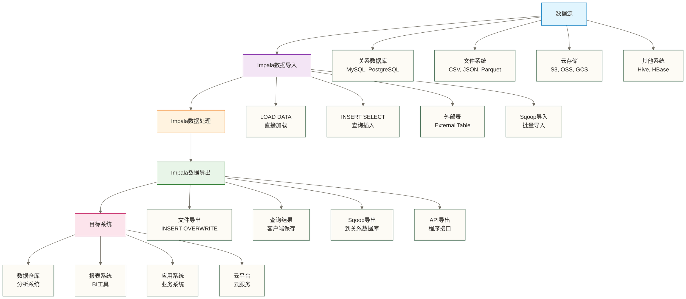

# 数据导入导出 - Impala数据流转的桥梁

> [!abstract] 📋 本节概览
> - 🎯 学习目标：掌握Impala中数据导入导出的各种方法和最佳实践
> - 📚 前置知识：[[【技术与工具】/Impala/09-连接与子查询|连接与子查询]]、HDFS基础操作
> - ⏱️ 预计用时：90-120分钟

## 🤔 为什么数据导入导出很重要？

> [!tip] 💝 给数据ETL新手的温暖指导
> 
> 🤗 **学习数据导入导出就像学会搭建数据的"高速公路"！**
> 
> 如果你现在面对数据流转时想：
> - "这么多种数据格式，该怎么处理？"
> - "大量数据导入导出好慢，有没有快速方法？"
> - "怎么保证数据在流转过程中不出错？"
> 
> **别担心！** 每个数据工程师都是从第一次数据迁移开始学习的 ✨
> 
> 🚛 **想象数据导入导出就像物流运输**
> 
> 物流运输的过程：
> - 📦 **数据源** = 货物仓库（各种格式的原始数据）
> - 🚛 **导入过程** = 运输车队（ETL工具和方法）
> - 🏭 **Impala表** = 加工厂（数据处理和分析中心）
> - 📤 **导出过程** = 配送系统（将结果送达目的地）
> - 🛣️ **优化策略** = 选择最佳路线（提升传输效率）
> 
> **掌握了数据流转技术，你就能让数据在系统间自由穿梭！** 🌟

## 🎯 数据导入导出全景图

### 📊 数据流转架构



### 🎯 导入导出方法对比

| 方法 | 数据量 | 性能 | 实施复杂度 | 适用场景 |
|---|---|---|---|---|
| **LOAD DATA** | 中小型 | ⭐⭐⭐ | ⭐⭐ | 文件直接加载 |
| **INSERT SELECT** | 小型 | ⭐⭐ | ⭐ | 简单数据迁移 |
| **外部表** | 大型 | ⭐⭐⭐⭐ | ⭐⭐⭐ | 零拷贝查询 |
| **Sqoop** | 大型 | ⭐⭐⭐⭐⭐ | ⭐⭐⭐⭐ | 数据库批量同步 |
| **INSERT OVERWRITE** | 中大型 | ⭐⭐⭐⭐ | ⭐⭐ | 文件导出 |

## 📥 数据导入技术详解

### 📁 文件导入

#### 1. 文本文件导入

```sql
-- 1.1 创建目标表
CREATE TABLE customer_import (
    customer_id STRING,
    customer_name STRING,
    email STRING,
    phone STRING,
    registration_date DATE,
    customer_type STRING
) 
ROW FORMAT DELIMITED
FIELDS TERMINATED BY ','
LINES TERMINATED BY '\n'
STORED AS TEXTFILE;

-- 1.2 准备CSV数据文件
-- 假设在HDFS路径 /data/import/customers.csv 有数据：
-- C001,张三公司,zhangsan@company.com,13800138001,2024-01-15,Enterprise
-- C002,李四贸易,lisi@trade.com,13800138002,2024-02-20,SMB

-- 1.3 使用LOAD DATA导入
LOAD DATA INPATH '/data/import/customers.csv' 
INTO TABLE customer_import;

-- 1.4 验证导入结果
SELECT * FROM customer_import LIMIT 10;
SELECT COUNT(*) FROM customer_import;
```

#### 2. 复杂格式文件导入

```sql
-- 2.1 JSON文件导入（通过外部表）
CREATE EXTERNAL TABLE json_logs_external (
    log_line STRING
)
STORED AS TEXTFILE
LOCATION '/data/import/json_logs/';

-- 2.2 解析JSON数据
CREATE TABLE parsed_logs AS
SELECT 
    get_json_object(log_line, '$.timestamp') AS log_timestamp,
    get_json_object(log_line, '$.user_id') AS user_id,
    get_json_object(log_line, '$.action') AS action,
    get_json_object(log_line, '$.ip_address') AS ip_address
FROM json_logs_external
WHERE log_line IS NOT NULL;

-- 2.3 管道符分隔文件处理
CREATE TABLE complex_format_data (
    field1 STRING,
    field2 STRING,
    field3 STRING,
    field4 STRING
)
ROW FORMAT DELIMITED
FIELDS TERMINATED BY '|'
STORED AS TEXTFILE;
```

### 🗃️ Parquet文件导入

```sql
-- 3.1 创建Parquet表
CREATE TABLE sales_parquet_import (
    order_id STRING,
    customer_id STRING,
    product_id STRING,
    order_date DATE,
    quantity INT,
    unit_price DECIMAL(10,2),
    total_amount DECIMAL(12,2)
)
STORED AS PARQUET;

-- 3.2 从现有Parquet文件导入
-- 方法1：直接指向Parquet文件的外部表
CREATE EXTERNAL TABLE sales_external_parquet (
    order_id STRING,
    customer_id STRING,
    product_id STRING,
    order_date DATE,
    quantity INT,
    unit_price DECIMAL(10,2),
    total_amount DECIMAL(12,2)
)
STORED AS PARQUET
LOCATION '/data/parquet_files/sales/';

-- 方法2：从外部表导入到内部表
INSERT INTO sales_parquet_import
SELECT * FROM sales_external_parquet;

-- 3.3 分区Parquet文件导入
CREATE TABLE sales_partitioned_import (
    order_id STRING,
    customer_id STRING,
    product_id STRING,
    quantity INT,
    unit_price DECIMAL(10,2),
    total_amount DECIMAL(12,2)
)
PARTITIONED BY (
    order_date DATE,
    region STRING
)
STORED AS PARQUET;

-- 动态分区导入（须先在源数据中提供 region；上方 sales_external_parquet 未定义该列）
-- 以上为 Hive 的动态分区设置，Impala 不使用这两个配置项。

INSERT INTO sales_partitioned_import PARTITION (order_date, region)
SELECT 
    order_id,
    customer_id,
    product_id,
    quantity,
    unit_price,
    total_amount,
    order_date,
    region
FROM sales_external_parquet;
```

### 🔗 从关系数据库导入

#### 1. 使用Sqoop导入

```bash
# 1.1 基础Sqoop导入命令
sqoop import \
  --connect jdbc:mysql://mysql-server:3306/ecommerce \
  --username data_user \
  --password 'password123' \
  --table customers \
  --target-dir /user/impala/external/customers \
  --fields-terminated-by ',' \
  --lines-terminated-by '\n' \
  --null-string '\\N' \
  --null-non-string '\\N'

# 1.2 增量导入
sqoop import \
  --connect jdbc:mysql://mysql-server:3306/ecommerce \
  --username data_user \
  --password 'password123' \
  --table orders \
  --target-dir /user/impala/external/orders \
  --incremental append \
  --check-column order_id \
  --last-value 1000 \
  --fields-terminated-by ','

# 1.3 条件导入
sqoop import \
  --connect jdbc:mysql://mysql-server:3306/ecommerce \
  --username data_user \
  --password 'password123' \
  --table orders \
  --where "order_date >= '2024-01-01'" \
  --target-dir /user/impala/external/orders_2024 \
  --fields-terminated-by ','

# 1.4 自定义SQL导入
sqoop import \
  --connect jdbc:mysql://mysql-server:3306/ecommerce \
  --username data_user \
  --password 'password123' \
  --query "SELECT o.order_id, o.customer_id, o.order_date, c.customer_name 
           FROM orders o JOIN customers c ON o.customer_id = c.customer_id 
           WHERE \$CONDITIONS" \
  --target-dir /user/impala/external/order_customer_join \
  --split-by o.order_id \
  --fields-terminated-by ','
```

#### 2. 在Impala中处理Sqoop导入的数据

```sql
-- 2.1 创建外部表指向Sqoop导入的数据
CREATE EXTERNAL TABLE sqoop_customers_external (
    customer_id STRING,
    customer_name STRING,
    email STRING,
    phone STRING,
    registration_date STRING,
    customer_type STRING
)
ROW FORMAT DELIMITED
FIELDS TERMINATED BY ','
STORED AS TEXTFILE
LOCATION '/user/impala/external/customers';

-- 2.2 数据类型转换和清洗
CREATE TABLE customers_cleaned AS
SELECT 
    customer_id,
    customer_name,
    email,
    phone,
    CAST(registration_date AS DATE) AS registration_date,
    customer_type
FROM sqoop_customers_external
WHERE customer_id IS NOT NULL
  AND customer_name IS NOT NULL;

-- 2.3 增量数据合并
-- 假设有新的增量数据
MERGE customers_cleaned AS target
USING sqoop_customers_incremental AS source
ON target.customer_id = source.customer_id
WHEN MATCHED THEN
    UPDATE SET
        customer_name = source.customer_name,
        email = source.email,
        phone = source.phone
WHEN NOT MATCHED THEN
    INSERT (customer_id, customer_name, email, phone, registration_date, customer_type)
    VALUES (source.customer_id, source.customer_name, source.email, source.phone, 
            CAST(source.registration_date AS DATE), source.customer_type);
```

### 🌐 从云存储导入

#### 1. Amazon S3导入

```sql
-- 1.1 创建指向S3的外部表
CREATE EXTERNAL TABLE s3_sales_data (
    order_id STRING,
    customer_id STRING,
    product_id STRING,
    order_date DATE,
    quantity INT,
    unit_price DECIMAL(10,2)
)
STORED AS PARQUET
LOCATION 's3a://my-data-bucket/sales-data/';

-- 1.2 从S3导入到本地表
CREATE TABLE local_sales_data AS
SELECT * FROM s3_sales_data
WHERE order_date >= '2024-01-01';

-- 1.3 分区导入
INSERT INTO local_sales_partitioned PARTITION (year, month)
SELECT 
    order_id,
    customer_id,
    product_id,
    order_date,
    quantity,
    unit_price,
    YEAR(order_date) AS year,
    MONTH(order_date) AS month
FROM s3_sales_data
WHERE order_date >= '2024-01-01';
```

#### 2. 阿里云OSS导入

```sql
-- 2.1 配置OSS访问（在集群配置中）
-- 需要在Hadoop配置中设置OSS访问密钥

-- 2.2 创建OSS外部表
CREATE EXTERNAL TABLE oss_log_data (
    log_timestamp TIMESTAMP,
    user_id STRING,
    action STRING,
    ip_address STRING,
    user_agent STRING
)
ROW FORMAT DELIMITED
FIELDS TERMINATED BY '\t'
STORED AS TEXTFILE
LOCATION 'oss://my-bucket/log-data/';

-- 2.3 数据清洗和导入
CREATE TABLE cleaned_log_data AS
SELECT 
    log_timestamp,
    user_id,
    action,
    ip_address,
    CASE 
        WHEN user_agent LIKE '%Mobile%' THEN 'Mobile'
        WHEN user_agent LIKE '%Bot%' THEN 'Bot'
        ELSE 'Desktop'
    END AS device_type
FROM oss_log_data
WHERE log_timestamp IS NOT NULL
  AND user_id IS NOT NULL;
```

## 📤 数据导出技术详解

### 📁 导出到文件系统

#### 1. 基础文件导出

```sql
-- 1.1 导出为CSV文件
INSERT OVERWRITE DIRECTORY '/data/export/customer_summary'
ROW FORMAT DELIMITED
FIELDS TERMINATED BY ','
LINES TERMINATED BY '\n'
SELECT 
    customer_id,
    customer_name,
    customer_type,
    total_orders,
    total_amount,
    last_order_date
FROM (
    SELECT 
        c.customer_id,
        c.customer_name,
        c.customer_type,
        COUNT(o.order_id) AS total_orders,
        SUM(o.order_amount) AS total_amount,
        MAX(o.order_date) AS last_order_date
    FROM customers c
    LEFT JOIN orders o ON c.customer_id = o.customer_id
    GROUP BY c.customer_id, c.customer_name, c.customer_type
) customer_stats
ORDER BY total_amount DESC;

-- 1.2 导出为Parquet文件
INSERT OVERWRITE DIRECTORY '/data/export/sales_analysis'
STORED AS PARQUET
SELECT 
    product_id,
    product_name,
    category,
    total_quantity_sold,
    total_revenue,
    avg_selling_price
FROM product_sales_summary
WHERE total_revenue > 10000;
```

#### 2. 分区导出

```sql
-- 2.1 按分区导出
INSERT OVERWRITE DIRECTORY '/data/export/sales_by_region'
ROW FORMAT DELIMITED
FIELDS TERMINATED BY ','
SELECT 
    region,
    order_date,
    customer_count,
    total_sales,
    avg_order_value
FROM regional_sales_summary
WHERE order_date >= '2024-01-01'
ORDER BY region, order_date;

-- 2.2 多格式导出
-- Parquet格式（用于后续分析）
INSERT OVERWRITE DIRECTORY '/data/export/analytics/parquet/'
STORED AS PARQUET
SELECT * FROM detailed_sales_analysis;

-- CSV格式（用于Excel分析）
INSERT OVERWRITE DIRECTORY '/data/export/analytics/csv/'
ROW FORMAT DELIMITED
FIELDS TERMINATED BY ','
LINES TERMINATED BY '\n'
SELECT * FROM summary_sales_report;
```

### 🗃️ 导出到关系数据库

#### 1. 使用Sqoop导出

```bash
# 1.1 基础导出到MySQL
sqoop export \
  --connect jdbc:mysql://mysql-server:3306/reporting \
  --username report_user \
  --password 'password123' \
  --table customer_summary \
  --export-dir /data/export/customer_summary \
  --fields-terminated-by ',' \
  --input-null-string '\\N' \
  --input-null-non-string '\\N'

# 1.2 更新模式导出
sqoop export \
  --connect jdbc:mysql://mysql-server:3306/reporting \
  --username report_user \
  --password 'password123' \
  --table sales_metrics \
  --export-dir /data/export/sales_metrics \
  --update-key order_date,region \
  --update-mode updateonly \
  --fields-terminated-by ','

# 1.3 自定义插入语句
sqoop export \
  --connect jdbc:mysql://mysql-server:3306/reporting \
  --username report_user \
  --password 'password123' \
  --table monthly_reports \
  --columns "report_month,total_sales,customer_count,avg_order_value" \
  --export-dir /data/export/monthly_summary \
  --fields-terminated-by ','
```

#### 2. 准备导出数据

```sql
-- 2.1 创建导出前的数据预处理
CREATE TABLE export_customer_summary AS
SELECT 
    customer_id,
    customer_name,
    CASE 
        WHEN customer_type = 'Enterprise' THEN 'ENT'
        WHEN customer_type = 'SMB' THEN 'SMB'
        ELSE 'OTHER'
    END AS customer_type_code,
    COALESCE(total_orders, 0) AS total_orders,
    COALESCE(total_amount, 0.00) AS total_amount,
    COALESCE(DATE_FORMAT(last_order_date, 'yyyy-MM-dd'), '1900-01-01') AS last_order_date_str
FROM customer_analysis_view;

-- 2.2 数据质量检查
SELECT 
    COUNT(*) AS total_records,
    COUNT(CASE WHEN customer_id IS NULL THEN 1 END) AS null_customer_id,
    COUNT(CASE WHEN customer_name IS NULL THEN 1 END) AS null_customer_name,
    COUNT(CASE WHEN total_amount < 0 THEN 1 END) AS negative_amount
FROM export_customer_summary;

-- 2.3 导出前最终检查
SELECT * FROM export_customer_summary 
WHERE customer_id IS NULL OR customer_name IS NULL
LIMIT 10;
```

### 🌐 导出到云存储

#### 1. 导出到Amazon S3

```sql
-- 1.1 直接导出到S3
INSERT OVERWRITE DIRECTORY 's3a://my-export-bucket/customer-analysis/'
STORED AS PARQUET
SELECT 
    customer_id,
    customer_name,
    customer_segment,
    lifetime_value,
    last_purchase_date,
    predicted_churn_risk
FROM customer_analytics_final
WHERE analysis_date = CURRENT_DATE();

-- 1.2 按日期分区导出到S3
INSERT OVERWRITE DIRECTORY 's3a://my-export-bucket/daily-sales/'
PARTITION BY (export_date STRING)
STORED AS PARQUET
SELECT 
    order_id,
    customer_id,
    product_id,
    order_amount,
    order_status,
    DATE_FORMAT(CURRENT_DATE(), 'yyyy-MM-dd') AS export_date
FROM orders
WHERE order_date = CURRENT_DATE();
```

#### 2. 导出到阿里云OSS

```sql
-- 2.1 导出分析结果到OSS
INSERT OVERWRITE DIRECTORY 'oss://analytics-bucket/monthly-reports/'
ROW FORMAT DELIMITED
FIELDS TERMINATED BY '\t'
SELECT 
    report_month,
    region,
    total_sales,
    total_orders,
    unique_customers,
    avg_order_value
FROM monthly_sales_report
WHERE report_month >= DATE_SUB(CURRENT_DATE(), 365);

-- 2.2 压缩导出
INSERT OVERWRITE DIRECTORY 'oss://analytics-bucket/compressed-data/'
STORED AS PARQUET
TBLPROPERTIES ('parquet.compression'='gzip')
SELECT * FROM large_dataset_summary;
```

## 🔄 ETL流程设计

### 📋 完整ETL流程示例

```sql
-- 1. 创建ETL控制表
CREATE TABLE etl_control (
    process_name STRING,
    last_run_date DATE,
    last_run_status STRING,
    records_processed BIGINT,
    error_message STRING
) STORED AS PARQUET;

-- 2. ETL数据质量检查函数
CREATE VIEW data_quality_check AS
SELECT 
    'customers' AS table_name,
    COUNT(*) AS total_records,
    COUNT(CASE WHEN customer_id IS NULL THEN 1 END) AS null_keys,
    COUNT(CASE WHEN customer_name IS NULL OR customer_name = '' THEN 1 END) AS missing_names,
    COUNT(CASE WHEN email NOT RLIKE '^[a-zA-Z0-9._%+-]+@[a-zA-Z0-9.-]+\\.[a-zA-Z]{2,}$' THEN 1 END) AS invalid_emails
FROM customers
UNION ALL
SELECT 
    'orders' AS table_name,
    COUNT(*) AS total_records,
    COUNT(CASE WHEN order_id IS NULL THEN 1 END) AS null_keys,
    COUNT(CASE WHEN customer_id IS NULL THEN 1 END) AS missing_customer_id,
    COUNT(CASE WHEN order_amount <= 0 THEN 1 END) AS invalid_amounts
FROM orders;

-- 3. 增量数据处理
WITH new_orders AS (
    SELECT *
    FROM external_orders_staging
    WHERE order_date > (
        SELECT COALESCE(MAX(last_run_date), DATE('1900-01-01'))
        FROM etl_control 
        WHERE process_name = 'orders_incremental'
    )
),
processed_orders AS (
    SELECT 
        order_id,
        customer_id,
        product_id,
        order_date,
        CASE 
            WHEN order_amount IS NULL THEN 0
            WHEN order_amount < 0 THEN 0
            ELSE order_amount
        END AS order_amount,
        COALESCE(order_status, 'Unknown') AS order_status
    FROM new_orders
    WHERE order_id IS NOT NULL
)
INSERT INTO orders
SELECT * FROM processed_orders;

-- 4. 记录ETL控制信息（示意：应由调度程序在作业成功后写入实际处理条数）
INSERT INTO etl_control
SELECT 
    'orders_incremental' AS process_name,
    CURRENT_DATE() AS last_run_date,
    'SUCCESS' AS last_run_status,
    CAST(NULL AS BIGINT) AS records_processed,  -- 占位：上条语句的 CTE 在此不可见，须填入实际处理条数
    NULL AS error_message;
```

### 🔧 性能优化策略

#### 1. 批量操作优化

```sql
-- 1.1 批量插入优化
-- 设置适当的批量大小
-- Impala 没有通用的 BATCH_SIZE 查询选项；批量大小需在上游写入任务中控制。
SET SYNC_DDL = false;  -- 不等待 DDL 元数据更新传播至所有 impalad；不表示 DDL 作业异步执行

-- 1.2 分批处理大量数据
WITH batch_data AS (
    SELECT 
        *,
        ROW_NUMBER() OVER (ORDER BY order_id) AS rn
    FROM large_source_table
    WHERE processing_flag = false
)
INSERT INTO target_table
SELECT 
    order_id,
    customer_id,
    order_amount,
    order_date
FROM batch_data
WHERE rn BETWEEN 1 AND 100000;  -- 处理前10万条

-- 1.3 并行分区处理
INSERT INTO target_partitioned_table PARTITION (year, month)
SELECT 
    order_id,
    customer_id,
    order_amount,
    order_date,
    YEAR(order_date) AS year,
    MONTH(order_date) AS month
FROM source_table
WHERE YEAR(order_date) = 2024
  AND MONTH(order_date) = 1;  -- 按月并行处理
```

#### 2. 内存和资源优化

```sql
-- 2.1 设置适当的内存限制
SET MEM_LIMIT = 8GB;
SET QUERY_TIMEOUT_S = 3600;

-- 2.2 使用流式处理减少内存使用
INSERT INTO summary_table
SELECT 
    customer_id,
    COUNT(*) AS order_count,
    SUM(order_amount) AS total_amount
FROM orders
WHERE order_date >= DATE_SUB(CURRENT_DATE(), 30)
GROUP BY customer_id;  -- 避免使用ORDER BY除非必要

-- 2.3 分阶段处理复杂转换
-- 第一阶段：基础清洗
CREATE TABLE stage1_cleaned AS
SELECT 
    order_id,
    TRIM(customer_id) AS customer_id,
    CASE 
        WHEN order_amount IS NULL THEN 0
        ELSE order_amount
    END AS order_amount,
    order_date
FROM raw_orders
WHERE order_id IS NOT NULL;

-- 第二阶段：业务逻辑处理
CREATE TABLE stage2_enriched AS
SELECT 
    s1.*,
    c.customer_name,
    c.customer_type
FROM stage1_cleaned s1
LEFT JOIN customers c ON s1.customer_id = c.customer_id;

-- 第三阶段：最终输出
CREATE TABLE final_orders AS
SELECT 
    order_id,
    customer_id,
    customer_name,
    customer_type,
    order_amount,
    order_date,
    CASE 
        WHEN customer_type = 'VIP' THEN order_amount * 0.95
        ELSE order_amount
    END AS final_amount
FROM stage2_enriched;
```

## 🔍 数据导入导出监控

### 📊 数据量和质量监控

```sql
-- 1. 创建数据质量监控表
CREATE TABLE data_quality_metrics (
    check_date DATE,
    table_name STRING,
    metric_name STRING,
    metric_value BIGINT,
    threshold_value BIGINT,
    status STRING
) STORED AS PARQUET;

-- 2. 数据量监控
INSERT INTO data_quality_metrics
SELECT 
    CURRENT_DATE() AS check_date,
    'orders' AS table_name,
    'record_count' AS metric_name,
    COUNT(*) AS metric_value,
    1000000 AS threshold_value,  -- 预期最小记录数
    CASE 
        WHEN COUNT(*) >= 1000000 THEN 'PASS'
        ELSE 'FAIL'
    END AS status
FROM orders
WHERE order_date = CURRENT_DATE();

-- 3. 数据完整性检查
WITH quality_checks AS (
    SELECT 
        'customers' AS table_name,
        'null_customer_id' AS metric_name,
        COUNT(CASE WHEN customer_id IS NULL THEN 1 END) AS metric_value,
        0 AS threshold_value
    FROM customers
    
    UNION ALL
    
    SELECT 
        'orders' AS table_name,
        'future_orders' AS metric_name,
        COUNT(CASE WHEN order_date > CURRENT_DATE() THEN 1 END) AS metric_value,
        0 AS threshold_value
    FROM orders
    
    UNION ALL
    
    SELECT 
        'orders' AS table_name,
        'negative_amounts' AS metric_name,
        COUNT(CASE WHEN order_amount < 0 THEN 1 END) AS metric_value,
        0 AS threshold_value
    FROM orders
)
INSERT INTO data_quality_metrics
SELECT 
    CURRENT_DATE() AS check_date,
    table_name,
    metric_name,
    metric_value,
    threshold_value,
    CASE 
        WHEN metric_value <= threshold_value THEN 'PASS'
        ELSE 'FAIL'
    END AS status
FROM quality_checks;

-- 4. 监控报告查询
SELECT 
    check_date,
    table_name,
    COUNT(*) AS total_checks,
    COUNT(CASE WHEN status = 'PASS' THEN 1 END) AS passed_checks,
    COUNT(CASE WHEN status = 'FAIL' THEN 1 END) AS failed_checks,
    ROUND(COUNT(CASE WHEN status = 'PASS' THEN 1 END) * 100.0 / COUNT(*), 2) AS pass_rate
FROM data_quality_metrics
WHERE check_date >= DATE_SUB(CURRENT_DATE(), 7)
GROUP BY check_date, table_name
ORDER BY check_date DESC, table_name;
```

### ⏱️ 性能监控

```sql
-- 5. ETL性能监控
CREATE TABLE etl_performance_log (
    job_name STRING,
    start_time TIMESTAMP,
    end_time TIMESTAMP,
    duration_minutes INT,
    records_processed BIGINT,
    records_per_minute BIGINT,
    status STRING,
    error_message STRING
) STORED AS PARQUET;

-- 6. 记录ETL性能
-- 在ETL脚本开始时记录
INSERT INTO etl_performance_log VALUES
('daily_customer_import', NOW(), NULL, NULL, NULL, NULL, 'RUNNING', NULL);

-- 在ETL脚本结束时更新（以下 UPDATE 不适用于上方创建的 Parquet 表，须另选支持更新的表或写入方式）
UPDATE etl_performance_log 
SET 
    end_time = NOW(),
    duration_minutes = TIMESTAMPDIFF(MINUTE, start_time, NOW()),
    records_processed = 150000,
    records_per_minute = 150000 / TIMESTAMPDIFF(MINUTE, start_time, NOW()),
    status = 'COMPLETED'
WHERE job_name = 'daily_customer_import' 
  AND status = 'RUNNING'
  AND DATE(start_time) = CURRENT_DATE();
```

## 🎉 数据导入导出学习收获

> [!success] 🌟 **你已阅读数据流转的核心练习材料，技能掌握仍需通过实际运行与验证确认！**
> 
> **这些材料涉及的ETL能力方向**：
> - ✅ **多源导入**：文件、数据库、云存储等各种数据源
> - ✅ **格式处理**：CSV、JSON、Parquet等多种格式
> - ✅ **批量操作**：高效的大数据量导入导出
> - ✅ **增量同步**：智能的增量数据处理
> - ✅ **质量控制**：数据质量检查和监控
> - ✅ **性能优化**：ETL流程性能调优
> - ✅ **云端集成**：与云平台的无缝对接
> 
> **这些练习有助于熟悉数据管道的部分技能；企业级管道仍需经过兼容性、质量和运维验证。** 🚀

### 🎯 实战技能验证

**完成以下ETL项目挑战来验证你的技能**：

```sql
-- 🎯 挑战1：构建完整的客户数据ETL管道
-- 要求：从多个数据源整合客户信息，包含数据清洗、去重、质量检查

-- 步骤1：创建统一客户主表
CREATE TABLE customer_master (
    customer_id STRING,
    customer_name STRING,
    email STRING,
    phone STRING,
    registration_date DATE,
    customer_type STRING,
    status STRING,
    created_time TIMESTAMP,
    updated_time TIMESTAMP,
    data_source STRING
) 
PARTITIONED BY (load_date DATE)
STORED AS PARQUET;

-- 步骤2：从CRM系统导入
INSERT INTO customer_master PARTITION (load_date)
SELECT 
    CONCAT('CRM_', customer_id) AS customer_id,
    TRIM(UPPER(customer_name)) AS customer_name,
    LOWER(TRIM(email)) AS email,
    REGEXP_REPLACE(phone, '[^0-9]', '') AS phone,
    registration_date,
    customer_type,
    CASE 
        WHEN status IN ('active', 'ACTIVE', '1') THEN 'Active'
        WHEN status IN ('inactive', 'INACTIVE', '0') THEN 'Inactive'
        ELSE 'Unknown'
    END AS status,
    NOW() AS created_time,
    NOW() AS updated_time,
    'CRM' AS data_source,
    CURRENT_DATE() AS load_date
FROM crm_customers_staging
WHERE customer_id IS NOT NULL
  AND customer_name IS NOT NULL;

-- 步骤3：数据去重和质量检查
WITH duplicate_check AS (
    SELECT 
        customer_id,
        email,
        COUNT(*) AS dup_count,
        MAX(updated_time) AS latest_update
    FROM customer_master
    WHERE load_date = CURRENT_DATE()
    GROUP BY customer_id, email
    HAVING COUNT(*) > 1
),
quality_summary AS (
    SELECT 
        COUNT(*) AS total_records,
        COUNT(CASE WHEN email NOT RLIKE '^[a-zA-Z0-9._%+-]+@[a-zA-Z0-9.-]+\\.[a-zA-Z]{2,}$' THEN 1 END) AS invalid_emails,
        COUNT(CASE WHEN LENGTH(phone) < 10 THEN 1 END) AS invalid_phones,
        COUNT(CASE WHEN customer_name IS NULL OR TRIM(customer_name) = '' THEN 1 END) AS missing_names,
        COUNT(CASE WHEN email RLIKE '^[a-zA-Z0-9._%+-]+@[a-zA-Z0-9.-]+\\.[a-zA-Z]{2,}$'
                        AND LENGTH(phone) >= 10
                        AND customer_name IS NOT NULL AND TRIM(customer_name) <> ''
                   THEN 1 END) AS valid_records
    FROM customer_master
    WHERE load_date = CURRENT_DATE()
)
SELECT 
    'Data Quality Summary' AS report_type,
    CURRENT_DATE() AS report_date,
    total_records,
    invalid_emails,
    invalid_phones,
    missing_names,
    ROUND(valid_records * 100.0 / NULLIF(total_records, 0), 2) AS data_quality_score  -- 满足全部示例规则的记录比例；空数据集返回 NULL
FROM quality_summary;

-- 🎯 挑战2：实时销售数据导出到多个目标系统
-- 要求：将Impala中的销售分析结果导出到文件、数据库和云存储

-- 创建销售分析视图
CREATE VIEW daily_sales_analysis AS
SELECT 
    order_date,
    region,
    product_category,
    COUNT(DISTINCT customer_id) AS unique_customers,
    COUNT(*) AS total_orders,
    SUM(order_amount) AS total_sales,
    AVG(order_amount) AS avg_order_value,
    SUM(CASE WHEN customer_type = 'VIP' THEN order_amount ELSE 0 END) AS vip_sales
FROM orders o
JOIN customers c ON o.customer_id = c.customer_id
JOIN products p ON o.product_id = p.product_id
WHERE o.order_status = 'Completed'
  AND o.order_date >= DATE_SUB(CURRENT_DATE(), 30)
GROUP BY order_date, region, product_category;

-- 导出到CSV（给业务团队）
INSERT OVERWRITE DIRECTORY '/export/business_reports/daily_sales_csv/'
ROW FORMAT DELIMITED
FIELDS TERMINATED BY ','
LINES TERMINATED BY '\n'
SELECT 
    order_date,
    region,
    product_category,
    unique_customers,
    total_orders,
    total_sales,
    avg_order_value,
    vip_sales
FROM daily_sales_analysis
ORDER BY order_date DESC, region, product_category;

-- 导出到Parquet（给数据科学团队）
INSERT OVERWRITE DIRECTORY '/export/analytics/daily_sales_parquet/'
STORED AS PARQUET
SELECT * FROM daily_sales_analysis;

-- 准备导出到数据库的格式化数据
CREATE TABLE db_export_sales_summary AS
SELECT 
    DATE_FORMAT(order_date, 'yyyy-MM-dd') AS order_date_str,
    region,
    product_category,
    CAST(unique_customers AS STRING) AS unique_customers_str,
    CAST(total_orders AS STRING) AS total_orders_str,
    CAST(ROUND(total_sales, 2) AS STRING) AS total_sales_str,
    CAST(ROUND(avg_order_value, 2) AS STRING) AS avg_order_value_str,
    CAST(ROUND(vip_sales, 2) AS STRING) AS vip_sales_str,
    DATE_FORMAT(NOW(), 'yyyy-MM-dd HH:mm:ss') AS export_timestamp
FROM daily_sales_analysis;
```

### 🎯 下一步学习建议

**立即实践**：
- [ ] 设计一个完整的ETL流程处理真实业务数据
- [ ] 实践增量数据同步和数据质量监控
- [ ] 优化大数据量的导入导出性能

**继续学习**：
- [ ] 学习 [[【技术与工具】/Impala/11-分区表设计|分区表]] - 深入分区优化策略
- [ ] 学习 [[【技术与工具】/Impala/12-文件格式优化|文件格式优化]] - 存储格式深度优化

> [!quote] 💭 **数据流转的艺术**
> 
> **数据导入导出是数据工程的核心技能**：
> - 🌊 **数据流动**：让数据在系统间自由流转
> - 🔍 **质量保证**：确保数据在流转过程中的完整性
> - ⚡ **性能优化**：在准确性和效率之间找到平衡
> - 🔄 **自动化运维**：构建可靠的自动化数据管道
> 
> **掌握ETL技能是参与企业数据流转建设的重要一步，仍需结合实际环境持续实践！** ✨

---

**创建时间**：2024-12-11  
**温度指数**：⭐⭐⭐⭐⭐ (实用性强，操作详细)  
**预计学习时长**：90-120分钟  
**下一步学习**：[[【技术与工具】/Impala/11-分区表设计|分区表]] → [[【技术与工具】/Impala/12-文件格式优化|文件格式优化]]

#Impala #数据导入 #数据导出 #ETL #Sqoop #数据质量 #性能优化 #云端集成
