# 分区表设计 - 大数据查询性能的关键

> [!abstract] 📋 本节概览
> - 🎯 学习目标：掌握Impala分区表的设计原理和最佳实践
> - 📚 前置知识：[[【技术与工具】/ClickHouse/06-ClickHouse数据导入导出|ClickHouse/ClickHouse数据导入导出]]、表设计基础
> - ⏱️ 预计用时：35分钟

## 🤔 为什么分区表设计如此重要？

> [!tip] 💝 给分区设计新手的温暖指导
> 
> 🤗 **学习分区表设计就像学会整理巨大的图书馆！**
> 
> 如果你现在面对海量数据时想：
> - "我的查询为什么这么慢？"
> - "分区应该怎么设计才合理？"
> - "分区太多或太少都有问题吗？"
> 
> **别着急！** 每个数据架构师都是从第一张分区表开始的 ✨
> 
> 📚 **想象分区表设计就像图书馆管理**
> 
> 图书馆的组织方式：
> - 🏢 **分区策略** = 楼层规划（按主题、时间分类存放）
> - 📖 **分区粒度** = 书架密度（每个分区存放多少数据）
> - 🔍 **查询优化** = 找书路径（快速定位到目标分区）
> - 📋 **分区修剪** = 智能导航（只搜索相关区域）
> - 🛠️ **维护策略** = 定期整理（分区清理和优化）
> 
> **合理的分区设计有助于减少扫描量；实际提速取决于查询条件、数据分布和执行环境。** 🌟

## 🎯 分区表设计全景图

### 📊 分区策略分类体系

```mermaid
%%{init: {"theme":"base","themeVariables":{"fontFamily":"PingFang SC, -apple-system, Source Han Serif SC, serif","fontSize":"16px","background":"#FDFBF5","primaryColor":"#FDFBF5","primaryTextColor":"#2D2A26","primaryBorderColor":"#6E6A60","secondaryColor":"#E8EFE8","secondaryBorderColor":"#8FA890","secondaryTextColor":"#2D2A26","tertiaryColor":"#FDFBF5","tertiaryBorderColor":"#9A9488","tertiaryTextColor":"#6E6A60","lineColor":"#6E6A60","textColor":"#2D2A26","mainBkg":"#FDFBF5","nodeBorder":"#2D5A3D","clusterBkg":"#F3EEDF","clusterBorder":"#9A9488","edgeLabelBackground":"#FDFBF5"},"flowchart":{"htmlLabels":true,"curve":"basis","padding":20,"nodeSpacing":60,"rankSpacing":70,"useMaxWidth":false},"themeCSS":".node rect, .node polygon, .node circle { stroke-width: 1.5px; } .edgePath .path { stroke-width: 1.5px; } .cluster-label .nodeLabel, .cluster-label foreignObject { color: #2D2A26 !important; } .edgeLabel, .edgeLabel foreignObject { color: #2D2A26 !important; background-color: #FDFBF5; } .edgeLabel rect { fill: #FDFBF5; }"}}%%
flowchart TD
    A[Impala分区表设计] --> B[📅 时间分区]
    A --> C[🌍 业务分区]
    A --> D[🔢 范围分区]
    A --> E[🎯 混合分区]
    A --> F[⚙️ 分区优化]
    B --> B1[按年分区<br/>适合历史数据]
    B --> B2[按月分区<br/>平衡性能和粒度]
    B --> B3[按日分区<br/>实时数据分析]
    B --> B4[按小时分区<br/>高频数据处理]
    C --> C1[地区分区<br/>按地理位置]
    C --> C2[部门分区<br/>按组织结构]
    C --> C3[产品分区<br/>按业务线]
    C --> C4[状态分区<br/>按数据状态]
    D --> D1[数值范围<br/>按数值区间]
    D --> D2[字母范围<br/>按首字母]
    D --> D3[哈希分区<br/>均匀分布]
    E --> E1[时间+地区<br/>二维分区]
    E --> E2[业务+状态<br/>多维分区]
    E --> E3[层次分区<br/>年/月/日]
    F --> F1[分区修剪<br/>查询优化]
    F --> F2[分区大小<br/>性能平衡]
    F --> F3[分区维护<br/>生命周期管理]
    style A fill:#e1f5fe
    style B fill:#f3e5f5
    style C fill:#fff3e0
    style D fill:#e8f5e8
    style E fill:#fce4ec
    style F fill:#f9fbe7
```



### 🎯 分区设计决策矩阵

| 数据特征 | 推荐分区策略 | 分区粒度 | 性能提升 | 维护复杂度 |
|---|---|---|---|---|
| **时序数据** | 按时间分区 | 日/月/年 | ⭐⭐⭐⭐⭐ | ⭐⭐ |
| **地域数据** | 按地区分区 | 省/市/区 | ⭐⭐⭐⭐ | ⭐⭐ |
| **多维数据** | 混合分区 | 时间+业务 | ⭐⭐⭐⭐⭐ | ⭐⭐⭐⭐ |
| **均匀分布** | 哈希分区 | 固定数量 | ⭐⭐⭐ | ⭐ |
| **历史归档** | 年度分区 | 年/季度 | ⭐⭐⭐ | ⭐ |

## 📅 时间分区设计详解

### 🕐 创建时间分区表

```sql
-- 1. 日分区电商订单表
CREATE TABLE ecommerce_orders_daily (
    order_id STRING COMMENT '订单ID',
    customer_id STRING COMMENT '客户ID',
    product_id STRING COMMENT '产品ID',
    order_amount DECIMAL(12,2) COMMENT '订单金额',
    payment_method STRING COMMENT '支付方式',
    order_status STRING COMMENT '订单状态',
    order_timestamp TIMESTAMP COMMENT '下单时间'
)
COMMENT '电商订单表-按日分区'
PARTITIONED BY (
    order_date DATE COMMENT '订单日期分区'
)
STORED AS PARQUET
TBLPROPERTIES (
    'parquet.compression' = 'snappy',
    'impala.enable.stats.extrapolation' = 'true'
);

-- 2. 月分区销售汇总表
CREATE TABLE sales_summary_monthly (
    region STRING COMMENT '销售区域',
    product_category STRING COMMENT '产品类别',
    sales_rep STRING COMMENT '销售代表',
    order_count INT COMMENT '订单数量',
    total_amount DECIMAL(15,2) COMMENT '总销售额',
    avg_order_value DECIMAL(10,2) COMMENT '平均订单价值',
    unique_customers INT COMMENT '独立客户数'
)
COMMENT '销售汇总表-按月分区'
PARTITIONED BY (
    year INT COMMENT '年份',
    month INT COMMENT '月份'
)
STORED AS PARQUET
TBLPROPERTIES ('parquet.compression' = 'gzip');

-- 3. 年分区历史数据表
CREATE TABLE historical_transactions (
    transaction_id STRING COMMENT '交易ID',
    account_id STRING COMMENT '账户ID',
    transaction_type STRING COMMENT '交易类型',
    amount DECIMAL(15,2) COMMENT '交易金额',
    currency STRING COMMENT '货币类型',
    transaction_time TIMESTAMP COMMENT '交易时间',
    description STRING COMMENT '交易描述'
)
COMMENT '历史交易表-按年分区'
PARTITIONED BY (
    transaction_year INT COMMENT '交易年份'
)
STORED AS PARQUET;
```

### 📊 时间分区数据操作

```sql
-- 1. 静态分区插入 - 每日数据
INSERT INTO ecommerce_orders_daily 
PARTITION (order_date='2024-01-15')
VALUES 
('ORD20240115001', 'C001', 'P001', 299.99, 'credit_card', 'completed', '2024-01-15 10:30:25'),
('ORD20240115002', 'C002', 'P002', 1299.99, 'alipay', 'pending', '2024-01-15 14:45:30'),
('ORD20240115003', 'C003', 'P003', 599.99, 'wechat_pay', 'completed', '2024-01-15 16:20:15');

-- 2. 动态分区插入 - 批量历史数据
-- Impala动态分区写入不需要设置Hive的hive.exec.dynamic.partition参数。

-- 从原始数据批量插入日分区
INSERT INTO ecommerce_orders_daily PARTITION (order_date)
SELECT 
    order_id,
    customer_id,
    product_id,
    order_amount,
    payment_method,
    order_status,
    order_timestamp,
    CAST(order_timestamp AS DATE) as order_date
FROM raw_orders
WHERE CAST(order_timestamp AS DATE) BETWEEN '2024-01-01' AND '2024-01-31';

-- 3. 多级分区插入 - 年月分区
INSERT INTO sales_summary_monthly PARTITION (year, month)
SELECT 
    region,
    product_category,
    sales_rep,
    COUNT(*) as order_count,
    SUM(order_amount) as total_amount,
    AVG(order_amount) as avg_order_value,
    COUNT(DISTINCT customer_id) as unique_customers,
    YEAR(order_date) as year,
    MONTH(order_date) as month
FROM ecommerce_orders_daily
WHERE order_date >= '2024-01-01'
GROUP BY 
    region, product_category, sales_rep,
    YEAR(order_date), MONTH(order_date);
```

### 🎯 时间分区查询优化

```sql
-- 1. 单分区查询（最优）
SELECT 
    COUNT(*) as daily_orders,
    SUM(order_amount) as daily_sales
FROM ecommerce_orders_daily
WHERE order_date = '2024-01-15';

-- 2. 范围分区查询（分区修剪）
SELECT 
    order_date,
    COUNT(*) as orders,
    SUM(order_amount) as sales
FROM ecommerce_orders_daily
WHERE order_date BETWEEN '2024-01-10' AND '2024-01-20'
GROUP BY order_date
ORDER BY order_date;

-- 3. 多分区聚合查询
SELECT 
    year,
    month,
    region,
    SUM(total_amount) as monthly_sales,
    SUM(order_count) as monthly_orders
FROM sales_summary_monthly
WHERE year = 2024 
  AND month IN (1, 2, 3)  -- 第一季度
GROUP BY year, month, region
ORDER BY year, month, region;

-- 4. 跨年查询优化
SELECT 
    transaction_year,
    transaction_type,
    COUNT(*) as transaction_count,
    SUM(amount) as total_amount
FROM historical_transactions
WHERE transaction_year IN (2022, 2023, 2024)
  AND transaction_type = 'purchase'
GROUP BY transaction_year, transaction_type
ORDER BY transaction_year;
```

## 🌍 业务分区设计

### 🏢 创建业务分区表

```sql
-- 1. 地区分区表
CREATE TABLE regional_sales (
    order_id STRING COMMENT '订单ID',
    customer_id STRING COMMENT '客户ID',
    product_id STRING COMMENT '产品ID',
    sales_rep STRING COMMENT '销售代表',
    order_amount DECIMAL(12,2) COMMENT '订单金额',
    order_date DATE COMMENT '订单日期',
    order_time TIMESTAMP COMMENT '下单时间'
)
COMMENT '区域销售表'
PARTITIONED BY (
    region STRING COMMENT '销售区域',
    country STRING COMMENT '国家'
)
STORED AS PARQUET;

-- 2. 产品线分区表
CREATE TABLE product_sales (
    sale_id STRING COMMENT '销售记录ID',
    customer_id STRING COMMENT '客户ID',
    product_id STRING COMMENT '产品ID',
    quantity INT COMMENT '销售数量',
    unit_price DECIMAL(10,2) COMMENT '单价',
    total_price DECIMAL(12,2) COMMENT '总价',
    sale_date DATE COMMENT '销售日期',
    sales_channel STRING COMMENT '销售渠道'
)
COMMENT '产品销售表'
PARTITIONED BY (
    product_category STRING COMMENT '产品类别',
    brand STRING COMMENT '品牌'
)
STORED AS PARQUET;

-- 3. 状态分区表
CREATE TABLE customer_data (
    customer_id STRING COMMENT '客户ID',
    customer_name STRING COMMENT '客户姓名',
    email STRING COMMENT '电子邮箱',
    phone STRING COMMENT '联系电话',
    registration_date DATE COMMENT '注册日期',
    last_login TIMESTAMP COMMENT '最后登录时间',
    total_orders INT COMMENT '总订单数',
    total_spent DECIMAL(12,2) COMMENT '总消费金额'
)
COMMENT '客户数据表'
PARTITIONED BY (
    customer_status STRING COMMENT '客户状态',
    customer_segment STRING COMMENT '客户细分'
)
STORED AS PARQUET;
```

### 📈 业务分区数据管理

```sql
-- 1. 按地区插入数据
INSERT INTO regional_sales 
PARTITION (region='North', country='China')
VALUES 
('ORD001', 'C001', 'P001', 'REP001', 1299.99, '2024-01-15', '2024-01-15 10:30:00'),
('ORD002', 'C002', 'P002', 'REP002', 899.99, '2024-01-15', '2024-01-15 14:20:00');

INSERT INTO regional_sales 
PARTITION (region='South', country='China')
VALUES 
('ORD003', 'C003', 'P003', 'REP003', 2599.99, '2024-01-15', '2024-01-15 16:45:00');

-- 2. 动态业务分区插入
INSERT INTO product_sales PARTITION (product_category, brand)
SELECT 
    r.sale_id,
    r.customer_id,
    r.product_id,
    quantity,
    unit_price,
    total_price,
    sale_date,
    sales_channel,
    p.category as product_category,
    p.brand
FROM raw_sales r
JOIN product_master p ON r.product_id = p.product_id
WHERE sale_date = '2024-01-15';

-- 3. 客户状态分区管理
INSERT INTO customer_data PARTITION (customer_status, customer_segment)
SELECT 
    customer_id,
    customer_name,
    email,
    phone,
    registration_date,
    last_login,
    total_orders,
    total_spent,
    CASE 
        WHEN last_login >= DATE_SUB(CURRENT_DATE(), 30) THEN 'active'
        WHEN last_login >= DATE_SUB(CURRENT_DATE(), 90) THEN 'inactive'
        ELSE 'dormant'
    END as customer_status,
    CASE 
        WHEN total_spent >= 10000 THEN 'VIP'
        WHEN total_spent >= 5000 THEN 'Premium'
        WHEN total_spent >= 1000 THEN 'Regular'
        ELSE 'Basic'
    END as customer_segment
FROM customer_summary;
```

### 🎯 业务分区查询策略

```sql
-- 1. 单地区分析
SELECT 
    product_id,
    COUNT(*) as order_count,
    SUM(order_amount) as total_sales,
    AVG(order_amount) as avg_order_value
FROM regional_sales
WHERE region = 'North' AND country = 'China'
  AND order_date >= '2024-01-01'
GROUP BY product_id
ORDER BY total_sales DESC;

-- 2. 多地区对比分析
SELECT 
    region,
    country,
    COUNT(*) as order_count,
    SUM(order_amount) as total_sales,
    AVG(order_amount) as avg_order_value
FROM regional_sales
WHERE order_date BETWEEN '2024-01-01' AND '2024-01-31'
GROUP BY region, country
ORDER BY total_sales DESC;

-- 3. 产品线分析
SELECT 
    product_category,
    brand,
    SUM(quantity) as total_quantity,
    SUM(total_price) as total_revenue,
    COUNT(DISTINCT customer_id) as unique_customers
FROM product_sales
WHERE product_category IN ('Electronics', 'Clothing')
  AND sale_date >= '2024-01-01'
GROUP BY product_category, brand
ORDER BY total_revenue DESC;

-- 4. 客户细分分析
SELECT 
    customer_status,
    customer_segment,
    COUNT(*) as customer_count,
    AVG(total_spent) as avg_spending,
    AVG(total_orders) as avg_orders
FROM customer_data
WHERE customer_status = 'active'
GROUP BY customer_status, customer_segment
ORDER BY avg_spending DESC;
```

## 🔢 范围分区和哈希分区

### 📊 范围分区表设计

```sql
-- 1. 数值范围分区表
CREATE TABLE customer_orders_by_amount (
    order_id STRING COMMENT '订单ID',
    customer_id STRING COMMENT '客户ID',
    product_id STRING COMMENT '产品ID',
    order_amount DECIMAL(12,2) COMMENT '订单金额',
    order_date DATE COMMENT '订单日期',
    order_status STRING COMMENT '订单状态'
)
COMMENT '按订单金额范围分区的订单表'
PARTITIONED BY (
    amount_range STRING COMMENT '金额范围分区'
)
STORED AS PARQUET;

-- 2. 字母范围分区表
CREATE TABLE customer_master_by_name (
    customer_id STRING COMMENT '客户ID',
    customer_name STRING COMMENT '客户姓名',
    email STRING COMMENT '电子邮箱',
    phone STRING COMMENT '联系电话',
    registration_date DATE COMMENT '注册日期',
    city STRING COMMENT '城市',
    country STRING COMMENT '国家'
)
COMMENT '按姓名首字母分区的客户表'
PARTITIONED BY (
    name_initial STRING COMMENT '姓名首字母分区'
)
STORED AS PARQUET;
```

### 🎯 范围分区数据处理

```sql
-- 1. 按金额范围插入数据
INSERT INTO customer_orders_by_amount PARTITION (amount_range)
SELECT 
    order_id,
    customer_id,
    product_id,
    order_amount,
    order_date,
    order_status,
    CASE 
        WHEN order_amount < 100 THEN 'small'
        WHEN order_amount < 500 THEN 'medium'
        WHEN order_amount < 2000 THEN 'large'
        ELSE 'xlarge'
    END as amount_range
FROM ecommerce_orders_daily
WHERE order_date = '2024-01-15';

-- 2. 按姓名首字母插入数据
INSERT INTO customer_master_by_name PARTITION (name_initial)
SELECT 
    customer_id,
    customer_name,
    email,
    phone,
    registration_date,
    city,
    country,
    UPPER(SUBSTR(customer_name, 1, 1)) as name_initial
FROM customer_raw_data;

-- 3. 范围分区查询示例
-- 查询大额订单
SELECT 
    COUNT(*) as large_orders,
    SUM(order_amount) as total_amount,
    AVG(order_amount) as avg_amount
FROM customer_orders_by_amount
WHERE amount_range IN ('large', 'xlarge')
  AND order_date >= '2024-01-01';

-- 查询特定首字母客户
SELECT 
    name_initial,
    COUNT(*) as customer_count,
    COUNT(DISTINCT city) as city_count
FROM customer_master_by_name
WHERE name_initial IN ('A', 'B', 'C')
GROUP BY name_initial
ORDER BY name_initial;
```

## 🎯 混合分区设计

### 🔄 多维分区表

```sql
-- 1. 时间+地区双分区表
CREATE TABLE sales_time_region (
    sale_id STRING COMMENT '销售ID',
    customer_id STRING COMMENT '客户ID',
    product_id STRING COMMENT '产品ID',
    sales_rep STRING COMMENT '销售代表',
    sale_amount DECIMAL(12,2) COMMENT '销售金额',
    commission DECIMAL(8,2) COMMENT '佣金',
    sale_timestamp TIMESTAMP COMMENT '销售时间'
)
COMMENT '按时间和地区双分区的销售表'
PARTITIONED BY (
    sale_date DATE COMMENT '销售日期',
    region STRING COMMENT '销售区域'
)
STORED AS PARQUET;

-- 2. 三级分区表（年-月-产品类别）
CREATE TABLE product_sales_hierarchical (
    sale_id STRING COMMENT '销售ID',
    product_id STRING COMMENT '产品ID',
    customer_id STRING COMMENT '客户ID',
    quantity INT COMMENT '销售数量',
    unit_price DECIMAL(10,2) COMMENT '单价',
    total_amount DECIMAL(12,2) COMMENT '总金额',
    discount_rate DECIMAL(3,2) COMMENT '折扣率',
    sale_time TIMESTAMP COMMENT '销售时间'
)
COMMENT '三级分区销售表'
PARTITIONED BY (
    sale_year INT COMMENT '销售年份',
    sale_month INT COMMENT '销售月份',
    product_category STRING COMMENT '产品类别'
)
STORED AS PARQUET;
```

### 📊 混合分区数据操作

```sql
-- 1. 双分区数据插入
INSERT INTO sales_time_region PARTITION (sale_date, region)
SELECT 
    rs.sale_id,
    rs.customer_id,
    rs.product_id,
    sales_rep,
    sale_amount,
    commission,
    sale_timestamp,
    CAST(sale_timestamp AS DATE) as sale_date,
    CASE 
        WHEN customer_city IN ('Beijing', 'Shanghai', 'Guangzhou', 'Shenzhen') THEN 'Tier1'
        WHEN customer_city IN ('Chengdu', 'Hangzhou', 'Nanjing', 'Wuhan') THEN 'Tier2'
        ELSE 'Others'
    END as region
FROM raw_sales_data rs
JOIN customer_info ci ON rs.customer_id = ci.customer_id
WHERE CAST(sale_timestamp AS DATE) = '2024-01-15';

-- 2. 三级分区数据插入
INSERT INTO product_sales_hierarchical PARTITION (sale_year, sale_month, product_category)
SELECT 
    ps.sale_id,
    ps.product_id,
    ps.customer_id,
    ps.quantity,
    ps.unit_price,
    ps.total_amount,
    ps.discount_rate,
    ps.sale_time,
    YEAR(ps.sale_time) as sale_year,
    MONTH(ps.sale_time) as sale_month,
    p.category as product_category
FROM product_sales_raw ps
JOIN products p ON ps.product_id = p.product_id
WHERE ps.sale_time >= '2024-01-01 00:00:00'
  AND ps.sale_time < '2024-02-01 00:00:00';
```

### 🎯 混合分区查询优化

```sql
-- 1. 双分区精确查询（最优性能）
SELECT 
    COUNT(*) as daily_sales_count,
    SUM(sale_amount) as daily_sales_total,
    AVG(sale_amount) as avg_sale_amount
FROM sales_time_region
WHERE sale_date = '2024-01-15' 
  AND region = 'Tier1';

-- 2. 部分分区查询
SELECT 
    sale_date,
    region,
    COUNT(*) as sales_count,
    SUM(sale_amount) as total_amount
FROM sales_time_region
WHERE sale_date BETWEEN '2024-01-10' AND '2024-01-20'
  AND region IN ('Tier1', 'Tier2')
GROUP BY sale_date, region
ORDER BY sale_date, region;

-- 3. 三级分区聚合查询
SELECT 
    sale_year,
    sale_month,
    product_category,
    SUM(quantity) as total_quantity,
    SUM(total_amount) as total_sales,
    COUNT(DISTINCT customer_id) as unique_customers
FROM product_sales_hierarchical
WHERE sale_year = 2024
  AND sale_month IN (1, 2, 3)
  AND product_category IN ('Electronics', 'Books', 'Clothing')
GROUP BY sale_year, sale_month, product_category
ORDER BY sale_year, sale_month, product_category;

-- 4. 跨分区复杂分析
WITH monthly_stats AS (
    SELECT 
        sale_year,
        sale_month,
        product_category,
        SUM(total_amount) as monthly_sales,
        COUNT(*) as monthly_orders
    FROM product_sales_hierarchical
    WHERE sale_year = 2024
    GROUP BY sale_year, sale_month, product_category
)
SELECT 
    product_category,
    AVG(monthly_sales) as avg_monthly_sales,
    MAX(monthly_sales) as peak_monthly_sales,
    MIN(monthly_sales) as min_monthly_sales,
    STDDEV(monthly_sales) as sales_volatility
FROM monthly_stats
GROUP BY product_category
ORDER BY avg_monthly_sales DESC;
```

## ⚙️ 分区优化策略

### 📈 分区大小优化

```sql
-- 1. 检查分区大小
SHOW TABLE STATS ecommerce_orders_daily;
SHOW TABLE STATS sales_time_region;

-- 查看具体分区统计信息
SHOW PARTITIONS ecommerce_orders_daily;
DESCRIBE FORMATTED ecommerce_orders_daily 
PARTITION (order_date='2024-01-15');

-- 2. 分区合并策略（对于过小分区）
-- 创建周分区表来替代日分区
CREATE TABLE ecommerce_orders_weekly (
    order_id STRING,
    customer_id STRING,
    product_id STRING,
    order_amount DECIMAL(12,2),
    payment_method STRING,
    order_status STRING,
    order_timestamp TIMESTAMP
)
PARTITIONED BY (
    year INT,
    week_of_year INT
)
STORED AS PARQUET;

-- 从日分区表聚合到周分区表
INSERT INTO ecommerce_orders_weekly PARTITION (year, week_of_year)
SELECT 
    order_id,
    customer_id,
    product_id,
    order_amount,
    payment_method,
    order_status,
    order_timestamp,
    YEAR(order_date) as year,
    WEEKOFYEAR(order_date) as week_of_year
FROM ecommerce_orders_daily
WHERE order_date >= '2024-01-01'
  AND order_date < '2024-02-01';
```

### 🔧 分区维护自动化

```sql
-- 1. 分区清理脚本模板
-- 清理超过90天的日分区示例；执行前须确认保留政策、表类型、数据删除影响及备份。
-- 分区表达式支持情况须按目标Impala版本验证，不要直接用于生产。
ALTER TABLE ecommerce_orders_daily 
DROP PARTITION (order_date < DATE_SUB(CURRENT_DATE(), 90));

-- 2. 动态分区管理
-- 以下为Hive参数示例，不是Impala查询选项，不要在Impala会话执行。
-- 如写入任务实际由Hive执行，再按对应Hive版本核对：
-- SET hive.exec.dynamic.partition = true;
-- SET hive.exec.dynamic.partition.mode = nonstrict;
-- SET hive.exec.max.dynamic.partitions = 2000;
-- SET hive.exec.max.dynamic.partitions.pernode = 1000;

-- 3. 分区统计信息更新
-- 批量更新所有分区的统计信息
COMPUTE INCREMENTAL STATS ecommerce_orders_daily;
COMPUTE INCREMENTAL STATS sales_time_region;

-- 更新特定分区
COMPUTE INCREMENTAL STATS ecommerce_orders_daily 
PARTITION (order_date='2024-01-15');

-- 4. 分区修复和恢复
-- 发现已有分区目录并补充元数据，不会恢复已删除的数据文件
-- Hive执行方式（不要在Impala会话执行）：
-- MSCK REPAIR TABLE ecommerce_orders_daily;
-- Impala执行方式：
ALTER TABLE ecommerce_orders_daily RECOVER PARTITIONS;
```

### 🎯 查询性能监控

```sql
-- 1. 分区修剪验证
-- 使用EXPLAIN查看分区修剪效果
EXPLAIN 
SELECT COUNT(*) 
FROM ecommerce_orders_daily 
WHERE order_date = '2024-01-15';

-- 2. 多分区查询分析
EXPLAIN 
SELECT 
    order_date,
    COUNT(*) as orders,
    SUM(order_amount) as sales
FROM ecommerce_orders_daily
WHERE order_date BETWEEN '2024-01-10' AND '2024-01-20'
GROUP BY order_date;

-- 3. 混合分区查询分析
EXPLAIN 
SELECT 
    region,
    COUNT(*) as sales_count
FROM sales_time_region
WHERE sale_date = '2024-01-15'
  AND region IN ('Tier1', 'Tier2')
GROUP BY region;
```

## 🎉 分区表设计最佳实践

### 📋 设计原则总结

> [!tip] 💡 **分区设计黄金原则**
> 
> **1. 分区策略选择**
> - 📅 **时间分区**：常见选择；原稿“适合90%的业务场景”为未核实示例说法，不作为覆盖率结论，应按查询模式评估
> - 🌍 **业务分区**：按查询模式设计，如地区、部门、产品线
> - 🔢 **范围分区**：数据分布均匀时使用
> - 🎯 **混合分区**：复杂业务需求，平衡查询性能
> 
> **2. 分区粒度控制**
> - 📊 **大小参考**：原稿每个分区256MB-1GB为未核实示例范围，不是通用理想值，应结合文件数量、扫描量和并发测试
> - 🚫 **避免过细**：关注大量小分区及小文件开销；原稿<100MB为未核实示例阈值，不是硬性下限
> - ⚖️ **平衡考虑**：在查询性能和维护成本间找平衡
> 
> **3. 查询模式适配**
> - 🎯 **常用条件**：分区键应该是最常用的过滤条件
> - 📈 **修剪效果**：确保分区修剪能显著减少扫描数据量
> - 🔍 **索引配合**：结合排序和统计信息优化

### 🎯 实战案例模板

```sql
-- 🏆 电商数据仓库分区设计最佳实践模板

-- 1. 订单事实表（时间+业务双分区）
CREATE TABLE dw_order_fact (
    order_id STRING COMMENT '订单ID',
    customer_id STRING COMMENT '客户ID', 
    product_id STRING COMMENT '产品ID',
    order_amount DECIMAL(12,2) COMMENT '订单金额',
    quantity INT COMMENT '购买数量',
    discount_amount DECIMAL(10,2) COMMENT '折扣金额',
    payment_method STRING COMMENT '支付方式',
    order_status STRING COMMENT '订单状态',
    created_time TIMESTAMP COMMENT '创建时间',
    updated_time TIMESTAMP COMMENT '更新时间'
)
COMMENT '订单事实表-分区设计教学模板，生产使用前须验证'
PARTITIONED BY (
    dt STRING COMMENT '日期分区-格式YYYY-MM-DD',
    region STRING COMMENT '地区分区'
)
STORED AS PARQUET
TBLPROPERTIES (
    'parquet.compression' = 'snappy',
    'impala.enable.stats.extrapolation' = 'true',
    'parquet.page.size' = '1048576',
    'parquet.block.size' = '134217728'
);

-- 2. 客户维度表（状态分区）
CREATE TABLE dw_customer_dim (
    customer_id STRING COMMENT '客户ID',
    customer_name STRING COMMENT '客户姓名',
    email STRING COMMENT '电子邮箱',
    phone STRING COMMENT '联系电话',
    birth_date DATE COMMENT '出生日期',
    gender STRING COMMENT '性别',
    city STRING COMMENT '城市',
    province STRING COMMENT '省份',
    registration_date DATE COMMENT '注册日期',
    last_login_time TIMESTAMP COMMENT '最后登录时间',
    total_orders INT COMMENT '总订单数',
    total_amount DECIMAL(15,2) COMMENT '总消费金额',
    updated_time TIMESTAMP COMMENT '更新时间'
)
COMMENT '客户维度表-按状态分区'
PARTITIONED BY (
    customer_status STRING COMMENT '客户状态-active/inactive/dormant'
)
STORED AS PARQUET;

-- 3. 产品销售汇总表（时间层次分区）
CREATE TABLE dws_product_sales_summary (
    product_id STRING COMMENT '产品ID',
    product_name STRING COMMENT '产品名称',
    category_l1 STRING COMMENT '一级类目',
    category_l2 STRING COMMENT '二级类目',
    brand STRING COMMENT '品牌',
    order_count INT COMMENT '订单数',
    sales_quantity INT COMMENT '销售数量', 
    sales_amount DECIMAL(15,2) COMMENT '销售金额',
    unique_customers INT COMMENT '独立客户数',
    avg_price DECIMAL(10,2) COMMENT '平均售价',
    created_time TIMESTAMP COMMENT '创建时间'
)
COMMENT '产品销售汇总表-层次分区'
PARTITIONED BY (
    year INT COMMENT '年份',
    month INT COMMENT '月份'
)
STORED AS PARQUET;
```

### 🚀 高级优化技巧

```sql
-- 1. 智能分区策略
-- 基于每日记录数输出分区建议，不会自动创建或调整分区。
-- 100000和10000为原稿未核实示例阈值，须结合行宽、文件大小及查询模式验证。
WITH data_distribution AS (
    SELECT 
        CAST(order_timestamp AS DATE) as order_date,
        COUNT(*) as daily_records,
        SUM(order_amount) as daily_amount
    FROM raw_orders
    GROUP BY CAST(order_timestamp AS DATE)
),
partition_strategy AS (
    SELECT 
        order_date,
        daily_records,
        daily_amount,
        CASE 
            WHEN daily_records > 100000 THEN 'hourly'
            WHEN daily_records > 10000 THEN 'daily'
            ELSE 'weekly'
        END as recommended_partition
    FROM data_distribution
)
SELECT 
    recommended_partition,
    COUNT(*) as days_count,
    AVG(daily_records) as avg_daily_records,
    SUM(daily_amount) as total_amount
FROM partition_strategy
GROUP BY recommended_partition;

-- 2. 分区性能基准测试
-- 以下仅展示日分区和周分区查询形式，两者时间范围不同，不能直接比较性能。
-- 正式基准须统一数据范围、结果口径、集群资源及缓存条件，并记录运行指标。
-- 日分区查询
SELECT 'daily_partition' as partition_type, COUNT(*) as result
FROM ecommerce_orders_daily 
WHERE order_date = '2024-01-15';

-- 周分区查询
SELECT 'weekly_partition' as partition_type, COUNT(*) as result
FROM ecommerce_orders_weekly 
WHERE year = 2024 AND week_of_year = 3;

-- 3. 分区监控视图模板
-- SHOW TABLE STATS不能用于FROM子查询。
-- 须先在外部采集统计结果，建立partition_stats_snapshot表；本文未提供采集实现。
-- 该表须含table_name、partition_spec、num_files、total_file_size_bytes、num_rows字段。
CREATE VIEW partition_health_monitor AS
SELECT 
    'ecommerce_orders_daily' as table_name,
    p.partition_spec,
    p.num_files,
    p.total_file_size_bytes / 1024 / 1024 as size_mb,
    p.num_rows,
    CASE 
        WHEN p.total_file_size_bytes / 1024 / 1024 < 100 THEN 'TOO_SMALL'
        WHEN p.total_file_size_bytes / 1024 / 1024 > 2048 THEN 'TOO_LARGE'
        ELSE 'OPTIMAL'
    END as size_status
FROM partition_stats_snapshot p
WHERE p.table_name = 'ecommerce_orders_daily'
  AND p.partition_spec != '';
```

## 🎯 学习成果验证

> [!success] 🌟 **恭喜！你已经掌握了分区表设计的核心技能！**
> 
> **你现在具备的能力**：
> - ✅ **分区策略设计**：能根据业务需求选择最佳分区方案
> - ✅ **性能优化**：通过分区修剪显著提升查询性能
> - ✅ **混合分区**：设计多维分区满足复杂查询需求
> - ✅ **维护管理**：建立分区生命周期管理机制
> - ✅ **监控优化**：持续监控和优化分区性能
> - ✅ **最佳实践**：应用生产级分区设计模式
> 
> **完成挑战并验证正确性、分区修剪与维护安全性后，可据此评估自己的分区设计能力；阅读本文不等于已具备生产系统设计能力。** 🚀

### 🎯 实战技能验证

**完成以下挑战来验证你的分区设计技能**：

```sql
-- 🎯 挑战1：设计物联网数据分区表
-- 考虑设备数据的时间特性和设备分布特性
CREATE TABLE iot_sensor_data (
    device_id STRING COMMENT '设备ID',
    sensor_type STRING COMMENT '传感器类型',
    measurement_value DOUBLE COMMENT '测量值',
    unit STRING COMMENT '单位',
    quality_score DOUBLE COMMENT '数据质量分数',
    location_lat DOUBLE COMMENT '纬度',
    location_lng DOUBLE COMMENT '经度',
    timestamp TIMESTAMP COMMENT '时间戳'
)
COMMENT 'IoT传感器数据表'
PARTITIONED BY (
    dt STRING COMMENT '日期分区',
    device_category STRING COMMENT '设备类别分区'
)
STORED AS PARQUET;

-- 🎯 挑战2：设计金融交易分区表
CREATE TABLE financial_transactions (
    transaction_id STRING COMMENT '交易ID',
    account_id STRING COMMENT '账户ID',
    transaction_type STRING COMMENT '交易类型',
    amount DECIMAL(15,2) COMMENT '交易金额',
    currency STRING COMMENT '货币',
    counterparty_id STRING COMMENT '交易对手ID',
    channel STRING COMMENT '交易渠道',
    status STRING COMMENT '交易状态',
    created_time TIMESTAMP COMMENT '创建时间',
    processed_time TIMESTAMP COMMENT '处理时间'
)
COMMENT '金融交易表'
PARTITIONED BY (
    transaction_date DATE COMMENT '交易日期',
    amount_tier STRING COMMENT '金额等级分区'
)
STORED AS PARQUET;
```

### 🎯 下一步学习建议

**立即练习**：
- [ ] 分析现有业务数据，设计最佳分区策略
- [ ] 实现分区表数据插入和查询优化
- [ ] 建立分区监控和维护机制

**继续学习**：
- [ ] 学习 [[【技术与工具】/Impala/12-文件格式优化|文件格式优化]] - 掌握存储层优化
- [ ] 学习 [[【技术与工具】/Impala/13-元数据管理|元数据]] - 深入数据治理

> [!quote] 💭 **分区设计的智慧**
> 
> **好的分区设计是大数据性能的基石**：
> - 🎯 **业务驱动**：分区策略必须契合实际查询模式
> - ⚡ **性能优先**：追求查询速度的同时兼顾存储效率
> - 🔧 **运维友好**：设计易于维护和监控的分区方案
> - 📊 **持续优化**：根据数据增长和查询变化调整分区策略
> 
> **优秀的数据架构师既是技术专家，也是业务理解者！** ✨

---

**创建时间**：2024-12-11  
**温度指数**：⭐⭐⭐⭐⭐ (实用性极强，案例丰富)  
**预计学习时长**：90-120分钟  
**下一步学习**：[[【技术与工具】/Impala/12-文件格式优化|文件格式优化]] → [[【技术与工具】/Impala/13-元数据管理|元数据]]

#Impala #分区设计 #性能优化 #数据架构 #查询优化 #大数据 #存储策略
