> [!warning] 关联材料边界
> 以下原引用目标缺失或无法唯一确认，已取消跳转并保留提及：10-性能调优实战。相关素材/延伸说明暂不可用，不能据此声称已经提供配套材料。

# 文件格式优化 - 存储效率与查询性能的完美平衡

> [!abstract] 📋 本节概览
> - 🎯 学习目标：掌握Impala支持的各种文件格式及其性能特点和选择策略
> - 📚 前置知识：[[【技术与工具】/Impala/11-分区表设计|分区表]]、存储系统基础
> - ⏱️ 预计用时：120-150分钟

## 🤔 为什么文件格式选择如此重要？

> [!tip] 💝 给存储优化新手的温暖指导
> 
> 🤗 **学习文件格式优化就像学会选择最适合的包装方式！**
> 
> 如果你现在面对存储选择时想：
> - "Parquet、ORC、Avro...哪种格式最好？"
> - "压缩算法这么多，该怎么选择？"
> - "为什么同样的数据存储大小差这么多？"
> 
> **别困惑！** 每个存储专家都是从第一次格式选择开始的 ✨
> 
> 📦 **想象文件格式就像物流包装**
> 
> 包装货物的考虑：
> - 📁 **文件格式** = 包装材料（纸盒、泡沫、塑料）
> - 🗜️ **压缩算法** = 压缩技术（真空包装、充气保护）
> - 📊 **列式存储** = 分类整理（同类物品放一起）
> - 🚀 **查询性能** = 拆包速度（快速找到需要的物品）
> - 💾 **存储空间** = 仓库利用率（最小化存储成本）
> 
> **掌握了文件格式优化，你就能在存储成本和查询性能间找到最佳平衡点！** 🌟

## 🎯 文件格式全景图

### 📊 存储格式分类体系

```mermaid
%%{init: {"theme":"base","themeVariables":{"fontFamily":"PingFang SC, -apple-system, Source Han Serif SC, serif","fontSize":"16px","background":"#FDFBF5","primaryColor":"#FDFBF5","primaryTextColor":"#2D2A26","primaryBorderColor":"#6E6A60","secondaryColor":"#E8EFE8","secondaryBorderColor":"#8FA890","secondaryTextColor":"#2D2A26","tertiaryColor":"#FDFBF5","tertiaryBorderColor":"#9A9488","tertiaryTextColor":"#6E6A60","lineColor":"#6E6A60","textColor":"#2D2A26","mainBkg":"#FDFBF5","nodeBorder":"#2D5A3D","clusterBkg":"#F3EEDF","clusterBorder":"#9A9488","edgeLabelBackground":"#FDFBF5"},"flowchart":{"htmlLabels":true,"curve":"basis","padding":20,"nodeSpacing":60,"rankSpacing":70,"useMaxWidth":false},"themeCSS":".node rect, .node polygon, .node circle { stroke-width: 1.5px; } .edgePath .path { stroke-width: 1.5px; } .cluster-label .nodeLabel, .cluster-label foreignObject { color: #2D2A26 !important; } .edgeLabel, .edgeLabel foreignObject { color: #2D2A26 !important; background-color: #FDFBF5; } .edgeLabel rect { fill: #FDFBF5; }"}}%%
flowchart TD
    A[Impala文件格式优化]
    A --> B[📄 行式存储]
    A --> C[📊 列式存储]
    A --> D[🗜️ 压缩算法]
    A --> E[⚙️ 格式配置]
    A --> F[📈 性能调优]
    B --> B1[Text<br/>纯文本格式]
    B --> B2[Avro<br/>自描述格式]
    B --> B3[SequenceFile<br/>Hadoop原生]
    C --> C1[Parquet<br/>推荐格式]
    C --> C2[ORC<br/>Hive优化]
    C --> C3[Delta Lake表格式<br/>底层通常为Parquet，非独立列式文件格式；Impala兼容性须另行确认]
    D --> D1[Snappy<br/>快速压缩]
    D --> D2[GZIP<br/>高压缩比]
    D --> D3[LZ4<br/>极速压缩]
    D --> D4[ZSTD<br/>平衡选择]
    E --> E1[块大小<br/>Block Size]
    E --> E2[页大小<br/>Page Size]
    E --> E3[行组大小<br/>Row Group]
    E --> E4[字典编码<br/>Dictionary]
    F --> F1[读取优化<br/>列修剪]
    F --> F2[写入优化<br/>排序策略]
    F --> F3[存储优化<br/>压缩配置]
    F --> F4[查询优化<br/>谓词下推]
    style A fill:#e1f5fe
    style B fill:#f3e5f5
    style C fill:#fff3e0
    style D fill:#e8f5e8
    style E fill:#fce4ec
    style F fill:#f9fbe7
```



### 🎯 格式选择决策矩阵

| 使用场景 | 推荐格式 | 压缩算法 | 存储效率 | 查询性能 | 兼容性 |
|---|---|---|---|---|---|
| **OLAP分析** | Parquet | Snappy | ⭐⭐⭐⭐⭐ | ⭐⭐⭐⭐⭐ | ⭐⭐⭐⭐⭐ |
| **实时写入** | Avro | GZIP | ⭐⭐⭐ | ⭐⭐⭐ | ⭐⭐⭐⭐ |
| **数据交换** | Text/CSV | GZIP | ⭐⭐ | ⭐⭐ | ⭐⭐⭐⭐⭐ |
| **归档存储** | Parquet | GZIP | ⭐⭐⭐⭐⭐ | ⭐⭐⭐ | ⭐⭐⭐⭐ |
| **流式处理** | Avro | Snappy | ⭐⭐⭐ | ⭐⭐⭐⭐ | ⭐⭐⭐⭐ |

## 📊 Parquet格式深度优化

### 🏗️ Parquet表创建最佳实践

```sql
-- 1. 基础Parquet表创建
CREATE TABLE sales_parquet_basic (
    order_id STRING,
    customer_id STRING,
    product_id STRING,
    order_date DATE,
    order_amount DECIMAL(12,2),
    quantity INT,
    discount_rate DECIMAL(3,2),
    sales_rep STRING,
    region STRING
)
COMMENT '基础Parquet格式销售表'
STORED AS PARQUET;

-- 2. 高度优化的Parquet表
CREATE TABLE sales_parquet_optimized (
    order_id STRING,
    customer_id STRING,
    product_id STRING,
    order_date DATE,
    order_amount DECIMAL(12,2),
    quantity INT,
    discount_rate DECIMAL(3,2),
    sales_rep STRING,
    region STRING
)
COMMENT '优化的Parquet格式销售表'
PARTITIONED BY (
    year INT,
    month INT
)
STORED AS PARQUET
TBLPROPERTIES (
    -- 压缩设置
    'parquet.compression' = 'snappy',
    
    -- 块大小设置（默认128MB）
    'parquet.block.size' = '134217728',  -- 128MB
    
    -- 页大小设置（默认1MB）
    'parquet.page.size' = '1048576',     -- 1MB
    
    -- 字典页大小
    'parquet.dictionary.page.size' = '1048576',
    
    -- 启用字典编码
    'parquet.enable.dictionary' = 'true',
    
    -- 行组大小
    'parquet.row.group.size.bytes' = '134217728',
    
    -- 启用统计信息
    'parquet.write.statistics' = 'true',
    
    -- Impala优化设置
    'impala.enable.stats.extrapolation' = 'true',
    'impala.optimize.sort.columns' = 'order_date,region'
);

-- 3. 针对不同数据类型的优化表
CREATE TABLE customer_parquet_typed (
    -- 字符串类型优化
    customer_id STRING COMMENT '客户ID-高基数字段',
    customer_name STRING COMMENT '客户姓名-中等基数',
    email STRING COMMENT '邮箱-高基数',
    
    -- 数值类型优化
    age TINYINT COMMENT '年龄-小整数',
    income DECIMAL(10,2) COMMENT '收入-精确数值',
    credit_score SMALLINT COMMENT '信用分-中等整数',
    
    -- 日期时间优化
    birth_date DATE COMMENT '出生日期-日期类型',
    registration_time TIMESTAMP COMMENT '注册时间-时间戳',
    
    -- 布尔和枚举优化
    is_active BOOLEAN COMMENT '是否活跃-布尔值',
    customer_type STRING COMMENT '客户类型-低基数枚举',
    
    -- 复杂类型
    purchase_history ARRAY<STRING> COMMENT '购买历史-数组',
    preferences MAP<STRING,STRING> COMMENT '偏好设置-映射'
)
STORED AS PARQUET
TBLPROPERTIES (
    'parquet.compression' = 'snappy',
    'parquet.enable.dictionary' = 'true',
    'parquet.write.statistics' = 'true'
);
```

### 📈 Parquet性能测试与对比

```sql
-- 创建不同压缩算法的测试表
-- 1. Snappy压缩（速度优先）
CREATE TABLE sales_snappy LIKE sales_parquet_optimized
STORED AS PARQUET
TBLPROPERTIES ('parquet.compression' = 'snappy');

-- 2. GZIP压缩（大小优先）
CREATE TABLE sales_gzip LIKE sales_parquet_optimized
STORED AS PARQUET
TBLPROPERTIES ('parquet.compression' = 'gzip');

-- 3. LZ4压缩（极速）
CREATE TABLE sales_lz4 LIKE sales_parquet_optimized
STORED AS PARQUET
TBLPROPERTIES ('parquet.compression' = 'lz4');

-- 插入相同数据进行对比测试
INSERT INTO sales_snappy 
SELECT * FROM raw_sales_data WHERE order_date = '2024-01-15';

INSERT INTO sales_gzip 
SELECT * FROM raw_sales_data WHERE order_date = '2024-01-15';

INSERT INTO sales_lz4 
SELECT * FROM raw_sales_data WHERE order_date = '2024-01-15';

-- 对比查询性能
-- 全表扫描测试
SELECT COUNT(*), SUM(order_amount) FROM sales_snappy;
SELECT COUNT(*), SUM(order_amount) FROM sales_gzip;
SELECT COUNT(*), SUM(order_amount) FROM sales_lz4;

-- 列选择测试
SELECT order_id, order_amount FROM sales_snappy LIMIT 1000;
SELECT order_id, order_amount FROM sales_gzip LIMIT 1000;
SELECT order_id, order_amount FROM sales_lz4 LIMIT 1000;

-- 聚合查询测试
SELECT region, COUNT(*), AVG(order_amount) 
FROM sales_snappy GROUP BY region;

SELECT region, COUNT(*), AVG(order_amount) 
FROM sales_gzip GROUP BY region;

SELECT region, COUNT(*), AVG(order_amount) 
FROM sales_lz4 GROUP BY region;
```

### 🎯 Parquet列存储优化

```sql
-- 1. 列顺序优化（将常用列放前面）
CREATE TABLE sales_column_optimized (
    -- 最常用的过滤列
    order_date DATE,
    region STRING,
    
    -- 常用的聚合列
    order_amount DECIMAL(12,2),
    quantity INT,
    
    -- 常用的分组列
    customer_id STRING,
    product_id STRING,
    
    -- 其他列按使用频率排序
    sales_rep STRING,
    payment_method STRING,
    order_status STRING,
    
    -- 很少使用的列放最后
    order_id STRING,
    notes STRING
)
STORED AS PARQUET
TBLPROPERTIES (
    'parquet.compression' = 'snappy',
    'impala.optimize.sort.columns' = 'order_date,region,customer_id'
);

-- 2. 数据类型优化示例
CREATE TABLE product_catalog_optimized (
    -- 使用合适的整数类型
    product_id INT,                    -- 而不是STRING
    category_id SMALLINT,              -- 而不是INT
    is_active BOOLEAN,                 -- 而不是STRING
    
    -- 优化字符串长度
    product_name VARCHAR(200),         -- 而不是STRING
    sku VARCHAR(50),                   -- 而不是STRING
    
    -- 使用精确的DECIMAL
    price DECIMAL(8,2),                -- 而不是DOUBLE
    weight DECIMAL(6,3),               -- 精确重量
    
    -- 合理使用日期类型
    created_date DATE,                 -- 而不是TIMESTAMP
    last_updated TIMESTAMP             -- 需要时间的地方才用TIMESTAMP
)
STORED AS PARQUET
TBLPROPERTIES (
    'parquet.compression' = 'snappy',
    'parquet.enable.dictionary' = 'true'
);
```

## 📄 其他格式优化策略

### 🔄 Avro格式优化

```sql
-- 1. Avro表创建（适合Schema演进）
CREATE TABLE event_log_avro (
    event_id STRING,
    user_id STRING,
    event_type STRING,
    timestamp BIGINT,  -- 本示例约定为Unix时间戳（秒），须与实际输入单位一致
    properties MAP<STRING,STRING>,
    user_agent STRING,
    ip_address STRING
)
COMMENT 'Avro格式事件日志表'
STORED AS AVRO
TBLPROPERTIES (
    'avro.schema.literal' = '{
        "type": "record",
        "name": "event_log",
        "fields": [
            {"name": "event_id", "type": "string"},
            {"name": "user_id", "type": "string"},
            {"name": "event_type", "type": "string"},
            {"name": "timestamp", "type": "long"},
            {"name": "properties", "type": {"type": "map", "values": "string"}},
            {"name": "user_agent", "type": "string"},
            {"name": "ip_address", "type": "string"}
        ]
    }',
    'avro.compression.codec' = 'snappy'
);

-- 2. Avro与Parquet转换
-- 从Avro转换到Parquet进行分析
CREATE TABLE event_log_parquet_from_avro
STORED AS PARQUET
TBLPROPERTIES ('parquet.compression' = 'snappy')
AS
SELECT 
    event_id,
    user_id,
    event_type,
    FROM_UNIXTIME(timestamp) as event_timestamp,
    properties,
    user_agent,
    ip_address
FROM event_log_avro;
```

### 📝 Text格式优化

```sql
-- 1. 优化的Text格式表
CREATE TABLE csv_import_optimized (
    order_id STRING,
    customer_id STRING,
    product_id STRING,
    order_amount STRING,  -- 作为字符串导入，后续转换
    order_date STRING,    -- 作为字符串导入，后续转换
    region STRING
)
ROW FORMAT DELIMITED
FIELDS TERMINATED BY ','
LINES TERMINATED BY '\n'
STORED AS TEXTFILE
TBLPROPERTIES (
    'serialization.null.format' = '',
    'skip.header.line.count' = '1'  -- 跳过表头
);

-- 2. Text到Parquet的ETL优化
INSERT OVERWRITE TABLE sales_parquet_optimized
PARTITION (year, month)
SELECT 
    order_id,
    customer_id,
    product_id,
    CAST(order_date AS DATE) as order_date,
    CAST(order_amount AS DECIMAL(12,2)) as order_amount,
    CAST(NULL AS INT) as quantity,
    CAST(NULL AS DECIMAL(3,2)) as discount_rate,
    CAST(NULL AS STRING) as sales_rep,
    region,
    YEAR(CAST(order_date AS DATE)) as year,
    MONTH(CAST(order_date AS DATE)) as month
FROM csv_import_optimized
WHERE order_date IS NOT NULL 
  AND order_amount IS NOT NULL
  AND order_amount != '';
```

## 🗜️ 压缩算法深度对比

### 📊 压缩性能基准测试

```sql
-- 创建压缩对比测试表
CREATE TABLE compression_test_data (
    id BIGINT,
    name STRING,
    description STRING,
    amount DECIMAL(12,2),
    created_date DATE,
    status STRING,
    metadata MAP<STRING,STRING>
)
STORED AS PARQUET;

-- 插入测试数据（假设已有大量数据）
INSERT INTO compression_test_data
SELECT 
    row_number() OVER () as id,
    'Customer_' || (row_number() OVER () % 10000) as name,
    'This is a description for testing compression efficiency with repeated patterns and various text content' as description,
    (row_number() OVER () % 1000) * 1.23 as amount,
    date_add('2024-01-01', row_number() OVER () % 365) as created_date,
    CASE (row_number() OVER () % 5)
        WHEN 0 THEN 'active'
        WHEN 1 THEN 'inactive'
        WHEN 2 THEN 'pending'
        WHEN 3 THEN 'suspended'
        ELSE 'unknown'
    END as status,
    map('key1', 'value1', 'key2', 'value2') as metadata
FROM (
    SELECT 1 FROM (SELECT 1 UNION ALL SELECT 1) t1
    CROSS JOIN (SELECT 1 FROM (SELECT 1 UNION ALL SELECT 1) t2) t2
    -- 继续交叉连接以生成足够的行数
) large_dataset
LIMIT 1000000;  -- 仅限制最多100万行；当前交叉连接只有4行，需补充数据生成步骤

-- 创建不同压缩算法的表进行对比
CREATE TABLE compression_snappy LIKE compression_test_data
STORED AS PARQUET
TBLPROPERTIES ('parquet.compression' = 'snappy');

CREATE TABLE compression_gzip LIKE compression_test_data
STORED AS PARQUET
TBLPROPERTIES ('parquet.compression' = 'gzip');

CREATE TABLE compression_lz4 LIKE compression_test_data
STORED AS PARQUET
TBLPROPERTIES ('parquet.compression' = 'lz4');

CREATE TABLE compression_zstd LIKE compression_test_data
STORED AS PARQUET
TBLPROPERTIES ('parquet.compression' = 'zstd');

-- 分别插入数据并对比
INSERT INTO compression_snappy SELECT * FROM compression_test_data;
INSERT INTO compression_gzip SELECT * FROM compression_test_data;
INSERT INTO compression_lz4 SELECT * FROM compression_test_data;
INSERT INTO compression_zstd SELECT * FROM compression_test_data;

-- 查看文件大小对比
SHOW FILES IN compression_snappy;
SHOW FILES IN compression_gzip;
SHOW FILES IN compression_lz4;
SHOW FILES IN compression_zstd;
```

### 🎯 压缩算法选择指南

```sql
-- 1. 针对不同数据特征的压缩选择

-- 高重复性数据（推荐GZIP）
CREATE TABLE log_data_gzip (
    timestamp TIMESTAMP,
    log_level STRING,      -- 重复值多：ERROR, WARN, INFO
    service_name STRING,   -- 重复值多：几十个服务名
    message STRING,        -- 部分重复：错误消息模式
    host STRING           -- 重复值多：几百台服务器
)
STORED AS PARQUET
TBLPROPERTIES ('parquet.compression' = 'gzip');

-- 实时查询数据（推荐Snappy）
CREATE TABLE realtime_metrics_snappy (
    metric_time TIMESTAMP,
    metric_name STRING,
    metric_value DOUBLE,
    host_id STRING,
    region STRING
)
STORED AS PARQUET
TBLPROPERTIES ('parquet.compression' = 'snappy');

-- 归档数据（推荐GZIP或ZSTD）
CREATE TABLE archived_transactions_zstd (
    transaction_id STRING,
    account_id STRING,
    amount DECIMAL(15,2),
    transaction_date DATE,
    description STRING
)
PARTITIONED BY (archive_year INT)
STORED AS PARQUET
TBLPROPERTIES ('parquet.compression' = 'zstd');

-- 2. 混合压缩策略
-- 对于同一张表的不同分区，可以使用不同的压缩策略
ALTER TABLE archived_transactions_zstd 
PARTITION (archive_year=2022) 
SET TBLPROPERTIES ('parquet.compression' = 'gzip');  -- 老数据用更高压缩比

ALTER TABLE archived_transactions_zstd 
PARTITION (archive_year=2024) 
SET TBLPROPERTIES ('parquet.compression' = 'snappy');  -- 新数据用更快压缩
```

## ⚙️ 高级存储优化技术

### 📐 块大小和页大小调优

```sql
-- 1. 针对大文件的优化配置
CREATE TABLE large_dataset_optimized (
    id BIGINT,
    data_payload STRING,
    created_time TIMESTAMP,
    metadata_json STRING
)
STORED AS PARQUET
TBLPROPERTIES (
    'parquet.compression' = 'snappy',
    
    -- 大文件优化：增大块大小到256MB
    'parquet.block.size' = '268435456',  -- 256MB
    
    -- 大文件优化：增大页大小到2MB
    'parquet.page.size' = '2097152',     -- 2MB
    
    -- 大文件优化：增大行组大小
    'parquet.row.group.size.bytes' = '268435456',  -- 256MB
    
    -- 减少元数据开销
    'parquet.dictionary.page.size' = '2097152'  -- 2MB
);

-- 2. 针对小文件的优化配置
CREATE TABLE small_lookup_optimized (
    lookup_key STRING,
    lookup_value STRING,
    category STRING,
    is_active BOOLEAN
)
STORED AS PARQUET
TBLPROPERTIES (
    'parquet.compression' = 'snappy',
    
    -- 小文件优化：减小块大小到32MB
    'parquet.block.size' = '33554432',   -- 32MB
    
    -- 小文件优化：减小页大小到512KB
    'parquet.page.size' = '524288',      -- 512KB
    
    -- 小文件优化：减小行组大小
    'parquet.row.group.size.bytes' = '33554432',  -- 32MB
    
    -- 启用积极的字典编码
    'parquet.enable.dictionary' = 'true',
    'parquet.dictionary.page.size' = '1048576'  -- 1MB
);
```

### 🎯 排序和分布优化

```sql
-- 1. 排序优化表
CREATE TABLE sorted_sales_data (
    order_date DATE,
    region STRING,
    customer_id STRING,
    product_id STRING,
    order_amount DECIMAL(12,2),
    quantity INT,
    sales_rep STRING
)
STORED AS PARQUET
TBLPROPERTIES (
    'parquet.compression' = 'snappy',
    -- 指定排序列以优化过滤性能
    'sort.columns' = 'order_date,region,customer_id'
);

-- 插入排序数据
INSERT INTO sorted_sales_data
SELECT *
FROM raw_sales_data
ORDER BY order_date, region, customer_id;

-- 2. 分桶表优化
CREATE TABLE bucketed_customer_data (
    customer_id STRING,
    customer_name STRING,
    email STRING,
    registration_date DATE,
    last_purchase_date DATE,
    total_spent DECIMAL(12,2)
)
CLUSTERED BY (customer_id) INTO 32 BUCKETS
STORED AS PARQUET
TBLPROPERTIES (
    'parquet.compression' = 'snappy'
);
```

### 📊 统计信息和索引优化

```sql
-- 1. 启用高级统计信息
CREATE TABLE analytics_fact_table (
    fact_id BIGINT,
    dimension_1 STRING,
    dimension_2 STRING,
    measure_1 DECIMAL(12,2),
    measure_2 DECIMAL(12,2),
    fact_date DATE
)
PARTITIONED BY (
    year INT,
    month INT
)
STORED AS PARQUET
TBLPROPERTIES (
    'parquet.compression' = 'snappy',
    
    -- 启用详细统计信息
    'parquet.write.statistics' = 'true',
    'impala.enable.stats.extrapolation' = 'true',
    
    -- 优化谓词下推
    'parquet.filter.dictionary.enabled' = 'true',
    'parquet.filter.stats.enabled' = 'true',
    
    -- 启用列索引
    'parquet.bloom.filter.enabled' = 'true',
    'parquet.bloom.filter.expected.ndv' = '1000000',
    'parquet.bloom.filter.max.bytes' = '1048576'
);

-- 2. 计算和维护统计信息
COMPUTE STATS analytics_fact_table;
COMPUTE INCREMENTAL STATS analytics_fact_table;

-- 查看统计信息
SHOW TABLE STATS analytics_fact_table;
SHOW COLUMN STATS analytics_fact_table;
```

## 🔄 格式转换和迁移策略

### 📈 批量格式转换

```sql
-- 1. Text到Parquet转换管道
-- 第一步：创建临时Text表接收原始数据
CREATE TABLE staging_text_data (
    raw_line STRING
)
STORED AS TEXTFILE;

-- 第二步：解析并转换到Parquet
CREATE TABLE production_parquet_data
STORED AS PARQUET
TBLPROPERTIES ('parquet.compression' = 'snappy')
AS
SELECT 
    split_part(raw_line, ',', 1) as order_id,
    split(raw_line, ',')[1] as customer_id,
    split(raw_line, ',')[2] as product_id,
    CAST(split(raw_line, ',')[3] AS DECIMAL(12,2)) as order_amount,
    CAST(split(raw_line, ',')[4] AS DATE) as order_date
FROM staging_text_data
WHERE raw_line IS NOT NULL 
  AND length(trim(raw_line)) > 0
  AND split(raw_line, ',')[3] IS NOT NULL;

-- 2. Avro到Parquet高性能转换
CREATE TABLE parquet_from_avro
STORED AS PARQUET
TBLPROPERTIES (
    'parquet.compression' = 'snappy',
    'parquet.block.size' = '134217728'
)
AS
SELECT 
    event_id,
    user_id,
    event_type,
    FROM_UNIXTIME(event_timestamp/1000) as event_time,
    properties,
    CAST(properties['session_id'] AS STRING) as session_id,
    CAST(properties['page_url'] AS STRING) as page_url
FROM avro_event_data
WHERE event_timestamp IS NOT NULL;

-- 3. 分区转换策略
INSERT OVERWRITE TABLE target_partitioned_parquet
PARTITION (year, month)
SELECT 
    order_id,
    customer_id,
    product_id,
    order_amount,
    order_date,
    YEAR(order_date) as year,
    MONTH(order_date) as month
FROM source_table
WHERE order_date >= '2024-01-01';
```

### 🎯 渐进式迁移策略

```sql
-- 1. 创建新格式表
CREATE TABLE sales_v2_parquet (
    order_id STRING,
    customer_id STRING,
    product_id STRING,
    order_amount DECIMAL(12,2),
    order_date DATE,
    region STRING,
    -- 新增字段
    payment_method STRING,
    shipping_address STRING
)
PARTITIONED BY (
    year INT,
    month INT
)
STORED AS PARQUET
TBLPROPERTIES (
    'parquet.compression' = 'snappy'
);

-- 2. 创建统一读取视图（不执行双写；迁移后须调整旧表读取范围，避免重复计数）
CREATE VIEW sales_unified AS
SELECT 
    order_id,
    customer_id,
    product_id,
    order_amount,
    order_date,
    region,
    payment_method,
    shipping_address
FROM sales_v2_parquet
UNION ALL
SELECT 
    order_id,
    customer_id,
    product_id,
    order_amount,
    order_date,
    region,
    NULL as payment_method,
    NULL as shipping_address
FROM sales_v1_text
WHERE order_date < '2024-01-01';  -- 只包含迁移前的数据

-- 3. 历史数据迁移脚本
-- 按月份逐步迁移
INSERT INTO sales_v2_parquet PARTITION (year=2023, month=12)
SELECT 
    order_id,
    customer_id,
    product_id,
    CAST(order_amount AS DECIMAL(12,2)),
    CAST(order_date AS DATE),
    region,
    'unknown' as payment_method,
    'unknown' as shipping_address
FROM sales_v1_text
WHERE order_date >= '2023-12-01' 
  AND order_date < '2024-01-01';
```

## 🎯 存储成本优化

### 💰 成本效益分析

```sql
-- 1. 存储空间分析视图
CREATE VIEW storage_analysis AS
SELECT 
    table_name,
    storage_format,
    compression_codec,
    total_size_mb,
    avg_file_size_mb,
    file_count,
    CASE 
        WHEN storage_format = 'PARQUET' AND compression_codec = 'SNAPPY' THEN total_size_mb * 0.1  -- 假设成本
        WHEN storage_format = 'PARQUET' AND compression_codec = 'GZIP' THEN total_size_mb * 0.08
        WHEN storage_format = 'TEXTFILE' THEN total_size_mb * 0.15
        ELSE total_size_mb * 0.12
    END as estimated_monthly_cost
FROM (
    SELECT 
        'sales_parquet_snappy' as table_name,
        'PARQUET' as storage_format,
        'SNAPPY' as compression_codec,
        SUM(file_size_bytes) / 1024 / 1024 as total_size_mb,
        AVG(file_size_bytes) / 1024 / 1024 as avg_file_size_mb,
        COUNT(*) as file_count
    FROM (SHOW FILES IN sales_parquet_snappy)
    
    UNION ALL
    
    SELECT 
        'sales_parquet_gzip' as table_name,
        'PARQUET' as storage_format,
        'GZIP' as compression_codec,
        SUM(file_size_bytes) / 1024 / 1024 as total_size_mb,
        AVG(file_size_bytes) / 1024 / 1024 as avg_file_size_mb,
        COUNT(*) as file_count
    FROM (SHOW FILES IN sales_parquet_gzip)
) storage_stats;

-- 2. 压缩比分析
WITH compression_comparison AS (
    SELECT 
        'uncompressed' as format_type,
        COUNT(*) as record_count,
        0 as estimated_size_mb  -- 基准
    FROM sales_text_uncompressed
    
    UNION ALL
    
    SELECT 
        'parquet_snappy' as format_type,
        COUNT(*) as record_count,
        -- 实际计算需要访问文件系统统计信息
        100 as estimated_size_mb  -- 示例值
    FROM sales_parquet_snappy
    
    UNION ALL
    
    SELECT 
        'parquet_gzip' as format_type,
        COUNT(*) as record_count,
        75 as estimated_size_mb  -- 示例值
    FROM sales_parquet_gzip
)
SELECT 
    format_type,
    record_count,
    estimated_size_mb,
    ROUND(estimated_size_mb / NULLIF((SELECT estimated_size_mb FROM compression_comparison WHERE format_type = 'uncompressed'), 0), 2) as compression_ratio
FROM compression_comparison;
```

### 🗄️ 数据生命周期管理

```sql
-- 1. 分层存储策略
-- 热数据（最近3个月）- Snappy压缩，快速访问
CREATE TABLE sales_hot_data (
    order_id STRING,
    customer_id STRING,
    product_id STRING,
    order_amount DECIMAL(12,2),
    order_date DATE,
    region STRING
)
PARTITIONED BY (
    year INT,
    month INT
)
STORED AS PARQUET
TBLPROPERTIES (
    'parquet.compression' = 'snappy',
    'parquet.block.size' = '134217728'
);

-- 温数据（3-12个月）- GZIP压缩，平衡性能和成本
CREATE TABLE sales_warm_data (
    order_id STRING,
    customer_id STRING,
    product_id STRING,
    order_amount DECIMAL(12,2),
    order_date DATE,
    region STRING
)
PARTITIONED BY (
    year INT,
    month INT
)
STORED AS PARQUET
TBLPROPERTIES (
    'parquet.compression' = 'gzip',
    'parquet.block.size' = '268435456'  -- 更大的块以提升压缩比
);

-- 冷数据（1年以上）- ZSTD压缩，最大化压缩比
CREATE TABLE sales_cold_data (
    order_id STRING,
    customer_id STRING,
    product_id STRING,
    order_amount DECIMAL(12,2),
    order_date DATE,
    region STRING
)
PARTITIONED BY (
    year INT
)
STORED AS PARQUET
TBLPROPERTIES (
    'parquet.compression' = 'zstd',
    'parquet.block.size' = '536870912'  -- 512MB块大小
);

-- 2. 自动数据迁移脚本（伪代码示例）
-- 实际环境中通过调度工具执行
/*
-- 每月执行：将3个月前的数据从热存储迁移到温存储
INSERT INTO sales_warm_data PARTITION (year, month)
SELECT *, YEAR(order_date) as year, MONTH(order_date) as month
FROM sales_hot_data
WHERE order_date < date_sub(current_date(), 90);

-- 删除已迁移的热数据
ALTER TABLE sales_hot_data DROP PARTITION (order_date < date_sub(current_date(), 90));

-- 每年执行：将1年前的数据从温存储迁移到冷存储
INSERT INTO sales_cold_data PARTITION (year)
SELECT *, YEAR(order_date) as year
FROM sales_warm_data
WHERE order_date < date_sub(current_date(), 365);

-- 删除已迁移的温数据
ALTER TABLE sales_warm_data DROP PARTITION (order_date < date_sub(current_date(), 365));
*/
```

## 🎉 文件格式优化最佳实践

### 📋 优化决策流程图

> [!tip] 💡 **文件格式选择最佳实践**
> 
> **1. 格式选择优先级**
> - 📊 **OLAP分析**：首选Parquet + Snappy
> - 🔄 **ETL处理**：Parquet + GZIP（批处理）/ Snappy（实时）
> - 📝 **数据交换**：Avro（Schema演进）/ CSV（兼容性）
> - 🗄️ **长期归档**：Parquet + ZSTD/GZIP
> 
> **2. 压缩算法选择**
> - ⚡ **实时查询**：Snappy（速度优先）
> - 🗜️ **存储优化**：GZIP/ZSTD（大小优先）
> - ⚖️ **平衡选择**：LZ4（速度和大小平衡）
> 
> **3. 配置优化原则**
> - 📐 **块大小**：128MB（默认）到256MB（大文件）
> - 📄 **页大小**：1MB（默认）到2MB（大文件）
> - 📚 **字典编码**：低基数列启用，高基数列禁用
> - 📊 **统计信息**：始终启用以支持谓词下推

### 🎯 生产环境配置模板

```sql
-- 🏆 生产级表创建模板

-- 1. 大型事实表模板
CREATE TABLE production_fact_table (
    -- 主键列
    fact_id BIGINT COMMENT '事实表主键',
    
    -- 维度外键（通常是整数类型以节省空间）
    date_key INT COMMENT '日期维度键',
    customer_key INT COMMENT '客户维度键',
    product_key INT COMMENT '产品维度键',
    
    -- 度量值（使用精确的数据类型）
    sales_amount DECIMAL(15,2) COMMENT '销售金额',
    quantity DECIMAL(10,3) COMMENT '销售数量',
    discount_amount DECIMAL(10,2) COMMENT '折扣金额',
    
    -- 审计字段
    created_timestamp TIMESTAMP COMMENT '创建时间',
    updated_timestamp TIMESTAMP COMMENT '更新时间',
    data_source STRING COMMENT '数据来源'
)
COMMENT '生产级销售事实表'
PARTITIONED BY (
    year INT COMMENT '年份分区',
    month INT COMMENT '月份分区'
)
STORED AS PARQUET
TBLPROPERTIES (
    -- 基础配置
    'parquet.compression' = 'snappy',
    'parquet.block.size' = '134217728',  -- 128MB
    'parquet.page.size' = '1048576',     -- 1MB
    
    -- 性能优化
    'parquet.enable.dictionary' = 'true',
    'parquet.write.statistics' = 'true',
    'impala.enable.stats.extrapolation' = 'true',
    
    -- 查询优化
    'impala.optimize.sort.columns' = 'date_key,customer_key',
    
    -- 元数据
    'table.type' = 'fact_table',
    'data.classification' = 'internal',
    'retention.period' = '7_years'
);

-- 2. 维度表模板
CREATE TABLE production_dimension_table (
    -- 代理键
    dimension_key INT COMMENT '维度代理键',
    
    -- 业务键
    business_key STRING COMMENT '业务键',
    
    -- 维度属性
    attribute_1 STRING COMMENT '维度属性1',
    attribute_2 STRING COMMENT '维度属性2',
    attribute_3 DECIMAL(10,2) COMMENT '数值属性',
    
    -- SCD字段
    effective_date DATE COMMENT '生效日期',
    expiry_date DATE COMMENT '失效日期',
    is_current BOOLEAN COMMENT '是否当前版本',
    
    -- 审计字段
    created_timestamp TIMESTAMP COMMENT '创建时间',
    updated_timestamp TIMESTAMP COMMENT '更新时间'
)
COMMENT '生产级维度表'
STORED AS PARQUET
TBLPROPERTIES (
    -- 维度表优化配置
    'parquet.compression' = 'snappy',
    'parquet.block.size' = '67108864',   -- 64MB（维度表较小）
    'parquet.page.size' = '524288',      -- 512KB
    
    -- 字典编码优化
    'parquet.enable.dictionary' = 'true',
    'parquet.dictionary.page.size' = '1048576',
    
    -- 统计信息
    'parquet.write.statistics' = 'true',
    'impala.enable.stats.extrapolation' = 'true',
    
    -- 排序优化
    'impala.optimize.sort.columns' = 'dimension_key,business_key'
);
```

### 🚀 性能监控和调优

```sql
-- 1. 文件格式性能监控查询
WITH table_performance AS (
    SELECT 
        table_name,
        storage_format,
        compression_codec,
        total_files,
        total_size_mb,
        avg_file_size_mb,
        CASE 
            WHEN avg_file_size_mb < 100 THEN 'Small Files Issue'
            WHEN avg_file_size_mb > 1024 THEN 'Large Files Issue'
            ELSE 'Optimal'
        END as file_size_status,
        total_size_mb / total_files as storage_efficiency_score
    FROM storage_metadata_view
)
SELECT 
    table_name,
    storage_format,
    compression_codec,
    file_size_status,
    storage_efficiency_score,
    CASE 
        WHEN storage_efficiency_score > 500 THEN 'Excellent'
        WHEN storage_efficiency_score > 200 THEN 'Good'
        WHEN storage_efficiency_score > 100 THEN 'Fair'
        ELSE 'Needs Optimization'
    END as optimization_recommendation
FROM table_performance
ORDER BY storage_efficiency_score DESC;

-- 2. 查询性能基准测试
-- 全表扫描测试
EXPLAIN SELECT COUNT(*) FROM production_fact_table 
WHERE year = 2024 AND month = 1;

-- 列选择测试
EXPLAIN SELECT date_key, sales_amount FROM production_fact_table 
WHERE year = 2024 AND month = 1;

-- 聚合查询测试
EXPLAIN SELECT 
    date_key, 
    SUM(sales_amount) as total_sales,
    COUNT(*) as transaction_count
FROM production_fact_table 
WHERE year = 2024 AND month = 1
GROUP BY date_key;
```

## 🎯 学习成果验证

> [!success] 🌟 **本节覆盖了Impala文件格式优化的实践方向，掌握程度需通过版本验证与实测检验。**
> 
> **完成实验后需要验证的能力**：
> - ✅ **格式选择**：能根据业务场景选择最佳文件格式
> - ✅ **压缩优化**：掌握各种压缩算法的特点和适用场景
> - ✅ **存储调优**：优化块大小、页大小等存储参数
> - ✅ **成本控制**：实现存储成本和查询性能的最佳平衡
> - ✅ **生命周期管理**：建立数据分层存储策略
> - ✅ **性能监控**：持续监控和优化存储性能
> 
> **这些练习可作为学习大数据存储架构的起点，不能仅凭阅读认定已具备专家能力。** 🚀

### 🎯 实战技能验证

**完成以下挑战来验证你的文件格式优化技能**：

```sql
-- 🎯 挑战1：设计多媒体内容存储方案
CREATE TABLE media_content_optimized (
    content_id STRING COMMENT '内容ID',
    content_type STRING COMMENT '内容类型',
    file_size_bytes BIGINT COMMENT '文件大小',
    metadata_json STRING COMMENT '元数据JSON',
    upload_time TIMESTAMP COMMENT '上传时间',
    user_id STRING COMMENT '用户ID',
    content_url STRING COMMENT '内容URL'
)
COMMENT '优化的多媒体内容表'
PARTITIONED BY (
    content_category STRING COMMENT '内容分类',
    upload_date DATE COMMENT '上传日期'
)
STORED AS PARQUET
TBLPROPERTIES (
    'parquet.compression' = 'snappy',
    'parquet.enable.dictionary' = 'true'
);

-- 🎯 挑战2：设计时序数据存储优化方案
CREATE TABLE iot_timeseries_optimized (
    device_id STRING COMMENT '设备ID',
    sensor_type STRING COMMENT '传感器类型', 
    measurement_value DOUBLE COMMENT '测量值',
    quality_score TINYINT COMMENT '质量分数',
    location_hash STRING COMMENT '位置哈希',
    measurement_time TIMESTAMP COMMENT '测量时间'
)
COMMENT '优化的IoT时序数据表'
PARTITIONED BY (
    measurement_date DATE COMMENT '测量日期',
    device_category STRING COMMENT '设备类别'
)
STORED AS PARQUET
TBLPROPERTIES (
    'parquet.compression' = 'zstd',
    'parquet.block.size' = '268435456',
    'sort.columns' = 'measurement_time,device_id'
);
```

### 🎯 下一步学习建议

**立即练习**：
- [ ] 对现有表进行文件格式分析和优化
- [ ] 实施压缩策略并测量性能提升
- [ ] 建立存储成本监控和优化机制

**继续学习**：
- [ ] 学习 [[【技术与工具】/Impala/13-元数据管理|元数据]] - 掌握数据治理
- [ ] 学习 Flume/性能调优（原引用“10-性能调优实战”未能确定有效目标，暂不可跳转） - 深入性能优化

> [!quote] 💭 **存储优化的智慧**
> 
> **高效的存储策略是大数据成功的基石**：
> - 🎯 **场景驱动**：根据实际使用模式选择格式和压缩
> - ⚡ **性能平衡**：在查询速度和存储成本间找到平衡
> - 🔧 **持续优化**：随着数据增长和需求变化调整策略
> - 📊 **监控导向**：基于实际性能数据做优化决策
> 
> **优秀的存储架构师既懂技术原理，也懂业务价值！** ✨

---

**创建时间**：2024-12-11  
**温度指数**：⭐⭐⭐⭐⭐ (实用性强，技术深度高)  
**预计学习时长**：120-150分钟  
**下一步学习**：[[【技术与工具】/Impala/13-元数据管理|元数据]] → Flume/性能调优（原引用“10-性能调优实战”未能确定有效目标，暂不可跳转）

#Impala #文件格式 #存储优化 #压缩算法 #Parquet #性能调优 #成本优化
