> [!warning] 关联材料边界
> 以下原引用目标缺失或无法唯一确认，已取消跳转并保留提及：10-性能调优实战。相关素材/延伸说明暂不可用，不能据此声称已经提供配套材料。

# 元数据管理 - Impala数据治理的基石

> [!abstract] 📋 本节概览
> - 🎯 学习目标：掌握Impala元数据管理的原理和最佳实践
> - 📚 前置知识：[[【技术与工具】/Impala/12-文件格式优化|文件格式优化]]、数据治理基础
> - ⏱️ 预计概览阅读用时：25分钟；包含设计与实操验证的预计学习时长：150-180分钟

## 🤔 为什么元数据管理如此重要？

> [!tip] 💝 给元数据管理新手的温暖指导
> 
> 🤗 **学习元数据管理就像学会建立图书馆的目录系统！**
> 
> 如果你现在面对数据管理时想：
> - "这么多表和字段，怎么知道哪些数据在哪里？"
> - "数据血缘关系这么复杂，如何追踪？"
> - "怎么保证数据质量和一致性？"
> 
> **别担心！** 每个数据治理专家都是从第一个元数据开始的 ✨
> 
> 📚 **想象元数据管理就像图书馆管理系统**
> 
> 图书馆的管理方式：
> - 📖 **元数据信息** = 图书目录卡（记录每本书的基本信息）
> - 🗂️ **数据字典** = 分类索引系统（帮助快速查找）
> - 🔗 **血缘关系** = 引用网络（书籍间的关联关系）
> - 🔍 **数据发现** = 智能检索系统（快速找到需要的资源）
> - 📊 **质量监控** = 定期盘点检查（确保信息准确性）
> 
> **掌握了元数据管理，你就能成为数据王国的优秀管理员！** 🌟

## 🎯 元数据管理全景图

### 📊 元数据体系架构

```mermaid
%%{init: {"theme":"base","themeVariables":{"fontFamily":"PingFang SC, -apple-system, Source Han Serif SC, serif","fontSize":"16px","background":"#FDFBF5","primaryColor":"#FDFBF5","primaryTextColor":"#2D2A26","primaryBorderColor":"#6E6A60","secondaryColor":"#E8EFE8","secondaryBorderColor":"#8FA890","secondaryTextColor":"#2D2A26","tertiaryColor":"#FDFBF5","tertiaryBorderColor":"#9A9488","tertiaryTextColor":"#6E6A60","lineColor":"#6E6A60","textColor":"#2D2A26","mainBkg":"#FDFBF5","nodeBorder":"#2D5A3D","clusterBkg":"#F3EEDF","clusterBorder":"#9A9488","edgeLabelBackground":"#FDFBF5"},"flowchart":{"htmlLabels":true,"curve":"basis","padding":20,"nodeSpacing":60,"rankSpacing":70,"useMaxWidth":false},"themeCSS":".node rect, .node polygon, .node circle { stroke-width: 1.5px; } .edgePath .path { stroke-width: 1.5px; } .cluster-label .nodeLabel, .cluster-label foreignObject { color: #2D2A26 !important; } .edgeLabel, .edgeLabel foreignObject { color: #2D2A26 !important; background-color: #FDFBF5; } .edgeLabel rect { fill: #FDFBF5; }"}}%%
flowchart TD
    A[[Impala元数据管理]] --> B[📋 技术元数据]
    A --> C[📝 业务元数据]
    A --> D[🔗 操作元数据]
    A --> E[📊 统计元数据]
    A --> F[🛠️ 管理工具]
    
    B --> B1[表结构<br/>Schema定义]
    B --> B2[字段信息<br/>列元数据]
    B --> B3[分区信息<br/>分区元数据]
    B --> B4[存储信息<br/>文件格式]
    
    C --> C1[业务术语<br/>术语表]
    C --> C2[数据字典<br/>字段含义]
    C --> C3[业务规则<br/>约束条件]
    C --> C4[数据标准<br/>规范定义]
    
    D --> D1[数据血缘<br/>Lineage追踪]
    D --> D2[访问记录<br/>使用日志]
    D --> D3[变更历史<br/>Schema Evolution]
    D --> D4[依赖关系<br/>表关联]
    
    E --> E1[表统计<br/>行数、大小]
    E --> E2[列统计<br/>分布信息]
    E --> E3[查询统计<br/>性能指标]
    E --> E4[质量指标<br/>数据质量]
    
    F --> F1[HMS<br/>Hive Metastore]
    F --> F2[Catalog Service<br/>元数据服务]
    F --> F3[数据目录<br/>Data Catalog]
    F --> F4[治理工具<br/>Governance]
    
    style A fill:#e1f5fe,stroke:#0277bd
    style B fill:#f3e5f5,stroke:#7b1fa2
    style C fill:#fff3e0,stroke:#ef6c00
    style D fill:#e8f5e8,stroke:#2e7d32
    style E fill:#fce4ec,stroke:#c2185b
    style F fill:#f9fbe7,stroke:#689f38
```



### 🎯 元数据管理价值矩阵

| 管理维度 | 业务价值 | 技术价值 | 实施难度 | 投资回报 |
|---|---|---|---|---|
| **数据发现** | 快速找到数据 | 提升开发效率 | ⭐⭐ | ⭐⭐⭐⭐⭐ |
| **血缘追踪** | 影响分析 | 变更管理 | ⭐⭐⭐⭐ | ⭐⭐⭐⭐ |
| **质量监控** | 数据可信度 | 自动化检查 | ⭐⭐⭐ | ⭐⭐⭐⭐ |
| **标准化** | 一致性 | 可维护性 | ⭐⭐⭐⭐ | ⭐⭐⭐⭐⭐ |
| **访问控制** | 安全合规 | 权限管理 | ⭐⭐⭐ | ⭐⭐⭐⭐ |

## 📋 技术元数据管理

### 🏗️ 表和列元数据查询

```sql
-- 1. 查看数据库和表的基本信息
-- 列出所有数据库
SHOW DATABASES;

-- 查看特定数据库详情
DESCRIBE DATABASE sales_analytics;
DESCRIBE DATABASE EXTENDED sales_analytics;

-- 列出数据库中的所有表
SHOW TABLES IN sales_analytics;
SHOW TABLES IN sales_analytics LIKE '*customer*';

-- 2. 表结构和元数据查询
-- 查看表结构
DESCRIBE sales_fact;
DESCRIBE FORMATTED sales_fact;
DESCRIBE EXTENDED sales_fact;

-- 查看表的创建语句
SHOW CREATE TABLE sales_fact;

-- 查看表的分区信息
SHOW PARTITIONS sales_fact;
SHOW PARTITIONS sales_fact PARTITION (year=2024);

-- 3. 列级元数据详细查询
-- 查看特定列的详细信息
DESCRIBE sales_fact.order_amount;

-- 查看所有列的统计信息
SHOW COLUMN STATS sales_fact;

-- 查看表的统计信息
SHOW TABLE STATS sales_fact;

-- 4. 文件和存储信息
-- 查看表的文件信息
SHOW FILES IN sales_fact;
SHOW FILES IN sales_fact PARTITION (year=2024, month=1);

-- 查看表的存储位置（查看输出中的Location）
DESCRIBE FORMATTED sales_fact;
```

### 📊 创建元数据管理表

```sql
-- 1. 创建数据字典表
CREATE TABLE data_dictionary (
    database_name STRING COMMENT '数据库名称',
    table_name STRING COMMENT '表名',
    column_name STRING COMMENT '列名',
    data_type STRING COMMENT '数据类型',
    is_nullable BOOLEAN COMMENT '是否可为空',
    column_comment STRING COMMENT '列注释',
    business_name STRING COMMENT '业务名称',
    business_description STRING COMMENT '业务描述',
    data_source STRING COMMENT '数据来源',
    update_frequency STRING COMMENT '更新频率',
    data_owner STRING COMMENT '数据负责人',
    created_date DATE COMMENT '创建日期',
    last_updated DATE COMMENT '最后更新日期'
)
COMMENT '数据字典表'
STORED AS PARQUET;

-- 2. 创建表关系映射表
CREATE TABLE table_relationships (
    parent_database STRING COMMENT '父表数据库',
    parent_table STRING COMMENT '父表名',
    child_database STRING COMMENT '子表数据库',
    child_table STRING COMMENT '子表名',
    relationship_type STRING COMMENT '关系类型',
    join_columns ARRAY<STRING> COMMENT '关联字段',
    relationship_description STRING COMMENT '关系描述',
    created_by STRING COMMENT '创建人',
    created_date DATE COMMENT '创建日期'
)
COMMENT '表关系映射表'
STORED AS PARQUET;

-- 3. 创建数据血缘表
CREATE TABLE data_lineage (
    lineage_id STRING COMMENT '血缘ID',
    source_database STRING COMMENT '源数据库',
    source_table STRING COMMENT '源表',
    source_column STRING COMMENT '源列',
    target_database STRING COMMENT '目标数据库',
    target_table STRING COMMENT '目标表',
    target_column STRING COMMENT '目标列',
    transformation_logic STRING COMMENT '转换逻辑',
    etl_job_name STRING COMMENT 'ETL作业名',
    dependency_level INT COMMENT '依赖层级',
    created_timestamp TIMESTAMP COMMENT '创建时间',
    updated_timestamp TIMESTAMP COMMENT '更新时间'
)
COMMENT '数据血缘表'
PARTITIONED BY (
    lineage_date DATE COMMENT '血缘日期'
)
STORED AS PARQUET;
```

### 🔍 自动化元数据收集

```sql
-- 1. 收集所有表的元数据
CREATE VIEW metadata_inventory AS
SELECT 
    t.database_name,
    t.table_name,
    t.table_type,
    t.storage_format,
    t.location,
    ts.num_rows,
    ts.total_file_size_bytes / 1024 / 1024 as size_mb,
    ts.num_files,
    CURRENT_TIMESTAMP() as collected_time
FROM (
    SELECT 
        database_name,
        table_name,
        table_type,
        'UNKNOWN' as storage_format,  -- 需要从DESCRIBE FORMATTED中解析
        'UNKNOWN' as location
    FROM (
        SHOW TABLES
    ) tables_list
) t
LEFT JOIN (
    -- 这里应该是TABLE STATS的结果，实际中需要动态查询
    SELECT 
        'sales_analytics' as database_name,
        'sales_fact' as table_name,
        1000000 as num_rows,
        1073741824 as total_file_size_bytes,
        10 as num_files
    -- 更多表的统计信息...
) ts ON t.database_name = ts.database_name AND t.table_name = ts.table_name;

-- 2. 收集列级元数据
CREATE TABLE column_metadata_snapshot (
    database_name STRING,
    table_name STRING,
    column_name STRING,
    ordinal_position INT,
    data_type STRING,
    character_maximum_length INT,
    numeric_precision INT,
    numeric_scale INT,
    is_nullable STRING,
    column_default STRING,
    column_comment STRING
)
PARTITIONED BY (snapshot_date DATE)
STORED AS PARQUET;

-- 插入列元数据快照（示例数据）
INSERT INTO column_metadata_snapshot PARTITION (snapshot_date='2024-01-15')
VALUES 
('sales_analytics', 'sales_fact', 'order_id', 1, 'STRING', 50, NULL, NULL, 'NO', NULL, '订单唯一标识'),
('sales_analytics', 'sales_fact', 'customer_id', 2, 'STRING', 20, NULL, NULL, 'NO', NULL, '客户ID'),
('sales_analytics', 'sales_fact', 'order_amount', 3, 'DECIMAL', NULL, 12, 2, 'NO', NULL, '订单金额'),
('sales_analytics', 'sales_fact', 'order_date', 4, 'DATE', NULL, NULL, NULL, 'NO', NULL, '订单日期');
```

## 📝 业务元数据管理

### 📚 业务术语表管理

```sql
-- 1. 创建业务术语表
CREATE TABLE business_glossary (
    term_id STRING COMMENT '术语ID',
    term_name STRING COMMENT '术语名称',
    term_definition STRING COMMENT '术语定义',
    business_category STRING COMMENT '业务类别',
    domain STRING COMMENT '业务域',
    synonyms ARRAY<STRING> COMMENT '同义词',
    related_terms ARRAY<STRING> COMMENT '相关术语',
    examples STRING COMMENT '使用示例',
    data_steward STRING COMMENT '数据管家',
    approval_status STRING COMMENT '审批状态',
    created_by STRING COMMENT '创建人',
    created_date DATE COMMENT '创建日期',
    last_updated_by STRING COMMENT '最后更新人',
    last_updated_date DATE COMMENT '最后更新日期'
)
COMMENT '业务术语表'
STORED AS PARQUET;

-- 插入业务术语示例
INSERT INTO business_glossary VALUES
('TERM_001', '客户生命周期价值', '客户在整个关系期间为企业创造的总价值', '客户管理', '销售', 
 array('CLV', 'Customer LTV'), array('客户价值', '客户细分'), 
 '计算公式：平均订单价值 × 购买频率 × 客户生命周期长度', 
 'data_team@company.com', 'approved', 'analyst001', '2024-01-15', 'analyst001', '2024-01-15'),
 
('TERM_002', '月活跃用户', '在特定月份内至少进行一次有意义交互的独立用户数', '用户行为', '产品', 
 array('MAU', 'Monthly Active Users'), array('日活跃用户', '用户留存'), 
 '统计周期为自然月，用户ID去重计算', 
 'product_team@company.com', 'approved', 'analyst002', '2024-01-15', 'analyst002', '2024-01-15');

-- 2. 创建业务规则表
CREATE TABLE business_rules (
    rule_id STRING COMMENT '规则ID',
    rule_name STRING COMMENT '规则名称',
    rule_description STRING COMMENT '规则描述',
    rule_type STRING COMMENT '规则类型',
    business_area STRING COMMENT '业务领域',
    rule_logic STRING COMMENT '规则逻辑',
    validation_sql STRING COMMENT '验证SQL',
    target_tables ARRAY<STRING> COMMENT '目标表',
    severity_level STRING COMMENT '严重级别',
    is_active BOOLEAN COMMENT '是否启用',
    created_by STRING COMMENT '创建人',
    created_date DATE COMMENT '创建日期'
)
COMMENT '业务规则表'
STORED AS PARQUET;

-- 插入业务规则示例
INSERT INTO business_rules VALUES
('RULE_001', '订单金额正数检查', '订单金额必须大于0', 'data_quality', '销售', 
 'order_amount > 0', 
 'SELECT COUNT(*) FROM sales_fact WHERE order_amount <= 0',
 array('sales_fact'), 'high', true, 'dba001', '2024-01-15'),
 
('RULE_002', '客户年龄合理性检查', '客户年龄应在18-120岁之间', 'data_quality', '客户', 
 'age BETWEEN 18 AND 120', 
 'SELECT COUNT(*) FROM customer_dim WHERE age < 18 OR age > 120',
 array('customer_dim'), 'medium', true, 'dba001', '2024-01-15');
```

### 🎯 数据标准管理

```sql
-- 1. 创建数据标准表
CREATE TABLE data_standards (
    standard_id STRING COMMENT '标准ID',
    standard_name STRING COMMENT '标准名称',
    standard_category STRING COMMENT '标准类别',
    data_domain STRING COMMENT '数据域',
    standard_description STRING COMMENT '标准描述',
    data_type STRING COMMENT '数据类型',
    data_format STRING COMMENT '数据格式',
    value_range STRING COMMENT '取值范围',
    default_value STRING COMMENT '默认值',
    validation_rules ARRAY<STRING> COMMENT '验证规则',
    examples ARRAY<STRING> COMMENT '示例值',
    reference_tables ARRAY<STRING> COMMENT '参考表',
    standard_owner STRING COMMENT '标准负责人',
    effective_date DATE COMMENT '生效日期',
    expiry_date DATE COMMENT '失效日期',
    version STRING COMMENT '版本号'
)
COMMENT '数据标准表'
STORED AS PARQUET;

-- 插入数据标准示例
INSERT INTO data_standards VALUES
('STD_001', '客户ID标准', '标识符', '客户', '客户唯一标识符规范', 'STRING', 'C[0-9]{6}', 
 'C000001-C999999', NULL, array('非空', '唯一性', '格式匹配'), 
 array('C000001', 'C123456'), array('customer_dim', 'customer_fact'), 
 'data_architect@company.com', '2024-01-01', '2025-12-31', 'v1.0'),
 
('STD_002', '金额字段标准', '数值', '财务', '货币金额字段规范', 'DECIMAL(12,2)', '###,###.##', 
 '0.00-999999999.99', '0.00', array('非负数', '精度2位小数'), 
 array('1234.56', '0.00', '999999.99'), array('sales_fact', 'payment_fact'), 
 'finance_team@company.com', '2024-01-01', '2025-12-31', 'v1.0');

-- 2. 创建数据质量检查模板
CREATE TABLE data_quality_checks (
    check_id STRING COMMENT '检查ID',
    check_name STRING COMMENT '检查名称',
    check_type STRING COMMENT '检查类型',
    target_database STRING COMMENT '目标数据库',
    target_table STRING COMMENT '目标表',
    target_column STRING COMMENT '目标列',
    check_sql STRING COMMENT '检查SQL',
    expected_result STRING COMMENT '期望结果',
    severity STRING COMMENT '严重程度',
    check_frequency STRING COMMENT '检查频率',
    notification_emails ARRAY<STRING> COMMENT '通知邮箱',
    is_enabled BOOLEAN COMMENT '是否启用',
    created_by STRING COMMENT '创建人',
    created_date DATE COMMENT '创建日期'
)
COMMENT '数据质量检查表'
STORED AS PARQUET;

-- 插入数据质量检查示例
INSERT INTO data_quality_checks VALUES
('QC_001', '订单表空值检查', 'completeness', 'sales_analytics', 'sales_fact', 'order_id',
 'SELECT COUNT(*) FROM sales_fact WHERE order_id IS NULL',
 '0', 'high', 'daily', array('dqa@company.com'), true, 'dqa001', '2024-01-15'),
 
('QC_002', '客户年龄范围检查', 'validity', 'sales_analytics', 'customer_dim', 'age',
 'SELECT COUNT(*) FROM customer_dim WHERE age < 0 OR age > 150',
 '0', 'medium', 'weekly', array('dqa@company.com'), true, 'dqa001', '2024-01-15');
```

## 🔗 数据血缘追踪

### 📊 血缘关系建立

```sql
-- 1. 创建详细的数据血缘追踪表
CREATE TABLE detailed_data_lineage (
    lineage_id STRING COMMENT '血缘唯一标识',
    job_name STRING COMMENT '作业名称',
    job_type STRING COMMENT '作业类型',
    source_system STRING COMMENT '源系统',
    source_database STRING COMMENT '源数据库',
    source_schema STRING COMMENT '源模式',
    source_table STRING COMMENT '源表',
    source_column STRING COMMENT '源列',
    target_system STRING COMMENT '目标系统',
    target_database STRING COMMENT '目标数据库',
    target_schema STRING COMMENT '目标模式',
    target_table STRING COMMENT '目标表',
    target_column STRING COMMENT '目标列',
    transformation_type STRING COMMENT '转换类型',
    transformation_logic STRING COMMENT '转换逻辑',
    dependency_order INT COMMENT '依赖顺序',
    impact_level STRING COMMENT '影响级别',
    created_timestamp TIMESTAMP COMMENT '创建时间',
    last_updated_timestamp TIMESTAMP COMMENT '最后更新时间',
    created_by STRING COMMENT '创建人'
)
COMMENT '详细数据血缘表'
PARTITIONED BY (
    lineage_date DATE COMMENT '血缘日期'
)
STORED AS PARQUET;

-- 插入血缘关系示例
INSERT INTO detailed_data_lineage 
PARTITION (lineage_date='2024-01-15')
VALUES
('LIN_001', 'daily_sales_etl', 'ETL', 'source_db', 'raw_data', 'public', 'raw_orders', 'order_id',
 'target_db', 'sales_analytics', 'public', 'sales_fact', 'order_id',
 'direct_copy', 'INSERT INTO sales_fact SELECT order_id FROM raw_orders',
 1, 'high', '2024-01-15 08:00:00', '2024-01-15 08:00:00', 'etl_user'),
 
('LIN_002', 'daily_sales_etl', 'ETL', 'source_db', 'raw_data', 'public', 'raw_orders', 'amount',
 'target_db', 'sales_analytics', 'public', 'sales_fact', 'order_amount',
 'type_conversion', 'CAST(amount AS DECIMAL(12,2))',
 1, 'high', '2024-01-15 08:00:00', '2024-01-15 08:00:00', 'etl_user');

-- 2. 创建血缘关系查询视图
CREATE VIEW lineage_analysis AS
WITH recursive_lineage AS (
    -- 直接血缘关系
    SELECT 
        source_database,
        source_table,
        source_column,
        target_database,
        target_table,
        target_column,
        transformation_logic,
        1 as level,
        ARRAY[CONCAT(source_database, '.', source_table)] as path
    FROM detailed_data_lineage
    WHERE lineage_date = (SELECT MAX(lineage_date) FROM detailed_data_lineage)
    
    UNION ALL
    
    -- 递归查找上游依赖
    SELECT 
        dl.source_database,
        dl.source_table,
        dl.source_column,
        rl.target_database,
        rl.target_table,
        rl.target_column,
        dl.transformation_logic,
        rl.level + 1,
        ARRAY_APPEND(rl.path, CONCAT(dl.source_database, '.', dl.source_table))
    FROM detailed_data_lineage dl
    INNER JOIN recursive_lineage rl 
        ON dl.target_database = rl.source_database 
        AND dl.target_table = rl.source_table
    WHERE rl.level < 10  -- 防止无限递归
)
SELECT 
    source_database,
    source_table,
    source_column,
    target_database,
    target_table,
    target_column,
    transformation_logic,
    level,
    path,
    ARRAY_LENGTH(path) as dependency_depth
FROM recursive_lineage;
```

### 🔍 影响分析查询

```sql
-- 1. 上游依赖分析
-- 查找指定表的所有上游依赖
CREATE VIEW upstream_dependencies AS
SELECT 
    target_table,
    source_database,
    source_table,
    source_column,
    transformation_logic,
    dependency_order
FROM detailed_data_lineage
WHERE lineage_date = CURRENT_DATE()
  AND target_database = 'sales_analytics'
  AND target_table = 'sales_summary'
ORDER BY dependency_order;

-- 2. 下游影响分析  
-- 查找指定表的所有下游影响
CREATE VIEW downstream_impact AS
SELECT 
    source_table,
    target_database,
    target_table,
    target_column,
    transformation_logic,
    impact_level
FROM detailed_data_lineage
WHERE lineage_date = CURRENT_DATE()
  AND source_database = 'sales_analytics'
  AND source_table = 'customer_dim'
ORDER BY 
    CASE impact_level 
        WHEN 'critical' THEN 1
        WHEN 'high' THEN 2
        WHEN 'medium' THEN 3
        WHEN 'low' THEN 4
    END;

-- 3. 完整血缘路径查询
SELECT 
    CONCAT(source_database, '.', source_table, '.', source_column) as source_full_path,
    transformation_type,
    transformation_logic,
    CONCAT(target_database, '.', target_table, '.', target_column) as target_full_path,
    job_name,
    impact_level
FROM detailed_data_lineage
WHERE lineage_date = CURRENT_DATE()
  AND (source_table LIKE '%customer%' OR target_table LIKE '%customer%')
ORDER BY dependency_order;
```

## 📊 元数据统计与监控

### 📈 元数据质量监控

```sql
-- 1. 创建元数据质量监控表
CREATE TABLE metadata_quality_metrics (
    database_name STRING COMMENT '数据库名',
    table_name STRING COMMENT '表名',
    total_columns INT COMMENT '总列数',
    documented_columns INT COMMENT '有文档的列数',
    null_descriptions INT COMMENT '空描述列数',
    documentation_coverage DECIMAL(5,2) COMMENT '文档覆盖率',
    last_stats_update DATE COMMENT '最后统计更新',
    stats_freshness_days INT COMMENT '统计新鲜度(天)',
    lineage_mapped BOOLEAN COMMENT '是否有血缘映射',
    quality_score DECIMAL(5,2) COMMENT '质量分数',
    created_timestamp TIMESTAMP COMMENT '创建时间'
)
COMMENT '元数据质量指标表'
PARTITIONED BY (metric_date DATE)
STORED AS PARQUET;

-- 插入质量指标示例数据
INSERT INTO metadata_quality_metrics 
PARTITION (metric_date='2024-01-15')
VALUES
('sales_analytics', 'sales_fact', 15, 12, 3, 80.00, 
 '2024-01-14', 1, true, 85.50, '2024-01-15 09:00:00'),
('sales_analytics', 'customer_dim', 20, 18, 2, 90.00, 
 '2024-01-13', 2, true, 92.00, '2024-01-15 09:00:00');

-- 2. 元数据健康度仪表板视图
CREATE VIEW metadata_health_dashboard AS
SELECT 
    database_name,
    COUNT(*) as total_tables,
    AVG(documentation_coverage) as avg_documentation_coverage,
    AVG(quality_score) as avg_quality_score,
    SUM(CASE WHEN stats_freshness_days <= 1 THEN 1 ELSE 0 END) as fresh_stats_tables,
    SUM(CASE WHEN lineage_mapped THEN 1 ELSE 0 END) as lineage_mapped_tables,
    ROUND(SUM(CASE WHEN quality_score >= 90 THEN 1 ELSE 0 END) * 100.0 / COUNT(*), 2) as high_quality_percentage
FROM metadata_quality_metrics
WHERE metric_date = CURRENT_DATE()
GROUP BY database_name;

-- 3. 元数据异常监控
CREATE VIEW metadata_anomalies AS
SELECT 
    database_name,
    table_name,
    CASE 
        WHEN documentation_coverage < 50 THEN 'Low Documentation Coverage'
        WHEN stats_freshness_days > 7 THEN 'Stale Statistics'
        WHEN NOT lineage_mapped THEN 'Missing Lineage'
        WHEN quality_score < 70 THEN 'Low Quality Score'
    END as anomaly_type,
    CASE 
        WHEN documentation_coverage < 50 THEN CONCAT('Coverage: ', CAST(documentation_coverage AS STRING), '%')
        WHEN stats_freshness_days > 7 THEN CONCAT('Days old: ', CAST(stats_freshness_days AS STRING))
        WHEN NOT lineage_mapped THEN 'No lineage information'
        WHEN quality_score < 70 THEN CONCAT('Score: ', CAST(quality_score AS STRING))
    END as anomaly_details,
    metric_date
FROM metadata_quality_metrics
WHERE metric_date = CURRENT_DATE()
  AND (documentation_coverage < 50 
       OR stats_freshness_days > 7 
       OR NOT lineage_mapped 
       OR quality_score < 70);
```

### 🎯 使用统计分析

```sql
-- 1. 创建数据使用统计表
CREATE TABLE data_usage_statistics (
    database_name STRING COMMENT '数据库名',
    table_name STRING COMMENT '表名',
    query_count INT COMMENT '查询次数',
    unique_users INT COMMENT '独立用户数',
    avg_query_duration_seconds DECIMAL(10,2) COMMENT '平均查询时长',
    total_rows_scanned BIGINT COMMENT '总扫描行数',
    total_bytes_processed BIGINT COMMENT '总处理字节数',
    top_query_patterns ARRAY<STRING> COMMENT '主要查询模式',
    peak_hour INT COMMENT '峰值小时',
    popularity_score DECIMAL(5,2) COMMENT '热度分数'
)
COMMENT '数据使用统计表'
PARTITIONED BY (usage_date DATE)
STORED AS PARQUET;

-- 插入使用统计示例
INSERT INTO data_usage_statistics 
PARTITION (usage_date='2024-01-15')
VALUES
('sales_analytics', 'sales_fact', 450, 25, 12.5, 5000000, 2147483648,
 array('SELECT COUNT(*)', 'GROUP BY region', 'WHERE order_date'), 14, 87.5),
('sales_analytics', 'customer_dim', 120, 15, 3.2, 500000, 134217728,
 array('JOIN operations', 'SELECT customer_info'), 10, 65.0);

-- 2. 数据资产价值评估
CREATE VIEW data_asset_value AS
SELECT 
    dus.database_name,
    dus.table_name,
    dus.query_count,
    dus.unique_users,
    dus.popularity_score,
    mqm.quality_score,
    ts.num_rows,
    ts.total_file_size_bytes / 1024 / 1024 as size_mb,
    CASE 
        WHEN dus.popularity_score >= 80 AND mqm.quality_score >= 90 THEN 'High Value'
        WHEN dus.popularity_score >= 60 AND mqm.quality_score >= 70 THEN 'Medium Value'
        WHEN dus.popularity_score >= 40 OR mqm.quality_score >= 50 THEN 'Low Value'
        ELSE 'Candidate for Archival'
    END as asset_classification,
    ROUND((dus.popularity_score * 0.4 + mqm.quality_score * 0.6), 2) as composite_value_score
FROM data_usage_statistics dus
LEFT JOIN metadata_quality_metrics mqm 
    ON dus.database_name = mqm.database_name 
    AND dus.table_name = mqm.table_name
    AND dus.usage_date = mqm.metric_date
LEFT JOIN (
    -- 表统计信息，实际中从SHOW TABLE STATS获取
    SELECT 
        'sales_analytics' as database_name,
        'sales_fact' as table_name,
        1000000 as num_rows,
        1073741824 as total_file_size_bytes
    UNION ALL
    SELECT 
        'sales_analytics' as database_name,
        'customer_dim' as table_name,
        50000 as num_rows,
        67108864 as total_file_size_bytes
) ts ON dus.database_name = ts.database_name AND dus.table_name = ts.table_name
WHERE dus.usage_date = CURRENT_DATE();
```

## 🛠️ 元数据管理工具集成

### 🔧 HMS (Hive Metastore) 管理

```sql
-- 1. Metastore健康检查
-- 检查表统计信息状态
CREATE VIEW metastore_health_check AS
SELECT 
    database_name,
    table_name,
    CASE 
        WHEN num_rows = -1 THEN 'Missing Row Count'
        WHEN total_file_size_bytes = -1 THEN 'Missing File Size'
        WHEN last_modified_time IS NULL THEN 'Missing Last Modified'
        ELSE 'Healthy'
    END as health_status,
    num_rows,
    total_file_size_bytes,
    last_modified_time
FROM (
    -- 实际中这些数据来自SHOW TABLE STATS
    SELECT 
        'sales_analytics' as database_name,
        'sales_fact' as table_name,
        1000000 as num_rows,
        1073741824 as total_file_size_bytes,
        '2024-01-15 08:00:00' as last_modified_time
    UNION ALL
    SELECT 
        'sales_analytics' as database_name,
        'old_table' as table_name,
        -1 as num_rows,
        -1 as total_file_size_bytes,
        NULL as last_modified_time
) metastore_stats;

-- 2. 创建元数据同步监控
CREATE TABLE metastore_sync_log (
    sync_id STRING COMMENT '同步ID',
    sync_timestamp TIMESTAMP COMMENT '同步时间',
    operation_type STRING COMMENT '操作类型',
    database_name STRING COMMENT '数据库名',
    table_name STRING COMMENT '表名',
    sync_status STRING COMMENT '同步状态',
    error_message STRING COMMENT '错误信息',
    sync_duration_seconds INT COMMENT '同步耗时',
    records_processed INT COMMENT '处理记录数'
)
COMMENT 'Metastore同步日志'
PARTITIONED BY (sync_date DATE)
STORED AS PARQUET;

-- 插入同步日志示例
INSERT INTO metastore_sync_log 
PARTITION (sync_date='2024-01-15')
VALUES
('SYNC_001', '2024-01-15 02:00:00', 'COMPUTE_STATS', 'sales_analytics', 'sales_fact',
 'SUCCESS', NULL, 45, 1000000),
('SYNC_002', '2024-01-15 02:05:00', 'REFRESH_TABLE', 'sales_analytics', 'customer_dim',
 'SUCCESS', NULL, 12, 50000);
```

### 📋 数据目录集成

```sql
-- 1. 创建数据目录注册表
CREATE TABLE data_catalog_registry (
    catalog_id STRING COMMENT '目录ID',
    asset_type STRING COMMENT '资产类型',
    asset_name STRING COMMENT '资产名称',
    asset_description STRING COMMENT '资产描述',
    business_context STRING COMMENT '业务上下文',
    technical_context STRING COMMENT '技术上下文',
    data_classification STRING COMMENT '数据分类',
    sensitivity_level STRING COMMENT '敏感级别',
    access_policy STRING COMMENT '访问策略',
    tags ARRAY<STRING> COMMENT '标签',
    contact_info MAP<STRING,STRING> COMMENT '联系信息',
    certification_status STRING COMMENT '认证状态',
    last_certified_date DATE COMMENT '最后认证日期',
    created_timestamp TIMESTAMP COMMENT '创建时间',
    updated_timestamp TIMESTAMP COMMENT '更新时间'
)
COMMENT '数据目录注册表'
STORED AS PARQUET;

-- 插入数据目录示例
INSERT INTO data_catalog_registry VALUES
('CAT_001', 'table', 'sales_analytics.sales_fact', '销售事实表，包含所有订单交易数据',
 '用于销售分析、业绩报告、趋势预测等业务场景', 
 '基于Impala的分区表，按年月分区，Parquet格式存储',
 'business_critical', 'internal', 'team_access',
 array('sales', 'analytics', 'fact_table', 'daily_refresh'),
 map('owner', 'sales_team@company.com', 'steward', 'data_team@company.com'),
 'certified', '2024-01-15', '2024-01-15 10:00:00', '2024-01-15 10:00:00'),
 
('CAT_002', 'table', 'sales_analytics.customer_dim', '客户维度表，包含客户基本信息和属性',
 '支持客户分析、画像构建、营销活动等业务需求',
 '维度表，SCD Type 2设计，支持历史变化追踪',
 'business_important', 'confidential', 'restricted_access',
 array('customer', 'dimension', 'scd_type2', 'weekly_refresh'),
 map('owner', 'customer_team@company.com', 'steward', 'data_team@company.com'),
 'certified', '2024-01-15', '2024-01-15 10:00:00', '2024-01-15 10:00:00');

-- 2. 数据发现查询接口
CREATE VIEW data_discovery_search AS
SELECT 
    dcr.catalog_id,
    dcr.asset_name,
    dcr.asset_description,
    dcr.business_context,
    dcr.technical_context,
    dcr.contact_info,
    dcr.certification_status,
    dcr.data_classification,
    dcr.tags,
    mqm.quality_score,
    dus.popularity_score,
    CASE 
        WHEN mqm.quality_score >= 90 AND dus.popularity_score >= 80 THEN 'Highly Recommended'
        WHEN mqm.quality_score >= 70 AND dus.popularity_score >= 60 THEN 'Recommended'
        WHEN mqm.quality_score >= 50 OR dus.popularity_score >= 40 THEN 'Available'
        ELSE 'Use with Caution'
    END as recommendation_level
FROM data_catalog_registry dcr
LEFT JOIN metadata_quality_metrics mqm 
    ON SPLIT_PART(dcr.asset_name, '.', 1) = mqm.database_name 
    AND SPLIT_PART(dcr.asset_name, '.', 2) = mqm.table_name
    AND mqm.metric_date = CURRENT_DATE()
LEFT JOIN data_usage_statistics dus 
    ON SPLIT_PART(dcr.asset_name, '.', 1) = dus.database_name 
    AND SPLIT_PART(dcr.asset_name, '.', 2) = dus.table_name
    AND dus.usage_date = CURRENT_DATE()
WHERE dcr.certification_status = 'certified';
```

## 🎯 元数据治理最佳实践

### 📋 治理流程标准化

```sql
-- 1. 创建元数据治理流程表
CREATE TABLE metadata_governance_process (
    process_id STRING COMMENT '流程ID',
    process_name STRING COMMENT '流程名称',
    process_type STRING COMMENT '流程类型',
    trigger_condition STRING COMMENT '触发条件',
    approval_workflow ARRAY<STRING> COMMENT '审批工作流',
    required_documents ARRAY<STRING> COMMENT '必需文档',
    stakeholders MAP<STRING,STRING> COMMENT '相关方',
    sla_hours INT COMMENT 'SLA小时数',
    process_steps ARRAY<STRUCT<step_id:STRING,step_name:STRING,responsible_party:STRING,estimated_hours:INT>> COMMENT '流程步骤',
    created_by STRING COMMENT '创建人',
    created_date DATE COMMENT '创建日期'
)
COMMENT '元数据治理流程表'
STORED AS PARQUET;

-- 2. 创建变更管理记录
CREATE TABLE metadata_change_log (
    change_id STRING COMMENT '变更ID',
    change_type STRING COMMENT '变更类型',
    target_object STRING COMMENT '目标对象',
    change_description STRING COMMENT '变更描述',
    business_justification STRING COMMENT '业务理由',
    impact_assessment STRING COMMENT '影响评估',
    rollback_plan STRING COMMENT '回滚计划',
    requested_by STRING COMMENT '申请人',
    approved_by STRING COMMENT '审批人',
    implemented_by STRING COMMENT '实施人',
    change_status STRING COMMENT '变更状态',
    requested_date DATE COMMENT '申请日期',
    approved_date DATE COMMENT '审批日期',
    implemented_date DATE COMMENT '实施日期',
    validation_results STRING COMMENT '验证结果'
)
COMMENT '元数据变更日志'
PARTITIONED BY (change_date DATE)
STORED AS PARQUET;

-- 插入变更记录示例
INSERT INTO metadata_change_log 
PARTITION (change_date='2024-01-15')
VALUES
('CHG_001', 'schema_change', 'sales_analytics.sales_fact', 
 '新增payment_method列记录支付方式', '业务需求：支持支付方式分析',
 '影响下游3个报表，需要更新ETL作业', '删除新增列，回滚ETL作业',
 'analyst001', 'architect001', 'dba001', 'completed',
 '2024-01-10', '2024-01-12', '2024-01-15', '验证通过，数据质量正常');
```

### 🎯 自动化治理工具

```sql
-- 1. 创建自动化检查规则
CREATE TABLE automated_governance_rules (
    rule_id STRING COMMENT '规则ID',
    rule_name STRING COMMENT '规则名称',
    rule_category STRING COMMENT '规则类别',
    check_frequency STRING COMMENT '检查频率',
    check_sql STRING COMMENT '检查SQL',
    threshold_value DECIMAL(10,2) COMMENT '阈值',
    alert_level STRING COMMENT '警报级别',
    notification_targets ARRAY<STRING> COMMENT '通知目标',
    auto_remediation BOOLEAN COMMENT '自动修复',
    remediation_action STRING COMMENT '修复动作',
    is_enabled BOOLEAN COMMENT '是否启用',
    created_by STRING COMMENT '创建人',
    created_date DATE COMMENT '创建日期'
)
COMMENT '自动化治理规则表'
STORED AS PARQUET;

-- 插入自动化规则示例
INSERT INTO automated_governance_rules VALUES
('AR_001', '表统计信息新鲜度检查', 'data_freshness', 'daily',
 'SELECT COUNT(*) FROM tables WHERE last_stats_update < date_sub(current_date(), 3)',
 0, 'medium', array('dba@company.com'), false, 'COMPUTE STATS', true,
 'admin', '2024-01-15'),
 
('AR_002', '未文档化表检查', 'documentation', 'weekly',
 'SELECT COUNT(*) FROM tables WHERE table_comment IS NULL OR table_comment = \'\'',
 5, 'low', array('data_steward@company.com'), false, 'SEND_REMINDER', true,
 'admin', '2024-01-15');

-- 2. 自动化检查结果记录
CREATE TABLE governance_check_results (
    check_id STRING COMMENT '检查ID',
    rule_id STRING COMMENT '规则ID',
    check_timestamp TIMESTAMP COMMENT '检查时间',
    check_status STRING COMMENT '检查状态',
    actual_value DECIMAL(10,2) COMMENT '实际值',
    threshold_value DECIMAL(10,2) COMMENT '阈值',
    violation_count INT COMMENT '违规数量',
    violation_details STRING COMMENT '违规详情',
    remediation_taken BOOLEAN COMMENT '是否已修复',
    remediation_details STRING COMMENT '修复详情',
    next_check_time TIMESTAMP COMMENT '下次检查时间'
)
COMMENT '治理检查结果表'
PARTITIONED BY (check_date DATE)
STORED AS PARQUET;
```

## 🎉 元数据管理学习收获

> [!success] 🌟 **你已完成Impala元数据管理设计材料的学习，专业技能还需通过实际环境中的实现与验证来确认。**
> 
> **以下是需要通过实操验证的目标能力**：
> - ✅ **元数据架构设计**：建立完整的技术和业务元数据体系
> - ✅ **数据血缘追踪**：掌握复杂的数据依赖关系管理
> - ✅ **质量监控**：实现自动化的元数据质量检查和监控
> - ✅ **治理流程**：建立标准化的元数据治理流程
> - ✅ **工具集成**：整合多种元数据管理工具和平台
> - ✅ **自动化管理**：实现元数据的自动发现、更新和维护
> 
> **这些内容覆盖了数据治理的部分核心技能；专家级能力仍需结合实际项目、版本验证和治理效果评估逐步建立。** 🚀

### 🎯 实战技能验证

**完成以下挑战来验证你的元数据管理技能**：

```sql
-- 🎯 挑战1：设计完整的数据资产管理体系
CREATE TABLE comprehensive_data_assets (
    asset_id STRING COMMENT '资产ID',
    asset_type STRING COMMENT '资产类型',
    asset_path STRING COMMENT '资产路径',
    business_owner STRING COMMENT '业务负责人',
    technical_owner STRING COMMENT '技术负责人',
    data_steward STRING COMMENT '数据管家',
    business_glossary_terms ARRAY<STRING> COMMENT '业务术语',
    data_quality_score DECIMAL(5,2) COMMENT '数据质量分数',
    usage_frequency STRING COMMENT '使用频率',
    last_accessed TIMESTAMP COMMENT '最后访问时间',
    retention_policy STRING COMMENT '保留策略',
    compliance_requirements ARRAY<STRING> COMMENT '合规要求'
)
COMMENT '综合数据资产表'
STORED AS PARQUET;

-- 🎯 挑战2：实现智能数据发现系统
CREATE VIEW intelligent_data_discovery AS
SELECT 
    asset_name,
    asset_description,
    ARRAY_JOIN(tags, ', ') as keywords,
    quality_score,
    popularity_score,
    recommendation_level,
    business_context,
    technical_context,
    contact_info['owner'] as data_owner
FROM data_discovery_search
WHERE certification_status = 'certified'
  AND recommendation_level IN ('Highly Recommended', 'Recommended')
ORDER BY 
    CASE recommendation_level 
        WHEN 'Highly Recommended' THEN 1
        WHEN 'Recommended' THEN 2
        ELSE 3
    END,
    quality_score DESC,
    popularity_score DESC;
```

### 🎯 下一步学习建议

**立即练习**：
- [ ] 建立组织的元数据管理体系
- [ ] 实施数据血缘追踪和影响分析
- [ ] 建立元数据质量监控机制

**继续学习**：
- [ ] 学习 Flume/性能调优（原引用“10-性能调优实战”未能确定有效目标，暂不可跳转） - 掌握高级优化技术
- [ ] 学习 企业级部署 - 了解生产环境部署

> [!quote] 💭 **元数据管理的智慧**
> 
> **优秀的元数据管理是数据治理的基石**：
> - 🎯 **业务驱动**：元数据体系要服务于实际业务需求
> - 🔧 **工具支撑**：选择合适的工具自动化元数据管理
> - 👥 **协作文化**：建立跨部门的元数据协作机制
> - 📊 **持续改进**：基于使用反馈不断优化元数据体系
> 
> **数据治理的成功在于将技术能力与业务价值完美结合！** ✨

---

**创建时间**：2024-12-11  
**温度指数**：⭐⭐⭐⭐⭐ (治理价值高，体系完整)  
**预计学习时长**：150-180分钟  
**下一步学习**：Flume/性能调优（原引用“10-性能调优实战”未能确定有效目标，暂不可跳转） → 企业级部署

#Impala #元数据管理 #数据治理 #数据血缘 #数据目录 #质量监控 #HMS #数据资产
