# 性能调优实战 - Impala高性能查询的终极秘籍

> [!abstract] 📋 本节概览
> - 🎯 学习目标：掌握Impala性能调优的高级技巧和实战经验
> - 📚 前置知识：[[【技术与工具】/Impala/13-元数据管理|元数据]]、查询优化基础
> - ⏱️ 预计用时：45分钟

## 🤔 为什么需要深入的性能调优？

> [!tip] 💝 给性能优化新手的温暖指导
> 
> 🤗 **学习性能调优就像学会给F1赛车调校引擎！**
> 
> 如果你现在面对慢查询时想：
> - "我的查询为什么跑了半天还没结果？"
> - "内存不够、CPU打满，该怎么解决？"
> - "这么多优化参数，从哪里开始调？"
> 
> **别着急！** 每个性能专家都是从第一个慢查询开始学习的 ✨
> 
> 🏎️ **想象性能调优就像F1赛车调校**
> 
> 赛车调校的过程：
> - 🔍 **性能诊断** = 赛车数据分析（找出性能瓶颈）
> - 🔧 **引擎调校** = 优化SQL和统计信息（提升查询性能）
> - ⚙️ **底盘设置** = 系统参数调优（优化运行环境）
> - 🛣️ **路线策略** = 执行计划优化（选择最佳路径）
> - 🏆 **赛道测试** = 压力测试验证（确保稳定高效）
> 
> **掌握性能调优方法后，还需通过执行计划和基准测试验证慢查询的改善效果。** 🌟

## 🎯 性能调优全景图

### 📊 性能优化层次架构

```mermaid
%%{init: {"theme":"base","themeVariables":{"fontFamily":"PingFang SC, -apple-system, Source Han Serif SC, serif","fontSize":"16px","background":"#FDFBF5","primaryColor":"#FDFBF5","primaryTextColor":"#2D2A26","primaryBorderColor":"#6E6A60","secondaryColor":"#E8EFE8","secondaryBorderColor":"#8FA890","secondaryTextColor":"#2D2A26","tertiaryColor":"#FDFBF5","tertiaryBorderColor":"#9A9488","tertiaryTextColor":"#6E6A60","lineColor":"#6E6A60","textColor":"#2D2A26","mainBkg":"#FDFBF5","nodeBorder":"#2D5A3D","clusterBkg":"#F3EEDF","clusterBorder":"#9A9488","edgeLabelBackground":"#FDFBF5"},"flowchart":{"htmlLabels":true,"curve":"basis","padding":20,"nodeSpacing":60,"rankSpacing":70,"useMaxWidth":false},"themeCSS":".node rect, .node polygon, .node circle { stroke-width: 1.5px; } .edgePath .path { stroke-width: 1.5px; } .cluster-label .nodeLabel, .cluster-label foreignObject { color: #2D2A26 !important; } .edgeLabel, .edgeLabel foreignObject { color: #2D2A26 !important; background-color: #FDFBF5; } .edgeLabel rect { fill: #FDFBF5; }"}}%%
flowchart TD
    A[Impala性能调优实战] --> B[🔍 问题诊断]
    A --> C[📝 SQL层优化]
    A --> D[🏗️ 数据层优化]
    A --> E[⚙️ 系统层优化]
    A --> F[🔧 集群层优化]
    B --> B1[执行计划分析<br/>EXPLAIN/PROFILE]
    B --> B2[资源监控<br/>CPU/内存/IO]
    B --> B3[瓶颈识别<br/>热点分析]
    B --> B4[基准测试<br/>性能对比]
    C --> C1[查询重写<br/>SQL优化]
    C --> C2[统计信息<br/>执行计划]
    C --> C3[连接优化<br/>JOIN策略]
    C --> C4[聚合优化<br/>预计算]
    D --> D1[分区设计<br/>数据分布]
    D --> D2[存储格式<br/>压缩策略]
    D --> D3[文件大小<br/>合并策略]
    D --> D4[数据倾斜<br/>负载均衡]
    E --> E1[内存配置<br/>内存管理]
    E --> E2[并发控制<br/>资源隔离]
    E --> E3[缓存策略<br/>数据缓存]
    E --> E4[网络优化<br/>传输效率]
    F --> F1[节点配置<br/>硬件优化]
    F --> F2[负载均衡<br/>工作分配]
    F --> F3[故障恢复<br/>高可用]
    F --> F4[扩缩容<br/>弹性伸缩]
    style A fill:#e1f5fe
    style B fill:#f3e5f5
    style C fill:#fff3e0
    style D fill:#e8f5e8
    style E fill:#fce4ec
    style F fill:#f9fbe7
```



### 🎯 性能优化优先级矩阵（示意，须按工作负载实测调整）

| 优化层面 | 性能提升 | 实施难度 | 优先级 | 投资回报 | 风险级别 |
|---|---|---|---|---|---|
| **SQL查询优化** | ⭐⭐⭐⭐⭐ | ⭐⭐ | 🔴 最高 | ⭐⭐⭐⭐⭐ | ⭐ |
| **统计信息管理** | ⭐⭐⭐⭐ | ⭐ | 🟠 高 | ⭐⭐⭐⭐⭐ | ⭐ |
| **分区与文件布局** | ⭐⭐⭐⭐ | ⭐⭐⭐ | 🟡 中高 | ⭐⭐⭐⭐ | ⭐⭐ |
| **存储格式优化** | ⭐⭐⭐ | ⭐⭐ | 🟢 中 | ⭐⭐⭐ | ⭐ |
| **内存参数调优** | ⭐⭐⭐ | ⭐⭐⭐⭐ | 🔵 中低 | ⭐⭐ | ⭐⭐⭐ |
| **集群硬件升级** | ⭐⭐ | ⭐⭐⭐⭐⭐ | ⚫ 最低 | ⭐ | ⭐⭐⭐⭐ |

## 🔍 性能问题诊断实战

### 📈 建立性能基准测试环境

```sql
-- 1. 创建性能测试数据集
CREATE TABLE performance_test_orders (
    order_id STRING,
    customer_id STRING,
    product_id STRING,
    order_date DATE,
    order_amount DECIMAL(12,2),
    quantity INT,
    discount_rate DECIMAL(3,2),
    region STRING,
    sales_rep STRING,
    payment_method STRING,
    shipping_address STRING
)
COMMENT '性能测试订单表'
PARTITIONED BY (
    year INT,
    month INT
)
STORED AS PARQUET
TBLPROPERTIES (
    'parquet.compression' = 'snappy'
);

-- 插入教学测试数据；下列五个十行数据源的笛卡尔积为10万行，且日期与分区值尚需统一生成
INSERT INTO performance_test_orders PARTITION (year, month)
SELECT 
    CONCAT('ORD', LPAD(CAST(row_number() OVER () AS STRING), 10, '0')) as order_id,
    CONCAT('CUST', LPAD(CAST((row_number() OVER () % 100000) + 1 AS STRING), 8, '0')) as customer_id,
    CONCAT('PROD', LPAD(CAST((row_number() OVER () % 10000) + 1 AS STRING), 6, '0')) as product_id,
    date_add('2020-01-01', CAST(random() * 1460 AS INT)) as order_date,  -- 4年的随机日期
    ROUND(random() * 5000 + 10, 2) as order_amount,
    CAST(random() * 10 + 1 AS INT) as quantity,
    ROUND(random() * 0.3, 2) as discount_rate,
    CASE CAST(random() * 5 AS INT)
        WHEN 0 THEN 'North'
        WHEN 1 THEN 'South' 
        WHEN 2 THEN 'East'
        WHEN 3 THEN 'West'
        ELSE 'Central'
    END as region,
    CONCAT('REP', LPAD(CAST((row_number() OVER () % 500) + 1 AS STRING), 4, '0')) as sales_rep,
    CASE CAST(random() * 4 AS INT)
        WHEN 0 THEN 'Credit Card'
        WHEN 1 THEN 'PayPal'
        WHEN 2 THEN 'Bank Transfer'
        ELSE 'Cash'
    END as payment_method,
    CONCAT('Address ', CAST(row_number() OVER () AS STRING)) as shipping_address,
    YEAR(date_add('2020-01-01', CAST(random() * 1460 AS INT))) as year,
    MONTH(date_add('2020-01-01', CAST(random() * 1460 AS INT))) as month
FROM (
    SELECT 1 FROM (VALUES (1),(1),(1),(1),(1),(1),(1),(1),(1),(1)) t1(x)
    CROSS JOIN (VALUES (1),(1),(1),(1),(1),(1),(1),(1),(1),(1)) t2(x)
    CROSS JOIN (VALUES (1),(1),(1),(1),(1),(1),(1),(1),(1),(1)) t3(x)
    CROSS JOIN (VALUES (1),(1),(1),(1),(1),(1),(1),(1),(1),(1)) t4(x)
    CROSS JOIN (VALUES (1),(1),(1),(1),(1),(1),(1),(1),(1),(1)) t5(x)
) large_dataset
LIMIT 1000000;  -- 当前数据源仅生成10万行；LIMIT不会增加行数

-- 2. 创建性能基准测试用例
CREATE TABLE performance_benchmarks (
    test_id STRING COMMENT '测试ID',
    test_name STRING COMMENT '测试名称',
    test_category STRING COMMENT '测试类别',
    test_sql STRING COMMENT '测试SQL',
    expected_rows BIGINT COMMENT '期望行数',
    baseline_duration_ms BIGINT COMMENT '基准执行时间(毫秒)',
    current_duration_ms BIGINT COMMENT '当前执行时间(毫秒)',
    performance_ratio DECIMAL(5,2) COMMENT '性能比率',
    test_timestamp TIMESTAMP COMMENT '测试时间',
    test_status STRING COMMENT '测试状态'
)
COMMENT '性能基准测试表'
PARTITIONED BY (test_date DATE)
STORED AS PARQUET;

-- 插入基准测试用例
INSERT INTO performance_benchmarks PARTITION (test_date='2024-01-15')
VALUES
('BENCH_001', '全表计数查询', 'aggregation', 
 'SELECT COUNT(*) FROM performance_test_orders', 
 100000, 5000, NULL, NULL, CURRENT_TIMESTAMP(), 'pending'),
 
('BENCH_002', '分区过滤查询', 'filtering',
 'SELECT COUNT(*) FROM performance_test_orders WHERE year = 2023 AND month = 6',
 NULL, 2000, NULL, NULL, CURRENT_TIMESTAMP(), 'pending'),
 
('BENCH_003', '聚合分组查询', 'grouping',
 'SELECT region, COUNT(*), SUM(order_amount) FROM performance_test_orders WHERE year = 2023 GROUP BY region',
 5, 3000, NULL, NULL, CURRENT_TIMESTAMP(), 'pending'),
 
('BENCH_004', '复杂连接查询', 'join',
 'SELECT o1.region, COUNT(*) FROM performance_test_orders o1 JOIN performance_test_orders o2 ON o1.customer_id = o2.customer_id WHERE o1.year = 2023 GROUP BY o1.region',
 NULL, 15000, NULL, NULL, CURRENT_TIMESTAMP(), 'pending');
```

### 🔍 执行计划深度分析

```sql
-- 1. 分析查询执行计划
-- 简单查询的执行计划
EXPLAIN 
SELECT COUNT(*) 
FROM performance_test_orders 
WHERE year = 2023 AND month = 6;

-- 复杂查询的执行计划
EXPLAIN 
SELECT 
    region,
    COUNT(*) as order_count,
    SUM(order_amount) as total_sales,
    AVG(order_amount) as avg_order_value,
    COUNT(DISTINCT customer_id) as unique_customers
FROM performance_test_orders
WHERE year = 2023 
  AND order_date >= '2023-06-01'
  AND order_date < '2023-07-01'
GROUP BY region
HAVING COUNT(*) > 1000
ORDER BY total_sales DESC;

-- 连接查询的执行计划分析
EXPLAIN 
SELECT 
    o.region,
    o.payment_method,
    COUNT(*) as transaction_count,
    SUM(o.order_amount) as total_amount
FROM performance_test_orders o
JOIN (
    SELECT customer_id, COUNT(*) as order_frequency
    FROM performance_test_orders
    WHERE year = 2023
    GROUP BY customer_id
    HAVING COUNT(*) >= 5
) frequent_customers fc ON o.customer_id = fc.customer_id
WHERE o.year = 2023
GROUP BY o.region, o.payment_method
ORDER BY total_amount DESC;

-- 2. 详细性能剖析
-- 使用PROFILE获取详细执行统计
SELECT 
    region,
    payment_method,
    COUNT(*) as order_count,
    SUM(order_amount) as total_sales,
    AVG(order_amount) as avg_order_value
FROM performance_test_orders
WHERE year = 2023 AND month IN (6, 7, 8)
GROUP BY region, payment_method
ORDER BY total_sales DESC
LIMIT 20;
-- 在 impala-shell 中执行上述查询后输入 PROFILE; 查看最近一次查询的执行详情。

-- 分析特定查询的资源使用情况
SELECT 
    customer_id,
    COUNT(*) as order_count,
    SUM(order_amount) as customer_value,
    MAX(order_date) as last_order_date,
    AVG(quantity) as avg_quantity
FROM performance_test_orders
WHERE year >= 2022
GROUP BY customer_id
HAVING SUM(order_amount) > 10000
ORDER BY customer_value DESC
LIMIT 100;
-- 在 impala-shell 中执行上述查询后输入 PROFILE; 查看最近一次查询的执行详情。
```

### 📊 性能监控指标收集

```sql
-- 1. 创建性能监控表
CREATE TABLE query_performance_metrics (
    metric_id STRING COMMENT '指标ID',
    query_id STRING COMMENT '查询ID',
    query_hash STRING COMMENT '查询哈希',
    query_text STRING COMMENT '查询文本',
    user_name STRING COMMENT '执行用户',
    database_name STRING COMMENT '数据库名',
    start_time TIMESTAMP COMMENT '开始时间',
    end_time TIMESTAMP COMMENT '结束时间',
    duration_ms BIGINT COMMENT '执行时长(毫秒)',
    rows_examined BIGINT COMMENT '扫描行数',
    rows_returned BIGINT COMMENT '返回行数',
    bytes_read BIGINT COMMENT '读取字节数',
    peak_memory_usage BIGINT COMMENT '峰值内存使用',
    cpu_time_ms BIGINT COMMENT 'CPU时间(毫秒)',
    io_wait_time_ms BIGINT COMMENT 'IO等待时间(毫秒)',
    network_time_ms BIGINT COMMENT '网络时间(毫秒)',
    query_status STRING COMMENT '查询状态',
    error_message STRING COMMENT '错误信息'
)
COMMENT '查询性能指标表'
PARTITIONED BY (metric_date DATE)
STORED AS PARQUET;

-- 2. 性能异常检测视图
CREATE VIEW performance_anomaly_detection AS
WITH performance_baseline AS (
    SELECT 
        query_hash,
        COUNT(*) as execution_count,
        AVG(duration_ms) as avg_duration,
        STDDEV(duration_ms) as stddev_duration,
        PERCENTILE(duration_ms, 0.95) as p95_duration,
        AVG(peak_memory_usage) as avg_memory,
        AVG(rows_examined) as avg_rows_scanned
    FROM query_performance_metrics
    WHERE metric_date >= DATE_SUB(CURRENT_DATE(), 30)
      AND query_status = 'completed'
    GROUP BY query_hash
    HAVING COUNT(*) >= 10  -- 至少执行10次的查询
),
current_performance AS (
    SELECT 
        metric_id,
        query_hash,
        query_text,
        duration_ms,
        peak_memory_usage,
        rows_examined,
        start_time
    FROM query_performance_metrics
    WHERE metric_date = CURRENT_DATE()
      AND query_status = 'completed'
)
SELECT 
    cp.metric_id,
    cp.query_hash,
    SUBSTR(cp.query_text, 1, 100) as query_preview,
    cp.duration_ms,
    pb.avg_duration,
    ROUND(cp.duration_ms / pb.avg_duration, 2) as duration_ratio,
    cp.peak_memory_usage,
    pb.avg_memory,
    ROUND(cp.peak_memory_usage / pb.avg_memory, 2) as memory_ratio,
    CASE 
        WHEN cp.duration_ms > pb.avg_duration + 2 * pb.stddev_duration THEN 'Slow Query'
        WHEN cp.peak_memory_usage > pb.avg_memory * 2 THEN 'Memory Intensive'
        WHEN cp.rows_examined > pb.avg_rows_scanned * 3 THEN 'Full Scan Alert'
        ELSE 'Normal'
    END as anomaly_type,
    cp.start_time
FROM current_performance cp
INNER JOIN performance_baseline pb ON cp.query_hash = pb.query_hash
WHERE cp.duration_ms > pb.avg_duration + 2 * pb.stddev_duration
   OR cp.peak_memory_usage > pb.avg_memory * 2
   OR cp.rows_examined > pb.avg_rows_scanned * 3;
```

## 📝 SQL层优化实战

### 🎯 查询重写优化技巧

```sql
-- 1. 子查询优化：EXISTS vs IN vs JOIN

-- 🔎 对照：使用IN子查询；是否低效取决于执行计划和数据分布
SELECT o.*
FROM performance_test_orders o
WHERE o.customer_id IN (
    SELECT customer_id 
    FROM performance_test_orders 
    WHERE year = 2023 
      AND order_amount > 1000
);

-- 🔎 对照：使用EXISTS；是否更快须实测
SELECT o.*
FROM performance_test_orders o
WHERE EXISTS (
    SELECT 1 
    FROM performance_test_orders o2 
    WHERE o2.customer_id = o.customer_id 
      AND o2.year = 2023 
      AND o2.order_amount > 1000
);

-- 🔎 对照：对匹配客户去重后执行普通INNER JOIN；这不是SEMI JOIN，性能须实测
SELECT o.*
FROM performance_test_orders o
INNER JOIN (
    SELECT DISTINCT customer_id 
    FROM performance_test_orders 
    WHERE year = 2023 AND order_amount > 1000
) high_value_customers ON o.customer_id = high_value_customers.customer_id;

-- 2. 聚合查询优化

-- ❌ 低效：重复计算
SELECT 
    region,
    COUNT(*) as order_count,
    (SELECT COUNT(*) FROM performance_test_orders WHERE region = o.region AND order_amount > 1000) as high_value_orders,
    (SELECT AVG(order_amount) FROM performance_test_orders WHERE region = o.region) as avg_amount
FROM performance_test_orders o
GROUP BY region;

-- ✅ 高效：单次聚合计算
SELECT 
    region,
    COUNT(*) as order_count,
    COUNT(CASE WHEN order_amount > 1000 THEN 1 END) as high_value_orders,
    AVG(order_amount) as avg_amount,
    SUM(order_amount) as total_amount,
    MAX(order_amount) as max_amount,
    MIN(order_amount) as min_amount
FROM performance_test_orders
GROUP BY region;

-- 3. 窗口函数优化思路对照：以下两条查询不等价；自连接统计所有年份中金额大于等于当前订单的条数，窗口查询只在2023年内计算RANK，并列金额的结果也可能不同。须先统一年份范围和排名定义再比较性能。

-- ❌ 低效：自连接计算排名
SELECT 
    o1.customer_id,
    o1.order_amount,
    COUNT(o2.order_id) as rank_by_amount
FROM performance_test_orders o1
LEFT JOIN performance_test_orders o2 
    ON o1.customer_id = o2.customer_id 
    AND o2.order_amount >= o1.order_amount
WHERE o1.year = 2023
GROUP BY o1.customer_id, o1.order_amount, o1.order_id
ORDER BY o1.customer_id, rank_by_amount;

-- ✅ 高效：使用窗口函数
SELECT 
    customer_id,
    order_amount,
    RANK() OVER (PARTITION BY customer_id ORDER BY order_amount DESC) as rank_by_amount,
    ROW_NUMBER() OVER (PARTITION BY customer_id ORDER BY order_date DESC) as recency_rank,
    SUM(order_amount) OVER (PARTITION BY customer_id) as customer_total
FROM performance_test_orders
WHERE year = 2023
ORDER BY customer_id, rank_by_amount;
```

### 🔧 连接优化策略

```sql
-- 1. JOIN顺序优化

-- 🔎 连接顺序对照：大表在前不必然低效，须结合统计信息、连接策略和执行计划判断；以下维表需另行提供，订单测试表实际仅生成10万行。
SELECT 
    o.order_id,
    o.order_amount,
    c.customer_name,
    p.product_name
FROM performance_test_orders o  -- 当前教学数据为10万行
JOIN customer_dimension c ON o.customer_id = c.customer_id  -- 10万行
JOIN product_dimension p ON o.product_id = p.product_id;   -- 1万行

-- 🔎 STRAIGHT_JOIN顺序控制草案：小表在前不保证更快；此查询额外增加了筛选条件，与上一条不等价，且中间维表JOIN缺少连接条件，须先明确连接关系后修订、验证。
SELECT STRAIGHT_JOIN
    o.order_id,
    o.order_amount,
    c.customer_name,
    p.product_name
FROM product_dimension p       -- 1万行（最小）
JOIN customer_dimension c      -- 10万行（中等）
JOIN performance_test_orders o ON o.product_id = p.product_id 
    AND o.customer_id = c.customer_id  -- 订单测试表当前为10万行，不一定是最大表
WHERE p.category = 'Electronics'
  AND c.region = 'North';

-- 2. 广播JOIN优化

-- 创建小维度表用于广播
CREATE TABLE region_lookup (
    region_code STRING,
    region_name STRING,
    region_manager STRING,
    population BIGINT
) STORED AS PARQUET;

INSERT INTO region_lookup VALUES
('N', 'North', 'John Smith', 5000000),
('S', 'South', 'Jane Doe', 4500000),
('E', 'East', 'Bob Wilson', 3800000),
('W', 'West', 'Alice Brown', 4200000),
('C', 'Central', 'Tom Davis', 2100000);

-- ✅ 使用广播JOIN优化小表连接
SELECT /*+ BROADCAST(rl) */
    o.region,
    rl.region_name,
    rl.region_manager,
    COUNT(*) as order_count,
    SUM(o.order_amount) as total_sales
FROM performance_test_orders o
JOIN region_lookup rl ON o.region = rl.region_name
WHERE o.year = 2023
GROUP BY o.region, rl.region_name, rl.region_manager;

-- 3. 分区过滤JOIN优化

-- 🔎 分区过滤与连接语义检查示例：WHERE o1.year = 2023会排除仅右侧存在的客户；同一客户的多对多连接会重复累计两侧金额，统计年度金额应先按客户分别聚合再连接。
SELECT 
    o1.customer_id,
    COUNT(DISTINCT o1.order_id) as orders_2023,
    COUNT(DISTINCT o2.order_id) as orders_2022,
    SUM(o1.order_amount) as amount_2023,
    SUM(o2.order_amount) as amount_2022
FROM performance_test_orders o1
FULL OUTER JOIN performance_test_orders o2 
    ON o1.customer_id = o2.customer_id 
    AND o2.year = 2022  -- 分区过滤在JOIN条件中
WHERE o1.year = 2023    -- 分区过滤在WHERE条件中
GROUP BY o1.customer_id
HAVING COUNT(DISTINCT o1.order_id) > 5;
```

### 📊 谓词下推和列修剪

```sql
-- 1. 谓词下推优化示例

-- ❌ 低效：过滤条件在外层
SELECT *
FROM (
    SELECT 
        customer_id,
        order_date,
        order_amount,
        region,
        payment_method
    FROM performance_test_orders
) subquery
WHERE order_date >= '2023-06-01' 
  AND order_date < '2023-07-01'
  AND region = 'North';

-- 🔎 直接过滤并增加分区条件：优化器可能已对上一条查询执行谓词下推，须查看执行计划；当前造数的日期与分区独立随机生成，因此新增year、month条件会改变结果，不能直接作为等价优化对照。
SELECT 
    customer_id,
    order_date,
    order_amount,
    region,
    payment_method
FROM performance_test_orders
WHERE order_date >= '2023-06-01' 
  AND order_date < '2023-07-01'
  AND region = 'North'
  AND year = 2023  -- 分区过滤
  AND month = 6;   -- 分区过滤

-- 2. 列修剪优化

-- ❌ 低效：选择不必要的列
SELECT *
FROM performance_test_orders o
JOIN customer_dimension c ON o.customer_id = c.customer_id
WHERE o.year = 2023 AND o.region = 'North';

-- ✅ 高效：只选择需要的列
SELECT 
    o.order_id,
    o.order_amount,
    o.order_date,
    c.customer_name,
    c.customer_segment
FROM performance_test_orders o
JOIN customer_dimension c ON o.customer_id = c.customer_id
WHERE o.year = 2023 AND o.region = 'North';

-- 3. 复杂查询的优化重写

-- ❌ 低效：多层嵌套子查询
SELECT 
    customer_id,
    total_orders,
    total_amount,
    avg_amount
FROM (
    SELECT 
        customer_id,
        COUNT(*) as total_orders,
        SUM(order_amount) as total_amount,
        AVG(order_amount) as avg_amount
    FROM (
        SELECT customer_id, order_amount
        FROM performance_test_orders
        WHERE year IN (SELECT DISTINCT year FROM performance_test_orders WHERE year >= 2022)
    ) filtered_orders
    GROUP BY customer_id
) customer_stats
WHERE total_orders >= 5 AND avg_amount > 500;

-- ✅ 高效：扁平化查询
SELECT 
    customer_id,
    COUNT(*) as total_orders,
    SUM(order_amount) as total_amount,
    AVG(order_amount) as avg_amount
FROM performance_test_orders
WHERE year >= 2022
GROUP BY customer_id
HAVING COUNT(*) >= 5 AND AVG(order_amount) > 500;
```

## 🏗️ 数据层优化实战

### 📊 统计信息管理

```sql
-- 1. 统计信息维护策略

-- 计算完整表统计信息
COMPUTE STATS performance_test_orders;

-- 计算增量统计信息（分区表）
COMPUTE INCREMENTAL STATS performance_test_orders;

-- 计算特定分区的统计信息
COMPUTE INCREMENTAL STATS performance_test_orders 
PARTITION (year=2023, month=6);

-- 查看表统计信息
SHOW TABLE STATS performance_test_orders;

-- 查看列统计信息
SHOW COLUMN STATS performance_test_orders;

-- 2. 创建统计信息监控系统
CREATE TABLE stats_health_monitor (
    check_date DATE,
    database_name STRING,
    table_name STRING,
    partition_spec STRING,
    num_rows BIGINT,
    num_files INT,
    total_file_size_bytes BIGINT,
    last_stats_update TIMESTAMP,
    stats_age_days INT,
    stats_health_status STRING,
    recommended_action STRING
)
COMMENT '统计信息健康监控表'
PARTITIONED BY (check_date DATE)
STORED AS PARQUET;

-- 插入统计信息健康检查数据
INSERT INTO stats_health_monitor PARTITION (check_date='2024-01-15')
SELECT 
    '2024-01-15' as check_date,
    'default' as database_name,
    'performance_test_orders' as table_name,
    partition_spec,
    num_rows,
    num_files,
    total_file_size_bytes,
    -- 实际环境中这些值来自metastore
    '2024-01-10 08:00:00' as last_stats_update,
    5 as stats_age_days,
    CASE 
        WHEN 5 <= 1 THEN 'Fresh'
        WHEN 5 <= 7 THEN 'Acceptable'
        WHEN 5 <= 30 THEN 'Stale'
        ELSE 'Critical'
    END as stats_health_status,
    CASE 
        WHEN 5 > 7 THEN 'Run COMPUTE INCREMENTAL STATS'
        WHEN num_files > 1000 THEN 'Consider file consolidation'
        WHEN total_file_size_bytes < 67108864 THEN 'Consider partition merging'
        ELSE 'No action needed'
    END as recommended_action
FROM (
    -- 模拟表统计信息，实际环境中从SHOW TABLE STATS获取
    SELECT 
        'year=2023/month=6' as partition_spec,
        85000 as num_rows,
        5 as num_files,
        134217728 as total_file_size_bytes
    UNION ALL
    SELECT 
        'year=2023/month=7' as partition_spec,
        92000 as num_rows,
        6 as num_files,
        147456789 as total_file_size_bytes
) stats_data;

-- 3. 自动化统计信息更新脚本（伪代码示例）
/*
-- 每日统计信息更新任务
FOR partition IN (SELECT DISTINCT CONCAT('year=', year, '/month=', month) 
                  FROM performance_test_orders 
                  WHERE last_modified >= CURRENT_DATE() - 1) DO
    COMPUTE INCREMENTAL STATS performance_test_orders PARTITION (partition);
END FOR;

-- 每周完整统计信息更新
COMPUTE STATS performance_test_orders;
*/
```

### 🗂️ 分区策略优化

```sql
-- 1. 动态分区管理

-- 创建分区管理配置表
CREATE TABLE partition_management_config (
    table_name STRING,
    partition_column STRING,
    retention_days INT,
    auto_create_partitions BOOLEAN,
    partition_size_mb_target INT,
    max_partitions_per_table INT,
    consolidation_threshold_files INT
)
STORED AS PARQUET;

INSERT INTO partition_management_config VALUES
('performance_test_orders', 'year,month', 1095, true, 512, 120, 100);

-- 2. 分区性能分析
CREATE VIEW partition_performance_analysis AS
SELECT 
    table_name,
    partition_spec,
    num_rows,
    num_files,
    total_file_size_bytes / 1024 / 1024 as size_mb,
    ROUND(total_file_size_bytes / num_files / 1024 / 1024, 2) as avg_file_size_mb,
    CASE 
        WHEN num_files > 1000 THEN 'Too Many Small Files'
        WHEN total_file_size_bytes / 1024 / 1024 > 2048 THEN 'Partition Too Large'
        WHEN total_file_size_bytes / 1024 / 1024 < 100 THEN 'Partition Too Small'
        WHEN num_files < 5 THEN 'Good - Few Large Files'
        ELSE 'Acceptable'
    END as partition_health,
    CASE 
        WHEN num_files > 1000 THEN 'Run file consolidation'
        WHEN total_file_size_bytes / 1024 / 1024 > 2048 THEN 'Consider sub-partitioning'
        WHEN total_file_size_bytes / 1024 / 1024 < 100 THEN 'Consider partition merging'
        ELSE 'No action needed'
    END as recommended_action
FROM (
    -- 实际环境中这些数据来自SHOW TABLE STATS
    SELECT 
        'performance_test_orders' as table_name,
        'year=2023/month=6' as partition_spec,
        85000 as num_rows,
        500 as num_files,
        67108864 as total_file_size_bytes
    UNION ALL
    SELECT 
        'performance_test_orders' as table_name,
        'year=2023/month=7' as partition_spec,
        92000 as num_rows,
        1200 as num_files,  -- 小文件过多
        147456789 as total_file_size_bytes
) partition_stats;

-- 3. 智能分区建议系统
CREATE VIEW intelligent_partitioning_advisor AS
WITH query_patterns AS (
    SELECT 
        table_name,
        extract_filter_columns(query_text) as filter_columns,
        COUNT(*) as query_frequency
    FROM query_performance_metrics
    WHERE metric_date >= DATE_SUB(CURRENT_DATE(), 30)
    GROUP BY table_name, extract_filter_columns(query_text)
),
current_partitioning AS (
    SELECT 
        'performance_test_orders' as table_name,
        array('year', 'month') as current_partition_cols
),
data_distribution AS (
    SELECT 
        'performance_test_orders' as table_name,
        'year' as column_name,
        COUNT(DISTINCT year) as distinct_values,
        STDDEV(COUNT(*)) as distribution_skew
    FROM performance_test_orders
    GROUP BY year
    
    UNION ALL
    
    SELECT 
        'performance_test_orders' as table_name,
        'region' as column_name,
        COUNT(DISTINCT region) as distinct_values,
        STDDEV(COUNT(*)) as distribution_skew
    FROM performance_test_orders
    GROUP BY region
)
SELECT 
    cp.table_name,
    cp.current_partition_cols,
    qp.filter_columns as frequent_filter_cols,
    qp.query_frequency,
    dd.distinct_values,
    dd.distribution_skew,
    CASE 
        WHEN ARRAY_CONTAINS(qp.filter_columns, 'region') 
             AND dd.column_name = 'region' 
             AND dd.distinct_values <= 10 
        THEN 'Consider adding region to partition columns'
        WHEN dd.distribution_skew > 100000 
        THEN 'Data skew detected - consider hash partitioning'
        ELSE 'Current partitioning seems appropriate'
    END as recommendation
FROM current_partitioning cp
CROSS JOIN query_patterns qp
CROSS JOIN data_distribution dd
WHERE cp.table_name = qp.table_name 
  AND cp.table_name = dd.table_name;
```

### 📁 文件合并和压缩

```sql
-- 1. 小文件合并策略

-- 创建文件管理监控表
CREATE TABLE file_management_metrics (
    metric_date DATE,
    table_name STRING,
    partition_spec STRING,
    file_count INT,
    avg_file_size_mb DECIMAL(10,2),
    total_size_mb DECIMAL(12,2),
    small_files_count INT,
    large_files_count INT,
    consolidation_needed BOOLEAN,
    estimated_optimal_files INT
)
PARTITIONED BY (metric_date DATE)
STORED AS PARQUET;

-- 插入文件管理指标
INSERT INTO file_management_metrics PARTITION (metric_date='2024-01-15')
SELECT 
    '2024-01-15' as metric_date,
    'performance_test_orders' as table_name,
    partition_spec,
    file_count,
    ROUND(total_size_mb / file_count, 2) as avg_file_size_mb,
    total_size_mb,
    small_files_count,
    large_files_count,
    CASE WHEN small_files_count > file_count * 0.7 THEN true ELSE false END as consolidation_needed,
    CASE 
        WHEN total_size_mb <= 256 THEN 1
        WHEN total_size_mb <= 512 THEN 2
        ELSE CEIL(total_size_mb / 256)
    END as estimated_optimal_files
FROM (
    SELECT 
        'year=2023/month=6' as partition_spec,
        1200 as file_count,
        512.5 as total_size_mb,
        800 as small_files_count,  -- 文件 < 64MB
        50 as large_files_count    -- 文件 > 256MB
    UNION ALL
    SELECT 
        'year=2023/month=7' as partition_spec,
        856 as file_count,
        445.2 as total_size_mb,
        120 as small_files_count,
        10 as large_files_count
) file_stats;

-- 2. 文件合并执行计划

-- 创建优化的目标表（用于重新组织数据）
CREATE TABLE performance_test_orders_optimized (
    order_id STRING,
    customer_id STRING,
    product_id STRING,
    order_date DATE,
    order_amount DECIMAL(12,2),
    quantity INT,
    discount_rate DECIMAL(3,2),
    region STRING,
    sales_rep STRING,
    payment_method STRING,
    shipping_address STRING
)
PARTITIONED BY (
    year INT,
    month INT
)
STORED AS PARQUET
TBLPROPERTIES (
    'parquet.compression' = 'snappy',
    'parquet.block.size' = '268435456',  -- 256MB blocks
    'parquet.page.size' = '1048576'      -- 1MB pages
);

-- 批量重新组织数据以合并小文件
INSERT OVERWRITE TABLE performance_test_orders_optimized
PARTITION (year, month)
SELECT 
    order_id,
    customer_id,
    product_id,
    order_date,
    order_amount,
    quantity,
    discount_rate,
    region,
    sales_rep,
    payment_method,
    shipping_address,
    year,
    month
FROM performance_test_orders
WHERE year = 2023 AND month = 6;

-- 3. 压缩策略优化

-- 创建不同压缩格式的性能对比
CREATE TABLE compression_performance_test (
    compression_type STRING,
    table_size_mb DECIMAL(10,2),
    compression_ratio DECIMAL(5,2),
    write_time_ms BIGINT,
    read_time_ms BIGINT,
    cpu_usage_percent DECIMAL(5,2),
    test_timestamp TIMESTAMP
)
STORED AS PARQUET;

-- 插入未经实测的教学假设数据，不可作为压缩方案选型依据
INSERT INTO compression_performance_test VALUES
('snappy', 512.5, 2.1, 45000, 8500, 15.2, CURRENT_TIMESTAMP()),
('gzip', 387.2, 2.8, 78000, 12000, 25.8, CURRENT_TIMESTAMP()),
('lz4', 567.8, 1.9, 32000, 6800, 12.1, CURRENT_TIMESTAMP()),
('zstd', 410.3, 2.6, 62000, 9200, 20.4, CURRENT_TIMESTAMP());

-- 压缩策略选择视图
CREATE VIEW compression_strategy_advisor AS
SELECT 
    compression_type,
    table_size_mb,
    compression_ratio,
    write_time_ms,
    read_time_ms,
    cpu_usage_percent,
    -- 综合评分：考虑压缩比、读写性能、CPU使用
    ROUND(
        (compression_ratio * 0.3) +           -- 压缩比权重30%
        ((100000 / read_time_ms) * 0.4) +     -- 读取性能权重40%
        ((100000 / write_time_ms) * 0.2) +    -- 写入性能权重20%
        ((100 - cpu_usage_percent) * 0.1),    -- CPU效率权重10%
    2) as composite_score,
    CASE 
        WHEN compression_type = 'snappy' THEN 'Best for real-time analytics'
        WHEN compression_type = 'gzip' THEN 'Best for archival storage'
        WHEN compression_type = 'lz4' THEN 'Best for write-heavy workloads'
        WHEN compression_type = 'zstd' THEN 'Best balanced performance'
    END as use_case_recommendation
FROM compression_performance_test
ORDER BY composite_score DESC;
```

## ⚙️ 系统层优化实战

### 💾 内存管理优化

```sql
-- 1. 内存使用监控

-- 创建内存使用监控表
CREATE TABLE memory_usage_monitoring (
    monitoring_timestamp TIMESTAMP,
    node_id STRING,
    query_id STRING,
    process_type STRING,  -- impalad, catalogd, statestore
    total_memory_mb BIGINT,
    used_memory_mb BIGINT,
    available_memory_mb BIGINT,
    memory_utilization_percent DECIMAL(5,2),
    peak_memory_usage_mb BIGINT,
    memory_spill_events INT,
    gc_time_ms BIGINT,
    gc_frequency INT
)
COMMENT '内存使用监控表'
PARTITIONED BY (monitoring_date DATE)
STORED AS PARQUET;

-- 插入内存监控数据示例
INSERT INTO memory_usage_monitoring PARTITION (monitoring_date='2024-01-15')
VALUES
('2024-01-15 10:00:00', 'node-001', 'query-12345', 'impalad', 
 8192, 6144, 2048, 75.0, 7200, 2, 150, 3),
('2024-01-15 10:00:00', 'node-002', 'query-12346', 'impalad', 
 8192, 5632, 2560, 68.75, 6800, 0, 120, 2),
('2024-01-15 10:00:00', 'node-003', 'query-12347', 'impalad', 
 8192, 7890, 302, 96.31, 8100, 5, 380, 8);  -- 内存压力高

-- 2. 内存优化建议系统
CREATE VIEW memory_optimization_advisor AS
WITH memory_stats AS (
    SELECT 
        node_id,
        AVG(memory_utilization_percent) as avg_memory_util,
        MAX(memory_utilization_percent) as peak_memory_util,
        SUM(memory_spill_events) as total_spills,
        AVG(gc_time_ms) as avg_gc_time,
        COUNT(CASE WHEN memory_utilization_percent > 90 THEN 1 END) as high_memory_events
    FROM memory_usage_monitoring
    WHERE monitoring_date >= DATE_SUB(CURRENT_DATE(), 7)
    GROUP BY node_id
)
SELECT 
    node_id,
    avg_memory_util,
    peak_memory_util,
    total_spills,
    avg_gc_time,
    high_memory_events,
    CASE 
        WHEN peak_memory_util > 95 THEN 'Critical - Add more memory'
        WHEN avg_memory_util > 80 THEN 'High - Consider memory tuning'
        WHEN total_spills > 10 THEN 'Frequent spilling - Increase memory limits'
        WHEN avg_gc_time > 200 THEN 'GC pressure - Tune heap settings'
        ELSE 'Memory usage is acceptable'
    END as memory_recommendation,
    CASE 
        WHEN peak_memory_util > 95 THEN CONCAT('Increase --mem_limit to ', CAST(CEIL(8192 * 1.5) AS STRING), 'MB')
        WHEN total_spills > 10 THEN 'Increase --default_spillable_buffer_size'
        WHEN avg_gc_time > 200 THEN 'Tune JVM heap settings'
        ELSE 'No immediate action needed'
    END as specific_action
FROM memory_stats
ORDER BY peak_memory_util DESC;

-- 3. 查询内存限制优化配置

-- 创建查询内存配置表
CREATE TABLE query_memory_config (
    config_id STRING,
    query_type STRING,
    memory_limit_mb INT,
    spillable_buffer_size_mb INT,
    max_row_size_mb INT,
    disable_codegen BOOLEAN,
    batch_size INT,
    description STRING,
    recommended_for STRING
)
STORED AS PARQUET;

-- 插入内存配置建议
INSERT INTO query_memory_config VALUES
('CONFIG_001', 'OLAP_AGGREGATION', 4096, 256, 512, false, 1024, 
 '大型聚合查询配置', 'Complex GROUP BY with millions of groups'),
('CONFIG_002', 'LARGE_JOIN', 6144, 512, 256, false, 2048,
 '大表连接查询配置', 'Multi-table JOINs with large datasets'),
('CONFIG_003', 'STREAMING_INSERT', 1024, 64, 128, true, 500,
 '流式插入配置', 'High-frequency INSERT operations'),
('CONFIG_004', 'ANALYTICAL_SCAN', 2048, 128, 256, false, 1024,
 '分析扫描配置', 'Large table scans with filtering');
```

### 🔄 并发控制优化

```sql
-- 1. 并发查询监控

-- 创建并发查询监控表
CREATE TABLE concurrent_query_monitoring (
    monitoring_timestamp TIMESTAMP,
    active_queries_count INT,
    queued_queries_count INT,
    admission_slots_total INT,
    admission_slots_used INT,
    avg_query_duration_ms BIGINT,
    peak_memory_total_mb BIGINT,
    cluster_memory_utilization DECIMAL(5,2),
    resource_pool STRING,
    queue_timeout_events INT
)
PARTITIONED BY (monitoring_date DATE)
STORED AS PARQUET;

-- 插入并发监控数据
INSERT INTO concurrent_query_monitoring PARTITION (monitoring_date='2024-01-15')
VALUES
('2024-01-15 10:00:00', 15, 3, 20, 15, 12500, 45600, 78.5, 'default', 0),
('2024-01-15 10:05:00', 18, 8, 20, 18, 18200, 52100, 89.2, 'default', 2),
('2024-01-15 10:10:00', 12, 1, 20, 12, 9800, 38900, 65.3, 'default', 0);

-- 2. 资源池配置优化
CREATE TABLE resource_pool_config (
    pool_name STRING,
    max_queries INT,
    max_memory_mb BIGINT,
    queue_timeout_ms BIGINT,
    max_query_duration_ms BIGINT,
    priority STRING,
    target_workload STRING,
    config_status STRING
)
STORED AS PARQUET;

-- 插入资源池配置
INSERT INTO resource_pool_config VALUES
('analytics_pool', 5, 20480, 300000, 1800000, 'high', 'Complex analytical queries', 'active'),
('etl_pool', 3, 12288, 600000, 3600000, 'medium', 'ETL batch processing', 'active'),
('reporting_pool', 10, 8192, 60000, 300000, 'low', 'Dashboard and reports', 'active'),
('adhoc_pool', 8, 4096, 120000, 600000, 'low', 'Ad-hoc user queries', 'active');

-- 3. 智能资源调度建议
CREATE VIEW resource_scheduling_advisor AS
WITH pool_utilization AS (
    SELECT 
        resource_pool,
        AVG(active_queries_count) as avg_active_queries,
        AVG(queued_queries_count) as avg_queued_queries,
        MAX(queued_queries_count) as peak_queue_depth,
        SUM(queue_timeout_events) as total_timeouts,
        AVG(cluster_memory_utilization) as avg_memory_util
    FROM concurrent_query_monitoring
    WHERE monitoring_date >= DATE_SUB(CURRENT_DATE(), 7)
    GROUP BY resource_pool
),
pool_config AS (
    SELECT 
        pool_name,
        max_queries,
        max_memory_mb,
        queue_timeout_ms,
        priority
    FROM resource_pool_config
    WHERE config_status = 'active'
)
SELECT 
    pu.resource_pool,
    pc.max_queries as current_max_queries,
    pu.avg_active_queries,
    pu.avg_queued_queries,
    pu.peak_queue_depth,
    pu.total_timeouts,
    pu.avg_memory_util,
    CASE 
        WHEN pu.peak_queue_depth > 5 AND pu.total_timeouts > 0 
        THEN CONCAT('Increase max_queries to ', CAST(CEIL(pc.max_queries * 1.5) AS STRING))
        WHEN pu.avg_memory_util > 85 
        THEN 'Reduce max_memory_mb or add more nodes'
        WHEN pu.avg_active_queries < pc.max_queries * 0.5 
        THEN 'Consider reducing max_queries to optimize resource usage'
        ELSE 'Current configuration is appropriate'
    END as optimization_recommendation
FROM pool_utilization pu
LEFT JOIN pool_config pc ON pu.resource_pool = pc.pool_name
ORDER BY pu.total_timeouts DESC, pu.peak_queue_depth DESC;
```

### 🌐 网络和IO优化

```sql
-- 1. 网络传输监控

-- 创建网络性能监控表
CREATE TABLE network_performance_monitoring (
    monitoring_timestamp TIMESTAMP,
    source_node STRING,
    target_node STRING,
    data_transferred_mb DECIMAL(12,2),
    transfer_duration_ms BIGINT,
    throughput_mbps DECIMAL(10,2),
    network_latency_ms DECIMAL(8,2),
    packet_loss_percent DECIMAL(5,2),
    connection_type STRING  -- inter_node, client_connection
)
PARTITIONED BY (monitoring_date DATE)
STORED AS PARQUET;

-- 插入网络监控数据
INSERT INTO network_performance_monitoring PARTITION (monitoring_date='2024-01-15')
VALUES
('2024-01-15 10:00:00', 'node-001', 'node-002', 1024.5, 8500, 120.5, 2.3, 0.01, 'inter_node'),
('2024-01-15 10:00:00', 'node-002', 'node-003', 2048.2, 18200, 112.6, 2.8, 0.02, 'inter_node'),
('2024-01-15 10:00:00', 'client-app', 'node-001', 512.8, 12000, 42.7, 15.2, 0.05, 'client_connection');

-- 2. IO性能监控
CREATE TABLE io_performance_monitoring (
    monitoring_timestamp TIMESTAMP,
    node_id STRING,
    disk_device STRING,
    read_iops INT,
    write_iops INT,
    read_throughput_mbps DECIMAL(10,2),
    write_throughput_mbps DECIMAL(10,2),
    avg_read_latency_ms DECIMAL(8,2),
    avg_write_latency_ms DECIMAL(8,2),
    disk_utilization_percent DECIMAL(5,2),
    queue_depth INT
)
PARTITIONED BY (monitoring_date DATE)
STORED AS PARQUET;

-- 插入IO监控数据
INSERT INTO io_performance_monitoring PARTITION (monitoring_date='2024-01-15')
VALUES
('2024-01-15 10:00:00', 'node-001', '/dev/sda', 850, 320, 125.5, 45.2, 8.5, 12.3, 65.2, 4),
('2024-01-15 10:00:00', 'node-002', '/dev/sda', 1200, 180, 180.3, 28.7, 6.2, 15.8, 78.9, 6),
('2024-01-15 10:00:00', 'node-003', '/dev/sda', 650, 420, 95.8, 58.4, 12.1, 9.5, 52.3, 3);

-- 3. 网络和IO优化建议
CREATE VIEW network_io_optimization_advisor AS
WITH network_stats AS (
    SELECT 
        source_node,
        AVG(throughput_mbps) as avg_throughput,
        AVG(network_latency_ms) as avg_latency,
        MAX(packet_loss_percent) as max_packet_loss
    FROM network_performance_monitoring
    WHERE monitoring_date >= DATE_SUB(CURRENT_DATE(), 7)
      AND connection_type = 'inter_node'
    GROUP BY source_node
),
io_stats AS (
    SELECT 
        node_id,
        AVG(read_throughput_mbps + write_throughput_mbps) as avg_total_throughput,
        AVG(avg_read_latency_ms) as avg_read_latency,
        MAX(disk_utilization_percent) as peak_disk_util
    FROM io_performance_monitoring
    WHERE monitoring_date >= DATE_SUB(CURRENT_DATE(), 7)
    GROUP BY node_id
)
SELECT 
    COALESCE(ns.source_node, ios.node_id) as node_id,
    ns.avg_throughput as network_throughput_mbps,
    ns.avg_latency as network_latency_ms,
    ns.max_packet_loss as max_packet_loss_percent,
    ios.avg_total_throughput as io_throughput_mbps,
    ios.avg_read_latency as io_read_latency_ms,
    ios.peak_disk_util as peak_disk_utilization,
    CASE 
        WHEN ns.avg_throughput < 100 THEN 'Network bandwidth bottleneck detected'
        WHEN ns.avg_latency > 10 THEN 'High network latency'
        WHEN ns.max_packet_loss > 0.1 THEN 'Network reliability issues'
        WHEN ios.avg_read_latency > 20 THEN 'Slow disk read performance'
        WHEN ios.peak_disk_util > 90 THEN 'Disk utilization too high'
        ELSE 'Network and IO performance acceptable'
    END as performance_assessment,
    CASE 
        WHEN ns.avg_throughput < 100 THEN 'Upgrade network interface or check switch configuration'
        WHEN ns.avg_latency > 10 THEN 'Check network topology and routing'
        WHEN ios.avg_read_latency > 20 THEN 'Consider SSD upgrade or RAID optimization'
        WHEN ios.peak_disk_util > 90 THEN 'Add more disks or optimize data placement'
        ELSE 'No immediate action required'
    END as optimization_recommendation
FROM network_stats ns
FULL OUTER JOIN io_stats ios ON ns.source_node = ios.node_id;
```

## 🎉 性能调优实战总结

> [!success] 🌟 **你已了解Impala性能调优的关键环节，专业技能仍需通过实战验证！**
> 
> **需要通过实践验证的目标能力**：
> - ✅ **问题诊断**：能快速识别和定位性能瓶颈
> - ✅ **SQL优化**：掌握查询重写和执行计划优化技巧
> - ✅ **数据优化**：优化分区、文件布局和存储格式提升存储性能
> - ✅ **系统调优**：配置内存、并发、网络参数获得最佳性能
> - ✅ **监控体系**：建立完整的性能监控和预警机制
> - ✅ **自动化运维**：实现性能问题的自动识别和处理
> 
> **以上内容覆盖性能调优的关键环节，实际应用能力仍需通过环境内的测试和复盘验证。** 🚀

### 🎯 性能调优方法论

> [!tip] 💡 **性能调优黄金法则**
> 
> **1. 问题定位优先级**
> - 🔍 **先分析再优化**：使用EXPLAIN和PROFILE理解查询
> - 📊 **数据驱动决策**：基于监控指标而非猜测
> - 🎯 **聚焦主要矛盾**：优先解决影响最大的性能问题
> 
> **2. 优化层次策略**
> - 📝 **SQL层优化**：成本最低，效果最明显
> - 🏗️ **数据层优化**：中等投入，持续受益
> - ⚙️ **系统层优化**：高投入，基础保障
> 
> **3. 持续改进原则**
> - 📈 **建立基准**：记录优化前后的性能数据
> - 🔄 **迭代优化**：小步快跑，持续改进
> - 📋 **文档化经验**：积累性能优化知识库

### 🎯 实战技能验证

**完成以下挑战来验证你的性能调优技能**：

```sql
-- 🎯 挑战1：设计实时OLAP系统性能监控
CREATE TABLE realtime_olap_performance (
    metric_timestamp TIMESTAMP,
    query_type STRING,
    response_time_p50_ms BIGINT,
    response_time_p95_ms BIGINT,
    response_time_p99_ms BIGINT,
    queries_per_second DECIMAL(8,2),
    concurrent_users INT,
    resource_utilization DECIMAL(5,2),
    data_freshness_minutes INT
)
COMMENT '实时OLAP性能监控'
PARTITIONED BY (metric_date DATE)
STORED AS PARQUET;

-- 🎯 挑战2：实现智能查询路由系统
CREATE VIEW intelligent_query_router AS
SELECT 
    query_hash,
    query_complexity_score,
    estimated_memory_mb,
    estimated_duration_ms,
    CASE 
        WHEN estimated_memory_mb > 8192 THEN 'large_memory_pool'
        WHEN estimated_duration_ms > 300000 THEN 'batch_pool'
        WHEN query_complexity_score < 50 THEN 'fast_lane_pool'
        ELSE 'default_pool'
    END as recommended_pool,
    CASE 
        WHEN estimated_memory_mb > 16384 THEN 'MEM_LIMIT=20GB'
        WHEN estimated_duration_ms > 600000 THEN 'QUERY_TIMEOUT_S=1800'
        ELSE 'DEFAULT_CONFIG'
    END as recommended_config
FROM (
    -- 查询复杂度评分逻辑
    SELECT 
        'sample_hash' as query_hash,
        75 as query_complexity_score,
        4096 as estimated_memory_mb,
        45000 as estimated_duration_ms
) query_analysis;
```

### 🎯 下一步学习建议

**立即练习**：
- [ ] 先在隔离环境验证，再按变更流程在生产环境应用性能诊断技术
- [ ] 建立完整的性能监控体系
- [ ] 实施自动化性能优化策略

**继续学习**：
- [ ] 学习 企业级部署 - 掌握生产环境部署
- [ ] 学习 安全与权限管理 - 完善安全体系

> [!quote] 💭 **性能调优的智慧**
> 
> **优秀的性能调优是艺术与科学的结合**：
> - 🎯 **科学方法**：基于数据分析和系统性诊断
> - 🎨 **工程艺术**：需要经验直觉和创新思维
> - ⚡ **持续进化**：性能优化永远在路上
> - 🤝 **团队协作**：需要开发、运维、业务的紧密配合
> 
> **真正的性能专家不仅能解决问题，更能预防问题！** ✨

---

**创建时间**：2024-12-11  
**温度指数**：⭐⭐⭐⭐⭐ (实战性极强，技术深度高)  
**预计学习时长**：180-240分钟  
**下一步学习**：企业级部署 → 安全与权限管理

#Impala #性能调优 #查询优化 #系统调优 #监控告警 #资源管理 #SQL优化
