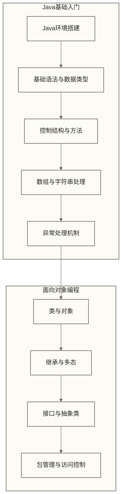
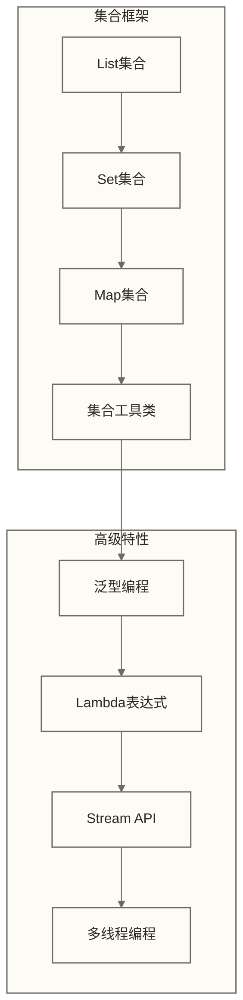
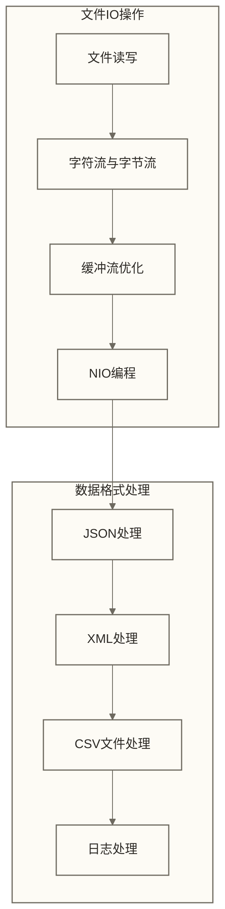
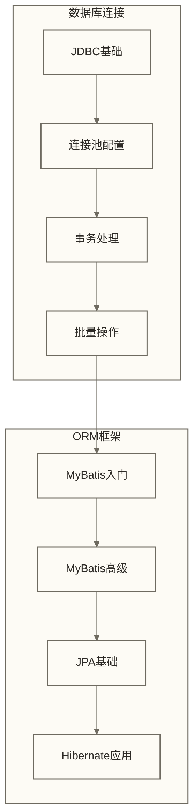
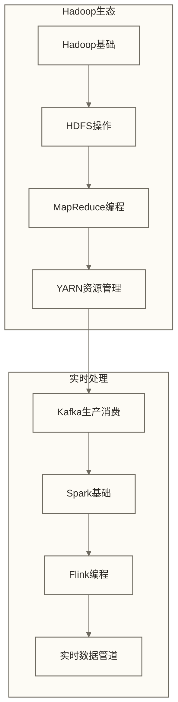
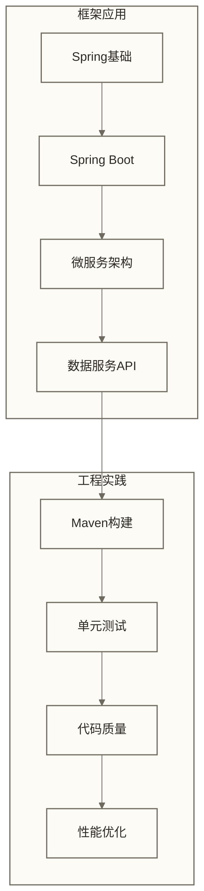

# Java学习路线图 - 数据开发从业者的Java技能体系

> [!info] 为什么Java是数据开发的必备技能？
> 
> 想象一下，如果把大数据生态系统比作一座现代化的工厂，那么Java就是这座工厂的**通用语言**和**核心动力**。正如工厂中的各个部门需要统一的标准和协议来协作，大数据领域的各种工具和框架也需要Java作为共同的基础。
> 
> **Java在数据领域就像是：**
> - 🏗️ **建筑师的蓝图**：Hadoop、Spark、Kafka等框架属于JVM生态；Spark主要使用Scala实现，也提供Java API
> - 🔧 **工程师的工具箱**：提供丰富的数据处理、IO操作和并发处理能力
> - 🌉 **系统间的桥梁**：连接不同数据源、数据库和应用系统
> - 🏢 **企业级的保障**：成熟稳定，适合构建大规模生产系统
> 
> **掌握Java后你能做什么？**
> - 开发高效的ETL数据管道
> - 构建实时数据处理应用
> - 设计企业级数据服务API
> - 优化大数据任务性能
> 
> **学习投入**：原建议投入3-6个月时间，从基础语法到企业级应用开发；下文完整分阶段计划延伸至第27周，实际安排应以详细任务和练习完成情况为准，不保证在建议时间内达到企业级开发能力

## 🗺️ Java数据开发学习路径

### 📚 第一阶段：Java基础语法（4-6周）

> [!note] 第一阶段学习重点
> 
> 这个阶段就像学习开车一样，需要先熟悉**基本操作**（语法）和**交通规则**（面向对象原则）。
> 
> **必须掌握的核心内容**：
> - **开发环境搭建**：就像配置你的工作台，选择合适的工具提高效率
> - **语法基础**：掌握Java的"词汇"和"语法规则"
> - **面向对象编程**：学会用对象的思维来解决问题，这是Java的精髓
> - **异常处理**：学会优雅地处理程序运行中的意外情况

### 🏗️ 第二阶段：Java进阶特性（3-4周）

> [!tip] 第二阶段：掌握Java的高效工具
> 
> 如果说第一阶段是学会开车，那么第二阶段就是学会**熟练驾驶**和使用各种**高级功能**。
> 
> **重点学习内容**：
> - **集合框架**：就像学会使用不同的容器（盒子、抽屉、文件夹）来组织数据
> - **泛型编程**：确保类型安全，避免在运行时出现数据类型错误
> - **函数式编程**：学会更简洁、更优雅的编程方式，特别适合数据处理
> - **多线程编程**：让程序能够同时处理多个任务，提高处理效率

### 📁 第三阶段：Java数据处理（3-4周）

> [!important] 第三阶段：数据处理核心技能
> 
> 这个阶段就像学会**处理各种格式的文件**和**高效的数据传输**。想象你是一个图书管理员，需要处理不同格式的书籍和文档。
> 
> **核心技能点**：
> - **文件IO操作**：高效地读写文件，就像熟练使用不同的读写工具
> - **数据格式解析**：处理JSON、XML、CSV等格式，如同翻译不同语言的文档
> - **日志记录**：记录程序运行情况，便于问题追踪和性能监控
> - **数据序列化**：在不同系统间传输数据的标准化方法

### 🗄️ 第四阶段：数据库操作（2-3周）

> [!warning] 第四阶段：数据库操作精通
> 
> 数据库操作就像管理一个大型仓库，你需要知道如何**高效存取货物**（数据）和**保证仓库安全**（事务）。
> 
> **必备技能**：
> - **JDBC操作**：直接与数据库对话的基本技能
> - **连接池管理**：就像管理仓库的进出通道，避免拥堵和资源浪费
> - **ORM框架**：用更面向对象的方式操作数据库，提高开发效率
> - **事务处理**：确保数据操作的一致性和可靠性

### 🚀 第五阶段：Java大数据技术（4-6周）

> [!success] 第五阶段：大数据技术应用
> 
> 这是Java数据开发的**高级阶段**，就像从管理小商店升级到管理大型连锁超市，需要掌握**分布式处理**和**实时计算**。
> 
> **核心大数据技能**：
> - **Hadoop开发**：处理大规模离线数据，如同管理大型仓储中心
> - **Spark开发**：快速数据处理和分析，像高速的数据处理流水线
> - **Kafka开发**：实时消息处理，如同高效的物流配送系统
> - **Flink开发**：复杂事件处理，能够识别数据中的重要模式

### 🏢 第六阶段：企业级开发（3-4周）

> [!example] 第六阶段：企业级开发能力
> 
> 这个阶段就像学会**经营一家企业**，需要考虑系统的**可维护性**、**可扩展性**和**生产就绪**。
> 
> **企业级技能**：
> - **Spring框架**：Java企业开发的事实标准，提供完整的解决方案
> - **微服务架构**：构建可扩展的分布式系统
> - **测试与质量**：确保代码质量和系统可靠性
> - **性能优化**：让系统在生产环境中高效稳定运行

## 📋 分阶段学习计划

### 🎯 阶段一：基础语法掌握（第1-6周）

**学习目标**：
- 搭建Java开发环境并熟练使用IDE
- 掌握Java基础语法和面向对象编程
- 理解Java内存模型和垃圾回收机制
- 能够编写结构清晰的Java程序

**核心任务**：
1. **环境搭建**（第1周）
   - 安装JDK 11或17版本
   - 配置IntelliJ IDEA或Eclipse
   - 学习Maven项目管理
   - 编写第一个Hello World程序

2. **语法基础**（第2-3周）
   - 变量、数据类型、运算符
   - 控制结构：条件语句、循环语句
   - 方法定义与调用
   - 数组和字符串操作

3. **面向对象**（第4-5周）
   - 类的定义与实例化
   - 构造方法与方法重载
   - 继承与多态的应用
   - 接口与抽象类的使用

4. **异常处理**（第6周）
   - 异常类型与处理机制
   - try-catch-finally语句
   - 自定义异常类
   - 异常处理最佳实践

> [!example] 阶段一实践项目：学生信息管理系统
> 
> **项目描述**：开发一个控制台版的学生管理系统
> 
> **功能要求**：
> - 添加学生信息（姓名、学号、成绩）
> - 查询和修改学生信息
> - 计算平均成绩和排名
> - 数据持久化到文件
> 
> **技能应用**：面向对象设计、异常处理、文件IO

### 🛠️ 阶段二：进阶特性应用（第7-10周）

**学习目标**：
- 熟练使用Java集合框架
- 掌握泛型编程和函数式编程
- 理解多线程编程基础
- 能够处理复杂的数据结构操作

**核心任务**：
1. **集合框架**（第7周）
   - List、Set、Map接口的实现类
   - Iterator遍历与增强for循环
   - Collections工具类使用
   - 集合性能对比与选择

2. **泛型与函数式**（第8周）
   - 泛型类和泛型方法
   - 通配符与类型限定
   - Lambda表达式语法
   - Stream API数据处理

3. **多线程基础**（第9-10周）
   - Thread类与Runnable接口
   - 线程同步与锁机制
   - 线程池的使用
   - 并发工具类应用

> [!example] 阶段二实践项目：日志分析工具
> 
> **项目描述**：分析Web服务器的访问日志，统计热门页面和用户行为
> 
> **功能要求**：
> - 多线程读取大型日志文件
> - 使用Stream API进行数据过滤和统计
> - 生成访问报告和异常告警
> - 支持实时日志监控
> 
> **技能应用**：多线程、Stream API、集合框架、函数式编程

### 📊 阶段三：数据处理能力（第11-14周）

**学习目标**：
- 精通文件IO和网络编程
- 掌握常见数据格式的处理
- 理解Java序列化机制
- 能够处理各种数据源的读写

**核心任务**：
1. **文件IO操作**（第11周）
   - 字节流与字符流的选择
   - 缓冲流的性能优化
   - NIO与传统IO的对比
   - 文件系统操作

2. **数据格式处理**（第12周）
   - JSON解析：Jackson、Gson
   - XML处理：DOM、SAX、StAX
   - CSV文件读写：OpenCSV
   - 配置文件处理：Properties、YAML

3. **网络编程**（第13周）
   - HTTP客户端编程
   - 网络数据传输
   - RESTful API调用
   - WebSocket通信

4. **日志与监控**（第14周）
   - 日志框架配置：Logback、Log4j2
   - 日志格式化与输出
   - 应用监控基础
   - 性能指标收集

> [!example] 阶段三实践项目：通用数据采集工具
> 
> **项目描述**：开发一个支持多种数据源的数据采集和处理工具
> 
> **功能要求**：
> - 支持HTTP API、数据库、文件等多种数据源
> - 解析JSON、XML、CSV等格式数据
> - 数据清洗：去重、格式统一、异常值处理
> - 结果输出到数据库或文件
> 
> **技能应用**：网络编程、数据格式处理、IO操作、日志记录

### 🗄️ 阶段四：数据库操作精通（第15-17周）

**学习目标**：
- 熟练使用JDBC进行数据库操作
- 掌握连接池的配置和优化
- 理解ORM框架的使用
- 能够处理复杂的数据库交互

**核心任务**：
1. **JDBC深入**（第15周）
   - 数据库连接与配置
   - PreparedStatement防SQL注入
   - 批量操作优化
   - 事务处理机制

2. **连接池管理**（第16周）
   - HikariCP连接池配置
   - 连接池性能调优
   - 连接泄漏检测
   - 数据源管理

3. **ORM框架**（第17周）
   - MyBatis映射配置
   - 动态SQL构建
   - 缓存机制应用
   - 批量操作优化

> [!example] 阶段四实践项目：数据库同步工具
> 
> **项目描述**：开发企业级数据同步工具，支持不同数据库间的数据迁移
> 
> **功能要求**：
> - 支持MySQL、PostgreSQL、Oracle等主流数据库
> - 全量同步和增量同步功能
> - 数据一致性检查和错误处理
> - 同步进度监控和报警
> 
> **技能应用**：JDBC、连接池、事务管理、多线程

### 🎛️ 阶段五：大数据技术应用（第18-23周）

**学习目标**：
- 掌握Hadoop生态系统的Java开发
- 学会Spark和Flink的程序开发
- 理解Kafka的生产和消费机制
- 能够构建完整的数据处理管道

**核心任务**：
1. **Hadoop开发**（第18-19周）
   - HDFS Java API使用
   - MapReduce程序开发
   - 自定义InputFormat和OutputFormat
   - YARN应用开发

2. **Spark开发**（第20-21周）
   - RDD操作与转换
   - DataFrame和Dataset API
   - Spark SQL查询优化
   - 自定义UDF开发

3. **Kafka开发**（第22周）
   - Producer API详解
   - Consumer API使用
   - Kafka Streams处理
   - 消息序列化定制

4. **Flink开发**（第23周）
   - DataStream API编程
   - 窗口操作与水印
   - 状态管理与检查点
   - CEP复杂事件处理

> [!example] 阶段五实践项目：实时数据处理平台
> 
> **项目描述**：构建类似阿里巴巴Double 11实时大屏的数据处理平台
> 
> **功能要求**：
> - 实时采集电商订单数据（模拟）
> - 计算实时销售额、热门商品等指标
> - 支持复杂事件处理（如异常订单检测）
> - Web界面展示实时数据大屏
> 
> **技能应用**：Kafka消息处理、Spark Streaming、Flink CEP

### 🏢 阶段六：企业级应用开发（第24-27周）

**学习目标**：
- 掌握Spring框架的核心概念
- 学会构建微服务架构应用
- 理解企业级开发的最佳实践
- 能够开发数据服务教学原型；达到生产级要求还需安全、可靠性、性能及运维验收

**核心任务**：
1. **Spring框架**（第24周）
   - IoC容器与依赖注入
   - AOP面向切面编程
   - Spring Boot自动配置
   - 配置管理与Profile

2. **微服务开发**（第25周）
   - 服务注册与发现
   - 配置中心应用
   - API网关设计
   - 服务间通信

3. **数据服务API**（第26周）
   - RESTful API设计
   - 数据访问层设计
   - 缓存策略应用
   - 接口文档生成

4. **工程实践**（第27周）
   - 单元测试与集成测试
   - 代码质量检查
   - 持续集成/持续部署
   - 性能监控与调优

> [!example] 阶段六实践项目：企业数据中台
> 
> **项目描述**：开发企业级数据中台，为各业务部门提供统一的数据服务
> 
> **功能要求**：
> - RESTful API提供数据查询服务
> - 多租户隔离和权限控制
> - API文档自动生成
> - 服务监控和性能优化
> 
> **技能应用**：Spring Boot、微服务、API设计、监控体系

## 🎯 数据开发关键技能点

### 💡 核心技能矩阵

| 技能领域 | 基础要求 | 进阶要求 | 专家级要求 |
|---------|---------|---------|-----------|
| **Java基础** | 语法、OOP、集合 | 泛型、并发、反射 | JVM调优、源码分析 |
| **数据处理** | IO操作、格式解析 | NIO、序列化 | 高性能处理优化 |
| **数据库操作** | JDBC、连接池 | ORM、事务管理 | 分布式事务、分库分表 |
| **大数据框架** | Hadoop、Spark基础 | 性能调优、集群管理 | 框架扩展、源码贡献 |
| **消息队列** | Kafka基础使用 | Streams、Connect | 集群设计、性能优化 |
| **企业框架** | Spring基础 | Spring Boot、微服务 | 架构设计、中间件开发 |

### 🛠️ 必备开发工具

**开发环境**：
- **JDK版本**：Java 11或17（LTS版本）
- **IDE选择**：IntelliJ IDEA或Eclipse
- **构建工具**：Maven 3.x（主要）、Gradle（可选）
- **版本控制**：Git + GitHub/GitLab

**调试监控**：
- **性能分析**：JProfiler、VisualVM、Arthas
- **内存分析**：Eclipse MAT、JConsole
- **日志分析**：ELK Stack（Elasticsearch、Logstash、Kibana）
- **应用监控**：Micrometer、Prometheus、Grafana

**大数据工具**：
- **集群管理**：Ambari、Cloudera Manager
- **开发工具**：Zeppelin、Jupyter（BeakerX）
- **测试工具**：MRUnit、Spark Testing Base
- **部署工具**：Docker、Kubernetes

## 📚 推荐学习资源

### 📖 经典书籍

**Java基础**：
- 《Java核心技术 卷I》- Cay S. Horstmann
- 《Effective Java》- Joshua Bloch
- 《Java并发编程实战》- Brian Goetz
- 《深入理解Java虚拟机》- 周志明

**数据处理**：
- 《Java 8实战》- Raoul-Gabriel Urma
- 《Java性能优化权威指南》- Charlie Hunt
- 《Java网络编程》- Elliotte Rusty Harold

**大数据开发**：
- 《Hadoop权威指南》- Tom White
- 《Spark快速大数据分析》- Holden Karau
- 《Kafka权威指南》- Neha Narkhede
- 《Flink基础教程》- Ellen Friedman

### 🌐 在线资源

**官方文档**：
- [Oracle Java Documentation](https://docs.oracle.com/en/java/)
- [Apache Hadoop Documentation](https://hadoop.apache.org/docs/)
- [Apache Spark Documentation](https://spark.apache.org/docs/latest/)
- [Apache Kafka Documentation](https://kafka.apache.org/documentation/)

**学习平台**：
- [Oracle Java Learning Path](https://education.oracle.com/java)
- [Coursera Big Data Specialization](https://www.coursera.org/specializations/big-data)
- [edX Java Programming](https://www.edx.org/learn/java)
- [Pluralsight Java Path](https://www.pluralsight.com/paths/java)

**开源项目**：
- [Apache Commons](https://commons.apache.org/) - 常用工具库
- [Google Guava](https://github.com/google/guava) - Google核心库
- [Spring Framework](https://github.com/spring-projects/spring-framework) - 企业框架
- [Alibaba Druid](https://github.com/alibaba/druid) - 数据库连接池

## 🎓 学习建议与最佳实践

### 💪 学习方法建议

**理论与实践结合**：
- 每学习一个概念，立即编写代码验证
- 通过debug跟踪程序执行流程
- 阅读优秀开源项目的源代码
- 参与开源项目的贡献

**项目驱动学习**：
- 从简单的控制台程序开始
- 逐步构建复杂的数据处理应用
- 模拟真实的企业级开发场景
- 关注代码质量和性能优化

**社区参与**：
- 加入Java和大数据相关的技术社区
- 参与技术讨论和问题解答
- 关注技术博客和会议分享
- 建立个人技术博客记录学习心得

### ⚠️ 常见学习误区

**避免的问题**：
- 过分追求新技术而忽视基础
- 只看视频不动手实践
- 学习过程中缺乏系统性规划
- 忽视代码质量和工程实践

**正确的学习态度**：
- 重视Java基础和JVM原理
- 关注企业级开发的最佳实践
- 理解大数据技术的原理而非仅仅会用
- 培养解决复杂问题的能力

### 🚀 职业发展路径

**初级数据开发工程师**（0-2年）：
- 熟练掌握Java基础语法和集合框架
- 能够使用JDBC进行数据库操作
- 了解Hadoop、Spark等大数据框架的基本使用
- 具备基本的数据处理和ETL开发能力

**中级数据开发工程师**（2-5年）：
- 深入理解JVM原理和性能调优
- 熟练使用Spring框架进行企业级开发
- 掌握Spark、Flink等框架的高级特性
- 能够设计和优化复杂的数据处理管道

**高级数据开发工程师**（5-8年）：
- 具备大数据架构设计能力
- 能够进行框架源码分析和定制开发
- 精通分布式系统和微服务架构
- 具备团队领导和技术决策能力

**数据架构师/技术专家**（8年以上）：
- 能够设计企业级数据平台架构
- 具备跨领域的技术整合能力
- 能够推动技术创新和最佳实践
- 具备业务理解和战略思维能力

---

> [!quote] 💭 Java学习成功的关键
> 
> 🎯 **扎实基础**：重视Java基础语法和面向对象编程思想
> 💻 **多写代码**：理论学习必须结合大量的编程实践
> 🔍 **深入理解**：不仅要知道怎么用，更要知道为什么这样设计
> 🌱 **持续学习**：技术发展迅速，保持学习和更新知识的习惯
> 🤝 **社区参与**：积极参与开源项目和技术社区的交流

## 🔗 相关学习资源链接

### 后续深入学习
- **[[【技术与工具】/Java/01-Java基础语法入门|Java基础语法]]**：掌握Java语言基础
- **[[【技术与工具】/Java/02-Java开发环境搭建|Java开发环境搭建]]**：配置专业的开发环境
- **[[【技术与工具】/Java/03-Java面向对象编程|Java面向对象编程]]**：理解OOP核心思想
- **[[【技术与工具】/Java/04-Java数据处理与文件IO|Java数据处理与文件IO]]**：数据处理核心技能
- **[[【技术与工具】/Java/05-Java在数据开发中的应用|Java在数据开发中的]]**：Java在数据领域的实践
- **[[【技术与工具】/Java/06-Java大数据技术栈|Java大数据技术栈]]**：大数据技术栈应用
- **[[【技术与工具】/Java/07-Java数据库操作与数据仓库开发|Java数据库操作与数据仓库开发]]**：数据库操作精通

### 配套技术栈学习
- **[[【技术与工具】/Hadoop/00-Hadoop学习路线图|Hadoop/Hadoop]]**：分布式存储与计算基础
- **[[【技术与工具】/Spark/00-Spark学习路线图|Spark/Spark]]**：大数据处理引擎
- **[[【技术与工具】/Kafka/00-Kafka学习路线图|Kafka/Kafka]]**：分布式消息系统
- **[[【技术与工具】/Flink/00-Flink学习路线图|Flink/Flink]]**：流式数据处理

> [!tip] 🌟 学习建议
> 
> Java学习是一个循序渐进的过程，建议按照路线图的阶段性安排进行学习。重点关注数据处理相关的技能点，这些将是你在数据开发岗位上的核心竞争力。记住，理论学习必须与实际项目相结合，只有在实践中才能真正掌握Java在数据开发中的应用精髓。