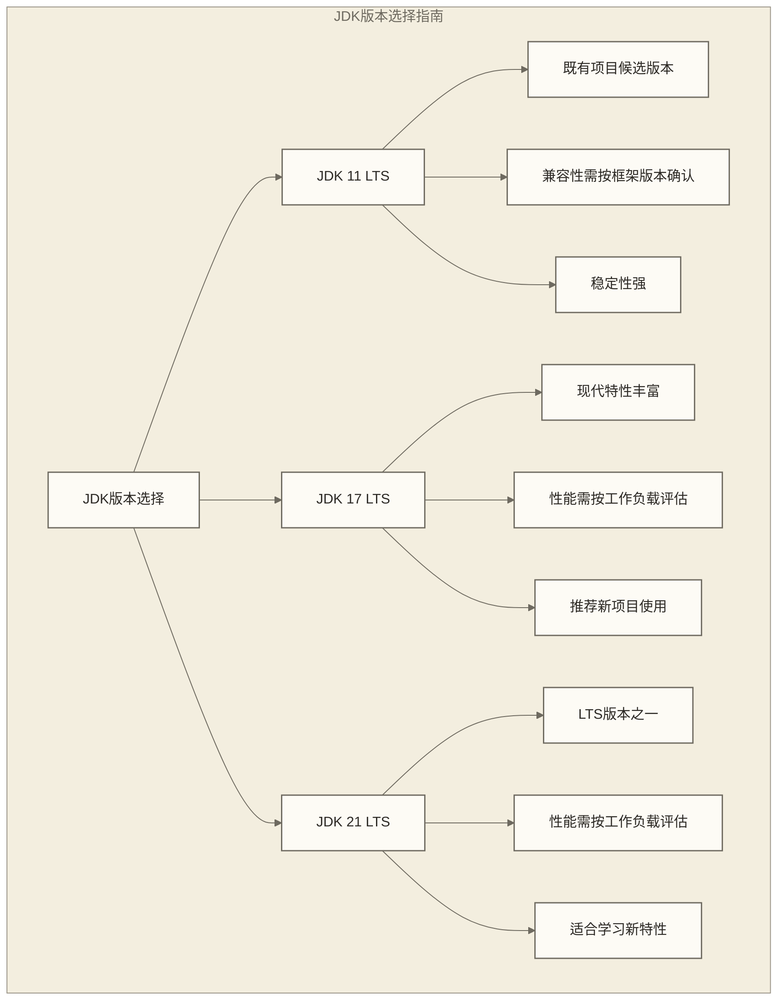

# Java开发环境搭建 - 从零开始构建数据开发环境

> [!abstract] 📋 Java开发环境搭建概览
> 
> 🔍 **为什么环境搭建很重要？**
> 良好的开发环境是高效开发的基础。对于数据开发者来说，正确配置Java开发环境不仅能提高开发效率，还能避免很多不必要的技术问题。
> 
> 🎯 **本教程将帮助你完成**：
> - ☕ **JDK安装配置**：选择合适的JDK版本并正确安装
> - 🛠️ **IDE选择使用**：配置功能强大的集成开发环境
> - 📦 **Maven项目管理**：掌握现代Java项目的构建工具
> - 🔧 **开发工具配置**：配置必要的开发辅助工具
> - 🚀 **第一个项目**：创建并运行第一个Java数据处理项目
> 
> ⏱️ **预计时间**：45分钟完成完整的开发环境搭建

## ☕ JDK安装与配置

### 🎯 选择合适的JDK版本

对于数据开发，推荐使用长期支持（LTS）版本的JDK：



**推荐配置**：
- **学习使用**：JDK 17 或 JDK 21（本教程项目按JDK 17配置，其他版本需检查工具链兼容性）
- **企业开发**：JDK 11可作为既有项目的候选版本，须按项目依赖和发行版支持要求选择
- **大数据项目**：JDK 11仅作为候选版本；Hadoop、Spark等框架的兼容范围须按实际框架版本确认

### 🔽 Windows系统JDK安装

**步骤一：下载JDK**

1. 访问 [Oracle JDK官网](https://www.oracle.com/java/technologies/downloads/) 或 [OpenJDK官网](https://openjdk.org/)
2. 选择适合的版本（推荐JDK 17）
3. 下载Windows x64安装包

**步骤二：安装JDK**

```powershell
# 双击下载的.exe文件，按照向导安装
# 默认安装路径通常是：C:\Program Files\Java\jdk-17

# 验证安装是否成功
java -version
javac -version
```

**步骤三：配置环境变量**

```powershell
# 1. 右键"此电脑" -> "属性" -> "高级系统设置" -> "环境变量"

# 2. 新建系统变量JAVA_HOME
# 变量名: JAVA_HOME
# 变量值: C:\Program Files\Java\jdk-17

# 3. 编辑Path环境变量，添加：
# %JAVA_HOME%\bin

# 4. 验证配置（重新打开PowerShell后执行）
$env:JAVA_HOME
java -version
```

### 🐧 Linux/macOS系统JDK安装

**Linux（Ubuntu/Debian）**：

```bash
# 方法1：使用包管理器安装OpenJDK
sudo apt update
sudo apt install openjdk-17-jdk

# 方法2：手动安装Oracle JDK
# 下载tar.gz文件后执行：
sudo mkdir -p /opt/java
sudo tar -zxvf jdk-17_linux-x64_bin.tar.gz -C /opt/java

# 配置环境变量
echo 'export JAVA_HOME=/opt/java/jdk-17' >> ~/.bashrc
echo 'export PATH=$JAVA_HOME/bin:$PATH' >> ~/.bashrc
source ~/.bashrc

# 验证安装
java -version
javac -version
```

**macOS**：

```bash
# 方法1：使用Homebrew（推荐）
brew install openjdk@17

# 方法2：下载官方安装包
# 下载.dmg文件，双击安装

# 配置环境变量（如果使用Homebrew）
echo 'export PATH="/opt/homebrew/opt/openjdk@17/bin:$PATH"' >> ~/.zshrc
source ~/.zshrc

# 验证安装
java -version
javac -version
```

### ✅ JDK安装验证

创建一个简单的测试文件来验证JDK安装：

```java
// 创建文件：HelloJava.java
public class HelloJava {
    public static void main(String[] args) {
        System.out.println("Java开发环境搭建成功！");
        System.out.println("Java版本: " + System.getProperty("java.version"));
        System.out.println("操作系统: " + System.getProperty("os.name"));
        System.out.println("用户目录: " + System.getProperty("user.home"));
    }
}
```

```bash
# 编译和运行
javac HelloJava.java
java HelloJava

# 预期输出类似：
# Java开发环境搭建成功！
# Java版本: 17.0.2
# 操作系统: Windows 10
# 用户目录: C:\Users\YourName
```

## 🛠️ IDE选择与配置

### 🥇 IntelliJ IDEA（强烈推荐）

**为什么选择IntelliJ IDEA？**
- 智能代码提示和自动完成
- 强大的调试功能
- 内置Maven和Git支持
- 丰富的插件生态
- 优秀的代码重构功能

**安装步骤**：

1. **下载IDEA**：访问 [JetBrains官网](https://www.jetbrains.com/idea/)
2. **选择版本**：
   - Community Edition（免费，功能足够）
   - Ultimate Edition（付费，功能更全）

**初始配置**：

```java
// IDEA配置建议

// 1. 设置JDK
// File -> Project Structure -> SDKs -> 添加JDK路径

// 2. 设置编码
// File -> Settings -> Editor -> File Encodings
// Global Encoding: UTF-8
// Project Encoding: UTF-8

// 3. 设置Maven
// File -> Settings -> Build, Execution, Deployment -> Build Tools -> Maven
// Maven home directory: 指向Maven安装目录

// 4. 安装有用的插件
// File -> Settings -> Plugins
// 推荐插件：
// - Lombok
// - Maven Helper
// - Rainbow Brackets
// - GitToolBox
// - Database Navigator
```

### 🔧 Eclipse配置（备选）

如果选择Eclipse作为IDE：

```java
// Eclipse配置步骤

// 1. 下载Eclipse IDE for Java Developers
// https://www.eclipse.org/downloads/

// 2. 配置JDK
// Window -> Preferences -> Java -> Installed JREs
// 添加你安装的JDK

// 3. 设置编码
// Window -> Preferences -> General -> Workspace
// Text file encoding: UTF-8

// 4. 安装Maven插件（通常已内置）
// Help -> Eclipse Marketplace -> 搜索"Maven"
```

### 📝 VS Code配置（轻量级选择）

对于轻量级开发，VS Code也是不错的选择：

```json
// VS Code Java开发配置
// 安装扩展：Extension Pack for Java

// settings.json配置示例
{
    "java.home": "C:\\Program Files\\Java\\jdk-17",
    "java.configuration.runtimes": [
        {
            "name": "JavaSE-17",
            "path": "C:\\Program Files\\Java\\jdk-17"
        }
    ],
    "java.compile.nullAnalysis.mode": "automatic",
    "maven.executable.path": "C:\\apache-maven-3.8.6\\bin\\mvn.cmd"
}
```

## 📦 Maven项目管理工具

### 🔽 Maven安装配置

**下载和安装**：

```bash
# 1. 下载Maven
# 访问：https://maven.apache.org/download.cgi
# 下载Binary zip/tar.gz文件

# 2. 解压到指定目录
# Windows: C:\apache-maven-3.8.6
# Linux/macOS: /opt/apache-maven-3.8.6

# 3. 配置环境变量
# Windows:
# MAVEN_HOME = C:\apache-maven-3.8.6
# Path添加: %MAVEN_HOME%\bin

# Linux/macOS:
echo 'export MAVEN_HOME=/opt/apache-maven-3.8.6' >> ~/.bashrc
echo 'export PATH=$MAVEN_HOME/bin:$PATH' >> ~/.bashrc
source ~/.bashrc

# 4. 验证安装
mvn -version
```

### ⚙️ Maven配置优化

**配置settings.xml**：

```xml
<?xml version="1.0" encoding="UTF-8"?>
<!-- ~/.m2/settings.xml 或 MAVEN_HOME/conf/settings.xml -->
<settings xmlns="http://maven.apache.org/SETTINGS/1.0.0"
          xmlns:xsi="http://www.w3.org/2001/XMLSchema-instance"
          xsi:schemaLocation="http://maven.apache.org/SETTINGS/1.0.0 
          http://maven.apache.org/xsd/settings-1.0.0.xsd">
  
  <!-- 本地仓库路径 -->
  <localRepository>D:/maven/repository</localRepository>
  
  <!-- 国内镜像源（提高下载速度） -->
  <mirrors>
    <mirror>
      <id>aliyun-maven</id>
      <mirrorOf>central</mirrorOf>
      <name>Aliyun Maven Repository</name>
      <url>https://maven.aliyun.com/repository/central</url>
    </mirror>
  </mirrors>
  
  <!-- 全局配置 -->
  <profiles>
    <profile>
      <id>jdk-17</id>
      <activation>
        <activeByDefault>true</activeByDefault>
      </activation>
      <properties>
        <maven.compiler.source>17</maven.compiler.source>
        <maven.compiler.target>17</maven.compiler.target>
        <maven.compiler.compilerVersion>17</maven.compiler.compilerVersion>
      </properties>
    </profile>
  </profiles>
</settings>
```

### 🏗️ 创建第一个Maven项目

```bash
# 使用Maven原型创建项目
mvn archetype:generate \
  -DgroupId=com.example.dataprocessing \
  -DartifactId=data-processor \
  -DarchetypeArtifactId=maven-archetype-quickstart \
  -DinteractiveMode=false

# 进入项目目录
cd data-processor

# 查看项目结构
tree .
# 输出类似：
# .
# ├── pom.xml
# └── src
#     ├── main
#     │   └── java
#     │       └── com
#     │           └── example
#     │               └── dataprocessing
#     │                   └── App.java
#     └── test
#         └── java
#             └── com
#                 └── example
#                     └── dataprocessing
#                         └── AppTest.java
```

**配置pom.xml**：

```xml
<?xml version="1.0" encoding="UTF-8"?>
<project xmlns="http://maven.apache.org/POM/4.0.0"
         xmlns:xsi="http://www.w3.org/2001/XMLSchema-instance"
         xsi:schemaLocation="http://maven.apache.org/POM/4.0.0 
         http://maven.apache.org/xsd/maven-4.0.0.xsd">
    <modelVersion>4.0.0</modelVersion>

    <groupId>com.example.dataprocessing</groupId>
    <artifactId>data-processor</artifactId>
    <version>1.0-SNAPSHOT</version>
    <packaging>jar</packaging>

    <name>Data Processor</name>
    <description>Java数据处理示例项目</description>

    <properties>
        <maven.compiler.source>17</maven.compiler.source>
        <maven.compiler.target>17</maven.compiler.target>
        <project.build.sourceEncoding>UTF-8</project.build.sourceEncoding>
        <junit.version>5.9.2</junit.version>
    </properties>

    <dependencies>
        <!-- 单元测试 -->
        <dependency>
            <groupId>org.junit.jupiter</groupId>
            <artifactId>junit-jupiter</artifactId>
            <version>${junit.version}</version>
            <scope>test</scope>
        </dependency>
        
        <!-- JSON处理 -->
        <dependency>
            <groupId>com.fasterxml.jackson.core</groupId>
            <artifactId>jackson-databind</artifactId>
            <version>2.15.2</version>
        </dependency>
        
        <!-- CSV处理 -->
        <dependency>
            <groupId>com.opencsv</groupId>
            <artifactId>opencsv</artifactId>
            <version>5.7.1</version>
        </dependency>
        
        <!-- 日志框架 -->
        <dependency>
            <groupId>ch.qos.logback</groupId>
            <artifactId>logback-classic</artifactId>
            <version>1.4.7</version>
        </dependency>
    </dependencies>

    <build>
        <plugins>
            <plugin>
                <groupId>org.apache.maven.plugins</groupId>
                <artifactId>maven-compiler-plugin</artifactId>
                <version>3.11.0</version>
                <configuration>
                    <source>17</source>
                    <target>17</target>
                </configuration>
            </plugin>
            
            <plugin>
                <groupId>org.apache.maven.plugins</groupId>
                <artifactId>maven-surefire-plugin</artifactId>
                <version>3.1.2</version>
            </plugin>
        </plugins>
    </build>
</project>
```

## 🚀 创建第一个数据处理项目

### 📊 项目结构设计

| 路径 | 说明 |
|------|------|
| `data-processor/pom.xml` | Maven 项目配置 |
| `src/main/java/com/example/dataprocessing/DataProcessor.java` | 主程序 |
| `src/main/java/com/example/dataprocessing/model/UserData.java` | 数据模型 |
| `src/main/java/com/example/dataprocessing/util/FileUtil.java` | 工具类 |
| `src/main/resources/logback.xml` | 日志配置 |
| `src/main/resources/sample-data.csv` | 示例数据 |
| `src/test/java/com/example/dataprocessing/DataProcessorTest.java` | 单元测试 |

### 🏗️ 实现数据模型

```java
// src/main/java/com/example/dataprocessing/model/UserData.java
package com.example.dataprocessing.model;

/**
 * 用户数据模型
 */
public class UserData {
    private String userId;
    private String userName;
    private int age;
    private String email;
    private double balance;
    
    // 构造方法
    public UserData() {}
    
    public UserData(String userId, String userName, int age, String email, double balance) {
        this.userId = userId;
        this.userName = userName;
        this.age = age;
        this.email = email;
        this.balance = balance;
    }
    
    // Getter和Setter方法
    public String getUserId() { return userId; }
    public void setUserId(String userId) { this.userId = userId; }
    
    public String getUserName() { return userName; }
    public void setUserName(String userName) { this.userName = userName; }
    
    public int getAge() { return age; }
    public void setAge(int age) { this.age = age; }
    
    public String getEmail() { return email; }
    public void setEmail(String email) { this.email = email; }
    
    public double getBalance() { return balance; }
    public void setBalance(double balance) { this.balance = balance; }
    
    // toString方法（便于调试）
    @Override
    public String toString() {
        return String.format("UserData{userId='%s', userName='%s', age=%d, email='%s', balance=%.2f}",
                userId, userName, age, email, balance);
    }
    
    // 数据验证方法
    public boolean isValid() {
        return userId != null && !userId.trim().isEmpty()
            && userName != null && !userName.trim().isEmpty()
            && age > 0 && age < 150
            && email != null && email.contains("@")
            && balance >= 0;
    }
}
```

### 🛠️ 实现工具类

```java
// src/main/java/com/example/dataprocessing/util/FileUtil.java
package com.example.dataprocessing.util;

import com.example.dataprocessing.model.UserData;
import com.opencsv.CSVReader;
import com.opencsv.CSVWriter;
import org.slf4j.Logger;
import org.slf4j.LoggerFactory;

import java.io.*;
import java.util.ArrayList;
import java.util.List;

/**
 * 文件处理工具类
 */
public class FileUtil {
    private static final Logger logger = LoggerFactory.getLogger(FileUtil.class);
    
    /**
     * 从CSV文件读取用户数据
     */
    public static List<UserData> readUserDataFromCSV(String filePath) {
        List<UserData> userDataList = new ArrayList<>();
        
        try (FileReader fileReader = new FileReader(filePath, java.nio.charset.StandardCharsets.UTF_8);
             CSVReader csvReader = new CSVReader(fileReader)) {
            
            String[] headers = csvReader.readNext(); // 跳过标题行
            if (headers == null) {
                logger.warn("CSV文件为空: {}", filePath);
                return userDataList;
            }
            logger.info("CSV标题行: {}", String.join(", ", headers));
            
            String[] line;
            int lineNumber = 1;
            
            while ((line = csvReader.readNext()) != null) {
                lineNumber++;
                
                try {
                    if (line.length >= 5) {
                        UserData userData = new UserData(
                            line[0].trim(),                    // userId
                            line[1].trim(),                    // userName
                            Integer.parseInt(line[2].trim()),  // age
                            line[3].trim(),                    // email
                            Double.parseDouble(line[4].trim()) // balance
                        );
                        
                        if (userData.isValid()) {
                            userDataList.add(userData);
                        } else {
                            logger.warn("第{}行数据无效: {}", lineNumber, String.join(", ", line));
                        }
                    } else {
                        logger.warn("第{}行数据格式不正确: {}", lineNumber, String.join(", ", line));
                    }
                } catch (NumberFormatException e) {
                    logger.error("第{}行数据格式错误: {}", lineNumber, e.getMessage());
                }
            }
            
        } catch (IOException | com.opencsv.exceptions.CsvValidationException e) {
            logger.error("读取CSV文件失败: {}", e.getMessage());
        }
        
        logger.info("成功读取{}条有效数据", userDataList.size());
        return userDataList;
    }
    
    /**
     * 将用户数据写入CSV文件
     */
    public static void writeUserDataToCSV(List<UserData> userDataList, String filePath) {
        try (FileWriter fileWriter = new FileWriter(filePath, java.nio.charset.StandardCharsets.UTF_8);
             CSVWriter csvWriter = new CSVWriter(fileWriter)) {
            
            // 写入标题行
            String[] headers = {"UserId", "UserName", "Age", "Email", "Balance"};
            csvWriter.writeNext(headers);
            
            // 写入数据行
            for (UserData userData : userDataList) {
                String[] line = {
                    userData.getUserId(),
                    userData.getUserName(),
                    String.valueOf(userData.getAge()),
                    userData.getEmail(),
                    String.valueOf(userData.getBalance())
                };
                csvWriter.writeNext(line);
            }
            
            logger.info("成功写入{}条数据到文件: {}", userDataList.size(), filePath);
            
        } catch (IOException e) {
            logger.error("写入CSV文件失败: {}", e.getMessage());
        }
    }
}
```

### 🎯 实现主程序

```java
// src/main/java/com/example/dataprocessing/DataProcessor.java
package com.example.dataprocessing;

import com.example.dataprocessing.model.UserData;
import com.example.dataprocessing.util.FileUtil;
import org.slf4j.Logger;
import org.slf4j.LoggerFactory;

import java.util.List;
import java.util.stream.Collectors;

/**
 * 数据处理主程序
 */
public class DataProcessor {
    private static final Logger logger = LoggerFactory.getLogger(DataProcessor.class);
    
    public static void main(String[] args) {
        logger.info("开始数据处理任务...");
        
        // 1. 读取原始数据
        String inputFile = "src/main/resources/sample-data.csv";
        List<UserData> rawData = FileUtil.readUserDataFromCSV(inputFile);
        
        if (rawData.isEmpty()) {
            logger.warn("没有读取到任何数据，程序退出");
            return;
        }
        
        // 2. 数据分析
        analyzeData(rawData);
        
        // 3. 数据清洗和转换
        List<UserData> cleanedData = cleanData(rawData);
        
        // 4. 数据过滤（示例：过滤出高价值用户）
        List<UserData> highValueUsers = filterHighValueUsers(cleanedData, 1000.0);
        
        // 5. 输出结果
        String outputFile = "src/main/resources/high-value-users.csv";
        FileUtil.writeUserDataToCSV(highValueUsers, outputFile);
        
        logger.info("数据处理任务完成！");
    }
    
    /**
     * 数据分析
     */
    private static void analyzeData(List<UserData> data) {
        logger.info("=== 数据分析报告 ===");
        
        int totalUsers = data.size();
        double avgAge = data.stream().mapToInt(UserData::getAge).average().orElse(0);
        double totalBalance = data.stream().mapToDouble(UserData::getBalance).sum();
        double avgBalance = data.stream().mapToDouble(UserData::getBalance).average().orElse(0);
        
        UserData maxBalanceUser = data.stream()
            .max((u1, u2) -> Double.compare(u1.getBalance(), u2.getBalance()))
            .orElse(null);
        
        logger.info("总用户数: {}", totalUsers);
        logger.info("平均年龄: {}", String.format(java.util.Locale.ROOT, "%.1f", avgAge));
        logger.info("余额总计: {}", String.format(java.util.Locale.ROOT, "%.2f", totalBalance));
        logger.info("平均余额: {}", String.format(java.util.Locale.ROOT, "%.2f", avgBalance));
        
        if (maxBalanceUser != null) {
            logger.info("最高余额用户: {} (余额: {})", 
                maxBalanceUser.getUserName(), String.format(java.util.Locale.ROOT, "%.2f", maxBalanceUser.getBalance()));
        }
    }
    
    /**
     * 数据清洗
     */
    private static List<UserData> cleanData(List<UserData> rawData) {
        logger.info("开始数据清洗...");
        
        List<UserData> cleanedData = rawData.stream()
            .filter(UserData::isValid)  // 过滤无效数据
            .map(user -> {
                // 数据标准化处理（示例：邮箱转小写）
                user.setEmail(user.getEmail().toLowerCase());
                // 用户名去空格
                user.setUserName(user.getUserName().trim());
                return user;
            })
            .collect(Collectors.toList());
        
        int removedCount = rawData.size() - cleanedData.size();
        logger.info("数据清洗完成，移除{}条无效数据，保留{}条有效数据", 
            removedCount, cleanedData.size());
        
        return cleanedData;
    }
    
    /**
     * 过滤高价值用户
     */
    private static List<UserData> filterHighValueUsers(List<UserData> data, double threshold) {
        logger.info("筛选余额大于{}的高价值用户...", threshold);
        
        List<UserData> highValueUsers = data.stream()
            .filter(user -> user.getBalance() > threshold)
            .sorted((u1, u2) -> Double.compare(u2.getBalance(), u1.getBalance())) // 按余额降序排序
            .collect(Collectors.toList());
        
        logger.info("找到{}个高价值用户", highValueUsers.size());
        
        // 输出前5个高价值用户
        logger.info("Top 5 高价值用户:");
        highValueUsers.stream()
            .limit(5)
            .forEach(user -> logger.info("  - {} (余额: {})", 
                user.getUserName(), String.format(java.util.Locale.ROOT, "%.2f", user.getBalance())));
        
        return highValueUsers;
    }
}
```

### 📄 配置文件

**日志配置**：

```xml
<?xml version="1.0" encoding="UTF-8"?>
<!-- src/main/resources/logback.xml -->
<configuration>
    <appender name="CONSOLE" class="ch.qos.logback.core.ConsoleAppender">
        <encoder>
            <pattern>%d{HH:mm:ss.SSS} [%thread] %-5level %logger{36} - %msg%n</pattern>
        </encoder>
    </appender>
    
    <appender name="FILE" class="ch.qos.logback.core.FileAppender">
        <file>logs/data-processor.log</file>
        <encoder>
            <pattern>%d{yyyy-MM-dd HH:mm:ss.SSS} [%thread] %-5level %logger{36} - %msg%n</pattern>
        </encoder>
    </appender>
    
    <logger name="com.example.dataprocessing" level="INFO"/>
    
    <root level="INFO">
        <appender-ref="CONSOLE"/>
        <appender-ref="FILE"/>
    </root>
</configuration>
```

**示例数据**：

保存为 `src/main/resources/sample-data.csv`（UTF-8编码，以下为虚构教学数据）：

```csv
UserId,UserName,Age,Email,Balance
U001,张三,25,zhangsan@example.com,1500.50
U002,李四,30,lisi@example.com,2300.75
U003,王五,22,wangwu@example.com,800.25
U004,赵六,35,zhaoliu@example.com,3200.00
U005,钱七,28,qianqi@example.com,450.80
U006,孙八,40,sunba@example.com,5500.25
U007,周九,26,zhoujiu@example.com,1200.60
U008,吴十,33,wushi@example.com,980.30
```

### ▶️ 运行项目

```bash
# 1. 编译项目
mvn compile

# 2. 运行程序
mvn exec:java -Dexec.mainClass="com.example.dataprocessing.DataProcessor"

# 3. 运行测试
mvn test

# 4. 打包项目
mvn package

# 5. 清理项目
mvn clean
```

## 🔧 开发工具推荐

### 📊 数据库管理工具

```java
// 推荐的数据库工具

// 1. DBeaver (免费，支持多种数据库)
// 下载地址：https://dbeaver.io/

// 2. DataGrip (JetBrains出品，付费)
// 下载地址：https://www.jetbrains.com/datagrip/

// 3. MySQL Workbench (MySQL官方工具)
// 下载地址：https://www.mysql.com/products/workbench/
```

### 🔍 代码质量工具

```xml
<!-- Maven代码质量插件 -->
<plugin>
    <groupId>org.sonarsource.scanner.maven</groupId>
    <artifactId>sonar-maven-plugin</artifactId>
    <version>3.9.1.2184</version>
</plugin>

<plugin>
    <groupId>com.github.spotbugs</groupId>
    <artifactId>spotbugs-maven-plugin</artifactId>
    <version>4.7.3.0</version>
</plugin>
```

### 📈 性能监控工具

```java
// 性能监控工具推荐

// 1. JProfiler - Java性能分析
// 2. VisualVM - JVM监控和分析
// 3. Arthas - 阿里巴巴开源的Java诊断工具
// 4. JConsole - JVM自带的监控工具
```

## ✅ 环境验证清单

在完成环境搭建后，请检查以下项目：

### 🔍 基础环境检查

```bash
# 1. Java版本检查
java -version
# 本文数据处理项目按JDK 17配置，建议使用JDK 17完成验证

# 2. 编译器检查
javac -version
# 应显示对应的javac版本

# 3. Maven检查
mvn -version
# 应显示Maven版本和Java版本

# 4. 环境变量检查
echo $JAVA_HOME    # Linux/macOS
echo %JAVA_HOME%   # Windows cmd；PowerShell使用 $env:JAVA_HOME
# 应显示JDK安装路径
```

### 🏗️ 项目功能验证

```bash
# 1. 创建测试项目
mvn archetype:generate -DgroupId=test -DartifactId=test-project -DarchetypeArtifactId=maven-archetype-quickstart -DinteractiveMode=false

# 2. 编译测试项目
cd test-project
mvn compile

# 3. 运行测试
mvn test

# 4. 打包项目
mvn package

# 如果以上步骤都成功，说明环境搭建正确
```

## 🚨 常见问题解决

### ❌ 常见错误及解决方案

```java
// 1. JAVA_HOME未设置或设置错误
// 错误信息：'java' 不是内部或外部命令
// 解决方案：检查JAVA_HOME环境变量和PATH配置

// 2. Maven下载依赖失败
// 错误信息：Could not resolve dependencies
// 解决方案：配置国内镜像源，检查网络连接

// 3. IDE无法识别JDK
// 错误信息：Project SDK is not defined
// 解决方案：在IDE中重新配置JDK路径

// 4. 编码问题
// 错误信息：编译错误，字符编码问题
// 解决方案：统一设置UTF-8编码
```

### 🔧 性能优化建议

```bash
# JVM参数示例（须按可用内存与负载评估，不是通用优化结论）
# JAVA_OPTS只是约定变量，只有启动脚本显式读取并传给java时才生效
export JAVA_OPTS="-Xms2g -Xmx8g -XX:+UseG1GC -XX:+UseStringDeduplication"

# Maven构建优化
export MAVEN_OPTS="-Xms1g -Xmx2g -XX:+TieredCompilation -XX:TieredStopAtLevel=1"
```

---

> [!quote] 💭 环境搭建成功的标志
> 
> 🎯 **JDK配置正确**：java -version命令能正常显示版本信息
> 🛠️ **IDE运行流畅**：能够创建项目、编写代码、调试程序
> 📦 **Maven工作正常**：能够下载依赖、编译项目、运行测试
> 🚀 **项目运行成功**：能够创建并运行第一个数据处理项目

## 🔗 相关学习资源

### 继续学习
- **学习路线图**：[[【技术与工具】/Java/00-Java学习路线图|Java]]
- **Java基础语法**：[[【技术与工具】/Java/01-Java基础语法入门|Java基础语法]]
- **面向对象编程**：[[【技术与工具】/Java/03-Java面向对象编程|Java面向对象编程]]
- **数据处理与文件IO**：[[【技术与工具】/Java/04-Java数据处理与文件IO|Java数据处理与文件IO]]

### 开发工具深入
- **IDEA使用技巧**：IntelliJ IDEA使用指南
- **调试技巧**：Java调试技巧大全

> [!tip] 🌟 环境搭建建议
> 
> 环境搭建是Java学习的第一步，建议选择最新的LTS版本JDK，使用功能强大的IDE如IntelliJ IDEA，配置好Maven构建工具。良好的开发环境将大大提高后续的学习和开发效率。记住，磨刀不误砍柴工！