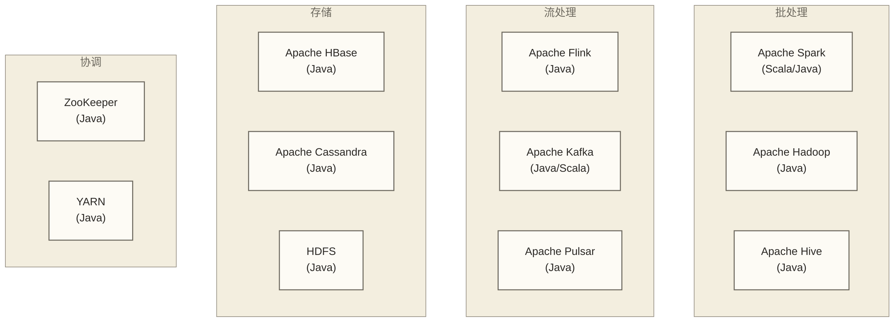
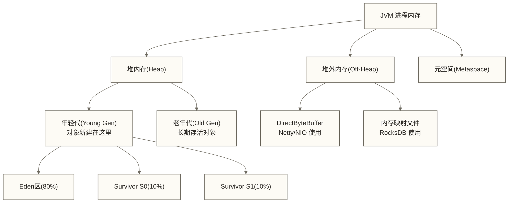

# Java在大数据开发中的核心应用场景

> [!abstract] 学习目标
> - 理解 Java 在大数据生态中的核心地位（Flink/Kafka/HBase/Hadoop 都是 Java）
> - 掌握 Java Stream API 与 Spark 算子的概念对应关系
> - 了解 JVM 内存模型与 GC 对大数据任务性能的影响
> - 掌握 Java 并发工具（CountDownLatch/CompletableFuture）在数据任务中的应用
> - 理解序列化选型（Kryo/Protobuf/Avro）对数据传输性能的影响
> - 建立 Java 大数据工程师的完整技能图谱

> [!quote] 核心洞察
> Python 让你能快速上手大数据，但 Java 让你真正理解大数据框架的运转原理。Flink、Kafka、HBase、Hadoop 的源码都是 Java 写的，掌握 Java 不只是多一个编程语言，而是打开了理解和调优这些框架的大门。

---

## 目录

- [[#Java在大数据生态中的地位]]
- [[#Java Stream API与Spark算子的对比理解]]
- [[#JVM内存模型对大数据任务的影响]]
- [[#Java并发工具在数据任务中的应用]]
- [[#序列化选型：Kryo/Protobuf/Avro]]
- [[#Java大数据工程师技能图谱]]

---

## Java在大数据生态中的地位

### 大数据框架的 Java 底层

大数据生态的核心框架几乎全部由 Java/JVM 语言编写：



这意味着：
- 调优这些框架，需要理解 JVM 的 GC、内存模型、线程模型
- 开发自定义连接器、插件，需要用 Java/Scala 实现接口
- 排查生产问题时，需要读懂 Java 堆栈日志和 JVM 指标

### Java vs Python vs Scala 的定位

| 语言 | 大数据角色 | 优势 | 劣势 |
|------|----------|------|------|
| Java | 框架开发、生产级 Flink 作业 | 生态最全、性能最稳定、工程化成熟 | 代码量大、函数式支持弱 |
| Scala | Spark 作业（API 层面最优） | 与 Spark 深度融合、简洁、函数式 | 学习曲线陡、编译慢 |
| Python | 数据分析、ML 特征工程、快速原型 | 生态（pandas/sklearn）、简单 | 性能低（PySpark UDF 慢）、类型不安全 |

> [!note] 实际情况
> 岗位学习规划示例（非2026年市场统计）：若目标岗位以Flink Java API为主，可优先学习Java；若假设目标Spark岗位中Python/Scala各占一半，可按目标岗位要求选择语言。这里的占比仅作假设，不代表实际市场；JVM与并发知识主要适用于涉及JVM框架开发、运行和排障的工作。

---

## Java Stream API与Spark算子的对比理解

Java 8 引入的 Stream API 与 Spark 的算子设计思想高度相似。理解 Stream API，能让你更快地掌握 Spark 算子的逻辑。

### 核心操作对比

```java
import java.util.*;
import java.util.stream.*;

// 数据准备
List<Order> orders = Arrays.asList(
    new Order("O1", "北京", 1200.0, "completed"),
    new Order("O2", "上海", 500.0, "cancelled"),
    new Order("O3", "北京", 800.0, "completed"),
    new Order("O4", "广州", 3000.0, "completed")
);

// Java Stream：统计各城市已完成订单的总金额
Map<String, Double> cityRevenue = orders.stream()
    .filter(o -> o.getStatus().equals("completed"))  // 过滤
    .collect(Collectors.groupingBy(
        Order::getCity,                               // 分组键
        Collectors.summingDouble(Order::getAmount)   // 聚合
    ));
// {北京=2000.0, 广州=3000.0}
```

```python
# 对应的 Spark DataFrame 操作（概念相同）
from pyspark.sql import functions as F

df.filter(F.col("status") == "completed") \
  .groupBy("city") \
  .agg(F.sum("amount").alias("total_revenue"))
```

### Stream API 的惰性求值

Java Stream 和 Spark 一样，中间操作（Intermediate）是惰性的，终端操作（Terminal）才触发执行：

```java
// 中间操作：filter、map、flatMap、sorted、distinct、limit
// 终端操作：collect、forEach、reduce、count、findFirst

Stream<String> filteredStream = orders.stream()
    .filter(o -> o.getAmount() > 100)  // 惰性：还没执行
    .map(o -> o.getCity());            // 惰性：还没执行

// 只有 collect 触发才真正执行上面所有操作
List<String> cities = filteredStream.collect(Collectors.toList());
```

### Stream 并行流：本地多线程处理

```java
// parallelStream：自动使用 ForkJoinPool 多线程处理
// 对应 Spark 的分布式并行（更大规模）

long count = orders.parallelStream()
    .filter(o -> o.getAmount() > 1000)
    .count();

// 注意：parallelStream 适合 CPU 密集型、无状态操作
// 对 IO 密集型或有共享状态的操作，需要谨慎使用
```

### flatMap 处理嵌套数据

```java
// 场景：每个订单有多个商品，展平所有商品
List<Order> orders = getOrders();  // 每个订单包含 List<Item>

List<Item> allItems = orders.stream()
    .flatMap(order -> order.getItems().stream())  // 展平嵌套
    .filter(item -> item.getPrice() > 50)
    .collect(Collectors.toList());

// 对应 Spark：
// ordersDs.flatMap(order -> order.getItems().iterator(), itemEncoder)
```

---

## JVM内存模型对大数据任务的影响

这是 Java 大数据工程师必须掌握的基础知识，直接关系到生产任务的稳定性。

### JVM 内存结构（以大数据视角）



### Flink/Spark 的内存分区

```java
// Flink TaskManager 内存分配（典型配置）
// -Xmx4g：堆内存 4GB
// 但 Flink 实际使用的内存远不止这些：

// 1. JVM 堆：Flink 的 Java 对象
// 2. Flink Managed Memory（堆外）：RocksDB State Backend、排序缓冲区
// 3. Network Buffer（堆外）：算子间数据传输缓冲
// 4. JVM Metaspace：类定义

// flink-conf.yaml 关键内存配置
// taskmanager.memory.process.size: 8g  # 总进程内存
// taskmanager.memory.flink.size: 6g    # Flink 可用内存
// taskmanager.memory.managed.fraction: 0.4  # Managed Memory 占比
```

### GC 算法选择对大数据任务的影响

```java
// 大数据任务的 GC 选型（常见 JVM 参数）

// G1GC（推荐用于大多数大数据场景）
-XX:+UseG1GC
-XX:MaxGCPauseMillis=200   // 目标停顿时间 200ms
-XX:G1HeapRegionSize=16m   // 大数据处理中建议用较大 Region

// ZGC（超低延迟，适合流处理）
-XX:+UseZGC               // JDK 15+ 生产可用
// ZGC 可作为低停顿流处理任务的候选；停顿时间与吞吐量需按实际负载测量
// 不保证停顿时间 < 10ms，也不能一概断言吞吐量低于 G1

// Parallel GC（适合批处理，高吞吐）
-XX:+UseParallelGC
-XX:+UseParallelOldGC
// 面向吞吐量的候选收集器；是否适合 Spark 批量 ETL需结合停顿要求与负载测试
```

### 常见 OOM 类型及解决方向

| OOM 类型 | 错误信息 | 常见原因 | 解决方向 |
|---------|---------|---------|---------|
| 堆内存溢出 | `Java heap space` | 数据量超出堆大小、内存泄漏 | 增大 -Xmx，检查 collect() 用法 |
| 元空间溢出 | `Metaspace` | 类加载过多（如大量动态代理） | 增大 MaxMetaspaceSize |
| 直接内存溢出 | `Direct buffer memory` | Netty/NIO 直接内存未释放 | 增大 MaxDirectMemorySize |
| GC 开销超限 | `GC overhead limit exceeded` | GC 时间占比超过 98% | 增大堆内存，优化数据结构 |
| Flink State OOM | TaskManager 崩溃 | State 过大未清理 | 使用 RocksDB Backend，设置 TTL |

---

## Java并发工具在数据任务中的应用

### CountDownLatch：等待多个并发任务完成

```java
import java.util.concurrent.*;

// 场景：并行从多个数据源加载数据，等全部加载完再合并
public class ParallelDataLoader {

    public List<Record> loadFromMultipleSources(List<String> sources)
            throws InterruptedException {
        CountDownLatch latch = new CountDownLatch(sources.size());
        List<Record> allRecords = Collections.synchronizedList(new ArrayList<>());
        ExecutorService executor = Executors.newFixedThreadPool(sources.size());

        for (String source : sources) {
            executor.submit(() -> {
                try {
                    List<Record> records = loadFromSource(source);
                    allRecords.addAll(records);
                } finally {
                    latch.countDown();  // 无论成功失败都 countDown
                }
            });
        }

        latch.await(30, TimeUnit.SECONDS);  // 最多等 30 秒
        executor.shutdown();
        return allRecords;
    }
}
```

### CompletableFuture：异步链式处理

```java
import java.util.concurrent.CompletableFuture;

// 场景：异步查询数据库，查询结果驱动后续异步操作
public CompletableFuture<EnrichedOrder> processOrder(String orderId) {
    return CompletableFuture
        // 异步查询订单
        .supplyAsync(() -> orderRepository.findById(orderId), ioExecutor)
        // 查到订单后，异步查用户信息（并行）
        .thenCompose(order -> {
            CompletableFuture<User> userFuture =
                CompletableFuture.supplyAsync(() -> userRepository.findById(order.getUserId()), ioExecutor);
            return userFuture.thenApply(user -> new EnrichedOrder(order, user));
        })
        // 异常处理：查询失败时返回默认值
        .exceptionally(ex -> {
            log.error("处理订单失败: " + orderId, ex);
            return EnrichedOrder.empty(orderId);
        });
}

// 等待多个 CompletableFuture 全部完成
List<CompletableFuture<EnrichedOrder>> futures = orderIds.stream()
    .map(this::processOrder)
    .collect(Collectors.toList());

CompletableFuture.allOf(futures.toArray(new CompletableFuture[0]))
    .thenRun(() -> System.out.println("所有订单处理完成"));
```

### 线程池配置在数据任务中的实践

```java
// Flink 自定义 Source 中的线程池配置示例
public class KafkaCustomSource extends RichSourceFunction<Event> {
    private ExecutorService fetchExecutor;
    private ExecutorService parseExecutor;

    @Override
    public void open(Configuration parameters) {
        int cpuCount = Runtime.getRuntime().availableProcessors();

        // IO 密集型（网络请求、磁盘读取）：线程数 = CPU * 2
        fetchExecutor = Executors.newFixedThreadPool(
            cpuCount * 2,
            new ThreadFactoryBuilder()
                .setNameFormat("kafka-fetch-%d")
                .setDaemon(true)
                .build()
        );

        // CPU 密集型（数据解析、计算）：线程数 = CPU
        parseExecutor = Executors.newFixedThreadPool(
            cpuCount,
            new ThreadFactoryBuilder()
                .setNameFormat("parse-%d")
                .setDaemon(true)
                .build()
        );
    }

    @Override
    public void close() {
        // 必须优雅关闭，等待正在执行的任务完成
        if (fetchExecutor != null) {
            fetchExecutor.shutdown();
            try {
                if (!fetchExecutor.awaitTermination(10, TimeUnit.SECONDS)) {
                    fetchExecutor.shutdownNow();
                }
            } catch (InterruptedException e) {
                fetchExecutor.shutdownNow();
            }
        }
    }
}
```

---

## 序列化选型：Kryo/Protobuf/Avro

序列化性能在大数据场景中至关重要，直接影响网络传输和磁盘 IO 效率。

### 三种序列化方案对比

| 维度 | Java 原生序列化 | Kryo | Protobuf | Avro |
|------|-------------|------|---------|------|
| 速度 | 需按负载测试 | 需按负载测试；5—10倍仅作待测试假设 | 需按负载测试 | 需按负载测试 |
| 体积 | 取决于对象结构与元数据 | 取决于对象结构与注册方式 | 取决于字段类型与编码，不能一概称最小 | 取决于编码与容器形式；对象容器文件携带 schema |
| Schema 演进 | 有类版本兼容机制，但受兼容规则限制 | 取决于序列化器及兼容策略 | 依赖字段编号与兼容变更规则 | 依赖 writer/reader schema 解析与兼容规则 |
| 跨语言 | 仅 Java | 仅 JVM | 优秀 | 优秀 |
| 使用场景 | 不推荐 | Spark/Flink 内部传输 | 微服务 API、Kafka 消息 | 数据交换、行式文件存储；与ORC/Parquet按访问模式选型 |

### Kryo：Spark 的性能加速器

```java
// Spark 启用 Kryo（Java 配置方式）
SparkConf conf = new SparkConf()
    .setAppName("MyApp")
    .set("spark.serializer", "org.apache.spark.serializer.KryoSerializer")
    .set("spark.kryo.registrationRequired", "false"); // 不强制注册（但性能略低）

// 注册自定义类（最佳性能）
conf.registerKryoClasses(new Class[]{
    OrderRecord.class,
    UserProfile.class,
    SalesMetric.class
});

// 为复杂类型实现自定义 Kryo 序列化
import com.esotericsoftware.kryo.Kryo;
import com.esotericsoftware.kryo.Serializer;

public class OrderRecordSerializer extends Serializer<OrderRecord> {
    @Override
    public void write(Kryo kryo, Output output, OrderRecord order) {
        output.writeLong(order.getOrderId());
        output.writeDouble(order.getAmount());
        output.writeString(order.getCity());
    }

    @Override
    public OrderRecord read(Kryo kryo, Input input, Class<OrderRecord> type) {
        return new OrderRecord(
            input.readLong(),
            input.readDouble(),
            input.readString()
        );
    }
}
```

### Protobuf：Kafka 消息的推荐选择

```protobuf
// order.proto
syntax = "proto3";
package com.company.data;

message Order {
    int64 order_id = 1;
    string user_id = 2;
    double amount = 3;
    string status = 4;
    repeated OrderItem items = 5;
    int64 created_at = 6;
}

message OrderItem {
    string product_id = 1;
    int32 quantity = 2;
    double unit_price = 3;
}
```

```java
// Kafka 生产者：使用 Protobuf 序列化
Properties props = new Properties();
props.put(ProducerConfig.VALUE_SERIALIZER_CLASS_CONFIG,
          KafkaProtobufSerializer.class.getName());

try (KafkaProducer<String, Order> producer = new KafkaProducer<>(props)) {
    Order order = Order.newBuilder()
        .setOrderId(12345L)
        .setUserId("user-001")
        .setAmount(599.0)
        .setStatus("pending")
        .build();

    producer.send(new ProducerRecord<>("orders", String.valueOf(order.getOrderId()), order));
}
```

### Avro：数据湖的 Schema 管理利器

```java
// Avro Schema 定义
String schemaJson = """
{
  "type": "record",
  "name": "UserEvent",
  "namespace": "com.company.events",
  "fields": [
    {"name": "userId", "type": "long"},
    {"name": "eventType", "type": "string"},
    {"name": "timestamp", "type": "long"},
    {"name": "properties", "type": {"type": "map", "values": "string"}, "default": {}}
  ]
}
""";

Schema schema = new Schema.Parser().parse(schemaJson);

// 写入 Avro 文件
GenericRecord record = new GenericData.Record(schema);
record.put("userId", 10001L);
record.put("eventType", "page_view");
record.put("timestamp", System.currentTimeMillis());
record.put("properties", new java.util.HashMap<String, String>());

DatumWriter<GenericRecord> writer = new GenericDatumWriter<>(schema);
DataFileWriter<GenericRecord> dataFileWriter = new DataFileWriter<>(writer);
dataFileWriter.create(schema, new File("/data/events.avro"));
dataFileWriter.append(record);
dataFileWriter.close();
```

---

## Java大数据工程师技能图谱

```mermaid
%%{init: {"theme":"base","themeVariables":{"fontFamily":"PingFang SC, -apple-system, Source Han Serif SC, serif","fontSize":"16px","background":"#FDFBF5","primaryColor":"#FDFBF5","primaryTextColor":"#2D2A26","primaryBorderColor":"#6E6A60","secondaryColor":"#E8EFE8","secondaryBorderColor":"#8FA890","secondaryTextColor":"#2D2A26","tertiaryColor":"#FDFBF5","tertiaryBorderColor":"#9A9488","tertiaryTextColor":"#6E6A60","lineColor":"#6E6A60","textColor":"#2D2A26","mainBkg":"#FDFBF5","nodeBorder":"#2D5A3D","clusterBkg":"#F3EEDF","clusterBorder":"#9A9488","edgeLabelBackground":"#FDFBF5"},"flowchart":{"htmlLabels":true,"curve":"basis","padding":20,"nodeSpacing":60,"rankSpacing":70,"useMaxWidth":false},"themeCSS":".node rect, .node polygon, .node circle { stroke-width: 1.5px; } .edgePath .path { stroke-width: 1.5px; } .cluster-label .nodeLabel, .cluster-label foreignObject { color: #2D2A26 !important; } .edgeLabel, .edgeLabel foreignObject { color: #2D2A26 !important; background-color: #FDFBF5; } .edgeLabel rect { fill: #FDFBF5; }"}}%%
graph TD
    classDef default fill:#FDFBF5,stroke:#6E6A60,color:#2D2A26,stroke-width:1.5px
    classDef startend fill:#2D2A26,stroke:#2D2A26,color:#FDFBF5,font-weight:bold
    classDef decision fill:#F6EAD8,stroke:#C08A1A,color:#2D2A26,font-weight:bold
    classDef hub fill:#3B5A80,stroke:#3B5A80,color:#FDFBF5,font-weight:bold
    classDef io fill:#E5EAF0,stroke:#3B5A80,color:#2D2A26
    classDef accent fill:#A6432C,stroke:#A6432C,color:#FDFBF5,font-weight:bold
    classDef storage fill:#F3EEDF,stroke:#9A9488,color:#2D2A26
    ROOT["Java大数据工程师"] --> JAVA["Java核心"]
    ROOT --> STREAM["流处理"]
    ROOT --> BATCH["批处理"]
    ROOT --> STORE["数据存储"]
    ROOT --> INFRA["基础设施"]

    JAVA --> JVM["JVM调优<br/>(GC/内存/线程)"]
    JAVA --> CONCURRENT["并发编程<br/>(线程池/CompletableFuture)"]
    JAVA --> SERIAL["序列化<br/>(Kryo/Protobuf/Avro)"]
    JAVA --> STREAM_API["Stream API<br/>(函数式编程基础)"]

    STREAM --> FLINK["Apache Flink<br/>(DataStream/Table API)"]
    STREAM --> KAFKA["Apache Kafka<br/>(生产消费/Streams)"]

    BATCH --> SPARK["Apache Spark<br/>(Java API)"]
    BATCH --> HIVE["Apache Hive<br/>(SQL/UDF开发)"]

    STORE --> HBASE["HBase<br/>(Java客户端)"]
    STORE --> HDFS["HDFS<br/>(Java API)"]

    INFRA --> DOCKER["容器化部署<br/>(Docker/K8s)"]
    INFRA --> MONITOR["监控<br/>(JVM指标/Prometheus)"]
    class ROOT,JAVA,STREAM,BATCH,STORE,INFRA,JVM,CONCURRENT,SERIAL,STREAM_API,FLINK,KAFKA,SPARK,HIVE,HBASE,HDFS,DOCKER,MONITOR default
```



### 技能优先级建议

| 优先级 | 技能 | 说明 |
|-------|------|------|
| P0（必须） | JVM 基础（内存/GC） | 排查生产问题的基石 |
| P0（必须） | Flink Java API | 主流实时计算框架 |
| P0（必须） | Kafka 生产消费 | 实时链路的必经之路 |
| P1（重要） | Java 并发（线程池/CompletableFuture） | 高性能数据处理 |
| P1（重要） | 序列化选型（Protobuf/Kryo） | 性能优化的关键 |
| P2（加分） | Spark Java API | 批处理场景 |
| P2（加分） | HBase Java 客户端 | 实时查询场景 |

---

## 小结

Java 在大数据领域的核心价值可以用三句话概括：
1. **框架理解**：大数据框架是 Java 写的，Java 工程师能更深入地理解和调优
2. **性能稳定**：Java 的 JVM 调优能力让生产任务更稳定，排查问题更精准
3. **工程成熟**：Java 的工程化体系（Maven/测试/监控）在大型团队中更易落地

### 延伸学习路径

- [[【技术与工具】/Java/09-Flink Java API实战]] - Java 在 Flink 中的完整实战
- [[【技术与工具】/Java/10-Java调优与大数据性能优化]] - JVM 调优的系统方法
- [[【技术与工具】/Java/06-Java大数据技术栈]] - 大数据技术栈的完整概述
- [[【技术与工具】/Java/05-Java在数据开发中的应用]] - Java 数据开发的基础应用

#Java #大数据 #Flink #Kafka #JVM #序列化 #并发编程 #技能图谱
