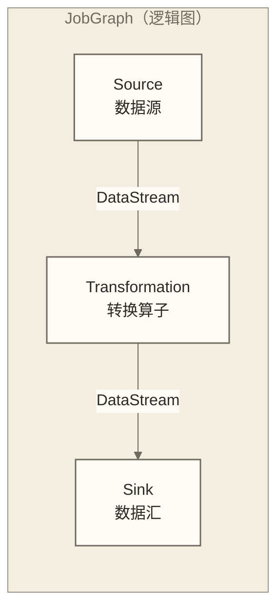

# Flink Java API实战

> [!abstract] 学习目标
> - 掌握 Flink DataStream API 的 Java 实现范式
> - 理解 Java Lambda 表达式如何简化 Flink 代码
> - 掌握 Flink Java 作业的打包与提交流程
> - 学会用 Java 实现 ProcessFunction（窗口/定时器/状态管理）
> - 了解 Flink Table API 的 Java 最佳实践
> - 掌握生产级 Flink Java 项目的代码组织结构

> [!quote] 核心洞察
> 本文采用 Flink Java API 演示实时计算开发。接口的成熟度、社区支持和维护状况需要结合具体版本及比较范围评估，本文不据此作跨接口排名。对于使用 Flink Java API 建设实时数仓的团队，掌握这些开发方式具有实践价值。

---

## 目录

- [[#Flink Java API基础架构]]
- [[#DataStream API核心操作]]
- [[#Java Lambda简化Flink代码]]
- [[#ProcessFunction深度实战]]
- [[#窗口操作详解]]
- [[#Flink Table API与SQL]]
- [[#作业打包与提交]]
- [[#生产级代码组织结构]]

---

## Flink Java API基础架构

### Flink 作业的执行模型



每个 Flink 作业由三部分组成：
1. **Source**：从外部系统读取数据（Kafka、文件、Socket）
2. **Transformation**：对数据进行处理（map、filter、keyBy、window）
3. **Sink**：将结果写出（Kafka、数据库、文件）

### 第一个 Flink Java 作业

```java
import org.apache.flink.streaming.api.environment.StreamExecutionEnvironment;
import org.apache.flink.streaming.api.datastream.DataStream;
import org.apache.flink.api.common.functions.MapFunction;

public class WordCountJob {

    public static void main(String[] args) throws Exception {
        // 1. 获取执行环境
        StreamExecutionEnvironment env = StreamExecutionEnvironment
            .getExecutionEnvironment();

        // 2. 设置并行度
        env.setParallelism(4);

        // 3. 定义数据源
        DataStream<String> lines = env.fromElements(
            "hello world flink",
            "hello java flink",
            "flink is awesome"
        );

        // 4. 数据转换
        DataStream<Tuple2<String, Integer>> wordCounts = lines
            .flatMap(new FlatMapFunction<String, Tuple2<String, Integer>>() {
                @Override
                public void flatMap(String line, Collector<Tuple2<String, Integer>> out) {
                    for (String word : line.split(" ")) {
                        out.collect(Tuple2.of(word, 1));
                    }
                }
            })
            .keyBy(tuple -> tuple.f0)
            .sum(1);

        // 5. 输出
        wordCounts.print();

        // 6. 触发执行（Flink 的惰性执行）
        env.execute("Word Count Job");
    }
}
```

---

## DataStream API核心操作

### 基础变换操作

```java
// 数据模型
@Data
@AllArgsConstructor
@NoArgsConstructor
public class OrderEvent {
    private Long orderId;
    private String userId;
    private String city;
    private Double amount;
    private String status;
    private Long timestamp;
}

// 获取执行环境
StreamExecutionEnvironment env = StreamExecutionEnvironment.getExecutionEnvironment();

// 从 Kafka 读取数据
KafkaSource<String> kafkaSource = KafkaSource.<String>builder()
    .setBootstrapServers("kafka:9092")
    .setTopics("order-events")
    .setGroupId("flink-consumer")
    .setStartingOffsets(OffsetsInitializer.latest())
    .setValueOnlyDeserializer(new SimpleStringSchema())
    .build();

DataStream<String> rawStream = env.fromSource(
    kafkaSource,
    WatermarkStrategy.noWatermarks(),
    "Kafka Source"
);

// 解析 JSON → OrderEvent
DataStream<OrderEvent> orderStream = rawStream
    .map(json -> {
        ObjectMapper mapper = new ObjectMapper();
        return mapper.readValue(json, OrderEvent.class);
    })
    .filter(event -> event != null && event.getAmount() > 0);
```

### keyBy 与分组操作

```java
// keyBy：按 key 分组，保证相同 key 的数据进入同一个算子实例
// 注意：keyBy 按 key 做哈希分区，属于数据重分发（shuffle），可能涉及跨网络传输

KeyedStream<OrderEvent, String> keyedByCity = orderStream
    .keyBy(OrderEvent::getCity);  // 方法引用（Java 8+）

// keyBy 之后的聚合
DataStream<Tuple2<String, Double>> cityRevenue = keyedByCity
    .map(new RichMapFunction<OrderEvent, Tuple2<String, Double>>() {
        private ValueState<Double> totalState;

        @Override
        public void open(Configuration parameters) {
            ValueStateDescriptor<Double> descriptor =
                new ValueStateDescriptor<>("city-total", Double.class);
            totalState = getRuntimeContext().getState(descriptor);
        }

        @Override
        public Tuple2<String, Double> map(OrderEvent event) throws Exception {
            Double current = totalState.value();
            double newTotal = (current == null ? 0.0 : current) + event.getAmount();
            totalState.update(newTotal);
            return Tuple2.of(event.getCity(), newTotal);
        }
    });
```

### connect 与 union：合并多个流

```java
// union：合并相同类型的多个流
DataStream<OrderEvent> stream1 = ...; // 来自渠道A
DataStream<OrderEvent> stream2 = ...; // 来自渠道B
DataStream<OrderEvent> unified = stream1.union(stream2);

// connect：合并不同类型的流（如订单流 + 用户画像流）
DataStream<OrderEvent> orderStream = ...;
DataStream<UserProfile> profileStream = ...;

ConnectedStreams<OrderEvent, UserProfile> connected =
    orderStream.connect(profileStream);

DataStream<EnrichedOrder> enriched = connected.process(
    new CoProcessFunction<OrderEvent, UserProfile, EnrichedOrder>() {
        // 存储用户画像的状态
        private MapState<String, UserProfile> profileState;

        @Override
        public void open(Configuration parameters) {
            MapStateDescriptor<String, UserProfile> desc =
                new MapStateDescriptor<>("profiles", String.class, UserProfile.class);
            profileState = getRuntimeContext().getMapState(desc);
        }

        @Override
        public void processElement1(OrderEvent order, Context ctx,
                                    Collector<EnrichedOrder> out) throws Exception {
            UserProfile profile = profileState.get(order.getUserId());
            if (profile != null) {
                out.collect(new EnrichedOrder(order, profile));
            }
            // 如果 profile 还没到，可以注册定时器等待
        }

        @Override
        public void processElement2(UserProfile profile, Context ctx,
                                    Collector<EnrichedOrder> out) throws Exception {
            // 更新用户画像状态
            profileState.put(profile.getUserId(), profile);
        }
    }
);
```

---

## Java Lambda简化Flink代码

Java 8 Lambda 大幅减少了 Flink 代码的冗余。

### 匿名内部类 vs Lambda

```java
// 匿名内部类写法（较冗长，并非 Flink 1.x 专属）
DataStream<Integer> doubled = numbers.map(new MapFunction<Integer, Integer>() {
    @Override
    public Integer map(Integer value) throws Exception {
        return value * 2;
    }
});

// Java Lambda 写法（简洁，并非 Flink 2.x 专属）
DataStream<Integer> doubled = numbers.map(value -> value * 2);

// 方法引用：更简洁（适合一对一的方法调用）
DataStream<String> uppercased = strings.map(String::toUpperCase);
DataStream<OrderEvent> parsed = rawJsonStream.map(JsonParser::parseOrder);
```

### Lambda 的类型擦除问题

Java 的泛型在运行时存在类型擦除，Lambda 与泛型结合时，Flink 可能无法推断返回类型，需要显式指定：

```java
// 可能失败：Flink 无法推断 Tuple2<String, Integer> 的泛型
DataStream<Tuple2<String, Integer>> result = stream
    .map(event -> Tuple2.of(event.getCity(), 1));  // 类型擦除问题

// 尝试1：显式标注函数接口类型；该强制转换不保证 Flink 能恢复返回值的泛型信息
DataStream<Tuple2<String, Integer>> result = stream
    .map((MapFunction<OrderEvent, Tuple2<String, Integer>>)
         event -> Tuple2.of(event.getCity(), 1));

// 解决方案2：使用 returns 方法（最推荐）
DataStream<Tuple2<String, Integer>> result = stream
    .map(event -> Tuple2.of(event.getCity(), 1))
    .returns(Types.TUPLE(Types.STRING, Types.INT));

// 解决方案3：使用具体结果类代替泛型 Tuple；能否按 POJO 处理仍取决于类结构，例如是否具有公共无参构造方法
@Data
@AllArgsConstructor
@NoArgsConstructor
public class CityCount {
    public String city;
    public Integer count;
}
DataStream<CityCount> result = stream
    .map(event -> new CityCount(event.getCity(), 1));  // Flink 自动推断 POJO
```

---

## ProcessFunction深度实战

ProcessFunction 是 Flink 中最底层、最强大的算子，直接访问时间戳、定时器和状态。

### KeyedProcessFunction：带状态的逐事件处理

```java
// 场景：检测用户在 5 分钟内订单金额超过阈值，触发风险预警
public class OrderRiskDetector
    extends KeyedProcessFunction<String, OrderEvent, RiskAlert> {

    // 用户在当前窗口内的累计金额
    private ValueState<Double> accumulatedAmountState;
    // 当前窗口的结束时间戳
    private ValueState<Long> windowEndState;

    @Override
    public void open(Configuration parameters) {
        accumulatedAmountState = getRuntimeContext().getState(
            new ValueStateDescriptor<>("accumulated", Double.class)
        );
        windowEndState = getRuntimeContext().getState(
            new ValueStateDescriptor<>("window-end", Long.class)
        );
    }

    @Override
    public void processElement(
        OrderEvent event,
        Context ctx,
        Collector<RiskAlert> out
    ) throws Exception {
        long currentTime = ctx.timestamp();

        // 初始化或重置窗口
        Long windowEnd = windowEndState.value();
        if (windowEnd == null || currentTime > windowEnd) {
            // 新窗口：重置状态
            long newWindowEnd = currentTime + 5 * 60 * 1000L;
            windowEndState.update(newWindowEnd);
            accumulatedAmountState.update(event.getAmount());
            // 注册定时器：窗口结束时清理状态
            ctx.timerService().registerEventTimeTimer(newWindowEnd);
        } else {
            // 窗口内累加
            double current = accumulatedAmountState.value();
            double newTotal = current + event.getAmount();
            accumulatedAmountState.update(newTotal);

            // 超过阈值触发预警
            if (newTotal > 10000.0) {
                out.collect(new RiskAlert(
                    event.getUserId(),
                    newTotal,
                    "5分钟内交易金额超过1万元",
                    currentTime
                ));
            }
        }
    }

    @Override
    public void onTimer(long timestamp, OnTimerContext ctx,
                        Collector<RiskAlert> out) throws Exception {
        // 窗口结束：清理状态，避免状态无限增长
        accumulatedAmountState.clear();
        windowEndState.clear();
    }
}

// 使用 ProcessFunction
DataStream<RiskAlert> alerts = orderStream
    .assignTimestampsAndWatermarks(
        WatermarkStrategy.<OrderEvent>forBoundedOutOfOrderness(Duration.ofSeconds(5))
            .withTimestampAssigner((event, ts) -> event.getTimestamp())
    )
    .keyBy(OrderEvent::getUserId)
    .process(new OrderRiskDetector());
```

### 状态管理的最佳实践

```java
// 五种状态类型及其使用场景
public class StateUsageExample extends KeyedProcessFunction<String, Event, Result> {

    // ValueState：存储单个值（如计数器、最新值）
    private ValueState<Integer> countState;

    // ListState：存储列表（如最近 N 条记录）
    private ListState<Event> recentEventsState;

    // MapState：存储键值对（如用户的各维度指标）
    private MapState<String, Double> metricsState;

    // ReducingState：自动做 reduce 聚合（如累加器）
    private ReducingState<Double> sumState;

    // AggregatingState：自定义聚合（如计算平均值）
    private AggregatingState<Double, Double> avgState;

    @Override
    public void open(Configuration parameters) {
        countState = getRuntimeContext().getState(
            new ValueStateDescriptor<>("count", Integer.class)
        );

        // 为状态设置 TTL（避免状态无限增长）
        StateTtlConfig ttlConfig = StateTtlConfig
            .newBuilder(Time.hours(24))           // 创建或最后一次写入24小时后过期；读取不刷新TTL，实际清理取决于清理机制
            .setUpdateType(StateTtlConfig.UpdateType.OnCreateAndWrite)
            .setStateVisibility(StateTtlConfig.StateVisibility.NeverReturnExpired)
            .build();

        ValueStateDescriptor<Integer> countDesc =
            new ValueStateDescriptor<>("count-with-ttl", Integer.class);
        countDesc.enableTimeToLive(ttlConfig);  // 启用 TTL
        countState = getRuntimeContext().getState(countDesc);
    }
}
```

---

## 窗口操作详解

```java
// 时间语义设置
env.getConfig().setAutoWatermarkInterval(200L); // 每200ms插入Watermark

DataStream<OrderEvent> withWatermark = orderStream
    .assignTimestampsAndWatermarks(
        WatermarkStrategy.<OrderEvent>forBoundedOutOfOrderness(Duration.ofSeconds(10))
            .withTimestampAssigner((event, ts) -> event.getTimestamp())
    );

// 滚动窗口（Tumbling Window）：无重叠，适合精确统计
DataStream<WindowResult> tumblingResult = withWatermark
    .keyBy(OrderEvent::getCity)
    .window(TumblingEventTimeWindows.of(Time.minutes(5)))
    .aggregate(new OrderAmountAggregator(), new WindowResultFunction());

// 滑动窗口（Sliding Window）：有重叠，适合移动平均
DataStream<WindowResult> slidingResult = withWatermark
    .keyBy(OrderEvent::getCity)
    .window(SlidingEventTimeWindows.of(Time.minutes(10), Time.minutes(5)))
    // 窗口大小10分钟，每5分钟滑动一次
    .aggregate(new OrderAmountAggregator(), new WindowResultFunction());

// Session Window：按活跃间隔划分
DataStream<WindowResult> sessionResult = withWatermark
    .keyBy(OrderEvent::getUserId)
    .window(EventTimeSessionWindows.withGap(Time.minutes(30)))
    // 30分钟无活动则关闭窗口
    .aggregate(new UserActivityAggregator(), new WindowResultFunction());
```

```java
// 自定义聚合函数
public class OrderAmountAggregator
    implements AggregateFunction<OrderEvent, Double, Double> {

    @Override
    public Double createAccumulator() {
        return 0.0;
    }

    @Override
    public Double add(OrderEvent event, Double accumulator) {
        return accumulator + event.getAmount();
    }

    @Override
    public Double getResult(Double accumulator) {
        return accumulator;
    }

    @Override
    public Double merge(Double a, Double b) {
        return a + b;
    }
}

// WindowFunction：获取窗口时间信息
public class WindowResultFunction
    implements WindowFunction<Double, WindowResult, String, TimeWindow> {

    @Override
    public void apply(
        String city,
        TimeWindow window,
        Iterable<Double> input,
        Collector<WindowResult> out
    ) {
        double totalAmount = input.iterator().next();
        out.collect(new WindowResult(
            city,
            totalAmount,
            window.getStart(),
            window.getEnd()
        ));
    }
}
```

---

## Flink Table API与SQL

```java
// Table API 环境设置
StreamExecutionEnvironment env = StreamExecutionEnvironment.getExecutionEnvironment();
StreamTableEnvironment tableEnv = StreamTableEnvironment.create(env);

// 注册 DataStream 为表
DataStream<OrderEvent> orderStream = ...;
tableEnv.createTemporaryView("orders", orderStream,
    Schema.newBuilder()
        .column("orderId", DataTypes.BIGINT())
        .column("city", DataTypes.STRING())
        .column("amount", DataTypes.DOUBLE())
        .column("eventTime", DataTypes.TIMESTAMP(3))
        .watermark("eventTime", "eventTime - INTERVAL '5' SECOND")
        .build()
);

// 使用 SQL 查询（5分钟滚动窗口聚合）
Table result = tableEnv.sqlQuery("""
    SELECT
        city,
        TUMBLE_START(eventTime, INTERVAL '5' MINUTE) AS window_start,
        TUMBLE_END(eventTime, INTERVAL '5' MINUTE) AS window_end,
        COUNT(*) AS order_count,
        SUM(amount) AS total_amount
    FROM orders
    GROUP BY
        city,
        TUMBLE(eventTime, INTERVAL '5' MINUTE)
    """);

// Table 转回 DataStream
DataStream<Row> resultStream = tableEnv.toDataStream(result);
resultStream.print();

// 注册 Kafka Sink（使用 SQL DDL）
tableEnv.executeSql("""
    CREATE TABLE order_stats_sink (
        city STRING,
        window_start TIMESTAMP(3),
        window_end TIMESTAMP(3),
        order_count BIGINT,
        total_amount DOUBLE
    ) WITH (
        'connector' = 'kafka',
        'topic' = 'order-stats',
        'properties.bootstrap.servers' = 'kafka:9092',
        'format' = 'json'
    )
    """);

result.executeInsert("order_stats_sink");
```

---

## 作业打包与提交

### Maven pom.xml 关键配置

```xml
<properties>
    <flink.version>1.18.0</flink.version>
    <java.version>11</java.version>
</properties>

<dependencies>
    <!-- Flink 核心：provided（集群已有） -->
    <dependency>
        <groupId>org.apache.flink</groupId>
        <artifactId>flink-streaming-java</artifactId>
        <version>${flink.version}</version>
        <scope>provided</scope>
    </dependency>
    <dependency>
        <groupId>org.apache.flink</groupId>
        <artifactId>flink-table-api-java-bridge</artifactId>
        <version>${flink.version}</version>
        <scope>provided</scope>
    </dependency>

    <!-- Kafka Connector：打包进 fat jar -->
    <dependency>
        <groupId>org.apache.flink</groupId>
        <artifactId>flink-connector-kafka</artifactId>
        <version>${flink.version}</version>
    </dependency>
</dependencies>

<build>
    <plugins>
        <!-- 打 fat jar -->
        <plugin>
            <groupId>org.apache.maven.plugins</groupId>
            <artifactId>maven-shade-plugin</artifactId>
            <configuration>
                <shadedArtifactAttached>false</shadedArtifactAttached>
                <filters>
                    <filter>
                        <artifact>*:*</artifact>
                        <excludes>
                            <exclude>META-INF/*.SF</exclude>
                            <exclude>META-INF/*.DSA</exclude>
                        </excludes>
                    </filter>
                </filters>
            </configuration>
        </plugin>
    </plugins>
</build>
```

### 作业提交命令

```bash
# 提交到 Flink 集群
flink run \
  -m yarn-cluster \
  -p 8 \
  -yjm 2048 \
  -ytm 4096 \
  -yD taskmanager.numberOfTaskSlots=4 \
  -c com.company.jobs.OrderAnalysisJob \
  target/order-analysis-1.0.0.jar \
  --date 2024-01-15 \
  --kafka-brokers kafka:9092

# 从 Savepoint 恢复（用于版本升级或故障恢复）
flink run \
  -s hdfs:///flink/savepoints/savepoint-xxxxx \
  -c com.company.jobs.OrderAnalysisJob \
  target/order-analysis-1.0.0.jar

# 手动触发 Savepoint
flink savepoint <job-id> hdfs:///flink/savepoints/
```

---

## 生产级代码组织结构

| 文件路径 | 说明 |
|---------|------|
| `jobs/OrderAnalysisJob.java` | 作业入口（main 方法） |
| `sources/KafkaOrderSource.java` | Source 封装 |
| `operators/OrderEventParser.java` | 解析算子（MapFunction） |
| `operators/OrderRiskDetector.java` | 业务算子（ProcessFunction） |
| `operators/OrderAmountAggregator.java` | 聚合算子（AggregateFunction） |
| `sinks/KafkaSinkBuilder.java` | Sink 封装 |
| `models/OrderEvent.java` | 输入数据模型 |
| `models/WindowResult.java` | 窗口结果模型 |
| `models/RiskAlert.java` | 告警模型 |
| `config/JobConfig.java` | 配置管理（从参数/配置文件读取） |

```java
// jobs/OrderAnalysisJob.java（标准入口结构）
public class OrderAnalysisJob {

    public static void main(String[] args) throws Exception {
        // 1. 解析参数
        ParameterTool params = ParameterTool.fromArgs(args);
        JobConfig config = JobConfig.from(params);

        // 2. 创建执行环境
        StreamExecutionEnvironment env = StreamExecutionEnvironment.getExecutionEnvironment();
        env.setParallelism(config.getParallelism());

        // 3. 启用 Checkpoint（生产必须配置）
        env.enableCheckpointing(60_000L);  // 每60秒一次
        env.getCheckpointConfig().setCheckpointingMode(CheckpointingMode.EXACTLY_ONCE);
        env.getCheckpointConfig().setMinPauseBetweenCheckpoints(30_000L);
        env.getCheckpointConfig().setCheckpointTimeout(120_000L);
        env.getCheckpointConfig().setMaxConcurrentCheckpoints(1);
        // Checkpoint 目录
        env.getCheckpointConfig().setCheckpointStorage(
            "hdfs:///flink/checkpoints/" + config.getJobName()
        );

        // 4. 构建数据流
        DataStream<OrderEvent> orderStream = KafkaOrderSource.build(env, config);
        DataStream<RiskAlert> alerts = buildAnalysisPipeline(orderStream, config);

        // 5. 写出结果
        alerts.sinkTo(KafkaSinkBuilder.buildAlertSink(config));

        // 6. 执行
        env.execute(config.getJobName());
    }

    private static DataStream<RiskAlert> buildAnalysisPipeline(
        DataStream<OrderEvent> stream, JobConfig config
    ) {
        return stream
            .assignTimestampsAndWatermarks(
                WatermarkStrategy.<OrderEvent>forBoundedOutOfOrderness(Duration.ofSeconds(10))
                    .withTimestampAssigner((event, ts) -> event.getTimestamp())
            )
            .keyBy(OrderEvent::getUserId)
            .process(new OrderRiskDetector(config.getRiskThreshold()));
    }
}
```

> [!tip] 生产部署的关键配置检查清单
> - Checkpoint 已启用（EXACTLY_ONCE + 60 秒间隔仅为示例，需按负载与恢复目标评估；端到端语义还取决于 Source、Sink 及事务配置）
> - State Backend 已配置（大状态用 RocksDB）
> - 并行度已根据数据量评估（不要使用默认值）
> - 内存参数已配置（特别是 managed memory fraction）
> - 告警和监控已接入（Checkpoint 失败、反压告警）

---

## 小结

| Flink Java API 核心 | 关键类/接口 | 使用场景 |
|--------------------|-----------|---------|
| DataStream 基础 | `MapFunction`、`FilterFunction`、`FlatMapFunction` | 数据转换 |
| 分组聚合 | `KeyedStream`、`AggregateFunction` | 指标计算 |
| 状态管理 | `ValueState`、`ListState`、`MapState` | 有状态处理 |
| 时间与窗口 | `WatermarkStrategy`、`TumblingEventTimeWindows` | 时间聚合 |
| 复杂事件 | `KeyedProcessFunction`、`CoProcessFunction` | 规则检测、流关联 |
| SQL | `StreamTableEnvironment`、`sqlQuery` | 声明式查询 |

### 延伸学习路径

- [[【技术与工具】/Java/08-Java在大数据开发中的核心应用场景]] - Java 大数据开发基础
- [[【技术与工具】/Java/10-Java调优与大数据性能优化]] - Flink 性能调优的 JVM 视角
- [[【技术与工具】/Java/11-Java大数据工程师求职指南]] - Flink 面试题库

#Java #Flink #DataStream #ProcessFunction #流处理 #大数据 #实战
