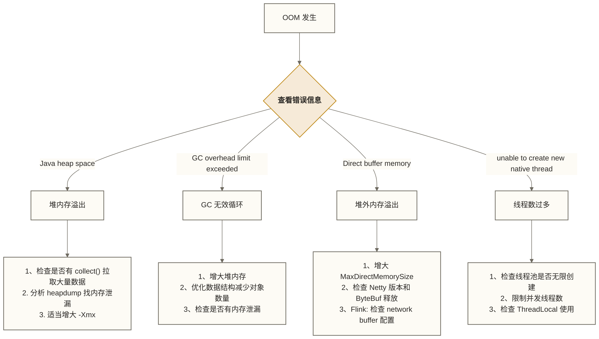

# Java调优与大数据性能优化

> [!abstract] 学习目标
> - 掌握大数据场景下 JVM 关键参数的调优方法
> - 理解堆外内存（Off-Heap）在 Flink/Spark 中的使用原理
> - 能够分析和优化 Java 序列化的性能开销
> - 了解线程池配置在大数据任务中的最佳实践
> - 掌握 JProfiler/Arthas 在大数据调试中的实际使用方法
> - 能够诊断和解决常见的内存溢出问题

> [!quote] 核心洞察
> JVM 调优是大数据任务性能优化的重要方向，实际瓶颈也可能来自状态访问、网络、存储或算子逻辑。理解 GC 日志、堆内存分配和堆外内存使用，是大数据工程师的重要能力。若以“80% 的调优工作涉及 JVM”或“吞吐量提升 30%-50%”作为练习假设，应通过具体负载下的对照测试评估，而不能视为普遍事实或收益保证。

---

## 目录

- [[#JVM参数调优核心配置]]
- [[#GC算法选择与调优]]
- [[#堆外内存的使用场景]]
- [[#序列化性能优化]]
- [[#线程池配置最佳实践]]
- [[#性能分析工具实战]]
- [[#常见OOM问题诊断]]

---

## JVM参数调优核心配置

### 大数据场景的 JVM 参数分类

```bash
# Flink TaskManager 完整的 JVM 调优参数示例
# （适合 8G 内存、Flink 流处理任务）

FLINK_ENV_JAVA_OPTS="\
  # 内存配置
  -Xms4g \                          # 初始堆大小 = 最大堆（避免动态扩容的停顿）
  -Xmx4g \                          # 最大堆大小
  -XX:MaxDirectMemorySize=2g \      # 直接内存上限
  -XX:MaxMetaspaceSize=512m \       # 元空间上限（避免无限增长）

  # GC 算法
  -XX:+UseG1GC \                    # 使用 G1 GC
  -XX:MaxGCPauseMillis=200 \        # 目标 GC 停顿 200ms
  -XX:G1HeapRegionSize=16m \        # G1 Region 大小（大数据建议 16MB）
  -XX:G1NewSizePercent=20 \         # 年轻代最小占比
  -XX:G1MaxNewSizePercent=40 \      # 年轻代最大占比
  -XX:InitiatingHeapOccupancyPercent=45 \  # 触发并发标记的堆占用阈值

  # GC 日志（排查问题必须开启）
  -Xlog:gc*:file=/var/log/flink/gc.log:time,level,tags:filecount=5,filesize=50m \

  # OOM 时 dump 堆（排查内存泄漏）
  -XX:+HeapDumpOnOutOfMemoryError \
  -XX:HeapDumpPath=/var/log/flink/heapdump.hprof \

  # 性能优化
  -XX:+UseStringDeduplication \     # 字符串去重（大数据处理中字符串占比高）
  -XX:+OptimizeStringConcat \       # 字符串拼接优化
  -XX:+TieredCompilation \          # 分层编译（JIT 优化）
  -XX:CompileThreshold=1000"        # 降低 JIT 编译阈值
```

### Spark Executor JVM 配置

```bash
# spark-submit 时指定 JVM 参数
spark-submit \
  --executor-memory 8g \
  --conf "spark.executor.extraJavaOptions=-XX:+UseG1GC \
    -XX:MaxGCPauseMillis=500 \
    -XX:+PrintGCDetails \
    -XX:+PrintGCDateStamps \
    -Xloggc:/tmp/executor-gc.log" \
  --conf "spark.driver.extraJavaOptions=-XX:+UseG1GC" \
  --conf "spark.serializer=org.apache.spark.serializer.KryoSerializer" \
  MyJob.jar
```

### 内存参数调优的计算方法

Flink TaskManager 内存分配（以 8G 进程内存为例）：

| 内存区域 | 大小 | 说明 |
|---------|------|------|
| JVM 堆外开销 | 0.7G | JVM 本身、线程栈等 |
| 元空间 | 0.3G | 类元数据 |
| Flink 堆内存 | ~3.5G | Flink 框架预留 128MB + TaskSlot 执行 |
| Flink Managed Memory | 2.4G（40%） | RocksDB State Backend、排序缓冲区、Python 进程内存 |
| 网络缓冲区 | 0.6G（10%） | 算子间数据传输 |

配置项：
```properties
taskmanager.memory.process.size: 8g
taskmanager.memory.managed.fraction: 0.4
taskmanager.memory.network.fraction: 0.1
```

---

## GC算法选择与调优

### 不同 GC 算法的特性对比

| GC 算法 | 停顿时间 | 吞吐量 | 内存占用 | 大数据适用场景 |
|---------|---------|-------|--------|-------------|
| Serial GC | 高 | 低 | 低 | 不适合 |
| Parallel GC | 随负载变化 | 偏重吞吐，需实测比较 | 随负载变化 | Spark 批处理（可容忍较长停顿时评估） |
| G1 GC | 低-中 | 中-高 | 中 | Flink 流处理（均衡选择，推荐） |
| ZGC | 极低(<10ms) | 中 | 较高 | 低延迟 Flink 任务（JDK 15+） |
| Shenandoah | 极低 | 中 | 较高 | 低延迟场景（OpenJDK） |

### G1 GC 调优实战

```bash
# G1 调优的关键参数（以 Flink 流处理为例）

# 问题现象：GC 停顿时间偶发超过 1 秒
# 分析 GC 日志后定位原因：年轻代晋升频繁，Mixed GC 耗时长

# 调优前配置
-XX:+UseG1GC
-Xms4g -Xmx4g

# 调优后配置（针对大数据频繁创建/销毁对象的特点）
-XX:+UseG1GC
-Xms4g -Xmx4g
-XX:MaxGCPauseMillis=100 \         # 更激进的停顿目标
-XX:G1HeapRegionSize=32m \         # 增大 Region，减少 Region 管理开销
-XX:G1NewSizePercent=30 \          # 增大年轻代比例（减少晋升）
-XX:G1MaxNewSizePercent=50 \
-XX:SurvivorRatio=8 \              # Eden : Survivor = 8:1:1
-XX:MaxTenuringThreshold=6 \       # 降低晋升老年代的年龄阈值
-XX:G1MixedGCCountTarget=8 \       # Mixed GC 分8次完成，减少单次停顿
-XX:G1OldCSetRegionThreshold=10    # 每次 Mixed GC 纳入回收集合的老年代 Region 数量上限占堆 Region 总数的百分比
```

### 分析 GC 日志的关键指标

```markdown
# GC 日志示例（G1 GC）
[2024-01-15T10:23:45.123+0800][GC][info] GC(42) Pause Young (Normal) (G1 Evacuation Pause)
[2024-01-15T10:23:45.123+0800][GC][info] GC(42) Pause 450M->280M(4096M) 45.231ms

# 解读：
# Pause Young (Normal)：年轻代 GC（Normal = 正常触发，不是 To-Space Exhausted）
# 450M->280M(4096M)：GC 前 450MB，GC 后 280MB，总堆 4096MB
# 45.231ms：停顿时间 45ms（在目标 200ms 内，正常）

# 需要关注的危险信号：
# "To-Space Exhausted"：对象疏散时缺少可用目标空间，可能发生疏散失败，需结合堆占用、可用 Region 和 GC 日志分析
# "Humongous"：大对象（超过 Region 50%）直接进入老年代，容易引发 Full GC
# "Full GC"：完全停顿，通常意味着内存配置不合理或内存泄漏
```

### 识别大数据任务中的 GC 问题

```java
// 常见的 GC 压力来源（大数据场景）

// 1. 在 map 算子中创建大量短命对象
rdd.map(record -> {
    // 每条记录创建新的 StringBuilder
    StringBuilder sb = new StringBuilder();  // 频繁 GC 压力
    sb.append(record.getField1());
    sb.append(",");
    sb.append(record.getField2());
    return sb.toString();
});

// 对照方案：使用字符串格式化；不能假定它比 StringBuilder 分配更少或更快，应在相同负载下测量
rdd.map(record ->
    String.format("%s,%s", record.getField1(), record.getField2())
);

// 2. 在 reduce 中使用不可变集合累积
// 问题：每次 reduce 创建新集合
rdd.reduce((a, b) -> {
    List<String> merged = new ArrayList<>(a);  // 创建新 List！
    merged.addAll(b);
    return merged;
});

// 优化：使用 foldLeft 或 aggregate
rdd.aggregate(
    new ArrayList<String>(),
    (acc, record) -> { acc.add(record); return acc; },    // 复用 accumulator
    (acc1, acc2) -> { acc1.addAll(acc2); return acc1; }
);
```

---

## 堆外内存的使用场景

### 为什么需要堆外内存

堆内存受 GC 管理，大对象在堆上频繁分配/释放会触发频繁 GC。堆外内存（Off-Heap）直接向操作系统申请，不受 GC 管辖，适合：
- 大块数据的长期存储（如 Flink RocksDB State）
- 网络传输缓冲区（Netty Direct Buffer）
- 缓存大量数据（如 Spark UnsafeRow）

### Flink 的堆外内存管理

```java
// Flink Managed Memory（堆外）的配置和使用

// 1. RocksDB State Backend（堆外）
EmbeddedRocksDBStateBackend rocksDb = new EmbeddedRocksDBStateBackend(true);

// RocksDB 调优（堆外内存分配）
RocksDBOptionsFactory optionsFactory = (dbOptions, cfOptions, handlesMap) -> {
    // 写缓冲区大小（堆外内存）
    cfOptions.setWriteBufferSize(128 * 1024 * 1024L);  // 128MB
    // Block Cache（堆外，读缓存）
    BlockBasedTableConfig tableConfig = new BlockBasedTableConfig()
        .setBlockCache(new LRUCache(512 * 1024 * 1024L))  // 512MB LRU 缓存
        .setBlockSize(64 * 1024L);                         // 64KB 块大小
    cfOptions.setTableFormatConfig(tableConfig);
    return cfOptions;
};

rocksDb.setRocksDBOptions(optionsFactory);
env.setStateBackend(rocksDb);

// flink-conf.yaml 中配置 Managed Memory
// taskmanager.memory.managed.size: 2g  # 固定分配给 RocksDB 的堆外内存
```

### Spark 的堆外内存（Tungsten）

```java
// Spark Tungsten 引擎的堆外内存管理
// 通过 UnsafeRow 直接操作堆外内存，减少 Java 对象开销

// 启用堆外内存（SparkConf 配置）
SparkConf conf = new SparkConf()
    .set("spark.memory.offHeap.enabled", "true")
    .set("spark.memory.offHeap.size", "2g");  // 堆外内存大小

// DataFrame 操作自动使用 Tungsten 堆外内存
// 无需代码修改，Catalyst 优化器和 Tungsten 引擎自动处理

// 手动管理 DirectByteBuffer（用于自定义连接器）
ByteBuffer directBuffer = ByteBuffer.allocateDirect(1024 * 1024);  // 1MB 直接内存
// 注意：直接内存需要在不再使用时显式释放（或依靠 Cleaner 机制）
```

---

## 序列化性能优化

### 序列化性能测试基准

序列化开销取决于数据结构、消息大小、实现版本和处理链路。本文未提供测试条件或来源，以下表格中的速度与体积倍数，以及“处理时间的 20%-40%”，仅作为假设性比较示例，不代表实测结果或通用排名：

| 序列化方案 | 序列化速度 | 反序列化速度 | 序列化体积 | 适用场景 |
|---------|---------|----------|---------|---------|
| Java 原生 | 1x（基准） | 1x | 1x | 不推荐 |
| Kryo（未注册） | 4-6x | 3-5x | 0.5x | Spark/Flink 临时传输 |
| Kryo（已注册） | 8-12x | 6-10x | 0.3x | 高性能场景 |
| Protobuf | 6-8x | 5-8x | 0.2x | 跨服务消息 |
| Avro | 4-6x | 4-6x | 0.4x | 数据湖存储 |

### Flink 序列化调优

```java
// Flink 的类型信息系统（TypeInformation）决定序列化方式

// 1. POJO 类型：Flink 自动生成高效序列化器
// 要求：public 类、public 字段或 getter/setter、无参构造方法
@Data
@NoArgsConstructor
@AllArgsConstructor
public class OrderEvent {  // public 类
    public Long orderId;   // public 字段（或提供 getter/setter）
    public Double amount;
    public String city;
}
// 满足 POJO 类型识别条件时，Flink 使用专用 POJO 序列化器；与 Kryo 的性能差异需在实际数据和负载下测量

// 2. 元组类型（Tuple）：Flink 内置优化
DataStream<Tuple3<Long, Double, String>> tupleStream = ...;
// Tuple 有专门的序列化器；不能仅凭类型断定其比 POJO 更快，应按实际负载测试

// 3. 当 Flink 使用 Kryo 序列化时，注册类提升性能
env.getConfig().registerTypeWithKryoSerializer(
    LocalDate.class,
    new LocalDateSerializer()  // 自定义 Kryo 序列化器
);

// 4. 禁用 Kryo（强制使用 Flink 原生序列化，排查性能问题）
env.getConfig().disableGenericTypes();  // 禁用泛型类型回退；遇到需要泛型序列化的类型时，可能在类型处理或序列化器创建阶段抛出异常，并非 Java 编译错误
```

### 减少序列化的设计技巧

```java
// 技巧1：使用原始类型代替包装类型（避免装箱/拆箱）
// 错误：使用包装类型
DataStream<Tuple2<Long, Double>> stream = ...;  // Long、Double 是包装类型；Java 泛型参数不能直接使用 long、double

// 在自定义聚合中，优先使用原始类型累加器
public class SumAggregator implements AggregateFunction<OrderEvent, double[], Double> {
    @Override
    public double[] createAccumulator() {
        return new double[]{0.0};  // 原始数组，避免 Double 对象
    }

    @Override
    public double[] add(OrderEvent event, double[] accumulator) {
        accumulator[0] += event.getAmount();
        return accumulator;
    }

    @Override
    public Double getResult(double[] accumulator) {
        return accumulator[0];
    }

    @Override
    public double[] merge(double[] a, double[] b) {
        a[0] += b[0];
        return a;
    }
}

// 技巧2：对象复用（Flink 的 reuse 模式）
// 启用对象复用：Flink 在算子间复用同一个对象，减少 GC 压力
env.getConfig().enableObjectReuse();
// 注意：启用后，map 函数必须自己创建新对象或完全替换字段值
// 不能持有对输入对象的引用！
```

---

## 线程池配置最佳实践

### Flink 作业中的线程模型

```java
// Flink 内置线程池不需要手动配置，但自定义 Source/Sink 需要管理线程

// 自定义异步 IO 操作（AsyncFunction）
public class AsyncDatabaseEnrichment
    extends RichAsyncFunction<OrderEvent, EnrichedOrder> {

    private ExecutorService executor;
    private DatabaseClient dbClient;

    @Override
    public void open(Configuration parameters) {
        // IO 密集型：下方 CPU * 2 仅为初始试验值，需结合数据库连接上限、请求等待时间、算子并行度及压测结果调整
        int threads = 2 * Runtime.getRuntime().availableProcessors();
        executor = Executors.newFixedThreadPool(threads,
            new ThreadFactoryBuilder()
                .setNameFormat("async-db-%d")
                .setDaemon(true)
                .build()
        );
        dbClient = new DatabaseClient(getRuntimeContext().getTaskName());
    }

    @Override
    public void asyncInvoke(OrderEvent event,
                            ResultFuture<EnrichedOrder> resultFuture) {
        // 提交异步任务到线程池
        CompletableFuture.supplyAsync(
            () -> dbClient.enrich(event),
            executor
        ).thenAccept(enriched ->
            resultFuture.complete(Collections.singletonList(enriched))
        ).exceptionally(ex -> {
            resultFuture.complete(Collections.emptyList());  // 降级处理
            return null;
        });
    }

    @Override
    public void close() {
        if (executor != null) {
            executor.shutdown();
            try {
                executor.awaitTermination(30, TimeUnit.SECONDS);
            } catch (InterruptedException e) {
                executor.shutdownNow();
            }
        }
    }
}

// 使用 AsyncDataStream
DataStream<EnrichedOrder> enriched = AsyncDataStream.unorderedWait(
    orderStream,
    new AsyncDatabaseEnrichment(),
    5000,          // 超时时间 5 秒
    TimeUnit.MILLISECONDS,
    100            // 最大并发异步请求数（背压控制）
);
```

---

## 性能分析工具实战

### Arthas：线上诊断的瑞士军刀

Arthas 是阿里开源的 Java 诊断工具，**无需重启 JVM**，可以直接 attach 到运行中的 Flink/Spark 进程。

```bash
# 下载并启动 Arthas
curl -O https://arthas.aliyun.com/arthas-boot.jar
java -jar arthas-boot.jar

# 常用命令（在 Arthas 控制台中）

# 1. 查看 JVM 概况（内存、GC、线程数）
dashboard

# 2. 查看 GC 统计
ognl '@java.lang.management.ManagementFactory@getGarbageCollectorMXBeans()'

# 3. 监控方法执行时间（找性能瓶颈）
# 监控 OrderRiskDetector.processElement 的执行时间（每 100 秒输出一个统计周期）
monitor -c 100 com.company.operators.OrderRiskDetector processElement

# 4. 查看方法入参和返回值（排查逻辑错误）
watch com.company.operators.OrderRiskDetector processElement \
  '{params,returnObj,throwExp}' -x 3

# 5. 查看线程堆栈（排查死锁/线程阻塞）
thread -b  # 找出阻塞其他线程的线程
thread -n 5  # 查看 CPU 占用最高的 5 个线程

# 6. 查看类加载情况（排查 ClassLoader 问题）
classloader -t

# 7. 热更新字节码（修复线上 bug，无需重启）
# redefine /tmp/FixedClass.class
```

### JProfiler：深度性能分析

```java
// JProfiler 使用场景：离线深度性能分析（本地复现生产问题）

// 1. CPU 热点分析
// 找到 Flink 算子中耗时最多的方法
// 常见发现：
// - ObjectMapper.readValue（JSON 解析慢）→ 使用 ObjectMapper 单例
// - String.split（正则编译开销）→ 使用 Guava Splitter 或 StringTokenizer

// 2. 内存分析
// 找到占用最多内存的对象类型
// 常见发现：
// - byte[] 大量存在 → Kafka/网络传输的字节数组未及时 GC
// - HashMap$Entry 大量存在 → 状态未设置 TTL

// 3. GC 活动分析
// 查看 GC 频率和停顿时间分布
// 常见发现：
// - Young GC 每秒 10+ 次 → 年轻代太小，需要增加 -Xmn 或 G1NewSizePercent

// 代码层面的优化示例（根据 JProfiler 分析结果）
public class OrderEventParser {
    // 错误：每次调用都创建 ObjectMapper
    public OrderEvent parse(String json) throws Exception {
        return new ObjectMapper().readValue(json, OrderEvent.class);  // 慢！
    }
}

public class OrderEventParser {
    // 正确：ObjectMapper 是线程安全的，可以复用
    private static final ObjectMapper MAPPER = new ObjectMapper()
        .configure(DeserializationFeature.FAIL_ON_UNKNOWN_PROPERTIES, false);

    public OrderEvent parse(String json) throws Exception {
        return MAPPER.readValue(json, OrderEvent.class);  // 复用已完成配置的 ObjectMapper；实际收益需测量，“快 5-10x”仅可作为假设
    }
}
```

---

## 常见OOM问题诊断

### 诊断流程



### 实战案例：Flink State 导致的堆外内存溢出

```java
// 问题：Flink 任务运行数小时后 TaskManager OOM（堆外内存）
// 排查假设：未设置 TTL 可能导致历史状态持续积累；是否为堆外 OOM 的原因，还需结合状态规模、RocksDB 原生内存和进程内存指标判断

// 错误做法：无 TTL 的状态
ValueStateDescriptor<UserSession> sessionDesc =
    new ValueStateDescriptor<>("session", UserSession.class);
// 没有设置 TTL，用户的 session 状态永远不会清理

// 正确做法：设置合理的 TTL
StateTtlConfig ttlConfig = StateTtlConfig
    .newBuilder(Time.hours(2))  // 2小时无更新后逻辑过期；物理回收由所配置的清理机制触发，不保证此刻完成
    .setUpdateType(StateTtlConfig.UpdateType.OnCreateAndWrite)
    .cleanupInRocksdbCompactFilter(1000)  // RocksDB 压缩时清理过期状态
    .build();

ValueStateDescriptor<UserSession> sessionDesc =
    new ValueStateDescriptor<>("session", UserSession.class);
sessionDesc.enableTimeToLive(ttlConfig);

// 监控 State 大小（在 processElement 中定期打印）
@Override
public void processElement(Event event, Context ctx, Collector<Result> out)
        throws Exception {
    // 定期输出 State 监控指标
    if (event.getTimestamp() % 10000 == 0) {
        // 以下仅为指标占位示例：返回常量 0，未获取 RocksDB 的真实状态大小
        log.info("State size: {}", getRuntimeContext().getMetricGroup()
            .gauge("state-size", () -> /* 自定义指标 */ 0L));
    }
}
```

### 堆内存溢出诊断：分析 heapdump

```bash
# 使用 MAT（Memory Analyzer Tool）分析 heapdump

# 1. 生成 heapdump（OOM 时自动，或手动触发）
jmap -dump:format=b,file=/tmp/heapdump.hprof <pid>

# 2. MAT 分析关键步骤：
# a. 打开 Leak Suspects 报告：自动找出最可能的内存泄漏
# b. 查看 Dominator Tree：按保留大小排序，找最大的对象树
# c. 查看 Histogram：统计各类型对象的实例数和内存占用

# 常见 Flink/Spark 内存泄漏模式：
# 1. byte[] 大量存在 → 反序列化的数据未释放，检查 Sink 的 flush 逻辑
# 2. HashMap 或 ArrayList 无限增长 → 静态集合忘记清理
# 3. classLoader 持有引用 → 任务反复提交导致类无法卸载
```

---

## 小结

| 调优方向 | 关键工具/参数 | 解决的核心问题 |
|---------|-------------|------------|
| GC 调优 | -XX:+UseG1GC / ZGC | 减少停顿，提升吞吐 |
| 堆内存 | -Xmx / -Xms 一致 | 避免动态扩容停顿 |
| 堆外内存 | MaxDirectMemorySize / RocksDB 配置 | 大状态管理 |
| 序列化 | Kryo 注册 / Flink POJO 类型 | 减少序列化开销 |
| 线程池 | 结合 CPU、等待时间、连接上限与算子并行度配置 | 控制并发并提高资源利用率 |
| 线上诊断 | Arthas（在线）/ JProfiler（离线） | 准确定位性能瓶颈 |
| OOM 诊断 | heapdump + MAT | 找出内存泄漏 |

### 延伸学习路径

- [[【技术与工具】/Java/09-Flink Java API实战]] - Flink 内存模型的具体应用
- [[【技术与工具】/Java/08-Java在大数据开发中的核心应用场景]] - 序列化和并发的基础
- [[【技术与工具】/Java/11-Java大数据工程师求职指南]] - JVM 调优面试题详解

#Java #JVM #GC调优 #性能优化 #Flink #Spark #内存 #Arthas #大数据
