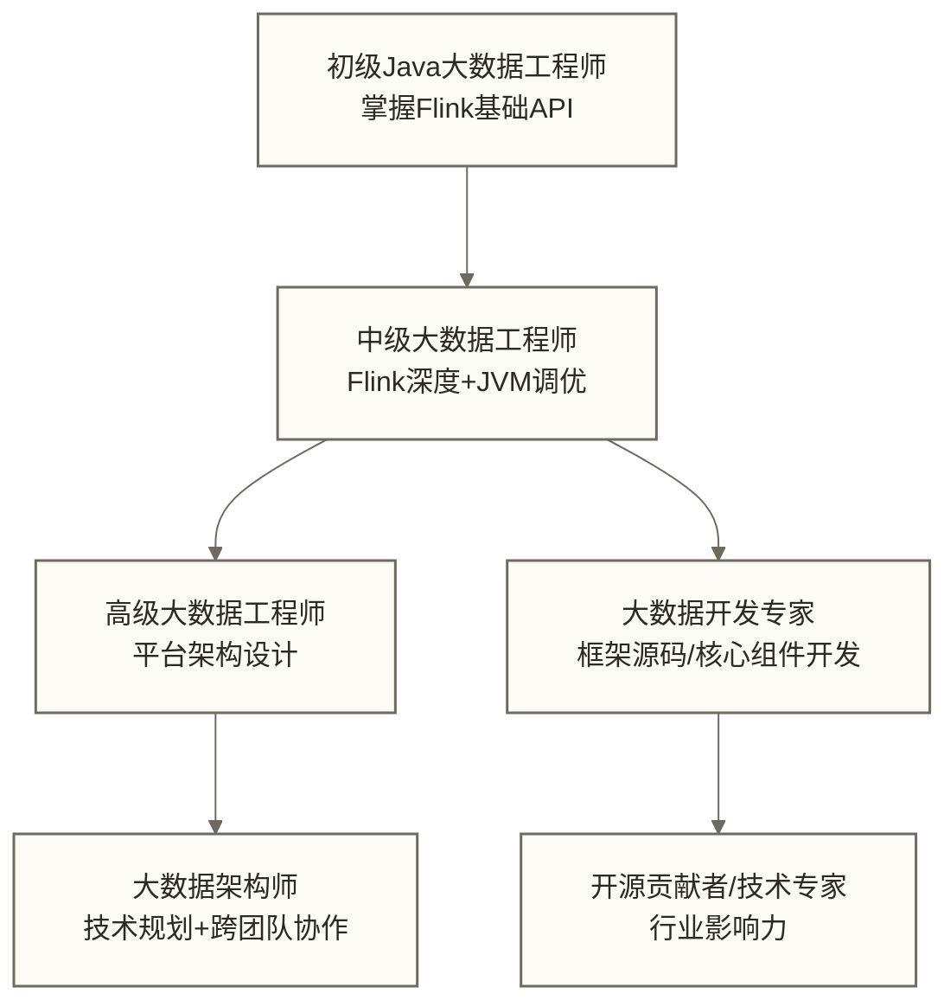

# Java大数据工程师求职指南

> [!abstract] 学习目标
> - 理解 Java 在大数据领域的核心地位与就业前景
> - 掌握 Java 大数据工程师的面试重点体系（JVM + 并发 + Flink + 系统设计）
> - 熟悉 30 道面试高频题的核心答案思路
> - 了解薪资行情与职业发展路径
> - 获得 Java vs Scala 的选择建议

> [!quote] 核心洞察
> Java 大数据工程师的面试，本质上考察的是两个能力：一是理解框架底层（JVM + 分布式原理），二是解决生产问题（调优经验 + 故障排查思维）。背住 API 不够，要能说出"为什么这样设计"和"踩过什么坑"。

---

## 目录

- [[#Java在大数据领域的核心地位]]
- [[#面试重点体系]]
- [[#面试高频题30道]]
- [[#薪资行情与职业路径]]
- #Java vs Scala的选择建议
- [[#求职准备路线图]]

---

## Java在大数据领域的核心地位

### 大数据框架的 Java 基因

几乎所有主流大数据框架都是 Java/JVM 语言写的：

| 框架 | 语言 | Java 工程师的使用方式 |
|------|------|-----------------|
| Apache Flink | Java | 主要开发语言，官方推荐 |
| Apache Kafka | Java/Scala | Java Producer/Consumer API |
| Apache HBase | Java | Java 客户端 API |
| Apache Hadoop/YARN | Java | 框架本身 + MapReduce |
| Apache Spark | Scala/Java | Java API 完整支持 |
| Apache Hive | Java | UDF/UDAF 用 Java 实现 |
| Apache ZooKeeper | Java | Java 客户端（Curator） |

### 2026 年就业市场现状

以下保留原文的2025—2026年招聘判断作为假设性讨论材料；原文未提供可追溯的平台样本和统计口径，不代表已确认的市场现状：

- **Flink 岗位占比假设**：暂以Java API 70%、Scala API 20%、Python 10%作讨论示例；这些比例不是已确认的招聘统计。
- **数据平台岗位**：开发Java/JVM框架插件或连接器时，Java可能是岗位要求；是否必选取决于目标框架和职位。
- **实时数仓岗位**：Flink Java + Kafka + Doris 是最常见的技术栈
- **招聘关键词频率**：Flink > Kafka > Spark > HBase > HDFS

> [!note] 关键认知
> "Java 大数据工程师"和"Python 数据工程师"是两条不同的职业路径。Java 路径更偏向**平台建设**（框架开发、实时计算、连接器开发），Python 路径更偏向**数据处理**（ETL脚本、特征工程、数据分析）。两条路径的薪资与技术要求取决于岗位职责、公司、地区和个人能力，不能仅按开发语言判断高低。

---

## 面试重点体系

### 知识体系框架

```mermaid
%%{init: {"theme":"base","themeVariables":{"fontFamily":"PingFang SC, -apple-system, Source Han Serif SC, serif","fontSize":"16px","background":"#FDFBF5","primaryColor":"#FDFBF5","primaryTextColor":"#2D2A26","primaryBorderColor":"#6E6A60","secondaryColor":"#E8EFE8","secondaryBorderColor":"#8FA890","secondaryTextColor":"#2D2A26","tertiaryColor":"#FDFBF5","tertiaryBorderColor":"#9A9488","tertiaryTextColor":"#6E6A60","lineColor":"#6E6A60","textColor":"#2D2A26","mainBkg":"#FDFBF5","nodeBorder":"#2D5A3D","clusterBkg":"#F3EEDF","clusterBorder":"#9A9488","edgeLabelBackground":"#FDFBF5"},"flowchart":{"htmlLabels":true,"curve":"basis","padding":20,"nodeSpacing":60,"rankSpacing":70,"useMaxWidth":false},"themeCSS":".node rect, .node polygon, .node circle { stroke-width: 1.5px; } .edgePath .path { stroke-width: 1.5px; } .cluster-label .nodeLabel, .cluster-label foreignObject { color: #2D2A26 !important; } .edgeLabel, .edgeLabel foreignObject { color: #2D2A26 !important; background-color: #FDFBF5; } .edgeLabel rect { fill: #FDFBF5; }"}}%%
graph TD
    classDef default fill:#FDFBF5,stroke:#6E6A60,color:#2D2A26,stroke-width:1.5px
    classDef startend fill:#2D2A26,stroke:#2D2A26,color:#FDFBF5,font-weight:bold
    classDef decision fill:#F6EAD8,stroke:#C08A1A,color:#2D2A26,font-weight:bold
    classDef hub fill:#3B5A80,stroke:#3B5A80,color:#FDFBF5,font-weight:bold
    classDef io fill:#E5EAF0,stroke:#3B5A80,color:#2D2A26
    classDef accent fill:#A6432C,stroke:#A6432C,color:#FDFBF5,font-weight:bold
    classDef storage fill:#F3EEDF,stroke:#9A9488,color:#2D2A26
    ROOT["Java大数据工程师面试"] --> JVM["JVM基础(25%)"]
    ROOT --> CONCURRENT["并发编程(20%)"]
    ROOT --> FLINK["Flink原理(30%)"]
    ROOT --> SYSTEM["系统设计(25%)"]

    JVM --> JVM1["内存模型(堆/栈/方法区)"]
    JVM --> JVM2["GC算法(G1/ZGC)"]
    JVM --> JVM3["类加载机制"]
    JVM --> JVM4["JVM调优实战"]

    CONCURRENT --> C1["Java内存模型(happens-before)"]
    CONCURRENT --> C2["synchronized/volatile/Lock"]
    CONCURRENT --> C3["线程池(ThreadPoolExecutor)"]
    CONCURRENT --> C4["CompletableFuture/ForkJoin"]

    FLINK --> F1["核心概念(State/Watermark/Checkpoint)"]
    FLINK --> F2["DataStream/Table API"]
    FLINK --> F3["Exactly-once语义"]
    FLINK --> F4["反压机制"]
    FLINK --> F5["Flink SQL"]

    SYSTEM --> S1["实时数仓架构设计"]
    SYSTEM --> S2["大数据量处理方案"]
    SYSTEM --> S3["数据倾斜解决方案"]
    SYSTEM --> S4["故障排查经验"]
    class ROOT,JVM,CONCURRENT,FLINK,SYSTEM,JVM1,JVM2,JVM3,JVM4,C1,C2,C3,C4,F1,F2,F3,F4,F5,S1,S2,S3,S4 default
```



---

## 面试高频题30道

### 第一类：JVM 基础（1-8题）

**Q1：Java 内存区域有哪些？各自存储什么？**

JVM 内存分为：
- **程序计数器**：当前线程执行的字节码行号，线程私有
- **Java 栈**：方法调用的栈帧（局部变量、操作数栈），线程私有
- **本地方法栈**：Native 方法调用，线程私有
- **堆**：对象实例存储，线程共享，GC 的主要区域
- **方法区**：JVM规范中的共享运行时区域，包含类元数据、运行时常量池等；在HotSpot JDK 8及以后，元空间承载类元数据，不能将方法区与元空间完全等同，类的静态字段值也不能笼统归入元空间。

大数据关联：OOM 最常出现在**堆**（collect 大量数据）和**元空间**（动态类加载），是调优重点。

**Q2：Java 对象的生命周期？什么情况下会进入老年代？**

在采用分代堆的常见收集器中，普通对象通常先分配在年轻代；经历年轻代回收后，存活对象可能留在Survivor，也可能因年龄或空间条件晋升老年代。具体规则取决于收集器与JVM配置：
1. **大对象分配**：PretenureSizeThreshold只对支持该参数的收集器生效；G1将达到或超过Region大小一半的对象视为Humongous对象，按专门规则分配在连续的老年代Region中，不能把两者视为同一通用规则。
2. **年龄晋升**：存活对象达到实际晋升年龄阈值后可能晋升；MaxTenuringThreshold限制最大年龄阈值，不代表所有对象都固定经历15次回收。
3. **动态晋升与空间压力**：收集器可能根据Survivor目标占用、年龄分布和可用空间调整晋升，不能统一概括为“相同年龄对象超过50%就直接进入老年代”。

大数据关联：Flink State和Spark广播数据可能增加内存压力，但是否位于Java堆、如何分配及何时晋升，取决于状态后端、对象大小、收集器与JVM配置，不能断言都会直接进入老年代。

**Q3：G1 GC 的工作原理？为什么大数据场景推荐 G1？**

G1 将堆划分为等大的 Region（默认 1-32MB），逻辑上分为 Eden/Survivor/Old，但物理上不连续。G1 优先回收垃圾最多的 Region（Garbage First 的由来），在目标停顿时间内最大化回收量。

G1可作为部分大堆、关注停顿时间的任务的候选收集器，但应结合JDK版本、负载和GC日志评估：
- `-XX:MaxGCPauseMillis`是停顿目标，不是每次停顿的硬性保证。
- Mixed GC回收年轻代及选定的老年代Region；只有位于Java堆且已经不可达的状态对象才能被回收，仍被引用的Flink State不会因Mixed GC自动释放。
- `-XX:G1HeapRegionSize=16m`仅是参数示例。Region大小会影响Humongous对象判定和回收粒度，增大Region并不必然减少碎片或改善延迟。

**Q4：什么是内存泄漏？大数据场景中常见的内存泄漏有哪些？**

内存泄漏：对象不再使用但仍被引用，无法被 GC 回收，导致内存持续增长。

大数据常见案例：
1. **Flink State 无 TTL**：用户状态永不清理，RocksDB 无限增长
2. **静态集合**：`static Map<String, List<Object>>` 作为缓存但没有淘汰机制
3. **ThreadLocal 未清理**：线程池复用线程，ThreadLocal 中的对象随线程存活
4. **Listener 未注销**：注册了回调但对象销毁时没有移除 listener

**Q5：JVM 类加载机制？大数据中双亲委派的意义？**

类加载过程：加载 → 验证 → 准备 → 解析 → 初始化。双亲委派：子类加载器先委托父加载器，父加载器无法处理才自己加载。

大数据意义：
- Flink/Spark 的 fat jar 中可能包含与框架冲突的依赖版本
- 通过自定义 ClassLoader（子加载器优先），作业 jar 中的类优先被加载，避免依赖冲突
- Flink 的 `classloader.resolve-order: parent-first/child-first` 就是控制这个行为

**Q6：什么是 JVM 逃逸分析？与大数据性能的关系？**

JIT 编译器通过逃逸分析判断对象是否"逃逸"出当前方法/线程：
- **方法逃逸**：对象作为返回值或参数传出方法
- **线程逃逸**：对象被多个线程访问

对于**不逃逸**的对象，JIT 可以进行：
- **分配消除**：在常见HotSpot实现中，逃逸分析可支持标量替换并消除部分对象分配，不应简单描述为完整对象直接在栈上分配。
- **标量替换**：将对象字段直接存储为局部变量
- **同步消除**：消除无竞争的 `synchronized`

大数据关联：Flink算子内的临时对象若满足逃逸分析及优化条件，JIT可能通过标量替换消除其分配，从而减少GC压力；不被State持有本身并不足以保证发生该优化。

**Q7：Full GC 的触发条件？如何避免？**

触发条件：
1. 老年代空间不足
2. 元空间不足
3. 调用 `System.gc()`（显式触发）
4. G1 Mixed GC 无法跟上内存分配速度
5. 大对象直接进入老年代导致 Old 区满

避免方式：
- 增大堆内存（特别是老年代）
- 减少大对象（超过 Region 50% 的对象）
- 降低存活对象晋升速率
- 为 Flink State 设置 TTL

**Q8：堆外内存是什么？Flink/Spark 如何使用堆外内存？**

堆外内存：JVM堆以外的内存，可通过`ByteBuffer.allocateDirect()`或本地接口等分配；其内容不由Java堆GC直接回收，但直接缓冲区关联的Java对象及清理机制可能参与释放过程，具体生命周期取决于分配方式。

Flink 使用：RocksDB State Backend 将 State 存储在堆外（通过 JNI 调用 RocksDB），避免大状态引发频繁 Full GC；网络缓冲区也用堆外内存，提高网络 IO 效率。

Spark使用：Tungsten相关执行路径通过紧凑二进制表示降低逐字段Java对象的开销；UnsafeRow可以指向堆内或堆外内存，并非天然只使用堆外内存。执行与shuffle排序是否使用堆外内存，取决于具体路径和内存配置。

---

### 第二类：并发编程（9-14题）

**Q9：volatile 的作用？与 synchronized 的区别？**

`volatile`：对同一变量的写与后续读建立happens-before关系，并约束相关重排序，但不保证读改写等复合操作的原子性。`synchronized`：提供互斥，并通过同一监视器的解锁与后续加锁建立可见性关系；其开销取决于JVM实现和竞争情况，不能一概称为重量级锁。

大数据关联：Flink Source 中常用 `volatile boolean isRunning` 作为停止标志（多线程可见且原子）。

**Q10：ThreadPoolExecutor 的核心参数？大数据任务如何配置线程池？**

关键参数：
- `corePoolSize`：核心线程数（常驻）
- `maximumPoolSize`：最大线程数
- `keepAliveTime`：空闲线程存活时间
- `workQueue`：任务队列（LinkedBlockingQueue/ArrayBlockingQueue）
- `RejectedExecutionHandler`：拒绝策略

大数据配置参考：
- IO密集型任务：可把`corePoolSize = CPU * 2`作为压测起点之一，但应根据等待时间、下游连接数、限流和内存预算调整。
- CPU密集型任务：可从接近可用CPU核数的线程数开始评估，并计入框架其他线程和容器CPU配额。
- 队列容量与最大线程数需共同限制积压和资源使用。`CallerRunsPolicy`可能通过占用提交线程形成反馈，但也可能阻塞Flink算子线程等关键线程；线程池关闭时该策略会丢弃被拒绝任务，不是无条件的可靠背压保证。

**Q11：CompletableFuture 的常用方法及其差异？**

- `thenApply`：非Async转换；执行线程可能是完成前置阶段的线程，也可能在注册时由调用线程执行，不能保证固定在当前线程执行。
- `thenApplyAsync`：异步转换（在线程池执行）
- `thenCompose`：链接另一个 CompletableFuture（扁平化嵌套）
- `thenCombine`：等待两个 Future 都完成，合并结果
- `allOf`：等待所有 Future 完成
- `exceptionally`：异常恢复（提供默认值）
- `handle`：无论成功失败都处理（类似 finally）

**Q12：Java 内存模型（JMM）中 happens-before 是什么？**

happens-before 是 JMM 定义的内存可见性规则：如果操作 A happens-before 操作 B，则 A 的结果对 B 可见。关键规则：
1. 程序顺序规则：同一线程内，前面的操作 hb 后面的操作
2. volatile 规则：写 volatile 变量 hb 后续读同一变量
3. 锁规则：unlock hb 后续 lock
4. 线程启动规则：start() hb 线程内所有操作

**Q13：ConcurrentHashMap 的实现原理？**

JDK 8+：数组 + 链表/红黑树，CAS + synchronized 保证并发安全。每个桶只在写操作时加锁，读操作无锁（利用 volatile 保证可见性）。size() 用 CounterCell 数组分段计数（类似 LongAdder），避免 size 更新的热点竞争。

大数据关联：Flink的MapState用于保存键值对状态，但具体存储实现由状态后端决定，不能套用ConcurrentHashMap的并发实现原理。

**Q14：如何解决死锁？如何诊断？**

预防：按固定顺序获取锁、使用 tryLock（带超时）、使用无锁数据结构。
诊断：`jstack <pid>` 查看线程堆栈，找到 "Found 1 deadlock" 标识；或使用 Arthas 的 `thread -b` 命令。

---

### 第三类：Flink 原理（15-22题）

**Q15：Flink 的 Checkpoint 机制？如何保证 Exactly-Once？**

Checkpoint 基于 Chandy-Lamport 算法：JobManager 向 Source 发送 Barrier，Barrier 随数据流传播；每个算子收到所有输入通道的 Barrier 后，将当前状态快照到持久化存储（HDFS/S3），然后将 Barrier 发往下游。所有算子完成快照后，Checkpoint 完成。

Exactly-Once 语义：失败时从最近成功的 Checkpoint 恢复，重新处理 Checkpoint 之后的数据。Sink 端通过两阶段提交（Two-Phase Commit）保证输出的 Exactly-Once（如 Kafka Sink）。

**Q16：Flink 的 Watermark 是什么？如何处理数据乱序？**

Watermark是时间戳为T的事件时间进度标记，表达系统对事件时间进展的判断，而不是所有时间戳小于等于T的数据都已到达的事实保证；更早的事件仍可能随后到达。Flink 用 Watermark 驱动窗口的触发：当 Watermark 超过窗口结束时间时，窗口关闭并计算。

处理乱序：`forBoundedOutOfOrderness(Duration.ofSeconds(5))` 生成 Watermark 时减去 5 秒的偏移，允许最多 5 秒的乱序数据。迟到数据的处理取决于窗口、allowed lateness及算子配置；窗口迟到数据需要显式配置相应Side Output才能收集，不会仅因设置乱序阈值就自动输出到侧流。

**Q17：Flink 的反压（Backpressure）机制？**

Flink 使用 Credit-based 背压：下游算子告知上游自己的可用 Buffer 数量（Credit），上游只发送 Credit 数量的数据。当下游处理慢时，Credit 为 0，上游自动停止发送，反压一路传递到 Source，最终减慢数据摄入速度。

特点：Flink的Credit-based机制在网络数据交换层控制发送量，Akka Streams通常通过Reactive Streams需求信号协调流量。两者机制和部署场景不同，不能仅据此认定Flink效率更高或延迟更低；性能比较需要明确负载、拓扑、资源与测量条件。

**Q18：本文介绍的两种 Flink State Backend 及选择？**

- **HashMapStateBackend**（原 MemoryStateBackend/FsStateBackend 的替代）：State 存储在 JVM 堆，速度快，但堆大时 GC 压力大。适合小状态（< 1GB）。
- **EmbeddedRocksDBStateBackend**：State 存储在 RocksDB（堆外），支持超大状态（数百 GB），但读写速度低于堆内存。适合大状态（实时数仓、用户行为分析）。
- 选择参考：前述1GB仅是讨论示例，不是通用分界。应结合每个SubTask的状态量、可用堆内存、GC表现、访问与序列化成本、磁盘性能和Checkpoint需求评估；小状态可优先测试HashMapStateBackend，大状态可评估EmbeddedRocksDBStateBackend，但最终选择需用实际负载验证。

**Q19：Flink 的 Window 类型有哪些？**

- **滚动窗口（Tumbling）**：无重叠，5分钟窗口 = 0-5、5-10、10-15...适合精确统计
- **滑动窗口（Sliding）**：有重叠，10分钟窗口每5分钟触发，数据可属于多个窗口。适合移动平均
- **会话窗口（Session）**：按活跃间隔划分，无活动超过 gap 则关闭窗口。适合用户行为分析
- **全局窗口（Global）**：手动触发，需要自定义 Trigger

**Q20：Flink SQL 和 DataStream API 如何互转？**

```java
// DataStream 转 Table
tableEnv.createTemporaryView("orders", orderStream, Schema.newBuilder()...build());

// Table 转 DataStream
DataStream<Row> resultStream = tableEnv.toDataStream(table);

// 混合使用场景：复杂逻辑用 DataStream，聚合查询用 SQL
```

**Q21：Flink 作业优化的常见方法？**

1. **并行度调优**：根据数据量和机器资源合理设置，不要使用默认值
2. **减少 State 大小**：设置 TTL，使用 RocksDB，压缩序列化
3. **优化 Checkpoint**：增大 Checkpoint 间隔，使用增量 Checkpoint（RocksDB）
4. **处理数据倾斜**：对热点 Key 加盐，使用 LocalGlobalAggregation
5. **减少序列化开销**：使用 POJO 类型，注册 Kryo 类型
6. **异步 IO**：用 `AsyncDataStream` 替代同步数据库查询

**Q22：Flink 和 Spark Streaming 的核心区别？**

| 维度 | Flink | 传统Spark Streaming（DStream） | Spark Structured Streaming |
|------|-------|--------------------------------|----------------------------|
| 处理模型 | 通常为逐事件处理 | 微批处理 | 默认微批处理，其他执行模式有适用限制 |
| 延迟 | 取决于算子、窗口、资源和负载 | 受批次间隔与处理耗时影响 | 受触发方式、查询与负载影响 |
| 状态管理 | 托管状态与Checkpoint | 提供有状态操作，可通过Checkpoint支持恢复 | 提供状态存储和Checkpoint机制 |
| 时间语义 | 支持事件时间与处理时间 | 常以批次时间组织处理，事件时间逻辑需结合应用实现 | 支持事件时间、Watermark及有状态计算 |
| 吞吐量 | 需按实际作业测试 | 需按实际作业测试 | 需按实际查询测试 |
| 适用场景 | 复杂有状态流处理和低延迟需求 | 既有DStream应用 | 基于DataFrame/SQL的增量流处理 |

Spark流处理并非都需要应用自行使用外部数据库保存状态；持久化Checkpoint的位置与运行时状态存储也应区分。

---

### 第四类：系统设计（23-30题）

**Q23：设计一个实时用户行为分析系统，技术选型和架构？**

```text
Kafka（数据接入）→ Flink（实时计算）→ Redis（实时指标缓存）→ API 服务
                                    → Doris/ClickHouse（实时查询）
                                    → HDFS（数据备份）
```

关键设计点：
- Kafka分区数影响Source可利用的消费并行度，应结合吞吐量和Source并行度规划；Flink最大并行度还涉及键控状态的key-group划分，不要求与Kafka分区数相等。
- Flink 使用 RocksDB State Backend 存储用户会话状态
- Redis 用 Hash 结构存储实时指标，TTL 控制过期
- Doris 支持实时写入和 OLAP 查询

**Q24：如何处理 Flink 任务中的数据倾斜？**

1. **诊断**：Flink Web UI 查看各 SubTask 的处理速率，找出明显慢的任务
2. **识别热点 Key**：通过日志或 State 大小判断哪个 Key 数据量异常
3. **加盐方案**：对热点Key附加随机后缀（`userId_0`到`userId_9`），分散到多个SubTask做局部聚合，再去掉盐值并按原始Key进行第二阶段聚合；union只合并流，不执行最终聚合，此方案要求聚合结果可正确合并。
4. **两阶段聚合**：先本地聚合（LocalAggregation），再全局聚合，减少 Shuffle 数据量
5. **广播方案**：小表广播，避免大 Key 触发 Shuffle Join

**Q25：Kafka 的 Exactly-Once 语义如何实现？**

Kafka Producer 端：`enable.idempotence=true` + 事务 API（`beginTransaction/commitTransaction`）。
Flink-Kafka 端到端：Flink Kafka Sink 实现了两阶段提交，Flink Checkpoint 的 Pre-Commit 阶段向 Kafka 发送数据（但不提交），Checkpoint 完成后 Commit，事务提交和中止由连接器的Checkpoint及恢复协议协调；端到端Exactly-Once还要求源可恢复或重放、启用Checkpoint、正确配置事务及超时，并由下游按已提交事务读取，不能仅凭这一流程无条件保证数据不重不漏。

**Q26：实时数仓的分层设计？**

```text
ODS（原始层）：Kafka，原始事件，不做业务处理
DWD（明细层）：Flink 清洗，数据格式化，写入 Kafka + HDFS
DWS（汇总层）：Flink 窗口聚合，指标宽表，写入 Doris/Redis
ADS（应用层）：API 服务查询 Doris/Redis，返回前端
```

**Q27：海量数据（千亿级）的 Join 方案？**

1. **Broadcast Join**：小表（< 几百 MB）广播到所有节点，大表逐条与广播表 Join，无 Shuffle
2. **Sort-Merge Join**：两表按 Join Key 排序后 Merge，适合两张大表
3. **Hash Join**：将小表构建为 Hash 表，大表逐条 probe，适合内存放得下小表的场景
4. **分桶 Join**：提前将两表按相同规则分桶，同桶的数据节点 Join，减少网络传输
5. **预计算**：对于固定 Join 条件，离线预 Join 存储为宽表，实时直接查

**Q28：如何设计高可用的 Flink 集群？**

- JobManager HA：使用 ZooKeeper 选主，备用 JM 随时接管
- State 持久化：Checkpoint 存储到 HDFS/S3，任务失败后恢复
- 重启策略：`setRestartStrategy(RestartStrategies.fixedDelayRestart(3, 10000L))`
- 告警监控：Checkpoint 失败、反压告警、JM/TM 资源告警

**Q29：大数据任务的数据质量如何保证？**

1. **Schema 验证**：Source 端验证数据格式，不合法数据写入 Dead Letter Queue
2. **数据监控**：实时统计 null 率、格式错误率，超阈值告警
3. **血缘追踪**：记录数据从来源到目标的处理链路
4. **幂等写入**：Sink 端使用 UPSERT，或通过 dedup 去重，保证重复运行不产生错误数据
5. **数据对账**：离线与实时数据定期对账，发现差异及时修复

**Q30：一个 Flink 任务突然停止处理数据，如何排查？**

1. **查 Flink Web UI**：检查是否有反压（Backpressure 红色标记），哪个算子是瓶颈
2. **查日志**：TaskManager 日志是否有异常，GC 日志是否有频繁 Full GC
3. **查 Checkpoint 状态**：Checkpoint 是否卡住（State 太大、网络问题）
4. **查 Kafka**：Source 消费是否正常（消费 Lag 是否增加）
5. **查资源**：CPU/内存/磁盘 IO 是否存在瓶颈
6. **线程堆栈**：用jstack或Arthas查看相关线程堆栈，判断锁等待、IO等待等情况；`thread -b`可辅助定位阻塞其他线程的监视器持有者，但不能覆盖所有锁类型、死锁或线程阻塞。

---

## 薪资行情与职业路径

### 2025-2026 薪资范围示例（原文未提供样本来源，以下数值仅作为假设性参考，不代表市场统计或个人薪资承诺）

| 级别 | 年限 | 核心能力 | 一线城市薪资范围 |
|------|------|---------|--------------|
| 初级 Java 大数据工程师 | 0-2年 | Flink 基础 API + Kafka 使用 | 15-25K/月 |
| 中级 | 2-4年 | Flink 深度（Checkpoint/State/优化）+ JVM 调优 | 25-40K/月 |
| 高级 | 4-7年 | 平台架构设计 + 故障处理经验 + 技术选型 | 40-60K/月 |
| 专家 | 7年+ | 框架源码贡献 + 大规模系统设计 | 60K+/月 |

### 职业发展路径



---

## Java vs Scala 的选择建议

这是很多入门者纠结的问题，给出务实的建议：

### 如果你是应届生或转行者

**先学 Java，再学 Scala（按需）**

理由：
- Java 的工程化体系（Maven/JUnit/Spring）更完善，学习资源更多
- Flink 的主要开发语言是 Java，官方文档以 Java 为主
- Java 语法更直观，学习曲线更平缓

### 如果你的目标岗位明确是 Spark

**Java 基础 + 补充 Scala 基础即可**

理由：Spark 的 Dataset API 用 Scala 写最自然，但 Spark 也完整支持 Java API，很多公司的 Spark 作业用 Java 写。

### 如果你想做框架开发/开源贡献

**需要同时掌握 Java 和 Scala**

Flink 源码是 Java，Spark 源码是 Scala/Java 混合，想要做深层贡献需要两者都掌握。

### 实际技术选型建议

| 场景 | 推荐语言 | 原因 |
|------|---------|------|
| 生产级 Flink 作业 | Java | 社区主流，文档最全 |
| Spark 批处理 | Scala 或 Python | Scala Dataset API 最优，Python 生态丰富 |
| 框架插件/连接器开发 | Java | 框架本身是 Java |
| 快速原型/数据探索 | Python | 开发效率最高 |
| 对性能要求极高的 Spark | Scala | 与框架内核最深度融合 |

---

## 求职准备路线图

### 3 个月快速备战

```text
第1个月：打牢 JVM + 并发基础
  - JVM 内存模型、GC 算法（G1/ZGC）
  - 并发：ThreadPoolExecutor、CompletableFuture、volatile/synchronized
  - 每天做 2 道 LeetCode（数组/链表/树为主）

第2个月：Flink 深度学习
  - DataStream API 全套操作
  - State + Checkpoint + Watermark 原理
  - Flink SQL 基本使用
  - 用 Flink + Kafka 做一个实时 WordCount 或 TopN 项目

第3个月：系统设计 + 模拟面试
  - 实时数仓架构设计
  - 数据倾斜、Exactly-Once 等高频设计题
  - 每周一次完整的模拟面试
  - 整理自己做过的项目，提炼技术难点和解决方案
```

### 简历关键词

- **必须有**：Apache Flink（版本号）、Apache Kafka、JVM 调优、GC 优化
- **加分项**：Flink SQL、RocksDB State Backend、Exactly-Once、Checkpoint 调优
- **量化指标**：处理数据量（"日均处理 XX 亿条消息"）、优化成果（"通过 GC 调优将延迟降低 30%"）

---

## 小结

Java 大数据工程师的核心竞争力：

1. **JVM 深度**：能看懂 GC 日志，会用 Arthas 诊断线上问题
2. **Flink 原理**：不只会写 API，更理解 Checkpoint/Watermark/Backpressure 的底层
3. **生产经验**：有真实大数据量（百亿级）系统的设计和调优经验
4. **问题驱动**：面试时能说清楚"遇到了什么问题，怎么分析，怎么解决"

### 延伸学习路径

- [[【技术与工具】/Java/09-Flink Java API实战]] - Flink API 的系统学习
- [[【技术与工具】/Java/10-Java调优与大数据性能优化]] - JVM 调优的具体方法
- [[【技术与工具】/Java/08-Java在大数据开发中的核心应用场景]] - 大数据开发的整体视角

#Java #大数据 #求职 #面试 #Flink #JVM #薪资 #职业发展 #技术面试
