# 消息队列基础概念 - 像邮政系统一样传递信息

> [!abstract] 📋 本节概览
> - 🎯 学习目标：理解消息队列的核心概念和作用
> - 📚 前置知识：无（入门级）
> - ⏱️ 预计用时：20分钟
> - 🔗 后续学习：[[【技术与工具】/Kafka/02-Kafka架构概述|Kafka架构]]

## 📮 从生活中理解消息队列

你有没有想过，为什么发快递这么方便？

你把包裹交给快递小哥，他放进收集袋，运到分拣中心，按地址分类，装车运输，最终送到收件人手中。整个过程中，你不用关心包裹现在在哪里，也不用等着收件人确认收货。

**这就是消息队列的工作原理！**

在软件系统中，不同的模块就像不同的人，它们需要互相传递信息。消息队列就是它们之间的"快递系统"，让信息传递变得简单、可靠、高效。
## 💡 消息队列的核心组成

### 📦 消息（Message）
就像邮政系统中的信件：

| 字段 | 说明 |
|------|------|
| 标题 | 消息头信息 |
| 内容 | 消息体数据 |
| 时间戳 | 元数据 |

**消息的特点：**
- **不可变性**：一旦发送就不能修改（像已投递的信件）
- **有序性**：部分消息队列支持在特定队列或分区范围内保持顺序；并行消费和重试可能影响处理完成顺序，时间戳本身不保证有序
- **持久性**：可以存储在硬盘上（像邮局的存储仓库）

### 🏪 队列（Queue）
就像邮局的分拣中心：

```text
生产者 → [消息1][消息2][消息3] → 消费者
        ↑                    ↑
       队列                 FIFO
     (先进先出)            (先到先处理)
```

**队列的职责：**
- **暂存消息**：临时保管等待处理的消息
- **顺序传递**：在支持顺序语义的队列或分区范围内，按相应规则传递消息；不代表所有消息都按发送顺序处理完成
- **流量控制**：控制消息处理的速度

### 👤 生产者（Producer）
就像写信的人：

```python
# 生产者示例伪代码
class Producer:
    def send_message(self, message):
 # 1. 准备消息
        prepared_msg = self.prepare(message)
        
 # 2. 选择队列
        queue = self.select_queue()
        
 # 3. 发送消息
        queue.put(prepared_msg)
        
 # 4. 确认发送
        return confirmation
```

**生产者的特点：**
- **只管发送**：不关心谁来处理消息
- **异步操作**：发送后不需要等待处理结果
- **可以批量**：一次发送多个消息提高效率

### 👥 消费者（Consumer）
就像收信的人：

```python
# 消费者示例伪代码
class Consumer:
    def process_messages(self):
        while True:
 # 1. 从队列获取消息
            message = queue.get()
            
 # 2. 处理消息
            result = self.handle(message)
            
 # 3. 确认处理完成
            queue.acknowledge(message)
```

**消费者的特点：**
- **按需获取**：有能力处理时才获取消息
- **确认机制**：处理完成后告知队列
- **可以多个**：多个消费者并行处理提高效率

## 🔍 消息队列的工作流程

### 🎬 完整的通信流程

```mermaid
%%{init: {"theme":"base","themeVariables":{"fontFamily":"PingFang SC, -apple-system, Source Han Serif SC, serif","fontSize":"16px","background":"#FDFBF5","primaryColor":"#FDFBF5","primaryTextColor":"#2D2A26","primaryBorderColor":"#6E6A60","secondaryColor":"#E8EFE8","secondaryBorderColor":"#8FA890","secondaryTextColor":"#2D2A26","tertiaryColor":"#FDFBF5","tertiaryBorderColor":"#9A9488","tertiaryTextColor":"#6E6A60","lineColor":"#6E6A60","textColor":"#2D2A26","mainBkg":"#FDFBF5","nodeBorder":"#2D5A3D","clusterBkg":"#F3EEDF","clusterBorder":"#9A9488","edgeLabelBackground":"#FDFBF5"},"flowchart":{"htmlLabels":true,"curve":"basis","padding":20,"nodeSpacing":60,"rankSpacing":70,"useMaxWidth":false},"themeCSS":".node rect, .node polygon, .node circle { stroke-width: 1.5px; } .edgePath .path { stroke-width: 1.5px; } .cluster-label .nodeLabel, .cluster-label foreignObject { color: #2D2A26 !important; } .edgeLabel, .edgeLabel foreignObject { color: #2D2A26 !important; background-color: #FDFBF5; } .edgeLabel rect { fill: #FDFBF5; }"}}%%
flowchart LR
    classDef default fill:#FDFBF5,stroke:#6E6A60,color:#2D2A26,stroke-width:1.5px
    classDef startend fill:#2D2A26,stroke:#2D2A26,color:#FDFBF5,font-weight:bold
    classDef decision fill:#F6EAD8,stroke:#C08A1A,color:#2D2A26,font-weight:bold
    classDef hub fill:#3B5A80,stroke:#3B5A80,color:#FDFBF5,font-weight:bold
    classDef io fill:#E5EAF0,stroke:#3B5A80,color:#2D2A26
    classDef accent fill:#A6432C,stroke:#A6432C,color:#FDFBF5,font-weight:bold
    classDef storage fill:#F3EEDF,stroke:#9A9488,color:#2D2A26
    A["应用A（生产者）"] -->|"① 发送消息"| Q["消息队列<br/>[消息1][消息2][消息3]"]
    Q -->|"③ 投递消息"| B["应用B（消费者）"]
    B -->|"④ 确认处理"| Q
    class A,Q,B default
```



### 📧 类比邮政系统的完整流程

| 邮政系统 | 消息队列系统 | 说明 |
|---|---|---|
| 写信人 | 生产者应用 | 创建和发送信息 |
| 信件 | 消息 | 需要传递的数据 |
| 邮箱 | 消息队列 | 临时存储位置 |
| 邮递员 | 消息中间件 | 负责传递消息 |
| 收信人 | 消费者应用 | 处理接收到的信息 |
| 签收 | 消息确认 | 表示已成功处理 |

## ⚡ 消息队列的核心优势

### 1. 🔄 异步处理
**假设场景：** 用户注册后需要发送邮件、短信、创建档案；以下耗时仅用于演示同步与异步流程差异，不是性能保证。

**同步方式的问题：**
```text
用户提交注册 → 发送邮件(2秒) → 发送短信(1秒) → 创建档案(1秒) → 返回结果
总耗时：4秒，用户等待时间长
```

**异步方式的优势：**
```text
用户提交注册 → 发送消息到队列 → 立即返回结果(0.1秒)
                    ↓
            后台慢慢处理各项任务
```

### 2. 🏗️ 系统解耦
**紧耦合的问题：**

订单系统 直接调用 库存系统，支付系统 直接调用 物流系统——被调用系统故障可能影响依赖它的调用方，并可能沿调用链传播。

**消息队列解耦：**

订单系统 → 消息队列 → 库存系统，支付系统 → 消息队列 → 物流系统——可降低系统之间的直接调用依赖，但消息积压、队列故障和业务一致性问题仍可能影响相关系统。

### 3. ⚖️ 流量削峰
**假设场景：** 秒杀活动出现流量冲击；以下每秒10万请求和每秒1万请求为教学假设，缓冲能力仍受队列容量和积压持续时间限制。

```text
高峰期流量（每秒10万请求）
     ↓
 消息队列缓冲
     ↓  
后端系统稳定处理（每秒1万请求）
```

> [!tip] 💡 削峰填谷
> 就像水库调节河流一样，消息队列把突发的高流量平摊到一个时间段内处理。

### 4. 🔄 提高可用性
```text
应用A → 消息队列 → 应用B（故障）
                 → 应用C（正常运行）
```
某个消费者故障时，已被可靠持久化且尚未被确认移除或超过保留期限的消息通常可留待后续处理；具体保障取决于消息队列的持久化、确认、复制和保留策略。

## 🎯 消息队列的应用场景

### 📱 电商系统中的应用

**1. 订单处理流程：**
```text
用户下单 → 订单队列 → [减库存][发货][支付][积分][邮件]
```

**2. 秒杀活动：**
```text
大量用户请求 → 秒杀队列 → 缓冲并控制处理速率；防止超卖仍需库存原子扣减、并发控制及幂等处理
```

**3. 数据同步：**
```text
主数据库更新 → 同步队列 → 搜索引擎、缓存、备份库
```

### 🏦 金融系统中的应用

**1. 交易处理：**
```text
交易请求 → 交易队列 → 风控检查 → 资金划转 → 通知确认
```

**2. 实时风控：**
```text
用户行为 → 行为队列 → 风控模型分析 → 实时决策
```

### 📊 大数据系统中的应用

**1. 日志收集：**
```text
应用日志 → 日志队列 → 实时分析 → 离线存储
```

**2. 实时计算：**
```text
数据流 → 流处理队列 → 实时统计 → 结果输出
```

## 🚨 消息队列的挑战

### 1. 📊 复杂性增加
- 需要维护额外的消息队列系统
- 需要处理消息的生命周期管理
- 需要监控消息的处理状态

### 2. 🔄 数据一致性
```text
场景：转账操作
A账户扣款 → 消息队列 → B账户增款
如果B账户增款失败怎么办？
```

**解决方案：**
- 事务消息
- 补偿机制
- 最终一致性

### 3. ⏱️ 消息延迟
- 消息处理不是实时的
- 需要在响应时间和系统解耦之间平衡

### 4. 🔁 重复消息
网络故障可能导致消息重复发送

**解决方案：**
- 幂等性设计
- 消息去重机制

## ✅ 掌握检查

完成以下检查，确保你已经理解了消息队列的基础概念：

- [ ] 能用生活中的例子解释什么是消息队列
- [ ] 理解生产者、消费者、队列的作用
- [ ] 能说出消息队列的四大核心优势
- [ ] 能举例说明消息队列的应用场景
- [ ] 了解使用消息队列可能遇到的挑战

## 🔗 学习连接

**下一步学习**: [[【技术与工具】/Kafka/02-Kafka架构概述|Kafka架构]] - 了解Kafka如何实现消息队列的功能

**相关概念**: 
- 异步编程
- 分布式系统
- 微服务架构

---

> [!tip] 💡 学习提示
> 
> 理解消息队列最好的方法是类比生活中的例子。每当你使用某个应用时，想想背后是否用到了消息队列：
> - 📱 发微信朋友圈后立即能做其他事
> - 🛒 网购下单后不需要等待所有处理完成
> - 📧 发邮件后不需要确认对方是否在线
> 
> 这些体验可用于类比异步处理，但仅凭用户体验不能确定底层是否使用消息队列；具体实现也可能采用其他异步机制。 