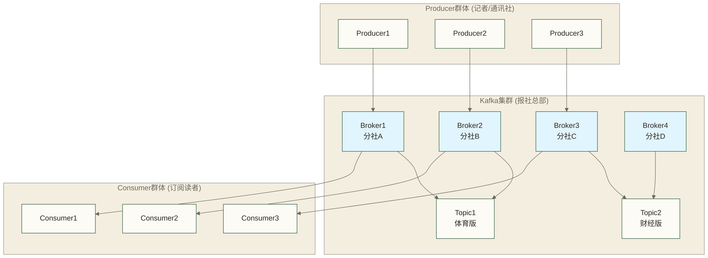
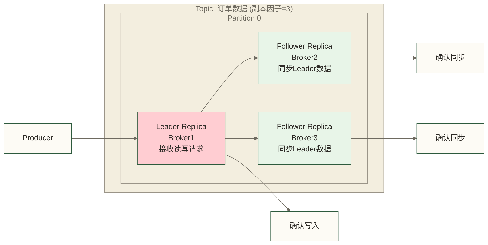

# Kafka架构概述 - 像报社一样工作的分布式系统

> [!abstract] 📋 本节概览
> - 🎯 学习目标：理解Kafka的整体架构和核心组件
> - 📚 前置知识：[[【技术与工具】/Kafka/01-消息队列基础概念|消息队列基础概念]]
> - ⏱️ 预计用时：25分钟
> - 🔗 后续学习：[[【技术与工具】/Kafka/03-Kafka核心术语|Kafka核心术语]]

## 🏗️ 架构设计挑战

构建可靠的数据系统时，Kafka架构概述是核心考虑因素，直接影响系统的稳定性和扩展性。

在实际工作环境中，这样的挑战每天都在发生。理解相关知识不仅能解决当前问题，更能提升整体的专业能力。
## 🏗️ Kafka整体架构

### 🎬 宏观视角：分布式报社网络



### 🔍 核心架构组件

| 组件 | 报社类比 | 职责 | 特点 |
|---|---|---|---|
| **Broker** | 分社/印刷厂 | 存储和分发消息 | 分布式部署，互为备份 |
| **Topic** | 报纸版面 | 消息分类 | 逻辑上的消息分组 |
| **Partition** | 版面的页码 | 消息分片 | 物理存储单元，并行处理 |
| **Producer** | 记者/通讯社 | 发送消息 | 可以同时向多个Topic发送 |
| **Consumer** | 订阅读者 | 接收消息 | 可以订阅多个Topic |
| **ZooKeeper（历史ZooKeeper模式）** | 报社总编 | 集群协调 | 管理元数据和协调服务；KRaft模式由Controller quorum承担元数据管理职责 |

## 🏢 Broker：分布式的数据节点

### 📍 Broker的职责
就像报社的各个分社：

```python
# Broker的核心功能伪代码
class KafkaBroker:
    def __init__(self, broker_id):
        self.broker_id = broker_id
        self.topics = {}  # 存储的主题
        self.partitions = {}  # 管理的分区
        self.replicas = {}  # 副本数据
    
    def receive_message(self, topic, partition, message):
        """接收生产者的消息"""
        self.store_message(topic, partition, message)
        self.replicate_to_followers(message)
    
    def send_message(self, consumer_group, topic, partition):
        """向消费者发送消息"""
        return self.get_next_message(topic, partition)
    
    def coordinate_with_cluster(self):
        """与其他Broker协调"""
        self.heartbeat_to_zookeeper()
        self.sync_metadata()
```

### 🔄 Broker集群特性

**1. 水平扩展：**
```text
初始部署：[Broker1] [Broker2] [Broker3]
业务增长：[Broker1] [Broker2] [Broker3] [Broker4] [Broker5]
```

**2. 自动故障转移：**
```text
正常状态：Broker1(Leader) ← Broker2(Follower) ← Broker3(Follower)
故障发生：Broker1(故障) ← Broker2(新Leader) ← Broker3(Follower)
```

**3. 负载均衡：**
- 不同的Topic分布在不同的Broker上
- 同一Topic的不同分区分布在不同Broker上

## 📰 Topic和Partition：数据的组织方式

### 📚 Topic：逻辑上的消息分类
就像报纸的不同版面：

**Topic: "用户行为数据"（就像"体育版"）：** 用户登录事件、页面浏览事件、购买行为事件、搜索查询事件

**Topic: "系统监控数据"（就像"财经版"）：** CPU使用率、内存使用率、网络流量、错误日志

### 🗂️ Partition：物理上的存储分片
就像版面分成多个页面：

| 分区 | 消息序列 | 所在节点 |
|---|---|---|
| Partition 0 | `[消息1][消息4][消息7]...` | Broker1 |
| Partition 1 | `[消息2][消息5][消息8]...` | Broker2 |
| Partition 2 | `[消息3][消息6][消息9]...` | Broker3 |

**优势：**
- 并行写入：多个分区同时接收数据
- 并行读取：多个消费者同时处理
- 水平扩展：增加分区提高吞吐量

### 🎯 分区的核心特性

**1. 有序性保证：**
```text
Partition 0: [A] → [B] → [C] → [D]
             ↑    ↑    ↑    ↑
           时间  时间
           T1    T2    T3    T4
```
同一分区的日志按offset有序；这不等同于业务事件时间有序，也不保证跨分区或消费者并行处理后的完成顺序。

**2. 分区分配策略：**
```python
# 简化的分区分配逻辑
def select_partition(key, total_partitions):
    if key is None:
        return random_partition()  # 示例：随机选择；实际无key策略取决于客户端与配置
    else:
        return hash(key) % total_partitions  # 按key哈希
```

## 🔄 副本机制：数据的安全保障

### 📑 副本架构设计
就像重要文档要复印备份：



### 🏆 Leader选举机制

**1. 正常情况：**
```text
Broker1 (Leader)   ← 处理所有读写
Broker2 (Follower) ← 同步数据
Broker3 (Follower) ← 同步数据
```

**2. Leader故障：**
```text
Broker1 (故障)     ← 不可用
Broker2 (新Leader) ← 接管服务  
Broker3 (Follower) ← 同步新Leader
```

**3. 选举条件：**
- 正常的干净Leader选举从ISR（In-Sync Replicas）中的可用副本选择
- 不应概括为“数据同步程度最高的Follower优先”；具体选择由Controller按相应选举规则执行
- 是否允许非ISR副本当选取决于不干净Leader选举配置，此类选举可能丢失数据

## 📊 数据持久化：像图书馆一样归档

### 💾 持久化机制

**1. 数据存储结构：**
| 路径 | 说明 |
|---|---|
| `/kafka-logs/topic1-0/` | Topic1的分区0 |
| `/kafka-logs/topic1-0/00000000000000000000.log` | 消息文件 |
| `/kafka-logs/topic1-0/00000000000000000000.index` | 索引文件 |
| `/kafka-logs/topic1-0/leader-epoch-checkpoint` | Leader信息 |
| `/kafka-logs/topic1-1/` | Topic1的分区1 |
| `/kafka-logs/topic2-0/` | Topic2的分区0 |

**2. 日志分段(Log Segment)：**
| 分段 | Offset范围 | 状态 |
|------|-----------|------|
| Segment 1 | 0-1000 | 旧数据，可能被清理 |
| Segment 2 | 1001-2000 | 中等数据 |
| Segment 3 | 2001-Now | 当前活跃段 |

### ⏰ 数据保留策略

**1. 基于时间：**
```markdown
# 保留7天的数据
log.retention.hours=168

时间线：
今天 ← 1天前 ← 2天前 ← ... ← 7天前 ← [删除]
```

**2. 基于大小：**
```markdown
# 每个分区的日志保留大小阈值示例为1GiB；按日志段清理，不是实时硬上限
log.retention.bytes=1073741824

大小限制：
[新数据...] ← [保留数据] ← [超出1GB的旧数据删除]
```

## 🎭 Producer和Consumer：数据的两端

### ✍️ Producer特性

**1. 分区策略：**
```python
# Producer发送消息示例
producer.send(
    topic="user-events",
    key="user-123",      # 相同key发往同一分区
    value=user_data,
    partition=None       # 自动选择分区
)
```

**2. 确认机制：**
```ini
acks=0: 不等待Broker确认，生产者无法据此判断写入是否成功
acks=1: 等待Leader确认，不等待Follower复制完成
acks=all: 等待当前ISR中的副本满足确认要求，并受min.insync.replicas约束；可靠性和延迟取决于配置与运行状态
```

### 👥 Consumer特性

**1. 消费者组：**
| 消费者 | 负责分区 |
|--------|---------|
| Consumer1 | Partition 0 |
| Consumer2 | Partition 1 |
| Consumer3 | Partition 2 |

> 负载均衡原则：一个分区只能被组内一个消费者消费

**2. 偏移量管理：**
```text
Partition: [A][B][C][D][E][F][G]
           ↑        ↑
         已消费    当前偏移量=3
```

## 🎯 ZooKeeper：集群的大脑

### 🧠 ZooKeeper的职责
就像报社的总编：

| 管理范围 | 包含内容 |
|---|---|
| 集群成员信息 | Broker列表、Broker状态、新增/退出通知 |
| Topic元数据 | Topic列表、分区分配、副本分布 |
| 配置信息 | Topic配置、Broker配置、用户权限 |
| 选举协调 | Controller选举、Leader选举、分区重分配 |

### 🔄 协调机制

**1. 服务发现：**
```text
历史ZooKeeper模式：新Broker加入 → 注册到ZooKeeper → 集群感知新节点；已有分区不会仅因新增Broker自动迁移，需要执行分区重分配或使用相应自动化工具
```

**2. 配置管理：**
```text
管理员修改配置 → ZooKeeper存储 → 推送给相关Broker → 动态生效
```

## 🚀 Kafka的核心优势

### 1. 📈 高吞吐量
```text
假设性数量级示例，非实测结论：
传统消息队列：    万级TPS
Kafka：          十万~百万级TPS
这些数字仅保留为场景假设，不代表产品性能上限或排序；实际吞吐量取决于硬件、消息大小、批量、分区、复制和确认配置。

实现方式：
✅ 批量操作：批量读写减少网络开销
✅ 零拷贝：操作系统层面优化
✅ 并行处理：多分区并行工作
✅ 压缩存储：减少磁盘和网络IO
```

### 2. 💾 可持久化
```text
内存消息队列：      重启数据丢失
Kafka：            数据持久化存储

优势：
✅ 可靠性：持久化日志有助于重启后恢复数据，但不能保证所有已发送消息均不丢失
✅ 可回溯：可在日志保留范围内重新消费历史数据
✅ 容错性：副本机制提高容错能力，数据安全仍取决于确认、ISR、选举配置及故障范围
```

### 3. 🔄 水平扩展
- 纵向扩展（Scale Up）：升级单机硬件配置
- 横向扩展（Scale Out）：增加更多Broker节点

| Kafka扩展方式 | 效果 |
|---|---|
| 增加Broker | 提供额外容量；已有分区负载的迁移需要分区重分配或相应自动化机制 |
| 增加分区 | 提高并行度 |
| 增加副本 | 提高可靠性 |

### 4. 🔗 松耦合
```text
生产者 ← → Kafka ← → 消费者
    ↑        ↑        ↑
  不感知   缓冲解耦   不感知
```

## 🎯 应用场景对比

### 📊 Kafka vs 其他消息系统

| 特性 | Kafka | RabbitMQ | Redis | ActiveMQ |
|---|---|---|---|---|---|
| **吞吐量** | 原文假设为百万级，非实测 | 原文假设为十万级，非实测 | 未提供测试条件，不作等级判断 | 未提供测试条件，不作等级判断 |
| **持久化** | ✅ 强持久化 | ✅ 可选 | ⚠️ 弱持久化 | ✅ 支持 |
| **分布式** | ✅ 原生支持 | ⚠️ 集群复杂 | ✅ 集群模式 | ⚠️ 主从模式 |
| **消息回溯** | 可在日志保留范围内按offset重新消费 | 取决于功能形态，Streams支持回溯，传统队列语义不同 | 取决于数据结构，Streams支持读取保留的历史条目 | 取决于具体实现、目的地类型和保留机制 |
| **学习曲线** | 陡峭 | 适中 | 简单 | 适中 |

### 🎯 最适合的场景

**Kafka最佳场景：**
- 📊 **大数据处理**：日志收集、实时分析
- 🔄 **事件流处理**：用户行为追踪、IoT数据
- 🏗️ **微服务解耦**：服务间异步通信
- 📈 **实时计算**：流式计算的数据源

**不太适合的场景：**
- 💬 **即时消息**：延迟要求极低的场景
- 🔒 **事务性消息**：需要复杂事务支持
- 📱 **小型应用**：消息量很小的简单应用

## ✅ 掌握检查

完成以下检查，确保你已经理解了Kafka的整体架构：

- [ ] 能画出Kafka的整体架构图
- [ ] 理解Broker、Topic、Partition的关系
- [ ] 明白副本机制如何提高容错能力，以及数据安全对确认、ISR、选举配置和故障范围的依赖
- [ ] 了解ZooKeeper在Kafka中的作用
- [ ] 能比较Kafka与其他消息系统的优劣

## 学习连接

**前置知识**: [[【技术与工具】/Kafka/01-消息队列基础概念|消息队列基础概念]] - 消息队列的基本原理
**下一步学习**: [[【技术与工具】/Kafka/03-Kafka核心术语|Kafka核心术语]] - 深入理解Kafka的专业术语
**相关概念**: 
- 分布式系统原理
- 数据持久化机制
- 集群协调算法

---

> [!tip] 💡 架构理解技巧
> 
> 理解Kafka架构的最佳方法：
> - 🏗️ **层次思维**：从宏观到微观逐层理解
> - 🔄 **数据流向**：跟踪消息从生产到消费的完整路径
> - 🎯 **场景对应**：将每个组件对应到现实场景
> - 🛠️ **动手验证**：搭建简单集群验证理解
> 
> 记住：架构是为业务服务的，理解了业务需求，架构设计就容易理解了！ 